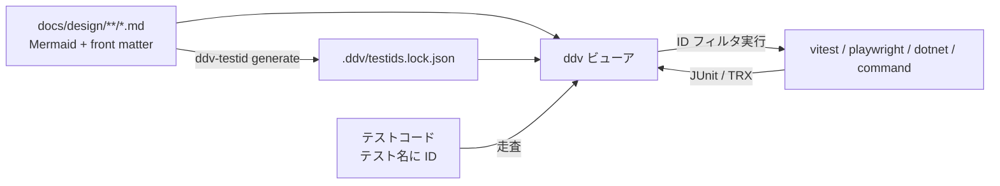
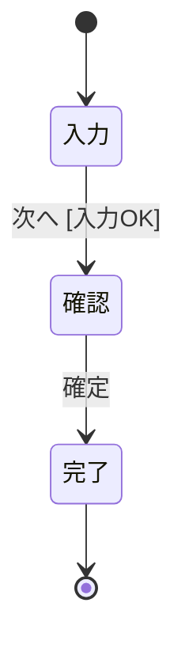

# ddv — Design Doc Viewer

要件定義・基本設計・詳細設計を **Mermaid の UML 中心の Markdown** で管理し、
状態図/フロー図から **テストマトリクスとテストIDを自動生成**、ID で紐づいた単体/結合テストを
**ビューアから実行・監視** するローカル Web アプリです。AI エージェント用プラグイン（`plugin/`）も同梱しています。



## 構成

| パス | 内容 |
|---|---|
| `apps/web` | ビューア（React + Vite） |
| `apps/server` | ローカルサーバ（Hono, 127.0.0.1 限定）・テストランナー・`ddv` CLI |
| `packages/core` | Markdown 解析、参照解決、TOC、設定、`ddv-lint` |
| `packages/graph` | Mermaid（stateDiagram-v2 / flowchart）→ グラフ → マトリクス・経路列挙・図差分 |
| `packages/testid` | テストID 採番・ロック・テスト紐づけ検出、`ddv-testid` CLI |
| `packages/mock` | シナリオ YAML（スキーマ・骨組み生成・経路照合・lint）、E2E 実行器 `@ddv/mock/playwright`、スナップショット比較 |
| `packages/mock-runtime` | モック内で動く runtime（疑似 API/DB・画面切替・プレイヤー連携）。`ddv mock init` で配置 |
| `examples/sample-app` | デモ対象（Web: Vitest / .NET: xUnit） |
| `docs/design` | ddv 自身の設計書（ドッグフーディング） |
| `plugin/` | Copilot CLI / Claude Code 用プラグイン（スキル・テンプレート）→ [plugin/README.md](plugin/README.md) |

## 使い方

前提：Node.js 20 以上（.NET のテストを実行する場合は .NET SDK）

```powershell
npm install
npx playwright install chromium   # E2E / playwright ランナーを使う場合
npm run serve:sample              # サンプルを表示 → http://127.0.0.1:5178
```

任意のローカルリポジトリを表示する：

```powershell
npm run build
npm run ddv -- serve --repo C:\path\to\your-repo [--port 5178]
```

対象リポジトリのルートに `ddv.config.yaml` を置きます（雛形：[plugin/templates/ddv.config.yaml](plugin/templates/ddv.config.yaml)）。

```yaml
docsRoot: docs/design
mocksRoot: docs/mocks
idPrefix: { requirements: REQ, basic: BD, detailed: DD }
toc: { minLevel: 2, maxLevel: 3 }
matrix: { nSwitch: 1, loopLimit: 1, maxPaths: 200 }
styles: [ src/web/styles/app.css ]          # モックで参照する実プロジェクトの CSS
runners:
  - { name: web,    type: vitest,     cwd: web,    level: integration }
  - { name: e2e,    type: playwright, cwd: web,    level: integration }
  - { name: dotnet, type: dotnet,     cwd: dotnet, level: unit }
  # - { name: x, type: command, cwd: ., command: "make test FILTER={pattern} JUNIT={junit}" }   # {pattern} {ids} {junit}
    # - { name: e2e, type: playwright, cwd: ., level: integration, scenarios: true }   # シナリオ YAML の id でも紐づける
  mock:
    browser: { channel: chromium }    # E2E・スナップショットのブラウザ（DDV_BROWSER_CHANNEL で上書き可）
    snapshot: { threshold: 0.001, viewport: { width: 1280, height: 800 } }
  ```

### GitHub の PR・branch を表示する

```powershell
npm run ddv -- serve --repo . --github acme/order-app --pr 12   # 手元と並べて PR #12 を開く
npm run ddv -- serve --github acme/order-app --ref main         # 手元のリポジトリ無しで branch・tag を開く
npm run ddv -- gh clean [--repo acme/order-app]                 # 開いていない worktree・clone を削除
```

- ビューアの「GitHub を開く」からも開けます。PR は `refs/pull/<n>/head` を取得して worktree（`~/.ddv/worktrees`）に展開し、`#/w/<ワークスペースID>/…` で表示します
- 認証は `gh auth token` → 環境変数 `GITHUB_TOKEN` の順。トークンは画面・ログ・保存ファイルに出しません。手元だけの利用では GitHub に問い合わせません
- PR の更新は 60 秒ごと（`DDV_GITHUB_POLL`、0 で無効）とウィンドウのフォーカス時に検知し「更新あり」を表示。「最新化」で取り直します
- GitHub のワークスペースでテスト・スナップショットを実行する前に確認ダイアログが出ます（PR のコードがこの PC で動くため）
- PR では PR バーに各レビュアーの最新のレビュー状態、文書ツリーに「変更された文書」（追加 A / 変更 M / 削除 D）を表示します
- 文書の上の「差分を表示」を開くと、本文に PR の差分（追加・変更・削除）を重ね、変更された図は base / head を並べて比較し、テストIDの増減も表示します
- PR のレビュースレッドは、対応する要素（見出し・段落・表の行・図のノード/遷移）の後ろに表示します。ファイルへのコメントや以前の版の行へのコメントは文書の先頭にまとめます。スレッドには ddv から返信でき、「解決済みにする」「未解決に戻す」も切り替えられます
- 置き場所は `DDV_HOME`（既定 `~/.ddv`）

### PR にレビューを返す

- 文書の要素の 💬 からコメントを保留に追加し、PR バーの「レビュー（n）」で一覧・修正・削除してから、Comment / Approve / Request changes のいずれかで送信します（送信するまで GitHub には投稿されません）
- Approve のときは、PR で変更された文書のうち選んだものの `status` を `approved` にするコミットを PR のブランチへ追加します（書き込めないときは同じ変更を suggestion として付けます）
- モックの「調整」で画面の要素を選び、文言と属性（placeholder・required・maxlength・min・max・pattern・選択肢など）を変えるとその場で反映されます。「保留に追加」で、モック HTML の該当行への suggestion として保留中のレビューに入ります（手元のリポジトリでは「HTML をコピー」）
- AI 側は `ddv review comments --github <owner/repo> --pr <n> --json` でスレッドを取得し、プラグインの `ddv-review-response` スキルで修正・返信します

## ドキュメントの書き方

````markdown
---
id: ORDER            # テストIDに入る文書ID
kind: basic          # requirements | basic | detailed
status: review       # draft | review | approved
title: 注文画面 基本設計
traces: [REQ-001]    # 上流のID
---

## 画面遷移



参照（ポップアップ）：:ref[../requirements/order.md#目的]

::embed[../requirements/order.md#受入基準]

::mock[order/index.html]
````

| 記法 | 意味 |
|---|---|
| `id=` | 図ID（参照・ハイライト用） |
| `matrix` | この図からテストマトリクスを生成（状態図 / flowchart） |
| `code=` | テストIDに入る図の略号（省略時は図IDから生成） |
| `nswitch=` / `loop=` | Nスイッチの N / 経路列挙のループ上限（既定は設定値） |
| `compare=<図ID>` | As-Is 図との差分表示とギャップ表（要件定義向け）。片方の図形/遷移にホバーすると、もう片方の対応要素（ノードは id、遷移は from->to＋ラベル）と、それを通る経路が両図で強調される（ツールバー「対応ホバー」で切替、ギャップ表の行ホバーでも可）。右クリックで選択を固定し、同じ要素/空白の右クリックまたは Esc で解除 |
| `%% req: <ノード> REQ-001` | To-Be 図のノードと REQ-ID の対応（ギャップ表に表示） |
| `:ref[path#見出し]` / `::embed[...]` | 他ドキュメントの節をポップアップ / インライン表示（二重管理しない） |
| `::mock[path]` | `mocksRoot` 配下のモックを iframe で埋め込む。シナリオがあればプレイヤー（再生・1ステップ・巻き戻し・速度）とスナップショットを表示。対応する画面遷移図は同じ文書の最初の `matrix` 状態図（`{diagram=<図ID>}` で指定可）。複数の文書が同じモックを参照するときは基本設計が正で、詳細設計からは表示だけ |

## モックとシナリオ

モック 1 件 = 1 フォルダ（`<mocksRoot>/<name>/`）で、静的配信だけで動きます。規約の詳細は [基本設計](docs/design/basic/mock-player.md)、ひな形は [plugin/templates/docs/mocks/sample](plugin/templates/docs/mocks/sample)。

| ファイル | 内容 |
|---|---|
| `index.html` | 全画面を `section[data-screen=<状態ID>]` で並べる。操作要素に `data-event=<イベント名>`、入力・確認要素に `data-testid`。振る舞いは `data-goto` / `data-validate` / `data-submit` / `data-bind` |
| `api.yaml` / `fixtures/*.yaml` | 疑似 API（ルート・条件付き応答）とテストデータ |
| `scenarios/<テストID>.yaml` | 経路 1 本 = 1 シナリオ。`ddv mock scaffold` で骨組みを自動生成（候補値入り）し、値だけを仕上げる |
| `scenarios/_map.yaml` | 実アプリで E2E を実行するときの画面・イベント・入力要素の対応表 |

```powershell
npm run ddv -- mock init --repo <path>       # runtime（<mocksRoot>/_ddv/mock-runtime.js）と固定の e2e/ddv-scenarios.spec.ts を配置
npm run ddv -- mock scaffold --repo <path> [--mock <name>]   # テストID採番後に実行。編集済みの値は保持、消えた経路は scenarios/_retired/ へ
npm run ddv -- mock snapshot --repo <path> [--id <ID>] [--approve]   # 各ステップを撮影し基準画像と比較
```

- E2E：`e2e/ddv-scenarios.spec.ts` がシナリオごとに `test('[ID] title')` を作って実行します（テストコード不要）。`DDV_BASE_URL` を付けると `_map.yaml`（と任意の `e2e/ddv-hooks.ts` の `seed` / `steps`）で実アプリに対して実行します
- スナップショット：基準画像 `.ddv/snapshots/baseline/` はコミットし、`.ddv/snapshots/current/` と `diff/` は `.gitignore` に入れます
- `ddv mock init` の前に `npm run build` で runtime をビルドしておきます

## テストID と紐づけ

形式：`{接頭辞}-{文書ID}-{図略号}-{種別}{連番}`（例 `BD-ORDER-SCREEN-P001`）。
種別は `P`=経路, `T`=遷移（0スイッチ）, `S`=Nスイッチ, `X`=不正遷移。

```powershell
npm run ddv-testid -- generate --repo <path>   # 採番して .ddv/testids.lock.json を更新（コミットする）
npm run ddv-testid -- list --repo <path>
npm run ddv-testid -- check --repo <path> [--strict]   # ロック鮮度・未実装・存在しないIDを検査
npm run ddv-testid -- show BD-ORDER-SCREEN-P001 --repo <path>
npm run ddv-lint -- --repo <path> [--strict]           # 必須節・Mermaid 構文・参照切れ・未トレースを検査
```

- ロックは「経路シグネチャ → ID」を保持します。既存経路の ID は不変、消えた経路は欠番（retired）、新しい経路は末尾に採番。
- テストコードには ID を **テスト宣言に 1 つ** 書きます。

| ランナー | 書き方 | 実行時のフィルタ |
|---|---|---|
| Vitest | `it('[BD-ORDER-SCREEN-P001] ...')` | `-t` |
| Playwright | `test('[BD-...] ...')` または `{ tag: '@BD-...' }` | `--grep` |
| xUnit / NUnit / MSTest | `[Trait("TestId","BD-...")]` / `[Property("TestId","BD-...")]` / `[TestProperty("TestId","BD-...")]` | `--filter FullyQualifiedName=...` |

紐づいたテストがある行は、マトリクスとテストタブで実行ボタンが有効になります。

## 開発

```powershell
npm test            # Vitest（packages / apps/server）
npm run typecheck
npm run e2e         # ビューアの Playwright E2E（examples/sample-app を対象）
npm run dev:server  # + 別端末で npm run dev:web
npm run ddv -- serve --repo .   # ddv 自身の設計書を表示し、ビューアからテストを実行
```

## ロードマップ

| Phase | 内容 | 状態 |
|---|---|---|
| 0–1 | 閲覧・Mermaid 描画（パン/ズーム）・TOC・参照・マトリクス/ID・経路ハイライト・テスト紐づけ/実行・As-Is/To-Be 差分 | ✅ |
| 1' | プラグイン最小版（要件/基本/詳細のスキルとテンプレート、`ddv-lint`） | ✅ |
| 2 | モック runtime（疑似 BE/DB）、シナリオ DSL＋データ分離（骨組み自動生成）、プレイヤー（巻き戻し/速度）、シナリオの E2E 実行（データ駆動）、スナップショット | ✅（[要件](docs/design/requirements/mock.md) / [基本設計](docs/design/basic/mock-player.md) / 詳細設計：[シナリオ](docs/design/detailed/scenario.md)・[runtime](docs/design/detailed/mock-runtime.md)・[スナップショット](docs/design/detailed/snapshot.md)） |
| 3 | GitHub repo/branch 指定、PR 行コメント・Approve 連携、モックのレビュー調整 → suggestion | 実装済み・実 GitHub での受入待ち（[受入チェックリスト](docs/acceptance/phase3-github.md)）：ワークスペース（PR・branch の取得と表示）、PR の差分・レビュースレッドの表示、コメント・送信・Approve＋status 連動・スレッド返信/解決、モックの調整 → suggestion、`ddv review comments`・`ddv-review-response` スキル（[要件](docs/design/requirements/github.md) / [基本設計](docs/design/basic/github-review.md) / 詳細設計：[ワークスペース](docs/design/detailed/workspace.md) / [レビューコメント](docs/design/detailed/review-comment.md) / [モック調整](docs/design/detailed/mock-tune.md)） |
| 4 | テスト監視（履歴・フレーキー・カバレッジ）、テストデータ編集（シナリオの入力値・fixtures・期待値をビューアで編集）、トレースビュー | 設計中：[要件定義](docs/design/requirements/testops.md) ✅ → 基本設計（[テスト監視](docs/design/basic/test-monitoring.md)・[テストデータ編集](docs/design/basic/test-data-editor.md)・[トレースビュー](docs/design/basic/trace-view.md)）✅ → 詳細設計（[実行記録](docs/design/detailed/run-record.md)・[テスト履歴](docs/design/detailed/test-history.md)・[テストデータ編集](docs/design/detailed/test-data.md)・[トレース記録](docs/design/detailed/trace-recorder.md)・[トレース表示](docs/design/detailed/trace.md)、レビュー待ち） |
| 5 | .NET デスクトップ（XAML → CSS トークン、FlaUI エクスポート） | 未着手 |
| 6 | ホスト型（GitHub Pages + API + Actions） | 未着手 |
| 7 | 品質ゲート（描画検査・改ざん検出・CI テンプレート）、プラグイン eval | 未着手 |
