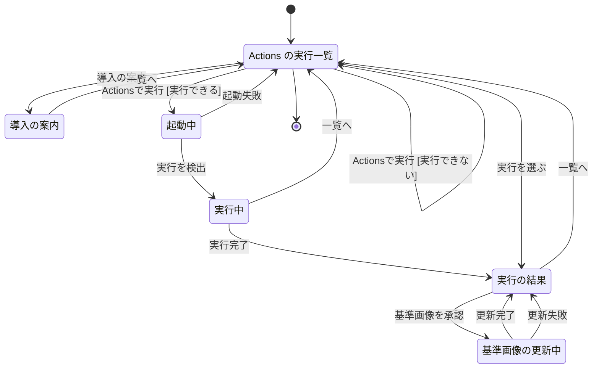
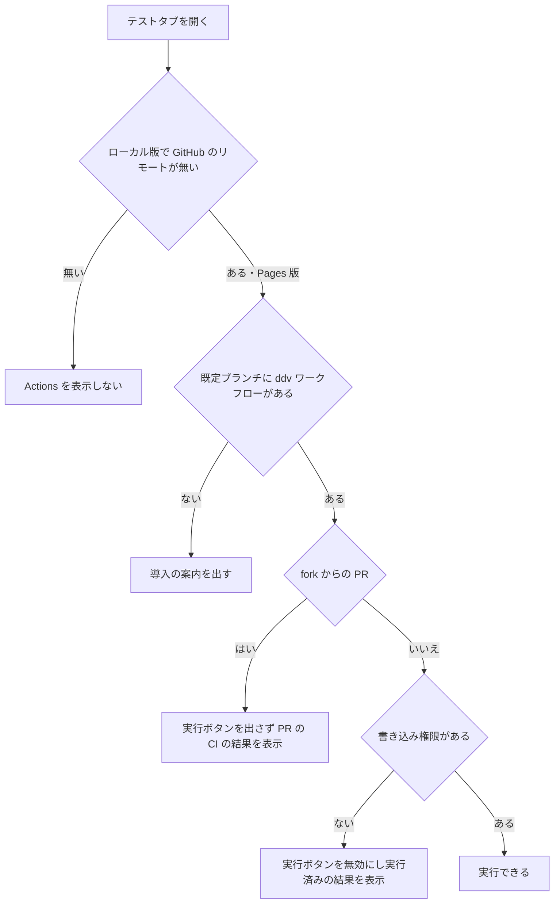
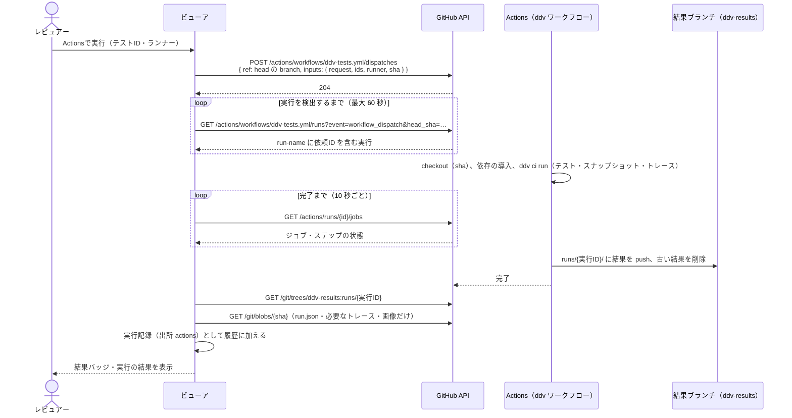
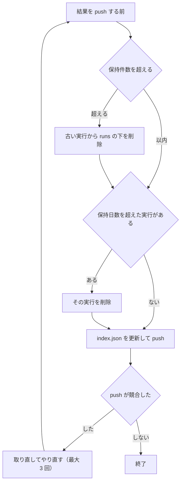
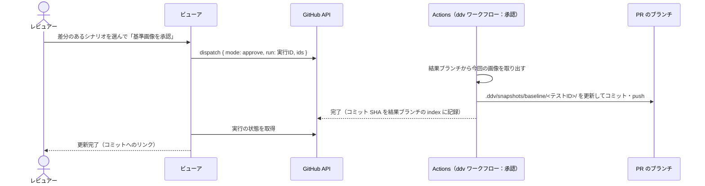
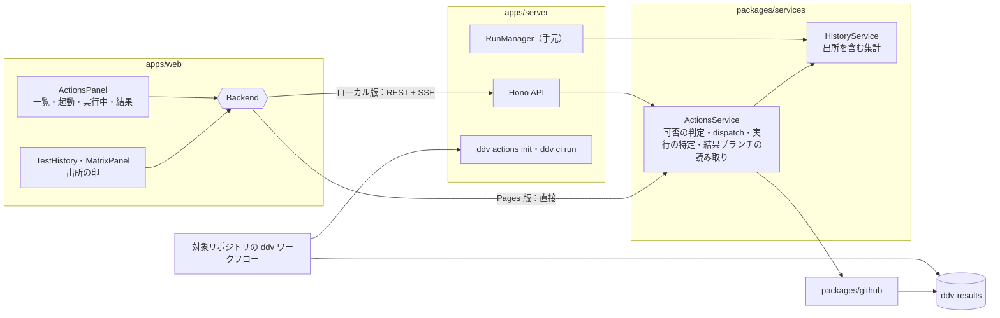
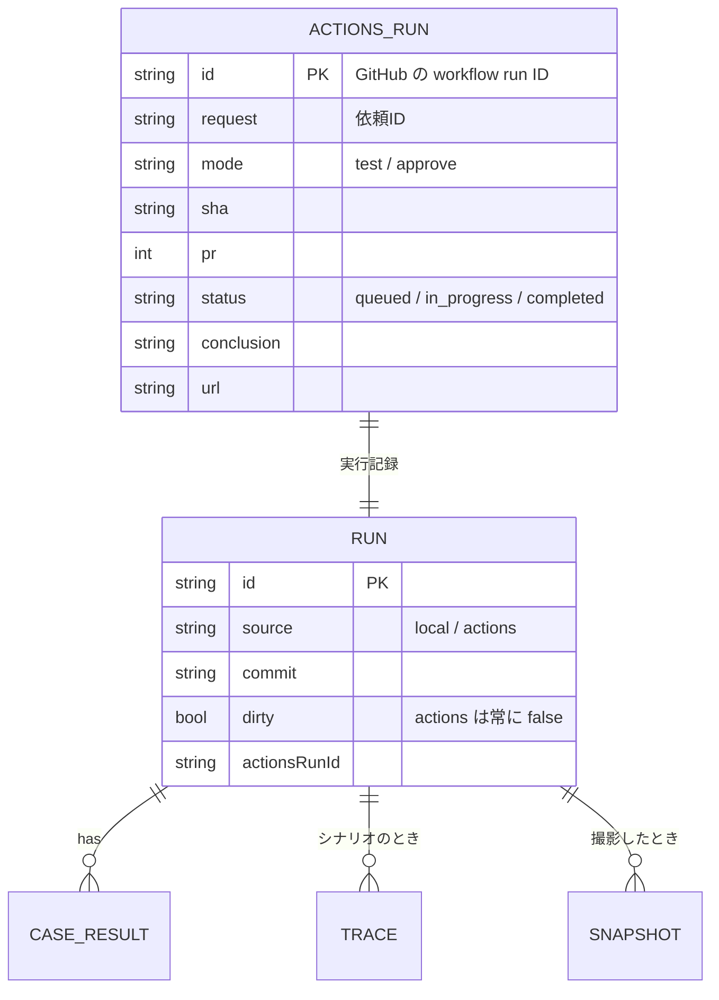

# Actions でのテスト実行・結果・履歴 基本設計

## 前提

- 目的は :ref[../requirements/hosted.md#目的]、範囲は :ref[../requirements/hosted.md#スコープ] を参照
- 実行記録・履歴・フレーキー・カバレッジの考え方は :ref[test-monitoring.md#用語]、トレースは :ref[trace-view.md#記録]、スナップショットは :ref[mock-player.md#スナップショット] のまま使う。本書は **実行する場所を対象リポジトリの Actions にしたとき** の起動・結果の受け渡し・表示を扱う
- Pages 版・ローカル版のどちらからも同じ操作で使う。GitHub の呼び出しは Pages 版は PAT（:ref[hosted-viewer.md#pat-の扱い]）、ローカル版は gh / `GITHUB_TOKEN`（:ref[github-review.md#認証]）

::embed[../requirements/hosted.md#受入基準]

## 用語

| 用語 | 意味 |
|---|---|
| ddv ワークフロー | 対象リポジトリに置く `.github/workflows/ddv-tests.yml`。ddv の雛形から配置する。テスト・スナップショット・トレースを実行し、結果を結果ブランチに保存する |
| 結果ブランチ | 対象リポジトリの `ddv-results` ブランチ（履歴を持たない orphan ブランチ）。ブラウザは Actions の artifact を CORS の制約で取得できないため、結果はここに置き、ブラウザは Git の API で読む |
| Actions の実行 | ddv ワークフローの 1 回の実行（GitHub の workflow run）。1 回が実行記録 1 つになる |
| 出所 | 実行記録がどこで実行されたか。`local`（手元。`.ddv/runs`）/ `actions`（結果ブランチ） |
| 依頼ID | ビューアが起動のたびに作る ID。workflow_dispatch は実行の ID を返さないため、ワークフローの `run-name` に入れて実行を特定する |

## 画面遷移

テストタブの「Actions」の中の遷移。Pages 版・ローカル版で同じ。マトリクスの行の実行ボタンからも同じ「起動中」へ進む。



- 「導入の案内」：既定ブランチに ddv ワークフローが無いときに一覧の先頭に出る。雛形の配置方法（[ワークフローの雛形](#ワークフローの雛形)）と、ローカル版なら「配置する」ボタン（`ddv actions init` と同じ処理。コミットは利用者が行う）
- 「Actionsで実行 [実行できない]」：[実行の可否](#実行の可否) で実行できない。ボタンを無効にして理由を表示する（押せない）
- 「起動失敗」：dispatch が拒否された（権限・ワークフローの入力の不一致）、または 60 秒以内に実行を検出できない。理由と Actions の画面へのリンクを表示する
- 「実行中」：ジョブ・ステップの進み具合を 10 秒ごとに取得して表示する。「一覧へ」で戻っても実行は続き、一覧の行に「実行中」と出る
- 「実行の結果」：テストIDごとの結果、トレースのある実行は「トレース」（:ref[trace-view.md#画面遷移]）、スナップショットの差分。トレース・差分画像は結果ブランチから読む
- 「基準画像を承認」：差分のあるスナップショットを選んで押す。ddv ワークフローを承認のモードで起動し、ワークフローが PR のブランチへ基準画像をコミットする（[スナップショットの承認](#スナップショットの承認)）。PR でないとき・書き込み権限が無いときは押せない

## 画面イメージ

::mock[actions-run/index.html]{diagram=screen-flow}

| 画面 | 主な要素 |
|---|---|
| Actions の実行一覧 | 実行の対象（PR の head / branch とコミット）、ランナーとテストIDの選択、「Actionsで実行」、無効のときの理由、実行の一覧（日時・依頼者・コミット・状態・成功 / 失敗の数・Actions へのリンク）、ローカル版では「未コミットの変更は Actions では実行されません」 |
| 導入の案内 | 雛形の配置コマンド、必要な設定（結果ブランチ・保持件数）、スキルの案内 |
| 起動中 | 依頼ID、経過時間 |
| 実行中 | ジョブ・ステップの状態、Actions のログへのリンク（ログはブラウザから取得できないため表示しない） |
| 実行の結果 | テストIDごとの結果バッジ、失敗のメッセージ、トレース、スナップショットの差分（基準 / 今回 / 差分）と承認の選択 |
| 基準画像の更新中 | 承認のワークフローの状態、完了後のコミットへのリンク |

## 実行の可否



- 書き込み権限：Pages 版は `GET /repos/{o}/{r}` の `permissions.push`（PAT が無ければ無し）、ローカル版はトークンで同じ API を呼ぶ。ワークフローの起動には fine-grained PAT の Actions: Write が要る（足りないと dispatch が 403。理由に表示）
- fork からの PR（`head.repo` が base と違う）は、PR のコードを対象リポジトリの権限で動かさないため起動しない。表示するのは PR の head に対する通常の CI（check runs）の結果だけ
- ローカル版の GitHub のリモート：開いたフォルダの `origin`（無ければ最初のリモート）が github.com を指すとき。GitHub のワークスペース（PR・branch）は常にあり
- **PR のコードは閲覧者の PC では動かさない**（REQ-612）。Pages 版は手元での実行の手段が無く、ローカル版の手元での実行は従来どおり信頼の確認が要る（:ref[github-review.md#pr-のコードの実行]）

## 実行と結果の受け渡し



- 入力 `sha` は表示中のコミット。ワークフローは branch の先頭ではなくこのコミットを checkout し、違うときは警告を結果に残す（押した後に push された場合）
- `ids`・`runner` を省略すると全件。ローカル版の「実行」と同じ指定方法（:ref[viewer.md#テスト実行]）
- 実行は対象リポジトリで同時に 1 つ（ワークフローの `concurrency`）。実行中に押したときは、待ち行列に入ることを表示する
- ローカル版は同じ流れをサーバが行い（トークンはサーバの中）、画面には従来の SSE で状態を流す

## 結果ブランチ

```text
ddv-results（orphan）
  index.json                     … 保持している実行の一覧（実行ID・コミット・PR・日時・状態・件数）
  runs/<実行ID>/run.json         … 実行記録（ローカルの .ddv/runs/*.json と同じ形式＋出所の項目）
  runs/<実行ID>/traces/…         … トレース（.ddv/traces/<実行ID>/ と同じ構成）
  runs/<実行ID>/snapshots/…      … 今回のスナップショットと差分画像
```



- 既定は 200 件・90 日。トレースは 20 回分（それより古い実行は `run.json` だけ残す。ローカル版の :ref[test-monitoring.md#保持件数] と同じ考え方）。設定はワークフローの入力の既定値で変える
- ブランチは履歴を持たない 1 コミットに保つ（毎回上書きの強制 push。大きな画像が履歴に溜まらないように）
- ブラウザは `index.json` と、表示に要るファイルだけを読む（Trees API と blob。いずれも CORS に対応）

## スナップショットの承認



- 承認は PR の head のブランチが対象リポジトリにあるときだけ（fork の PR は不可）
- 承認のコミットで PR の head が進むので、表示中の PR は「更新あり」になる（:ref[github-review.md#ワークスペース]）

## 履歴の統合

- 結果ブランチの実行記録を、手元の実行記録と同じ形にして履歴に加える。テストIDごとの推移・フレーキー・設計カバレッジの集計（:ref[test-monitoring.md#フレーキーの判定]、:ref[test-monitoring.md#設計カバレッジ]）は出所を問わず同じ計算をする
- Actions の実行は常に「コミットが分かり未コミットの変更なし」なので、フレーキーの判定に使える
- 推移・実行の一覧では出所を印（手元 / Actions）で区別する。ローカル版では両方が同じ推移に並ぶ（REQ-606）
- Pages 版の履歴は結果ブランチだけ。表示のたびに `index.json` から取り直し、ブラウザには保存しない

## ワークフローの雛形

| 項目 | 内容 |
|---|---|
| 配置 | `ddv actions init [--repo <path>]` が `.github/workflows/ddv-tests.yml` を書く（既にあれば差分を表示して止まる。`--force` で上書き）。プラグインの `templates/.github/workflows/ddv-tests.yml` をコピーしてもよい |
| 起動 | `workflow_dispatch`（入力：`request`・`mode`（`test` / `approve`）・`ids`・`runner`・`sha`・`run`） |
| 実行 | 対象のコミットを checkout → ddv を取得（ddv リポジトリの指定のタグ）→ 依存の導入 → `ddv ci run`（`ddv.config.yaml` の `runners` で実行し、実行記録・トレース・スナップショットを出力）→ 結果ブランチへ保存 |
| 権限 | `permissions: contents: write`（結果ブランチ・基準画像の push）。`actions: read` |
| 同時実行 | `concurrency: ddv-tests`（待ち行列） |
| 設定 | 入力の既定値で、ddv のタグ・保持件数・保持日数・トレースの保持数 |

- プラグインのスキル（`ddv-basic-design` の手順の末尾と README）に、導入の手順（配置 → コミット → 既定ブランチへのマージ → ビューアから実行）を追加する（REQ-607）

## 構成



## データ



| データ | 置き場所 |
|---|---|
| Actions の実行記録・トレース・スナップショット | 対象リポジトリの `ddv-results` ブランチ |
| 承認した基準画像 | PR のブランチの `.ddv/snapshots/baseline/`（既存の置き場所） |
| 手元の実行記録 | `.ddv/runs/`（既存。`source` を省略したものは `local`） |

## API

ローカル版のサーバに追加する（Pages 版は同じ処理をブラウザで行う）。GitHub のワークスペースでは `/api/w/<ワークスペースID>/...`。

| メソッド | パス | 内容 |
|---|---|---|
| GET | `/api/actions` | 可否（表示しない / 導入の案内 / fork / 権限なし / 実行できる）と理由、ワークフローの有無 |
| GET | `/api/actions/runs` | 結果ブランチの `index.json` と、実行中の実行 |
| POST | `/api/actions/runs` | `{ ids?, runner? }` 起動。202 `{ request }`。状態は SSE `/api/events` の `actions` で通知 |
| GET | `/api/actions/runs/{id}` | 実行記録・ジョブの状態 |
| GET | `/api/actions/runs/{id}/files/*` | 結果ブランチのトレース・画像 |
| POST | `/api/actions/runs/{id}/approve` | `{ ids }` 基準画像の承認を起動 |
| POST | `/api/actions/init` | 雛形の配置（手元のワークスペースのみ。コミットはしない） |

- 既存の `/api/history/*`・`/api/coverage`・`/api/results/latest` は、応答に `source` を加え、Actions の実行も含めて集計する（項目の追加のみ。REQ-610）

## 設定と CLI

| コマンド | 内容 |
|---|---|
| `ddv actions init [--repo <path>] [--force]` | ddv ワークフローを配置する |
| `ddv ci run [--ids <id,...>] [--runner <name>] [--out <dir>]` | ワークフローの中で使う。`runners` を実行し、実行記録・トレース・スナップショットを `--out` に出す |
| `ddv ci publish --out <dir> [--max-runs 200] [--max-days 90] [--max-trace-runs 20]` | 結果ブランチへの保存と剪定 |
| `ddv ci approve --run <実行ID> --ids <id,...>` | 承認のモードで、基準画像を PR のブランチにコミットする |
