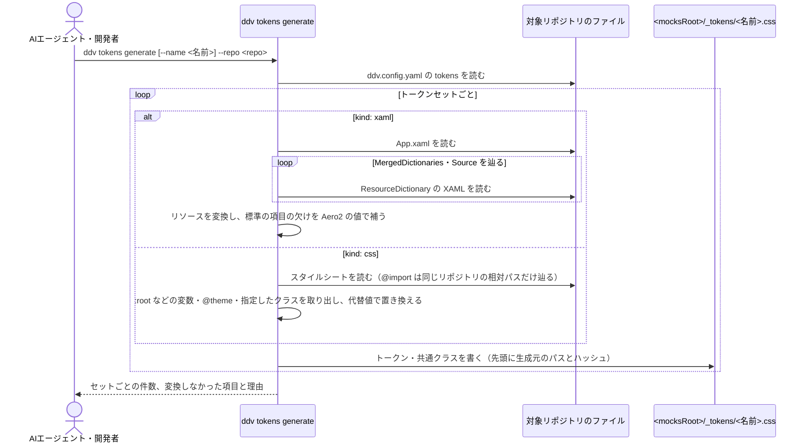
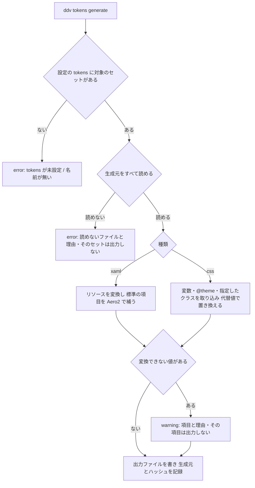
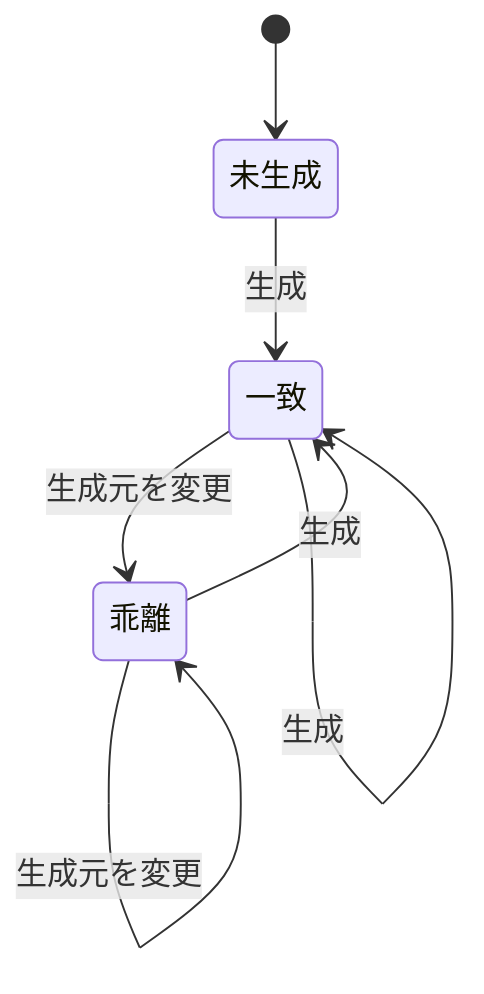
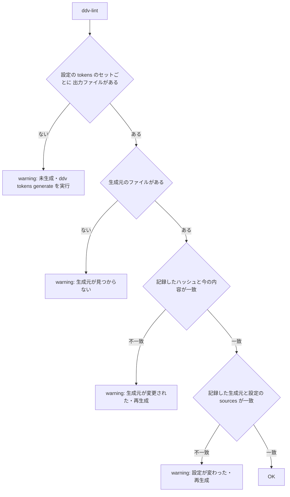
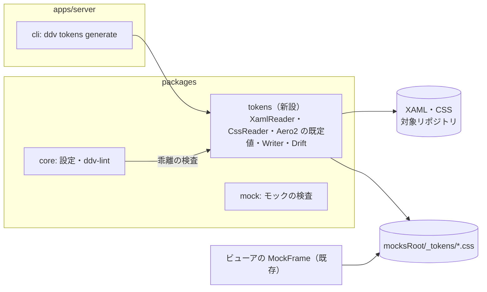
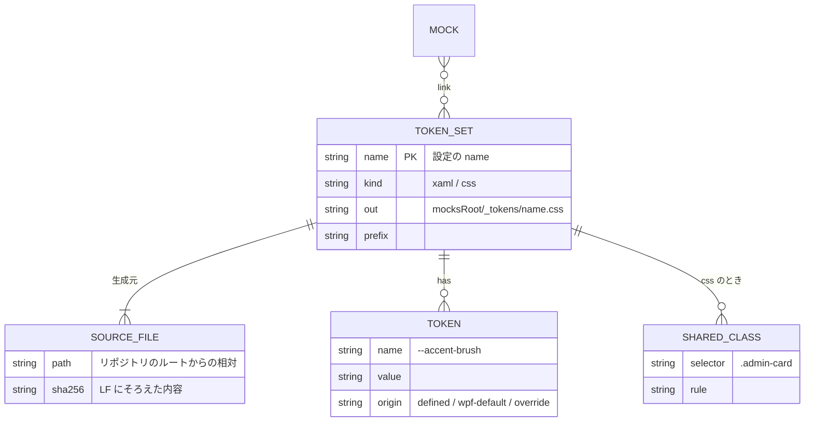

# 実アプリのデザインのトークン（XAML・CSS の取り込み）基本設計

## 前提

- 目的は :ref[../requirements/desktop.md#目的]、対象と取り込み範囲は :ref[../requirements/desktop.md#対象と取り込み範囲] を参照
- モックの成果物・属性は :ref[mock-player.md#成果物] のまま。本書は **実アプリのデザインの定義からトークン（CSS 変数）と共通クラスを生成し、モックで読み込む方法** と、生成元の変更の検出を扱う
- 画面は追加しない（CLI と `ddv-lint` だけ）。モックを開く画面（プレイヤー・調整・スナップショット）は従来のまま
- デスクトップアプリでのシナリオの実行は :ref[desktop-run.md#前提] で扱う

::embed[../requirements/desktop.md#受入基準]

## 用語

| 用語 | 意味 |
|---|---|
| トークン | 実アプリの配色・書体・文字サイズ・余白・角丸などの値を表す CSS 変数（例 `--color-accent-25`） |
| 共通クラス | Web アプリのスタイルシートから取り込む、指定したクラスの規則（例 `.admin-card`）。モックの要素にそのまま付けられる |
| トークンセット | 1 つの実アプリから生成するトークンと共通クラスのまとまり。設定の `tokens` の 1 項目 = 出力ファイル 1 つ |
| 生成元 | トークンセットを作るときに読んだファイル（XAML・CSS）。出力ファイルに一覧とハッシュを記録する |
| 標準の項目 | WPF のアプリで、リソースを定義していなくても値を持つ項目（ウィンドウの背景・文字色・書体・文字サイズ・ボタン・入力欄・選択色）。リソースが無いときは WPF 標準のテーマ（Aero2）の値を出力する |
| 代替値 | 実行時にしか決まらない変数（例 `next/font` の `--font-geist-sans`）に設定で与える値 |

## 生成の流れ



- **ファイルを読むだけ** で生成する（REQ-511）。対象のビルド・起動・`npm install`・`dotnet build`・パッケージの導入をしない。`node_modules` や NuGet のパッケージの中は読まない（例：`@import "tailwindcss"` は辿らず無視する）
- 出力は決まった順（トークンセットの中で種類 → 名前の順）に並べ、同じ入力なら同じ内容にする（差分レビューのため）



- 「変換できない値」：グラデーション・画像のブラシ、`{Binding}`・`{DynamicResource}` で解決できないキー、CSS の `@apply`・関数で計算する値（`theme()` など）、指定したクラスが見つからない
- 1 つのセットが失敗しても、ほかのセットは生成する。終了コードは error があれば 1

## XAML の取り込み（WPF）

| XAML の型 | トークン | 例（XAML → CSS） |
|---|---|---|
| `Color` | 色 | `#FF2457D6` → `#2457d6`、`#802457D6` → `#2457d680`（ARGB → RGBA） |
| `SolidColorBrush` | 色 | `<SolidColorBrush x:Key="AccentBrush" Color="{StaticResource AccentColor}"/>` → `--accent-brush: var(--accent-color)` |
| `FontFamily` | 書体 | `Segoe UI, Yu Gothic UI` → `"Segoe UI", "Yu Gothic UI"` |
| `sys:Double`（キーが文字サイズ） | 文字サイズ | `14` → `14px`（WPF の DIP = CSS の px）、`10.5pt` → `14px` |
| `Thickness` | 余白 | `8,4,8,4`（左,上,右,下）→ `4px 8px 4px 8px`（上 右 下 左） |
| `CornerRadius` | 角丸 | `4,4,0,0`（左上,右上,右下,左下）→ `4px 4px 0 0` |

- 名前：`x:Key` をケバブケースにする（`AccentBrush` → `--accent-brush`）。設定の `prefix` があれば先頭に付ける（`--wpf-accent-brush`）
- `StaticResource` / `DynamicResource` で別のリソースを参照する値は `var(--…)` にする（元の参照関係を残す）
- `sys:Double` のどれが文字サイズかは、キーに `FontSize`・`TextSize` を含むか、設定の `fontSizeKeys` で決める。それ以外の `Double` は出力しない
- `Style`・`ControlTemplate`・`DataTemplate` は読まない（共通クラスにしない。:ref[../requirements/desktop.md#対象と取り込み範囲]）
- **ResourceDictionary の `Source` の解決**：読めるのは、生成元と同じリポジトリ（または設定で指定した場所）のファイルに対応する URI だけ
  - 相対 URI（`Themes/Colors.xaml`）：その XAML のある場所から
  - ルート相対（`/Themes/Colors.xaml`）と、同じプロジェクトの `pack://application:,,,/Themes/Colors.xaml`：入口のファイル（App.xaml）のある `*.csproj` の場所から
  - `/<アセンブリ>;component/…`（`pack://` の形を含む）：同じリポジトリにそのアセンブリ名の `*.csproj`（`AssemblyName`、無ければファイル名）があればその場所から。無い（NuGet のパッケージ・外部のアセンブリ）ときは辿らず warning（理由と URI を表示）
  - 循環して参照していれば、2 回目は辿らず warning
- **同じキーの優先順**：WPF の検索の順に合わせる。その辞書自身の定義が最優先、次に `MergedDictionaries` を **後ろから** 順に（後に書いた辞書が勝つ）。生成元に複数のファイルを挙げたときは後のファイルが勝つ。負けた定義は出力しない（件数を表示）
- **標準の項目**：`SystemColors` のキー（`{x:Static SystemColors.WindowBrushKey}` など）や `TextElement.FontFamily` を App.xaml で上書きしていればその値、無ければ ddv が持つ Aero2（Windows 10 以降の WPF の既定）の値を出力する。出力では `/* WPF 標準 */` と印を付け、定義した値と区別する

| 標準の項目 | トークン |
|---|---|
| ウィンドウの背景・文字色 | `--wpf-window-bg`・`--wpf-window-fg` |
| 書体・文字サイズ | `--wpf-font-family`・`--wpf-font-size` |
| ボタンの背景・枠・文字色・押下・ホバー | `--wpf-button-bg`・`--wpf-button-border`・`--wpf-button-fg`・`--wpf-button-pressed-bg`・`--wpf-button-hover-bg` |
| 入力欄の背景・枠・フォーカスの枠 | `--wpf-input-bg`・`--wpf-input-border`・`--wpf-input-focus-border` |
| 選択の背景・文字色 | `--wpf-highlight-bg`・`--wpf-highlight-fg` |
| コントロールの内側の余白・枠の太さ | `--wpf-control-padding`・`--wpf-control-border-width` |

- 具体的な値と、どの `SystemColors` のキーで上書きされるかの対応は詳細設計で列挙する
- 標準の項目は、ddv が同梱する `wpf-base.css`（`button`・`input`・`select`・`body` にこのトークンを当てる最小の規則）と組み合わせると、モックの標準の部品が WPF の見た目に近づく。使うかどうかはモックが選ぶ（`<link>` するかどうか）

## CSS の取り込み（Web アプリ）

| 取り込むもの | 出力 |
|---|---|
| `:root`・`html`・`:host` の CSS 変数 | そのまま `:root { … }` に出す |
| `@theme` / `@theme inline`（Tailwind CSS v4） | `--color-*`・`--font-*` などの定義を `:root` の変数として出す（`inline` の `var()` はそのまま） |
| 設定の `classes` に挙げたクラス | そのクラスで始まるセレクタの規則（BEM の `__要素`・`--修飾子` を含む）と、それを含む `@media` をそのまま出す |
| 設定の `elements` に挙げた要素の規則（任意。例 `body`・`a`） | そのまま出す（モックの基本の書体・リンク色を合わせるとき） |

- 代替値：設定の `overrides`（変数名 → 値）で、生成元の値を置き換える。`--font-geist-sans: '"Geist", "Yu Gothic UI", sans-serif'` のように、実行時に決まる変数をモックで使える値にする。代替値を与えていない未定義の変数を参照していると warning
- `@import`：同じリポジトリの相対パスだけ辿る。パッケージ（`tailwindcss` など）は辿らない。Tailwind のユーティリティクラス（`flex`・`px-4` など）は生成しない（範囲外）
- **`@theme` の修飾子と順序**（Tailwind CSS v4）
  - `@theme`・`@theme static`・`@theme inline`（組み合わせを含む）は、どれも定義を `:root` の変数として出す。`static`（使わない変数も出す）はモックでは区別しない。`reference` は出力しない（参照用の定義のため）
  - 名前空間の初期化（`--color-*: initial`・`--*: initial`）は出力しない。それまでに集めた、その名前空間（`--*` はすべて）の `@theme` 由来の定義を消す命令として扱う
  - 同じ変数を何度も定義したときは、カスケードと同じく **ファイルの中で後に書いたもの** が勝つ（`:root` と `@theme` を区別しない。`@import` は取り込んだ位置に展開したものとして数える）。`@media` などの中の `:root` は、その `@media` ごと出す
- 取り込んだクラスが、取り込んでいない変数を参照していたら warning（`--shadow-card` など、`:root` 以外で定義した変数）
- 取り込み対象のクラスに `@apply` があると、その宣言を除いて warning（展開にはビルドが必要なため）

pokenae.Web（`app/globals.css`）の設定例：

```yaml
tokens:
  - name: pokenae-web
    kind: css
    sources: [../pokenae.Web/app/globals.css]   # リポジトリの外は相対パスで指定できる
    classes: [site-frame, admin-card]
    elements: [body, a]
    overrides:
      --font-geist-sans: '"Geist", "Yu Gothic UI", sans-serif'
      --font-geist-mono: '"Geist Mono", monospace'
```

## 出力ファイル

```css
/* ddv tokens: pokenae-web（ddv tokens generate が生成。編集しない）
 * source: ../pokenae.Web/app/globals.css sha256=3f1a…
 * config: sha256=9c0e…
 * generated-by: ddv 0.x format=1
 */
:root {
  --background: #ffffff;
  --color-accent-25: #a77ca5;
  --font-sans: var(--font-geist-sans);                      /* @theme inline */
  --font-geist-sans: "Geist", "Yu Gothic UI", sans-serif; /* override */
}
body { … }
.admin-card { … }
```

- 置き場所：`<mocksRoot>/_tokens/<名前>.css`（設定の `out` で変えられる。ただし `mocksRoot` の下に限る）。モックと同じ静的配信の範囲に置くので、ローカル版・Pages 版・スナップショットで同じパスで読める
- 先頭のコメントに、生成元のパス（リポジトリのルートからの相対）と内容の SHA-256（改行を LF にそろえてから計算）、生成の設定のハッシュ（`config`）、ddv の版と出力の形式の版（`format`）を書く。乖離の検出はこの記録だけで行う（REQ-511）
- `config` は、そのトークンセットの設定（`kind`・`sources`・`classes`・`elements`・`overrides`・`prefix`・`fontSizeKeys`・`out`）をキーの順にそろえた JSON の SHA-256。`format` は変換の規則を変えたときに上げる（ddv の版を上げただけでは変えない）
- 出力は自己完結させる（`@import`・相対の `url()` を含めない）。Pages 版は相対パスの資産を `data:` / `blob:` に置き換えて読み込むため（:ref[hosted-viewer.md#モックの再生]）
- 生成物はコミットする（テキスト。差分でデザインの変更をレビューできる）

## モックでの使い方

```html
<head>
  <link rel="stylesheet" href="../_tokens/pokenae-web.css" />   <!-- トークン・共通クラス -->
  <style>
    .card { color: var(--color-text-strong); }               /* モック固有の CSS もトークンで書く */
  </style>
</head>
<body>
  <section data-screen="List">
    <div class="site-frame"><article class="admin-card">…</article></div>
  </section>
</body>
```

| 場面 | 読み込み | 変更 |
|---|---|---|
| ローカル版のプレイヤー・調整モード | `/raw/...` から相対パスで | なし |
| Pages 版のプレイヤー | 相対パスの資産の置き換え（`data:` / `blob:`）で | なし（`_tokens` も同じ扱い） |
| スナップショット・E2E（モック） | `mocksRoot` の静的配信で | なし |

- トークンを持たないモックは従来どおり表示する（`<link>` が無いだけ。REQ-503）
- 既存の設定 `styles`（実プロジェクトの CSS をそのまま `<link>`）は残す。ブラウザでそのまま読めない CSS（Tailwind の入力・Sass）や、WPF のアプリのときはトークンを使う
- **調整モード**（:ref[github-review.md#モックの調整モード]）でトークンの値を変えた提案は、生成物ではなく生成元（XAML・CSS）を直すよう案内する（生成物は編集しない）

## 乖離の検出





- 「乖離」は warning（REQ-504）。再生成すると記録のハッシュが今の内容になり消える
- W4 の「設定が変わった」は、記録した生成元の一覧と設定の `sources` の不一致に加え、記録した `config` と今の設定のハッシュの不一致、記録した `format` と今の ddv の `format` の不一致を含む（取り込むクラス・代替値などを変えたのに古い生成物のまま、を見逃さない）
- XAML の `MergedDictionaries` で辿ったファイルも生成元として記録し、ハッシュを比べる
- 生成元がリポジトリの外（例 `../pokenae.Web`）で見つからない環境（CI・Pages 版）では W2 を info に下げる（設定 `optional: true` のセット、または環境変数 `DDV_TOKENS_OPTIONAL=1`）
- Pages 版は lint を実行しない（:ref[hosted-viewer.md#操作の可否]）

## 構成



- `packages/tokens` は `node:fs` を直接使わず、読み取りを `RepoReader`（:ref[hosted-viewer.md#構成]）で受け取る。乖離の検査は lint と同じくローカル版だけで動かす
- XML・CSS の解析は既存の依存で足りなければ、ブラウザでも動く純粋な解析器（例 `postcss`）を使う。.NET・Node のネイティブの部品は使わない

## データ



## 設定と CLI

```yaml
tokens:
  - name: order-wpf                  # 出力ファイル名（<mocksRoot>/_tokens/order-wpf.css）
    kind: xaml
    sources: [desktop/OrderApp.Wpf/App.xaml]   # 入口。MergedDictionaries は自動で辿る
    prefix: wpf                      # 任意。トークン名の先頭に付ける
    fontSizeKeys: [BodySize]         # 任意。文字サイズとみなす Double のキー
  - name: pokenae-web
    kind: css
    sources: [../pokenae.Web/app/globals.css]
    classes: [site-frame, admin-card]
    elements: [body, a]
    overrides: { --font-geist-sans: '"Geist", sans-serif' }
    optional: true                   # 生成元が無い環境では乖離の検査を info に下げる
```

- 既存の未使用の項目 `tokens: string[]` はこの形式に置き換える（文字列の項目は warning を出して無視する）

| コマンド | 内容 |
|---|---|
| `ddv tokens generate [--name <名前>] [--repo <path>]` | トークンセットを生成する（省略時はすべて） |
| `ddv tokens check [--repo <path>]` | 乖離だけを検査する（`ddv-lint` と同じ結果。CI 用） |

## プラグイン

- `ddv-basic-design` スキルのモックの節に追加する（REQ-508）：
  1. 実アプリ（WPF の XAML・Web のスタイルシート）がある場合は `ddv.config.yaml` に `tokens` を書き、`ddv tokens generate` を実行する
  2. モックは `<link rel="stylesheet" href="../_tokens/<名前>.css">` を読み、色・書体・余白はトークン（`var(--…)`）と共通クラスで書く。値を直書きしない
  3. lint の「生成元が変更された」warning は再生成で消す。生成物は手で直さない
- テンプレート：`ddv.config.yaml` に `tokens` の例（xaml・css）をコメントで加え、`docs/mocks/sample/index.html` に `_tokens` の `<link>` の例をコメントで加える
- README の流れの表（基本設計の行）に「トークンの生成」を加える

## 試験の観点

| 観点 | 確かめ方 |
|---|---|
| XAML の変換（REQ-501） | サンプルの WPF アプリ（`examples/sample-app/desktop/OrderApp.Wpf`）の ResourceDictionary に色・書体・文字サイズ・余白・角丸を定義し、生成結果の値と、定義していない標準の項目が Aero2 の値になることを単体テストで確かめる。相対・ルート相対・`pack://`・同じリポジトリの `;component` の URI を辿り、外部のアセンブリと循環は warning、同じキーは後の辞書が勝つこと |
| CSS の取り込み（REQ-502） | pokenae.Web の `globals.css` の写し（テスト用の固定ファイル）から `--color-accent-25`・`@theme`・`.site-frame`・`.admin-card` が出力され、`--font-geist-sans` が代替値になること。`--color-*: initial` で前の定義が消え、`@theme reference` が出ず、同じ変数は後の定義が勝つこと |
| 見た目（REQ-503） | トークンを読むサンプルのモックをローカル版・Pages 版のプレイヤーで開き、計算済みのスタイル（`getComputedStyle`）がトークンの値であることを E2E で確かめる。既存のモックのスナップショットが変わらないこと |
| 乖離（REQ-504） | 生成元（`MergedDictionaries` で辿ったファイルを含む）を書き換えると lint が warning、再生成で消えること。`classes`・`overrides` を変えても warning になること |
| ビルド不要（REQ-511） | `node_modules`・`bin`・`obj` の無い固定ファイルから生成でき、出力の先頭に生成元とハッシュがあること |
