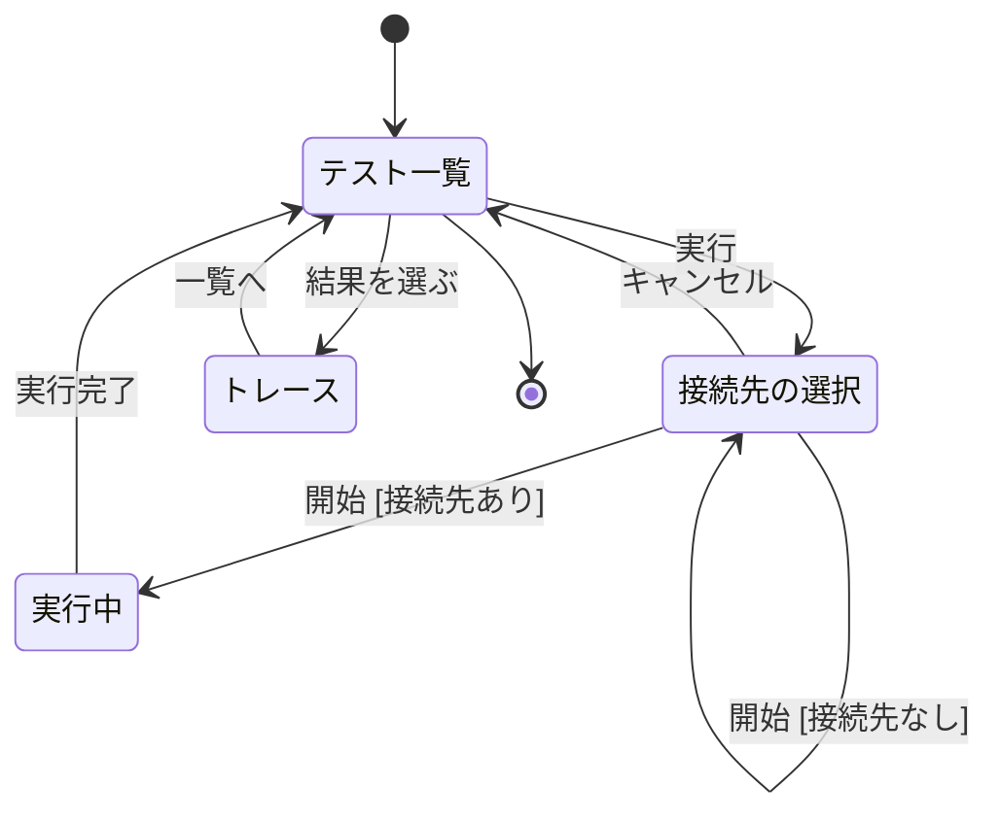
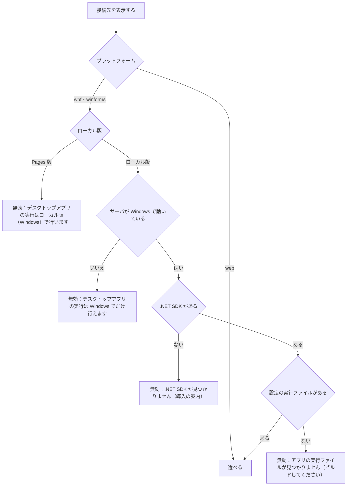
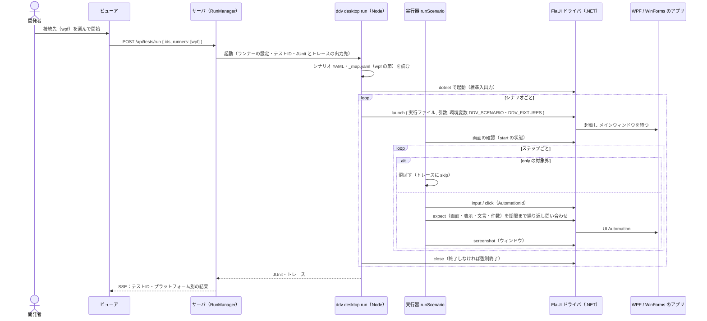
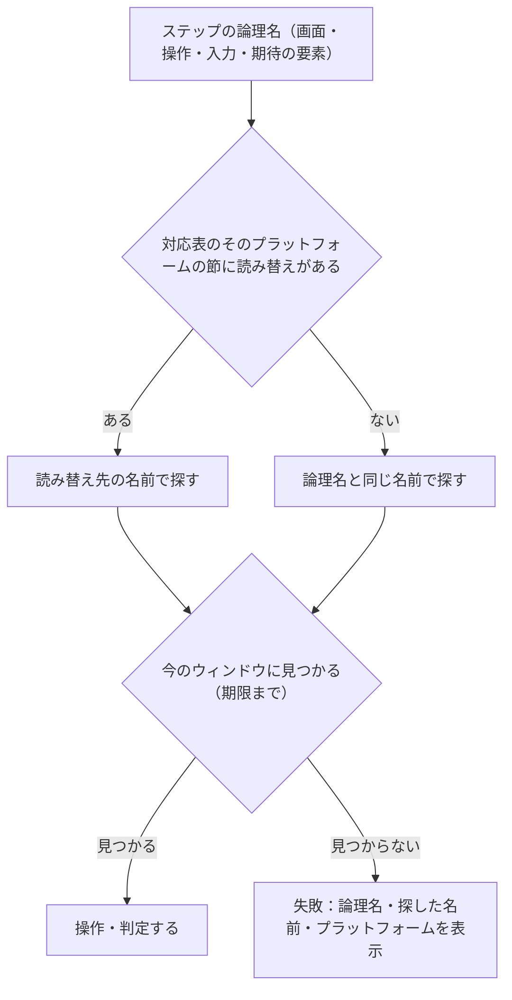
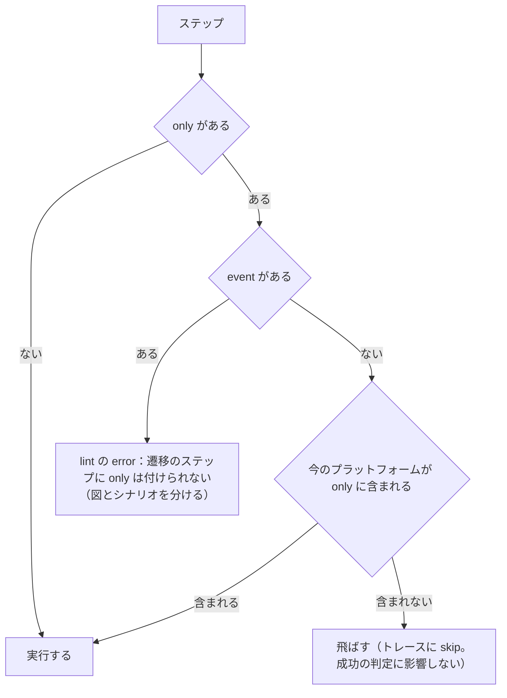
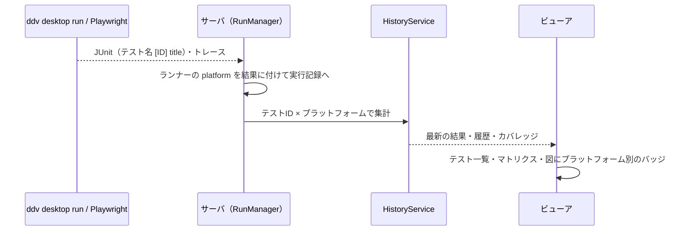
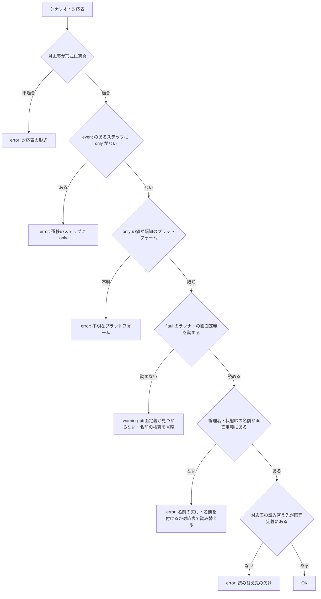
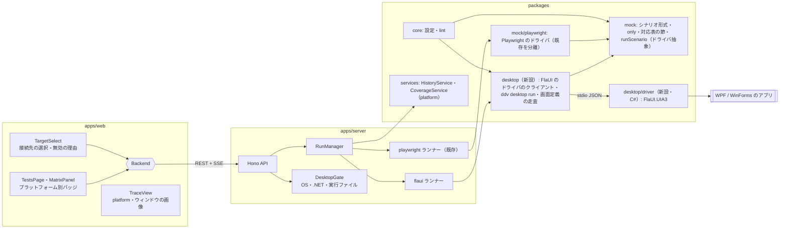
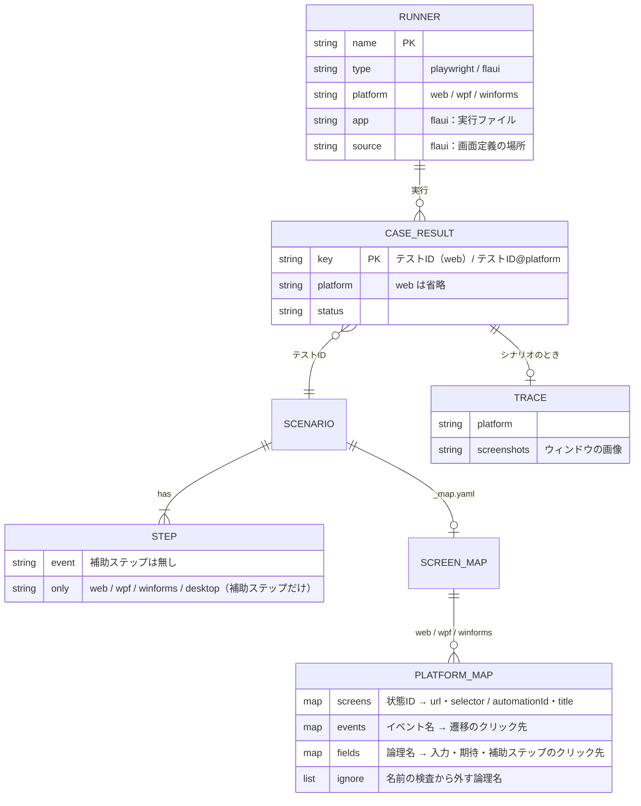

# デスクトップアプリ（WPF・WinForms）でのシナリオ実行 基本設計

## 前提

- 目的は :ref[../requirements/desktop.md#目的]、対象と取り込み範囲は :ref[../requirements/desktop.md#対象と取り込み範囲] を参照
- シナリオの形式・実行器・対応表は :ref[mock-player.md#シナリオ] と :ref[mock-player.md#e2e-実行データ駆動] を土台にする。本書は **同じシナリオを FlaUI で WPF・WinForms のアプリに対して実行する方法** と、プラットフォームの差の吸収（命名規約・対応表・`only:`）、結果の表示を扱う
- テストの結果・履歴・トレースの画面は :ref[test-monitoring.md#画面遷移]・:ref[trace-view.md#画面遷移] のまま。本書はそこへのプラットフォームの追加だけを扱う
- 実アプリのデザインのトークンは :ref[design-tokens.md#前提] で扱う

::embed[../requirements/desktop.md#受入基準]

## 用語

| 用語 | 意味 |
|---|---|
| プラットフォーム | シナリオを実行する対象の種類。`web`（モック・Web アプリ）・`wpf`・`winforms`。`desktop` は `wpf` と `winforms` の両方を表す（`only:` でだけ使う） |
| 接続先 | シナリオを実行するランナー（`ddv.config.yaml` の `runners` のうち `scenarios: true` の playwright と、`type: flaui`）。モック・Web アプリ・WPF・WinForms のどれに向けるかはランナーで決まる |
| 論理名 | シナリオに書く名前（`click: next`・`input: { customer: … }`・`screen: Input`）。プラットフォームに依存しない |
| 名前 | プラットフォームでの操作対象・画面の名前。Web は `data-testid`・`data-screen`、デスクトップは UI Automation の AutomationId |
| 対応表 | `scenarios/_map.yaml`。論理名と名前が一致しないものだけをプラットフォーム別に読み替える |
| 補助ステップ | 図の遷移（`event`）を伴わないステップ。`only:` を付けて特定のプラットフォームでだけ実行できる |
| FlaUI ドライバ | ddv が同梱する .NET の小さなプログラム。FlaUI（UI Automation）でアプリを起動・操作し、標準入出力で実行器と通信する |

## テストの種類

:ref[mock-player.md#テストの種類とシナリオ] にデスクトップを加える。シナリオの意味は 1 つで、実行する仕組みだけが違う。

| 場面 | 実行する仕組み | 対象 | 書くテストコード |
|---|---|---|---|
| レビュー（プレイヤー） | iframe 内の mock-runtime（既存） | モック | なし |
| 結合テスト（E2E）・Web | 実行器 `runScenario` ＋ Playwright のドライバ（既存） | モック / Web アプリ | なし（固定の spec 1 本） |
| 結合テスト（E2E）・デスクトップ | 実行器 `runScenario` ＋ FlaUI のドライバ（新設） | WPF / WinForms のアプリ | なし（`type: flaui` のランナーを設定するだけ） |
| 単体テスト | xUnit（既存の `type: dotnet` ランナー。テスト名か `[Trait("TestId", "DD-…")]` に詳細設計のテストID。結果は TRX） | ViewModel・ドメインなどの内部のロジック | 詳細設計のテストIDごとに書く（既存どおり） |

- デスクトップアプリの内部の関数（ViewModel のコマンド・入力検査・変換など）は、画面を操作せず xUnit で詳細設計のテストIDに紐づけて単体テストする。Phase 5 で単体テストの仕組みは変えない
- サンプル（`examples/sample-app/desktop/`）には、WPF・WinForms のアプリと、ViewModel の xUnit のテストプロジェクトを置く（既存の `dotnet/OrderDomain.Tests` と同じ書き方）

## 画面遷移

テストタブ（`#/tests`）と文書のマトリクスから、接続先を選んでシナリオを実行する遷移。結果の一覧・テストIDの履歴・フレーキーの遷移（:ref[test-monitoring.md#画面遷移]）は変えない。



- 「実行」：シナリオを含むテストIDを実行するとき（テスト一覧・マトリクスの行・図の経路）に、接続先を選ぶ。シナリオを含まない実行（vitest・dotnet だけ）は従来どおり選ばずに始める
- 「接続先の選択」：接続先ごとのチェック（既定は前回の選択。初回はモック）。使えない接続先は無効にして理由を表示する（[実行の可否](#実行の可否)）
- 「開始 [接続先なし]」：1 つも選んでいない。理由を表示して始めない
- 「開始 [接続先あり]」：選んだ接続先のランナーを順に実行する（同時には動かさない。デスクトップのアプリは前面の操作を取り合うため）
- 「結果を選ぶ」：結果のバッジ（プラットフォーム別）を選ぶと、そのプラットフォームの実行のトレースを開く（:ref[trace-view.md#画面遷移]）
- Pages 版は Actions での実行（:ref[actions-run.md#画面遷移]）の「接続先の選択」にデスクトップを出さない（無効と理由だけ表示）

## 画面イメージ

::mock[desktop-run/index.html]{diagram=screen-flow}

| 画面 | 主な要素 |
|---|---|
| テスト一覧 | 既存の一覧に、テストIDごとのプラットフォーム別の結果バッジ（例 `web ✓` `wpf ✗` `winforms –`）。「実行」 |
| 接続先の選択 | 接続先（ランナー名・プラットフォーム・対象：モック / URL / 実行ファイル）のチェック、無効な接続先の理由、実行するテストIDの件数、「開始」「キャンセル」 |
| 実行中 | 接続先ごとの進捗（実行中 / 待ち / 完了）、ログ、「デスクトップの操作中はマウス・キーボードに触れないでください」の注意 |
| トレース | 既存のトレース。ヘッダにプラットフォーム、ステップごとにアプリのウィンドウのスクリーンショット、飛ばした補助ステップ（`only:` の対象外）の印 |

文書のマトリクスの行・図の経路の結果も、同じプラットフォーム別のバッジにする（REQ-506）。

## 実行の可否



- 可否はサーバが判定し、画面は理由を表示するだけ（:ref[hosted-viewer.md#操作の可否] と同じ考え方）。無効な接続先の実行済みの結果は、従来どおり表示する（REQ-509）
- Actions での実行（`ddv ci run`）は、ワークフローの OS が Windows でなければ `type: flaui` のランナーを飛ばし、理由を実行記録に残す。Pages 版で見られるデスクトップの結果は、結果ブランチにあるものだけ（:ref[actions-run.md#結果ブランチ]）

## 実行の流れ



- 実行器 `runScenario` は、シナリオの解釈（ステップの順序・`only:`・期待値の判定・待機・トレースの記録）を 1 か所に持ち、操作だけを **ドライバ**（Playwright / FlaUI）に任せる。Web の実行の結果は変えない（REQ-510。既存の E2E で確かめる）
- FlaUI ドライバは ddv に同梱し、初回に `dotnet build` して `~/.ddv/cache/flaui-driver/<版>/` に置く（以後は使い回す）。対象のアプリのビルドは利用者が行う
- 通信は 1 行 1 JSON の要求・応答（`launch`・`find`・`setValue`・`select`・`toggle`・`invoke`・`query`・`screenshot`・`close`）。ドライバは状態を持たず、判定・待機は実行器が行う
- アプリは **シナリオごとに起動し直す**（前のシナリオの状態を持ち越さない）。fixtures の投入は、起動時の環境変数 `DDV_FIXTURES`（fixtures を結合した JSON のファイルのパス）をアプリが読むか、hooks の `desktopSeed` で行う
- 実行中は前面のウィンドウを操作するので、同時に動かす接続先は 1 つ。人がマウスを動かすと失敗しうることを「実行中」の画面で注意する

## 名前の解決



| 論理名の種類 | Web（既存） | WPF | WinForms |
|---|---|---|---|
| 画面（`start`・`expect.screen`） | `data-screen`（モック）/ 対応表の `url`・`selector`（Web アプリ） | 前面のウィンドウ、または表示中の `Window`・`Page`・`UserControl` の AutomationId | 前面のフォーム、または表示中の `UserControl` の AutomationId |
| 遷移のステップのクリック先 | `click` の値の `data-testid`（モック）/ 対応表の `events[イベント名]`（Web アプリ・既存） | 対応表の `events[イベント名]`、無ければ `click` の値の名前 | 同左 |
| 入力・期待の要素、補助ステップのクリック先 | `data-testid` / 対応表の `fields` | 対応表の `fields[論理名]`、無ければ論理名の名前 | 同左 |
| 名前の実体 | — | AutomationId（未設定なら `x:Name`。WPF が自動で AutomationId にする） | AutomationId（Control の `Name`。WinForms が自動で AutomationId にする） |

- 対応表の `events` と `fields` の役割は既存（:ref[mock-player.md#e2e-実行データ駆動]）と同じにする：`events` はイベント名（ガードを除く）→ 遷移のステップのクリック先、`fields` は論理名 → 入力・期待の要素。補助ステップには `event` が無いので、その `click` は `fields` で読み替える。Web とデスクトップで同じステップが同じ規則で解決される
- Web アプリと違い、デスクトップでは `events` の読み替えが無くても `click` の値をそのまま名前として探す（命名規約で合わせる前提。モックと同じ扱い）

- **命名規約**：論理名＝名前を基本とする。WPF は `x:Name="next"`（または `AutomationProperties.AutomationId="next"`）、WinForms は `Name = "next"`、画面は状態ID（`x:Name="Input"` の `UserControl` など）。合わせられないものだけ対応表に書く
- 入力の方法は要素の種類（UI Automation のパターン）で決める：テキスト＝Value、選択＝SelectionItem（表示文字列で選ぶ）、チェック＝Toggle（true / false）、クリック＝Invoke（無ければ要素の中央をクリック）
- 期待値：`visible` / `hidden`＝要素があり画面外でない / 無いか画面外、`text`＝Value または Name、`count`＝一覧（ListBox・DataGrid・ListView）の項目数
- `do:`（独自の操作）は hooks の `desktopSteps` の関数を呼ぶ（無ければ失敗）。`wait:` は同じ意味

## 対応表

既存の `scenarios/_map.yaml`（:ref[mock-player.md#e2e-実行データ駆動]）に、プラットフォームの節を加える。

```yaml
# 直下に screens / events / fields を書いた従来の形式は web の節とみなす（そのまま動く）
web:
  screens: { Input: { url: "/orders/new$" } }
  events: { 次へ: "button[type=submit]" }
wpf:
  screens:
    Confirm: { automationId: ConfirmPage }   # 画面：AutomationId、またはウィンドウのタイトル { title: 注文の確認 }
  events:
    次へ: NextButton                          # イベント名 → 遷移のクリック先の AutomationId
  fields:
    customer: CustomerNameBox                 # 論理名 → 入力・期待・補助ステップのクリック先
winforms:
  events:
    次へ: btnNext
  ignore: [order-rows]                        # 動的に作る要素：名前の検査から外す
```

- 書けるのは読み替えが要るものだけ。節が無いプラットフォームは命名規約どおり（論理名＝名前）
- 従来の形式（直下の `screens` 等）と `web:` の節を同時に書くと error
- 対応表は `ddv mock scaffold` で書き換えない（REQ-510）

## 補助ステップと only

```yaml
id: BD-ORDER-SCREEN-P001
start: List
steps:
  - event: 新規
    click: new
    expect: { screen: Input }
  - only: wpf                       # 補助ステップ：event が無い。wpf でだけ実行
    click: detail-tab
    expect: { visible: [customer] } # screen を省略すると 直前の画面に留まることを確かめる
  - event: 次へ [入力OK]
    input: { customer: 山田 太郎, sku: A-100, quantity: 1 }
    click: next
    expect: { screen: Confirm }
  - only: web
    click: dialog-close
    expect: { hidden: [confirm-dialog] }
  - event: 確定
    click: submit
    expect: { screen: Done }
```



- `only:` は 1 つ（`web`）か配列（`[wpf, winforms]`）。`desktop` は `wpf`・`winforms` の両方
- 補助ステップの `expect.screen` は省略できる（省略時は直前のステップの画面のまま）。`only:` の無い補助ステップも書ける（全プラットフォームで実行）
- **経路との照合**（:ref[mock-player.md#検査ddv-lint-拡張]）は補助ステップを除いた `event` の並びで行う。プレイヤーとモックの E2E は `web` として扱う（`only: desktop` は飛ばす）
- **骨組みの再生成**（`ddv mock scaffold`）：補助ステップは直前の遷移のステップに付いているものとして保持する。直前の遷移が経路から消えたときは、補助ステップも消して件数を表示する（シナリオの先頭の補助ステップは先頭に残す。REQ-510）

## 結果の表示



- 実行記録の結果は **テストIDとプラットフォームの組** で持つ。キーは `web` なら従来どおりテストIDだけ、デスクトップなら `<テストID>@<platform>`（例 `BD-ORDER-SCREEN-P001@wpf`）とする。テストIDに `@` は現れないので、読む側は `@` で分けて「テストID・プラットフォーム」に戻し、`@` の無いキー（既存の実行記録・結果ブランチ）は `web` とみなす（REQ-510）。結果の項目にも `platform` を加える（`web` は省略）
- 同じキーをトレースにも使う：実行記録の `traces` の要素と、保存先 `.ddv/traces/<runId>/<キー>.json`（スクリーンショットは `<キー>/`）。結果ブランチ（:ref[actions-run.md#結果ブランチ]）の `runs/<id>/` の中も同じ。`/api/traces/:runId/:testId` は `?platform=` を受け取る（省略時 `web`）
- 1 回の実行で同じプラットフォームの接続先は 1 つまで（`runners` に同じプラットフォームが 2 つあると 400）。キーの衝突を防ぐため。同じプラットフォームの別の接続先は別の実行にする
- 履歴・再実行・剪定（実行記録・トレースの削除）は、このキーのまま扱う（キーを分けて解釈するのは集計と表示だけ）。結果ブランチの形式（`CaseResultSchema`）にも `platform` を任意の項目として加える
- バッジは、設定にある接続先のプラットフォームと、結果があるプラットフォームだけを並べる（Web だけのリポジトリは従来の見た目のまま）
- テストIDの履歴・フレーキーの判定はプラットフォームごと。設計カバレッジ（:ref[test-monitoring.md#設計カバレッジ]）は、実行したすべてのプラットフォームで成功した経路を「成功」、どれかが失敗したら「失敗」とする
- トレースは既存の形式に `platform` を加え、ステップのスクリーンショットはアプリのウィンドウの画像にする。DOM のスナップショット・ネットワークの記録はデスクトップでは無い（表示しない）
- デスクトップのスクリーンショットはスナップショット（基準画像との比較）に使わない（範囲外）

## 検査（ddv-lint 拡張）



- 画面定義：ランナーの `source` の下のファイルを読むだけで調べる（ビルドしない）。WPF は `*.xaml` の `x:Name`・`AutomationProperties.AutomationId`、WinForms は `*.Designer.cs` の `.Name = "…"`
- 名前の検査は、そのプラットフォームで実行するステップ（`only:` の対象外を除く）の論理名と画面すべてが対象。コードで動的に作る要素は見つからないので、対応表の `ignore:`（論理名の一覧）で検査から外せる
- 名前は **ステップの遷移元の画面の中** で探す（実行時も今のウィンドウの中で探すため）。画面の状態IDから定義ファイルを決める：WPF は `x:Name`・AutomationId がその状態IDの `Window`・`Page`・`UserControl` を持つ `*.xaml`、WinForms は同名の `Form`・`UserControl` の `*.Designer.cs`。その中で使っている同じプロジェクトの `UserControl` の定義も含める
- 状態IDから定義ファイルを決められないとき（対応表の `title` で画面を指定した、など）は、プロジェクト全体で探し、見つかれば warning（画面を特定できず、別の画面の同名の要素かもしれない）にする
- 既存の検査（モックの画面・操作要素、シナリオの形式・経路）は変えない

## 構成



- `packages/desktop` は Windows 以外でも読み込めるようにする（lint の画面定義の走査は OS に依存しない）。ドライバを起動するのは Windows のときだけ
- UI Automation は既定で UIA3。WinForms の一部のコントロールで UIA2 が要る場合はランナーの `automation: uia2` で切り替える

## データ



## API

| メソッド | パス | 内容 |
|---|---|---|
| GET | `/api/tests/targets` | 接続先の一覧（ランナー名・プラットフォーム・対象・使えるか・使えない理由） |
| POST | `/api/tests/run` | 既存。`{ ids?, runner?, runners? }` の `runners`（接続先の配列）を追加。順に実行する。同じプラットフォームの接続先が 2 つ以上なら 400 |
| GET | `/api/traces/:runId/:testId` | 既存。`?platform=` を追加（省略時 `web`） |

- `/api/results/latest`・`/api/history/*`・`/api/coverage` の応答に `platform` を加える（項目の追加のみ）

## 設定と CLI

```yaml
runners:
  - { name: e2e, type: playwright, cwd: ., level: integration, include: ['e2e/**/*.spec.ts'], scenarios: true }  # モック
  - name: wpf
    type: flaui
    platform: wpf                     # wpf / winforms
    level: integration
    app:
      path: desktop/OrderApp.Wpf/bin/Debug/net8.0-windows/OrderApp.Wpf.exe
      args: []
    source: desktop/OrderApp.Wpf      # lint が名前を探す画面定義の場所
    timeout: 5000                     # 期待値を待つ上限（ミリ秒）
    automation: uia3                  # uia3（既定）/ uia2
  - name: winforms
    type: flaui
    platform: winforms
    level: integration
    app: { path: desktop/OrderApp.WinForms/bin/Debug/net8.0-windows/OrderApp.WinForms.exe }
    source: desktop/OrderApp.WinForms
```

- `type: flaui` のランナーは、シナリオの `id` でテストIDに紐づく（`scenarios: true` 相当を常に持つ）
- playwright のランナーは `platform` を省略すると `web`。Web アプリに向けるランナーは従来どおり環境変数 `DDV_BASE_URL` で指定する

| コマンド | 内容 |
|---|---|
| `ddv desktop run --runner <name> [--ids <id,...>] [--junit <file>] [--trace <dir>]` | flaui のランナーでシナリオを実行する（サーバ・`ddv ci run` が内部で使う。手でも実行できる） |
| `ddv desktop doctor [--runner <name>]` | 実行の可否（OS・.NET SDK・実行ファイル・ドライバのビルド）を調べて表示する |

hooks（任意。`e2e/ddv-hooks.ts`）に、デスクトップ用の関数を追加する。Web 用の `seed`・`steps` は変えない。

```ts
export const desktopSeed: DesktopHooks['seed'] = async (fixtures, { platform, fixturesFile }) => { /* DB ファイルの用意など */ };
export const desktopSteps: DesktopHooks['steps'] = { /* do: <名前> の独自の操作。app.find / click / setValue を使う */ };
```

## プラグイン

- `ddv-detailed-design` スキルの「実アプリの E2E」の節に追加する（REQ-508）：
  1. 命名規約（WPF の `x:Name`・WinForms の `Name` を論理名と同じにする）を実装の前提として書く
  2. 合わせられない名前だけ `_map.yaml` の `wpf:` / `winforms:` の節に書く。画面構成の差は補助ステップ＋`only:`、経路が違うなら図とシナリオを分ける
  3. `ddv.config.yaml` に `type: flaui` のランナーを書き、`ddv desktop doctor` → アプリのビルド → `ddv-lint`（名前の欠け）→ ビューアで接続先を選んで実行、の順に確かめる
  4. ViewModel などの内部のロジックは、詳細設計のテストIDで xUnit の単体テストを書く（既存の dotnet ランナー）
- テンプレート：`docs/mocks/sample/scenarios/_map.yaml` に `wpf:` / `winforms:` の例、`ddv.config.yaml` に flaui のランナーの例、`e2e/ddv-hooks.ts` に `desktopSeed`・`desktopSteps` の例をコメントで加える

## 試験の観点

| 観点 | 確かめ方 |
|---|---|
| 同じシナリオで実行（REQ-505） | sample-app の注文の既存シナリオを、WPF・WinForms のサンプルアプリに対して（テストコードの追加なしで）実行して成功し、期待値を誤らせると失敗すること（Windows の E2E） |
| 結果の表示（REQ-506） | Web と WPF で実行し、マトリクスの行に 2 つのバッジが並び、WPF だけ失敗させるとそのバッジだけ失敗・トレースに失敗のステップの画像があること。同じ実行の Web と WPF の結果・トレースが上書きされず、`@` の無い既存の実行記録が `web` として読めること |
| lint（REQ-507） | サンプルの WPF から `x:Name="next"` を消すと error、対応表で読み替えると消える。別の画面にだけ同名の要素があっても error。遷移のステップに `only: web` で error |
| 可否（REQ-509） | Pages 版・Windows 以外のサーバで、デスクトップの接続先が理由付きで無効、実行済みの結果は表示される（サーバの OS 判定を差し替えて E2E） |
| 互換（REQ-510） | 既存の Web のシナリオ・Playwright の E2E・Pages 版の E2E が変更なしで通る。`only:` のある シナリオで scaffold を再実行しても補助ステップと対応表が残る |
| 対応表と only（REQ-512） | 名前の違うボタンを対応表で読み替えて通る。`only: web` の補助ステップが Web で実行され、WPF で飛ばされて両方成功する |
| ドライバの単体 | `runScenario` をドライバの偽物で動かし、`only:`・名前の解決・待機・失敗の表示を Vitest で確かめる（Windows 以外でも動く） |
