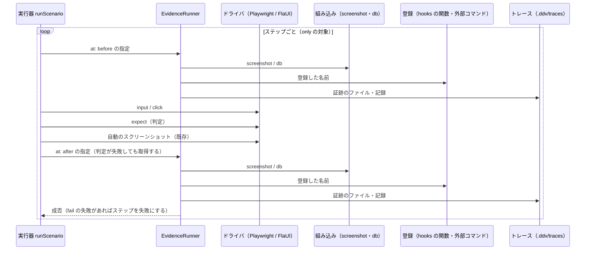
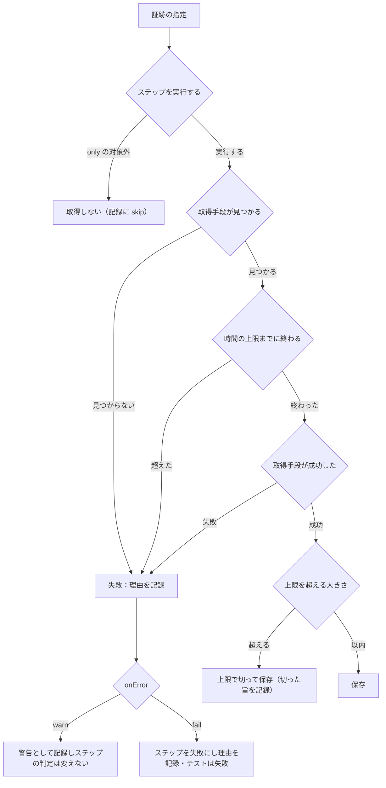
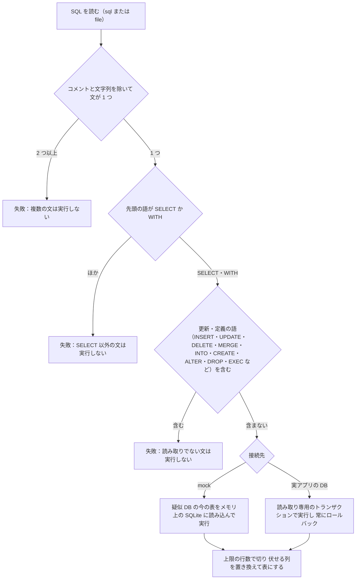
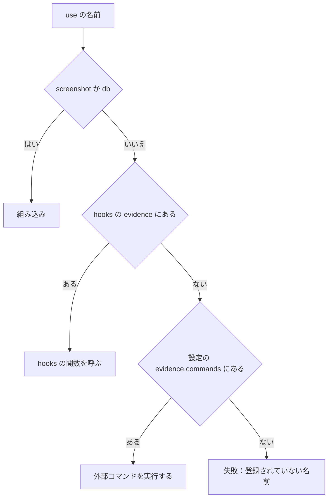
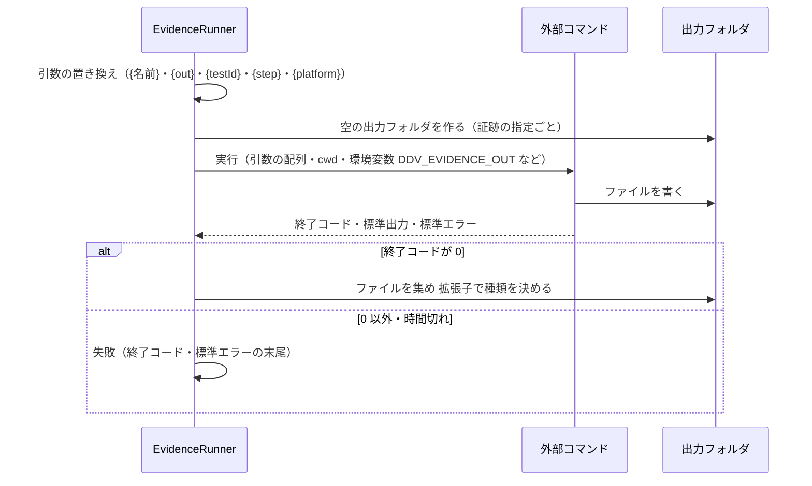
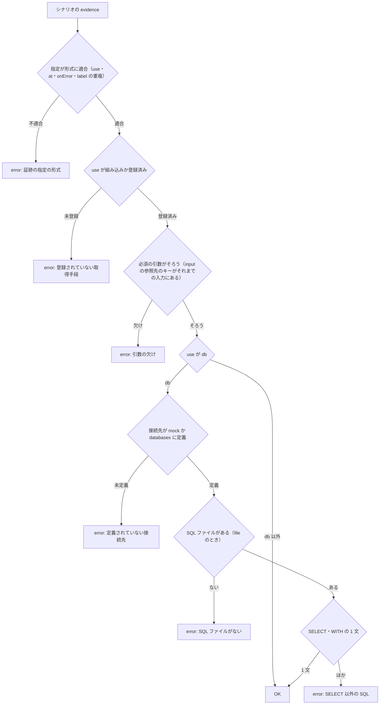
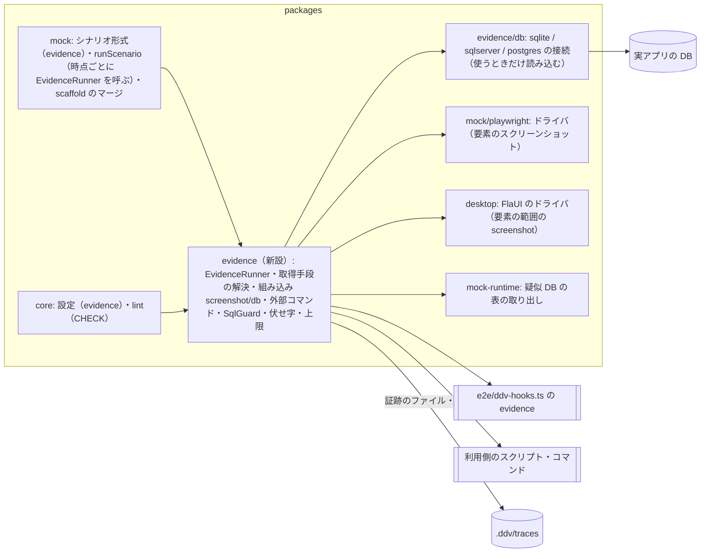
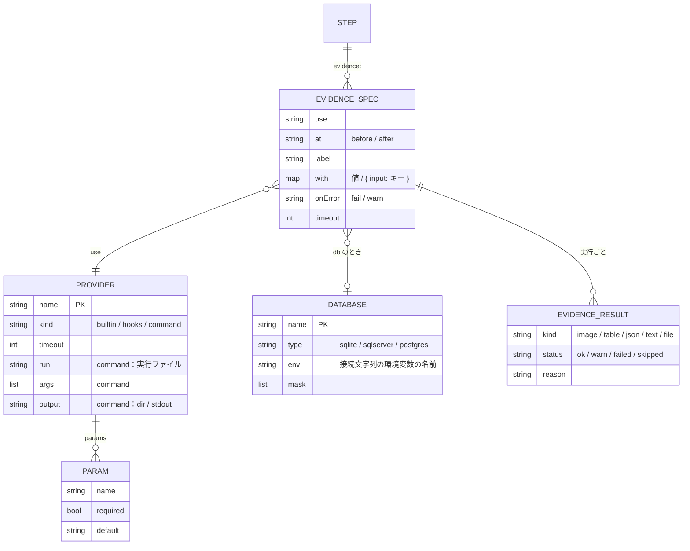

# シナリオからの証跡の取得（指定・組み込み・取得手段の登録）基本設計

## 前提

- 目的は :ref[../requirements/evidence.md#目的]、範囲は :ref[../requirements/evidence.md#スコープ] を参照
- シナリオの形式・実行器は :ref[mock-player.md#シナリオ]・:ref[mock-player.md#e2e-実行データ駆動]、デスクトップでの実行（ドライバ・名前の解決）は :ref[desktop-run.md#実行の流れ]・:ref[desktop-run.md#名前の解決] を土台にする。本書は **ステップに書いた証跡の指定を実行器が取得する方法** と、取得手段の登録・失敗の扱い・検査を扱う
- 取得した証跡の保存形式・表示（ローカル版・Pages 版）は :ref[evidence-view.md#前提] で扱う
- 画面は追加しない（シナリオ・設定・hooks・CLI・`ddv-lint` だけ）

::embed[../requirements/evidence.md#受入基準]

## 用語

| 用語 | 意味 |
|---|---|
| 証跡 | テストの実行中に取得し、トレースのステップに紐づけて残すもの。種類は 画像・表・JSON・テキスト・ファイル |
| 証跡の指定 | シナリオのステップの `evidence:` の 1 項目。取得手段の名前（`use`）・引数（`with`）・時点（`at`）・表示名（`label`）・失敗の扱い（`onError`） |
| 取得手段 | 証跡を作る処理。名前で呼ぶ。**組み込み**（`screenshot`・`db`）と、利用側が登録する **hooks の関数**・**外部コマンド** がある |
| 時点 | `before`＝ステップの操作（入力・クリック）の前、`after`＝判定（`expect`）の後。既定は `after` |
| 接続先（DB） | `db` で SELECT する相手。`mock`（モックの疑似 DB）か、設定の `evidence.databases` に名前で定義した実アプリの DB |
| 自動のスクリーンショット | 既存の、各ステップの判定後に 1 枚撮る画像（:ref[trace-view.md#記録]）。証跡とは別に従来どおり撮る |

## シナリオの書き方

ステップに `evidence:` を足す。書かないステップ・シナリオの動作は変わらない（REQ-810）。式・スクリプトは書かない（REQ-109）。

```yaml
id: BD-ORDER-SCREEN-P001
start: List
steps:
  - event: 新規
    click: new
    expect: { screen: Input }
  - event: 次へ [入力OK]
    input: { customer: 山田 太郎, sku: A-100, quantity: 1 }
    click: next
    expect: { screen: Confirm }
  - event: 確定
    click: submit
    expect: { screen: Done }
    evidence:
      - use: screenshot
        at: before                    # 確定を押す前の確認画面
        label: 確定前の確認画面
        with: { target: confirm-panel }   # 論理名の要素だけ。省略で画面全体
      - use: db
        label: 確定した注文
        with:
          db: app                     # mock / evidence.databases の名前
          sql: SELECT id, customer, sku, quantity, card_no FROM orders WHERE customer = :customer
          params: { customer: { input: customer } }   # シナリオの入力値（直前までの input.customer）
          mask: [card_no]             # 値を伏せて保存する列
      - use: app-log                  # 利用側が登録した取得手段
        label: アプリのログ
        with: { lines: 50 }
        onError: warn                 # 失敗してもステップは成功のまま（警告）
```

| キー | 必須 | 意味 |
|---|---|---|
| `use` | ○ | 取得手段の名前。`screenshot`・`db`・登録した名前 |
| `at` | | `before` / `after`（既定 `after`） |
| `label` | | トレースに出す表示名。省略時は `use`。同じステップ内で重複すると lint の error |
| `with` | | 取得手段の引数。取得手段ごとに決まる（下表・登録の `params`） |
| `onError` | | `fail`（既定）/ `warn` |
| `timeout` | | この指定だけの時間の上限（ミリ秒）。省略時は取得手段・設定の既定 |

- `with` の値は文字列・数値・真偽値・配列、または `{ input: <キー> }`（そのステップまでに入力した値）だけ。それ以外の式は書けない
- 補助ステップ（`only:`）にも書ける。`only:` の対象外で飛ばしたステップの証跡は取得しない（トレースには「取得しない」と残す）
- **骨組みの再生成**（`ddv mock scaffold`）：`evidence:` は生成項目ではないので、対応したステップの `input` と同じく保持する（:ref[mock-player.md#骨組み生成] のマージの規則に `evidence` を加える）。ステップが経路から消えたときは、シナリオごと `_retired/` に移る既存の扱いに従う（REQ-810）

## 取得の流れ



- 同じ時点の指定は **書いた順に 1 つずつ** 取得する（並列にしない。画面・DB の状態を指定の順に固定するため）
- `after` は判定が失敗したステップでも取得する（失敗の調査に使うため）。操作で例外が出て判定まで進まなかったときも、取得を試みる
- 取得は E2E の実行（ローカル版のサーバ・`ddv ci run`・手での `ddv desktop run`）で、トレースの記録が有効なとき（`DDV_TRACE_DIR` がある）だけ行う。プレイヤー・スナップショットでは取得しない（REQ-808 と同じ考え方。指定の表示は :ref[evidence-view.md#前提]）
- 各取得の前後で時間を計り、記録に残す



- 「失敗：理由」には、取得手段の名前・表示名・時点と、例外の文言・外部コマンドの終了コードと標準エラー（末尾 4KB）を残す。接続情報は伏せる（[接続情報の扱い](#接続情報の扱い)）
- 失敗の扱いが `fail` でも、**同じステップの残りの指定は取得する**（調査の材料を減らさない）。ステップの失敗は、そのステップのすべての取得の後に確定する
- 判定がすでに失敗したステップで証跡も失敗した場合は、判定の失敗を主な理由として残し、証跡の失敗を併記する
- 時間の上限：指定の `timeout` → 取得手段の `timeout` → 設定の `evidence.timeout`（既定 30 秒）の順。上限を超えた外部コマンドはプロセスツリーごと終了する

## 組み込みの証跡

### screenshot

| 引数 | 意味 |
|---|---|
| `target` | 要素の論理名。省略で画面全体 |
| `fullPage` | Web だけ。`true` でページ全体（スクロール外を含む）。既定 `false`（表示範囲） |

| プラットフォーム | 画面全体 | 要素（`target`） |
|---|---|---|
| Web（モック・Web アプリ） | Playwright の `page.screenshot` | 要素の解決は入力・期待と同じ（モックは `data-testid`、Web アプリは対応表の `fields`）→ その要素の `screenshot` |
| WPF・WinForms | アプリの前面のウィンドウ | 名前の解決（:ref[desktop-run.md#名前の解決]）で見つけた要素の範囲を切り出す。FlaUI ドライバの `screenshot` に要素の名前を渡せるようにする |

- 要素が見つからない・画面外のときは失敗（理由：論理名・探した名前・プラットフォーム）
- 形式は PNG。自動のスクリーンショットと違い、スナップショット（基準画像との比較）には使わない

### db（SELECT の結果）

| 引数 | 意味 |
|---|---|
| `db` | 接続先。`mock` か `evidence.databases` の名前。省略時は、モックを対象にした実行なら `mock`、それ以外は `evidence.defaultDatabase` |
| `sql` / `file` | どちらか一方。`file` はリポジトリのルートからのパス（`.sql`） |
| `params` | 名前付きのパラメータ（SQL の `:名前`）。値は文字列・数値・真偽値・`{ input: キー }` |
| `mask` | 値を伏せる列の名前の配列（設定の `mask` と合わせて伏せる） |
| `maxRows` | 行数の上限（既定は設定の `evidence.maxRows`） |



- 検査は実行の前（実行器）と `ddv-lint` の両方で同じ関数を使う（REQ-807・REQ-809）。語の検査はコメント・文字列の中を除いて行う
- 実アプリの DB は、検査に加えて **読み取り専用で実行** する：SQLite は読み取り専用で開く、PostgreSQL は `BEGIN READ ONLY`、SQL Server はトランザクションの中で実行して必ずロールバックする。利用側には読み取りだけの権限のユーザーを使うことをスキルで案内する
- 種類ごとの接続は、使うときだけ読み込む（SQL Server・PostgreSQL のクライアントは任意の依存。無ければ「導入が必要」と理由を出して失敗）
- モックの疑似 DB は、取得の時点の mock-runtime の表の内容を取り出し、同じ名前の表としてメモリ上の SQLite に入れて実行する（疑似 DB の状態は変えない）
- 結果は 列名の並び＋行。値は文字列・数値・真偽値・null に変換する（日時は ISO 8601、バイナリは `<binary 123 bytes>`）
- 上限：行数は既定 200、1 つの証跡の大きさは既定 1MB。超えた分は切り、「n 行中 200 行を表示」と記録する
- 伏せる：`mask` の列の値は保存の前に `***` に置き換える（元の値はトレース・ログに残さない）。列名の比較は大文字・小文字を区別しない

## 取得手段の登録



- 組み込みと同じ名前は登録できない（lint の error）。hooks と設定の両方にある名前も error

### hooks の関数

`e2e/ddv-hooks.ts`（既存）に `evidence` を加える。モックを対象にした E2E でも、証跡のために hooks を読み込む（`seed`・`steps` の呼び方は変えない）。

```ts
import { defineEvidence, type EvidenceHooks } from '@ddv/evidence';

export const evidence: EvidenceHooks = {
  'order-api': defineEvidence({
    params: { id: { required: true } },
    timeout: 10_000,
    async run({ id }, ctx) {
      // ctx: platform・testId・step・at・outDir・input（そのステップまでの入力値）
      //      page（Web）/ app（デスクトップ：find・screenshot）
      const res = await fetch(`${process.env.ORDER_API}/orders/${id}`);
      return { kind: 'json', data: await res.json() };
    },
  }),
};
```

- 戻り値は 1 つか配列：`{ kind: 'image', path }`・`{ kind: 'table', columns, rows }`・`{ kind: 'json', data }`・`{ kind: 'text', text }`・`{ kind: 'file', path }`。`path` は `ctx.outDir` の中のファイル
- 例外を投げると失敗。`params` の `required` は lint が検査する（`defineEvidence` の呼び出しをファイルから静的に読む。読めないときは warning で引数の検査を省く）

### 外部コマンド

```yaml
evidence:
  commands:
    app-log:
      run: pwsh                                   # 実行ファイル（シェルを介さない）
      args: [-NoProfile, -File, scripts/collect-log.ps1, -Lines, '{lines}', -Out, '{out}']
      cwd: .                                      # リポジトリのルートから
      params: { lines: { default: 50 } }          # required: true で必須
      output: dir                                 # dir（既定）/ stdout
      timeout: 10000
```



- **シェルを介さず** 引数の配列のまま起動する（引数の値に記号があっても別のコマンドにならない）。`{名前}` の置き換えは引数の 1 要素の中だけ
- 環境変数：`DDV_EVIDENCE_OUT`（出力フォルダ）・`DDV_TEST_ID`・`DDV_STEP`・`DDV_AT`・`DDV_PLATFORM` と、ddv を起動した環境の変数（DB の接続情報など、利用側のスクリプトが使う）
- `output: dir`：出力フォルダのファイルを証跡にする。種類は拡張子で決める（`.png`・`.jpg` は画像、`.csv` は表、`.json` は JSON、`.txt`・`.log` はテキスト、ほかはファイル）。1 つも無ければ失敗
- `output: stdout`：標準出力をテキストの証跡にする（JSON として読めれば JSON）
- 例：PowerShell・Python・`sqlcmd`。Windows 以外でも同じ設定で動く（実行ファイルがあれば）

## 接続情報の扱い

```yaml
evidence:
  databases:
    app:
      type: sqlite                  # sqlite / sqlserver / postgres
      env: DDV_DB_APP               # 接続文字列（SQLite はファイルのパス）を読む環境変数の名前
      mask: [card_no, password]     # この接続先で常に伏せる列
  defaultDatabase: app
```

- 設定・シナリオ・設計書には **接続先の名前と環境変数の名前だけ** を書く。値はローカルでは環境変数（`.env` は ddv が読まない。起動する側で設定する）、Actions では secrets をワークフローの `env:` に渡す（:ref[actions-run.md#ワークフローの雛形] の雛形にコメントで例を足す）
- 環境変数が無いときは、その接続先を使う指定を失敗にする（理由：接続先 `app` の環境変数 `DDV_DB_APP` がありません）
- 例外の文言・外部コマンドの標準エラー・ログを記録する前に、使っている接続先の環境変数の値と、その中の `Password=`・`pwd=`・URL のパスワードの部分を `***` に置き換える。トレースに残すのは接続先の名前と種類だけ（REQ-809）

## 検査（ddv-lint 拡張）



- 登録の読み取り：設定の `evidence.commands` と、`e2e/ddv-hooks.ts` の `evidence` の名前（ファイルを読むだけ。実行しない）。hooks を静的に読めないときは warning（名前・引数の検査を省く）
- 設定の検査：組み込みと同じ名前の登録、hooks と設定の重複、`databases` の `type` が既知でない、`env` が無い、を error にする
- 接続できるか・SQL が正しいか（表・列の有無）は lint では調べない（実行時の失敗として扱う。REQ-806）
- 既存の検査（シナリオの形式・経路・名前）は変えない。`evidence:` の無いシナリオに新しい警告は出ない（REQ-810）

## 構成



- `packages/evidence` は OS に依存しない。SQL の検査（`SqlGuard`）は lint と実行器で共有する
- 実行器から見た取得手段は 1 つの形（名前・引数・文脈 → 証跡の一覧）にそろえ、組み込み・hooks・外部コマンドを同じ扱いにする（REQ-804）

## データ



- 取得の結果（`EVIDENCE_RESULT`）の保存形式とトレースでの持ち方は :ref[evidence-view.md#データ] を参照

## 設定と CLI

```yaml
evidence:
  timeout: 30000            # 1 つの取得の上限（ミリ秒）
  maxRows: 200              # db の行数の上限
  maxBytes: 1048576         # 1 つの証跡の大きさの上限（画像・ファイルは 5MB を上限に別途）
  defaultDatabase: app
  databases:
    app: { type: sqlite, env: DDV_DB_APP, mask: [card_no] }
  commands:
    app-log: { run: pwsh, args: [-NoProfile, -File, scripts/collect-log.ps1, -Out, '{out}'] }
```

| コマンド | 内容 |
|---|---|
| `ddv evidence list [--repo <path>]` | 使える取得手段（組み込み・hooks・外部コマンド）と引数、接続先（名前・種類・環境変数の有無）を表示する |
| `ddv evidence try <名前> [--with key=value ...] [--db <接続先>]` | 1 つの取得手段をその場で実行し、結果の種類・大きさ・理由を表示する（登録の動作確認用。画面の操作はしない） |

- 既存の `ddv desktop run`・`ddv ci run`・サーバの実行は、設定に `evidence` があればそのまま取得する（追加の引数は無い）
- サンプル（`examples/sample-app`）：注文の SQLite の DB（`OrderDomain` が Web・WPF で共用）と `DDV_DB_APP` の例、`scripts/collect-log.ps1`、注文の確定のシナリオに証跡の指定を加える（受入基準の確認用）

## プラグイン

- `ddv-detailed-design` スキルに「証跡の指定」の節を追加する（REQ-811）：
  1. 証跡が要るステップに `evidence:` を書く（画面は `screenshot`、DB は `db` と SELECT、それ以外は登録した取得手段）。時点（`before`・`after`）と `onError` の選び方
  2. 実アプリの DB は `ddv.config.yaml` の `evidence.databases` に名前と環境変数を書き、読み取りだけの権限のユーザーを使う。接続情報はシナリオ・設計書に書かない。Actions は secrets を `env:` に渡す
  3. 独自の取得手段は、`e2e/ddv-hooks.ts` の `evidence`（`defineEvidence`）か、`evidence.commands` の外部コマンドで登録する。`ddv evidence try` で動作を確かめる
  4. `ddv-lint` → E2E の実行 → トレースで証跡を確認、の順に確かめる
- テンプレート：`ddv.config.yaml` に `evidence` の例、`e2e/ddv-hooks.ts` に `evidence` の例、`docs/mocks/sample/scenarios/` のシナリオに `evidence:` の例、`.github/workflows/ddv-tests.yml` に secrets を `env:` に渡す例をコメントで加える

## 試験の観点

| 観点 | 確かめ方 |
|---|---|
| 指定と時点（REQ-801） | 確定のステップに `before`・`after` の 2 つを書いて E2E を実行し、トレースに指定の順・表示名で並ぶ。`before` の画像は確定前の画面。同じシナリオを WPF のサンプルでも実行して同じ 2 つが並ぶ |
| スクリーンショット（REQ-802） | `target` を指定した画像の大きさが要素の範囲と一致する（Web・WPF）。存在しない論理名で失敗し理由に論理名が出る |
| DB（REQ-803・REQ-809） | `orders` の SELECT が `mock` と SQLite の両方で取れる。`{ input: customer }` が入力値になる。`UPDATE`・複文・`WITH … DELETE` が実行されずに失敗する。行数の上限で切られ切った旨が残る。`mask` の列の元の値がトレース・ログのどこにも無い |
| 登録（REQ-804） | hooks の関数と PowerShell のスクリプト（ファイルを出力）を名前と引数だけで呼び、証跡が残る。引数に `;`・`&` を含めても別のコマンドが実行されない |
| 失敗の扱い（REQ-806） | 存在しない表の SELECT でステップが失敗し理由が残る。`onError: warn` でテストは成功し警告が残る。時間の上限を超えたコマンドが終了させられ失敗になる。失敗した指定の後の指定も取得される |
| lint（REQ-807） | 未登録の名前・必須の引数の欠け・未定義の接続先・SELECT 以外・無い SQL ファイルで error、直すと消える。組み込みと同名の登録で error |
| 接続情報（REQ-809） | 接続に失敗させたときの理由・ログに接続文字列・パスワードが含まれない |
| 互換（REQ-810） | 証跡の無い既存のシナリオ・E2E・Pages 版の E2E が変更なしで通り、自動のスクリーンショットが従来どおり。`evidence:` のあるシナリオで scaffold を再実行しても指定が残る |
| 実行器の単体 | `EvidenceRunner`・`SqlGuard`・伏せ字・引数の置き換えを、ドライバ・DB の偽物で Vitest で確かめる（Windows 以外でも動く） |
