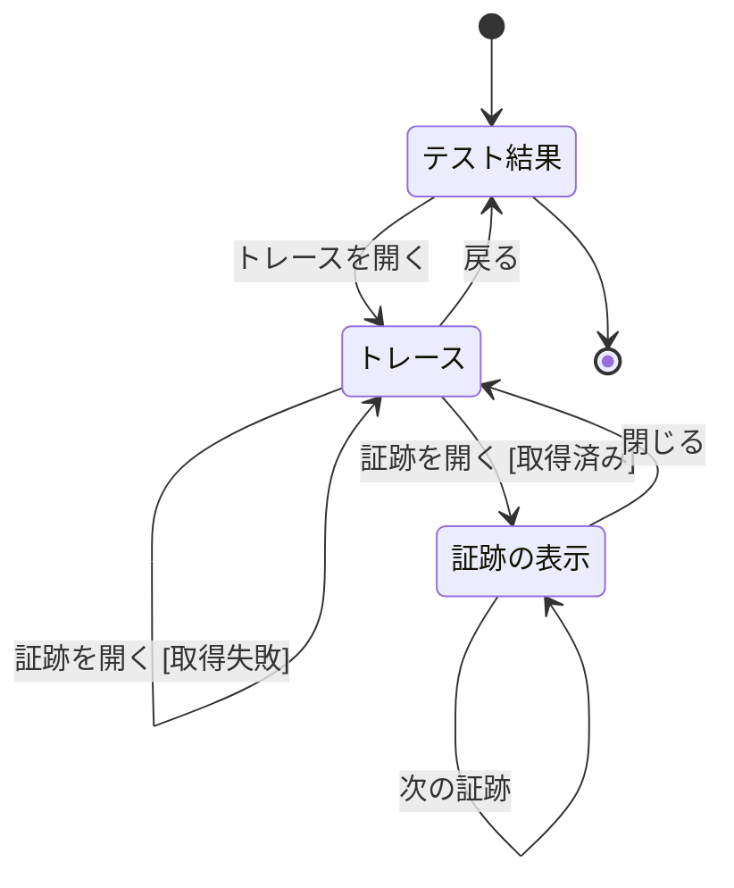
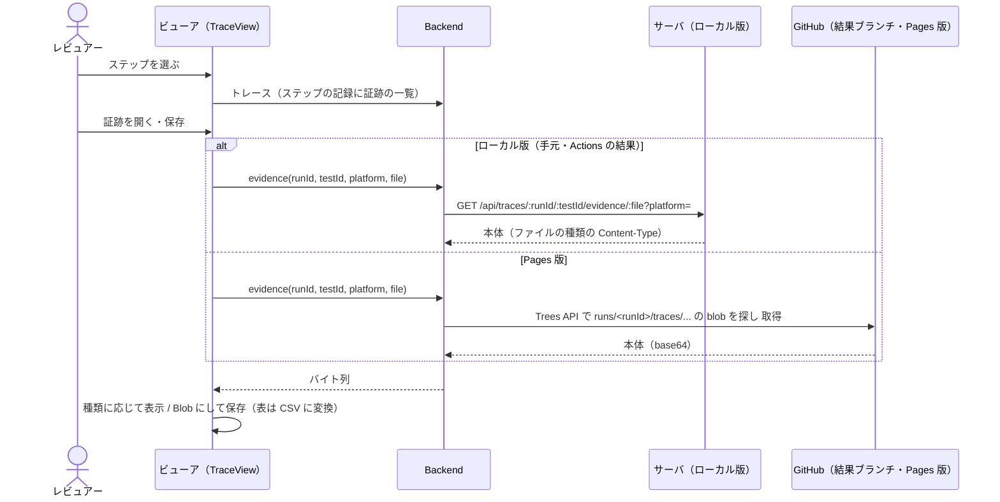
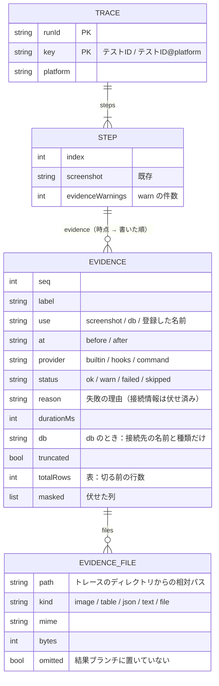
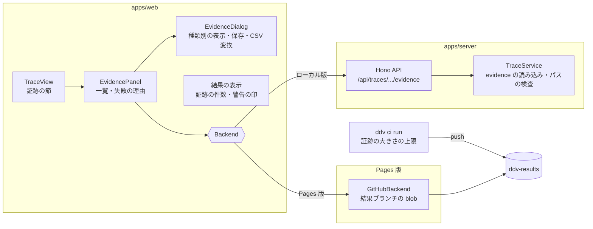

# トレースでの証跡の表示・保存（ローカル版・Pages 版）基本設計

## 前提

- 目的は :ref[../requirements/evidence.md#目的]、範囲は :ref[../requirements/evidence.md#スコープ] を参照
- 証跡の取得（シナリオの指定・取得手段・失敗の扱い）は :ref[evidence-capture.md#前提] で扱う。本書は **取得した証跡をトレースと一緒に保存し、ステップの詳細で表示・保存する方法** を扱う
- トレースの画面・記録・保持件数は :ref[trace-view.md#画面遷移]・:ref[trace-view.md#データ]、プラットフォーム別のキーは :ref[desktop-run.md#結果の表示]、結果ブランチ・Pages 版の読み込みは :ref[actions-run.md#結果ブランチ]・:ref[hosted-viewer.md#内容の取得] のまま。証跡はその中に足す
- Pages 版・プレイヤーには証跡を取得する操作を置かない（REQ-808）

::embed[../requirements/evidence.md#受入基準]

## 用語

| 用語 | 意味 |
|---|---|
| 証跡の一覧 | トレースのステップの詳細に出す、そのステップの証跡の並び（時点 → 書いた順） |
| 証跡の表示 | 1 つの証跡を種類に応じて大きく見せる画面（画像・表・JSON・テキスト・ファイル） |
| 証跡の状態 | `ok`（取得）・`warn`（取得に失敗したが警告）・`failed`（取得に失敗しステップも失敗）・`skipped`（`only:` の対象外で取得しない） |
| 保存 | 証跡をファイルとして手元にダウンロードすること。表は CSV、JSON・テキスト・画像・ファイルは元の形式 |

## 画面遷移

既存のトレースの画面（:ref[trace-view.md#画面遷移]）に、証跡の表示を加える。



- 「トレースを開く」：既存（記録なしの扱いも既存のまま）。プラットフォーム別の結果バッジから開くと、そのプラットフォームの証跡が出る（Web と WPF の証跡は別。REQ-805）
- 「証跡を開く [取得済み]」：状態が `ok`。種類に応じた表示を開く
- 「証跡を開く [取得失敗]」：状態が `warn`・`failed`。表示は開かず、一覧のその行に失敗の理由（取得手段・時点・文言）を広げる。`skipped` の行は押せない
- 「保存」：表示中の証跡をダウンロードする。一覧の各行にも保存のボタンを置く（表示を開かずに保存できる）
- 「次の証跡」：同じステップの次の証跡へ（最後なら最初へ）。キーボード（← →）でも操作できる
- 「閉じる」：Esc でも閉じる。ステップの選択は保つ

## 画面イメージ

::mock[evidence-view/index.html]{diagram=screen-flow}

| 画面 | 主な要素 |
|---|---|
| テスト結果 | 既存。証跡のあるトレースの結果に、証跡の件数（例 `証跡 3`）と、警告・失敗のある印 |
| トレース | 既存のステップの詳細の末尾に「証跡」の節：表示名・時点（操作前 / 判定後）・種類・取得手段・状態・大きさ・「保存」。タイムラインのステップに証跡の件数と警告の印 |
| 証跡の表示 | 表示名・時点・取得手段・取得の時間、本体（下表）、「保存」「次の証跡」「閉じる」。切った・伏せた旨の注記 |

| 種類 | 本体の表示 | 保存の形式 |
|---|---|---|
| 画像 | 画像（クリックで原寸 / 幅合わせの切り替え）。PNG・JPEG・GIF・WebP だけ画像として出す | 元のファイル |
| 表 | 列名の見出し付きの表（横スクロール）。伏せた列の値は `***`、切ったときは「n 行中 m 行」 | CSV（UTF-8 BOM 付き。表計算で開ける） |
| JSON | 整形したテキスト（折りたたみ） | `.json` |
| テキスト | 等幅のテキスト（1MB まで。超えた分は保存だけ） | 元のファイル（`.txt`・`.log`） |
| ファイル | 名前・大きさ・形式だけ（中身は出さない。SVG・HTML もここ） | 元のファイル |

- 中身は **すべて文字として表示** し、HTML として解釈しない（証跡は利用側のスクリプトの出力を含むため）。SVG・HTML は画像・ページとして描かずファイルとして扱う
- プレイヤーのライブ表示（:ref[trace-view.md#ライブ表示]）では、証跡の節に指定（表示名・時点・取得手段）だけを並べ、「E2E の実行で取得します」と出す（REQ-808）

## 保存の流れ



- 本体は開いたときに初めて読む（トレースの読み込みでは一覧の記録だけ）。Pages 版は GitHub API の回数を抑えるため、同じ証跡はページを閉じるまで覚えておく
- Actions で実行した結果は、ローカル版でも Pages 版でも結果ブランチから読む（:ref[actions-run.md#履歴の統合] と同じ）

## 保存先と結果ブランチ

```text
.ddv/traces/<実行ID>/<キー>.json                    … トレース（既存。ステップに evidence を追加）
.ddv/traces/<実行ID>/<キー>/<ステップ番号>.png       … 自動のスクリーンショット（既存）
.ddv/traces/<実行ID>/<キー>/evidence/<ステップ番号>-<連番>-<名前>.<拡張子>
                                                    … 証跡の本体（表は .table.json）
ddv-results: runs/<実行ID>/traces/…                 … 同じ構成で push（:ref[actions-run.md#結果ブランチ]）
```

- `<キー>` は既存のテストID・プラットフォームのキー（`BD-ORDER-SCREEN-P001` / `BD-ORDER-SCREEN-P001@wpf`）。プラットフォームごとに別の証跡になる
- `<名前>` は表示名から作る（ファイル名に使えない文字は `_`、40 文字まで）。連番で重複を防ぐ
- 証跡はトレースと同じ保持件数で消える（:ref[test-monitoring.md#保持件数]、結果ブランチは :ref[actions-run.md#結果ブランチ] のトレースの保持数）
- 結果ブランチに push する証跡の大きさに上限を設ける（1 つ 5MB、1 回の実行の合計 50MB。既定値はワークフローの入力で変える）。超えた証跡は本体を push せず、記録に「大きすぎるため結果ブランチに置いていません」と残す（ローカルの実行では残る）
- 証跡の無い既存のトレースは、証跡の節を出さないだけで従来どおり表示する（REQ-810）

## データ



- 表の本体（`.table.json`）は `{ columns: string[], rows: (string|number|boolean|null)[][] }`。CSV への変換はビューアで行う
- 1 つの取得手段が複数のファイルを返したときは、1 つの `EVIDENCE` に複数の `EVIDENCE_FILE` を持つ（一覧では 1 行、表示ではファイルを切り替える）
- 実行記録の結果（`CASE_RESULT`）には証跡の件数と警告の件数だけを加える（テスト結果の画面の印に使う）

## API

GitHub のワークスペースでは既存と同じく `/api/w/<ワークスペースID>/...` で呼ぶ。

| メソッド | パス | 内容 |
|---|---|---|
| GET | `/api/traces/{runId}/{testId}` | 既存。ステップに `evidence` を加える（項目の追加のみ） |
| GET | `/api/traces/{runId}/{testId}/evidence/{file}` | 証跡の本体。`?platform=`（省略時 `web`）、`?download=1` で `Content-Disposition: attachment`。`{file}` は記録にあるパスだけ受け付ける（`..`・絶対パスは 400） |

- 応答には `X-Content-Type-Options: nosniff` を付け、画像以外は `text/plain`・`application/json`・`application/octet-stream` で返す（ブラウザに HTML として解釈させない）
- Pages 版の Backend は同じ関数（`evidence(runId, testId, platform, file)`）を結果ブランチの blob で実装する（:ref[hosted-viewer.md#内容の取得]）

## 構成



## 試験の観点

| 観点 | 確かめ方 |
|---|---|
| 表示・保存（REQ-805） | 証跡のあるトレースでステップを選ぶと、表示名・時点・種類・状態が指定の順に並ぶ。画像・表・JSON・テキスト・ファイルを開き、保存したファイルの中身が元と同じ（表は CSV で列・行が一致し、伏せた値は `***`） |
| 失敗・警告 | `warn`・`failed` の行を押すと理由が広がり、表示は開かない。理由に接続情報が無い。タイムラインのステップに警告の印 |
| プラットフォーム（REQ-805） | Web と WPF で実行した同じテストIDの証跡が、それぞれのバッジから開いたトレースで別に見られる |
| Pages 版（REQ-808） | Actions で実行した結果を Pages 版で開いて、証跡を表示・保存できる。Pages 版・プレイヤーに取得の操作が無い。大きさの上限を超えた証跡は「結果ブランチに置いていません」 |
| 安全な表示 | `<script>` を含むテキスト・HTML・SVG の証跡が実行されず、文字かファイルとして扱われる。`..` を含むパスの要求が 400 |
| 互換（REQ-810） | 証跡の無い既存のトレース・実行記録・結果ブランチが従来どおり表示される（既存の E2E・Pages 版の E2E が変更なしで通る） |
