# GitHub 連携・PR レビュー 基本設計

## 前提

- 目的は :ref[../requirements/github.md#目的]、範囲は :ref[../requirements/github.md#スコープ] を参照
- 既存のビューア構成は :ref[viewer.md#構成]、モックの規約は :ref[mock-player.md#モック-html-の属性] を参照
- 図の差分は既存の As-Is/To-Be 比較（`compare=`、`diffGraphs`）をそのまま使う

::embed[../requirements/github.md#受入基準]

## 用語

| 用語 | 意味 |
|---|---|
| ワークスペース | ビューアが表示する対象 1 つ。**手元**（`--repo` で起動したリポジトリ）と **GitHub**（`owner/repo` の PR または branch・tag）の 2 種類 |
| キャッシュ | GitHub のリポジトリの clone と worktree を置く場所。既定 `~/.ddv/`（環境変数 `DDV_HOME` で変更）。利用側のリポジトリには何も書かない |
| 保留中レビュー | ddv で付けて、まだ GitHub に送っていないコメントの束。PR ごとにキャッシュに保存し、再起動しても残る |
| アンカー | コメントを付ける場所。ビューア上の要素（本文のブロック・表の行・図のノード/遷移・マトリクスの行・モックの要素）と、ソースの「ファイル・行範囲・その行の内容」の組 |
| 信頼 | GitHub のワークスペースで、PR のコードを手元で実行してよいという利用者の確認（テスト実行・依存の導入・スナップショット撮影の前提） |

## 画面遷移

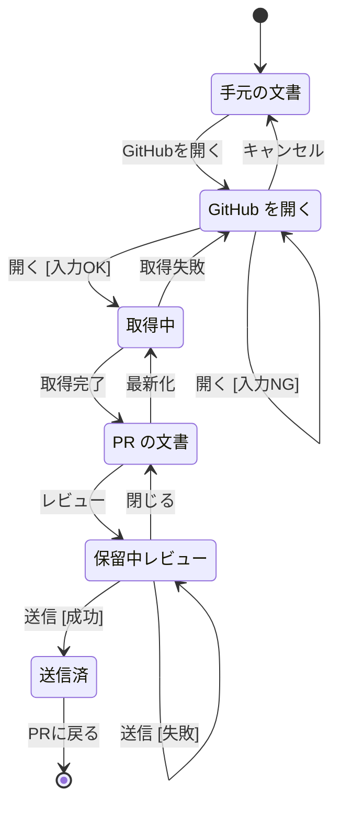

- 「GitHub を開く」の入力 NG：`owner/repo` の形式でない、PR 番号と branch・tag のどちらも無い
- 「送信済」：作成したレビューの URL と件数（行コメント / ファイルコメント / status 更新のコミット）を表示する。「PR に戻る」で PR の文書に戻り、スレッドを取り直す（レビューの 1 回分の終わりとして図では終端にする）
- 「送信 [失敗]」：GitHub が拒否した（Request changes / Comment で本文が空、権限なし、PR がクローズ済み等）。保留中レビューは残し、理由を表示する
- 「PR の文書」は **本文 / 差分** の表示を切り替えられる（画面遷移ではなく表示の切替。どちらでもコメント・レビューの操作は同じ）。branch・tag のワークスペースには差分が無い
- ヘッダのワークスペース切替（手元 / 開いた GitHub の PR・ref の一覧）はどの画面からも使える（手元に戻るのもこれで行う。図では省略）。開いたワークスペースは URL（`/w/<ワークスペースID>/...`）で共有・再読込できる
- 認証が無いときは「GitHub を開く」を押すと、ログイン方法（`gh auth login` または `GITHUB_TOKEN`）を表示して開かない（[認証](#認証) 参照）

## 画面イメージ

::mock[github-review/index.html]

| 画面 | 主な要素 |
|---|---|
| GitHub を開く | `owner/repo`、種類（PR / branch・tag）、PR 番号 または ref 名、最近開いたもの、認証の状態（`gh` / `GITHUB_TOKEN` / なし とログイン名。トークンは出さない） |
| 取得中 | 進捗（clone → fetch → worktree 作成）、取得失敗時の理由 |
| PR の文書（本文） | PR バー（番号・タイトル・`base ← head`・head の短縮 SHA・更新あり・最新化・本文 / 差分の切替・レビュー状態）、文書ツリーの変更印（追加 A / 変更 M / 削除 D）、本文の各要素に「💬」（コメント追加）と既存スレッドの件数、文書ごとのレビュー状態バッジ |
| PR の文書（差分） | 変更された設計書の一覧 → 文書ごとに本文の行差分（追加/削除の色分け）と、図の差分（As-Is/To-Be と同じ色分け）とマトリクスのテストIDの増減 |
| 保留中レビュー | 保留中のコメント一覧（件数は PR バーにも表示。修正・削除・該当箇所へ移動）、行コメント / ファイルコメント（差分外）の区別、種類（Comment / Approve / Request changes）、本文、Approve 時に `status: approved` にする文書の選択 |

## ワークスペース

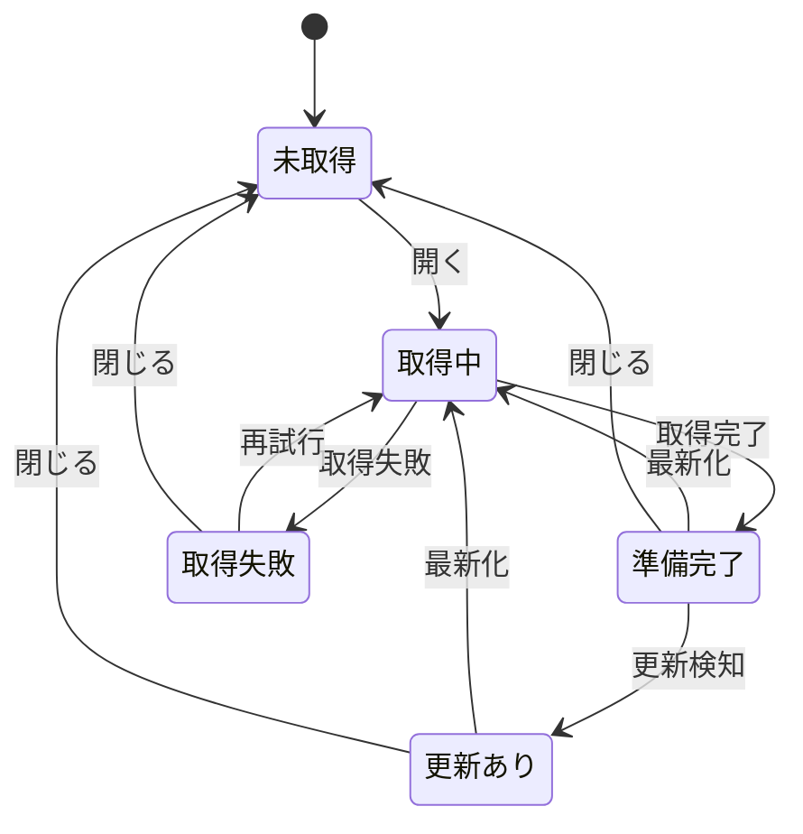

- 手元のワークスペースは常に「準備完了」で、この図の対象外（従来どおり。REQ-209）
- 更新検知：PR を表示している間、60 秒ごとと画面のフォーカス時に PR の head SHA を GitHub に問い合わせ、worktree と違えば「更新あり」を PR バーに出す（自動では更新しない。読んでいる途中の内容が変わらないように）
- 「閉じる」は worktree を削除する。clone（共有）は残し、`ddv gh clean` で消す
- テスト実行の結果（`.ddv/runs`）とスナップショットの今回分は worktree の中に置く（gitignore 済みの場所。利用側のリポジトリの規約どおり）

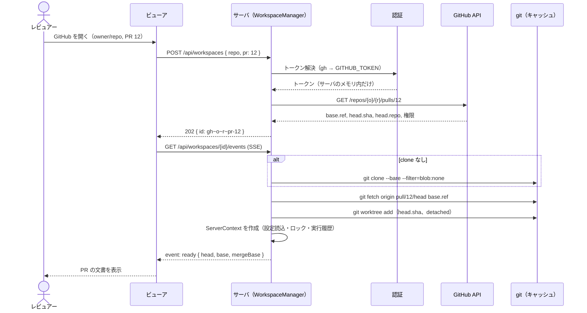

- git への認証もトークンを使うが、コマンドライン引数・git の設定ファイル・remote URL には入れない（環境変数経由で 1 コマンドだけに渡す。詳細設計で決める）
- ワークスペースごとに既存の `ServerContext`（設定・テストID・実行・スナップショット）を作る。既存の API はワークスペースを指定して同じ処理を呼ぶ（[API](#api) 参照）

### PR のコードの実行

テスト実行・スナップショット撮影・依存の導入は PR のコードを手元で実行するので、GitHub のワークスペースでは **初回に「信頼」の確認** を求める（ワークスペースごと。閉じるまで有効）。

| 操作 | 実行するもの | 確認 |
|---|---|---|
| 文書・図・差分の表示、コメント | なし | 不要 |
| モック再生（プレイヤー） | モックの JS（ブラウザの iframe 内。既存と同じ sandbox） | 不要 |
| テスト実行・スナップショット撮影 | ランナー（Vitest / Playwright 等）と PR のコード | 必要 |
| 依存の導入 | `npm ci` 等（ロックファイルで判定）。worktree に `node_modules` が無いときにテスト実行の前に提案 | 必要（導入するかも都度確認） |

## PR の差分

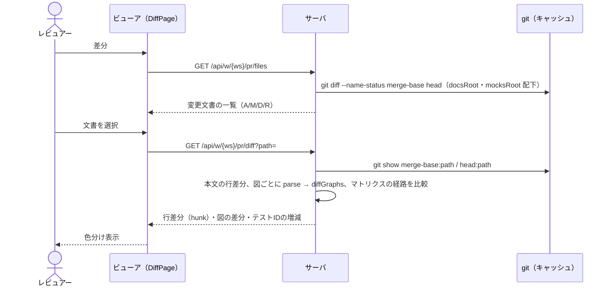

| 対象 | 表示 |
|---|---|
| 本文 | head を描画し、追加・変更された行のブロックに追加の色、削除されたブロックは削除の色で直前に挿入表示（「削除のみ表示」を切替可） |
| 図 | 同じ `id` の図を base と head で比較し、As-Is/To-Be と同じ色分け（追加・削除・変更）。`id` が無い図は位置で対応付け、対応しないものは追加/削除 |
| マトリクス | head のロック（`.ddv/testids.lock.json`）と base のロックを比較し、新規・欠番になったテストIDと経路を一覧表示 |
| モック | 変更されたモックファイルの行差分。モック自体は head を再生 |
| 文書以外 | 一覧に件数だけ出す（ddv は設計書のレビュー用。コードの差分は GitHub で見る） |

- base は merge-base（GitHub の「Files changed」と同じ比較）
- branch・tag のワークスペースには差分画面が無い（PR を開いたときだけ）

## コメント

### アンカー

| ビューアの要素 | 対応するソース行 |
|---|---|
| 見出し・段落・リスト項目・引用 | そのブロックの行範囲 |
| 表の行 | その行 |
| 図のノード / 状態 | 定義した行（`state "…" as X`、`A[…]`。無ければ最初に現れた行） |
| 図の遷移 / 矢印 | その遷移の行 |
| 図（全体）・シーケンス図・ER 図 | フェンスの開始行〜終了行 |
| マトリクスの行（テストID） | 図のフェンスの開始行。本文の先頭にテストIDと経路を引用する |
| モックの要素 | モック HTML の開始タグの行範囲（文言はテキストの行） |

- GitHub の行コメントは **PR の差分に含まれる行（hunk の範囲）** にしか付けられない。差分外の行は **ファイルコメント** として付け、本文の先頭に `L<行>` とその行の内容を引用する。保留中レビューの一覧で区別して表示する
- 削除された行（base 側）へのコメントは、差分画面の削除ブロックから付ける（GitHub の `side: LEFT`）

### コメントの状態

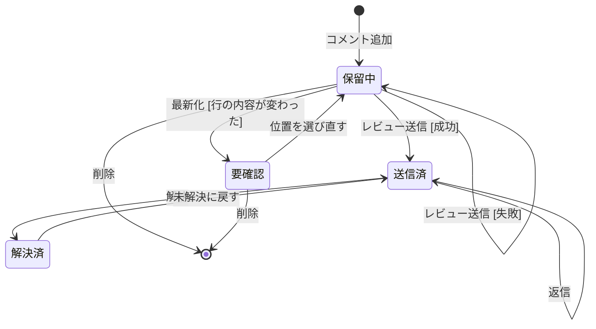

- 最新化で head が変わったら、保留中のコメントを「行の内容」で新しい head の行に付け直す。同じ内容の行が見つからなければ「要確認」にし、送信対象から外す
- 送信済（GitHub 上のスレッド）は、PR の文書の該当要素に件数を出し、開くとスレッド・返信欄・解決状態を表示する。GitHub 側で付いたコメントも同じ（アンカーは GitHub のコメントの `path`・`line` から逆引き）
- 返信と解決/未解決は保留しないで即時に GitHub に送る（GitHub の UI と同じ）

### レビューの送信

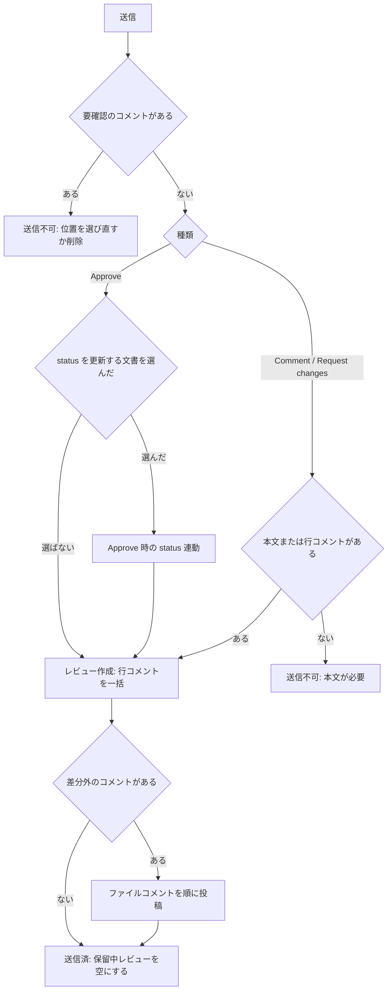

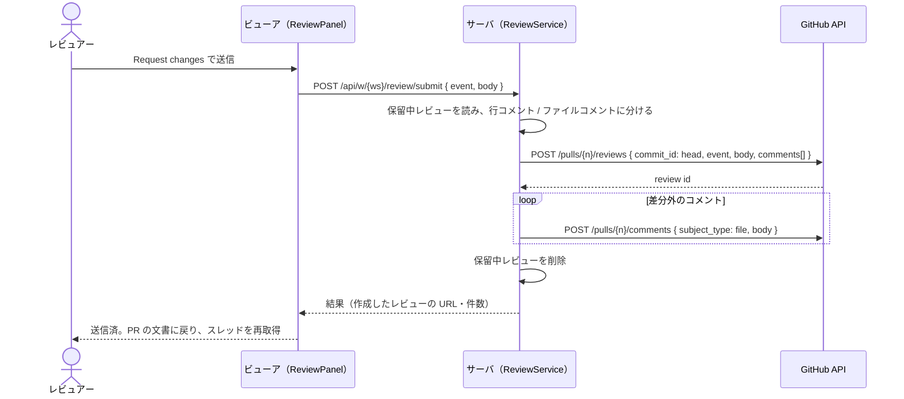

- 途中で失敗したら、成功した分を保留中レビューから外し、残りと理由を表示する（二重投稿しない）

### Approve 時の status 連動

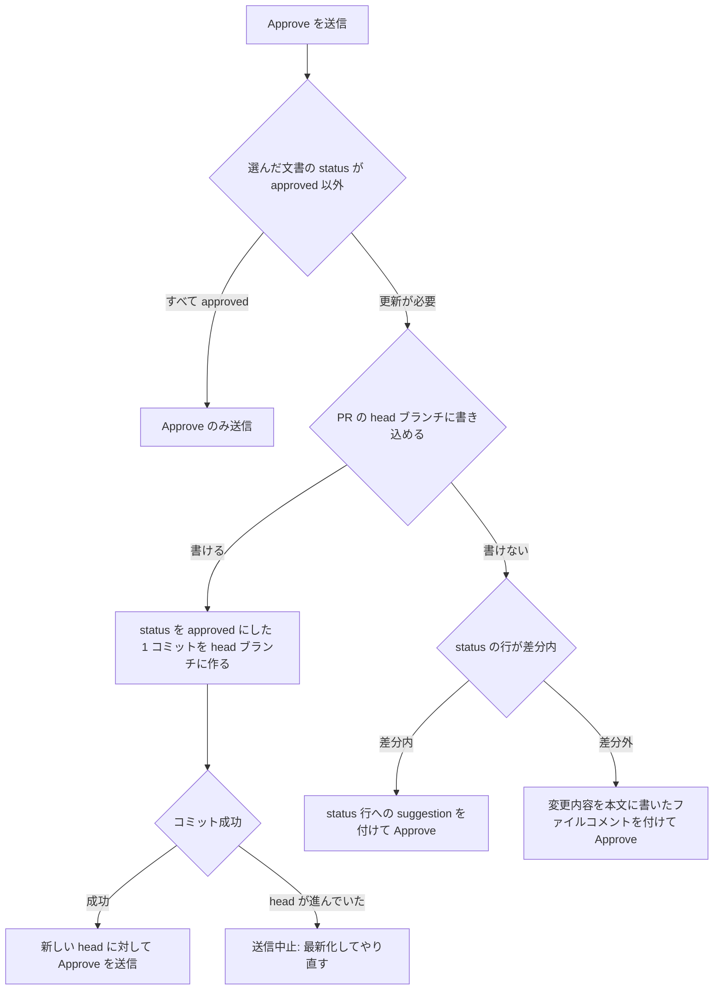

- 「書ける」の判定：PR の head リポジトリへの push 権限がある、またはフォークの PR で `maintainer_can_modify` が有効
- コミットは GitHub API（Git Data）で作り、手元の worktree からは push しない。コミットメッセージは `docs: approve <文書…> (ddv)`
- コミットしてから Approve する（Approve 後のコミットで、ブランチ保護の「古い承認の取り消し」が働かないように）
- PR の文書のレビュー状態バッジ：レビュアーごとの最新のレビュー（Approve / Changes requested / Comment）と、head の front matter の `status` を文書ごとに表示する

## モックの調整モード

モック表示（`::mock`）のツールバーに「調整」を追加する。調整モードの間はプレイヤーを止め、クリックが「要素の選択」になる。

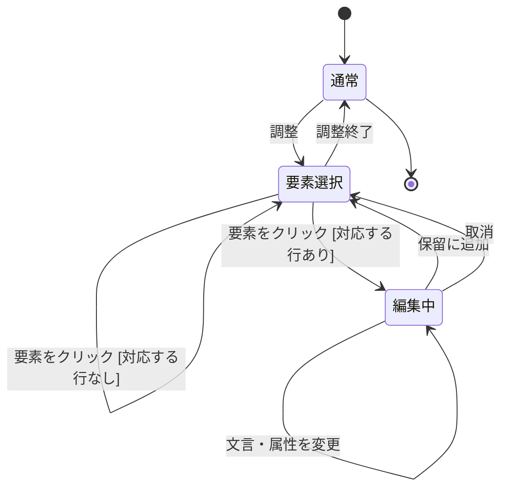

::mock[github-review-tune/index.html]{diagram=tune}

- 図の終端（通常 → 終了）は、調整を終えて文書の表示から離れること（経路の区切りとして置く）

| 編集できるもの | 対象 |
|---|---|
| 文言 | 要素の直下のテキスト（ボタン・ラベル・見出し・段落・`option`） |
| 属性 | `placeholder`・`required`・`maxlength`・`minlength`・`min`・`max`・`step`・`pattern`・`type`（input）・`value`・`title`・`aria-label`、`select` の選択肢（追加・削除・並べ替え・文言） |
| 対象外 | `class`・`style`・CSS（スタイル。範囲外）、`data-*`（ddv の規約。図と連動するため設計書側で直す） |

- 「対応する行なし」：要素が `data-bind` の繰り返しや `mock.js` で作られたもの（HTML ソースに無い）。理由を表示して選び直しにする
- 変更はその場の DOM に反映する（ファイルは変えない）。「保留に追加」で、元の行範囲を置き換える ```` ```suggestion ```` ブロックの行コメントを保留中レビューに追加する
- 同じ要素を何度か変更したら 1 つの suggestion にまとめる。モックを再読込すると DOM の変更は消えるが、保留中のコメントは残る（一覧から該当要素に移動するとその変更を再適用して見せる）
- 手元のワークスペースでも調整はできるが、suggestion にする先が無いので「変更内容の HTML をコピー」だけ

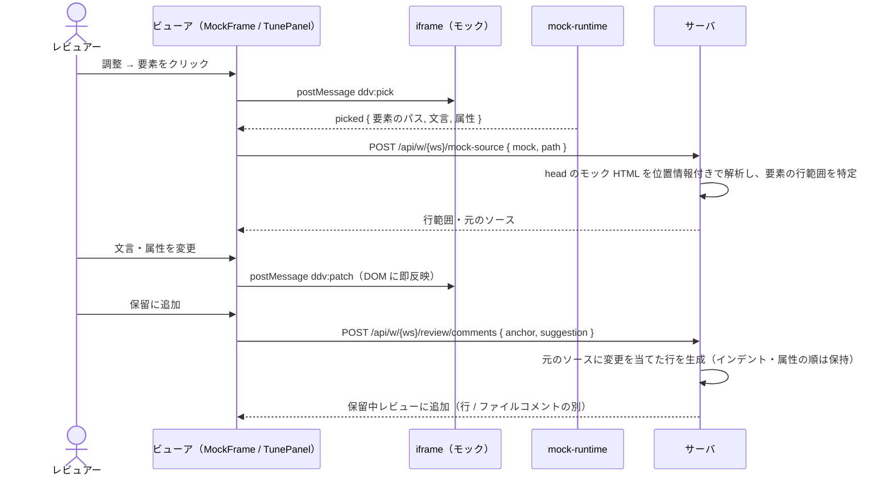

## 認証

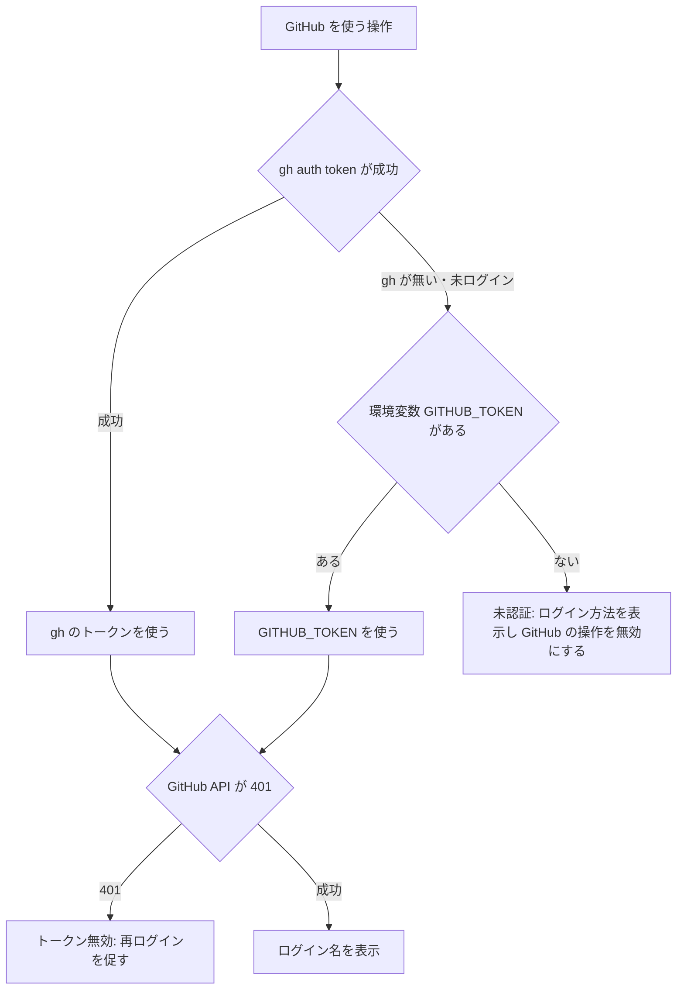

- トークンはサーバのメモリだけに置く。ブラウザへの応答・SSE・ログ・`.ddv` 配下・キャッシュの設定ファイルに出さない。エラー表示は GitHub の応答からトークンを含みうる項目を除いてから出す
- 解決はサーバ起動時ではなく **最初に GitHub を使うとき** に行う（手元だけの利用で `gh` を呼ばない。REQ-209）。401 のときだけ解決し直す
- サーバは従来どおり `127.0.0.1` で待ち受ける。加えて、変更系の API（POST / PATCH / DELETE）は `Origin` がビューア自身でなければ 403、`Host` が `127.0.0.1:<port>` / `localhost:<port>` 以外なら 400（他のサイトからの操作・DNS リバインディング対策）
- 必要な権限：PR の読み取り（clone・API）、レビューの投稿、status 連動のコミットにはリポジトリへの書き込み

## 構成

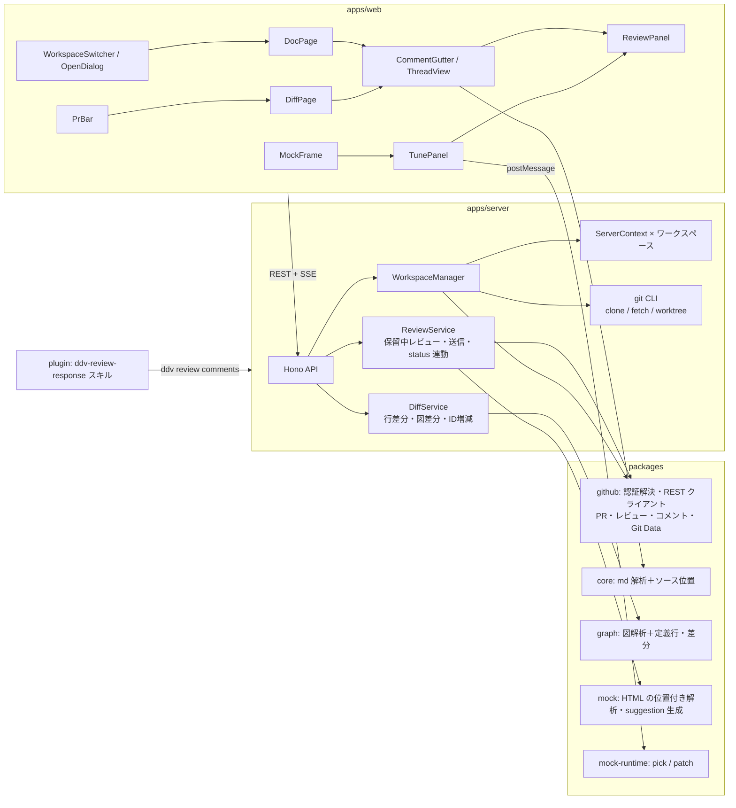

- `packages/github` は依存を増やさず `fetch` で REST を呼ぶ（GitHub API はモックサーバに差し替えてテストする）
- git 操作は `git` CLI を子プロセスで呼ぶ（手元に `git` がある前提。ライブラリは使わない）

## データ

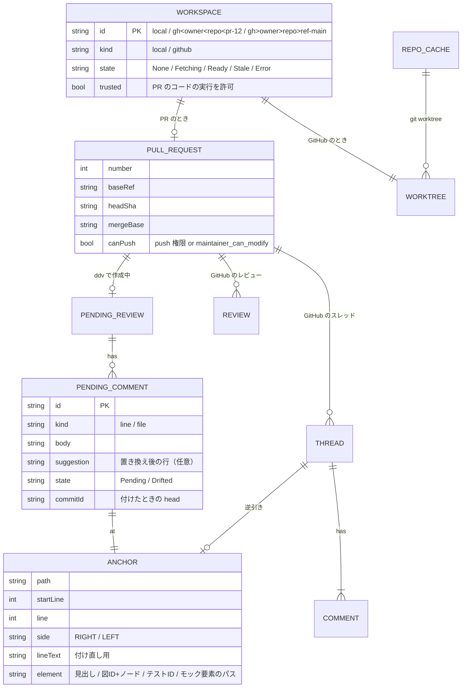

| データ | 置き場所 |
|---|---|
| clone | `~/.ddv/repos/<owner>/<repo>.git` |
| worktree | `~/.ddv/worktrees/<owner>/<repo>/<pr-12 / ref-…>` |
| 保留中レビュー | `~/.ddv/reviews/<owner>/<repo>/pr-12.json`（利用側のリポジトリには置かない） |
| 開いたワークスペースの一覧・信頼 | `~/.ddv/workspaces.json`（トークンは含めない） |
| スレッド・レビュー・PR 情報 | 保存しない（表示のたびに GitHub から取得し、サーバのメモリに短時間だけ保持） |

## API

既存の API（`/api/...`）は **手元のワークスペース** のまま変えない（REQ-209）。GitHub のワークスペースは同じ API を `/api/w/<ワークスペースID>/...` で呼ぶ（`/raw/*` も `/w/<ID>/raw/*`）。

| メソッド | パス | 内容 |
|---|---|---|
| GET | `/api/github/auth` | 認証の状態 `{ source: gh / env / none, login }`（トークンは返さない） |
| GET | `/api/github/pulls?repo=` | PR 一覧（オープン、新しい順） |
| GET | `/api/workspaces` | 開いているワークスペースの一覧と状態 |
| POST | `/api/workspaces` | `{ repo, pr? , ref? }` 開く。202 `{ id }` |
| GET | `/api/workspaces/{id}/events` | 取得の進捗（SSE） |
| POST | `/api/workspaces/{id}/refresh` | 最新化 |
| POST | `/api/workspaces/{id}/trust` | PR のコードの実行を許可 |
| DELETE | `/api/workspaces/{id}` | 閉じる（worktree を削除） |
| GET | `/api/w/{ws}/pr` | PR 情報・head・レビュー状態（文書ごと） |
| GET | `/api/w/{ws}/pr/files` | 変更された文書の一覧 |
| GET | `/api/w/{ws}/pr/diff?path=` | 文書の行差分・図の差分・テストIDの増減 |
| GET | `/api/w/{ws}/pr/threads?path=` | スレッド（アンカー付き） |
| POST | `/api/w/{ws}/pr/threads/{id}/replies` | 返信 |
| POST | `/api/w/{ws}/pr/threads/{id}/resolve` | `{ resolved }` 解決 / 未解決 |
| GET | `/api/w/{ws}/review` | 保留中レビュー |
| POST | `/api/w/{ws}/review/comments` | `{ anchor, body, suggestion? }` 追加 |
| PATCH | `/api/w/{ws}/review/comments/{id}` | 修正・位置の選び直し |
| DELETE | `/api/w/{ws}/review/comments/{id}` | 削除 |
| POST | `/api/w/{ws}/review/submit` | `{ event, body, approveDocs? }` 送信 |
| POST | `/api/w/{ws}/mock-source` | `{ mock, path }` モックの要素の行範囲と元のソース |

## 設定と CLI

GitHub 連携の設定は利用側のリポジトリ（`ddv.config.yaml`）ではなく、ddv を動かす人の環境で持つ（PR ごとにリポジトリの設定が変わっても挙動が変わらないように）。

| 環境変数 | 既定 | 内容 |
|---|---|---|
| `DDV_HOME` | `~/.ddv` | キャッシュ・保留中レビューの置き場所 |
| `GITHUB_TOKEN` | — | `gh` が使えないときのトークン |
| `DDV_GITHUB_POLL` | `60` | 更新検知の間隔（秒。`0` で無効） |

| コマンド | 内容 |
|---|---|
| `ddv serve --repo <path>` | 従来どおり（手元のワークスペースだけ） |
| `ddv serve [--repo <path>] --github <owner/repo> [--pr <n> \| --ref <name>]` | 起動時にそのワークスペースを開いて表示する（`--repo` 省略時は手元のワークスペース無し） |
| `ddv gh clean [--repo <owner/repo>]` | 閉じたワークスペースの worktree と clone を削除 |
| `ddv review comments --github <owner/repo> --pr <n> [--json]` | PR のスレッドを、文書・見出し・図の要素・テストID 付きで出力（プラグインのスキルが使う） |

## プラグイン：レビュー対応スキル

`plugin/skills/ddv-review-response/SKILL.md` を追加する（REQ-208）。

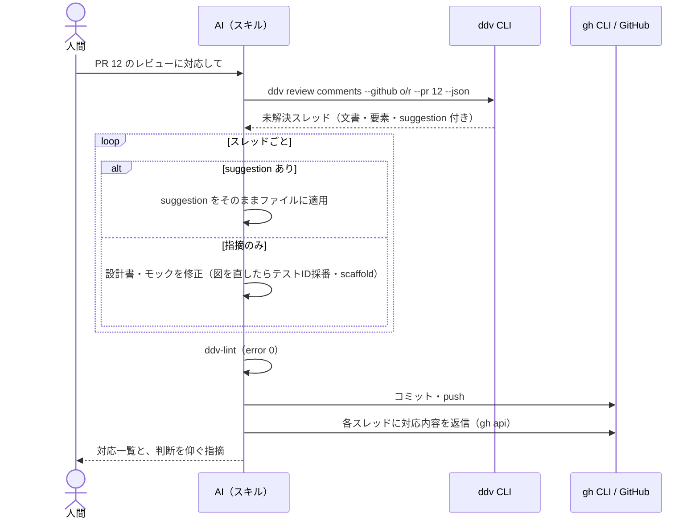

- 承認済み（`status: approved`）の文書への指摘は、修正せず人間に確認する（既存スキルの禁止事項と同じ）
- 解決（resolve）はレビュアーが行う。スキルは返信までにする
