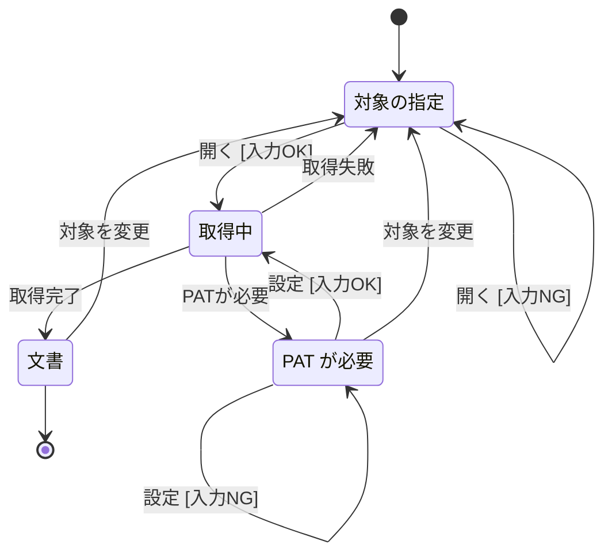
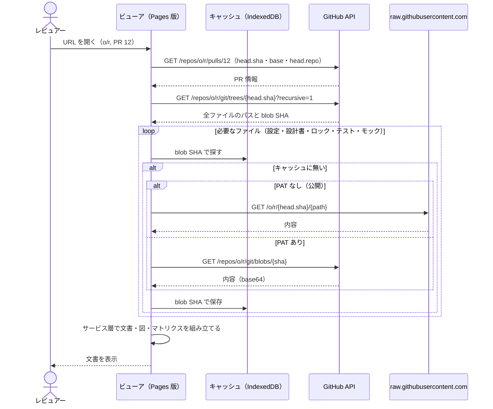
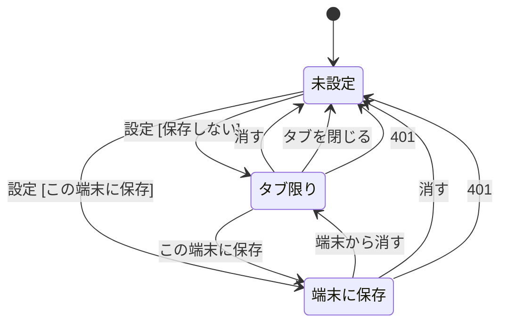
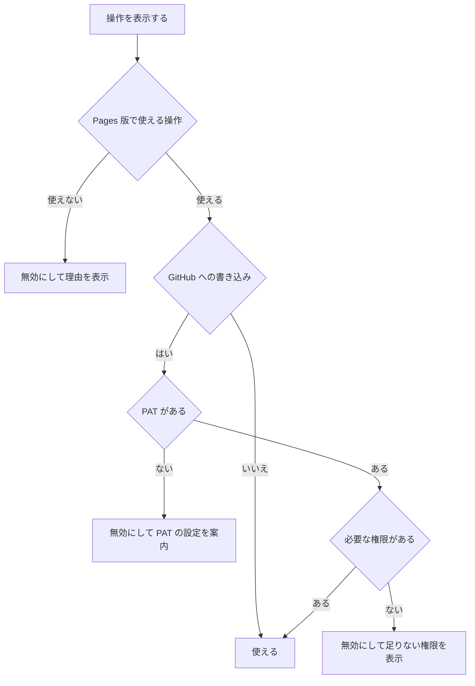
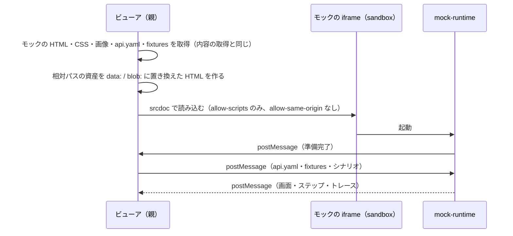
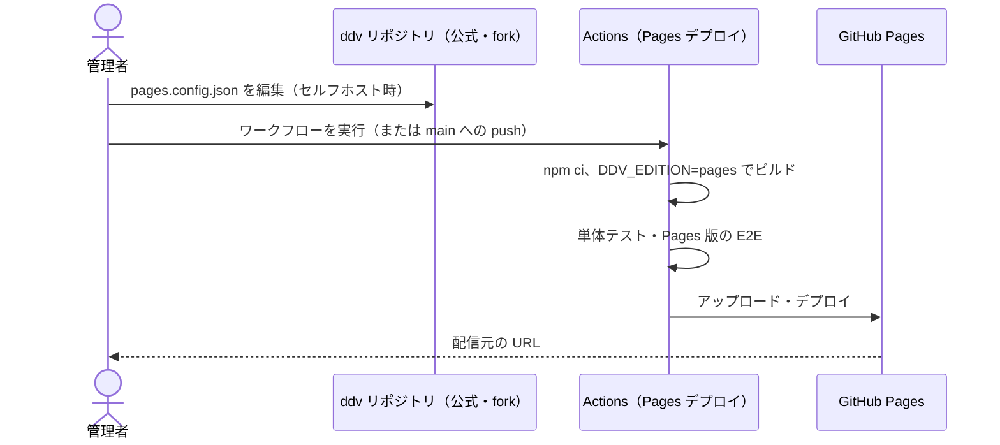
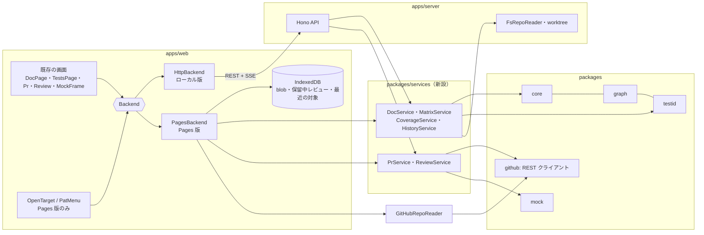
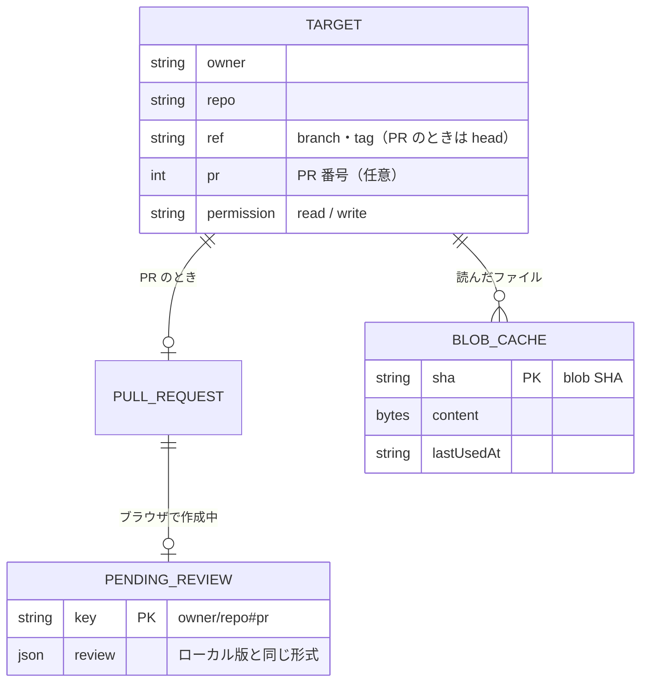

# Pages 版ビューア（GitHub 直結・PAT）基本設計

## 前提

- 目的は :ref[../requirements/hosted.md#目的]、範囲と版の切り分けは :ref[../requirements/hosted.md#pages-版とローカル版の切り分け] を参照
- 画面・操作は既存のビューア（:ref[viewer.md#構成]）と PR レビュー（:ref[github-review.md#画面遷移]）をそのまま使う。本書は **ddv のサーバが無いときに同じ画面を動かす方法** と、Pages 版だけの画面（対象の指定・PAT）を扱う
- Actions でのテスト実行は :ref[actions-run.md#前提]、ローカル版の起動トークンは :ref[local-folder.md#起動トークン] で扱う

::embed[../requirements/hosted.md#受入基準]

## 用語

| 用語 | 意味 |
|---|---|
| Pages 版 | 静的ファイルだけで動くビルド。ブラウザが GitHub と直接通信する。**公式版**（ddv リポジトリの GitHub Pages）と **セルフホスト版**（fork・テンプレートから自組織の Pages へデプロイ）がある |
| 対象 | 表示するリポジトリ（`owner/repo`）と、branch・tag または PR 番号の組 |
| PAT | 利用者が入力する GitHub の Personal Access Token。ブラウザの中だけで使う |
| Backend | 画面がデータを得る窓口。ローカル版は **HTTP**（従来の `/api/...`）、Pages 版は **ブラウザ内**（サービス層を直接呼ぶ）。どちらを使うかはビルド時に決める |
| サービス層 | 文書の組み立て・マトリクス・カバレッジ・PR の差分・スレッドのアンカー・レビューの送信など、サーバにあった処理を環境に依存しない形にまとめたもの。ファイルの読み取り（`RepoReader`）と GitHub の呼び出し（`GitHubClient`）を外から受け取る |
| RepoReader | 対象のファイルを読む窓口。ローカル版は手元のファイル・worktree、Pages 版は GitHub（[内容の取得](#内容の取得)） |

## 画面遷移

Pages 版で、文書を表示するまでの遷移。文書を表示した後の遷移（ドキュメント / テスト、PR の差分・レビュー）は :ref[viewer.md#画面遷移] と :ref[github-review.md#画面遷移] のまま変えない。

- URL に対象があるときは「対象の指定」を表示せず、「開く [入力OK]」を自動で行う（URL を共有すれば同じ画面が開く。REQ-601）
- 「開く [入力NG]」：`owner/repo` の形式でない、PR 番号が数字でない
- 「PATが必要」：GitHub が 404 / 401 を返し PAT が未設定（非公開リポジトリは PAT が無いと 404 になる）。PAT を設定済みで 404 のときは「取得失敗」（見つからない・権限が無い）
- 「取得失敗」：リポジトリ・ref・PR が無い、API の回数制限、通信の失敗。理由（回数制限なら解除の時刻と、PAT を設定すると上限が上がること）を表示する
- ヘッダの **PAT メニュー**（設定・この端末に保存・消す・必要な権限）はどの画面からも使える（図では省略。[PAT の扱い](#pat-の扱い)）。設定・消した後は対象を取得し直す
- 「文書」で PR のときは、Phase 3 と同じ PR バー・本文 / 差分の切替・レビューが使える。書き込みの操作は [操作の可否](#操作の可否) に従う

## 画面イメージ

::mock[hosted-viewer/index.html]{diagram=screen-flow}

| 画面 | 主な要素 |
|---|---|
| 対象の指定 | `owner/repo`、種類（PR / branch・tag）、PR 番号 または ref 名、最近開いた対象、版の表示（公式版 / セルフホスト版と配信元） |
| 取得中 | 進捗（ファイル一覧 → 設計書 → ロック・設定）、API の残り回数 |
| PAT が必要 | PAT の入力欄（伏せ字）、「この端末に保存」（既定オフ）、必要な権限の案内と作成ページへのリンク、PAT は GitHub 以外へ送らないことの説明 |
| 文書 | 既存の文書画面。ヘッダに対象・PAT メニュー・API の残り回数。使えない操作は無効にして理由を表示（REQ-609） |

## URL

ハッシュ（`#/...`）で表す。GitHub Pages は任意のパスの再読込に対応しないため。

| URL | 表示 |
|---|---|
| `<配信元>/` | 対象の指定 |
| `<配信元>/#/gh/<owner>/<repo>/ref/<ref>/doc/<文書のパス>` | branch・tag の文書（`ref` は `/` を `%2F` にする） |
| `<配信元>/#/gh/<owner>/<repo>/pr/<番号>/doc/<文書のパス>?view=diff` | PR の文書（`view=diff` で差分） |
| …`/doc/<文書のパス>?h=<見出しのスラッグ>` | 見出しまで移動 |
| …`/tests` | テストタブ |

- ref を省略したときは既定ブランチ。URL に PAT・コミット SHA の固定は含めない（共有した相手も最新を見る）
- ローカル版の URL（`/w/<ワークスペースID>/...`）とは別。ローカル版の画面からも「この画面の Pages 版の URL をコピー」を出す（`ddv.config.yaml` に Pages の配信元が書かれているとき）

## 内容の取得

- 読むファイルは、ローカル版のサーバが読むものと同じ（`ddv.config.yaml`、`docsRoot`・`mocksRoot` の配下、`.ddv/testids.lock.json`、`runners` の `include` に合うテストファイル）。ファイル一覧は Trees API の 1 回で得る
- PAT が無いとき API は 60 回 / 時（IP ごと）なので、ファイルの内容は API を使わず raw から取る。API を使うのは PR 情報・ファイル一覧・スレッドなど少数に限る
- blob SHA は内容で決まるので、キャッシュは期限なしで使い回す（上限を超えたら古い順に消す。既定 50 MB）
- PR の差分の base 側も同じ方法で読む（merge base の tree）
- **未コミットの変更** は Pages 版には存在しない。表示するのは常にコミット済みの内容

## PAT の扱い

| 状態 | 置き場所 |
|---|---|
| タブ限り | `sessionStorage`（タブを閉じると消える。既定） |
| 端末に保存 | `localStorage`（「この端末に保存」を選んだときだけ） |

- 「401」：PAT が失効・取り消された。保存していた PAT も消し、「PAT が無効です」と表示する
- 送信先：PAT は `api.github.com` への要求の `Authorization` にだけ付ける。raw・Pages の配信元には付けない。URL・`console`・エラー表示に出さない（エラー表示は Phase 3 と同じく、応答からトークンを含みうる項目を除く）
- **CSP**：Pages 版の HTML に `connect-src 'self' https://api.github.com https://raw.githubusercontent.com`、`img-src 'self' data: blob: https://*.githubusercontent.com`、`frame-src 'self' blob:` を `<meta>` で付け、それ以外への通信をブラウザに拒否させる（REQ-608 の受入基準）
- 必要な権限（fine-grained PAT）：閲覧＝Contents: Read、Pull requests: Read。レビュー＝Pull requests: Write。Approve の status 連動・Actions の実行＝Contents: Write、Actions: Write（[actions-run.md](actions-run.md)）。画面の案内は操作ごとに「足りない権限」を示す

## 操作の可否

| 操作 | Pages 版 | 理由の表示 |
|---|---|---|
| 未コミットの変更の閲覧 | 使えない | 「Pages 版はコミット済みの内容だけを表示します」 |
| テストデータ・ファイルの保存 | 使えない（PR への suggestion は使える） | 「ファイルの保存はローカル版で行います。PR には suggestion として付けられます」 |
| テストID採番・lint・骨組み生成 | 使えない | 「手元の ddv で実行してください」 |
| 手元のランナーでのテスト実行・依存の導入・スナップショット撮影 | 使えない（Actions での実行は使える） | 「Pages 版は Actions で実行します」 |
| コメント・返信・解決・レビューの送信 | 書き込み | — |
| Approve の status 連動・モックの調整の suggestion | 書き込み | — |

- 権限は、対象を開いたときに `GET /repos/{o}/{r}` の `permissions` で調べる（PAT が無いときは読み取りのみとみなす）
- **ロックの警告**：Pages 版は採番できないので、文書の図から求めたテストIDの経路と `.ddv/testids.lock.json` を比べ、ロックに無い経路（新しい経路）があれば文書の先頭とマトリクスに「テストIDのロックが図より古い（`ddv-testid generate` が未実行）」と表示する。該当行は仮IDで表示する（ローカル版の未採番と同じ表示）

## PR レビュー

- Phase 3 の画面・操作（:ref[github-review.md#コメント]）を変えずに、サービス層をブラウザで動かす
- 保留中レビューは IndexedDB に PR ごとに保存する（形式はローカル版の `~/.ddv/reviews/...json` と同じ）。別の端末には引き継がない
- 送信・返信・解決・Approve の status 連動は、ローカル版と同じ GitHub API を PAT で呼ぶ（status 連動のコミットは Git Data API。clone は使わない）
- 更新の検知（head SHA の変化）はローカル版と同じ間隔で行う。ただし PAT が無いときは回数制限を考え 5 分ごとにする

## モックの再生

- **隔離**：PR のモックの JS は利用者が書いたものなので、Pages の配信元と同じオリジンで動かすと PAT を読める。Pages 版はモックを sandbox（`allow-scripts` のみ）の iframe で動かし、親とは `postMessage` だけでやり取りする。モックから GitHub や外部への通信は CSP で止める
- ローカル版は従来どおり（`/raw/...` から読む）。プレイヤー・調整モード・トレースの記録は、親との通信が `postMessage` だけになるように揃え、両方の版で同じ動作にする（詳細設計で既存の `bridge` を確認する）

## デプロイとセルフホスト

- 公式版とセルフホスト版は **同じビルド手順** で、違いは `apps/web/pages.config.json` だけ（REQ-611）

| 設定 | 既定（公式版） | 内容 |
|---|---|---|
| `title` | `ddv` | ヘッダ・タブの表示名 |
| `defaultTarget` | なし | 対象を省略して開いたときの対象（例：自組織の設計リポジトリ） |
| `recentTargets` | `[]` | 対象の指定に最初から出す候補 |
| `allowedOwners` | なし（すべて） | 開ける `owner` の制限（セルフホストで自組織に限るとき） |

- ビルド時の版は環境変数 `DDV_EDITION`（`local` / `pages`、既定 `local`）で決め、`import.meta.env` の定数で分岐する。Pages 版のビルドには HTTP の Backend を含めず、`127.0.0.1` への要求が発生しないことを E2E で確かめる（REQ-614）
- ddv リポジトリに `.github/workflows/pages.yml` を追加する（`workflow_dispatch` と `main` への push。fork では管理者が Pages を有効にして実行する）

## 構成

- サービス層は `node:fs`・`child_process` を使わない。ファイルは `RepoReader`、時刻・乱数などは引数で受け取る。サーバは従来の API の中身をサービス層の呼び出しに置き換える（API の形は変えない。REQ-610）
- `packages/github` は既に `fetch` だけで動くので、ブラウザでもそのまま使う。トークンの解決（gh / 環境変数）だけはサーバ側に残す
- Backend の差は「読み取り元」と「使えない操作」だけにし、画面は版で分岐しない（分岐は [操作の可否](#操作の可否) の判定 1 か所）

## データ

| データ | 置き場所 |
|---|---|
| PAT | `sessionStorage`（既定）/ `localStorage`（この端末に保存） |
| ファイルの内容 | IndexedDB `blobs`（blob SHA をキー） |
| 保留中レビュー | IndexedDB `reviews` |
| 最近開いた対象・表示の設定 | `localStorage`（PAT は含めない） |
| スレッド・PR 情報・Actions の結果 | 保存しない（表示のたびに GitHub から取得し、メモリに短時間だけ保持） |

## 試験の観点

| 観点 | 確かめ方 |
|---|---|
| GitHub 以外へ通信しない（REQ-608） | Pages 版の E2E で、モックの GitHub（API・raw）と配信元以外への要求を記録し、0 件であること・PAT が API への要求にしか無いこと |
| ローカルサーバを呼ばない（REQ-614） | Pages 版のビルドの成果物に `/api/` への HTTP の Backend が含まれないこと、E2E で `127.0.0.1` への要求が無いこと |
| 版で画面が同じ（REQ-602・603） | 既存の PR レビュー・モック再生の E2E を、GitHub のモックを相手に Pages 版でも流す |
