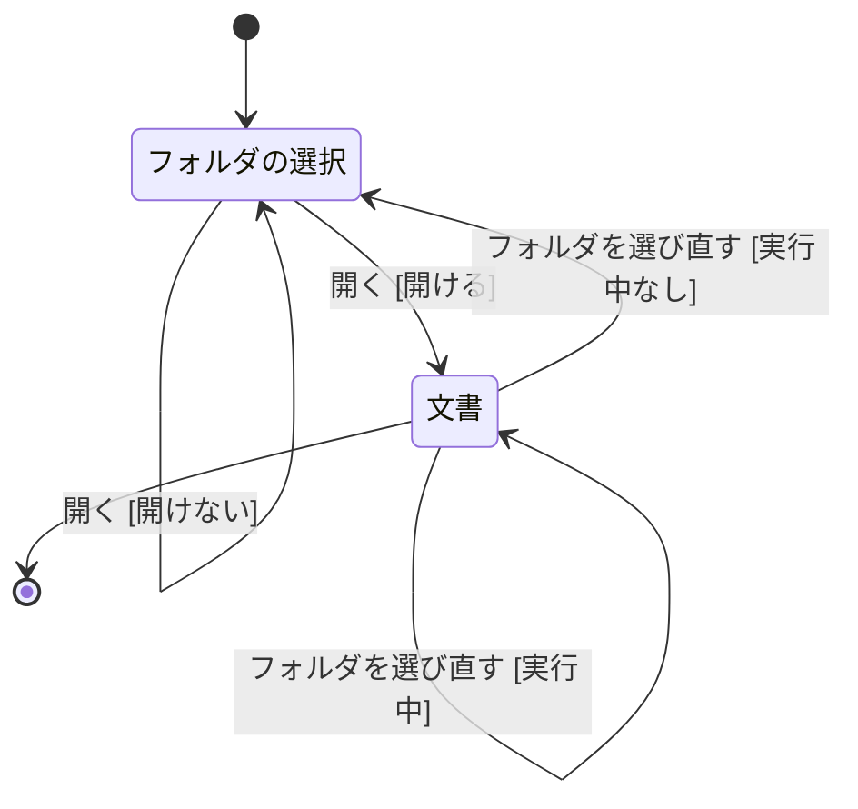
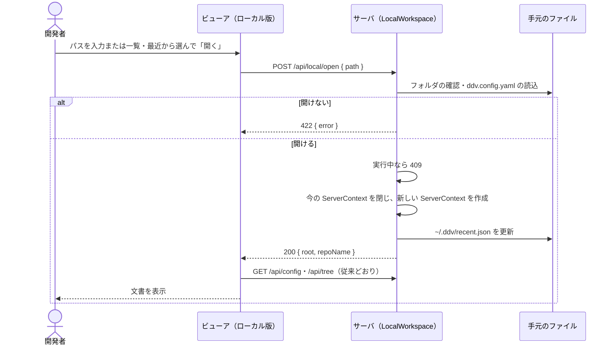
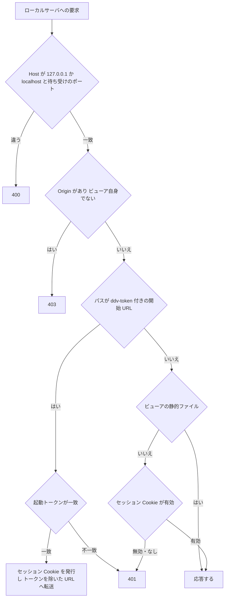
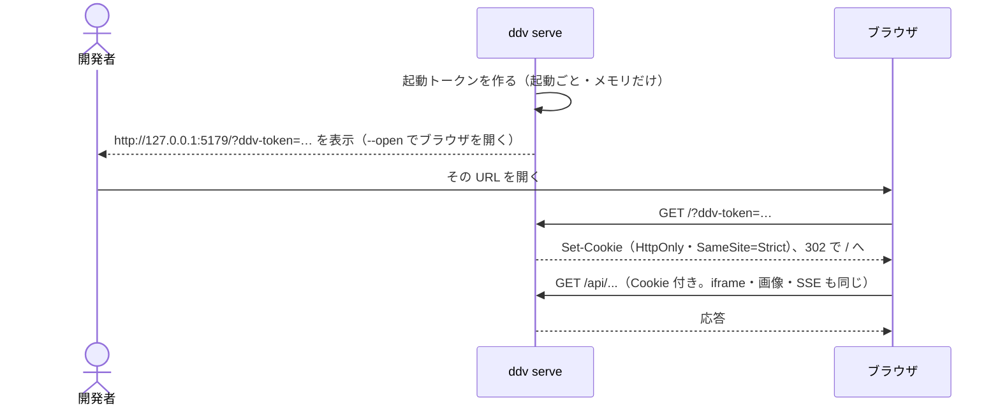
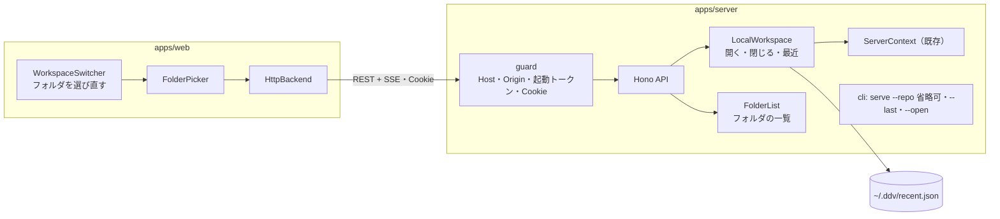
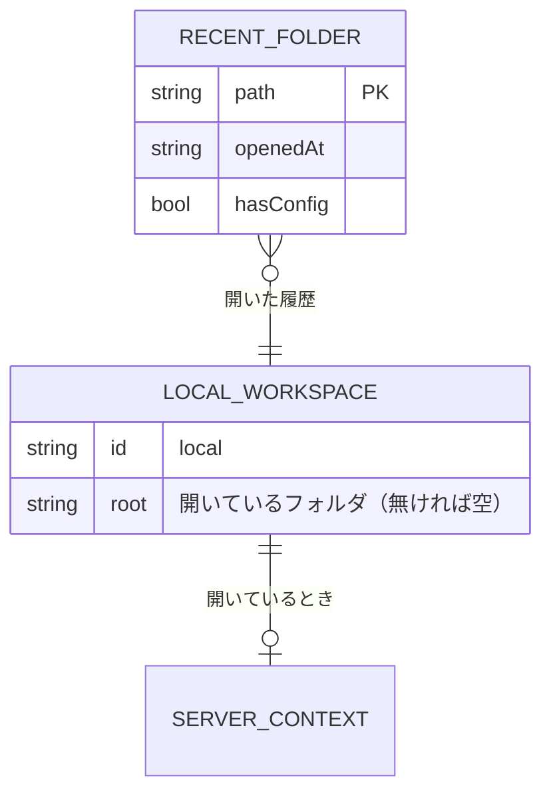

# ローカル版の作業フォルダ選択・起動トークン 基本設計

## 前提

- 目的は :ref[../requirements/hosted.md#目的]、版の切り分けは :ref[../requirements/hosted.md#pages-版とローカル版の切り分け] を参照
- 手元のワークスペース・GitHub のワークスペースの考え方は :ref[github-review.md#ワークスペース] のまま。本書は **手元のワークスペースの対象（フォルダ）を画面で選べるようにすること** と、ローカルサーバへの要求の検査を扱う
- Phase 5 までの機能・認証・動作は変えない（REQ-610）。`--repo` を付けて起動したときの画面・API は従来と同じ

::embed[../requirements/hosted.md#受入基準]

## 用語

| 用語 | 意味 |
|---|---|
| 作業フォルダ | 手元のワークスペースとして開くフォルダ。同時に 1 つ |
| 最近開いたフォルダ | 開いたフォルダの履歴（最大 10 件）。`~/.ddv/recent.json` に保存 |
| 起動トークン | `ddv serve` が起動のたびに作る推測できない値。これを知っているブラウザだけがローカルサーバを使える |
| セッション Cookie | 起動トークンを確かめた後にサーバが発行する Cookie（`HttpOnly`・`SameSite=Strict`）。以後の要求はこれで確かめる |

## 画面遷移

- `--repo` を付けて起動したとき、または前回のフォルダを開き直すとき（`--last`）は「フォルダの選択」を出さず「開く [開ける]」を自動で行う（従来と同じ画面から始まる）
- 「開く [開けない]」：パスが無い・フォルダでない・読めない。理由を表示し、最近開いたフォルダに無いパスなら一覧から消す
- 開けるフォルダの条件は「読めるフォルダ」だけ。`ddv.config.yaml` が無いフォルダも従来どおり既定の設定で開く（一覧では `ddv.config.yaml` のあるフォルダに印を付ける）
- 「フォルダを選び直す [実行中]」：手元のテスト・スナップショット・依存の導入が実行中。理由を表示して選び直さない
- 「フォルダを選び直す [実行中なし]」：今のフォルダを閉じる（監視・実行の管理を止める）。保留中レビュー・GitHub のワークスペースは閉じない
- ヘッダのワークスペース切替（:ref[github-review.md#画面遷移]）に「フォルダを選び直す」を加える。GitHub の PR・branch のワークスペースは従来どおり同時に開ける

## 画面イメージ

::mock[local-folder/index.html]{diagram=screen-flow}

| 画面 | 主な要素 |
|---|---|
| フォルダの選択 | パスの入力欄、フォルダの一覧（今の場所・上の階層へ・`ddv.config.yaml` のあるフォルダの印・ドライブ / ホーム）、最近開いたフォルダ（パス・開いた日時・削除）、「開く」 |
| 文書 | 従来の文書画面。ヘッダに開いているフォルダのパスと「フォルダを選び直す」 |

## 開く・選び直す

- 手元のワークスペースの ID は従来どおり `local`。中身が入れ替わるだけなので、既存の `/api/...` はそのまま使える。フォルダが開かれていないときの `/api/...`（手元のワークスペースの API）は 409 `{ error: "no-folder" }` を返す
- 入れ替えたことは SSE `/api/events` の `local` で通知し、開いている別のタブも開き直す
- フォルダの一覧は、サーバが動いている PC のフォルダを返す（フォルダ名と `ddv.config.yaml` の有無だけ。ファイルの中身は返さない）

## 起動トークン

- 対象は `/api/*`・`/raw/*`・`/w/*` のすべての要求（読み取りも含む）。従来の「変更系だけ Origin を検査」（:ref[github-review.md#認証]）を、すべての要求に広げる
- ビューアの静的ファイル（`index.html`・`assets/*`）はトークン無しで返す。Cookie が無いときの画面は「`ddv serve` が表示した URL から開いてください」を表示する（API を呼ばない）
- Cookie にしたのは、モックの iframe・画像・`EventSource` がヘッダを付けられないため。`SameSite=Strict` なので他のサイトから送られない
- 開発時の `--dev-origin`（Vite の開発サーバ）は、その Origin を「ビューア自身」として扱う
- 待ち受けは従来どおり `127.0.0.1` だけ（REQ-614）。Pages 版のビルドにはローカルサーバを呼ぶ処理を含めない（:ref[hosted-viewer.md#デプロイとセルフホスト]）

## 構成

## データ

| データ | 置き場所 |
|---|---|
| 最近開いたフォルダ | `~/.ddv/recent.json`（`DDV_HOME` で変更） |
| 起動トークン・セッション | サーバのメモリだけ（再起動で無効） |

## API

| メソッド | パス | 内容 |
|---|---|---|
| GET | `/api/local` | 開いているフォルダ（無ければ空）と最近開いたフォルダ |
| POST | `/api/local/open` | `{ path }` 開く。開けなければ 422、実行中なら 409 |
| DELETE | `/api/local/recent` | `{ path }` 最近開いたフォルダから消す |
| GET | `/api/fs/dirs?path=` | フォルダの一覧（名前・`ddv.config.yaml` の有無）。`path` 省略でホームとドライブ |

## 設定と CLI

| コマンド | 内容 |
|---|---|
| `ddv serve` | `--repo` を省略するとフォルダの選択から始める |
| `ddv serve --repo <path>` | 従来どおり（起動時にそのフォルダを開く） |
| `ddv serve --last` | 最近開いたフォルダの先頭を開く |
| `ddv serve --open` | 起動トークン付きの URL を既定のブラウザで開く |
