# モック再生・シナリオ 基本設計

## 前提

- 目的は :ref[../requirements/mock.md#目的]、誰が何を作るかは :ref[../requirements/mock.md#役割分担] を参照
- 既存のビューア構成は :ref[viewer.md#構成]、テストIDの形式は :ref[../detailed/testid.md#採番] を参照

## 成果物

利用側のリポジトリに置くファイルと、その作り方。モック 1 件 = 1 フォルダで、静的配信だけで動く（REQ-108）。

| ファイル | 作り方 | 確認・承認 |
|---|---|---|
| `<mocksRoot>/<name>/index.html` | 手書き（全画面） | 基本設計レビュー（プレイヤーで再生） |
| `<mocksRoot>/<name>/scenarios/<テストID>.yaml` | **`ddv mock scaffold` で骨組みを自動生成** → 値を仕上げる | 基本設計レビュー（再生OK） |
| `<mocksRoot>/<name>/fixtures/*.yaml` | 手書き | 基本設計 / 詳細設計レビュー |
| `<mocksRoot>/<name>/api.yaml` | 手書き | 詳細設計レビュー |
| `<mocksRoot>/<name>/mock.js` | 手書き（任意。宣言で書けない振る舞いだけ） | 詳細設計レビュー |
| `<mocksRoot>/_ddv/mock-runtime.js` | `ddv mock init` で配置（編集しない） | — |
| `e2e/ddv-scenarios.spec.ts` | `ddv mock init` で配置（固定。シナリオが増えても変えない） | — |
| 実アプリ用のデータ投入処理（`seed`）・独自の操作 | 手書き（実装工程） | 実装レビュー |
| `<mocksRoot>/<name>/scenarios/_map.yaml` | 手書き（実装工程。実アプリの画面・イベント・入力要素の対応） | 実装レビュー |
| `.ddv/snapshots/baseline/` | 撮影 → 承認で作成 | スナップショット承認 |

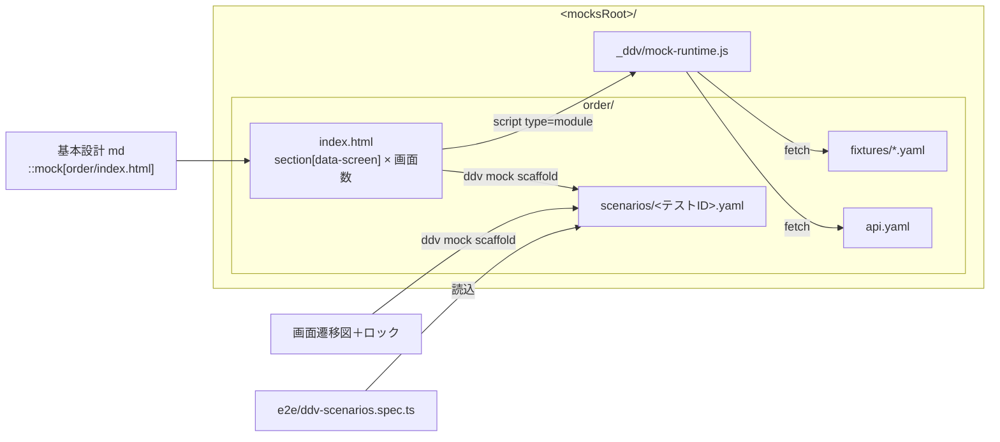

## テストの種類とシナリオ

シナリオ YAML の「ステップの意味」は 1 つで、実行する仕組みが場面ごとに違う。同じシナリオで結果が一致することをテストで担保する。

| 場面 | 実行する仕組み | 対象 | 書くテストコード |
|---|---|---|---|
| レビュー（プレイヤー） | iframe 内の mock-runtime が DOM を直接操作 | モック | なし |
| 結合テスト（E2E） | 実行器 `runScenario` が Playwright で操作（データ駆動） | モック / 実アプリ | なし（固定の spec 1 本） |
| スナップショット | サーバの Playwright で `runScenario` を実行し撮影 | モック | なし |
| 単体テスト | 対象外（画面を操作しない） | ロジック | 詳細設計のテストIDで Vitest / xUnit 等 |

## モック HTML の属性

| 属性 | 付ける要素 | 意味 |
|---|---|---|
| `data-screen="<状態ID>"` | 画面のルート要素 | 画面遷移図の状態ID（`state "注文入力" as Input` の `Input`）。表示中は 1 つだけ。モック専用（実アプリは対応表で判定。[E2E 実行](#e2e-実行データ駆動) 参照） |
| `data-event="<イベント名>"` | ボタン等 | 画面遷移図のイベント名（ガードを除く。例 `次へ`）。**骨組み生成で操作対象を決める根拠**。モック専用（同上） |
| `data-testid` | 入力・確認する要素 | 既存規約どおり。シナリオの `input` のキーになる |
| `data-sample="<値>"` | 入力要素（任意） | 骨組み生成で入れる候補値（自然な例：顧客名「山田 太郎」） |
| `data-goto="<状態ID>"` | ボタン等 | クリックでその画面に切り替える |
| `data-submit="<METHOD> <path>"` | ボタン等 | 画面の入力を JSON で送信。成功時は `data-ok`、失敗時は `data-ng` の画面へ（省略時は留まる） |
| `data-validate` | 画面のルート / ボタン | 送信・遷移前に HTML 標準の `required` / `min` / `max` / `maxlength` / `pattern` で検査。NG なら `data-error` の要素を表示し遷移しない |
| `data-bind="<GET パス>"` | 一覧・表示要素 | 画面表示時に GET した結果を描画（`template` を繰り返し `{{項目}}` を置換） |

- 宣言で書けない振る舞いだけ `mock.js` に書く：`mock.on('screen:Input', ctx => ...)` / `mock.route('POST /orders', (req, db) => ...)`

## 疑似API（api.yaml）

AI が書く（:ref[../requirements/mock.md#役割分担]）。条件式を使えるのはこのファイルだけ。

```yaml
tables: [orders, stock]
routes:
  - { method: GET,  path: /orders, op: list, table: orders }
  - method: POST
    path: /orders
    when:                                    # 上から評価し、最初に一致した応答を返す
      - if: "stock[body.sku].qty < body.quantity"
        status: 409
        body: { message: 在庫が不足しています }
    op: insert
    table: orders
    set: { status: Submitted }
    status: 201
```

## シナリオ

人間も読み書きできる形にする（REQ-109）。式・スクリプトは書かない。1 ステップ = 状態図の 1 遷移。

```yaml
# ddv mock scaffold が生成。event / click / expect.screen は再生成で更新、それ以外は保持
id: BD-ORDER-SCREEN-P004
title: 開始 → 注文一覧 → [新規] 注文入力 → [次へ [入力NG]] 注文入力 → …
fixtures: [default]                 # fixtures/default.yaml でDBを初期化
start: List
steps:
  - event: 新規
    click: new
    expect: { screen: Input }
  - event: 次へ [入力NG]
    input: { customer: "", sku: A-100, quantity: 1 }   # 人間が直すのは主にここ
    click: next
    expect: { screen: Input, visible: [error] }
  - event: 次へ [入力OK]
    input: { customer: 山田 太郎, sku: A-100, quantity: 1 }
    click: next
    expect: { screen: Confirm, text: { confirm-customer: 山田 太郎 } }
  - event: 確定
    click: submit
    expect: { screen: Done }
```

| キー | 意味 |
|---|---|
| `input` | `data-testid` → 値。要素の種類で入力方法が決まる（テキスト=入力、select=選択、checkbox=true/false） |
| `click` | クリックする要素の `data-testid` |
| `expect` | `screen`（必須）/ `visible` / `hidden` / `text` / `count`（一覧の件数） |
| `wait` | ミリ秒（アニメーション等。原則使わない） |
| `do` | 上で表せない操作（独自の操作。AI が実装を用意し名前で呼ぶ） |

### 骨組み生成

`ddv mock scaffold` は、文書の画面遷移図（`::mock` と同じ文書の `matrix` 付き状態図）の **経路（P）ごと** にシナリオを作る（REQ-102）。

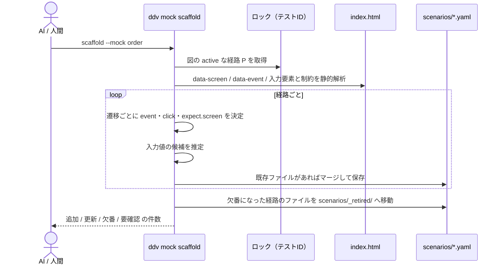

| 項目 | 決め方 |
|---|---|
| `click` | 遷移元画面の中で `data-event` がイベント名に一致する要素。なければ空欄＋要確認 |
| `input` を付けるか | 遷移にガードがある、またはクリック要素が `data-submit` / `data-validate` を持つとき。対象は遷移元画面の入力要素すべて |
| 候補値（正常） | `data-sample` → 制約から生成（number は `min` か 1、select は最初の有効な選択肢、text は「テスト」を `maxlength` 内で） |
| 候補値（異常） | 同じイベントでガード違いの遷移が複数あり、**遷移先が遷移元と同じ画面** の遷移には、最初の `required` 項目を空にした値を入れる |
| 推定できないとき | `pattern` 付きで `data-sample` がない、異常側の判定ができない等は、値を空欄にし `# 要確認` コメントを付ける（lint warning） |
| マージ | ステップを `event` と遷移先で対応付け、対応したステップの `input` の値・追加の `expect`・`fixtures` を保持。生成項目（`event`・`click`・`expect.screen`・`title`）は更新 |

### シナリオの状態

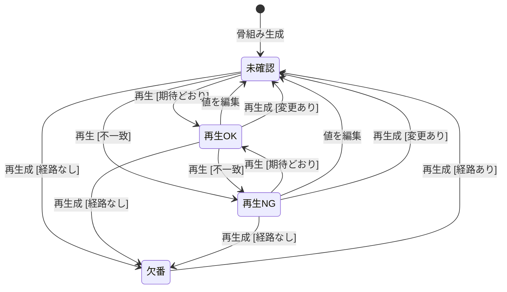

- 再生OK/NG は、プレイヤーまたは E2E の最新結果（テストIDごと）で判定する。値の編集はファイルの更新日時で検出する

## プレイヤー

モック表示（`::mock`）のツールバーに付ける。巻き戻しは「DB リセット → 先頭から目的ステップの直前まで即時再実行」で行う（決定的）。
速度（0.25×/0.5×/0.75×/1×/1.5×/2×/4×/最速、既定 1×）と「操作をハイライト」（既定オフ）は状態を変えない設定（ブラウザに保存）。
ハイライトをオンにすると、各ステップで入力する要素・クリックする要素を 1 つずつ枠で示してから操作する（巻き戻しの即時再実行、E2E、スナップショットでは付けない）。

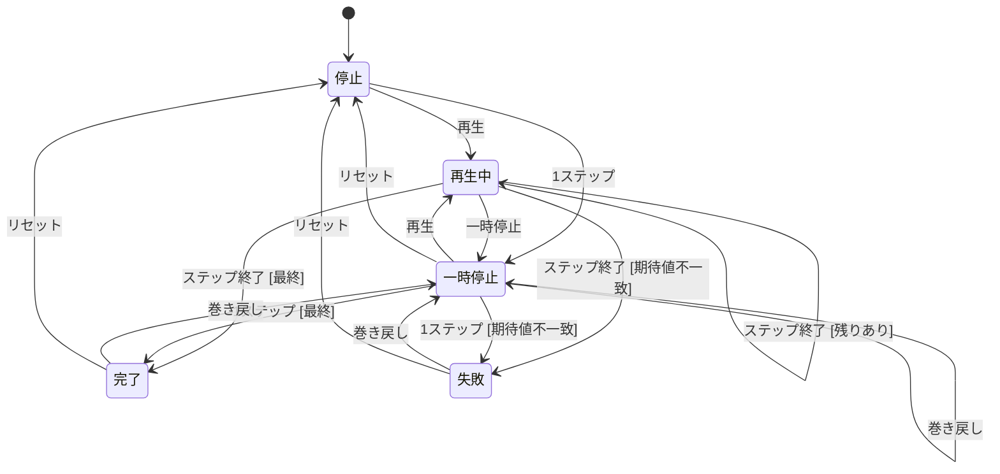

- 再生中のステップに対応する遷移を、画面遷移図上で強調する。失敗時はそのステップと期待値/実際の値を表示する
- マトリクスの行（シナリオがある経路）に「▶ モック」ボタンを出し、押すと同じ文書のモックでその経路を再生する（REQ-103）

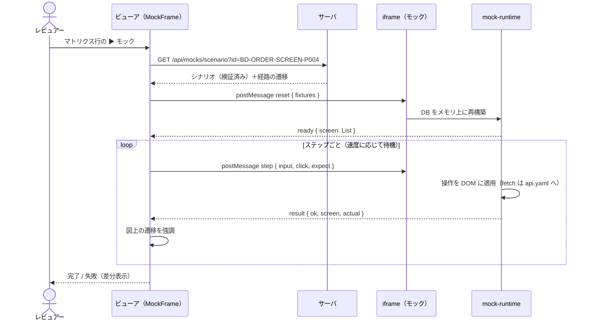

## E2E 実行（データ駆動）

ddv が実行器を提供し、利用側は固定の spec を 1 本置くだけ（REQ-104）。シナリオを置けばテストが増える。

```ts
// e2e/ddv-scenarios.spec.ts（ddv mock init が配置。編集しない）
import { defineScenarioTests } from '@ddv/mock/playwright';
defineScenarioTests({ repoRoot: '..' });
```

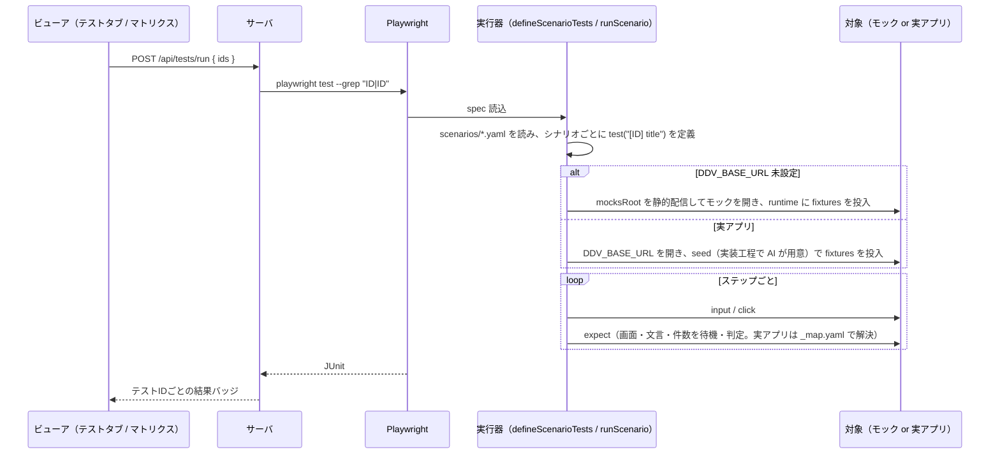

- テスト紐づけ：既存の走査（ソース内の ID）に加え、playwright ランナーの対象に `scenarios/*.yaml` を含め、`id` から紐づける
- 実アプリは **対応表 `scenarios/_map.yaml` だけで実行する**（実アプリの HTML に ddv 用の属性を付けない）。対応表は実装工程で AI が書く
  - `screens`：状態ID → 画面の判定（`url` のパターン、または表示される要素のセレクタ）
  - `events`：イベント名 → 操作する要素のセレクタ
  - `fields`：シナリオの `input` / `expect` のキー → 要素のセレクタ（書かなければ `[data-testid=<キー>]`。既存規約）
  - 例：`screens: { Input: { url: /orders/new } }`、`events: { 次へ: "button[type=submit]" }`
  - 対応表に無い画面・イベントがあると、そのステップで失敗し、何が見つからないかを表示する
- モックは常に `data-screen` / `data-event` 属性で判定し、対応表は使わない

## スナップショット

サーバが Playwright で `runScenario` を実行し、各ステップの `expect` 後の画面を撮影する（REQ-105）。
基準画像はコミット対象（`.ddv/snapshots/baseline/`）、撮影結果は `.ddv/snapshots/current/`（gitignore）。

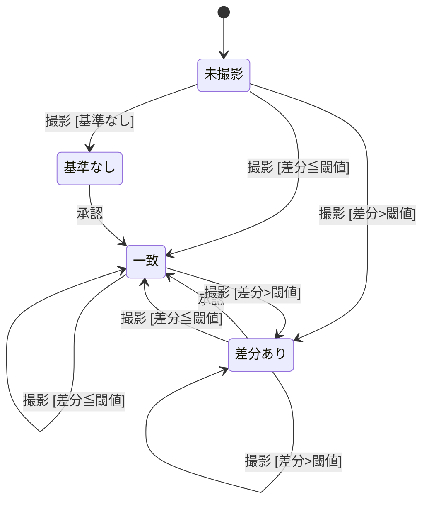

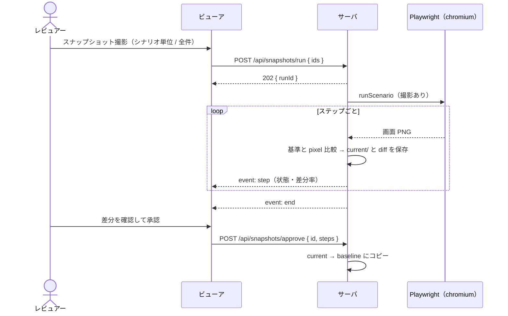

- 画面は「基準 / 今回 / 差分」を並べて表示する。閾値は `mock.snapshot.threshold`（差分画素の割合、既定 0.001）

## 検査（ddv-lint 拡張）

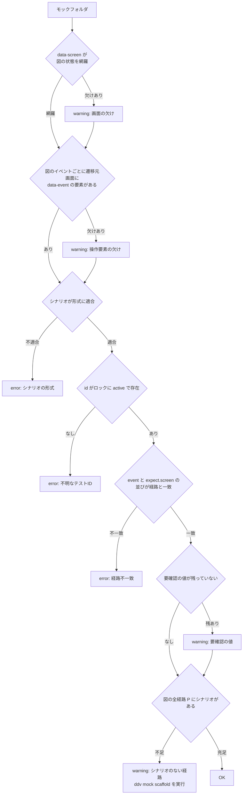

- 画面遷移図とモックの対応：文書の `::mock[x/index.html]` と、同じ文書の `matrix` 付きの最初の状態図を対応させる（REQ-106）。`::mock[x/index.html]{diagram=<図id>}` で対応させる図を指定できる（1 文書に複数のモックを置くとき。指定した図が無い・`matrix` 付きの状態図でないときは error）
- 同じモックを複数の文書が参照するときは、基本設計からの参照を正とする（シナリオ・経路はその文書の図に対応させる）。詳細設計などからの参照はモックの表示だけで、再生の強調は図を持つ文書でだけ行う
- runtime の版ずれ（`_ddv/mock-runtime.js` が ddv の版と違う）は warning

## 構成

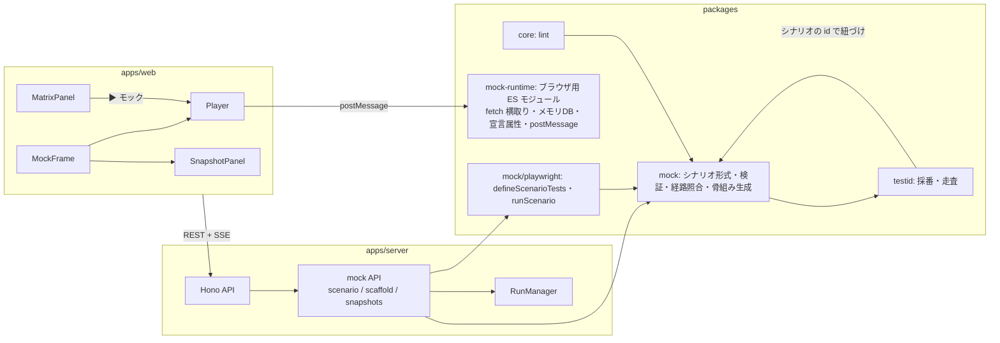

## データ

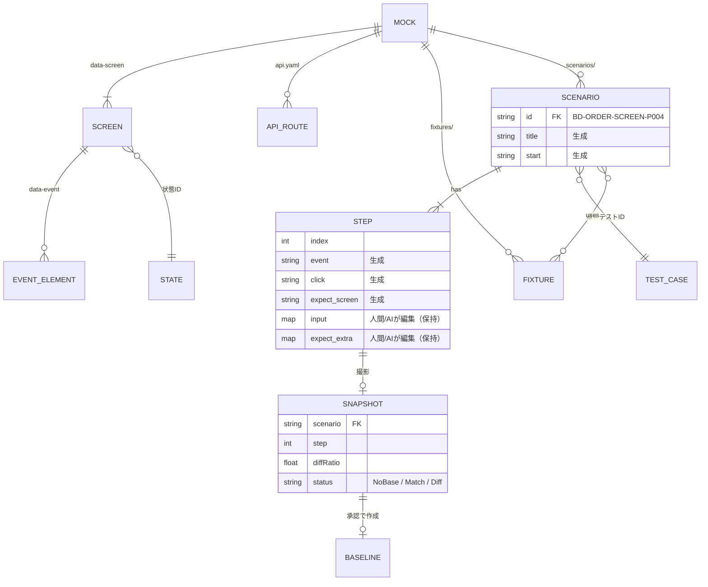

## API

| メソッド | パス | 内容 |
|---|---|---|
| GET | `/api/mocks/scenarios` | 全モックのシナリオ一覧（id, title, mock, 状態, 検証結果） |
| GET | `/api/mocks/scenario?id=` | シナリオ本文＋対応する経路の遷移（強調用） |
| POST | `/api/mocks/scaffold` | `{ mock? }` 骨組みを生成・マージ。追加/更新/欠番/要確認の件数を返す |
| POST | `/api/snapshots/run` | `{ ids? }` 撮影開始。202 `{ runId }`、進捗は `/api/runs/{id}/events` |
| GET | `/api/snapshots?id=` | ステップごとの状態・差分率・画像 URL |
| POST | `/api/snapshots/approve` | `{ id, steps? }` 今回を基準に承認 |

- E2E 実行は既存の `/api/tests/run`（playwright ランナー）を使う

## 設定と CLI

```yaml
mock:
  browser:
    channel: chromium              # 既定は Playwright 同梱の Chromium。msedge / chrome なども指定可
  snapshot:
    threshold: 0.001               # 差分画素の割合
    viewport: { width: 1280, height: 800 }
```

- E2E 実行とスナップショット撮影は `mock.browser.channel` のブラウザを使う（環境の既定ブラウザは使わない）。既定が同梱 Chromium なのは、描画差による差分のぶれを避けるため
- 環境変数 `DDV_BROWSER_CHANNEL` で一時的に上書きできる（CI と手元で変える場合など）。基準画像は撮影したブラウザ名と一緒に記録し、違うブラウザで撮った画像との比較は warning を出す
- プレイヤーは、人間が ddv を開いたブラウザで動く（設定の対象外）

| コマンド | 内容 |
|---|---|
| `ddv mock init` | runtime と固定の spec を配置（既存は版が違うときだけ更新） |
| `ddv mock scaffold [--mock <name>]` | シナリオの骨組みを生成・マージ（`ddv-testid generate` の後に実行） |
| `ddv mock snapshot [--id <ID>] [--approve]` | スナップショットを撮影 / 承認 |
