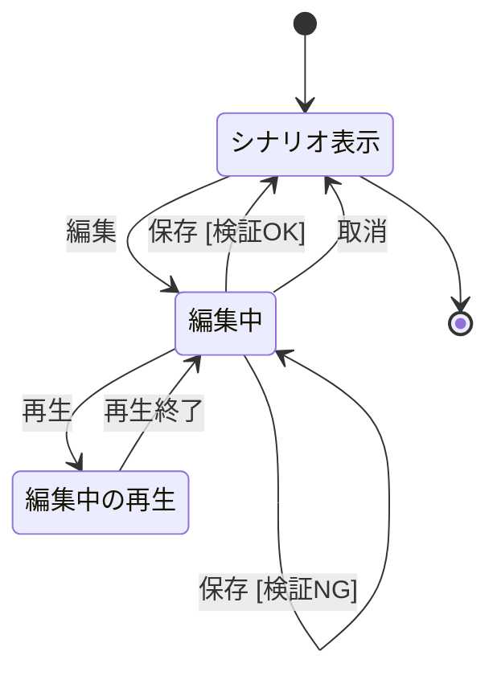
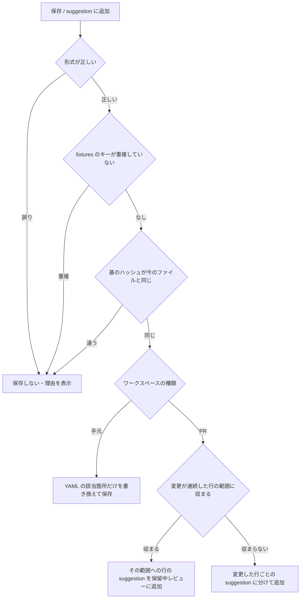
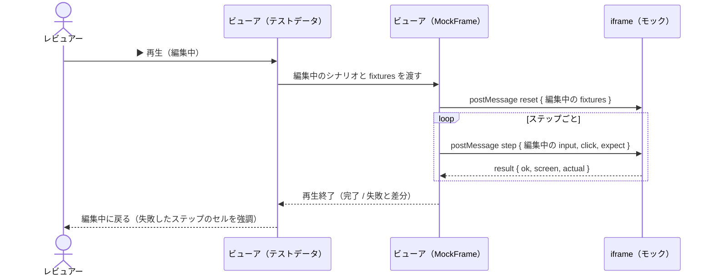
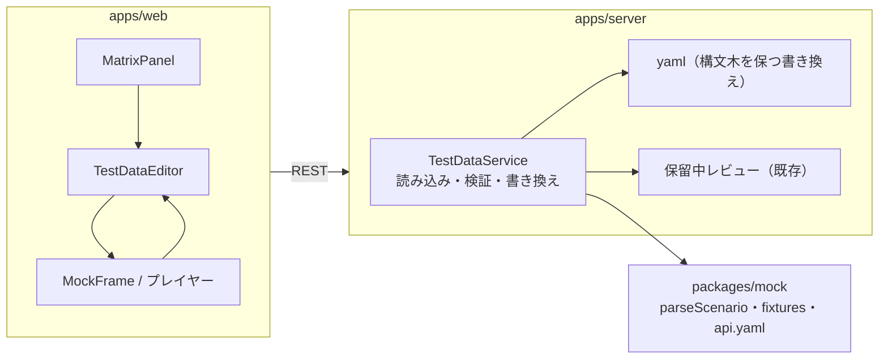
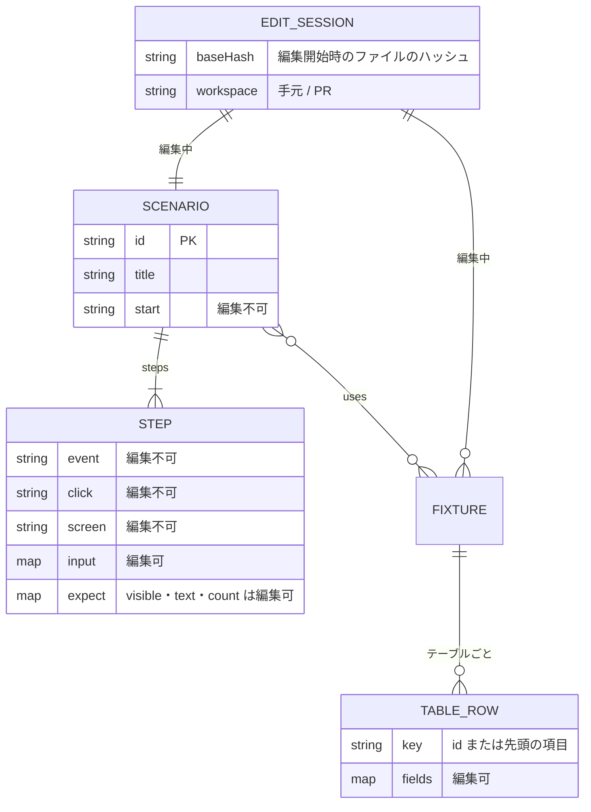

# テストデータ編集（シナリオ・fixtures）基本設計

## 前提

- 目的は :ref[../requirements/testops.md#目的]、範囲は :ref[../requirements/testops.md#スコープ] を参照
- シナリオと fixtures の形式は :ref[mock-player.md#シナリオ]、再生は :ref[mock-player.md#プレイヤー]、E2E は :ref[mock-player.md#e2e-実行データ駆動] のまま変えない
- PR での書き戻しは、モックの調整（:ref[github-review.md#モックの調整モード]）と同じく保留中のレビューへの suggestion にする

## 用語

| 用語 | 意味 |
|---|---|
| テストデータ | シナリオの各ステップの `input` と `expect` の値（`visible`・`text`・`count`）、および fixtures のレコード |
| 生成項目 | scaffold が経路から生成する `event`・`click`・`expect.screen` とステップの数・順序。編集できない |
| 編集中のデータ | フォームで変えたが、まだファイル（または suggestion）にしていない内容。ブラウザのメモリだけに持つ |
| 基のハッシュ | 編集を始めたときのファイル内容のハッシュ。保存時に変わっていたら競合とする |

## 画面遷移

マトリクスの行（シナリオがある経路）の「テストデータ」、またはプレイヤーのツールバーの「テストデータ」で開くパネル内の遷移。

- 「保存 [検証NG]」：形式の誤り、fixtures のキーの重複、ファイルが他で変更された（競合）のいずれか。理由を該当のセルと一覧に出し、編集中のデータは残す
- 警告（モックに無い要素キー・テーブル）は保存を止めない。保存前に一覧で示す
- 「保存」の文言は、手元のワークスペースでは「保存」、PR のワークスペースでは「suggestion に追加」とする（遷移は同じ）
- 「編集中の再生」はプレイヤー（:ref[mock-player.md#プレイヤー]）の状態をそのまま使う。再生が完了・失敗・停止したら「再生終了」として編集中に戻り、編集中のデータは保たれる
- 編集中に別のシナリオ・文書へ移ろうとしたら確認する（破棄するか留まるか）

## 画面イメージ

::mock[test-data-editor/index.html]{diagram=editor-flow}

| 画面 | 主な要素 |
|---|---|
| シナリオ表示 | シナリオID・タイトル・使う fixtures、ステップの表（イベント・入力・期待）、fixtures のテーブルごとの表、「編集」「▶ 再生」「E2E を実行」 |
| 編集中 | ステップの表の入力・期待のセルと fixtures の表のセルが入力欄になる（生成項目は灰色で編集不可）。fixtures の行の追加・削除、キーの追加・削除（`input`・`text`・`count`・`visible`）、変更の差分（YAML の行単位）、検証の結果、「▶ 再生」「保存 / suggestion に追加」「取消」 |
| 編集中の再生 | モックのプレイヤーで編集中のデータを使って再生。「編集中のデータで再生中」の表示 |

## 編集できる範囲

| 対象 | 編集できる | 編集できない |
|---|---|---|
| シナリオのステップ | `input` のキーと値、`expect.visible`（要素キーの一覧）、`expect.text`・`expect.count` のキーと値 | `event`・`click`・`expect.screen`、ステップの追加・削除・並べ替え |
| シナリオの見出し | `title`・`fixtures`（使う fixtures の選択） | `id`・`start` |
| fixtures | テーブルの行の追加・変更・削除、行の項目の追加・削除 | テーブルの追加・削除（api.yaml の `tables` と対応するため） |
| その他 | — | api.yaml、mock.js、テストコード |

- 値は文字列・数値・真偽値（:ref[mock-player.md#シナリオ] の値の型）。入力欄の種類は、モックの要素（`input type`・`select` の選択肢・チェックボックス）が分かればそれに合わせ、分からなければ文字列
- 要素キーの候補は、モックの HTML の `data-testid` から出す（入力の補完）

## 検証と保存

| 検証 | 結果 | 内容 |
|---|---|---|
| 形式 | エラー | シナリオ・fixtures の読み込み規則（既存の `parseScenario`・fixtures の読み込み）に合わない値 |
| キーの重複 | エラー | 同じテーブル内で行のキー（`id`、無ければ先頭の項目）が重複 |
| 競合 | エラー | 編集の開始後にファイルが変わった（手元：ファイル、PR：head が進んだ） |
| 要素キー | 警告 | `input`・`expect` のキーがモックの `data-testid` に無い |
| テーブル | 警告 | fixtures のテーブルが api.yaml の `tables` に無い |

- 書き換えは YAML の構文木（`yaml` パッケージ）の値だけを差し替え、コメント・キーの順・引用符・インデントを保つ（REQ-305）。変えていない行は 1 文字も変えない
- PR では suggestion を **head のファイル** に対して作る。PR の差分外の行でも置けるよう、既存の行・ファイルのコメントの使い分け（:ref[github-review.md#アンカー]）に従う。suggestion を取り込むまで、E2E は head の内容で動く（編集中のデータを確かめるのは「編集中の再生」で行う）
- 手元で保存した後は「E2E を実行」でそのシナリオだけを実行できる（既存の `POST /api/tests/run` に ID を 1 つ渡す）

## 編集中の再生

- サーバを経由せず、ビューアが編集中のデータを直接プレイヤーに渡す。サーバでの検証の前でも再生できる（形式が誤っている場合は再生を始めない）
- 再生の失敗はシナリオの状態（:ref[mock-player.md#シナリオの状態]）を変えない（保存していないため）

## 構成

## データ

- 編集中のデータはブラウザのメモリだけに置く（再読込で消える。離れる前に確認する）

## API

GitHub のワークスペースでは既存と同じく `/api/w/<ワークスペースID>/...` で呼ぶ。

| メソッド | パス | 内容 |
|---|---|---|
| GET | `/api/testdata?scenario={id}` | シナリオと使う fixtures の内容、ファイルのパスとハッシュ、編集可否、モックの要素キー・入力の種類・テーブル |
| POST | `/api/testdata/validate` | `{ scenario, fixtures }` 検証の結果（エラー・警告）と、変わる行の差分 |
| POST | `/api/testdata/save` | `{ scenario, fixtures, baseHash }` 検証してから、手元はファイルに書き換え、PR は保留中レビューに suggestion を追加。検証NG・競合は 409 / 422 |
