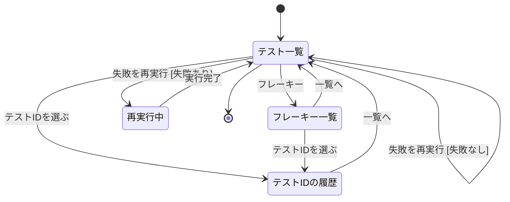
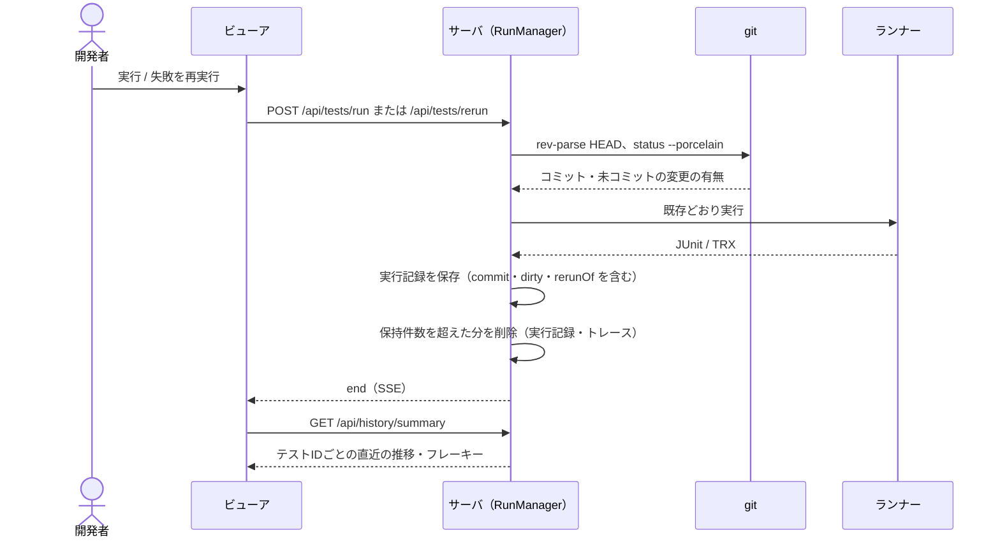
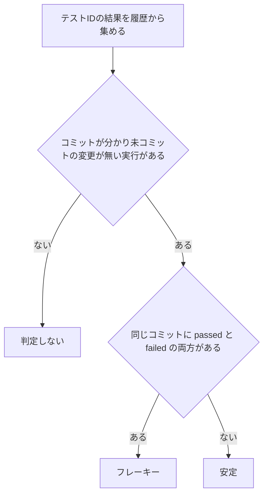
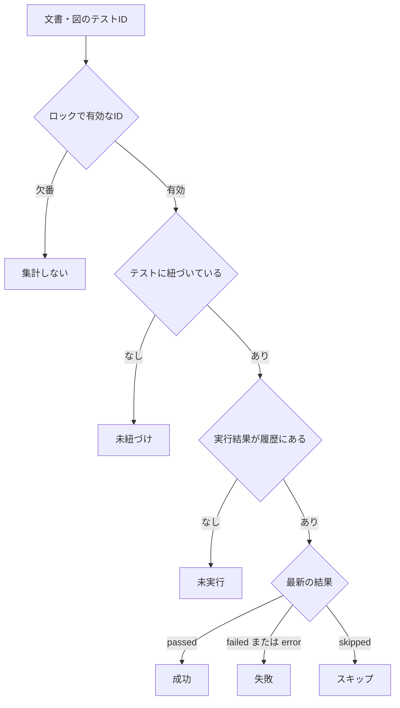
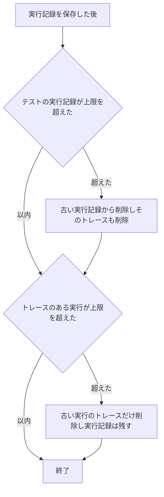
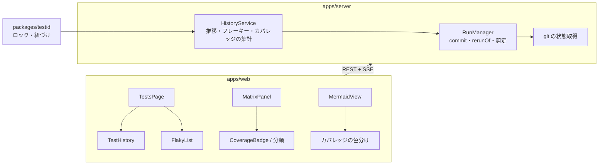
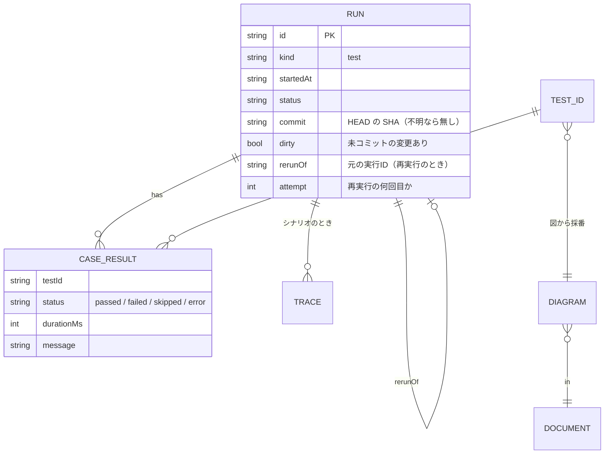

# テスト監視（履歴・フレーキー・設計カバレッジ）基本設計

## 前提

- 目的は :ref[../requirements/testops.md#目的]、範囲は :ref[../requirements/testops.md#スコープ] を参照
- 既存のテスト実行（`RunManager`・`.ddv/runs/*.json`・`/api/results/latest`）を拡張する。実行の流れは :ref[viewer.md#構成] のまま変えない
- トレースの記録と表示は :ref[trace-view.md#記録] で扱う。本書は実行記録の拡張・集計・表示と、トレースも含めた保持件数を扱う

## 用語

| 用語 | 意味 |
|---|---|
| 実行記録 | テスト実行 1 回分の記録（既存の `RunRecord`）。本書で、実行時のコミットと再実行の関係を加える |
| 履歴 | 保持している実行記録すべて。テストIDごとの推移・フレーキー・カバレッジはここから都度集計する（別の集計ファイルは持たない） |
| コミットの状態 | 実行開始時の `HEAD` のコミットと、未コミットの変更の有無（`dirty`）。git でないリポジトリでは不明 |
| フレーキー | 同じコミット（`dirty` なし）の実行で、`passed` と `failed` の両方があるテストID。`error`（ランナーの起動失敗等）と `skipped` は判定に使わない |
| 設計カバレッジ | 文書・図のテストIDのうち、紐づけ済み・実行済み・最新が成功の割合。コードの行カバレッジではない |

## 画面遷移

テストタブ（`#/tests`）の中の遷移。文書のマトリクス・図での表示は [設計カバレッジ](#設計カバレッジ) で扱う。



- 「失敗を再実行 [失敗なし]」：直近の実行に失敗したテストIDが無い。ボタンを無効にし、理由を表示する
- 「再実行中」は既存の「実行中」と同じく、ログと結果を逐次表示する。再実行の回数（既定 2）は一覧で選んでから押す
- 「テストIDの履歴」から失敗した実行のトレースを開く操作は :ref[trace-view.md#画面遷移] を参照（本書の図では省略）

## 画面イメージ

::mock[test-monitoring/index.html]{diagram=screen-flow}

| 画面 | 主な要素 |
|---|---|
| テスト一覧 | 既存の集計・実行ボタン・実行履歴に加え、テストIDごとに直近 10 回の結果の点（成功・失敗・スキップ・エラー・未実行）とフレーキーの印、「フレーキー（n）」、「失敗を再実行」（回数の選択付き） |
| テストIDの履歴 | 推移の表（実行日時・コミットの短縮 SHA と未コミット変更の印・結果・所要時間・メッセージの先頭）、結果が変わった行の強調、「失敗し始めた実行」（直近の連続した失敗の最初の実行とコミット）、フレーキーと判定したコミット |
| フレーキー一覧 | フレーキーのテストID・文書・判定したコミット・そのコミットでの成功 / 失敗の回数・最後に失敗した実行 |
| 再実行中 | 何回目か（1 / 2）、ログ、結果 |

## 実行記録の拡張



- コミットの状態は実行開始時に 1 回取る。`.ddv/` と `.gitignore` の対象は未コミットの変更に数えない。git でない・git が無いときは「不明」とし、その実行はフレーキーの判定に使わない
- GitHub のワークスペース（worktree）でも同じく取る（通常は head のコミットで `dirty` なし）
- 既存の実行記録（コミットの項目が無い）は「不明」として読み込み、推移には表示する（REQ-309）

## 失敗の再実行

- 対象は **直近の実行**（テストの実行。スナップショット等は除く）で `failed` または `error` だったテストID
- 指定回数（1〜5、既定 2）だけ、そのIDだけを順に実行する。1 回ごとに 1 つの実行記録になり、`rerunOf` に元の実行IDを持つ
- 途中で利用者が別の実行を始めることはできない（既存どおり同時に 1 つ）。2 回目以降の開始はサーバが続けて行う
- GitHub のワークスペースでは既存どおり信頼の確認が要る（:ref[github-review.md#pr-のコードの実行]）

## フレーキーの判定



- 判定は保持している履歴の範囲で行う（古い実行が削除されると印が外れることがある）
- 印は、マトリクスの行・テスト一覧・テストIDの履歴に同じ表示で出す。フレーキーと判定したコミットを併記する
- コミットが変わって成否が変わっただけ（直したら通った・壊したら落ちた）はフレーキーではない

## 設計カバレッジ



| 表示する場所 | 内容 |
|---|---|
| 文書の先頭 | 文書のテストID数と、紐づけ済み・実行済み・成功の数と割合 |
| 図（`matrix` 付き）の上 | 図ごとの同じ数と割合 |
| マトリクスの行 | 上の分類（未紐づけ・未実行・成功・失敗・スキップ）とフレーキーの印。行から「履歴」を開ける |
| 図の遷移・ノード | 「カバレッジを表示」をオンにすると、要素ごとに **その要素を含むテストID** の最も良い分類で色分けする（成功 > 失敗 > スキップ > 未実行 > 未紐づけ）。既存の経路の強調とは同時に使わない |

- 割合の分母は有効なテストID数。紐づけ済み ⊇ 実行済み ⊇ 成功
- フローチャートの図は分岐（ノード）を、状態図は遷移とノードを対象にする。経路（P）・Nスイッチ（S）・不正遷移（X）のIDは、行には出すが図の色分けには使わない（遷移・ノードを直接表す T と、その要素を通る P のみを使う）

## 保持件数



- 既定は実行記録 200 件、トレース 20 回分（`ddv.config.yaml` の `history` で変更。0 は無制限）
- スナップショット・依存の導入などのタスクの記録は従来どおりメモリだけに置き、件数に数えない
- 削除はサーバの起動時と、実行記録の保存の直後に行う

## 構成



- 集計は履歴（最大 200 件）をメモリに持って都度計算する。実行の終了で集計し直す

## データ



| データ | 置き場所 |
|---|---|
| 実行記録 | `.ddv/runs/<実行ID>.json`（既存。項目を追加） |
| トレース | `.ddv/traces/<実行ID>/`（:ref[trace-view.md#データ]） |
| 推移・フレーキー・カバレッジ | 保存しない（都度集計） |

## API

既存の API は変えない。GitHub のワークスペースでは既存と同じく `/api/w/<ワークスペースID>/...` で呼ぶ。

| メソッド | パス | 内容 |
|---|---|---|
| GET | `/api/history/summary` | テストIDごとの直近 10 回の結果・フレーキーの印・フレーキーの件数 |
| GET | `/api/history/tests/{id}` | テストIDの推移（実行・コミット・結果・所要時間・メッセージ）、失敗し始めた実行、フレーキーと判定したコミット |
| GET | `/api/history/flaky` | フレーキー一覧 |
| POST | `/api/tests/rerun` | `{ times }` 直近の実行で失敗したIDだけを再実行。202 `{ runId }`（1 回目。2 回目以降は SSE `/api/events` の `run` で通知）。失敗が無ければ 409 |
| GET | `/api/coverage?path=` | 文書・図ごとの数と割合、テストIDごとの分類、図の要素ごとの分類 |

## 設定

```yaml
# ddv.config.yaml（省略時は既定値）
history:
  maxRuns: 200        # テストの実行記録の上限（0 で無制限）
  maxTraceRuns: 20    # トレースを残す実行の上限（0 で無制限）
```
