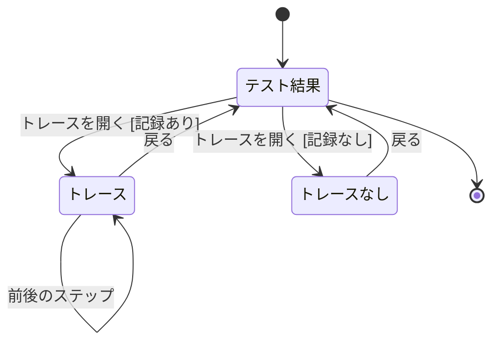
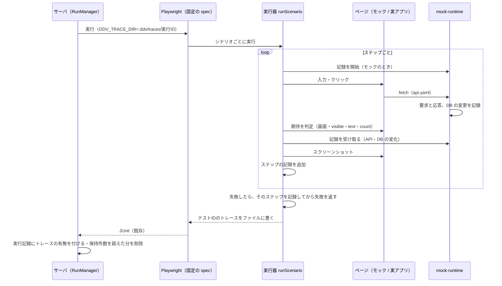
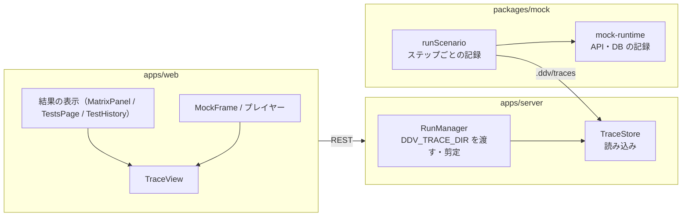
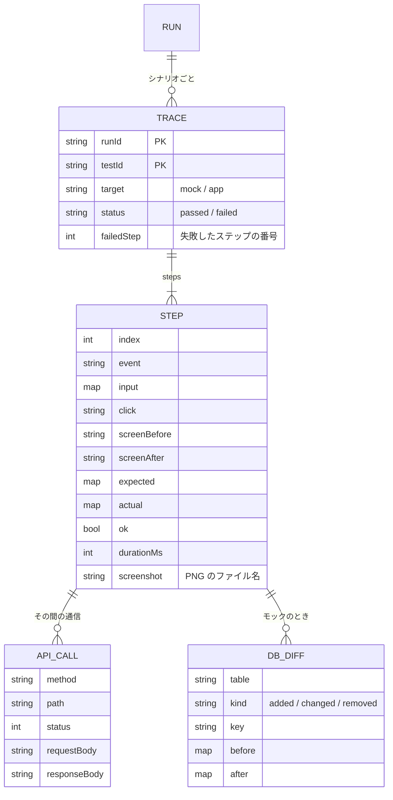

# トレースビュー（シナリオ E2E のステップ記録）基本設計

## 前提

- 目的は :ref[../requirements/testops.md#目的]、範囲は :ref[../requirements/testops.md#スコープ] を参照
- 対象はシナリオの E2E（:ref[mock-player.md#e2e-実行データ駆動]）だけ。vitest・dotnet の単体テスト、Playwright 標準の trace.zip は扱わない
- 保持件数と実行記録の拡張は :ref[test-monitoring.md#保持件数] を参照

## 用語

| 用語 | 意味 |
|---|---|
| トレース | 1 つのテストID（シナリオ）の 1 回の E2E 実行の記録。ステップの並び |
| ステップの記録 | 1 ステップ分の、操作（入力・クリック）、操作前後の画面、期待と実際の値・判定、その間のモック API の要求と応答、DB の変化、操作後のスクリーンショット |
| DB の変化 | ステップの前後での疑似 DB の差分（テーブルごとの追加・変更・削除された行）。モックを対象にした実行だけ |
| ライブ表示 | プレイヤーで再生中のステップの記録を、同じ表示で逐次見せること。保存しない |

## 画面遷移

テストの結果（マトリクスの行・テスト一覧・テストIDの履歴）から開くトレース表示の遷移。

- 「トレースを開く」は、シナリオのテストIDの結果の行に出す。失敗した結果から開くと、失敗したステップを選んだ状態で開く（成功なら最初のステップ）
- 「記録なし」：保持件数を超えて削除された、トレースの導入前の実行、実行が途中で止まった（ランナーの起動失敗等）。理由を出して戻れるようにする
- 「前後のステップ」はキーボード（← →）でも操作できる

## 画面イメージ

::mock[trace-view/index.html]{diagram=view-flow}

| 画面 | 主な要素 |
|---|---|
| テスト結果 | 既存の結果の表示に「トレース」ボタン（シナリオの結果だけ） |
| トレース | 上：実行（日時・コミット・結果・所要時間・対象 モック / 実アプリ）。左：ステップのタイムライン（番号・イベント・判定・所要時間、失敗は赤）。右：選んだステップの詳細（スクリーンショット、操作、画面 前→後、期待と実際の値の表、API の要求と応答の一覧（メソッド・パス・状態、開くと本文）、DB の変化（テーブルごとの追加・変更・削除）） |
| トレースなし | 理由と「戻る」 |

## 記録

- 記録は `DDV_TRACE_DIR` があるときだけ行う（スナップショット・手での `playwright test` 実行では記録しない）
- 失敗したステップでも、そこまでの操作・画面・実際の値・API・DB・スクリーンショットを記録する（REQ-307 の受入基準）
- 実アプリが対象のときは、API の要求と応答を Playwright の通信の記録から取る（本文は既定で 64KB まで）。DB の変化は記録しない（「対象外」と表示）
- スクリーンショットはステップの操作と判定の後に 1 枚。画面の大きさは E2E の設定のまま

## ライブ表示

- プレイヤー（:ref[mock-player.md#プレイヤー]）の再生中、モックの横に「トレース」パネルを開ける。各ステップの結果を受け取るたびに、同じ詳細の表示（スクリーンショットを除く）に追加する
- 保存しない。プレイヤーをリセットすると消える
- 編集中のデータの再生（:ref[test-data-editor.md#編集中の再生]）でも同じく見られる

## 構成

## データ

| データ | 置き場所 |
|---|---|
| トレース | `.ddv/traces/<実行ID>/<テストID>.json` |
| スクリーンショット | `.ddv/traces/<実行ID>/<テストID>/<ステップ番号>.png` |

- `.ddv/traces/` はコミットしない（`.gitignore` に追加）。保持件数（既定 20 回の実行分）を超えたら実行単位で削除する（:ref[test-monitoring.md#保持件数]）
- 既存の実行記録・トレースの無い実行は「記録なし」として扱う（REQ-309）

## API

GitHub のワークスペースでは既存と同じく `/api/w/<ワークスペースID>/...` で呼ぶ。

| メソッド | パス | 内容 |
|---|---|---|
| GET | `/api/traces/{runId}/{testId}` | トレース（ステップの記録。スクリーンショットはパスのみ）。無ければ 404 と理由 |
| GET | `/api/traces/{runId}/{testId}/steps/{n}.png` | スクリーンショット |
| GET | `/api/runs/{id}` | 既存。結果ごとにトレースの有無を加える |
