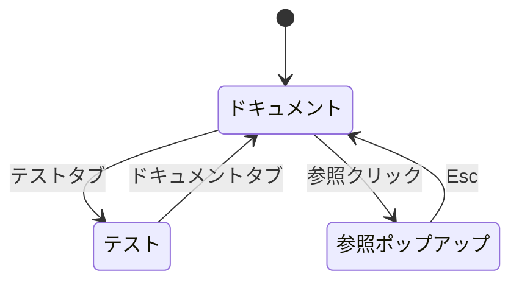
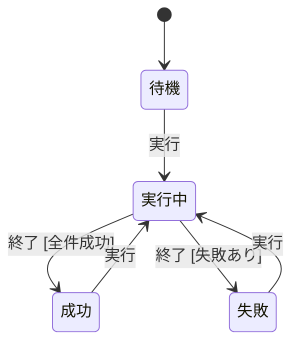
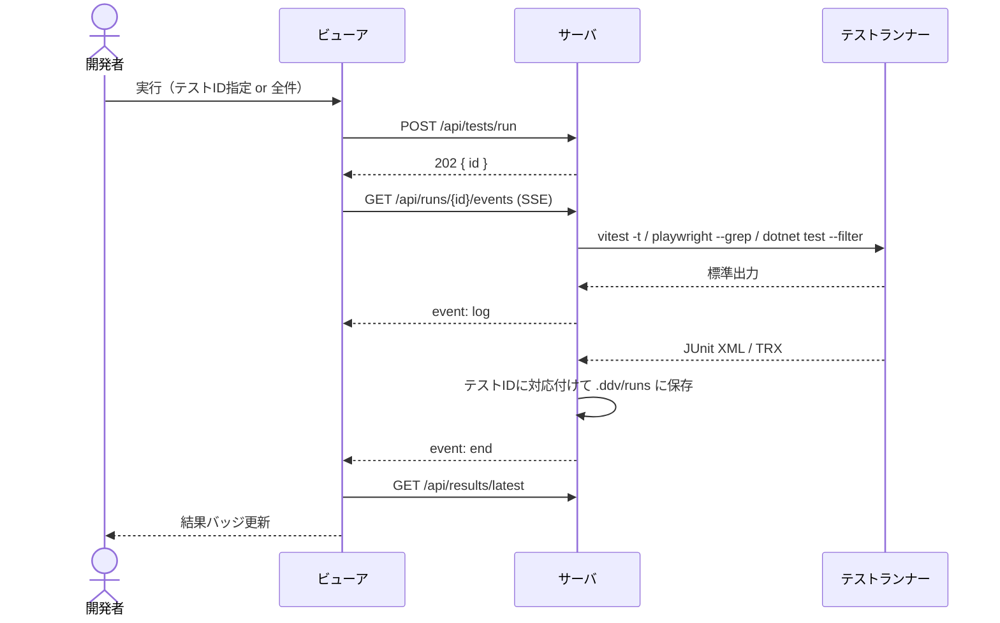
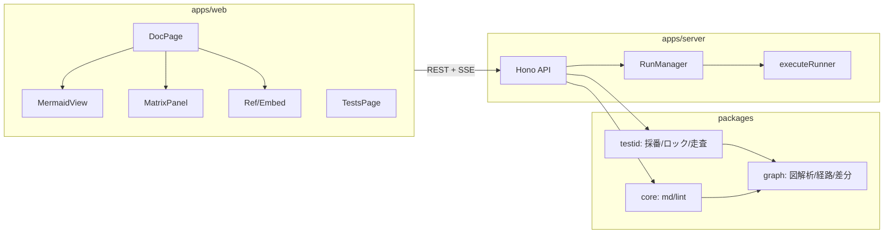
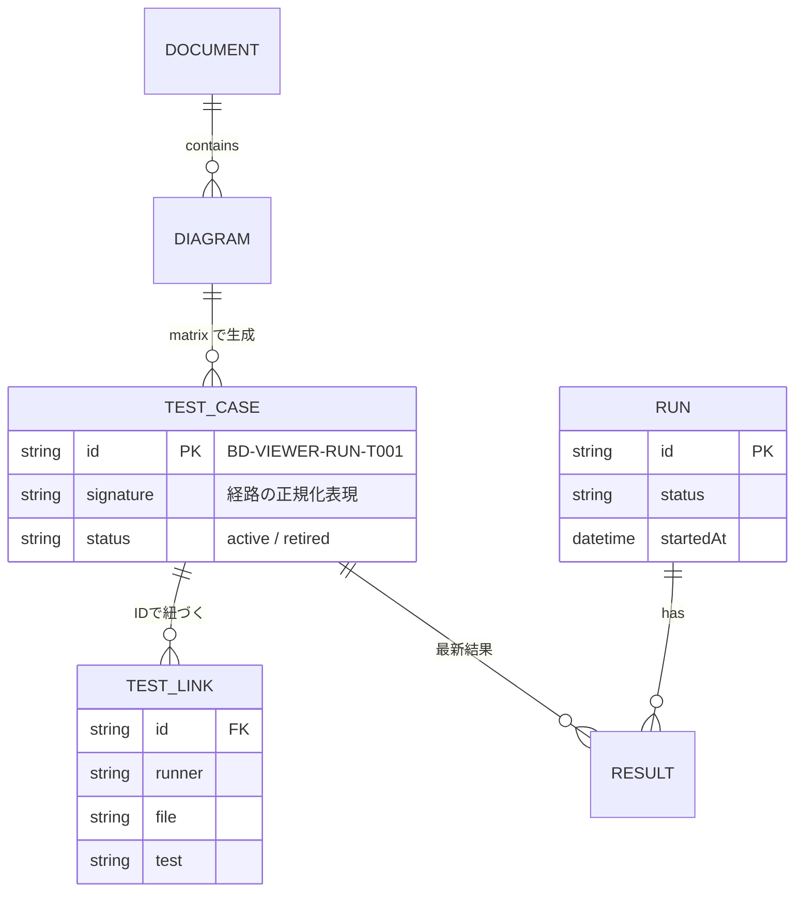

# ddv ビューア 基本設計

## 前提

目的は :ref[../requirements/ddv.md#目的] を参照。

## 画面遷移

## テスト実行

- 実行中の「実行」は受け付けない（サーバは 409、画面はボタン非活性）

## エラー表示（共通）

ビューアのどの画面にも共通する、想定外の応答・エラーの扱い。各画面に固有のエラー表示（入力チェック、取得失敗の理由など）は各設計書に従い、ここではその前提をそろえる。

- サーバの応答が JSON でない、または期待する形（一覧なのに一覧でない等）でないときは**通信の失敗として扱う**。成功として画面に渡さない。各画面は既存の取得失敗の表示に「サーバの応答を解釈できません（サーバが古い可能性があります。再起動してください）」を出す
  - 例：ビューアだけ新しく、起動中のサーバが古いと、未知の API に画面の HTML が返ることがある
- 描画中の想定外のエラーで**画面全体を消さない**（白い画面にしない）。ヘッダ（ワークスペース切替・タブ）は残し、本文の領域にエラー内容と「再読み込み」ボタンを表示する。ワークスペースや文書を切り替えると表示し直す
- サーバは、存在しない `/api/*` に JSON の 404（`{ error }`）を返す。画面の HTML（SPA のフォールバック）は返さない

## 構成

## データ

- TEST_CASE は `.ddv/testids.lock.json`、RUN/RESULT は `.ddv/runs/*.json` に保存する
