# Actions での実行・結果の読み取り・履歴の統合 詳細設計

## 前提

- 画面遷移は :ref[../basic/actions-run.md#画面遷移]、可否は :ref[../basic/actions-run.md#実行の可否]、起動と受け渡しは :ref[../basic/actions-run.md#実行と結果の受け渡し]、結果ブランチの構成は :ref[../basic/actions-run.md#結果ブランチ]、承認は :ref[../basic/actions-run.md#スナップショットの承認]、履歴の統合は :ref[../basic/actions-run.md#履歴の統合]、構成・データ・API は :ref[../basic/actions-run.md#構成]・:ref[../basic/actions-run.md#データ]・:ref[../basic/actions-run.md#api] を参照
- 本書は **読み取り側**（可否の判定・起動・実行の追跡・結果ブランチの読み取り・履歴への統合・ローカル版の API）を扱う。ワークフローの雛形・`ddv actions init`・`ddv ci run / publish / approve`・結果ブランチへの書き込みと剪定は [actions-workflow.md](actions-workflow.md)、サービス層・Backend の枠は [services.md](services.md) を参照
- 実行記録の項目は :ref[run-record.md#構造]、推移・フレーキー・カバレッジの集計は :ref[test-history.md#構造]、GitHub の呼び出しとトークンは :ref[workspace.md#github-api]・:ref[workspace.md#トークン]、Pages 版の PAT は :ref[../basic/hosted-viewer.md#pat-の扱い] を参照
- 実装：
  - サービス層 `packages/services/src/actions/`：`actions-service.ts`（`ActionsService`）、`gate.ts`（`actionsGate`）、`remote.ts`（`parseGitHubRemote`）、`tracker.ts`（`ActionsRunTracker`）、`results-branch.ts`（`ResultsBranchReader`・zod スキーマ）、`merge.ts`（`mergeRunRecords`・`latestOf`）
  - サーバ `apps/server/src/`：`repo-remote.ts`（`RepoRemote`）、`actions-target.ts`（`LocalActionsTarget`・`WorkspaceActionsTarget`）、`actions-api.ts`（`registerActionsRoutes`）、`runs.ts`（`RunRecord` の拡張。`RunManager` は `LocalRuns` を満たす）
  - `HistoryService` の拡張（`setActionsRuns`・統合）は `packages/services/src/history.ts` に足す。[services.md](services.md) の移行の段階 4（`HistoryService` を移す）の後に行う。`apps/server/src/history.ts` は移行前の現行位置で、移した後は段階 7 まで再エクスポートだけになる（ここには足さない）
  - ビューア `apps/web/src/components/`：`ActionsPanel.tsx`（新規）、`TestsPage.tsx`・`TestHistory.tsx`・`MatrixPanel.tsx`（出所の印）
- **既存の動作は変えない**（REQ-610）。GitHub のリモートが無いフォルダでは Actions の API は `hidden` を返すだけで GitHub に触れない。既存の API（`/api/history/*`・`/api/coverage`・`/api/results/latest`）は項目の追加のみで、GitHub の応答を待たない（[履歴の統合](#履歴の統合)）

## 画面

画面遷移は :ref[../basic/actions-run.md#画面遷移]（状態 List / Setup / Dispatching / Running / Detail / Approving）。ハッシュは `#/tests/actions`（List）、`#/tests/actions/setup`（Setup）、`#/tests/actions/requests/<依頼ID>`（Dispatching・Running・Approving）、`#/tests/actions/runs/<結果ID>`（Detail。結果IDは [結果ブランチの読み取り](#結果ブランチの読み取り)）。GitHub のワークスペースでは先頭に `#/w/<ワークスペースID>`、Pages 版では対象の接頭辞（:ref[../basic/hosted-viewer.md#url]）が付く。

::mock[actions-run/index.html]

- テストタブに「Actions」の切り替えを出すのは `GET /api/actions` の `state` が `hidden` 以外のときだけ（`hidden` のときはタブ自体を描かない）
- モック専用の要素（`allowed`・`detected`・`dispatch-fail`・`run-complete`・`approve-done`・`approve-fail`）は実装しない。実際の遷移は SSE `actions`（Pages 版は `ActionsService` のイベント）で起きる

### Actions の実行一覧

| 項目 | testid | 種類 | 型・桁 | 必須 | 初期値 | 取得元・送信先 | 入力チェック・エラー文言 |
|---|---|---|---|---|---|---|---|
| 導入の案内 | `setup-open` | ボタン | — | — | — | `#/tests/actions/setup` へ | `state` が `setup` のときは一覧の先頭に案内の帯も出す（帯のボタンも同じ testid） |
| 実行の対象 | `target` | 表示 | — | — | — | `ActionsStatus.target`（PR は「#12（feature/confirm-back・a1b2c3d）」、branch は「main・a1b2c3d」） | 対象が決まらない（`detached` 等）ときは理由を `dispatch-error` に出す |
| ランナー | `runner` | 選択 | 文字列 | — | 「すべて」（空） | 設定の `runners[].name`。`POST /api/actions/runs` の `runner` | 設定に無い名前：400 `runner-unknown`「ランナー <name> は設定にありません」 |
| テストID | `ids` | テキスト | 文字列 4000（カンマ・空白区切り、最大 200 件） | — | 空（＝全件） | `POST /api/actions/runs` の `ids`（区切りで分けて送る）。マトリクスの行から来たときはそのIDを入れる | テストIDの形式でない：「テストIDの形式ではありません: <値>」、201 件以上：「テストIDは 200 件までです」 |
| Actionsで実行 | `dispatch` | ボタン | — | — | — | `POST /api/actions/runs` → 202 で Dispatching へ | `state` が `ready` 以外は押せない（理由は `dispatch-error`）。`fork` のときはボタン自体を出さない。一覧に `in_progress` の行があるときは Dispatching に「前の実行が終わるまで待ちます」、`queued` の行もあるときは押す前に確認「待機中の実行 <依頼ID> はキャンセルされます（GitHub は待機を 1 件しか持てません）。起動しますか」 |
| 理由・起動の失敗 | `dispatch-error` | メッセージ | — | — | 非表示 | `ActionsStatus.reason`（`ready` 以外）、または起動失敗の `error`（SSE `actions` の `state: Failed`） | 文言は [可否の判定](#可否の判定) と [API](#api) の表。起動失敗のときは Actions の画面へのリンク（`workflowUrl`）を添える |
| 未コミットの注意 | `uncommitted-note` | 表示 | — | — | — | ローカル版の手元のワークスペースのみ「未コミットの変更は Actions では実行されません（<短縮SHA> を実行します）」 | `target.dirty` が true のときは強調する |
| 結果ブランチの状態 | `index-state` | メッセージ | — | — | 非表示 | `ActionsRunList.index.state` が `ok` 以外のとき | `noBranch`：「まだ Actions の実行結果はありません」、`indexMissing`・`broken`：「結果ブランチの index.json を読めません（<理由>）」、`unsupported`：「新しい ddv の結果形式です。ddv を更新してください」 |
| PR の CI | `ci-checks` | 一覧 | — | — | 非表示 | `state` が `fork` のときだけ `ActionsRunList.checks`（名前・状態・結論・リンク） | 0 件：「この PR の CI の結果はありません」 |
| 実行の一覧 | `runs` | 表 | 最大 200 行 | — | — | `GET /api/actions/runs` の `rows`（新しい順。各行 `run-row`） | 0 件：表を出さず `index-state` だけ |
| 実行を選ぶ | `run-open` | リンク（行ごと） | — | — | — | 完了した行は `#/tests/actions/runs/<結果ID>`、実行中の行は `#/tests/actions/requests/<依頼ID>`（追跡を `attach` で再開） | 結果が無い行（`no-result`・`cancelled`）は Actions の画面を開く |
| 状態（行） | `run-status` | 表示（行ごと） | — | — | — | `ActionsRunRow.state`（待機中・実行中・成功・失敗・エラー・キャンセル・結果なし）。承認の行は「基準画像の更新」。`approvals` が 1 以上なら「承認済み」、`trimmed` なら「詳細は削除済み」を添える | — |
| Actions へのリンク | `actions-link` | リンク（行ごと） | — | — | — | `ActionsRunRow.url`（新しいタブ） | — |

| 一覧の列 | 内容 |
|---|---|
| 日時 | `at`（`MM/DD HH:mm`） |
| 依頼者 | `actor` |
| コミット | `commit` の先頭 7 文字。PR は「#n」を併記 |
| 状態 | `run-status` |
| 成功 / 失敗 | `counts.passed` / `counts.failed + counts.error`。実行中・結果なし・承認は「—」 |

### 導入の案内

| 項目 | testid | 種類 | 型・桁 | 必須 | 初期値 | 取得元・送信先 | 入力チェック・エラー文言 |
|---|---|---|---|---|---|---|---|
| 一覧へ | `setup-back` | ボタン | — | — | — | `#/tests/actions` へ | — |
| 手順 | `setup-steps` | 一覧 | — | — | — | 固定の文言（配置 → コミット → 既定ブランチへのマージ → 実行）と `ActionsStatus.defaultBranch` | — |
| 配置する | `setup-init` | ボタン | — | — | — | `POST /api/actions/init` → 結果を `setup-result` に表示し、`GET /api/actions?refresh=1` で取り直す | ローカル版の手元のワークスペース（`canInit = true`）だけ表示。内容が違う：409 `workflow-differs` の文言と差分、`force` で送る「上書きする」を出す（文言は [actions-workflow.md](actions-workflow.md)） |
| 配置の結果 | `setup-result` | メッセージ | — | — | 非表示 | `status` が `created`・`overwritten`：「<path> を配置しました。コミットして既定ブランチにマージしてください。既存の PR のブランチには既定ブランチを取り込んでください」、`unchanged`：「既に同じワークフローがあります」 | — |

### 起動中・実行中

| 項目 | testid | 種類 | 型・桁 | 必須 | 初期値 | 取得元・送信先 | 入力チェック・エラー文言 |
|---|---|---|---|---|---|---|---|
| 依頼ID・経過 | `request` | 表示 | — | — | 「依頼ID ddv-xxxxxxxx（経過 0 秒）」 | SSE `actions` の `request`・`startedAt`（経過は 1 秒ごとに画面で数える） | — |
| 一覧へ | `running-back` | ボタン | — | — | — | `#/tests/actions` へ（追跡は続ける） | — |
| ジョブ・ステップ | `steps` | 一覧 | — | — | — | SSE `actions` の `jobs`（ジョブごとにステップ名と状態。完了 ✔・実行中 …・失敗 ✖） | 取得に失敗した回は「状態を取得できません（再試行中）」を添える（前回の表示は残す） |
| Actions のログ | `logs-link` | リンク | — | — | — | `ActionsRunInfo.url`（ログはブラウザから取得できないため表示しない） | Dispatching の間は出さない |

- 起動失敗（`state: Failed`）を受けたら List に戻り、`dispatch-error` に理由を出す
- `state: Cancelled` を受けたら List に戻り、`dispatch-error` に「待機中に新しい実行が起動されたためキャンセルされました」（承認は `approve-error`）。結果ブランチは読み直さない
- 完了（`state: Completed`、`cancelled` 以外）を受けたら Detail（`#/tests/actions/runs/<結果ID>`。SSE の `resultId`）へ移る。別の画面にいるときは移らず、一覧の行の状態だけ更新する

### 実行の結果

| 項目 | testid | 種類 | 型・桁 | 必須 | 初期値 | 取得元・送信先 | 入力チェック・エラー文言 |
|---|---|---|---|---|---|---|---|
| 一覧へ | `detail-back` | ボタン | — | — | — | `#/tests/actions` へ | — |
| 出所 | `detail-source` | 表示 | — | — | 「Actions」 | `RunRecord.source` | — |
| 結果 | `results` | 表 | — | — | — | `GET /api/actions/runs/{id}` の `record.results`（失敗・エラーを先頭、次にテストIDの順） | `recordState` が `missing`：「結果ブランチにこの実行の結果がありません（ワークフローが途中で失敗したか、削除されました）」、`broken`：「run.json を読めません」 |
| トレース | `result-trace` | ボタン（行ごと） | — | — | — | :ref[trace.md#画面] を `files/traces/<テストID>.json` で開く | `traceOf[テストID]` が true の行だけ |
| スナップショットの差分 | `snapshot-diff` | 一覧 | — | — | — | `ActionsRunDetail.snapshots`（`Diff`・`NoBase` のステップを持つシナリオ）。画像は `files/snapshots/{baseline,current,diff}/<シナリオID>/<NNN>.png` | 差分なし：節を出さない。`trimmed`：「古い実行のため画像は削除されました」 |
| ワークフローの警告 | `run-warnings` | 一覧 | — | — | 非表示 | `ActionsRunDetail.warnings` | 0 件：出さない |
| 承認の対象 | `approve-target` | チェック（シナリオごと） | — | — | オン | `POST /api/actions/runs/{id}/approve` の `ids` | — |
| 基準画像を承認 | `approve` | ボタン | — | — | — | `POST /api/actions/runs/{id}/approve { ids }` → 202 で Approving へ | 選択 0 件・`ActionsStatus.state` が `ready` 以外・`target.pr` 無し・この実行の `pr` と表示中の PR が違う・`trimmed` のときは押せない（`title` に理由。[承認](#承認)） |
| 承認のエラー | `approve-error` | メッセージ | — | — | 非表示 | 起動の 4xx の `error`、または承認のワークフローの失敗 | 「承認のワークフローが失敗しました。Actions のログを確認してください」ほか |
| 承認のコミット | `approve-commit` | リンク | — | — | 非表示 | 更新完了のとき `approveCommit`（`https://github.com/<o>/<r>/commit/<sha>`）。`null` は「基準画像に変更はありませんでした」 | 承認の記録が index に無いときは Actions へのリンクだけ。過去の承認は `ActionsRunDetail.approvals` を同じ欄に並べる |

### 基準画像の更新中

| 項目 | testid | 種類 | 型・桁 | 必須 | 初期値 | 取得元・送信先 | 入力チェック・エラー文言 |
|---|---|---|---|---|---|---|---|
| 状態 | `approve-status` | 表示 | — | — | 「承認のワークフローが PR のブランチ（<headRef>）へコミットします」 | SSE `actions`（`mode: approve`）の `state`・`jobs` | 完了で Detail に戻り `approve-commit`、失敗で Detail に戻り `approve-error` |

### テスト一覧・推移・マトリクス（追加分）

| 項目 | testid | 種類 | 取得元 | 備考 |
|---|---|---|---|---|
| 推移の出所 | `history-source` | 表示（行ごと） | `HistoryEntry.source`（「手元」/「Actions」。Actions は行の実行IDから Actions の画面へリンク） | `TestHistory.tsx`。:ref[test-history.md#テストidの履歴] の推移の表に列を足す |
| 直近 10 回の点 | `test-dots`（既存） | 表示 | `TestSummary.recentAt[i].source` | 点の `title` に「（Actions）」を足す。Actions の点は輪郭を太くする |
| マトリクスの出所 | `matrix-source` | 表示（行ごと） | `/api/results/latest` の `source` が `actions` の行だけ「Actions」 | `MatrixPanel.tsx` |
| マトリクスから Actions で実行 | `matrix-run-actions` | ボタン（行ごと） | `ActionsStatus.state` が `ready` のときだけ。`#/tests/actions` を `ids` にそのIDを入れて開き、そのまま `POST /api/actions/runs` | 既存の `run-case`（手元での実行）は変えない |

## 構造

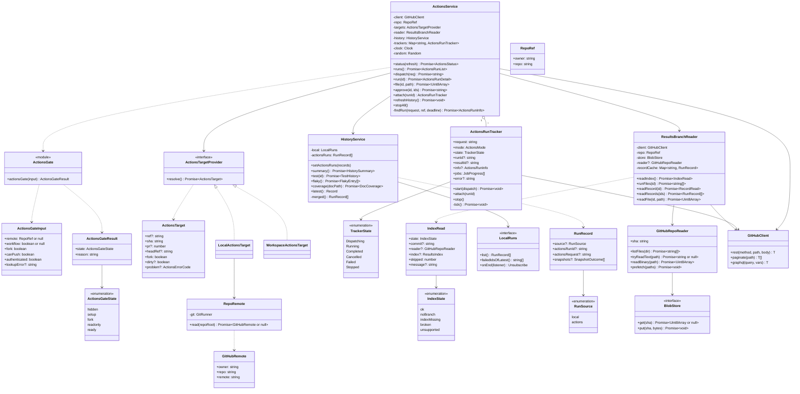

| クラス・関数 | 置き場所 | 役割 |
|---|---|---|
| `ActionsService` | services | 1 つの対象リポジトリ（`RepoRef`）について可否・起動・追跡・結果の読み取りをまとめる。ローカル版はワークスペースごとに `ServerContext.actions` に 1 つ（初回の `GET /api/actions` で作る）、Pages 版は対象を開くたびに 1 つ。`node:*` を使わない（時刻 `Clock`・乱数 `Random` は引数で受け取る） |
| `actionsGate` | services | [可否の判定](#可否の判定)。GitHub を呼ばない純粋関数 |
| `parseGitHubRemote(url)` | services | [リモートの判定](#リモートの判定)。純粋関数 |
| `RepoRemote` | server | 開いたフォルダのリモートを git で読む（`RepoStateReader` と同じ `GitRunner`・上限 5 秒） |
| `LocalActionsTarget` | server | 手元のワークスペースの対象（現在の branch・HEAD・`dirty`・その branch の PR） |
| `WorkspaceActionsTarget` | server | GitHub のワークスペースの対象（`Workspace.pr`・`headSha`）。Pages 版は同じ規則の `PagesActionsTarget`（[services.md](services.md)） |
| `ActionsRunTracker` | services | 1 回の起動（または一覧から開いた実行）の追跡。[実行の追跡](#実行の追跡) |
| `ResultsBranchReader` | services | 結果ブランチの読み取り。ref の解決だけ `GitHubClient`、ファイルは `GitHubRepoReader`（[services.md](services.md)）。[結果ブランチの読み取り](#結果ブランチの読み取り) |
| `mergeRunRecords(local, actions)`・`latestOf(runs)` | services | [履歴の統合](#履歴の統合)。純粋関数 |

- 定数：`DDV_WORKFLOW_FILE = 'ddv-tests.yml'`、`DDV_WORKFLOW_PATH = '.github/workflows/ddv-tests.yml'`、`RESULTS_BRANCH = 'ddv-results'`、`FIND_RUN_TIMEOUT_MS = 60_000`、`FIND_RUN_INTERVAL_MS = 3_000`、`TRACK_INTERVAL_MS = 10_000`、`STATUS_TTL_MS = 60_000`（ワークフロー名・ブランチ名は雛形と合わせた固定値。設定には出さない）
- `GitHubClient` は既存（:ref[workspace.md#github-api]）。ローカル版はサーバの `TokenResolver`（gh / `GITHUB_TOKEN`）、Pages 版は PAT で同じクラスを使う

## 可否の判定

`actionsGate(input)`。入力は `ActionsService.status()` が集める（[可否の取得](#可否の取得)）。

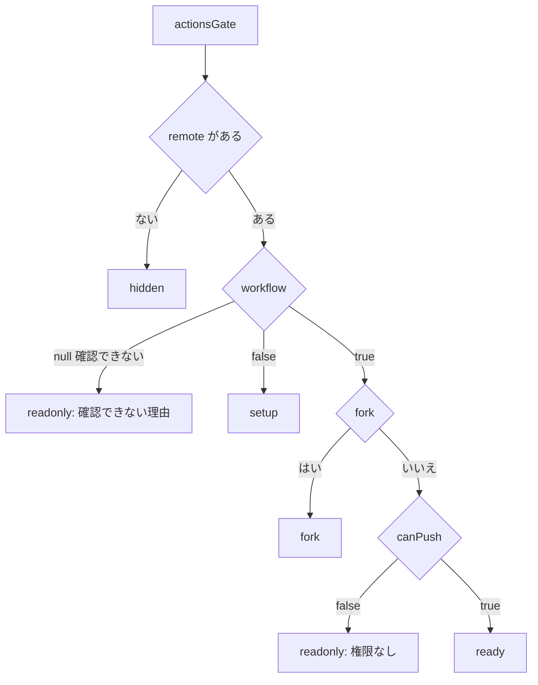

| state | reason（画面の `dispatch-error`） |
|---|---|
| `hidden` | 空（画面に出さない） |
| `setup` | 「既定ブランチ（<defaultBranch>）に ddv ワークフロー（.github/workflows/ddv-tests.yml）がありません」 |
| `fork` | 「fork からの PR は Actions で実行しません。PR の CI の結果を表示します」 |
| `readonly`（確認できない） | `authenticated` が false：ローカル版「GitHub にログインしてください（gh auth login または GITHUB_TOKEN）」、Pages 版「PAT を設定すると Actions の結果と実行が使えます」。それ以外は `lookupError`（`GitHubError.message`） |
| `readonly`（権限なし） | `authenticated` が false（Pages 版で PAT なし）：「PAT が無いため実行できません。実行済みの結果だけを表示します」、それ以外：「書き込み権限が無いため実行できません。実行済みの結果だけを表示します」 |
| `ready` | 空 |

- 不正な入力は無い（全組み合わせで値を返す）。`remote` が null のときは他の入力を見ない

### 可否の取得

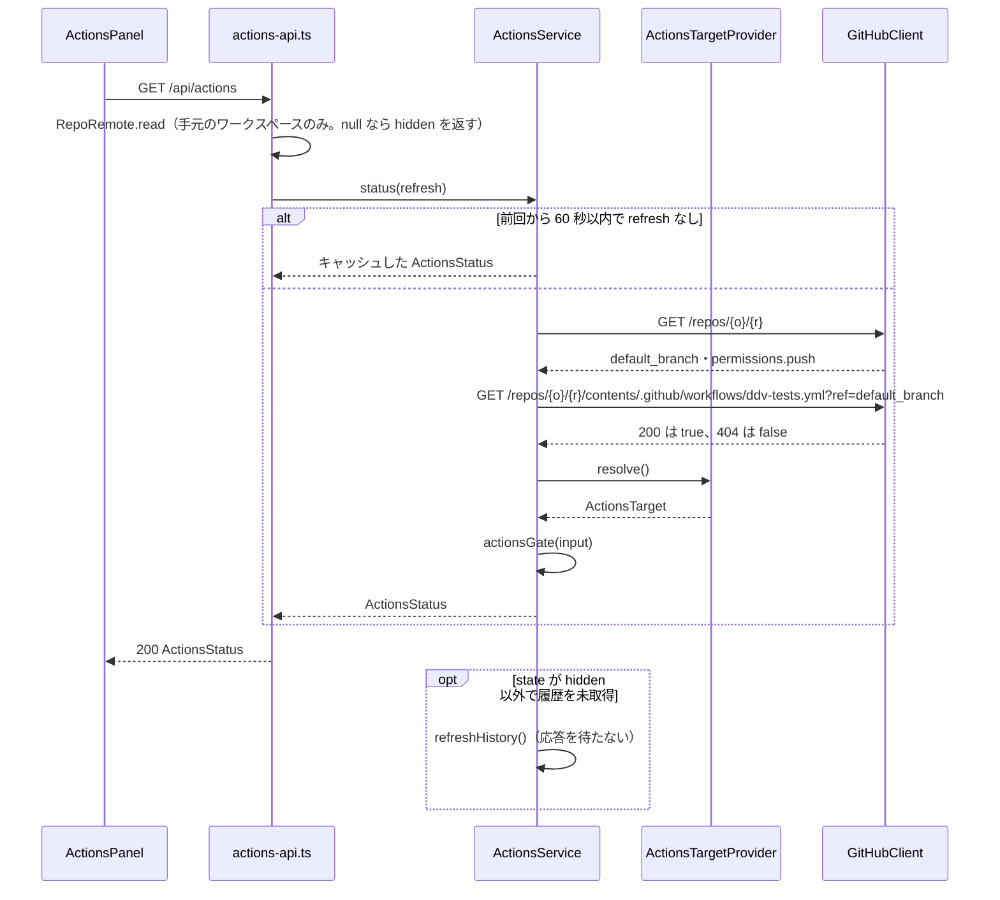

- `GET /repos` の失敗：`auth` は `authenticated: false` として `workflow: null`、`notFound`（PAT で見えない・リポジトリが無い）・`network`・`rateLimit` は `workflow: null`・`lookupError` に理由。contents の 404 以外の失敗も `workflow: null`
- `canPush` は `permissions.push === true`（PAT が無い・`permissions` が無いときは false）。fine-grained PAT で Actions: Write が足りないことは事前には分からないので、dispatch の 403 で知らせる（[起動](#起動)）
- `fork` は `ActionsTarget.fork`（[対象の決定](#対象の決定)）
- ローカル版の手元のワークスペースでは GitHub のリモートが無ければ `ActionsService` を作らず、GitHub の API もトークンの解決（`gh auth token`）も行わない

## リモートの判定

`RepoRemote.read(repoRoot)`：`git -C <repoRoot> remote` の行に `origin` があれば `origin`、無ければ最初の行のリモートを選び、`git -C <repoRoot> remote get-url <name>` の URL を `parseGitHubRemote` にかける。git の失敗・リモートが 0 件・解析できないときは null。結果は `ServerContext` に 30 秒キャッシュする（`.git/config` の変更に追従するため）。

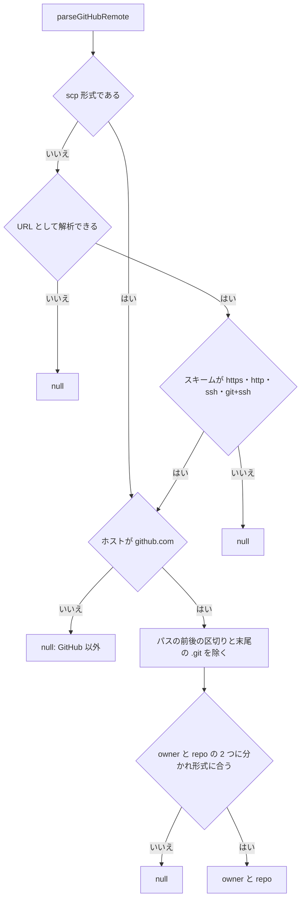

| 判定 | 規則 |
|---|---|
| scp 形式 | `^(?:[^@/]+@)?([^:/]+):(?!/)(.+)$`（例 `git@github.com:acme/order-app.git`）。`C:\…` のような 1 文字のホストは scp 形式としない（Windows のパス） |
| URL | `new URL(url)`。ユーザー情報（`https://x-access-token@github.com/…`）・ポート（`ssh://git@github.com:22/…`）は無視する |
| ホスト | 小文字にして `github.com` と一致（`www.github.com`・GitHub Enterprise は対象外） |
| owner / repo | :ref[workspace.md#ワークスペースid] と同じ正規表現（`parseRepo`）。`.git` を除いた後に `/` で 2 つに分かれること（3 つ以上は null） |

- 不正な入力（空文字・`file://`・ローカルのパス）は例外を投げず null を返す

## 対象の決定

`ActionsTargetProvider.resolve()`。dispatch の `ref`（ワークフローを起動する branch）・入力 `sha`・承認の可否に使う。

| ワークスペース | ref | sha | pr / headRef | fork | dirty |
|---|---|---|---|---|---|
| 手元（`LocalActionsTarget`） | `git rev-parse --abbrev-ref HEAD`（`HEAD` なら無し＝`problem: 'detached'`） | `RepoStateReader.read` の `commit` | `GET /repos/{o}/{r}/pulls?head=<owner>:<ref>&state=open` の先頭（無ければ無し） | false | `RepoStateReader.read` の `dirty` |
| GitHub の PR（`WorkspaceActionsTarget`） | `pr.headRef` | `Workspace.headSha` | `pr.number` / `pr.headRef` | `pr.headRepo` が `<o>/<r>` と違う（大文字小文字を区別しない） | 無し |
| GitHub の branch・tag | `target.ref` | `Workspace.headSha` | 無し | false | 無し |
| Pages 版 | 対象の `ref`（PR は head の branch） | 対象のコミット | 対象の PR | ローカル版の PR と同じ | 無し |

- 手元のワークスペースは、起動の前に `GET /repos/{o}/{r}/branches/<ref>` と `GET /repos/{o}/{r}/commits/<sha>` で push 済みかを確かめる。404・422 は `problem: 'not-pushed'`
- PR・branch の `ref` が既定ブランチと違うときは `GET /repos/{o}/{r}/contents/.github/workflows/ddv-tests.yml?ref=<ref>` も確かめ、404 なら `problem: 'workflow-missing-on-ref'`（dispatch は `ref` のブランチ上のワークフローファイルを使うため。[actions-workflow.md](actions-workflow.md)）。結果は `status` と同じく 60 秒キャッシュする
- `problem` があると `status()` の `state` は変えず（`ready` のまま）、`POST /api/actions/runs` が 409 で理由を返し、画面は `dispatch-error` に出す

## 起動

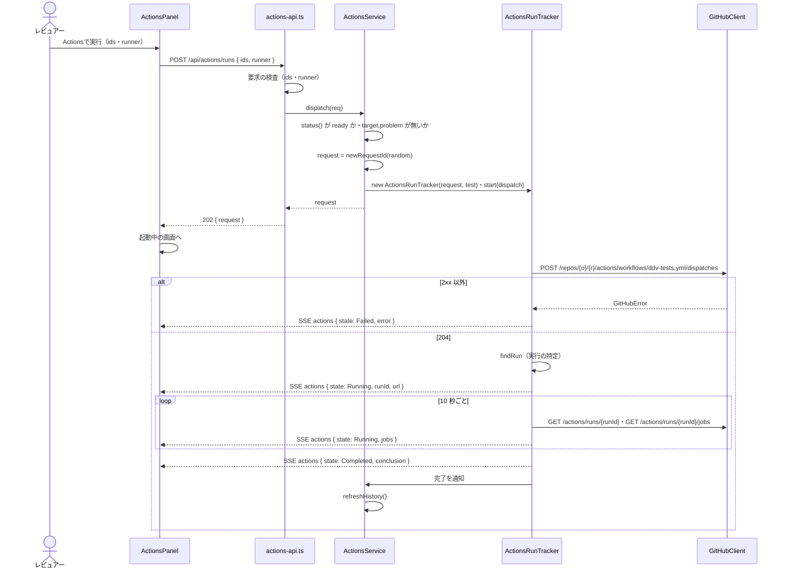

| dispatch の要求 | 値 |
|---|---|
| `ref` | `ActionsTarget.ref`（PR は head の branch 名） |
| `inputs.request` | 依頼ID：`ddv-` ＋ 小文字 16 進 8 桁（`^ddv-[0-9a-f]{8}$`。`Random` から作る） |
| `inputs.mode` | `test`（承認は `approve`） |
| `inputs.ids` | テストIDをカンマで連結（全件は空文字） |
| `inputs.runner` | ランナー名（全件は空文字） |
| `inputs.sha` | `ActionsTarget.sha`（40 桁。承認は空文字） |
| `inputs.run` | 空文字（承認は元の実行の結果ID） |

- workflow_dispatch の入力はすべて文字列で送る。ワークフローの `run-name` は依頼IDを空白で区切った 1 語として含む（`ddv <mode> <依頼ID>`。[actions-workflow.md](actions-workflow.md) の雛形との約束）
- 実行中の実行があるときも起動する（ワークフローの `concurrency: ddv-tests` で待つ）。GitHub が待たせられるのは 1 件だけで、さらに起動すると待機中の実行は `conclusion: cancelled` になる。そのため `queued` の行があるときは画面で確認してから送る（[Actions の実行一覧](#actions-の実行一覧)）。サーバは確認しない（他の利用者・Actions の画面からの起動もあるため）

| dispatch の応答 | 起動失敗の理由（`error`） |
|---|---|
| 403 | 「ワークフローを起動する権限がありません（PAT に Actions: Write が必要です）」 |
| 404 | 「ddv ワークフローが見つかりません。既定ブランチにマージされているか確認してください」（`status` のキャッシュを捨てる） |
| 422（`ref` にワークフローが無い：`message` が「not found」か「does not have 'workflow_dispatch' trigger」を含む） | 「PR のブランチ（<ref>）に ddv のワークフローがありません。既定ブランチを取り込んでから実行してください」（コード `workflow-missing-on-ref`） |
| 422（それ以外） | 「ワークフローの入力が ddv と合いません。ddv actions init で雛形を更新してください: <message>」 |
| 401・429・ネットワーク | `GitHubError.message`（:ref[workspace.md#github-api]） |

## 実行の特定

`ActionsService.findRun(request, ref, deadline)`。dispatch の 204 から呼ぶ。`deadline` は 204 を受けた時刻 ＋ 60 秒。

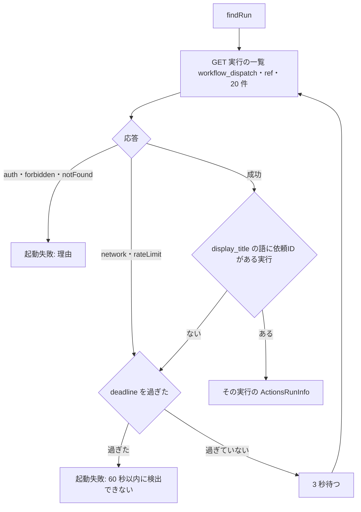

- 一覧：`GET /repos/{o}/{r}/actions/workflows/ddv-tests.yml/runs?event=workflow_dispatch&branch=<ref>&per_page=20`。最初の呼び出しは 204 の 2 秒後
- 照合は `display_title`（= `run-name`）を空白で分けた語のどれかが依頼IDと完全一致すること。複数あれば `created_at` の新しいもの
- 一覧を `head_sha` でなく `branch` で絞るのは、押した直後に branch が進んだときも見つけるため（ワークフローは入力の `sha` を checkout する）
- 起動失敗（検出できない）の理由：「60 秒以内に Actions の実行を検出できませんでした。Actions の画面で確認してください」と `workflowUrl`

| `ActionsRunInfo`（GitHub の workflow run から作る） | 元の項目 |
|---|---|
| `id` / `attempt` / `resultId` | `String(id)` / `run_attempt` / `<id>-<run_attempt>`（結果ブランチの結果ID） |
| `request` / `mode` | `display_title` の語のうち依頼IDの形式のもの / `approve` の語があれば `approve`、無ければ `test` |
| `ref` / `sha` | `head_branch` / `head_sha`（dispatch 時のブランチの先頭。checkout したコミットは結果ブランチの `commit` が正） |
| `actor` | `triggering_actor.login`（無ければ `actor.login`） |
| `createdAt` / `status` / `conclusion` / `url` | `created_at` / `status`（`queued`・`in_progress`・`completed`。`waiting`・`pending`・`requested` は `queued` にまとめる）/ `conclusion` / `html_url` |

## 実行の追跡

`ActionsRunTracker`。`start(dispatch)` は起動から、`attach(runId)` は一覧で実行中の行を開いたとき（実行中から始める）。

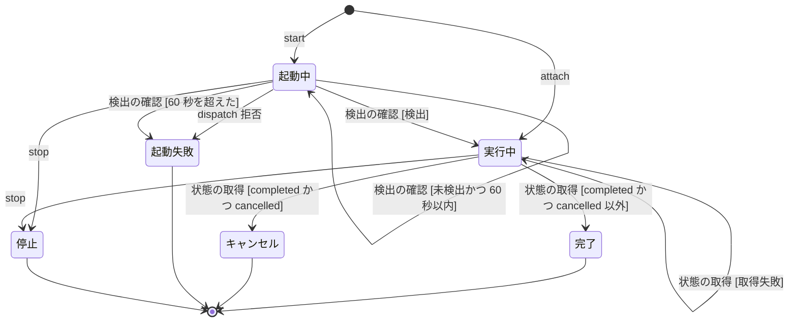

- 状態が変わるたび・状態の取得のたびに `update` イベント（[SSE](#sse)）を出す。「状態の取得」は 10 秒ごとに `GET /repos/{o}/{r}/actions/runs/{id}` と `GET /repos/{o}/{r}/actions/runs/{id}/jobs` を呼ぶ
- 「取得失敗」（ネットワーク・回数制限・5xx）は前回の表示を残し `error` に「状態を取得できません（再試行中）」を入れて続ける。`auth` も同じく続ける（再ログイン後に戻るため）
- 「一覧へ」で画面を離れても追跡は続ける（`ActionsService.trackers` が持つ）。止めるのは、Pages 版はページを閉じたとき（`pagehide`）、ローカル版は `/api/events` の購読が 0 になって 60 秒たったとき（`ActionsService.stopAll()`）。止めても Actions の実行は続き、次に一覧を開くと実行中の行として出る
- `Cancelled`：待機中に次の実行が起動された（concurrency の待ちは 1 件のみ）か、Actions の画面で止められた。結果ブランチには何も書かれないので `refreshHistory()` は呼ばない。理由は「待機中に新しい実行が起動されたためキャンセルされました」（Actions の画面で止めた場合も区別できないため同じ文言）
- 完了（`mode: test`）したら `ActionsService` が `refreshHistory()` を呼ぶ。`conclusion` が `success` 以外でも結果ブランチを読む（テストの失敗でもワークフローは結果を保存する）
- `trackers` は依頼IDをキーにし、完了・キャンセル・起動失敗・停止から 10 分後に捨てる
- 不正遷移：`start`・`attach` を 2 回目に呼ぶと `Error('追跡はすでに始まっています')`。`Completed`・`Cancelled`・`Failed`・`Stopped` での `stop` は無視する。停止後に届いた取得の結果は捨てる

## 結果ブランチの読み取り

`ResultsBranchReader`。構成は :ref[../basic/actions-run.md#結果ブランチ]、書き込みとスキーマの正本は [actions-workflow.md](actions-workflow.md)（`ResultsIndexEntrySchema`・`ApprovalSchema`・`CiRunRecord`）。本書はそれを読む側の扱いだけを決める。

| 用語 | 値 |
|---|---|
| 結果ID | 結果ブランチの `runs/<結果ID>/` と `run.json` の `id`。`<GITHUB_RUN_ID>-<GITHUB_RUN_ATTEMPT>`（例 `123456789-1`）。正規表現 `^\d{1,20}-\d{1,4}$` |
| 実行ID（GitHub） | `actionsRunId`（`GITHUB_RUN_ID`）。同じ実行を Actions の画面で再実行すると結果IDの末尾（attempt）だけが変わる |

読み取りでは、外枠だけを緩く検査し、行は書き込み側の `ResultsIndexEntrySchema` で 1 件ずつ検査する（1 行の不正で全体を読めなくしない）。

```ts
// Pages 版（packages/services）からも使うため、actions-workflow.md のスキーマは packages/core に置く前提
import { ResultsIndexEntrySchema, type ResultsIndexEntry } from '@ddv/core';

export const RESULTS_INDEX_VERSION = 1;
export const RESULT_ID = /^\d{1,20}-\d{1,4}$/;

// 読み取り用の外枠（書き込み側の ResultsIndexSchema は version: z.literal(1) で行も厳密に検査する）
export const ResultsIndexEnvelopeSchema = z.object({
  version: z.number().int(),
  updatedAt: z.string(),
  runs: z.array(z.unknown()),
});

export interface ResultsIndex { version: 1; updatedAt: string; runs: ResultsIndexEntry[] }
```

```ts
const CaseResultSchema = z.object({
  status: z.enum(['passed', 'failed', 'skipped', 'error']),
  durationMs: z.number().min(0),
  message: z.string().optional(),
  runner: z.string(),
  test: z.string(),
});

const StepResultMetaSchema = z.object({
  step: z.number().int().min(0),
  status: z.enum(['NoBase', 'Match', 'Diff']),
  diffRatio: z.number().optional(),
});

// runs/<結果ID>/run.json（actions-workflow.md の CiRunRecord）を読むときの検査
export const ActionsRunRecordSchema = z.object({
  id: z.string().regex(RESULT_ID),
  kind: z.literal('test').optional(),
  source: z.literal('actions'),
  actionsRunId: z.string().regex(/^\d{1,20}$/),
  actionsRequest: z.string().optional(),
  ref: z.string().optional(),
  startedAt: z.string(),
  finishedAt: z.string().optional(),
  status: z.enum(['passed', 'failed', 'error']),
  request: z.object({ ids: z.array(z.string()).optional(), runner: z.string().optional() }).prefault({}),
  runners: z.array(z.object({ name: z.string(), command: z.string(), exitCode: z.number().nullable(), error: z.string().optional() })).prefault([]),
  results: z.record(z.string(), CaseResultSchema),
  log: z.array(z.string()).prefault([]),
  commit: z.string().regex(/^[0-9a-f]{7,64}$/i).optional(),
  dirty: z.literal(false).optional(),
  traces: z.array(z.string()).optional(),
  snapshots: z.array(z.object({ id: z.string(), status: z.enum(['passed', 'failed', 'error']), steps: z.array(StepResultMetaSchema) }).loose()).optional(),
  warnings: z.array(z.string()).prefault([]),
}).loose();
```

- `run.json` の未知の項目は残す（`.loose()`。新しい ddv が足した項目で読めなくならないように）。`index.json` の `version` が 1 より大きいときだけ読まない
- index の行の `id` と `run.json` の `id` が違うときは `broken`（取り違えを表示しない）
### 読み手

`ResultsBranchReader` は GitHub を直接呼ばず、[services.md](services.md) の `GitHubRepoReader`（1 つのコミットを読む `RepoReader`）を ddv-results のコミット SHA で作って読む。

| 項目 | 規則 |
|---|---|
| コミットの解決 | `readIndex()` のたびに `GET /repos/{o}/{r}/git/ref/heads/ddv-results` で `object.sha` を取り直す（ref はキャッシュしない） |
| 読み手の生成 | SHA が前回と違うときだけ `GitHubRepoReader`（`owner`・`repo`・`sha` = そのコミット、`roots: ['runs']`、`store` = 注入した `BlobStore`）を作る。前の読み手は捨てる。同じなら前回の読み手と `IndexRead` を使う |
| `BlobStore` | `ActionsService` の生成時に注入する。ローカル版・Pages 版とも `MemoryBlobStore`（Pages 版も履歴をブラウザに保存しない。:ref[../basic/actions-run.md#履歴の統合]）。blob SHA がキーなので、コミットが変わっても変わらないファイルは取り直さない |
| tree が大きい | `TreeIndex.load` の `truncated` の扱い（`roots` ごとの取り直し）は [pages-viewer.md](pages-viewer.md) のまま |

### index.json

`readIndex()` は一覧を開くたび・`refreshHistory()` のたびに呼ぶ。

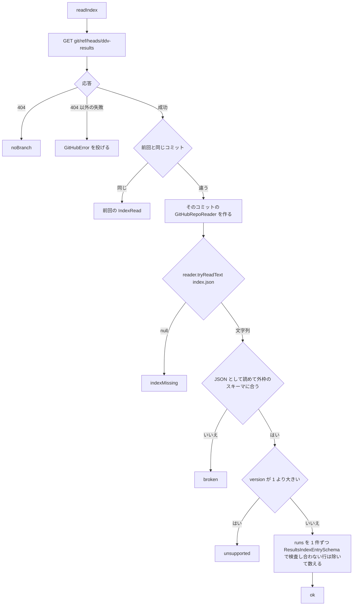

- 除いた行の数は `IndexRead.skipped`。1 以上なら一覧の `index-state` に「読めない実行が n 件あります」を出す（`state` は `ok`）
- `ok` 以外のとき、一覧は実行中の実行（GitHub の一覧から）だけを出し、履歴の Actions の分は空にする
- `GitHubRepoReader` の生成（tree の取得）が失敗したときも `GitHubError` を投げる（`IndexRead` は前回のまま）

### 1 回分の結果

`IndexRead.reader`（その時点の `GitHubRepoReader`）で読む。

| 操作 | 呼び出し | 失敗のとき |
|---|---|---|
| `runFiles(id)`（`id` は結果ID） | `reader.listFiles('runs/<id>')` | 空：`recordState: 'missing'` |
| `readRecord(id)` | `reader.tryReadText('runs/<id>/run.json')` → `ActionsRunRecordSchema` | `null`：`missing`、JSON でない・スキーマに合わない：`broken`（理由に zod の最初のエラー） |
| `readRecords(ids)` | `reader.prefetch(各 run.json)` の後に `readRecord` を順に | 読めない実行は除く（履歴に出さない。一覧の行には出る） |
| `readFile(id, path)` | `reader.readBinary('runs/<id>/<path>')` | 無い：`RepoReadError(404, 'not-found')` |

- 認証が無い（Pages 版で PAT なし）ときは回数制限のため `readRecords` は新しい 20 件だけ読む。このとき推移・フレーキーの画面に「PAT が無いため Actions の実行は直近 20 回だけを集計しています」を出す
- 読んだ `RunRecord` は結果IDをキーにメモリに保持する（`run.json` は書き込み後に変わらない）。index から消えた実行は捨てる
### 実行の結果の組み立て

`ActionsService.run(id)` は `ActionsRunDetail` を返す。

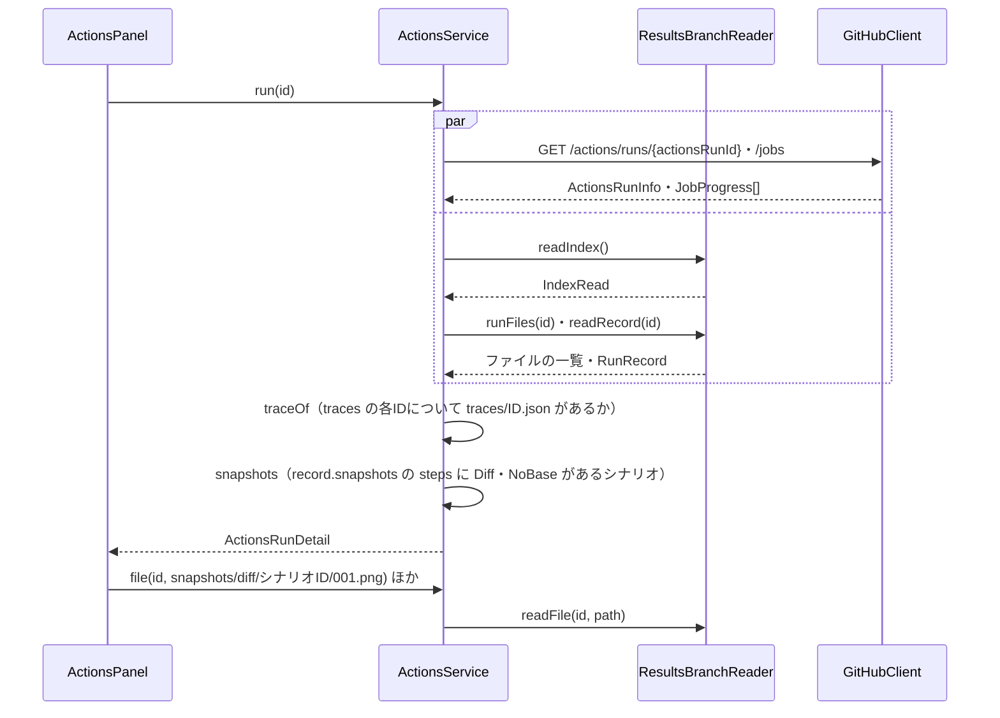

- `GET /actions/runs/{id}` が 404（実行が GitHub から削除済み）でも、結果ブランチにあれば表示する（`info` は index の行から作る）。両方に無ければ 404 `not-found`
- 画像は結果ブランチの `runs/<結果ID>/snapshots/{current,diff,baseline}/<シナリオID>/<NNN>.png` を読む（基準も実行時のものが Diff のシナリオだけ入っている。[actions-workflow.md](actions-workflow.md)）。無ければ 404（画面は「基準なし」）
- index の行が `trimmed: true`（剪定で `traces/`・`snapshots/` を消した）なら、トレース・画像の欄に「古い実行のため詳細は削除されました」を出し、承認できない
- `warnings`（index の行と `run.json`）は `run-warnings` に出す

## 承認

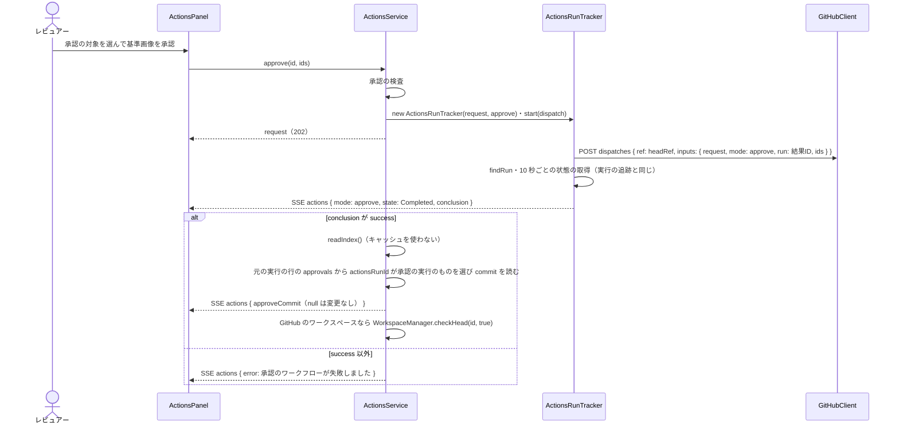

| 承認の検査 | 失敗のとき |
|---|---|
| `status()` が `ready` | 403 `readonly` / `fork`（`reason`） |
| `target.pr` と `target.headRef` がある | 409 `not-pr`「PR のワークスペースで承認してください」 |
| 実行の `pr`（index の行）が `target.pr` と同じ | 409 `other-pr`「別の PR の実行です」 |
| 行が `trimmed` でない | 409 `trimmed`「古い実行のため画像が削除されています。もう一度実行してください」 |
| `ids` が 1 件以上で、すべてその実行の `snapshots` で `Diff` か `NoBase` のステップを持つ | 400 `ids-invalid`「差分のあるシナリオを選んでください」 |

- `inputs.run` は元の実行の結果ID。ワークフローはその実行の今回の画像を PR のブランチの先頭にコミットする（`inputs.sha` は渡さない。祖先の確認・失敗の文言は [actions-workflow.md](actions-workflow.md)）
- 承認の完了：`approvals` の該当項目の `commit` が SHA なら `approve-commit` にリンク、`null` なら「基準画像に変更はありませんでした」。`success` なのに該当項目が無い（行が剪定で消えた・記録に失敗した）ときは「承認は完了しましたが、結果ブランチで確認できません。Actions の画面で確認してください」と `logs-link`
- 承認のコミットで PR の head が進むため、GitHub のワークスペースは `Stale`（更新あり）になる（:ref[../basic/github-review.md#ワークスペース]）。手元のワークスペースは何もしない（利用者が pull する）
- 承認の実行は履歴（推移・フレーキー）に数えない（[履歴の統合](#履歴の統合)）

## 履歴の統合

### RunRecord の拡張

:ref[run-record.md#構造] の `RunRecord` に足す（`runs.ts`）。

| 項目 | 規則 |
|---|---|
| `source?: 'local' \| 'actions'` | 出所。`.ddv/runs/*.json` は書かない（＝無し＝`local`。既存の記録・新しく書く記録とも変えない）。結果ブランチの `run.json` は `actions` |
| `actionsRunId?: string` | `source: 'actions'` のとき GitHub の workflow run ID（`id` は結果ID `<run ID>-<attempt>`） |
| `actionsRequest?: string` / `ref?: string` / `warnings?: string[]` | 依頼ID・実行したブランチ・ワークフローの警告（[actions-workflow.md](actions-workflow.md) の `CiRunRecord`） |
| `snapshots?: SnapshotOutcome[]` | Actions の実行で撮影したシナリオごとの `{ id, status, steps: StepResultMeta[] }`（手元の実行には書かない。手元は従来どおり `.ddv/snapshots`） |

- `RunSource = 'local' | 'actions'` は `packages/services/src/history.ts` から公開する（`RunRecord` の型は `runs.ts` のまま）
- `RunManager.load` は変えない（`source` の無い記録をそのまま登録する。:ref[run-record.md#読み込み]）

### 統合の規則

`HistoryService`（`packages/services/src/history.ts`）は手元の `LocalRuns.list()`（サーバは `RunManager`、Pages 版は空）と、`ActionsService.refreshHistory()` が `setActionsRuns(records)` で渡した Actions の記録を `mergeRunRecords(local, actions)` でまとめて、既存の集計（`allEntries`・`entriesOf`・`flakyCommits`・`classify` ほか。:ref[test-history.md#構造]）に渡す。

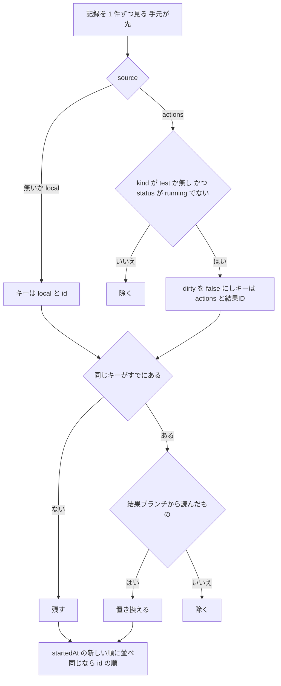

- 「結果ブランチから読んだもの」：`setActionsRuns` で渡した記録。手元の `.ddv/runs` に `source: 'actions'` の記録があり（`ddv ci run` を手元で `--out .ddv` にした等）、同じ結果IDが結果ブランチにもあれば結果ブランチを使う。同じ `actionsRunId` で attempt の違う結果ID（Actions の画面での再実行）は別の実行として数える
- 承認の実行は `run.json` も index の行も作らない（元の実行の行の `approvals` に記録される）ので `setActionsRuns` に入らない
- **フレーキーの判定**（:ref[test-history.md#フレーキーの判定]）は変えない。Actions の記録は `commit` があり `dirty` が false なので対象になる。同じコミットの手元のきれいな実行と Actions の実行は同じ組に入る（出所で分けない）。`commit` の無い `run.json` は対象にしない
- `latestOf(runs)` は現行の `RunManager.latest()` と同じ規則（古い順に上書き）で統合後の記録から最新の結果を求める。カバレッジ（`classify`）と `/api/results/latest` はこれを使う
- `HistorySummary.rerunnable`（失敗の再実行）は手元だけ（`LocalRuns.failedIdsOfLatest()`。再実行は手元の操作のため）
- キャッシュ（`summary`・`flaky`）は `LocalRuns.onEnd` に加え `setActionsRuns` でも捨てる
- Pages 版は手元の記録が無い（`local = []`）

### 取り込みの流れ

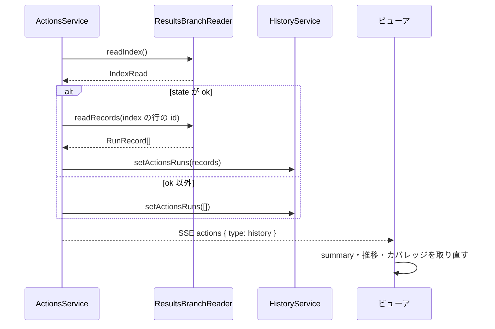

- `refreshHistory()` を呼ぶ時：初めて `status()` が `hidden` 以外を返した後、`mode: test` の追跡が完了した後、`GET /api/actions/runs` で index のコミットが前回と違ったとき。同時に 2 つは走らせない（実行中なら終わった後に 1 回だけやり直す）
- 失敗（認証なし・ネットワーク）は Actions の記録を前回のまま残し、サーバのログに `! Actions の結果を読めませんでした: …` を出す。既存の API は待たない（取り込み前は手元だけで集計する。REQ-610）

## API

ローカル版のサーバ（`actions-api.ts` の `registerActionsRoutes(app, ctx)`）。GitHub のワークスペースでは `/api/w/<ワークスペースID>/actions/...`（:ref[workspace.md#api-のルーティング]。実行系の `trusted` の確認はしない：PR のコードを手元で動かさないため）。エラーの形は既存と同じ `{ error, code }`。Pages 版は同じ処理を `ActionsService` で直接呼ぶ。

| メソッド | パス | 要求 | 応答 |
|---|---|---|---|
| GET | `/api/actions` | `?refresh=1`（任意。キャッシュを使わない） | 200 `ActionsStatus`（`hidden` も 200） |
| GET | `/api/actions/runs` | — | 200 `ActionsRunList`。404 `no-remote`。GitHub の失敗は `github-<kind>`（下の [エラー](#エラー)） |
| POST | `/api/actions/runs` | `{ ids?: string[], runner?: string }` | 202 `{ request }`。400 `ids-invalid` / `runner-unknown`。403 `readonly` / `fork`。404 `no-remote`。409 `setup` / `detached` / `not-pushed` / `workflow-missing-on-ref`。GitHub の失敗は同上 |
| GET | `/api/actions/runs/{id}` | `id` は結果ID | 200 `ActionsRunDetail`。400 `run-id-invalid`。404 `not-found` |
| GET | `/api/actions/runs/{id}/files/*` | `traces/<テストID>.json`・`traces/<テストID>/<NNN>.png`・`snapshots/{current,diff,baseline}/<シナリオID>/<NNN>.png` | 200（`content-type` は拡張子から。`cache-control: private, max-age=86400`）。400 `path-invalid`（上の形以外・`..`・`\`）。404 `not-found` |
| POST | `/api/actions/runs/{id}/approve` | `{ ids: string[] }` | 202 `{ request }`。400 `ids-invalid`。403 `readonly` / `fork`。409 `not-pr` / `other-pr` / `trimmed` / `workflow-missing-on-ref`。GitHub の失敗は同上 |
| POST | `/api/actions/init` | `{ force?: boolean }` | 201 `{ status: 'created', path }` / 200 `{ status: 'unchanged' \| 'overwritten', path }`。400 `invalid-request`。409 `workflow-differs` `{ diff }`。404 `local-only`（GitHub のワークスペース）。500 `template-missing`。処理と文言は [actions-workflow.md](actions-workflow.md) |

```ts
interface ActionsStatus {
  state: 'hidden' | 'setup' | 'fork' | 'readonly' | 'ready';
  reason: string;
  repo?: string;                 // owner/repo（hidden では無し）
  defaultBranch?: string;
  workflow: boolean | null;
  workflowUrl?: string;          // https://github.com/<o>/<r>/actions/workflows/ddv-tests.yml
  target?: { ref?: string; sha: string; pr?: number; headRef?: string; fork: boolean; dirty?: boolean; problem?: string };
  canInit: boolean;              // 手元のワークスペースのみ true
}

interface ActionsRunRow {
  id: string;                    // 結果ID <actionsRunId>-<attempt>
  actionsRunId: string;
  request?: string;
  mode: 'test' | 'approve';      // index の行は test。approve は GitHub の一覧の未完了の行だけ
  commit: string;
  pr?: number;
  actor?: string;
  at: string;                    // index の startedAt（実行中は created_at）
  state: 'queued' | 'in_progress' | 'passed' | 'failed' | 'error' | 'cancelled' | 'no-result';
  counts?: { passed: number; failed: number; skipped: number; error: number };
  snapshots?: { diff: number; noBase: number };
  approvals: number;             // index の approvals の件数
  trimmed: boolean;
  warnings: string[];
  url: string;                   // https://github.com/<o>/<r>/actions/runs/<actionsRunId>/attempts/<attempt>
}

interface ActionsRunList {
  index: { state: 'ok' | 'noBranch' | 'indexMissing' | 'broken' | 'unsupported'; skipped: number; message?: string };
  rows: ActionsRunRow[];         // index の行と、GitHub の一覧（新しい 30 件）の未完了・結果なしの行を合わせて新しい順
  checks?: Array<{ name: string; status: string; conclusion?: string; url: string }>; // fork のときだけ
}

interface JobProgress {
  name: string;
  status: 'queued' | 'in_progress' | 'completed';
  conclusion?: string;
  steps: Array<{ number: number; name: string; status: string; conclusion?: string }>;
  url: string;
}

interface ActionsRunDetail {
  info: ActionsRunInfo;
  jobs: JobProgress[];
  recordState: 'ok' | 'missing' | 'broken';
  record?: RunRecord;            // source: 'actions'
  traceOf: Record<string, boolean>;
  snapshots: SnapshotOutcome[];  // steps に Diff・NoBase があるシナリオだけ
  approvals: Approval[];         // index の行の approvals（actions-workflow.md の ApprovalSchema）
  trimmed: boolean;
  warnings: string[];            // index の行と run.json の warnings を重複なく
}
```

| 要求の検査 | 規則・文言 |
|---|---|
| `ids` | 文字列の配列、各要素が `idPattern`（`@ddv/testid`）に合う、200 件以内。違反は 400 `ids-invalid`「テストIDの形式ではありません: <値>」/「テストIDは 200 件までです」 |
| `runner` | 文字列で、`config.runners` の `name` のどれか。違反は 400 `runner-unknown` |
| `{id}` | 結果ID `^\d{1,20}-\d{1,4}$`。違反は 400 `run-id-invalid` |
| `ActionsStatus.state` | `hidden` → 404 `no-remote`「GitHub のリモートがありません」、`setup` → 409 `setup`、`fork`・`readonly` → 403（`reason`） |
| `target.problem` | `detached` → 409「ブランチをチェックアウトしてください（detached HEAD は Actions で実行できません）」、`not-pushed` → 409「<ref>（<短縮SHA>）が GitHub にありません。push してください」 |

- `fork` のときの `checks` は `GET /repos/{o}/{r}/commits/<target.sha>/check-runs`（ddv ワークフローの実行は含めない）
- `rows` の `no-result`：GitHub の一覧で `completed`（`cancelled` 以外）だが index に無い実行（結果の保存の前に失敗した等）。`cancelled`：GitHub の一覧で `conclusion: cancelled`（待機中に次の実行が起動されて外された・利用者が止めた）。どちらも結果IDは `<id>-<run_attempt>`
- `workflow-missing-on-ref`：dispatch が 422 で、メッセージが「Workflow does not have 'workflow_dispatch' trigger」または「not found」を含むとき。文言「PR のブランチ（<ref>）に ddv のワークフローがありません。既定ブランチを取り込んでから実行してください」

### エラー

エラーの形と変換は [services.md](services.md) の「エラーの変換」に従う。`ActionsService` は自前の判定を `ActionsError`（`ServiceError` の子。`status`・`code`・`message`・`extra`）で、GitHub の失敗を `GitHubError` のまま投げる。

| 例外 | ローカル版（`onError`） | Pages 版（`toApiError`） |
|---|---|---|
| `ActionsError` | 上の表の `status`・`code`（`no-remote`・`setup`・`readonly`・`fork`・`detached`・`not-pushed`・`workflow-missing-on-ref`・`ids-invalid`・`runner-unknown`・`run-id-invalid`・`path-invalid`・`not-found`・`not-pr`・`other-pr`・`trimmed`）。`init` の code は [actions-workflow.md](actions-workflow.md) | 同じ |
| `GitHubError` | `GITHUB_STATUS[kind]` と `github-<kind>`（`github-auth` 401・`github-forbidden` 403・`github-notFound` 404・`github-validation` 422・`github-rateLimit` 429・`github-network` 502） | `auth` と PAT なしの `notFound` は `pat-required` / `pat-invalid`、他は左と同じ |
| `RepoReadError(404)`（`files`） | 404 `not-found` | 同じ |

- dispatch の失敗は HTTP の応答でなく SSE `actions` の `state: Failed` の `error` で届く（[起動](#起動) の表の文言。`code` も `error` に添える：`github-forbidden`・`workflow-missing-on-ref`・`github-validation` 等）
- `ActionsGate` の `readonly`（確認できない）の理由は、`GitHubError` を [pat.md](pat.md) の `formatGitHubError` で文言にしたもの
### SSE

| SSE（`/api/events`） | data | 送る時 |
|---|---|---|
| `actions`（追加） | `{ type: 'tracker', request, mode, state: 'Dispatching' \| 'Running' \| 'Completed' \| 'Cancelled' \| 'Failed' \| 'Stopped', startedAt, runId?, resultId?, url?, status?, conclusion?（`cancelled` を含む）, jobs?, error?, approveCommit?（`string \| null`） }` | `ActionsRunTracker` の `update`（状態の変化・10 秒ごとの取得） |
| `actions`（追加） | `{ type: 'history' }` | `refreshHistory()` が `setActionsRuns` を呼んだ後 |
| `run`・`run-end`・`change`（既存） | 変えない | 変えない |

- ビューアは `actions`（`type: tracker`）を依頼IDで振り分ける。Dispatching 画面の初期表示は `GET /api/actions/runs` の行ではなく、購読後に最初に届く `update` で描く（サーバは購読の開始時に追跡中の全トラッカーの最新の `update` を 1 回ずつ送る）

### 既存の API への追加

項目の追加のみ（既存の項目・意味は変えない。Actions の記録が無いときの値は従来と同じ。REQ-610）。

| API | 追加する項目 |
|---|---|
| `GET /api/history/summary` | `TestSummary.recentAt[i].source` |
| `GET /api/history/tests/{id}` | `HistoryEntry.source`・`actionsRunId?`・`actionsUrl?`（`https://github.com/<o>/<r>/actions/runs/<id>`）。Actions の行の `trace` は `traces` にIDがあれば true（ファイルの有無は開いたときに `files/traces/…` の 404 で判断） |
| `GET /api/history/flaky` | `FlakyCommit.sources: RunSource[]`（そのコミットの組に含まれる出所） |
| `GET /api/coverage` | `DocCoverage.sources: Record<テストID, RunSource>`（`cases` のうち最新の結果があるもの） |
| `GET /api/results/latest` | 各IDに `source`・`actionsRunId?`。`trace` は Actions の結果なら `traces` にIDがあるか |

- `GET /api/runs`・`GET /api/runs/{id}` は手元の実行だけのまま（Actions の実行は `/api/actions/runs`）
