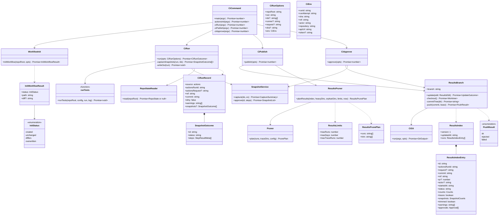
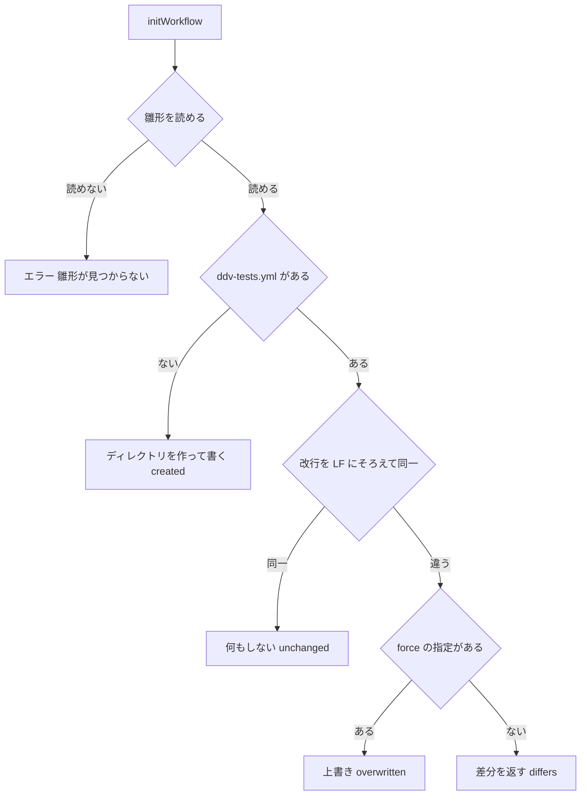
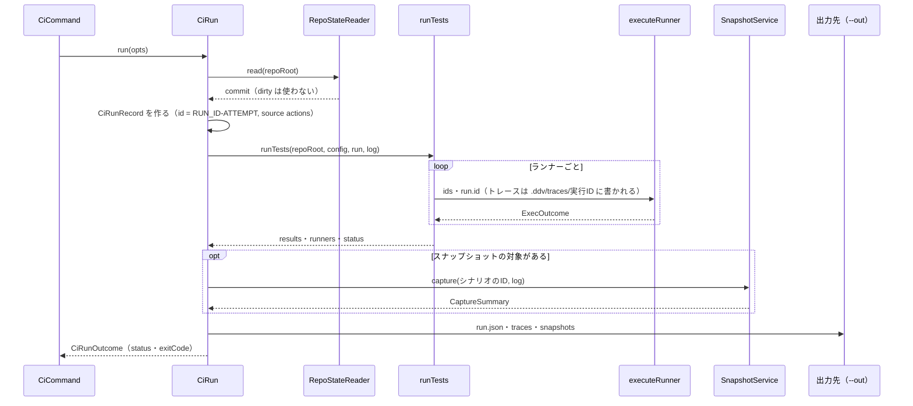
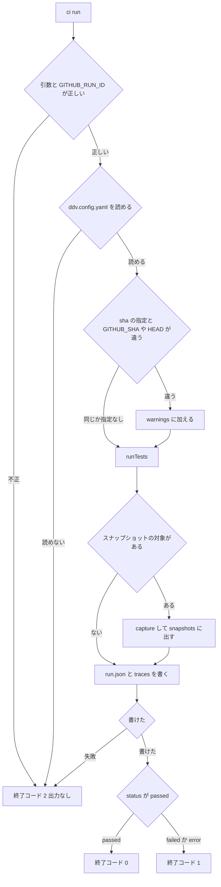
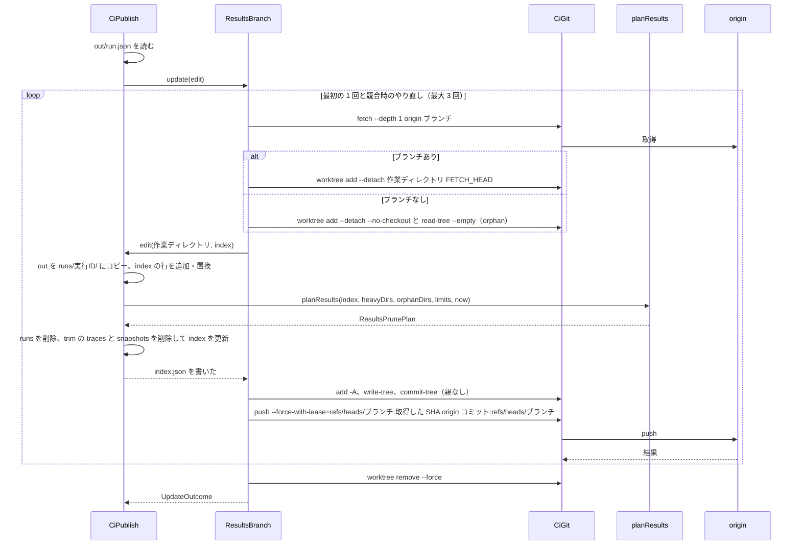
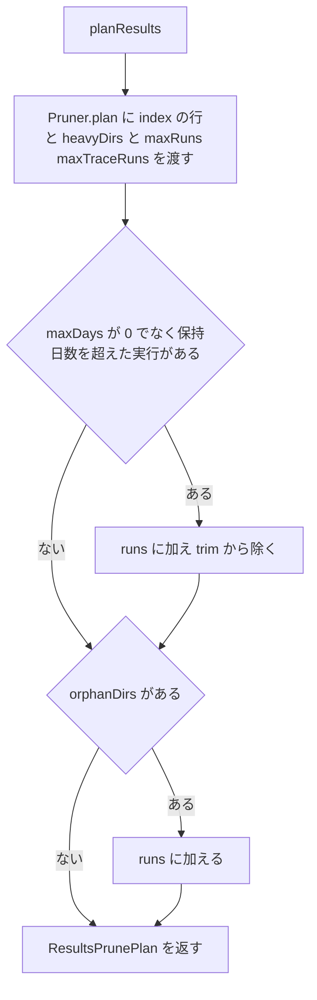
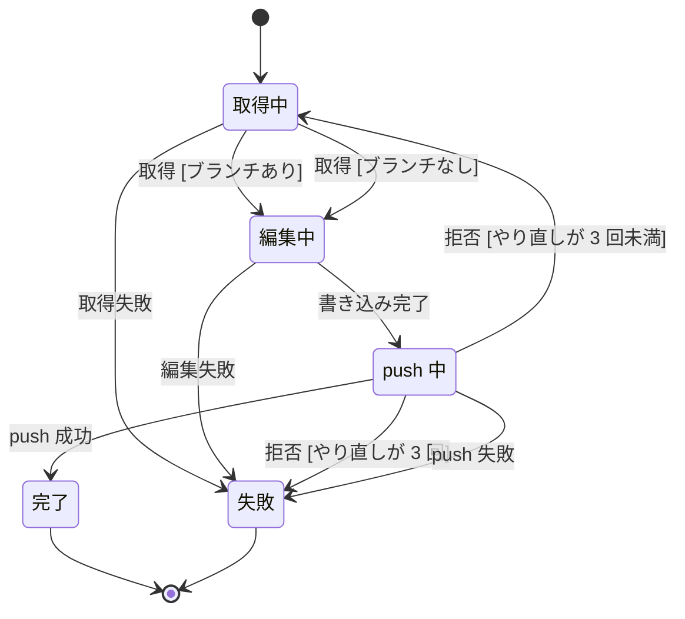
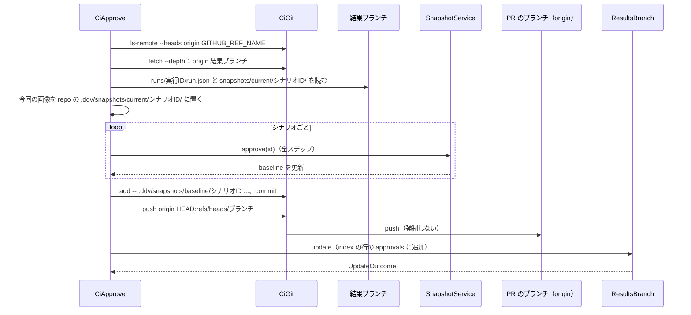
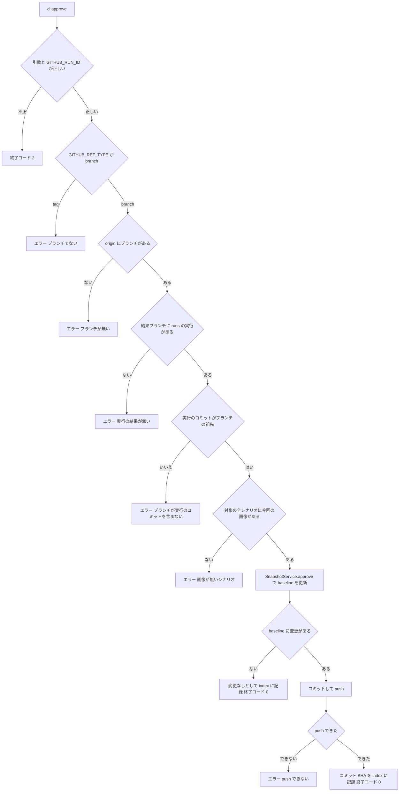

# ddv ワークフロー雛形・ddv ci コマンド・結果ブランチ 詳細設計

## 前提

- 雛形は :ref[../basic/actions-run.md#ワークフローの雛形]、CLI は :ref[../basic/actions-run.md#設定と-cli]、結果ブランチの構成と剪定は :ref[../basic/actions-run.md#結果ブランチ]、承認は :ref[../basic/actions-run.md#スナップショットの承認]、受け渡しの全体は :ref[../basic/actions-run.md#実行と結果の受け渡し] を参照
- 本書は **ワークフローの中で動く側**（雛形・`ddv actions init`・`ddv ci run / publish / approve`・結果ブランチへの書き込み）を扱う。ビューア側（可否の判定・dispatch・実行の特定・結果ブランチの読み取り・表示）は [actions-run.md](actions-run.md)
- 実行記録の形式・剪定の考え方は :ref[run-record.md#構造]・:ref[run-record.md#剪定]、基準画像の承認は :ref[snapshot.md#承認] をそのまま使う
- 実装（新規）：`apps/server/src/ci/`（`cli.ts`・`workflow-init.ts`・`ci-run.ts`・`results-index.ts`・`results-prune.ts`・`results-branch.ts`・`publish.ts`・`approve.ts`・`ci-git.ts`）、雛形の正本 `plugin/templates/.github/workflows/ddv-tests.yml`
- 実装（変更）：`apps/server/src/cli.ts`（`actions`・`ci` の振り分けと HELP）、`apps/server/src/runs.ts`（`RunManager.execute` の本体を `runTests` に切り出すだけ）、`RunRecord` に任意項目を追加
- 既存の動作は変えない（REQ-610）：`ddv serve`・`RunManager`・`Pruner`・`SnapshotService` の振る舞いと、`.ddv/runs/*.json` の既存項目はそのまま。追加する項目はすべて任意で、手元の実行では書かない

## 構造



| 名前 | ファイル | 責務 |
|---|---|---|
| `CiCommand` | `ci/cli.ts` | `ddv actions …`・`ddv ci …` の引数の解析と終了コード。`apps/server/src/cli.ts` の `main` から `actions` / `ci` を渡す |
| `initWorkflow` | `ci/workflow-init.ts` | 雛形の配置（[ddv actions init](#ddv-actions-init)）。ローカル版サーバの `POST /api/actions/init` と共通 |
| `CiRun` | `ci/ci-run.ts` | [ddv ci run](#ddv-ci-run) |
| `runTests` | `runs.ts` | 既存の `RunManager.execute` の try の中身（ランナーの実行・結果の対応付け・`status` の決定）を切り出した関数。`RunManager.execute` もこれを呼ぶ（振る舞いは変えない） |
| `ResultsIndexSchema` | `ci/results-index.ts` | `index.json` の zod スキーマ、読み込み・作り直し |
| `planResults` | `ci/results-prune.ts` | 結果ブランチの剪定の計画（純粋関数）。件数とトレース数は既存の `Pruner.plan` を再利用する |
| `ResultsBranch` | `ci/results-branch.ts` | 結果ブランチの取得・1 コミットの作成・強制 push・競合時のやり直し |
| `CiPublish` / `CiApprove` | `ci/publish.ts` / `ci/approve.ts` | [ddv ci publish](#ddv-ci-publish)・[ddv ci approve](#ddv-ci-approve) |
| `CiGit` | `ci/ci-git.ts` | git の実行（シェルなし。`{ code, stdout, stderr }` を返し、非 0 でも例外にしない。push の拒否の判定に stderr を使うため `repo-state.ts` の `GitRunner` とは別にする） |

- `CiEnv` は Actions の既定の環境変数から作る：`GITHUB_RUN_ID`・`GITHUB_RUN_ATTEMPT`・`GITHUB_SHA`（dispatch 時のブランチの先頭）・`GITHUB_REF_NAME`・`GITHUB_REF_TYPE`・`GITHUB_TRIGGERING_ACTOR`（無ければ `GITHUB_ACTOR`）・`GITHUB_REPOSITORY`・`GITHUB_API_URL`・`GITHUB_TOKEN`（雛形が step の env で渡す）。`GITHUB_RUN_ID` が無い（Actions の外）ときは `ci run` / `ci publish` / `ci approve` とも「Actions の中で実行してください（GITHUB_RUN_ID がありません）」で終了コード 2
- GitHub API は `TokenResolver` を使わず、`GITHUB_TOKEN` を直接 `authorization: Bearer` に付けて `fetch` する（`TokenResolver` は `GET /user` で検証するが、Actions のトークンは `/user` が 403 のため）

## ワークフローの雛形

正本は `plugin/templates/.github/workflows/ddv-tests.yml`。`ddv actions init` はこのファイルを読んでそのまま書く（置換しない）。ddv のタグ・保持件数などは `env` の値を利用者が書き換える。

```yaml
# ddv ワークフロー（ddv actions init で配置。ビューアの「Actionsで実行」「基準画像を承認」から起動する）
# 保持件数などは下の env を書き換える。書き換えた後に ddv actions init を実行すると差分を表示して止まる
name: ddv tests
run-name: "ddv ${{ inputs.mode }} ${{ inputs.request }}"

on:
  workflow_dispatch:
    inputs:
      request:
        description: 依頼ID（ビューアが付ける。run-name に入れて実行を特定する）
        type: string
        default: ''
      mode:
        description: test はテストの実行、approve は基準画像の承認
        type: choice
        options: [test, approve]
        default: test
      ids:
        description: テストID（カンマ区切り。空なら全件）
        type: string
        default: ''
      runner:
        description: ランナー名（空なら全ランナー）
        type: string
        default: ''
      sha:
        description: 実行するコミット（空ならブランチの先頭）
        type: string
        default: ''
      run:
        description: approve の対象の実行ID（結果ブランチの runs の下のディレクトリ名）
        type: string
        default: ''

permissions:
  contents: write       # 結果ブランチ・基準画像の push
  actions: read
  pull-requests: read   # 実行記録に PR の番号を入れる

concurrency:
  group: ddv-tests
  cancel-in-progress: false

env:
  DDV_REPOSITORY: p-o-ke-nae/design-document   # ddv のリポジトリ
  DDV_REF: v0.6.0                              # ddv のタグ
  DDV_RESULTS_BRANCH: ddv-results
  DDV_MAX_RUNS: '200'        # 保持する実行の数（0 で無制限）
  DDV_MAX_DAYS: '90'         # 保持する日数（0 で無制限）
  DDV_MAX_TRACE_RUNS: '20'   # トレース・スナップショットを残す実行の数（0 で無制限）
  DDV_EVIDENCE_MAX_BYTES: '5242880'    # 結果ブランチに置く証跡 1 つの上限（バイト）
  DDV_EVIDENCE_MAX_TOTAL: '52428800'   # 結果ブランチに置く証跡の 1 回の実行の合計の上限（バイト）
  NODE_VERSION: '20'

jobs:
  test:
    if: inputs.mode != 'approve'
    runs-on: ubuntu-latest
    timeout-minutes: 60
    env:
      DDV_REQUEST: ${{ inputs.request }}
      DDV_IDS: ${{ inputs.ids }}
      DDV_RUNNER: ${{ inputs.runner }}
      DDV_SHA: ${{ inputs.sha }}
      # 証跡で実アプリの DB を読むときは、接続文字列を secrets から渡す（ddv.config.yaml の evidence.databases の env と同じ名前）
      # DDV_DB_APP: ${{ secrets.DDV_DB_APP }}
    steps:
      - name: 対象のコミットを取得
        uses: actions/checkout@v5
        with:
          ref: ${{ inputs.sha || github.sha }}
          path: repo
      - name: ddv を取得
        uses: actions/checkout@v5
        with:
          repository: ${{ env.DDV_REPOSITORY }}
          ref: ${{ env.DDV_REF }}
          path: ddv
          persist-credentials: false
      - uses: actions/setup-node@v5
        with:
          node-version: ${{ env.NODE_VERSION }}
      - name: ddv の依存を導入
        working-directory: ddv
        run: |
          npm ci --no-audit --no-fund
          npx playwright install --with-deps chromium
      - name: 対象の依存を導入
        if: hashFiles('repo/package-lock.json') != ''
        working-directory: repo
        run: npm ci --no-audit --no-fund
      - name: 対象のブラウザを導入
        if: hashFiles('repo/node_modules/@playwright/test/package.json') != ''
        working-directory: repo
        run: npx playwright install --with-deps chromium
      # .NET などの依存はここに追加する（例 actions/setup-dotnet）
      - name: テストを実行（ddv ci run）
        id: run
        run: >-
          npm --prefix ddv run --silent ddv -- ci run
          --repo "$GITHUB_WORKSPACE/repo" --out "$RUNNER_TEMP/ddv-out"
          --request "$DDV_REQUEST" --sha "$DDV_SHA" --ids "$DDV_IDS" --runner "$DDV_RUNNER"
          --evidence-max-bytes "$DDV_EVIDENCE_MAX_BYTES" --evidence-max-total "$DDV_EVIDENCE_MAX_TOTAL"
      - name: 結果ブランチへ保存（ddv ci publish）
        if: ${{ !cancelled() && steps.run.outcome != 'skipped' }}
        env:
          GITHUB_TOKEN: ${{ github.token }}
        run: >-
          npm --prefix ddv run --silent ddv -- ci publish
          --repo "$GITHUB_WORKSPACE/repo" --out "$RUNNER_TEMP/ddv-out" --branch "$DDV_RESULTS_BRANCH"
          --max-runs "$DDV_MAX_RUNS" --max-days "$DDV_MAX_DAYS" --max-trace-runs "$DDV_MAX_TRACE_RUNS"

  approve:
    if: inputs.mode == 'approve'
    runs-on: ubuntu-latest
    timeout-minutes: 15
    env:
      DDV_REQUEST: ${{ inputs.request }}
      DDV_IDS: ${{ inputs.ids }}
      DDV_RUN: ${{ inputs.run }}
    steps:
      - name: PR のブランチを取得
        uses: actions/checkout@v5
        with:
          ref: ${{ github.ref }}
          path: repo
          fetch-depth: 0
          # 承認のコミットで PR の CI を動かしたいときは contents: write の PAT か GitHub App のトークンを secrets.DDV_PUSH_TOKEN に置く
          token: ${{ secrets.DDV_PUSH_TOKEN || github.token }}
      - name: ddv を取得
        uses: actions/checkout@v5
        with:
          repository: ${{ env.DDV_REPOSITORY }}
          ref: ${{ env.DDV_REF }}
          path: ddv
          persist-credentials: false
      - uses: actions/setup-node@v5
        with:
          node-version: ${{ env.NODE_VERSION }}
      - name: ddv の依存を導入
        working-directory: ddv
        run: npm ci --no-audit --no-fund
      - name: 基準画像を承認（ddv ci approve）
        env:
          GITHUB_TOKEN: ${{ github.token }}
        run: >-
          npm --prefix ddv run --silent ddv -- ci approve
          --repo "$GITHUB_WORKSPACE/repo" --branch "$DDV_RESULTS_BRANCH"
          --run "$DDV_RUN" --ids "$DDV_IDS" --request "$DDV_REQUEST"
```

| 箇所 | 規則 |
|---|---|
| `run-name` | `ddv <mode> <依頼ID>`。ビューアは実行の一覧の `display_title` に依頼ID が含まれるものを探す（[actions-run.md](actions-run.md)）。Actions の画面から手で起動したとき（依頼ID が空）も動く |
| inputs の受け渡し | `${{ inputs.* }}` を `run:` に直接書かず、job の `env` を経由してシェルの変数で渡す（入力によるスクリプトの注入を防ぐ） |
| 配置 | 対象リポジトリを `repo/`、ddv を `ddv/` に checkout する（ddv を対象の作業ツリーに置かず、対象を dirty にしないため） |
| ddv の取得 | ddv リポジトリの `DDV_REF`（タグ）を checkout して `npm ci`。`npm run ddv`（tsx）で CLI を呼ぶ。ddv のリポジトリが非公開のときは checkout に `token` が要る（雛形の対象外） |
| 依存の導入 | `package-lock.json` があれば `npm ci`。`@playwright/test` を使っていればその版のブラウザを入れる。それ以外の言語は利用者が step を足す |
| publish の条件 | `ddv ci run` が動いたとき（成功・失敗とも）。テストの失敗で job は失敗になるが結果は保存する。キャンセル時は保存しない |
| 承認の push のトークン | 既定は `github.token`。`secrets.DDV_PUSH_TOKEN` があればそれを使う（[GitHub 側の制約](#github-側の制約)） |

## ddv actions init

```text
ddv actions init [--repo <path>] [--force]
```

| 引数 | 既定 | 内容 |
|---|---|---|
| `--repo` | カレント | 対象リポジトリ。存在しなければ「リポジトリが見つかりません: <path>」で終了コード 2 |
| `--force` | なし | 既存のファイルと違っても上書きする |

`initWorkflow(repoRoot, { force })` は `<ddv>/plugin/templates/.github/workflows/ddv-tests.yml`（`import.meta.url` からの相対で解決）を読み、`<repoRoot>/.github/workflows/ddv-tests.yml` と比べる。



| 結果 | CLI の出力 | 終了コード | `POST /api/actions/init` |
|---|---|---|---|
| created | 「配置しました: .github/workflows/ddv-tests.yml（コミットして既定ブランチへマージしてください）」 | 0 | 201 `{ status, path }` |
| unchanged | 「変更なし: .github/workflows/ddv-tests.yml」 | 0 | 200 `{ status, path }` |
| overwritten | 「上書きしました: …」 | 0 | 200 `{ status, path }` |
| differs | 差分を表示し「既存のファイルと内容が異なります。上書きするには --force を付けてください」 | 1 | 409 `workflow-differs` `{ diff }` |
| 雛形が見つからない | 「ddv の雛形が見つかりません: <path>（ddv のインストールを確認してください）」 | 1 | 500 `template-missing` |

- 差分は `git diff --no-index --no-color -- <既存> <雛形>` の出力（終了コード 1 が「差分あり」）。git が無い・失敗したときは「（差分を表示できません。行数 既存 n / 雛形 m）」
- 書くときの改行は雛形のまま（LF）。コミットはしない（CLI・API とも）
- API は手元のワークスペースだけ。要求 `{ force?: boolean }`。GitHub のワークスペースでは 404 `local-only`。API の一覧は [actions-run.md](actions-run.md)
- 不正な入力：`--force` 以外の未知の引数は無視（既存の `mock init` と同じ）。`force` が boolean でない要求は 400 `invalid-request`

## ddv ci run

```text
ddv ci run [--repo <path>] [--ids <id,...>] [--runner <name>] [--out <dir>] [--request <依頼ID>] [--sha <sha>]
```

| 引数 | 既定 | 内容 |
|---|---|---|
| `--repo` | カレント | 対象リポジトリ（checkout 済み） |
| `--ids` | 全件 | カンマ区切り。前後の空白を除き、空の要素は捨てる。空文字は全件 |
| `--runner` | 全ランナー | `ddv.config.yaml` の `runners[].name`。存在しない名前は「ランナーがありません: <name>」で終了コード 2 |
| `--out` | `<repo>/.ddv/ci-out` | 出力先。既にあれば中身を消してから書く |
| `--request` | なし | 依頼ID。`run.json` の `actionsRequest` に入れる |
| `--sha` | なし | ビューアが指定したコミット（inputs.sha）。[コミットの確認](#コミットの確認) に使う |
| `--evidence-max-bytes` / `--evidence-max-total` | 5242880 / 52428800 | 結果ブランチに置く証跡の 1 つ・合計の上限（バイト）。1 以上の整数でなければ「--evidence-max-bytes は 1 以上の整数です」で終了コード 2。空文字は既定値（雛形の env が無い古いワークフローのため） |



### 出力（--out）

```text
<out>/
  run.json                                   … CiRunRecord（JSON、2 スペース字下げ）
  traces/<テストID>.json                      … .ddv/traces/<実行ID>/ をそのままコピー（トレースのある実行だけ）
  snapshots/current/<シナリオID>/meta.json    … 撮影したシナリオすべて
  snapshots/current/<シナリオID>/<NNN>.png    … Diff・NoBase のステップがあるシナリオだけ
  snapshots/diff/<シナリオID>/<NNN>.png       … Diff のステップだけ
  snapshots/baseline/<シナリオID>/            … Diff のあるシナリオだけ（png と meta.json）
```

- 構成は `.ddv/snapshots/` と同じにし、ビューアと `ci approve` が `SnapshotStore` と同じパスの規則で読めるようにする。すべて一致したシナリオは `meta.json`（`results` を含む）だけ残す（画像を結果ブランチに溜めないため）
- `traces/` のコピーには証跡の本体（`traces/<キー>/evidence/`）も含む。コピーの後に `limitEvidenceForBranch`（:ref[evidence-trace.md#結果ブランチの大きさの上限]）で上限を超えた証跡を除く

### 実行記録（run.json）

`RunRecord`（:ref[run-record.md#構造]）に次を加えたもの（`CiRunRecord`）。`RunRecord` の interface には `source?`・`actionsRunId?` などを任意項目として加え、手元の `RunManager` は書かない（無い＝`local`）。

| 項目 | 値 |
|---|---|
| `id` | `${GITHUB_RUN_ID}-${GITHUB_RUN_ATTEMPT}`（再実行でも重ならない。`checkRunId` の文字種に収まる） |
| `kind` | `test` |
| `request` | `{ ids?, runner? }`（既存の `RunRequest`） |
| `source` | `actions` |
| `actionsRunId` | `GITHUB_RUN_ID` |
| `actionsRequest` | `--request`（空なら項目なし） |
| `ref` | `GITHUB_REF_NAME` |
| `commit` | `RepoStateReader.read` の `commit`。null のときは `git rev-parse HEAD` が使えないので `--sha`、それも無ければ `GITHUB_SHA` |
| `dirty` | 常に `false`（Actions の実行は未コミットの変更なし。`read` が dirty を返しても使わない。:ref[../basic/actions-run.md#履歴の統合]） |
| `traces` | `.ddv/traces/<id>/*.json` のテストID（`RunManager.finish` と同じ規則。無ければ `[]`） |
| `snapshots` | `CaptureSummary.scenarios` の `{ id, status, steps }`（撮影しなかったときは項目なし） |
| `warnings` | 下の警告の文言の配列（無ければ `[]`） |

### スナップショットの対象

| 条件 | 撮影するシナリオ |
|---|---|
| `--runner` を指定し、そのランナーが `playwright` かつ `scenarios: true` でない | 撮影しない |
| `--ids` なし | `SnapshotService.scenarios()` の全シナリオ |
| `--ids` あり | `--ids` のうちシナリオのID（`scenarios()` のキー）だけ。1 つも無ければ撮影しない |

- 撮影の失敗（ブラウザを起動できない等）は `warnings` に「スナップショットを撮影できませんでした: <理由>」を加えて続ける。差分（Diff）・基準なし（NoBase）は終了コードに影響しない

### コミットの確認

| 条件 | `warnings` に加える文言 |
|---|---|
| `--sha` があり、`GITHUB_SHA`（dispatch 時のブランチの先頭）と違う | 「ブランチの先頭（<GITHUB_SHA 7 桁>）ではなく、指定のコミット（<sha 7 桁>）で実行しました」 |
| `--sha` があり、checkout した HEAD がその SHA で始まらない | 「指定のコミット（<sha 7 桁>）と実行したコミット（<HEAD 7 桁>）が違います」 |



- 終了コード 2 のときは `run.json` を書かない（publish は「run.json がありません」で失敗する）。標準エラーに理由を出す
- `runTests` の中の例外・ランナーの起動失敗は既存どおり `status: error`（終了コード 1、`run.json` は書く）。実行対象のランナーが無いときも既存どおり `error`

## ddv ci publish

```text
ddv ci publish --out <dir> [--repo <path>] [--branch ddv-results] [--max-runs 200] [--max-days 90] [--max-trace-runs 20]
```

| 引数 | 既定 | 入力チェック |
|---|---|---|
| `--out` | （必須） | 無い・`run.json` が無い・JSON でない・`id` が無い：「run.json がありません: <path>」終了コード 1 |
| `--repo` | カレント | origin と認証（checkout が残した設定）を使うため対象の checkout を指す |
| `--branch` | `ddv-results` | `git check-ref-format --branch` を通らなければ終了コード 2 |
| `--max-runs` / `--max-days` / `--max-trace-runs` | 200 / 90 / 20 | 0 以上の整数（0 は無制限）。違えば「--max-runs は 0 以上の整数です」で終了コード 2 |

### index.json

```ts
export const ApprovalSchema = z.object({
  request: z.string().optional(),
  actionsRunId: z.string(),
  ids: z.array(z.string()),
  /** 承認のコミット。基準画像が変わらなかったときは null */
  commit: z.string().nullable(),
  at: z.string(),
  actor: z.string().optional(),
});

export const ResultsIndexEntrySchema = z.object({
  id: z.string().regex(/^[\w.-]+$/),
  actionsRunId: z.string(),
  request: z.string().optional(),
  commit: z.string(),
  ref: z.string(),
  pr: z.number().int().positive().optional(),
  actor: z.string().optional(),
  startedAt: z.string(),
  finishedAt: z.string().optional(),
  status: z.enum(['passed', 'failed', 'error']),
  counts: z.object({
    passed: z.number().int().min(0),
    failed: z.number().int().min(0),
    error: z.number().int().min(0),
    skipped: z.number().int().min(0),
  }),
  /** runs/<id>/traces/ を保持している */
  traces: z.boolean(),
  snapshots: z.object({ diff: z.number().int().min(0), noBase: z.number().int().min(0) }).optional(),
  /** 剪定で run.json だけになった */
  trimmed: z.boolean().default(false),
  warnings: z.array(z.string()).default([]),
  approvals: z.array(ApprovalSchema).default([]),
});

export const ResultsIndexSchema = z.object({
  version: z.literal(1),
  updatedAt: z.string(),
  /** startedAt の新しい順 */
  runs: z.array(ResultsIndexEntrySchema),
});
```

- `counts` は `results` の `status` ごとの数。`pr` は `GET /repos/{o}/{r}/commits/{commit}/pulls` のうち `state: open` かつ `head.ref` が `ref` と同じ最初の PR（失敗・該当なしは項目なし。失敗しても publish は続ける）
- `index.json` が無い・JSON でない・スキーマに合わないときは、`runs/*/run.json` から作り直し、ログに「! index.json を作り直しました」を出す。`approvals` は作り直しで失われる
- ブラウザ側の読み取りは同じスキーマを使う（[actions-run.md](actions-run.md)）。スキーマは `packages/services` から参照できるように `packages/core` に置いてもよい（実装時に決める。中身は上のとおり）

### 保存の流れ



- 1 コミット：`commit-tree` に親を付けず、常に強制 push（大きな画像を履歴に残さない）。ブランチが無かったときの lease は `refs/heads/<branch>:`（空＝無いことを期待）
- コミットの作者は `github-actions[bot]` / `41898282+github-actions[bot]@users.noreply.github.com`（環境変数 `GIT_AUTHOR_*`・`GIT_COMMITTER_*` で渡す）。メッセージは `ddv results: <実行ID>`
- 作業ディレクトリは `os.tmpdir()` の下に作り、成否に関わらず `git worktree remove --force` で消す
- 同じ実行ID の `runs/<id>/` が既にあれば消してから書く（やり直しのとき）

### 剪定

`planResults(index, heavyDirs, orphanDirs, limits, now)` は純粋関数。`heavyDirs` は `runs/<id>/traces/` か `runs/<id>/snapshots/` を持つ実行ID、`orphanDirs` は `run.json` の無い `runs/<id>/`。



| 計画 | 結果ブランチでの削除 | index の更新 |
|---|---|---|
| `runs`（`Pruner.plan` の `runs`＋日数超過＋orphan） | `runs/<id>/` を再帰的に削除 | 行を削除 |
| `trim`（`Pruner.plan` の `traces` のうち `runs` に無いもの） | `runs/<id>/traces/`・`runs/<id>/snapshots/` を削除 | `traces: false`・`trimmed: true` |

- `Pruner.plan` は変更せずに使う：行を `{ id, kind: 'test', startedAt, status }` にして渡す。`HistoryConfig` は `{ maxRuns, maxTraceRuns }`。`Pruner.plan` の「実行記録の無いトレース」は index に無い `heavyDirs` に当たり、`trim` ではなく `runs` に入れる（`run.json` も index も無いので丸ごと消す）
- 日数：`now - startedAt > maxDays × 24 時間`。今回の実行は `startedAt` が新しいので消えない。`maxRuns` を 1 以上にすれば今回の実行は件数でも消えない（0 は無制限）
- 削除のパスは `checkRunId` と同じ文字種の確認をしてから作る（`runs/` の外を消さない）

### push のやり直し

`ResultsBranch.update(edit)` の状態。publish と approve の記録で共通。



- 「取得 [ブランチなし]」：`git ls-remote --exit-code --heads origin <branch>` が 2（該当なし）。orphan として空の作業ディレクトリから始める
- 「拒否」：push の stderr に `stale info`・`[rejected]`・`fetch first` のいずれか（lease の不一致＝他の実行が先に push した）。やり直しは毎回取り直してから `edit` を最初から行う
- 「取得失敗」「push 失敗」（認証・権限・ネットワーク）：`ResultsBranchError`（`code: fetch-failed | push-failed`、stderr のトークンは `redact` で伏せる）。CLI は「結果ブランチへ保存できませんでした: <理由>」で終了コード 1
- 「拒否 [やり直しが 3 回]」：「結果ブランチへの保存が競合しました（4 回試行）」で終了コード 1
- 不正遷移：`update` の実行中に同じインスタンスで `update` を呼ぶと `Error('結果ブランチの更新が進行中です')`（1 プロセス 1 回の想定）

| 終了コード（publish） | 条件 |
|---|---|
| 0 | 保存できた |
| 1 | run.json が無い・保存の失敗・競合のやり直し切れ |
| 2 | 引数が不正・Actions の外 |

## ddv ci approve

```text
ddv ci approve --run <実行ID> [--ids <id,...>] [--repo <path>] [--branch ddv-results] [--request <依頼ID>]
```

| 引数 | 既定 | 内容 |
|---|---|---|
| `--run` | （必須） | 結果ブランチの `runs/<実行ID>`。無い・空・文字種が不正なら終了コード 2 |
| `--ids` | その実行の Diff・NoBase のあるシナリオすべて | 承認するシナリオID（カンマ区切り）。対象が 0 件なら「承認する画像がありません」終了コード 1 |
| `--repo` | カレント | PR の head のブランチを checkout したもの（`fetch-depth: 0`） |
| `--branch` | `ddv-results` | 結果ブランチ |
| `--request` | なし | 依頼ID。index の `approvals[].request` に入れる |





| エラー | 文言（標準エラー） | 終了コード |
|---|---|---|
| ブランチでない | 「基準画像の承認はブランチに対してだけ行えます（<ref>）」 | 1 |
| ブランチが無い | 「ブランチ <ref> が対象リポジトリにありません（fork の PR は承認できません）」 | 1 |
| 実行の結果が無い | 「実行 <id> の結果が結果ブランチにありません（削除済みの可能性）」。trim 済み（`snapshots/` が無い）も同じ | 1 |
| 祖先でない | 「ブランチ <ref> が実行のコミット <7 桁> を含みません（force push された可能性）」 | 1 |
| 画像が無い | 「今回の画像がありません: <シナリオID,...>」（どれか 1 つでも無ければ何も承認しない） | 1 |
| push できない | 「PR のブランチに push できませんでした: <理由>（保護されたブランチ・権限を確認してください）」 | 1 |

- 承認の単位はシナリオの全ステップ（`SnapshotService.approve(id)` を `steps` なしで呼ぶ。余分な基準画像の削除・`meta.json` の更新も既存のまま。:ref[snapshot.md#承認]）。シナリオが checkout したブランチに無いときは `SnapshotError` の文言（「シナリオが見つかりません: <id>」）で終了コード 1
- `.ddv/snapshots/current/` は対象の `.gitignore` に無くてもコミットしない（`git add` は `baseline/<id>` のパスだけを指定する）
- ブランチの先頭が実行のコミットより進んでいる（祖先だが同じでない）ときは承認を続け、コミットのメッセージの本文に「承認した画像はコミット <7 桁> の実行のものです」を入れる
- コミット：作者は publish と同じ。メッセージは `ddv: 基準画像を承認（<シナリオID,...>）`、本文に `run: <実行ID>`・`request: <依頼ID>`
- push は強制しない。拒否（非 fast-forward）のときは `fetch` → `reset --hard origin/<ref>` → 祖先の確認からやり直す（最大 3 回）。やり直し切れたら「push できない」
- index への記録：`ResultsBranch.update` で、対象の行の `approvals` に `{ request, actionsRunId: GITHUB_RUN_ID, ids, commit, at, actor }` を追加する（行が剪定で消えていたら記録しない）。記録に失敗したときは「基準画像はコミットしました（<7 桁>）が、結果ブランチへの記録に失敗しました: <理由>」で終了コード 1（コミットは取り消さない）

## GitHub 側の制約

| 制約 | 本設計での扱い |
|---|---|
| `workflow_dispatch` は既定ブランチにワークフローがあるときだけ API・画面から起動できる | 導入の手順に「既定ブランチへマージ」を含める。可否の判定はビューア側（:ref[../basic/actions-run.md#実行の可否]） |
| dispatch で実行されるのは `ref` のブランチ上のワークフローファイル | ワークフローの導入より前に作られた PR のブランチにはファイルが無く、dispatch が失敗する（422）。導入の手順に「既存の PR のブランチは既定ブランチを取り込む」を書く |
| `ref` はブランチかタグ（SHA は不可） | コミットは inputs.sha で渡し、`actions/checkout` の `ref` に使う。承認は `GITHUB_REF_TYPE` が branch のときだけ |
| 実行の `head_sha` は dispatch 時のブランチの先頭（inputs.sha ではない） | ビューアは `head_sha` ではなく `run-name` の依頼ID で実行を特定する |
| `GITHUB_TOKEN` の push は新しいワークフローを起動しない | 結果ブランチへの push で何も起動しない（望ましい）。承認のコミットでは PR の CI が動かない（必須チェックが「待機中」のまま残りうる）ため、雛形で `secrets.DDV_PUSH_TOKEN` を使えるようにし、導入の手順に書く |
| `concurrency` の同じグループで待てるのは 1 つ（新しく待ちに入ると、待っていた実行はキャンセルされる） | `cancel-in-progress: false` で実行中は止めない。待ちから外された実行は `conclusion: cancelled` になり、publish は動かない |
| inputs は文字列で、数に上限がある（本雛形は 6 個） | 保持件数などは inputs にせず `env` に置く |
| 保護されたブランチへの push は拒否される | 承認は「push できない」エラー。結果ブランチは保護しない（導入の手順に書く） |

## プラグインへの追加

### 配置

| ファイル | 内容 |
|---|---|
| `plugin/templates/.github/workflows/ddv-tests.yml`（新規） | [ワークフローの雛形](#ワークフローの雛形) の全文。`ddv actions init` が読む正本 |
| `plugin/README.md`（追記） | 構成の `templates/` の行に `.github/workflows/ddv-tests.yml` を加え、下の節を「使い方（工程とゲート）」の後に加える |
| `plugin/skills/ddv-basic-design/SKILL.md`（追記） | 下の節を「手順」の後に加える |

### plugin/README.md に加える文面（案）

````markdown
## Actions でテストを実行する（任意）

ビューア（Pages 版・ローカル版）から、対象リポジトリの GitHub Actions でテスト・スナップショット・トレースを実行できる。
結果は対象リポジトリの `ddv-results` ブランチに保存される。

1. 雛形を配置する（どちらか）
   ```sh
   npm --prefix "$DDV_HOME" run ddv -- actions init --repo <対象の絶対パス>
   ```
   または `templates/.github/workflows/ddv-tests.yml` を対象の `.github/workflows/` にコピーする
2. `env` の `DDV_REF`（ddv のタグ）と保持件数（`DDV_MAX_RUNS`・`DDV_MAX_DAYS`・`DDV_MAX_TRACE_RUNS`）を必要なら直し、
   .NET など npm 以外の依存があれば「対象の依存を導入」の後に step を足す
3. コミットして **既定ブランチへマージ** する（既定ブランチに無いとビューアから起動できない）。
   既存の PR のブランチは既定ブランチを取り込む
4. `ddv-results` ブランチはブランチの保護（ルールセット）の対象にしない（ワークフローが毎回強制 push する）
5. 基準画像の承認のコミットで PR の CI を動かしたいときは、contents: write の PAT（または GitHub App のトークン）を
   リポジトリの secret `DDV_PUSH_TOKEN` に置く
6. ビューアのテストタブ →「Actions」→「Actionsで実行」。Pages 版は Actions: Write を持つ fine-grained PAT が要る
````

### plugin/skills/ddv-basic-design/SKILL.md に加える文面（案）

````markdown
## Actions での実行の導入（対象リポジトリにワークフローが無いとき）

ビューアから対象リポジトリの Actions でテストを実行できるようにする。人間の承認なしにコミット・マージはしない。

1. `npm --prefix "$DDV_HOME" run ddv -- actions init --repo <repo>` で `.github/workflows/ddv-tests.yml` を配置する
   - 「既存のファイルと内容が異なります」で止まったら差分を人間に見せ、上書きするか確認してから `--force`
2. `ddv.config.yaml` の `runners` に npm 以外のランナー（dotnet 等）があれば、ワークフローの「対象の依存を導入」の後に setup の step を足す
3. 人間に、コミット → 既定ブランチへのマージ → ビューアのテストタブの「Actions」から実行、の順で依頼する（手順の詳細は plugin の README）
````

## API

`initWorkflow` を使うローカル版サーバの `POST /api/actions/init` の要求・応答は [ddv actions init](#ddv-actions-init) の表のとおり。その他の Actions の API（起動・一覧・結果の取得・承認の起動）は [actions-run.md](actions-run.md)。

## CLI の HELP に加える行

```text
  ddv actions init [--repo <path>] [--force]
      ddv ワークフロー（.github/workflows/ddv-tests.yml）を配置します（既存と違えば差分を表示して終了コード 1、--force で上書き）
  ddv ci run [--repo <path>] [--ids <id,...>] [--runner <name>] [--out <dir>] [--request <依頼ID>] [--sha <sha>] [--evidence-max-bytes <n>] [--evidence-max-total <n>]
      ddv ワークフローの中で、ランナー・スナップショットを実行し、実行記録・トレース・スナップショットを --out に出力します
  ddv ci publish --out <dir> [--repo <path>] [--branch ddv-results] [--max-runs 200] [--max-days 90] [--max-trace-runs 20]
      --out の結果を結果ブランチに保存し、古い結果を削除します
  ddv ci approve --run <実行ID> [--ids <id,...>] [--repo <path>] [--branch ddv-results] [--request <依頼ID>]
      結果ブランチの今回の画像を基準画像として PR のブランチにコミットします
```

- `actions` / `ci` の不明なサブコマンドは既存と同じく「不明なサブコマンド: …」と HELP で終了コード 2
