# シナリオのプラットフォーム対応（補助ステップ・only・対応表・名前の検査）詳細設計

## 前提

- 補助ステップと `only:` は :ref[../basic/desktop-run.md#補助ステップと-only]、名前の解決は :ref[../basic/desktop-run.md#名前の解決]、対応表は :ref[../basic/desktop-run.md#対応表]、lint は :ref[../basic/desktop-run.md#検査ddv-lint-拡張]、実行の流れは :ref[../basic/desktop-run.md#実行の流れ] を参照
- 既存のシナリオの形式・経路照合・マージ・ステップ解釈・Web の要素の解決は :ref[scenario.md#ステップ解釈]・:ref[scenario.md#要素の解決] を参照。本書はその差分だけを書く
- FlaUI のドライバとランナーは :ref[flaui-driver.md#構造]、結果のキーとトレースの `platform` は :ref[platform-results.md#構造] で扱う
- 実装：`packages/mock/src/types.ts`・`scenario.ts`（`StepSchema`・`validateScenario`）・`platform.ts`（新規）・`map.ts`・`resolve.ts`・`step.ts`・`run-scenario.ts`（ドライバに依存しない実行器）・`playwright-driver.ts`（新規。`PlaywrightDriver`・`PlaywrightSession` を移す）・`match.ts`・`merge.ts`・`check-core.ts`・`trace-format.ts`、`packages/desktop/src/screen-defs.ts`・`check.ts`（新規）、`apps/web/src/player.ts`、`apps/server/src/snapshots.ts`

## 構造

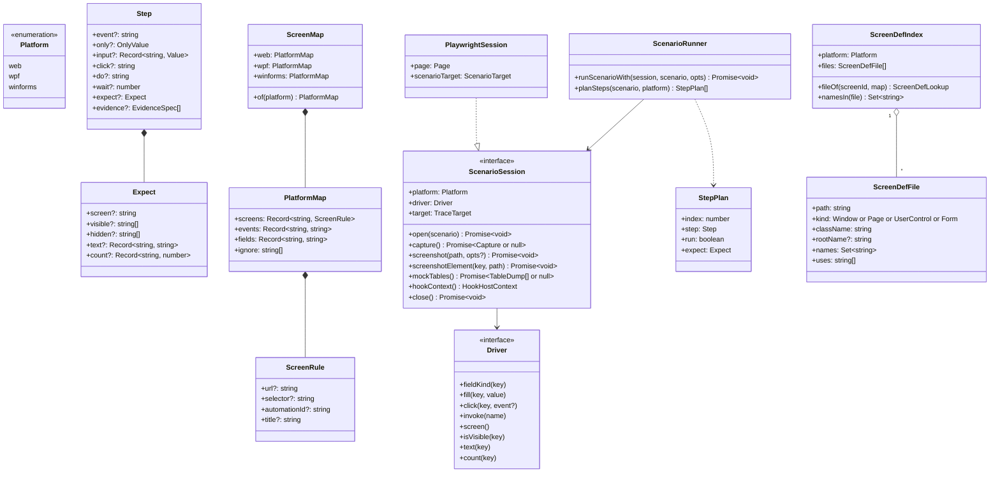

| 変更・追加 | 内容 |
|---|---|
| `Step.event` | 任意にする。`event` の無いステップが補助ステップ |
| `Step.only` | `OnlyValue = PlatformOrGroup or PlatformOrGroup[]`。`PlatformOrGroup = web / wpf / winforms / desktop` |
| `Step.expect`・`Expect.screen` | 補助ステップでは任意。遷移のステップでは従来どおり必須 |
| `expandOnly(only)`（`platform.ts`） | `desktop` を `wpf`・`winforms` に広げ、重複を除いた `Platform[]` を返す |
| `stepApplies(step, platform)` | `only` が無いか、`expandOnly(only)` に `platform` を含む |
| `Driver.click(key, event?)` | 補助ステップは `event` を渡さない（`undefined`）。既存の実装は引数を任意にするだけ |
| `ScenarioSession` | 対象を開く・記録・スクリーンショット・閉じるの、ドライバ以外の差分を包む。Web は `PlaywrightSession`、デスクトップは `FlaUiSession`（:ref[flaui-driver.md#構造]） |
| `runScenarioWith(session, scenario, opts)` | ドライバに依存しない実行器。既存の `runScenario(page, scenario, target, opts)` は `runScenarioWith(new PlaywrightSession(page, target), scenario, opts)` を呼ぶだけの互換の関数として残す（既存の spec・`defineScenarioTests` は変えない） |
| `ScreenMap` | 読み込み時にプラットフォームの節へ正規化した形（[対応表の読み込み](#対応表の読み込み)） |
| `Step.evidence` | 証跡の指定。形と検査は :ref[evidence-spec.md#構造]。補助ステップにも書ける |
| `ScenarioSession` の証跡の口 | `EvidenceHost`（:ref[evidence-runner.md#構造]）を実装する。`screenshot(path, opts?)` は `opts.fullPage`（Web だけ）を受け取る。`screenshotElement`・`mockTables`・`hookContext` の各実装は :ref[evidence-runner.md#screenshot]・:ref[evidence-runner.md#db]・:ref[evidence-runner.md#hooks-の関数]。`FlaUiSession` は :ref[flaui-driver.md#構造] |
| `runScenarioWith` の `opts.evidence` | `createEvidenceRunner` で作った `EvidenceRunner`（無ければ証跡を取らない）。[実行器](#実行器) |

## シナリオの形式の検査

`StepSchema` は形だけを検査し（`event`・`only` の組み合わせは通す）、意味の検査は `validateScenario(scenario)` が行う。lint（`check-core.ts`）と `defineScenarioTests`・`ddv desktop run` の両方が同じ関数を使う（実行時は `test.fail` / 失敗として報告）。

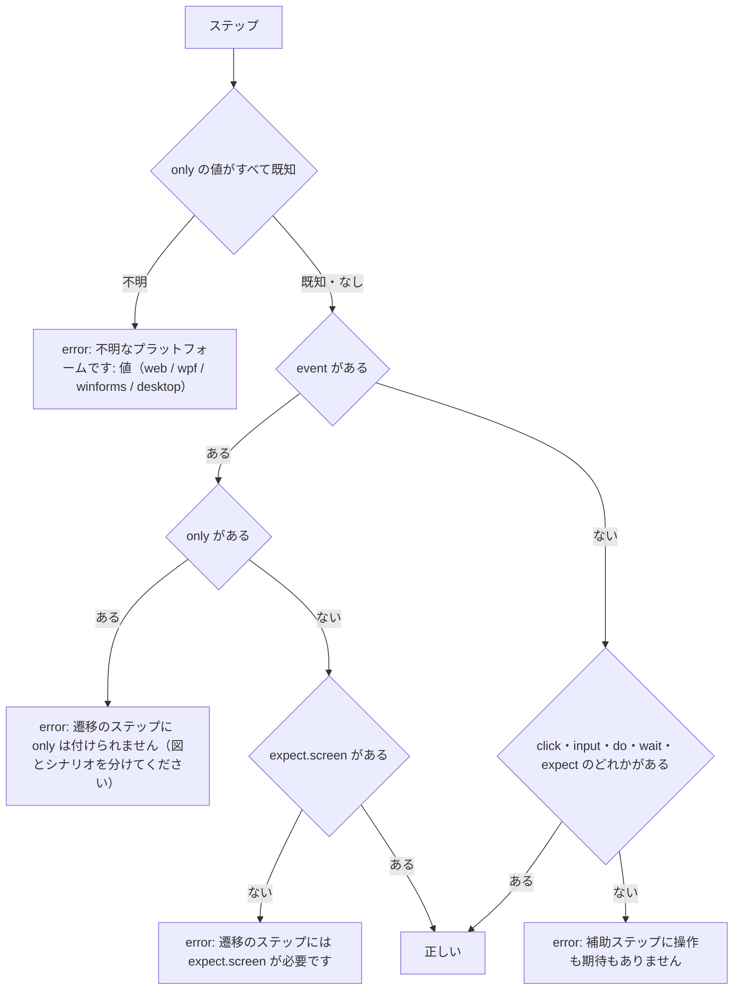

- `validateScenario` は各ステップの `evidence` を `validateEvidence`（:ref[evidence-spec.md#形式の検査]）で検査し、その結果も同じ場所の形式で返す
- エラーの場所は「シナリオ <ID> のステップ <番号>」（番号は補助ステップを含めたファイル上の 1 始まり）
- `only: []`（空の配列）は E1 と同じ扱い（「only が空です」）

## 経路照合の変更

`matchPath(scenario, path)` は `scenario.steps.filter((s) => s.event !== undefined)` を照合の対象にする（:ref[scenario.md#経路照合] の図はそのまま）。不一致のメッセージのステップ番号は、元のファイル上の番号に戻して表示する。

## ステップの計画

`planSteps(scenario, platform)` は実行の前に各ステップを実行するか飛ばすかと、判定に使う期待値を決める。

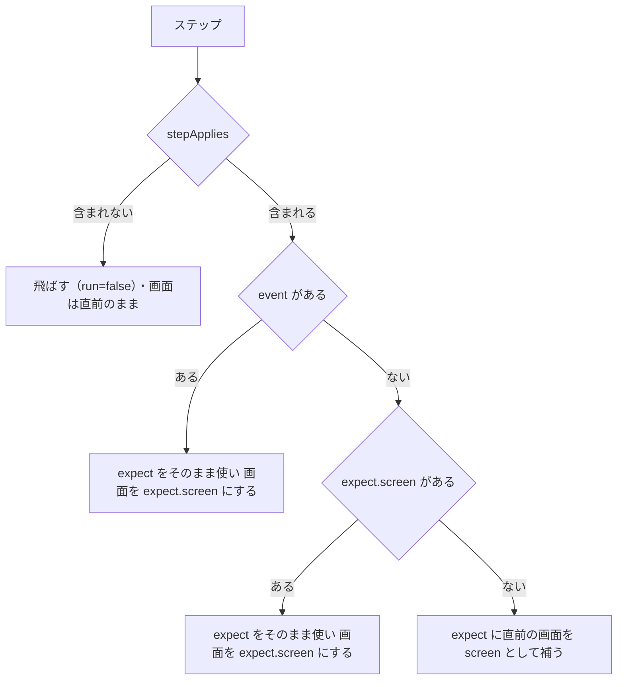

- 「直前の画面」は、直前に計画したステップの画面（飛ばしたステップは変えない）。先頭は `scenario.start`
- 飛ばしたステップの `expect.screen` は「直前の画面」を変えない。補助ステップが画面を変えるのは、そのプラットフォームで実行したときだけ

## 実行器

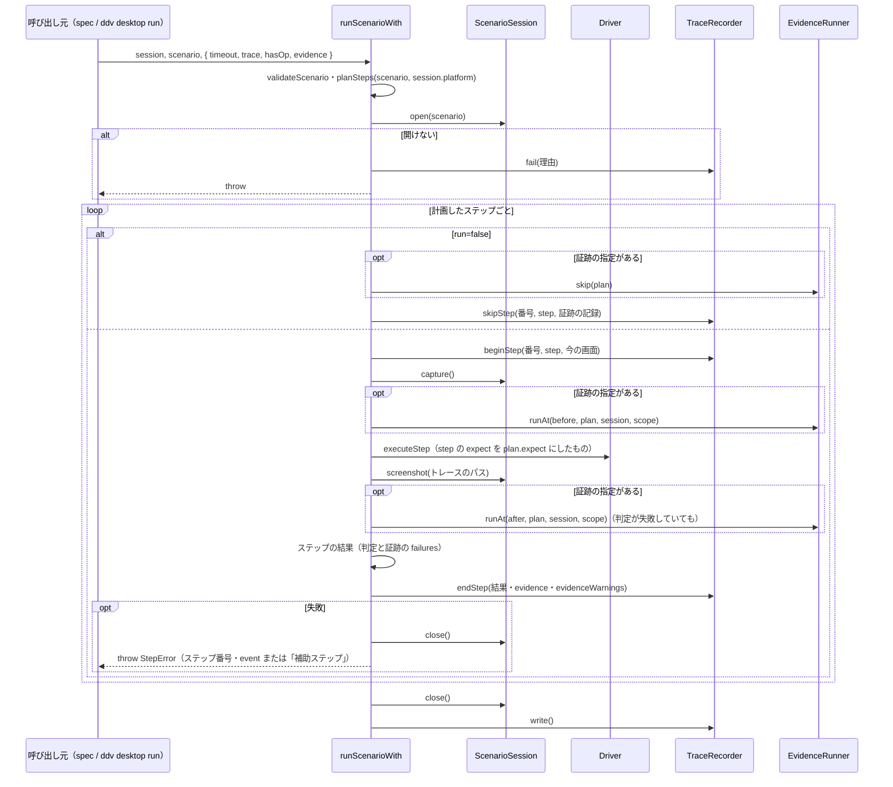

- `PlaywrightSession.open` は既存の `openTarget`（mock は `window.__ddv.reset`、app は hooks の `seed`）、`capture` は既存の `captureMock` / `captureApp`、`close` は何もしない（ページの後始末は Playwright が行う）。Web の実行の順序・タイムアウト・メッセージは変えない
- 失敗のメッセージは、遷移のステップは従来どおり「ステップ <n>（<event>）: …」、補助ステップは「ステップ <n>（補助・<click / do の名前>）: …」
- トレースの `TraceStep` に `skipped?: true`・`only?: Platform[]` を加える。補助ステップの `event` は空文字。飛ばしたステップは `expects: []`・`ok: true`・`durationMs: 0` で記録し、成功の判定に含めない
- 証跡：`executeStep` が失敗しても `after` の取得は行い、ステップの成否は判定と証跡の `failures` から決める（:ref[evidence-runner.md#ステップの結果]）。`before` の `fail` の失敗でも操作・判定は止めない。`scope` は `InputScope`（:ref[evidence-spec.md#入力値の範囲]）。飛ばしたステップの指定は `status: skipped` で記録する
- `opts.evidence` は記録が有効なとき（`opts.trace` がある）だけ渡す。証跡の本体はトレースのディレクトリに置くため（:ref[evidence-trace.md#構造]）

## 対応表の読み込み

`parseScreenMap(text)` は YAML を読み、プラットフォームの節へ正規化した `ScreenMap` を返す（`map.ts`）。

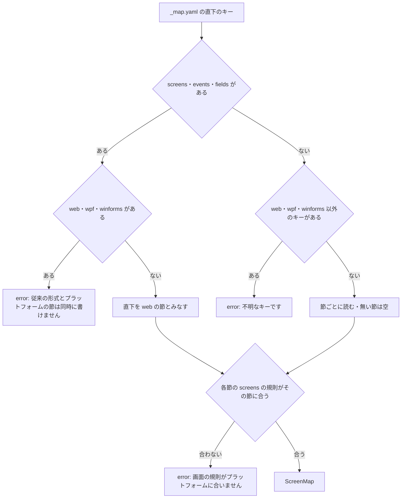

| 節 | `screens` の規則 | `ignore` |
|---|---|---|
| `web` | `url`・`selector` のどちらかが必要（既存） | 書けない（Web の名前は lint で検査しないため。書くと E2 と同じ扱い） |
| `wpf`・`winforms` | `automationId`・`title` のどちらか 1 つ | 書ける |

- E3 の文言：「_map.yaml の <節>.screens.<状態ID>: <節> では <使える項目> で画面を指定してください」
- 既存の呼び出し（`PlaywrightDriver`・`resolveLocator`）は `ScreenMap.web` を受け取るように変える。ファイルの形式が従来の形でも結果は同じ
- `ddv mock scaffold` は `_map.yaml` を読み書きしない（従来どおり）

## 名前の解決

### デスクトップ

`resolveDesktopName(kind, key, map, event?)`（`resolve.ts`）は、探す名前を返す。探すのは FlaUI のドライバ（:ref[flaui-driver.md#要素の探し方]）。

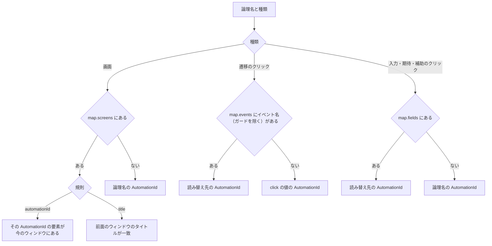

- 返す値は `{ by: 'automationId' | 'title', name, mapped }`。`mapped` は失敗のメッセージに使う（「論理名 customer（対応表で CustomerNameBox）」）
- `screen()`（今の画面）は、`map.screens` の規則とシナリオに現れる状態IDを順に調べ、最初に当たった状態IDを返す（AutomationId の要素が表示中か、`title` が一致）。調べる順は、直前の画面 → シナリオに現れる順。どれにも当たらなければ `null`

### Web の補助ステップのクリック

`PlaywrightDriver.click(key, event)` に `event` が無いとき（補助ステップ）の扱いを加える。

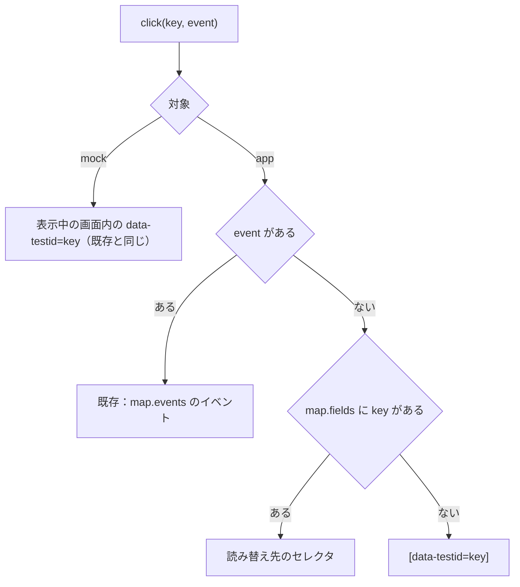

## マージ（骨組みの再生成）

`mergeScenario(existing, generated)` は、既存のステップを「遷移のステップと、その後に続く補助ステップ」のまとまりに分けてから、既存の規則（:ref[scenario.md#マージ]）で遷移のステップを対応させる。

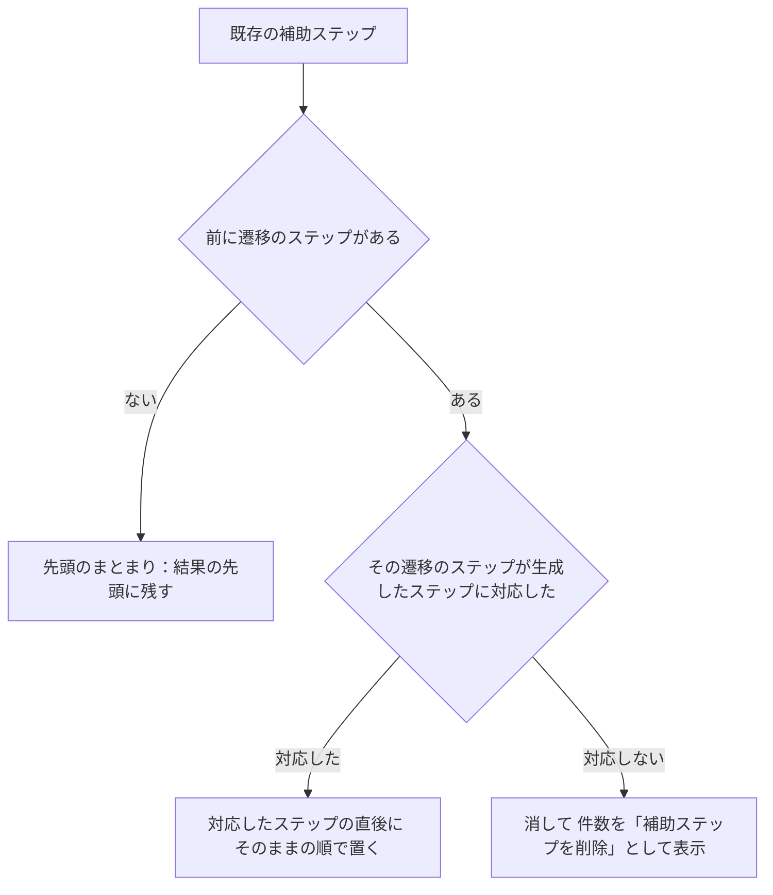

- 補助ステップの中身（`only`・`click`・`input`・`expect`・`evidence` など）は書き換えない。対応した遷移のステップの `evidence` も既存を保持する（骨組みは `evidence` を生成しない）
- 表示の例：「BD-ORDER-SCREEN-P001: 更新（補助ステップを 1 件削除）」

## プレイヤー・スナップショット

- プレイヤー（`apps/web/src/player.ts`）とスナップショット（`apps/server/src/snapshots.ts`）は、`planSteps(scenario, 'web')` の結果に従う。飛ばしたステップはプレイヤーの一覧に「（wpf だけ）」のように薄く表示し、再生では止まらずに次へ進む
- プレイヤーで補助ステップを再生するときの `expect` は `plan.expect`（screen を補ったもの）
- プレイヤーの一覧は、`evidence` のあるステップに指定の件数（「証跡 2」）を表示する。プレイヤー・スナップショットでは証跡を取らない（記録の実行だけで取る）

## 名前の検査（lint）

`checkDesktopNames(repoRoot, config, docs)`（`packages/desktop/src/check.ts`）を `ExtraLintCheck` として lint に加える（rule `desktop-names`）。対象は `type: flaui` のランナーごと。`packages/desktop` は Windows 以外でも読み込める（ファイルを読むだけ）。

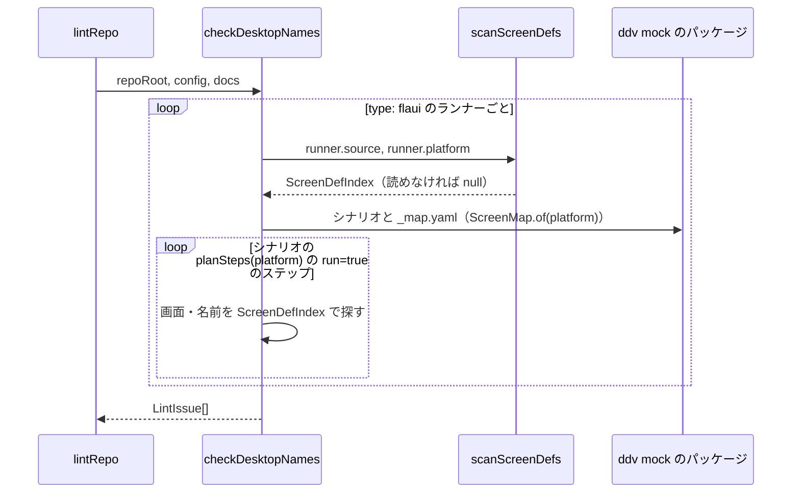

### 画面定義の走査

`scanScreenDefs(fs, source, platform)` は `source` の下を読むだけで `ScreenDefIndex` を作る（`bin`・`obj` を除く）。

| プラットフォーム | ファイル | `kind`・`className` | `rootName` | `names` | `uses` |
|---|---|---|---|---|---|
| wpf | `**/*.xaml`（`App.xaml` と、ルートが `ResourceDictionary` のものを除く） | ルートの局所名（`Window`・`Page`・`UserControl`）・`x:Class` の最後の名前 | ルートの `x:Name` / `Name` / `AutomationProperties.AutomationId` | 子孫のすべての `x:Name`・`Name`・`AutomationProperties.AutomationId` | `clr-namespace:` の接頭辞の付いた子孫の局所名（同じプロジェクトの `UserControl`） |
| winforms | `**/*.Designer.cs` | `partial class <名前>` と、同名の `*.cs` の基底（`Form`・`UserControl`。読めなければ `Form`） | `this.Name = "…";` | `this.<x>.Name = "…";` の値 | `new <型>()` のうち、索引の `className` にある型 |

- XAML は `fast-xml-parser` で読む（`@ddv/tokens` と同じ依存）。C# は正規表現で上の行だけを拾う（構文解析はしない）

### 画面と定義ファイル

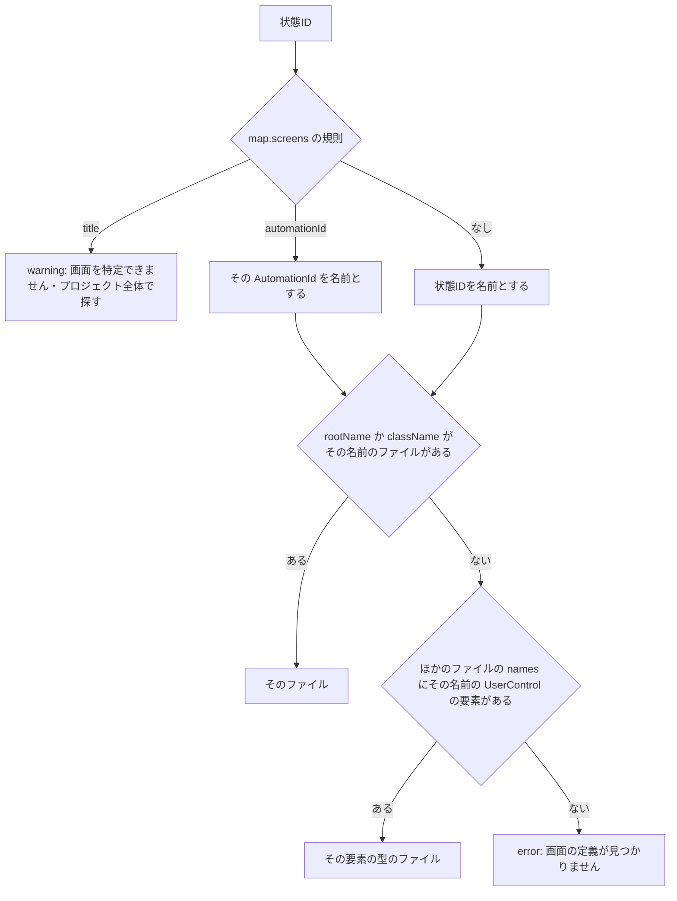

- 画面の名前の範囲は、決めたファイルの `names` と、`uses` で使っている `UserControl` のファイルの `names` を、循環を避けて辿った和集合
- W1 のときの範囲はプロジェクトのすべてのファイルの `names`（見つかっても別の画面の同名の要素かもしれないため、警告を残す）
- E1 の文言：「ランナー <name>（<platform>）: 画面 <状態ID> の定義（x:Name・AutomationId が <名前> の Window・Page・UserControl / Form）が見つかりません」

### ステップごとの検査

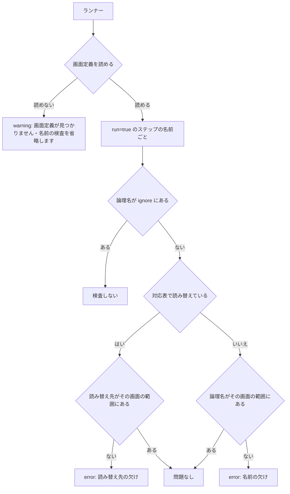

| 名前 | 探す画面 |
|---|---|
| `click`（遷移・補助）・`input` のキー | ステップの遷移元の画面（計画の「直前の画面」） |
| `expect` の `visible`・`hidden`・`text`・`count` のキー | ステップの遷移先の画面（`plan.expect.screen`） |
| `start`・`expect.screen` の状態ID | [画面と定義ファイル](#画面と定義ファイル)で定義ファイルが決まること |

- E1：「シナリオ <ID> ステップ <n>（<platform>）: 画面 <状態ID> に名前 <名前> がありません（x:Name / Name を付けるか、_map.yaml の <platform>.events / fields で読み替えてください）」
- E2：「_map.yaml の <platform>.<events / fields>.<論理名> の読み替え先 <名前> が画面 <状態ID> にありません」
- W1：「ランナー <name> の画面定義（source: <path>）が見つかりません。名前の検査を省略します」
- `do:` の名前は検査しない（hooks の中で何を探すか分からないため）
- 同じシナリオ・同じ名前の error は 1 回だけ出す
- 組み込み：`lint-cli.ts` の `extraChecks` と `/api/lint` に、`checkTokens`（:ref[tokens.md#乖離の検査]）と同じく動的な `import` で加える

## テストの方針

| 種類 | 対象 | 方法 |
|---|---|---|
| 単体テスト | 本書の matrix 図（`STEPVAL`・`APPLY`・`MAPNORM`・`DRES`・`WCLICK`・`AUXMRG`・`SCRFILE`・`NAMECHK`） | `packages/mock/src/*.test.ts`・`packages/desktop/src/*.test.ts`（Vitest。Windows 以外でも動く） |
| 単体テスト | `runScenarioWith` | `Driver` と `ScenarioSession` の偽物で、飛ばす・補う・失敗のメッセージ・トレースの `skipped` を確かめる |
| 結合テスト | 既存の Web のシナリオ | 既存の Playwright の E2E が変更なしで通ること（REQ-510） |
