# 証跡の取得（EvidenceRunner・組み込み・登録・接続）詳細設計

## 前提

- 取得の流れは :ref[../basic/evidence-capture.md#取得の流れ]、組み込みの証跡は :ref[../basic/evidence-capture.md#組み込みの証跡]、取得手段の登録は :ref[../basic/evidence-capture.md#取得手段の登録]、接続情報は :ref[../basic/evidence-capture.md#接続情報の扱い]、設定は :ref[../basic/evidence-capture.md#設定と-cli] を参照
- 指定の形式・`resolveWith`・取得手段の一覧（`loadRegistry`）は :ref[evidence-spec.md#構造]、証跡の保存（`EvidenceStore`）とトレースの記録の形は :ref[evidence-trace.md#構造] を参照
- 実行器（`runScenarioWith`）・`ScenarioSession` は :ref[desktop-scenario.md#実行器]、FlaUI のドライバの要素のスクリーンショットは :ref[flaui-driver.md#通信の形式]、mock-runtime の表の取り出しは :ref[mock-runtime.md#構造] を参照
- 実装：`packages/evidence/src/runner.ts`・`providers/screenshot.ts`・`providers/db.ts`・`providers/hooks.ts`・`providers/command.ts`・`sql-guard.ts`・`db/sqlite.ts`・`db/sqlite-worker.ts`・`db/sqlserver.ts`・`db/postgres.ts`・`db/mock.ts`・`redact.ts`・`config.ts`・`index.ts`（`defineEvidence`・型）、`packages/core/src/config.ts`（`evidence` を設定に加える）
- 本書に画面は無い

## 構造

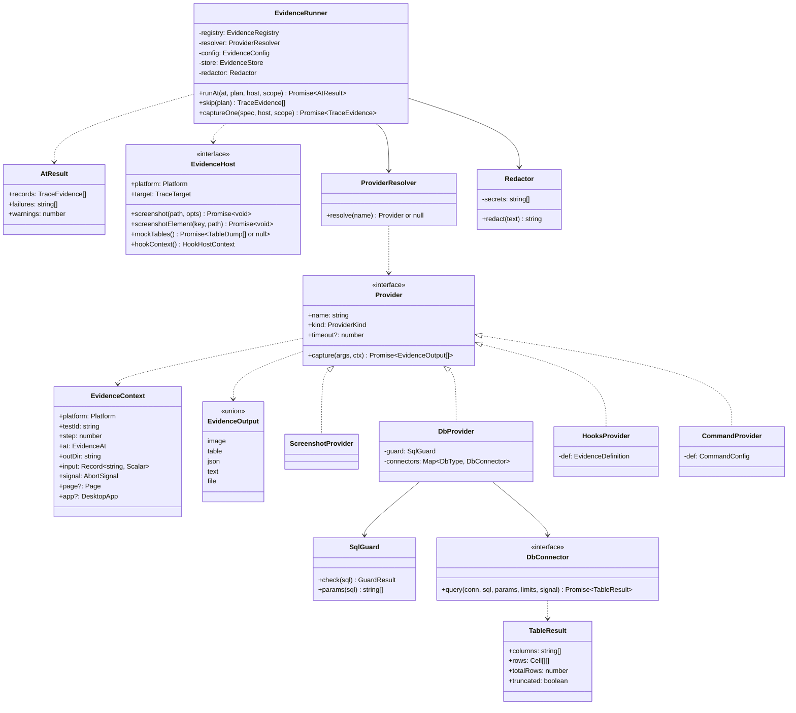

| 型・関数 | 置き場所 | 役割 |
|---|---|---|
| `EvidenceHost` | `@ddv/evidence` | 実行器の側が渡す口。`ScenarioSession` が実装する（:ref[desktop-scenario.md#構造]）。`screenshot`・`screenshotElement` は要素の解決とドライバを包む |
| `HookHostContext` | 同上 | `{ page?: Page }`（Web）／`{ app?: DesktopApp }`（デスクトップ）。`EvidenceContext` の `page`・`app` になる |
| `DesktopApp` | 同上 | `find(key) → { found, visible }`・`screenshot(path, key?)`。`FlaUiSession` が作る（:ref[flaui-driver.md#デスクトップの実行]） |
| `TableDump` | 同上 | `{ name, key, rows: Row[] }`。mock-runtime の `dump()` の結果（:ref[mock-runtime.md#構造]） |
| `EvidenceOutput` | 同上 | `{ kind: 'image', path }`・`{ kind: 'table', columns, rows }`・`{ kind: 'json', data }`・`{ kind: 'text', text }`・`{ kind: 'file', path }`（hooks の戻り値と同じ形） |
| `TraceEvidence` | :ref[evidence-trace.md#構造] | 1 つの指定の取得結果（トレースに書く） |
| `defineEvidence(def)` | `@ddv/evidence` | `EvidenceDefinition`（`params`・`timeout?`・`run(args, ctx)`）をそのまま返す（型を付けるため） |
| `createEvidenceRunner(opts)` | 同上 | `repoRoot`・`config`・`hooks`（読み込んだ `evidence`。無ければ `{}`）・`store`・`testId` から作る。設定に `evidence` が無く、シナリオにも `evidence:` が無ければ作らない（呼び出し元が `undefined` のまま実行する。REQ-810） |

- `Cell` は `string | number | boolean | null`。`EvidenceRunner` はテスト 1 件（シナリオ × プラットフォーム）ごとに作る
- `@ddv/evidence` の Node 側（`runner.ts` 以下）は `@ddv/mock` に依存しない（`ScenarioSession` を知らず `EvidenceHost` だけを使う）。`@ddv/mock` の実行器が `@ddv/evidence` を `import` する

## 時点ごとの取得

実行器は、計画したステップ（`StepPlan`）ごとに `runAt('before', …)`・`runAt('after', …)` を呼ぶ（順序は :ref[desktop-scenario.md#実行器]）。

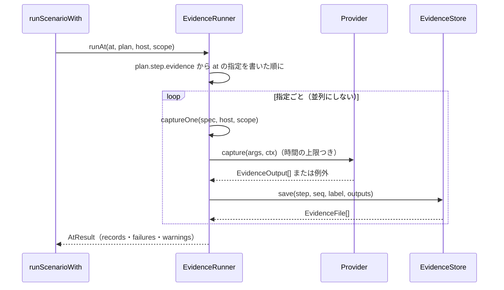

- `seq` はそのステップの中の通し番号（`before` → `after` の順に 1 から）。`skip` も番号を使う
- `run=false` のステップ（`only:` の対象外）は `skip(plan)` が、すべての指定を `status: skipped` の記録にする（取得手段を呼ばない）
- `scope` は :ref[evidence-spec.md#入力値の範囲] の `InputScope`。`before` は `scope.before(n)`、`after` は `scope.after(n)`

## 1 つの指定の取得

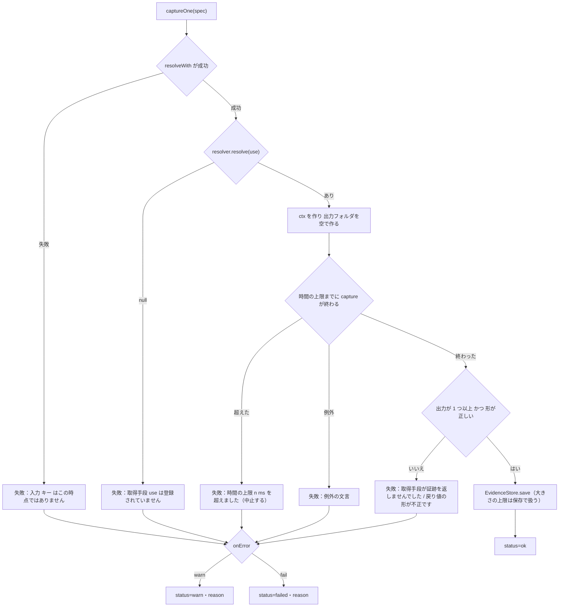

- `reason` は `Redactor.redact` を通してから記録する（[接続情報の伏せ字](#接続情報の伏せ字)）。形は「<use>（<操作前 / 判定後>）— <文言>」
- 時間を計る範囲は `capture` の呼び出しから保存の終わりまで。`durationMs` に残す
- 出力フォルダは `os.tmpdir()/ddv-evidence-<pid>/<testId>/<step>-<seq>/`（`ctx.outDir`）。保存の後に消す（成否にかかわらず）
- F5 の「形」：`kind` が既知、`image`・`file` の `path` が `ctx.outDir` の中にあるファイル（`safeJoin` で外を指すときも F5）、`table` の `columns` が文字列の配列で `rows` の各行の長さが `columns` と同じ

### 時間の上限

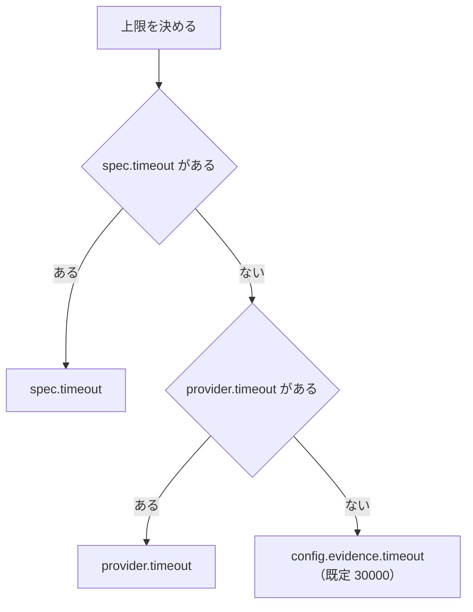

- 上限を超えたら `AbortController.abort()` で `ctx.signal` を中止にする。取得手段ごとの止め方：外部コマンドはプロセスツリーを終了（[外部コマンド](#外部コマンド)）、DB は接続を閉じる（SQLite はワーカーを終了）、hooks は `signal` を見ない関数は止められないので結果を捨てる（後から書かれたファイルは出力フォルダごと消す）、screenshot はドライバの要求の期限（:ref[flaui-driver.md#通信の形式]）とは別に待つのをやめる

### ステップの結果

`after` の取得の後、実行器は次の規則でステップの成否と文言を決める。

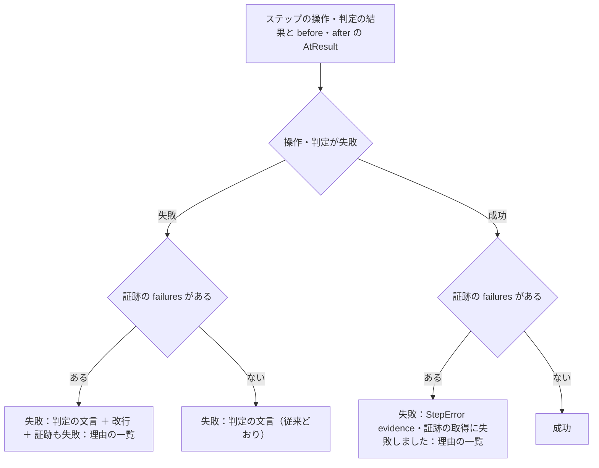

- `before` の取得で `fail` の失敗があっても、操作・判定と `after` の取得は行う（:ref[../basic/evidence-capture.md#取得の流れ]）。ステップの失敗は `after` の後に確定する
- `StepError` に `kind: 'evidence'` を加える。失敗の文言の先頭は既存と同じ「ステップ <n>（<event>）: 」
- `warn` の件数は `TraceStep.evidenceWarnings` に足す（:ref[trace-recorder.md#構造]）

## screenshot

`ScreenshotProvider.capture({ target, fullPage }, ctx)` は `ctx.outDir/shot.png` に撮り、`{ kind: 'image', path }` を返す。

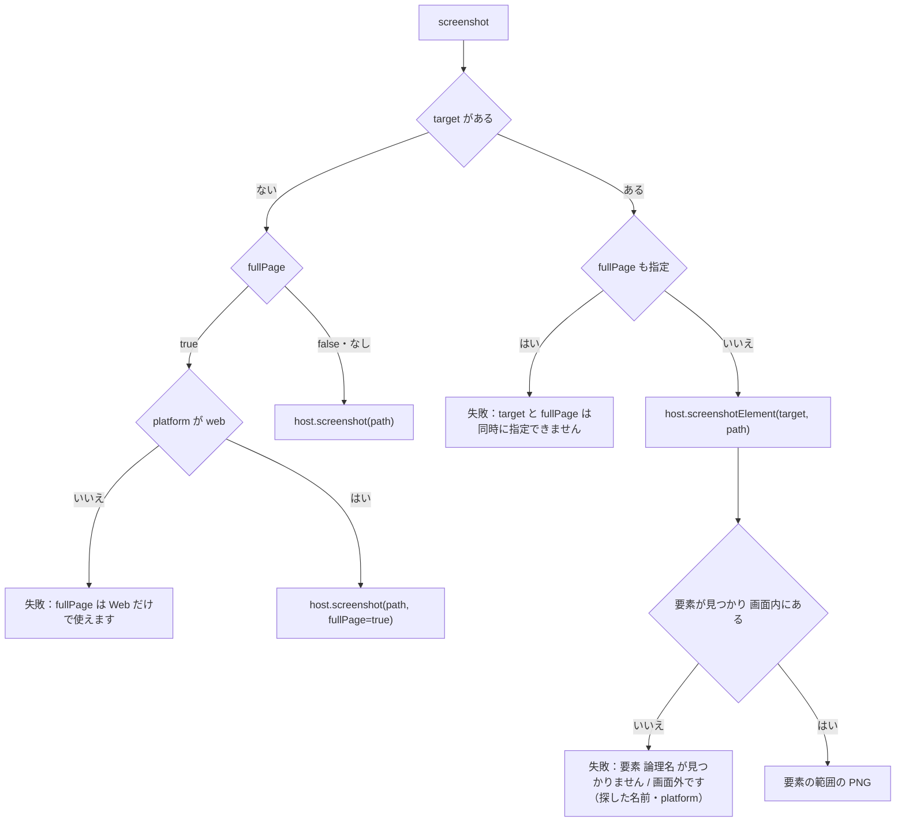

| 実装 | 画面全体 | 要素 |
|---|---|---|
| `PlaywrightSession` | `page.screenshot({ path, fullPage })` | 入力・期待と同じ解決（mock は表示中の画面の `[data-testid=key]`、app は `map.fields` → :ref[desktop-scenario.md#web-の補助ステップのクリック] と同じ）で `locator.first()` → `isVisible()` が偽なら E3 → `locator.screenshot({ path })` |
| `FlaUiSession` | ドライバの `screenshot { path }`（前面のウィンドウ） | `resolveDesktopName('field', key, map)`（:ref[desktop-scenario.md#デスクトップ]）→ ドライバの `screenshot { path, by, name }`。`notFound`・`offscreen` の応答を E3 にする |

- 自動のスクリーンショット（`<key>/<n>.png`）とは別のファイルにし、スナップショットの比較には使わない

## db

`DbProvider.capture({ db, sql, file, params, mask, maxRows }, ctx)`。

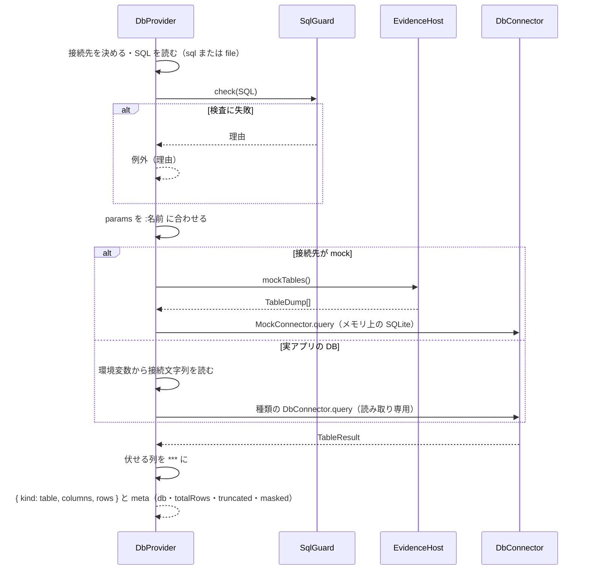

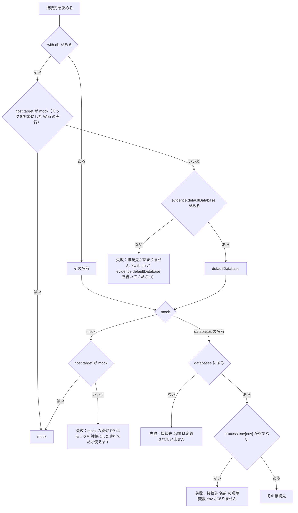

- lint はこの図のうち E1（デスクトップのプラットフォームで `with.db` も `defaultDatabase` も無いとき）・E3 を静的に調べる（:ref[evidence-spec.md#指定の検査]）。Web は対象（mock / app）が実行時に決まるので、`with.db` が無くても E1 にしない
- `file` はリポジトリのルートからのパスを `safeJoin` で読む（UTF-8。BOM は除く）。拡張子が `.sql` でなければ失敗「SQL ファイルは .sql です」

### SQL の検査

`SqlGuard.check(sql)` は字句に分けてから判定する（:ref[../basic/evidence-capture.md#dbselect-の結果] の `SQLGUARD`）。字句の分け方を次の状態で行う。

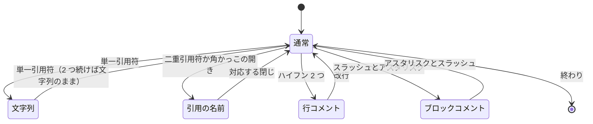

- 図の記号：単一引用符は `'`、二重引用符・角かっこは `"`・`[` `]`（SQL Server の名前）、行コメントは `--`、ブロックコメントは `/*` 〜 `*/`

- 「通常」の状態の文字だけを語にする（英字・数字・`_` の並び）。語は大文字にして比べる。`;` は文の区切り（末尾の `;` と空白だけの文は数えない）
- 終わりで「文字列」「引用の名前」「ブロックコメント」のままなら失敗「SQL の文字列かコメントが閉じていません」
- 禁止の語：`INSERT`・`UPDATE`・`DELETE`・`MERGE`・`INTO`・`CREATE`・`ALTER`・`DROP`・`TRUNCATE`・`GRANT`・`REVOKE`・`EXEC`・`EXECUTE`・`CALL`・`COPY`・`ATTACH`・`DETACH`・`PRAGMA`・`VACUUM`・`REPLACE`・`UPSERT`・`LOCK`・`SET`・`BEGIN`・`COMMIT`・`ROLLBACK`・`DECLARE`。理由の文言に見つけた語を入れる（「読み取りでない文は実行しない（DELETE）」）
- `params(sql)` は「通常」の状態の `:名前`（`::` の型変換は除く）を出現順・重複なしで返す。実行時は各 DB の書き方に置き換える（SQLite `:名前` のまま、PostgreSQL `$1…`、SQL Server `@名前`）
- 関数は `@ddv/evidence/sql-guard` として lint（:ref[evidence-spec.md#指定の検査]）と共有する

### 接続と読み取り専用

| `type` | 依存 | 開き方・読み取り専用 | 止め方 |
|---|---|---|---|
| `sqlite` | `sql.js`（WASM。必須の依存） | ファイル（接続文字列はパス。相対はリポジトリのルートから）をバイト列で読み、メモリ上に開く（元のファイルには書かない）。256MB を超えるファイルは失敗「SQLite のファイルが大きすぎます」 | `worker_threads` のワーカーで実行し `terminate()` |
| `sqlserver` | `mssql`（任意。`import` に失敗したら「SQL Server の証跡には mssql の導入が必要です（npm i -D mssql）」） | `BEGIN TRANSACTION` → クエリ → 必ず `ROLLBACK`（成否・例外にかかわらず） | `request.cancel()`・接続を閉じる |
| `postgres` | `pg`（任意。同様の文言で `pg`） | `BEGIN READ ONLY` → クエリ → `ROLLBACK` | 接続を閉じる（`client.end()`） |
| `mock` | `sql.js` | `mockTables()` の各表を同じ名前の表として作る（列は全行のキーの和。型の指定なし）。値は文字列・数値・真偽値（`1`/`0`）・null。オブジェクト・配列は JSON の文字列 | ワーカーで実行し `terminate()` |

- 接続は指定ごとに開いて閉じる（使い回さない。ステップの間に DB の状態が変わるため）
- 行の取り出しは `maxRows + 1` 行まで（それ以上は読まない）。`totalRows` は読めた行数で、`maxRows + 1` 行目があれば「n 行以上」と記録する（`totalRows = maxRows + 1`・`truncated = true`）
- 値の変換：日時は ISO 8601（タイムゾーン付き）、`Buffer`・`Uint8Array` は `<binary 123 bytes>`、`bigint`・`decimal` は桁を落とさない文字列、ほかは `String(v)`

### 伏せる列

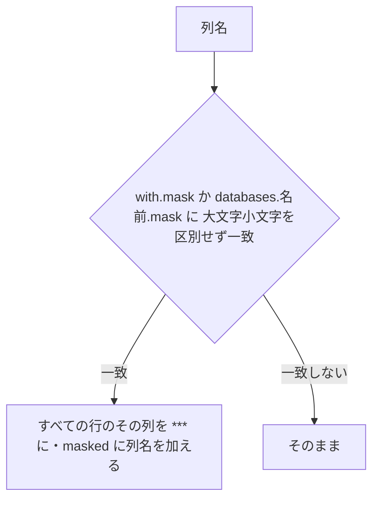

- 伏せた後の値だけを `EvidenceStore` に渡す（元の値は保存・ログに出さない）
- `mask` に結果に無い列名があっても失敗にしない

## hooks の関数

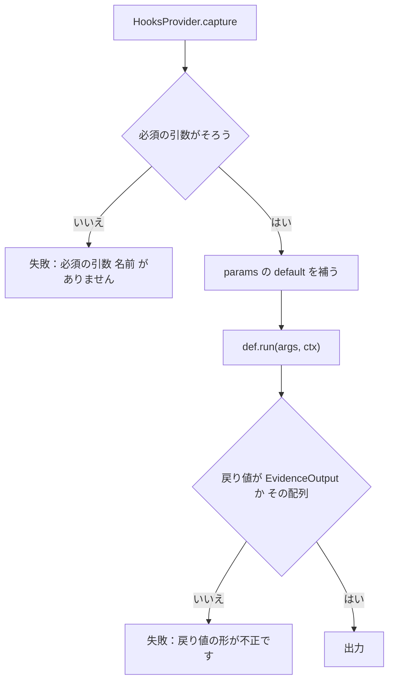

- hooks の読み込み：`defineScenarioTests`（:ref[scenario.md#e2e-実行]）と `ddv desktop run`（:ref[flaui-driver.md#デスクトップの実行]）が `e2e/ddv-hooks.ts` を読むときに `evidence` も受け取り、`createEvidenceRunner` に渡す。モックを対象にした Web の実行でも読む（`seed` は従来どおり使わない）
- `ctx.page` は Web（`PlaywrightSession.page`）、`ctx.app` はデスクトップ（`FlaUiSession` の `DesktopApp`）。どちらかしか入らない
- 戻り値の `path` のファイルは `EvidenceStore` がコピーする（出力フォルダは後で消える）

## 外部コマンド

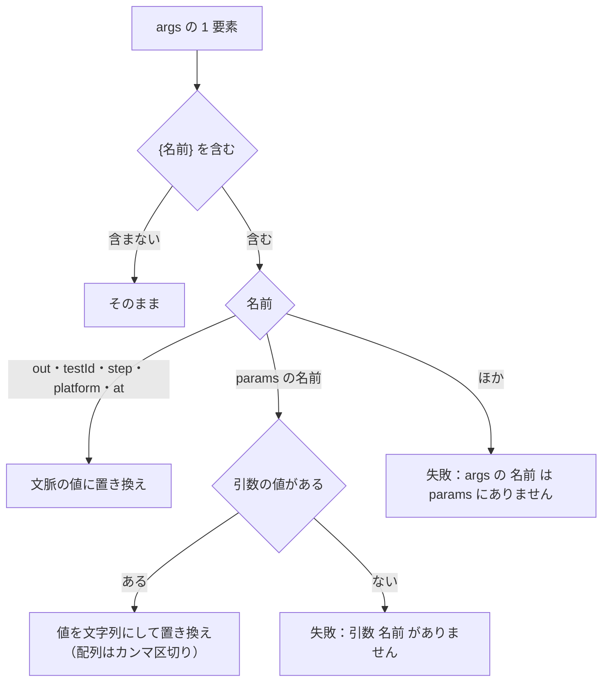

- 置き換えは 1 要素の中の文字列の置き換えだけ（要素を分けたり足したりしない）。`{{` と `}}` は `{`・`}` の文字
- 起動：`child_process.spawn(run, args, { cwd, env, shell: false, windowsHide: true })`。`cwd` は `safeJoin(repoRoot, cwd)`。`env` は `process.env` に `DDV_EVIDENCE_OUT`・`DDV_TEST_ID`・`DDV_STEP`・`DDV_AT`・`DDV_PLATFORM` を加えたもの
- Windows で `run` が `.cmd`・`.bat` のときは失敗「.cmd・.bat は直接起動できません（pwsh などで包んでください）」（シェルを介さないため）
- 標準出力・標準エラーは各 `maxBytes` まで集める（超えた分は捨て、標準出力なら `truncated`）。標準エラーは失敗の理由に末尾 4KB を使う

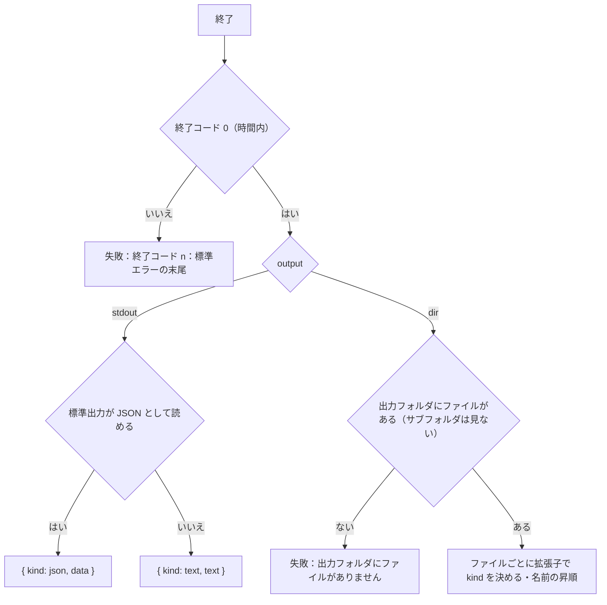

| 拡張子（大文字小文字を区別しない） | `kind` |
|---|---|
| `.png`・`.jpg`・`.jpeg`・`.gif`・`.webp` | `image` |
| `.csv` | `table`（UTF-8・BOM を除く・1 行目が列名。RFC 4180 の引用に対応。読めなければ `file`） |
| `.json` | `json`（読めなければ `text`） |
| `.txt`・`.log` | `text` |
| ほか（`.svg`・`.html` を含む） | `file` |

- 時間の上限を超えたら、Windows は `taskkill /PID <pid> /T /F`、ほかは `spawn` に `detached: true` を付けておき `process.kill(-pid, 'SIGKILL')` でプロセスグループを終了する
- 標準出力の JSON の判定は、前後の空白を除いて `{` か `[` で始まり `JSON.parse` できるとき

## 接続情報の伏せ字

`Redactor` は `createEvidenceRunner` のときに作る。

| 伏せる対象 | 規則 |
|---|---|
| 接続先の環境変数の値 | `evidence.databases` のすべての `env` の今の値（4 文字以上のもの）。文字列としてそのまま一致した部分 |
| 接続文字列のパスワード | `Password=`・`Pwd=`（大文字小文字を区別しない）の後の `;` までの値、URL の `://ユーザー:パスワード@` のパスワードの部分 |

- 置き換える文字は `***`。対象：失敗の `reason`、外部コマンドの標準エラー、`console.warn` に出すログ。証跡の本体（表・テキスト）は伏せる列（[伏せる列](#伏せる列)）だけを対象にする
- 長い値から順に置き換える（短い値が長い値の一部のとき、長い方を先に伏せる）
- トレースの `db` には接続先の名前と種類だけを書く（:ref[evidence-trace.md#構造]）

## 設定

`EvidenceConfigSchema`（`packages/evidence/src/config.ts`）を `ConfigSchema` の `evidence`（任意）に加える。

| 項目 | 型 | 既定 | 規則・エラー文言 |
|---|---|---|---|
| `timeout` | 整数（ミリ秒） | `30000` | 100〜600000 |
| `maxRows` | 整数 | `200` | 1〜10000 |
| `maxBytes` | 整数（バイト） | `1048576` | 1024〜10485760。表・JSON・テキストの 1 つの上限 |
| `maxFileBytes` | 整数（バイト） | `5242880` | 1024〜52428800。画像・ファイルの 1 つの上限（:ref[evidence-trace.md#大きさの上限]） |
| `defaultDatabase` | 文字列 | なし | `mock` か `databases` の名前（:ref[evidence-spec.md#設定の検査]） |
| `databases.<名前>.type` | `sqlite` / `sqlserver` / `postgres` | — | 必須 |
| `databases.<名前>.env` | 文字列 | — | 必須。`^[A-Za-z_][A-Za-z0-9_]*$` |
| `databases.<名前>.mask` | 文字列の配列 | `[]` | — |
| `commands.<名前>.run` | 文字列 | — | 必須 |
| `commands.<名前>.args` | 文字列の配列 | `[]` | — |
| `commands.<名前>.cwd` | 文字列 | `.` | リポジトリの中（`safeJoin`） |
| `commands.<名前>.params.<引数>` | `{ required?: boolean, default?: Scalar }` | `{ required: false }` | — |
| `commands.<名前>.output` | `dir` / `stdout` | `dir` | — |
| `commands.<名前>.timeout` | 整数（ミリ秒） | なし | 100〜600000 |

- `databases` の名前は `mock` 以外（`mock` は予約）。違反は「接続先の名前 mock は使えません」
- 設定に `evidence` が無いときは既定値の設定とみなす（シナリオに `evidence:` があれば組み込みと hooks は使える）

## テストの方針

| 種類 | 対象 | 方法 |
|---|---|---|
| 単体テスト | 本書の matrix 図（`CAPONE`・`TMO`・`STEPRES`・`SHOT`・`DBTGT`・`SQLLEX`・`MASK`・`HOOKCALL`・`ARGSUB`・`CMDOUT`） | `packages/evidence/src/*.test.ts`（`EvidenceHost`・`DbConnector` は偽物） |
| 単体テスト | `SqlGuard`（:ref[../basic/evidence-capture.md#dbselect-の結果] の `SQLGUARD`） | 複文・`WITH … DELETE`・コメントや文字列の中の禁止語（通す）・閉じていない文字列 |
| 結合テスト | sqlite・mock | 一時ファイルの SQLite と `TableDump` で SELECT・上限・伏せ字。元のファイルが変わらない |
| 結合テスト | 外部コマンド | Node のスクリプトを `process.execPath` で起動し、`dir`・`stdout`・終了コード・時間切れ（子プロセスも終わる）・`;`・`&` を含む引数 |
| 結合テスト | sqlserver・postgres | CI ではサービスコンテナがあるときだけ実行（無ければ skip）。更新の文が実行されないこと |
