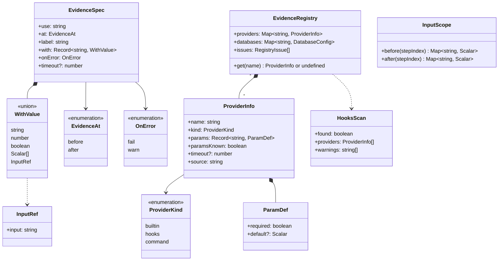
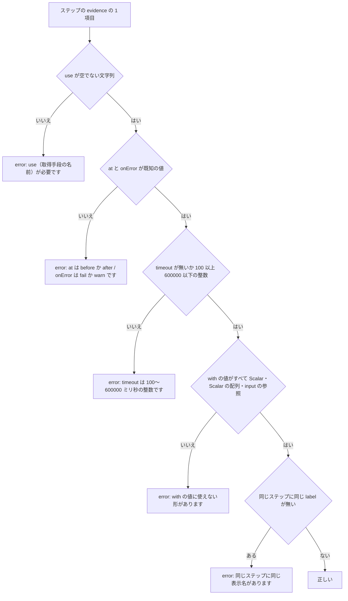
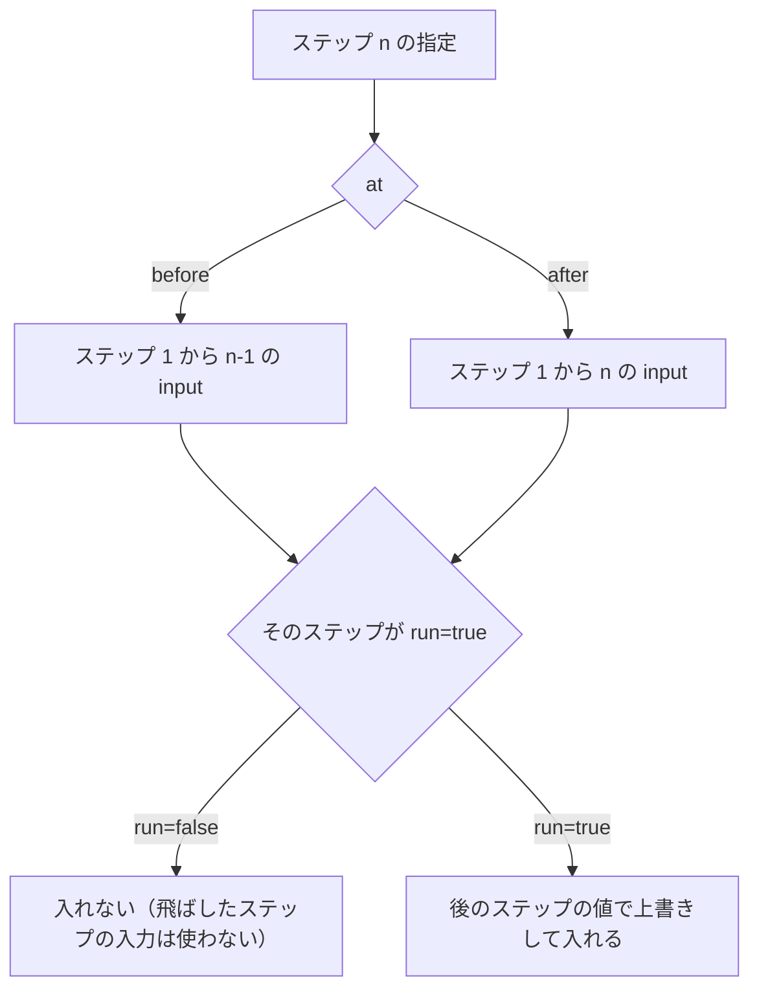
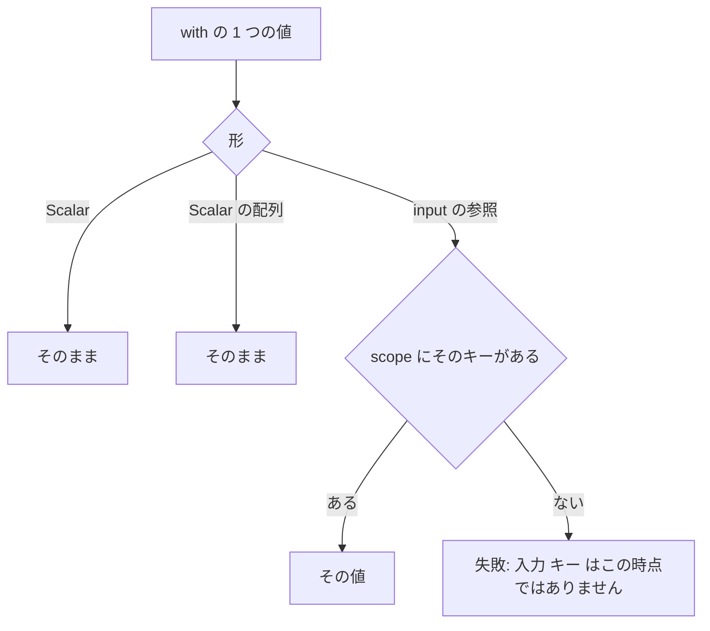
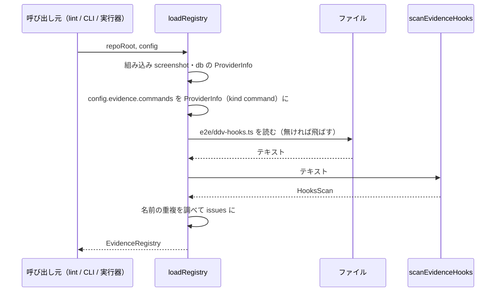
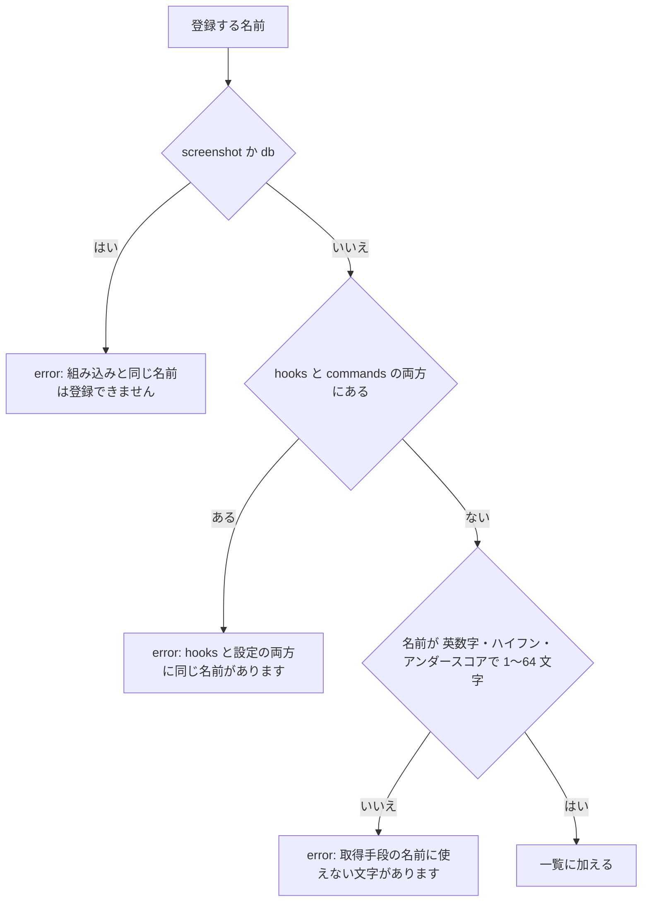
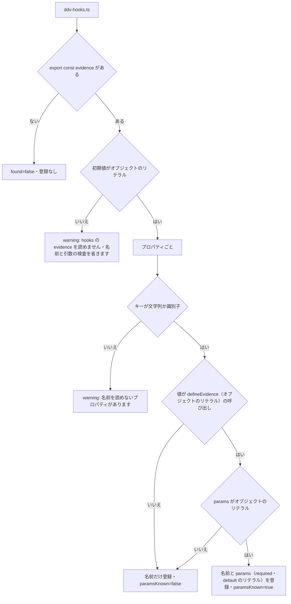
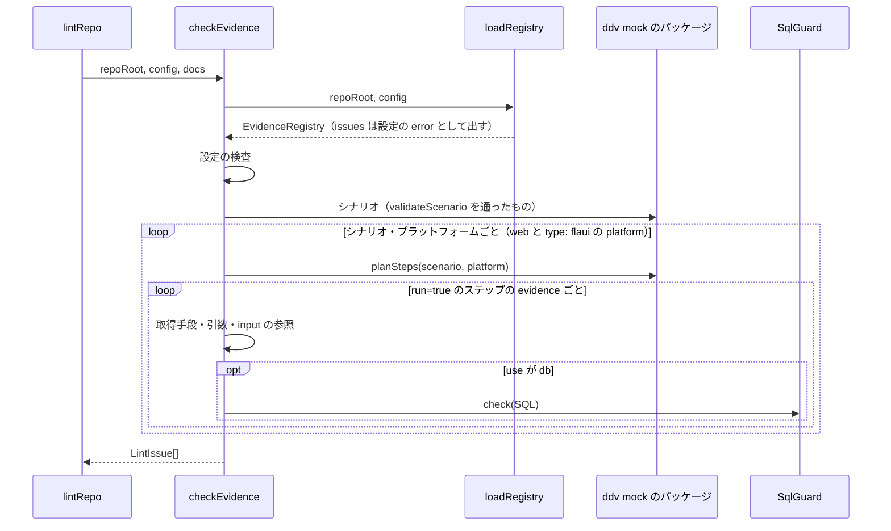
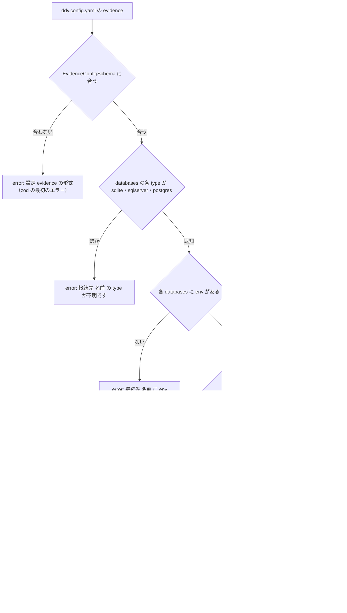
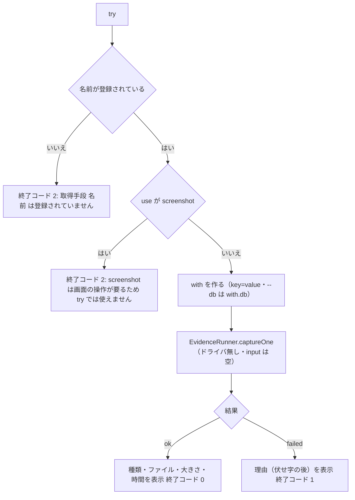

# 証跡の指定・検査（シナリオの形式・ddv-lint・ddv evidence）詳細設計

## 前提

- シナリオの書き方は :ref[../basic/evidence-capture.md#シナリオの書き方]、取得手段の登録は :ref[../basic/evidence-capture.md#取得手段の登録]、検査は :ref[../basic/evidence-capture.md#検査ddv-lint-拡張]、設定と CLI は :ref[../basic/evidence-capture.md#設定と-cli] を参照
- 取得の実行（`EvidenceRunner`・取得手段・`SqlGuard`・設定 `EvidenceConfigSchema`）は :ref[evidence-runner.md#構造]、シナリオの `Step`・`planSteps`・`validateScenario`・マージは :ref[desktop-scenario.md#構造]・:ref[scenario.md#マージ] を参照。本書はその差分だけを書く
- 実装：新規パッケージ `packages/evidence`（`@ddv/evidence`。本書の分は `src/spec.ts`・`src/with.ts`・`src/registry.ts`・`src/hooks-scan.ts`・`src/check.ts`・`src/cli.ts`）、`packages/mock/src/types.ts`・`scenario.ts`（`StepSchema.evidence`）、`packages/core/src/lint-cli.ts`・`apps/server/src/app.ts`（`/api/lint` の `extraChecks`）、`apps/server/src/cli.ts`（`ddv evidence`）
- 本書に画面は無い

## 構造



| 関数・型 | 置き場所 | 役割 |
|---|---|---|
| `EvidenceSpecSchema` | `@ddv/evidence/spec` | 1 項目の形の検査（zod）。`StepSchema.evidence` は `z.array(EvidenceSpecSchema).optional()`（`@ddv/mock` が import する） |
| `normalizeSpec(raw)` | 同上 | 既定値を補う：`at` → `after`、`label` → `use`、`with` → `{}`、`onError` → `fail` |
| `validateEvidence(scenario)` | 同上 | [形式の検査](#形式の検査)。`validateScenario`（:ref[desktop-scenario.md#シナリオの形式の検査]）の後に呼ぶ |
| `InputScope.of(scenario, plan)` | `@ddv/evidence/with` | [入力値の範囲](#入力値の範囲) |
| `resolveWith(with, scope)` | 同上 | [引数の解決](#引数の解決)。実行器と lint の両方で使う |
| `loadRegistry(repoRoot, config)` | `@ddv/evidence/registry` | [取得手段の一覧](#取得手段の一覧) |
| `scanEvidenceHooks(text)` | `@ddv/evidence/hooks-scan` | [hooks の静的な読み取り](#hooks-の静的な読み取り) |
| `checkEvidence(repoRoot, config, docs)` | `@ddv/evidence/check` | `ExtraLintCheck`（rule `evidence`）。[検査（lint）](#検査lint) |
| `evidenceCommand(argv)` | `@ddv/evidence/cli` | [ddv evidence](#ddv-evidence) |

- `Scalar` は `string | number | boolean`（シナリオの `Value` と同じ）。`WithValue` の配列の要素は `Scalar` だけ（入れ子・`InputRef` は不可）
- `@ddv/evidence` の `spec.ts`・`with.ts` はブラウザでも読める（プレイヤーが指定を表示するため。Node の API を使わない）

## 形式の検査

`EvidenceSpecSchema` は型だけを見る。`validateEvidence(scenario)` は意味の検査を行い、`ScenarioIssue`（:ref[scenario.md#構造]）を返す。



- エラーの場所は「シナリオ <ID> のステップ <番号> の証跡 <n>（<label>）」。番号は :ref[desktop-scenario.md#シナリオの形式の検査] と同じくファイル上の 1 始まり、`n` はそのステップの中の 1 始まり
- E4 の対象：入れ子の配列・オブジェクト（`input` だけを持つものを除く）・`null`。`{ input: <キー> }` は `input` 以外のキーがあっても E4
- 補助ステップ（`event` の無いステップ）にも書ける。`evidence` だけで操作も期待も無い補助ステップは、既存の E4（:ref[desktop-scenario.md#シナリオの形式の検査] の「補助ステップに操作も期待もありません」）のまま error にする（証跡だけを取るなら、直前のステップに書く）

## 入力値の範囲

`{ input: <キー> }` が参照できる値は、`InputScope` が計画（`planSteps` の結果）から決める。



- 同じキーは後のステップの値を使う（「直前までに入力した値」）
- プラットフォームごとに計画が違うので、`InputScope` はプラットフォームごとに作る（lint は `type: flaui` のランナーの `platform` と `web` のそれぞれで調べる）

## 引数の解決

`resolveWith(with, scope)` は、取得手段に渡す引数（`Record<string, Scalar | Scalar[]>`）を作る。



- 失敗は、実行時は取得の失敗（:ref[evidence-runner.md#1-つの指定の取得]）、lint では error（[検査（lint）](#検査lint)）
- `db` の `params` は `with.params` の中の値を同じ規則で解決する（`params` は 1 段だけ中を見る）

## 取得手段の一覧

`loadRegistry(repoRoot, config)` は、組み込み・hooks・外部コマンドを 1 つの一覧にする。実行器（`ProviderResolver`。:ref[evidence-runner.md#構造]）と lint・`ddv evidence list` が同じ一覧を使う。





- E1・E2 の名前は一覧に加えない（実行時は「登録されていない名前」と同じ失敗になる）
- 組み込みの `params`：`screenshot` は `target`・`fullPage`（どちらも任意）、`db` は `db`・`sql`・`file`・`params`・`mask`・`maxRows`（`sql` と `file` はどちらか一方が必須。[検査（lint）](#検査lint) の個別の規則で見る）
- 実行器は、hooks の関数の本体を `import` で読み込んだ後、静的に読んだ一覧と実体の名前を突き合わせる（静的に読めなかった名前も、実体があれば使える）

## hooks の静的な読み取り

`scanEvidenceHooks(text)` は `e2e/ddv-hooks.ts` を実行せずに読む。`typescript` の `createSourceFile`（構文木だけ。型検査はしない）を使い、`@ddv/evidence` の依存に `typescript` を加える。



- `export const evidence: EvidenceHooks = { ... }`・`export const evidence = { ... } satisfies EvidenceHooks` のどちらも C の「はい」
- W1 のとき、シナリオの `use` が組み込み・外部コマンドに無い名前は lint で error にせず、warning「hooks を読めないため <名前> の登録を確かめられません」にする
- `paramsKnown=false` の取得手段は、必須の引数の検査を省く

## 検査（lint）

`checkEvidence(repoRoot, config, docs)` を `ExtraLintCheck` として加える（rule `evidence`）。組み込み方は `checkDesktopNames`（:ref[desktop-scenario.md#名前の検査lint]）と同じく `lint-cli.ts` の `extraChecks` と `/api/lint` に動的な `import` で加える。



### 設定の検査



- `evidence` が無い設定は検査しない（REQ-810）
- `EvidenceConfigSchema` の項目と既定は :ref[evidence-runner.md#設定]
- 環境変数が今あるかは lint では調べない（Actions の secrets はローカルに無いため）。`ddv evidence list` で表示する

### 指定の検査

:ref[../basic/evidence-capture.md#検査ddv-lint-拡張] の図の各判定を、次の規則で行う。

| 判定 | 規則 | 文言 |
|---|---|---|
| 形式 | `validateEvidence` の結果をそのまま | [形式の検査](#形式の検査) |
| 未登録 | `registry.get(use)` が無い | 「シナリオ <ID> ステップ <n> の証跡 <label>: 取得手段 <use> は登録されていません（組み込み：screenshot・db、登録：<名前の一覧>）」 |
| 引数の欠け | `paramsKnown` で、`required: true` かつ `default` が無い引数が `with` に無い | 「… 必須の引数 <名前> がありません」 |
| 未知の引数 | `paramsKnown` で、`with` に `params` に無いキーがある | warning「… 引数 <名前> は <use> にありません」 |
| input の参照 | `resolveWith` が失敗（[入力値の範囲](#入力値の範囲)） | 「… 入力 <キー> はこの時点（<at>）ではありません（<platform>）」 |
| 接続先 | `db` の `with.db`（省略時は :ref[evidence-runner.md#db] の規則で決めた接続先）が `mock` でも `databases` の名前でもない | 「… 接続先 <名前> は定義されていません（ddv.config.yaml の evidence.databases）」 |
| sql と file | 両方ある・両方無い | 「… sql と file はどちらか一方を書きます」 |
| SQL ファイル | `file` がリポジトリの中に無い（`safeJoin` で外を指すときも） | 「… SQL ファイル <path> がありません」 |
| SELECT 以外 | `SqlGuard.check` が失敗（:ref[evidence-runner.md#sql-の検査]） | 「… <SqlGuard の理由>」 |
| パラメータ | SQL の `:名前` が `params` に無い・`params` のキーが SQL に無い | error「… パラメータ <名前> がありません」／ warning「… パラメータ <名前> は SQL で使っていません」 |

- 同じシナリオ・ステップ・証跡の同じ error は、プラットフォームが違っても 1 回だけ出す（文言に `platform` が入る input の参照を除く）
- `run=false` のステップ（そのプラットフォームでは飛ばす）は、そのプラットフォームでは検査しない
- `evidence:` の無いシナリオには何も出さない（REQ-810）

## ddv evidence

`ddv evidence <list | try>`（`apps/server/src/cli.ts` から `evidenceCommand` を呼ぶ）。

### list

```text
ddv evidence list [--repo <path>] [--json]
```

| 列 | 内容 |
|---|---|
| 名前 | `ProviderInfo.name`（組み込み → hooks → 外部コマンドの順、各々は名前の昇順） |
| 種類 | `builtin` / `hooks` / `command` |
| 引数 | `名前`（必須は `*` を付ける、既定値は `=値`）。`paramsKnown=false` は「（読めません）」 |
| 時間の上限 | 取得手段の `timeout`、無ければ設定の `evidence.timeout` |

- 続けて接続先の表（名前・種類・環境変数の名前・環境変数の有無「あり / なし」）。値は表示しない
- `registry.issues` があれば末尾に出し、終了コード 1。無ければ 0
- `--json` は `{ providers, databases: [{ name, type, env, present }], issues }`

### try

```text
ddv evidence try <名前> [--repo <path>] [--with key=value ...] [--db <接続先>] [--out <dir>] [--timeout <ms>]
```



- `--with` の値は文字列のまま渡す。`true`・`false`・数値に見える値は変換する（`--with lines=50` は数値）。同じキーを繰り返すと配列
- `--out` の既定は `os.tmpdir()/ddv-evidence-try-<時刻>`。結果のファイルを残し、場所を表示する
- `db: mock` は try では使えない（終了コード 2「mock の疑似 DB は E2E の実行でだけ使えます」）
- hooks の関数は `ctx.page`・`ctx.app` が無い状態で呼ぶ（`undefined`）。使う関数は失敗する（理由はその関数の例外）

## テストの方針

| 種類 | 対象 | 方法 |
|---|---|---|
| 単体テスト | 本書の matrix 図（`SPECVAL`・`SCOPE`・`WITH`・`REGMERGE`・`HOOKSCAN`・`CFGCHK`・`TRY`） | `packages/evidence/src/*.test.ts`（Vitest。Windows 以外でも動く） |
| 単体テスト | [指定の検査](#指定の検査) の表の行ごと | `checkEvidence` に一時フォルダのリポジトリ（設定・シナリオ・hooks・SQL ファイル）を渡す |
| 結合テスト | 既存の lint | `evidence:` の無い sample-app で lint の結果が変わらない（REQ-810）。証跡の指定を加えたシナリオで受入基準 REQ-807 の各 error が出て、直すと消える |
