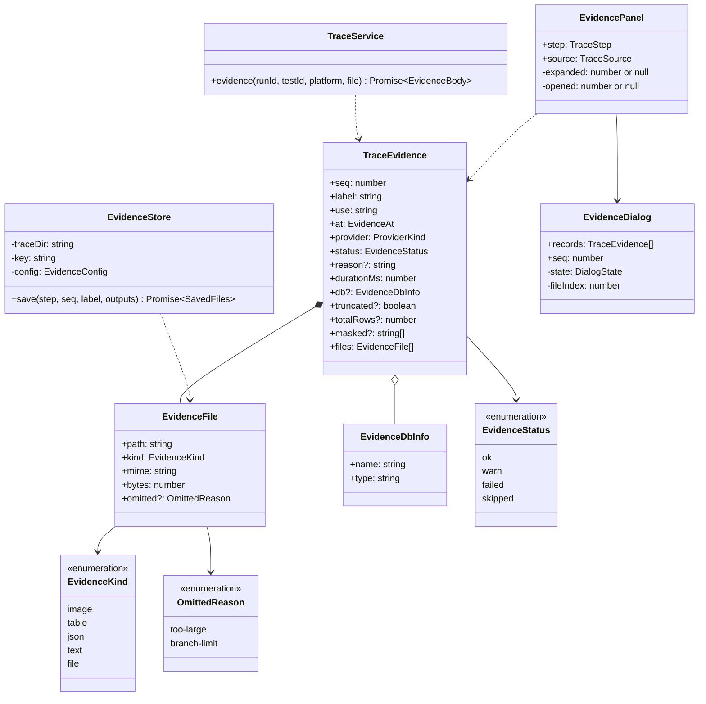
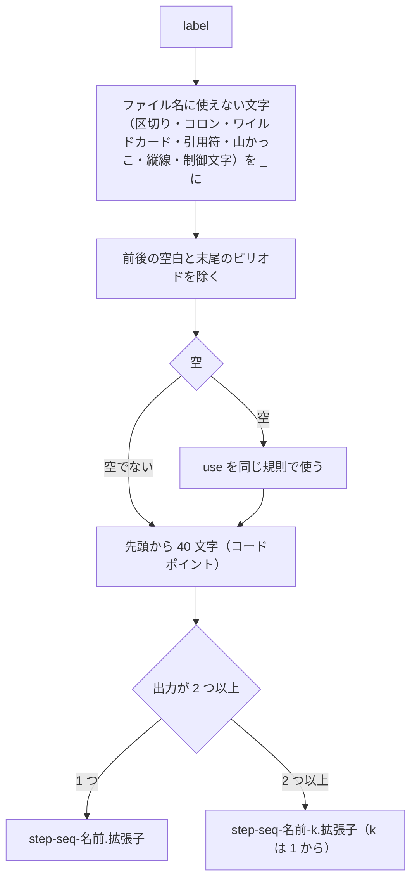
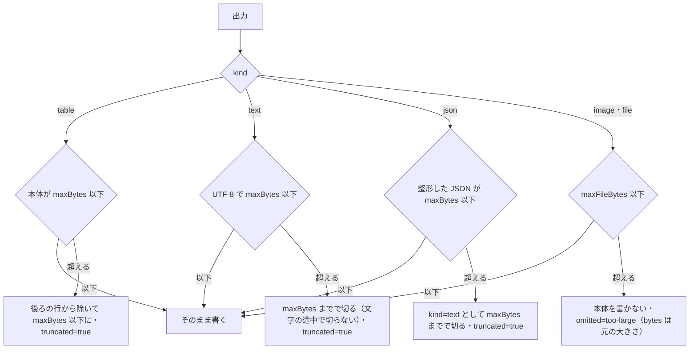
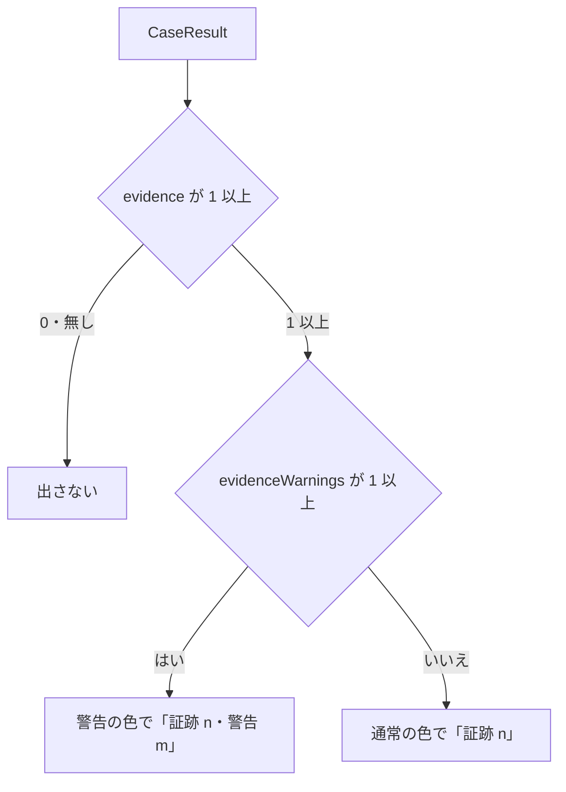
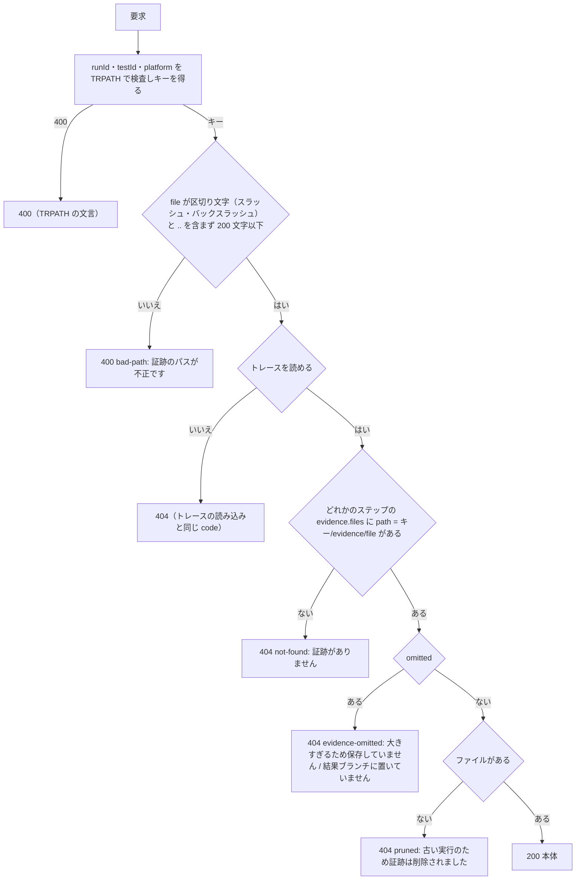
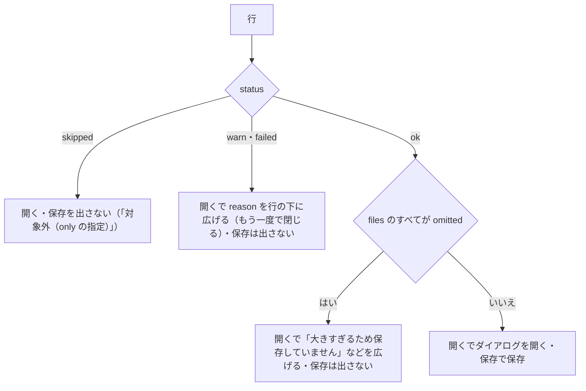
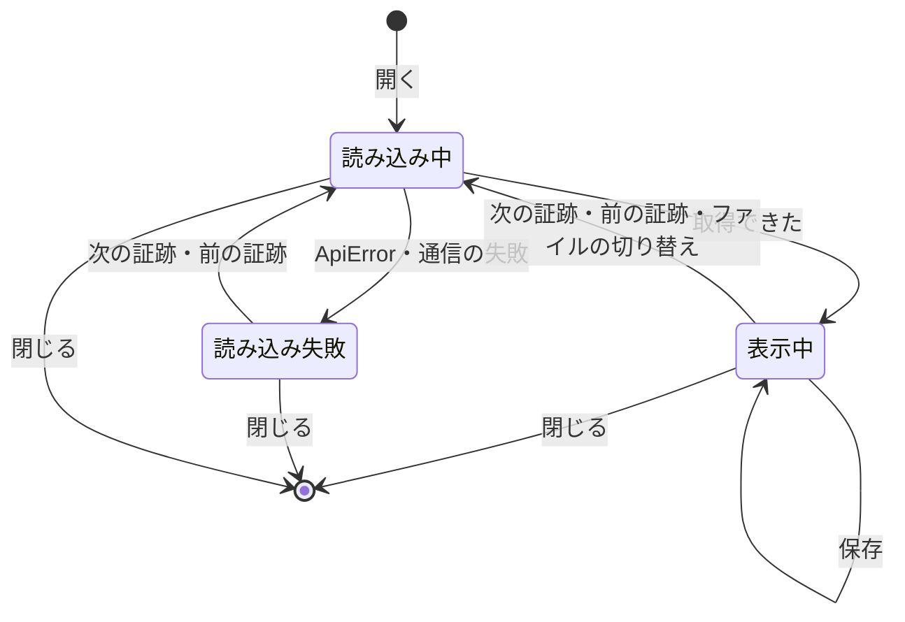
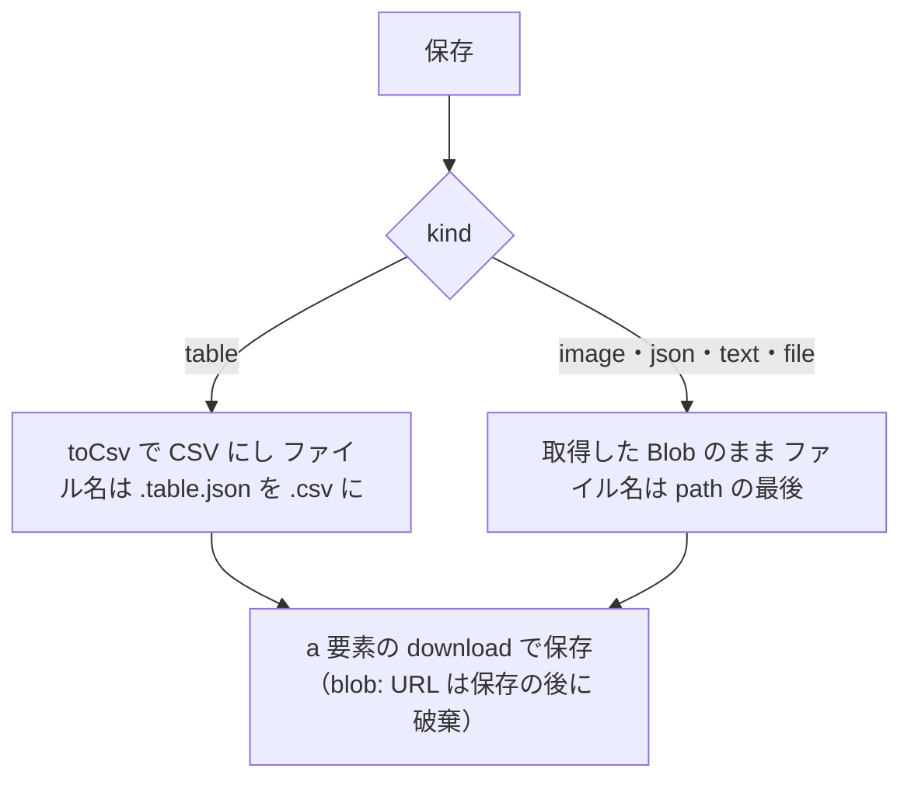
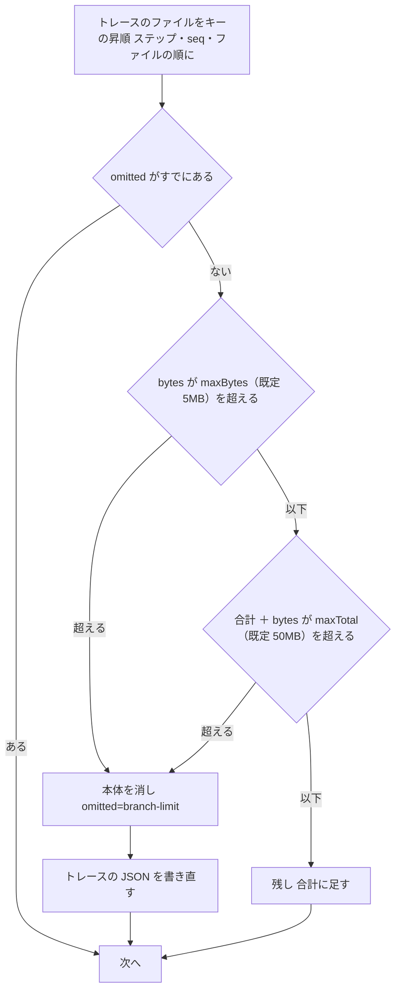

# 証跡の保存と表示（トレース・API・ビューア）詳細設計

## 前提

- 画面遷移は :ref[../basic/evidence-view.md#画面遷移]、画面の要素は :ref[../basic/evidence-view.md#画面イメージ]、保存の流れは :ref[../basic/evidence-view.md#保存の流れ]、保存先と結果ブランチは :ref[../basic/evidence-view.md#保存先と結果ブランチ]、データは :ref[../basic/evidence-view.md#データ]、API は :ref[../basic/evidence-view.md#api] を参照
- 取得（`EvidenceRunner`・`EvidenceOutput`・設定の `maxBytes`・`maxFileBytes`）は :ref[evidence-runner.md#構造]、トレースの形式（`TraceStep`）と記録の流れは :ref[trace-recorder.md#構造]、トレースの画面は :ref[trace.md#画面]、プラットフォームのキーとトレースのパスの検査は :ref[platform-results.md#トレース]、`Backend` は :ref[services.md#メソッド]、結果ブランチへの出力は :ref[actions-workflow.md#出力--out] を参照。本書はそこへの追加を書く
- 実装：`packages/evidence/src/store.ts`（`EvidenceStore`・ファイル名・大きさの上限）・`counts.ts`（`evidenceCounts`）・`branch-limit.ts`（`limitEvidenceForBranch`）、`apps/server/src/traces.ts`（`TraceService.evidence`）・`app.ts`（ルート）、`apps/web/src/components/EvidencePanel.tsx`・`EvidenceDialog.tsx`・`EvidenceBody.tsx`・`evidence-csv.ts`・`TraceStepDetail.tsx`・`TraceView.tsx`・`MatrixPanel.tsx`・`LiveTracePanel.tsx`、`apps/web/src/backend/http.ts`・`pages.ts`

## 画面

ハッシュ・戻る先はトレースの画面（:ref[trace.md#画面]）のまま。証跡の表示はトレースの画面の上に重ねるダイアログ（`role="dialog"`・`aria-modal="true"`）で、ハッシュを変えない。

::mock[evidence-view/index.html]

### テスト結果（追加分）

| 項目 | testid | 種類 | 型・桁 | 必須 | 初期値 | 取得元・送信先 | 入力チェック・エラー文言 |
|---|---|---|---|---|---|---|---|
| 証跡の件数 | `evidence-count` | バッジ | — | — | 非表示 | `CaseResult.evidence`・`evidenceWarnings`（:ref[run-record.md#構造]）。[件数の印](#件数の印) | — |
| トレース | `trace-open` | ボタン | — | — | — | 既存（:ref[trace.md#テスト結果追加分]） | — |

### トレース（追加分）

| 項目 | testid | 種類 | 型・桁 | 必須 | 初期値 | 取得元・送信先 | 入力チェック・エラー文言 |
|---|---|---|---|---|---|---|---|
| 戻る | `trace-back` | ボタン | — | — | — | 既存 | — |
| タイムライン | `timeline` | 一覧 | — | — | 既存 | 既存の各行の末尾に、`evidence` が 1 件以上なら「証跡 n」（`skipped` を除く件数）、`warn`・`failed` があれば「⚠」（`title`「証跡の警告・失敗があります」） | — |
| ステップを選ぶ | `step-select` | ボタン（行ごと） | — | — | — | 既存 | — |
| スクリーンショット | `screenshot` | 画像 | — | — | — | 既存（自動のスクリーンショット） | — |
| 証跡の一覧 | `evidence-list` | 表 | — | — | — | 選んだステップの `evidence`（`seq` の順）。列：#（`seq`）・表示名（`label`）・時点（`before`「操作前」/ `after`「判定後」）・種類（[種類の表示](#種類の表示)）・取得手段（`use`。`db` は「db（<接続先>・<種類>）」、`command` は「<名前>（コマンド）」、`hooks` は「<名前>（hooks）」）・状態（`ok`「取得」/ `warn`「警告」/ `failed`「失敗」/ `skipped`「対象外」）・操作 | `evidence` が無いか空：節（見出しと表）ごと出さない |
| 開く | `evidence-open` | ボタン（行ごと） | — | — | — | [一覧の行の操作](#一覧の行の操作) | `skipped` の行は出さない |
| 保存 | `evidence-save` | ボタン（行ごと） | — | — | — | [保存](#保存)。`ok` の行だけ | — |
| 失敗の理由 | `evidence-error` | メッセージ（行の下） | — | — | 非表示 | `reason`（「取得に失敗しました：<reason>」） | — |
| 開く証跡の状態 | `evidence-state` | 選択 | — | — | — | モックだけの操作（実装には無い） | — |
| 取得しない旨 | — | 注記 | — | — | — | ライブ表示のときだけ「プレイヤーの再生では証跡を取得しません（E2E の実行で取得します）」（[ライブ表示](#ライブ表示)） | — |

- 行の中の `evidence-open`・`evidence-save` は、行（`tr`）に `data-seq` を付け、E2E は行で絞ってから押す（`step-select` と同じ扱い）
- デスクトップのトレースでも同じ表を出す（`api-calls`・`db-diff` を出さない規則は :ref[platform-results.md#トレース追加分] のまま）

### 証跡の表示

| 項目 | testid | 種類 | 型・桁 | 必須 | 初期値 | 取得元・送信先 | 入力チェック・エラー文言 |
|---|---|---|---|---|---|---|---|
| 表示名 | `evidence-title` | 見出し | — | — | — | `label`。続けて時点・取得手段・`durationMs`（「0.2s」） | — |
| 閉じる | `evidence-close` | ボタン | — | — | — | ダイアログを閉じる。Esc でも。フォーカスは開いた行の `evidence-open` に戻す | — |
| ファイル | — | タブ | — | — | 1 つ目 | `files` が 2 つ以上のときだけ、ファイル名のタブ（モックに無い） | — |
| 本体 | `evidence-table` ほか | 種類ごと | — | — | — | [種類の表示](#種類の表示)。表は `evidence-table` | 読み込みの失敗：[ダイアログの状態](#ダイアログの状態) |
| 注記 | `evidence-note` | 表示 | — | — | 非表示 | [注記](#注記) | — |
| 保存 | `evidence-save` | ボタン | — | — | — | 表示中のファイルを保存。表は「保存（CSV）」、ほかは「保存」 | — |
| 次の証跡 | `evidence-next` | ボタン | — | — | — | 同じステップの `ok` の次の証跡へ（最後なら最初へ）。→ キーでも、← キーは前へ | `ok` の証跡が 1 つだけ：押せない |

## 構造

| 型・関数 | 置き場所 | 役割 |
|---|---|---|
| `TraceEvidence`・`EvidenceFile` | `packages/mock/src/trace-format.ts` | `TraceStep.evidence?: TraceEvidence[]`（:ref[trace-recorder.md#構造]）。`TRACE_VERSION` は 1 のまま（項目の追加だけ） |
| `EvidenceStore` | `@ddv/evidence/store` | [保存](#証跡の保存)。`traceDir` は `DDV_TRACE_DIR`、`key` は結果のキー（:ref[platform-results.md#結果のキー]） |
| `evidenceCounts(trace)` | `@ddv/evidence/counts` | `{ evidence, evidenceWarnings }`。`evidence` は `skipped` 以外の件数、`evidenceWarnings` は `warn`・`failed` の件数。どちらも全ステップの合計 |
| `limitEvidenceForBranch(dir, limits)` | `@ddv/evidence/branch-limit` | [結果ブランチの大きさの上限](#結果ブランチの大きさの上限) |
| `TraceService.evidence` | `apps/server/src/traces.ts` | [API](#api) |
| `Backend.evidence(runId, testId, platform, file)` | `apps/web/src/backend` | `Promise<Blob>`（:ref[services.md#メソッド]）。[本体の取得](#本体の取得) |
| `toCsv(table)` | `apps/web/src/components/evidence-csv.ts` | [CSV への変換](#csv-への変換) |

- `EvidenceFile.path` はトレースのディレクトリ（`.ddv/traces/<runId>/`）からの相対パス（`<key>/evidence/<名前>`。区切りは `/`）。`TraceStep.screenshot` と同じ規則
- `reason` は伏せ字の後の文言（:ref[evidence-runner.md#接続情報の伏せ字]）

## 証跡の保存

`EvidenceStore.save(step, seq, label, outputs)` は、取得手段の出力（:ref[evidence-runner.md#構造] の `EvidenceOutput`）を `.ddv/traces/<runId>/<key>/evidence/` に書き、`EvidenceFile[]` を返す。

| `kind` | 拡張子 | 書く内容 | `mime` |
|---|---|---|---|
| `image` | 元のファイルの拡張子（小文字。`png`・`jpg`・`gif`・`webp` 以外は `kind` を `file` にする） | 元のファイルのコピー | `image/png` など |
| `table` | `.table.json` | `{ "columns": [...], "rows": [[...]] }`（UTF-8、字下げなし） | `application/json` |
| `json` | `.json` | `JSON.stringify(data, null, 2)` | `application/json` |
| `text` | 外部コマンドのファイルは元の拡張子（`.txt`・`.log`）、ほかは `.txt` | UTF-8 の文字列 | `text/plain` |
| `file` | 元の拡張子（無ければ `.bin`） | 元のファイルのコピー | `application/octet-stream` |

- FNAME の「使えない文字」は `\`・`/`・`:`・`*`・`?`・`"`・`<`・`>`・`|` と制御文字（U+0000〜U+001F）
- `step` は 1 始まりのステップ番号、`seq` は :ref[evidence-runner.md#時点ごとの取得] の通し番号。同じ名前にならない（`step`・`seq` が一意のため）
- Windows の予約名（`CON`・`NUL` など）になる名前は先頭に `_` を付ける
- 書き込みは `<名前>.tmp` に書いてから名前を変える。書けなかったら取得の失敗（理由「証跡を保存できません：<文言>」）として扱う

### 大きさの上限

- `table` の `totalRows` は取得手段の値（:ref[evidence-runner.md#接続と読み取り専用]）。行を除いたときは `totalRows` を変えず、注記の「m 行」は書いた行数
- `too-large` は取得の成功（`status` は変えない）。画像・ファイルは切ると読めなくなるため、切らずに置かない

## 記録への追加

実行器が `TraceRecorder.endStep` に渡す `StepTrace` に、`before`・`after` の `AtResult.records`（:ref[evidence-runner.md#構造]）をつないだ `evidence` と、`warn` の件数の `evidenceWarnings` を加える（:ref[trace-recorder.md#記録の流れ]）。

- `evidence` が空の配列のときは項目を書かない（証跡の無いトレースの形を変えない。REQ-810）
- 実行の終わりに `RunRecord.results` の各結果へ `evidenceCounts` を書く（:ref[run-record.md#実行の終了]）。0 件のときは書かない

## 件数の印

- プラットフォーム別のバッジ（:ref[platform-results.md#バッジの表示]）があるときは、件数をプラットフォームの合計にし、`title` にプラットフォームごとの内訳を出す
- テスト一覧・履歴の行には出さない（マトリクスの行だけ）

## API

`GET /api/traces/{runId}/{testId}/evidence/{file}?platform=&download=1`（GitHub のワークスペースは `/api/w/<ID>/...`）。

| 応答のヘッダ | 値 |
|---|---|
| `Content-Type` | `image` は `EvidenceFile.mime`、`table`・`json` は `application/json; charset=utf-8`、`text` は `text/plain; charset=utf-8`、`file` は `application/octet-stream` |
| `X-Content-Type-Options` | `nosniff` |
| `Content-Security-Policy` | `default-src 'none'; sandbox`（直接開いても何も実行させない） |
| `Cache-Control` | `private, max-age=86400`（スクリーンショットと同じ） |
| `Content-Disposition` | `download=1` のときだけ `attachment; filename*=UTF-8''<file を RFC 5987 で符号化>` |

- `{file}` は URL のデコードの後に検査する。記録との照合は完全一致（大文字小文字を区別する）
- Actions の結果（`source: actions`）は、トレースと同じく結果ブランチから読む（:ref[services.md#メソッド] の `trace` と同じ経路。パスは `traces/<キー>/evidence/<file>`）

## 本体の取得

| 版 | `Backend.evidence(runId, testId, platform, file)` |
|---|---|
| ローカル版（`HttpBackend`） | `fetch(上の API)` → `res.blob()`。4xx は `ApiError`（`code`・`error`） |
| Pages 版（`PagesBackend`） | `ActionsService.file(runId, 'traces/<キー>/evidence/<file>')`（:ref[actions-run.md#1-回分の結果]）の前に、トレースの記録で [API](#api) と同じ照合（E1・E3・E4）をし、同じ `code` の `ApiError` を返す。結果は `Blob`（`type` は記録の `mime`） |

- Pages 版は取得した `Blob` を `runId/キー/file` をキーにメモリに保持する（ページを閉じるまで。合計 100MB を超えたら古く使ったものから捨てる）。ローカル版はブラウザのキャッシュ（`Cache-Control`）に任せる
- 保存のための取得も同じ関数を使う（`download=1` はブラウザで直接開くときだけ使う。ビューアは `Blob` から保存する）

## 一覧の行の操作

- 広げた理由は 1 行に 1 つ（ほかの行を開くと前の行は閉じる）
- 一覧はステップを選び直すと閉じた状態に戻る

## ダイアログの状態

- 読み込み失敗の本体：`ApiError` の `error`（例「古い実行のため証跡は削除されました」）。保存は押せない
- 読み込み中に閉じた・次へ進んだときは、前の取得の結果を捨てる（`AbortController`）
- 開いている間は ←・→・Esc をダイアログで受け、トレースの画面のステップの移動（:ref[trace.md#ステップの選択]）には渡さない
- 「次の証跡」「前の証跡」は、同じステップの `ok` で `omitted` でないファイルを持つ証跡だけを順に回る

## 種類の表示

| `kind` | 一覧の「種類」 | 本体（testid） | 規則 |
|---|---|---|---|
| `image` | 画像 | ``（`evidence-image`。モックに無い） | `Blob` の `blob:` URL。`mime` が `image/png`・`image/jpeg`・`image/gif`・`image/webp` のときだけ。クリックで原寸 / 幅合わせを切り替える。閉じたら URL を `revokeObjectURL` |
| `table` | 表（n 行） | `<table>`（`evidence-table`） | 見出しは `columns`。値は文字として表示（null は空欄で薄い「null」）。横スクロール |
| `json` | JSON | `<pre>` の木（`evidence-json`。モックに無い） | 深さ 2 までを開き、それより深いオブジェクト・配列は `
` で閉じる |
| `text` | テキスト | `<pre>`（`evidence-text`。モックに無い） | 等幅・折り返しなし。1MB を超える分は表示せず「続きは保存して確認してください」 |
| `file` | ファイル（形式） | 名前・大きさ・`mime`（`evidence-file`。モックに無い） | 中身を出さない |

- どの種類も React のテキストとして描き、`dangerouslySetInnerHTML`・`<iframe>`・`<object>` を使わない（:ref[../basic/evidence-view.md#画面イメージ] の安全な表示）
- 一覧の「種類」の `n` は `.table.json` を読む前に分かるよう、`totalRows`（無ければ空）を使う

### 注記

`evidence-note` は次を「。」でつないで出す。どれも無ければ出さない。

| 条件 | 文言 |
|---|---|
| `masked` が 1 つ以上 | 「<列名をカンマで>は伏せています」 |
| `kind` が `table` | 「<totalRows>行中 <書いた行数>行を表示」（`totalRows` が `maxRows + 1` のときは「<maxRows> 行以上のうち <書いた行数> 行を表示」） |
| `truncated` で `table` 以外 | 「上限の大きさで切っています」 |
| ファイルの一部が `omitted` | 「<n> 個のファイルは <理由> ため表示できません」 |

## 保存

### CSV への変換

- 先頭に UTF-8 の BOM、行の区切りは CRLF、1 行目は `columns`
- 値：`null` は空、真偽値は `true`/`false`、数値は `String(v)`、文字列はそのまま
- `,`・`"`・CR・LF を含むか、前後に空白がある値は `"` で囲み、中の `"` は `""` にする（RFC 4180）
- 伏せた値（`***`）はそのまま書く（元の値は記録に無い）

## 結果ブランチの大きさの上限

`ddv ci run` が `.ddv/traces/<実行ID>/` を出力先（:ref[actions-workflow.md#出力--out]）にコピーした後、`limitEvidenceForBranch(<out>/traces, { maxBytes, maxTotal })` を呼ぶ。

- 合計に数えるのは証跡の本体だけ（トレースの JSON・自動のスクリーンショットは数えない）
- 手元の `.ddv/traces/` は変えない（ローカルの実行では残る）
- 消した件数が 1 以上なら `run.json` の `warnings` に「大きさの上限のため証跡 n 件（m MB）を結果ブランチに置いていません」を加える
- 上限の値は `ddv ci run` の `--evidence-max-bytes`・`--evidence-max-total`（:ref[actions-workflow.md#ddv-ci-run]）

## ライブ表示

プレイヤーのライブ表示（:ref[trace.md#ライブ表示]）は取得しない。`LiveTracePanel` は、ステップの記録の代わりにシナリオのステップの `evidence`（`planSteps` の計画。:ref[desktop-scenario.md#プレイヤースナップショット]）から一覧を作る。

- 列は表示名・時点・取得手段だけ（種類・状態・操作は空）。表の下に「プレイヤーの再生では証跡を取得しません（E2E の実行で取得します）」
- 指定の正規化（既定値の補い）は `normalizeSpec`（:ref[evidence-spec.md#構造]）を使う

## テストの方針

| 種類 | 対象 | 方法 |
|---|---|---|
| 単体テスト | 本書の matrix 図（`FNAME`・`SAVESIZE`・`EVBADGE`・`EVAPI`・`EVROW`・`EVDLG`・`EVSAVE`・`BRLIMIT`） | `packages/evidence/src/*.test.ts`・`apps/server/src/traces.test.ts`・`apps/web/src/components/*.test.tsx` |
| 単体テスト | CSV への変換・注記の文言 | `evidence-csv.test.ts`（BOM・引用・CRLF・null） |
| 結合テスト | API | 一時フォルダのトレースで、種類ごとの `Content-Type`・`nosniff`・`download=1`、`..`・`%2e%2e`・`/` を含む `file` が 400、記録に無いファイルが 404 |
| E2E | 画面 | ビューアの E2E（:ref[../basic/evidence-view.md#試験の観点]）。モックのシナリオ（`docs/mocks/evidence-view/scenarios/`）と同じ testid で、Pages 版の E2E でも結果ブランチの証跡を開き・保存する |
