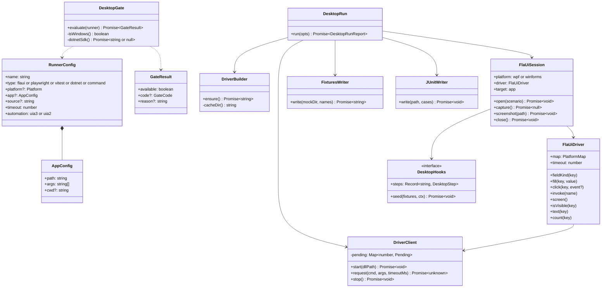
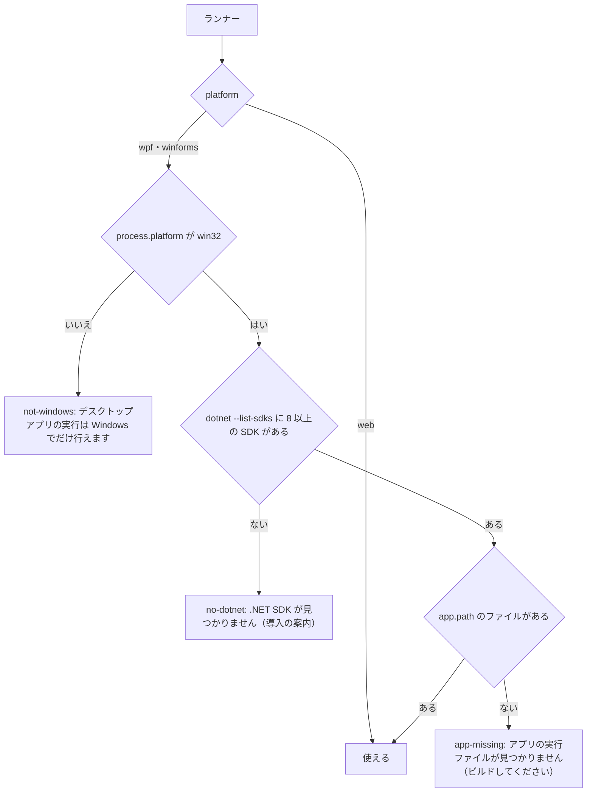
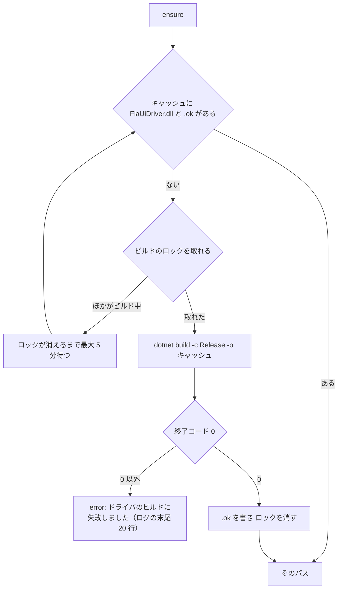
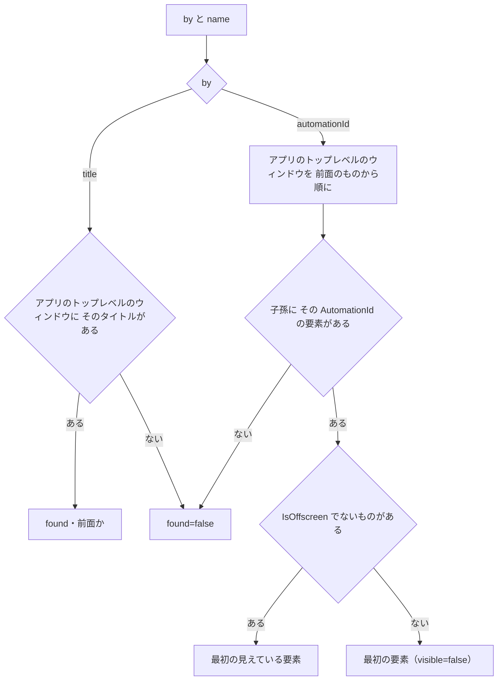
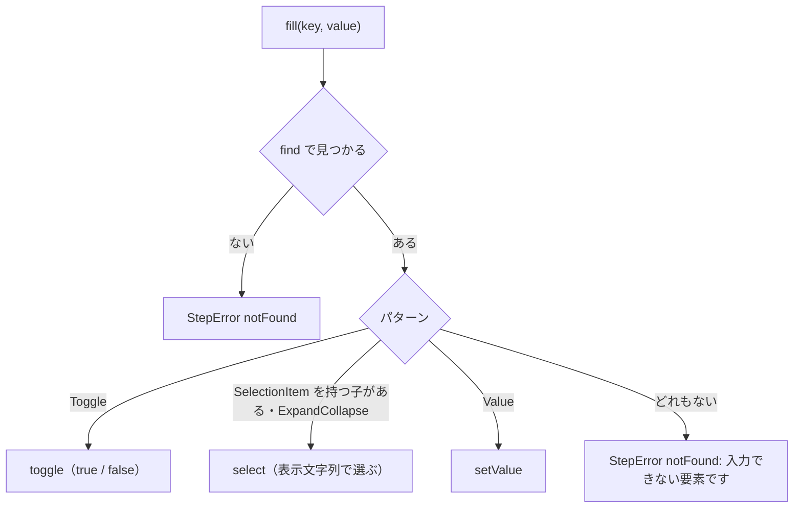
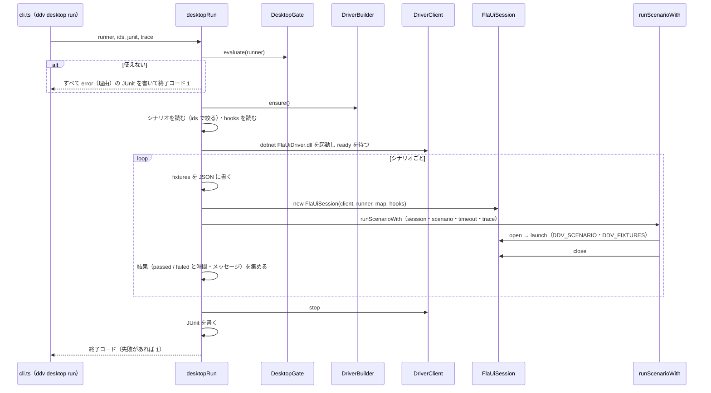

# FlaUI のドライバとデスクトップの実行 詳細設計

## 前提

- 実行の可否は :ref[../basic/desktop-run.md#実行の可否]、実行の流れは :ref[../basic/desktop-run.md#実行の流れ]、名前の解決は :ref[../basic/desktop-run.md#名前の解決]、構成は :ref[../basic/desktop-run.md#構成]、設定と CLI は :ref[../basic/desktop-run.md#設定と-cli] を参照
- シナリオの計画・実行器 `runScenarioWith`・`ScenarioSession`・名前の解決 `resolveDesktopName` は :ref[desktop-scenario.md#実行器] と :ref[desktop-scenario.md#名前の解決]、結果のキー・トレースの保存先は :ref[platform-results.md#結果のキー] を参照
- 実装：設定 `packages/core/src/config.ts`（`RunnerSchema`）、新規パッケージ `packages/desktop`（`@ddv/desktop`。`src/gate.ts`・`src/driver-build.ts`・`src/client.ts`・`src/flaui-driver.ts`・`src/session.ts`・`src/fixtures.ts`・`src/run.ts`・`src/junit.ts`、C# の `driver/FlaUiDriver.csproj`・`driver/Program.cs`・`driver/Commands.cs`）、`apps/server/src/runner.ts`（`buildInvocation`）、`apps/server/src/cli.ts`（`ddv desktop`）、`apps/server/src/ci/ci-run.ts`、`packages/testid/src/scan.ts`・`packages/services/src/matrix.ts`（テストの紐づけ）
- 本書に画面は無い（接続先の選択の画面は :ref[platform-results.md#画面]）

## 構造



## 設定

`RunnerSchema` の `type` に `flaui` を加え、次の項目を足す（`superRefine` で `type` ごとに検査する）。

| 項目 | 型 | 対象 | 既定 | 規則・エラー文言 |
|---|---|---|---|---|
| `platform` | `web` / `wpf` / `winforms` | playwright・flaui | playwright は `web` | flaui は `wpf` か `winforms` が必須：「ランナー <name>: type: flaui には platform: wpf か winforms が必要です」。playwright は `web` だけ：「ランナー <name>: playwright の platform は web だけです」。ほかの type に書くと warning で無視 |
| `app.path` | string | flaui | — | 必須：「ランナー <name>: app.path（アプリの実行ファイル）が必要です」。リポジトリのルートからの相対 |
| `app.args` | string[] | flaui | `[]` | — |
| `app.cwd` | string | flaui | 実行ファイルの場所 | — |
| `source` | string | flaui | — | 必須：「ランナー <name>: source（画面定義の場所）が必要です」 |
| `timeout` | number（ミリ秒） | flaui | `5000` | 100 以上 |
| `automation` | `uia3` / `uia2` | flaui | `uia3` | — |

- `type: flaui` のランナーは `include`・`command`・`scenarios` を使わない（書くと warning で無視）。シナリオの紐づけは常に行う
- テストの紐づけ：`scanTestLinks`（`packages/testid/src/scan.ts`）と `scanTestLinksIn`（`packages/services/src/matrix.ts`）で、`scenarios: true` の playwright と同じく `<mocksRoot>/**/scenarios/*.yaml` の `id:` を、`type: flaui` のランナーにも紐づける（`TestLink.runner` はそのランナー名、`test` はシナリオの `title`）

## 実行の可否

`DesktopGate.evaluate(runner)`（`gate.ts`）は、サーバと `ddv desktop doctor` が使う。Pages 版の判定はブラウザ側（:ref[platform-results.md#接続先の一覧]）。



- `GateCode = not-windows / no-dotnet / app-missing`。`reason` は図の文言。`no-dotnet` には導入の URL（`https://dotnet.microsoft.com/download`）を添える
- `dotnet --list-sdks` の結果はサーバのプロセスの間 30 秒保持する（接続先の一覧を開くたびに起動しない）。`doctor` は保持を使わない
- 実行の開始時（`ddv desktop run`）にも同じ判定をし、使えなければそのランナーのすべてのテストIDを `error`（理由をメッセージ）にする

## ドライバの用意

`DriverBuilder.ensure()` は、ドライバの `FlaUiDriver.dll` のパスを返す。



- キャッシュの場所：`~/.ddv/cache/flaui-driver/<ddv の版>-<driver フォルダの内容の SHA-256 の先頭 12 桁>/`。ドライバのソースを変えると別の場所になる
- ロックは同じ場所の `.lock`（`open(..., 'wx')`）。10 分より古いロックは消してから取り直す
- E のとき、失敗したビルドの出力はキャッシュの `build.log` に残す

### ドライバ（C#）

- `net8.0-windows`、依存は `FlaUI.UIA3`・`FlaUI.UIA2`。コンソールアプリで、標準入力から 1 行ずつ要求を読み、標準出力に 1 行ずつ応答を書く。ログは標準エラー
- 起動直後に `{"ready":true,"version":"<ドライバの版>"}` を 1 行書く
- 状態として持つのは、起動したアプリ（`FlaUI.Core.Application`）と `Automation`（UIA3 / UIA2）だけ。待機・再試行・判定はしない（実行器が行う）

## 通信の形式

要求 `{"id":<番号>,"cmd":"<コマンド>","args":{…}}`、応答 `{"id":<番号>,"ok":true,"result":…}` または `{"id":<番号>,"ok":false,"error":{"code":"<コード>","message":"…"}}`。

| コマンド | args | result | 主な error.code |
|---|---|---|---|
| `launch` | `path`・`args`・`cwd`・`env`・`automation`・`timeoutMs` | `{ pid, title, automationId }`（メインウィンドウ） | `launch-failed`・`no-window` |
| `find` | `by`（`automationId` / `title`）・`name` | `{ found, visible, controlType, patterns }` | — |
| `setValue` | `name`・`value` | `{}` | `notFound`・`no-pattern`・`readonly` |
| `select` | `name`・`text` | `{}` | `notFound`・`no-pattern`・`no-option` |
| `toggle` | `name`・`on` | `{}` | `notFound`・`no-pattern` |
| `invoke` | `name` | `{}` | `notFound`・`disabled` |
| `query` | `what`（`window` / `text` / `count` / `visible`）・`name` | `window`：`{ title, automationId }`、`text`：文字列か null、`count`：数、`visible`：真偽 | `notFound`（`text`・`count`） |
| `screenshot` | `path` | `{ width, height }` | `no-window` |
| `close` | `timeoutMs` | `{ exitCode, killed }` | — |

- `DriverClient.request` は要求ごとに期限を持つ（`launch` は 30 秒、ほかは 10 秒）。期限を過ぎたらドライバを強制終了し、`error`「FlaUI のドライバが応答しません（<コマンド>）」で、そのシナリオを失敗にする。次のシナリオの前にドライバを起動し直す
- ドライバが予期せず終了したら、待っているすべての要求を同じく失敗にする
- 応答の `id` が待っている要求に無いときは捨てる（標準エラーに記録）

## 要素の探し方

`find` などの `name` は `resolveDesktopName` の結果（:ref[desktop-scenario.md#名前の解決]）。ドライバは「今のウィンドウ」の中で探す。



- 「アプリのトップレベルのウィンドウ」は、起動したプロセスの `GetAllTopLevelWindows`（モーダルのダイアログを含む）。前面の順は Z オーダー
- 子孫の検索は `FindFirstDescendant(cf.ByAutomationId(name))` を見つかるまで（見えている要素を優先するため `FindAllDescendants` で集めてから選ぶ）

### 操作の方法

`FlaUiDriver` は `Driver` を実装し、次のように要求に変える。待機は既存の `executeStep` の再試行（`timeout`）に任せる。



| `Driver` のメソッド | 要求 | 規則 |
|---|---|---|
| `fieldKind(key)` | `find` | `Toggle` → `checkbox`、選択 → `select`、`Value` → `text`、見つからない → `null` |
| `click(key, event)` | `invoke` | 名前は `resolveDesktopName('event' / 'field', …)`。`Invoke` が無ければ要素の中央をクリック（ドライバ側） |
| `invoke(name)` | — | hooks の `desktopSteps[name]` を呼ぶ。無ければ `StepError('unknownOp')` |
| `screen()` | `query window`・`find` | :ref[desktop-scenario.md#デスクトップ] の `screen()` の規則 |
| `isVisible(key)` | `find` | `found && visible` |
| `text(key)` | `query text` | `Value` の値、無ければ `Name` |
| `count(key)` | `query count` | `Grid` の `RowCount`、無ければ子の `ListItem`・`DataItem` の数 |

## デスクトップの実行

`ddv desktop run --runner <name> [--ids <id,...>] [--junit <file>] [--trace <dir>]`（`desktopRun`）。



- hooks は `e2e/ddv-hooks.ts` があれば CLI と同じ仕組み（`tsx`）で `import` し、`desktopSeed`・`desktopSteps` を使う。無ければ使わない
- `FlaUiSession.open(scenario)` の順：`desktopSeed(fixtures, { platform, fixturesFile, scenario })`（あれば）→ `launch`（`env` に `DDV_SCENARIO=<ID>`・`DDV_FIXTURES=<JSON のパス>`・`DDV_PLATFORM=<platform>`）→ `start` の画面になるまで `screen()` を `timeout` まで繰り返す（ならなければ「開始の画面 <start> になりません（今：<画面>）」）
- `FlaUiSession.capture()` は常に `null`（通信・DB の記録は無い）。`screenshot(path)` は前面のウィンドウの PNG
- `FlaUiSession.close()` は `close`（5 秒待って終了しなければ強制終了）。失敗・例外のときも必ず呼ぶ
- JUnit：テスト名は `[<ID>] <title>`、`classname` はランナー名。既存の JUnit の読み取り（`runner.ts`）で `[ID]` から結果に戻る
- トレース：`--trace` か環境変数 `DDV_TRACE_DIR` があれば `TraceRecorder` に `platform` を渡して記録する（:ref[platform-results.md#トレース]）

### fixtures のファイル

`FixturesWriter.write(mockDir, names)` は、シナリオの `fixtures` の名前の順に `<mockDir>/fixtures/<name>.yaml` を読み、テーブルごとに行を連結した JSON を一時フォルダ（`os.tmpdir()/ddv-fixtures-<runId>/<ID>.json`）に書いてパスを返す。

```json
{ "scenario": "BD-ORDER-SCREEN-P001", "fixtures": ["default"], "tables": { "orders": [ { "id": 1, "customer": "山田 太郎" } ] } }
```

- 同じテーブルを複数の fixtures が持つときは、後の fixtures の行を後ろに足す（モックの runtime の `reset` と同じ）
- 読めない fixtures があれば、そのシナリオを開始前の失敗（`failedStep: 0`）にする：「fixtures <name> が読めません」
- 一時フォルダは実行の終わりに消す

## サーバ・CI からの起動

- `buildInvocation`（`runner.ts`）に `flaui` を加える：コマンドはサーバ自身の CLI（`process.execPath`・`process.execArgv`・`cli.ts` のパス）で `desktop run --runner <name> --junit <reportDir>/<name>.xml`、`ids` があれば `--ids`、`DDV_TRACE_DIR` は playwright と同じ規則で渡す
- `ddv ci run`（`ci-run.ts`）は、`process.platform` が `win32` でなければ `type: flaui` のランナーを実行せず、`RunnerOutcome` に `skipped: true`・`message`「Windows 以外のため実行しません」を残す（テストIDの結果は作らない）

## ddv desktop doctor

`ddv desktop doctor [--runner <name>]` は、`type: flaui` のランナー（指定があればそれだけ）ごとに次を表示する。

| 行 | 内容 |
|---|---|
| OS | `win32` なら ✓、それ以外は ✗ と `not-windows` の文言 |
| .NET SDK | 見つかった版、無ければ ✗ と導入の URL |
| 実行ファイル | `app.path` の有無 |
| ドライバ | キャッシュの有無。無ければ `ensure()` でビルドし、その結果 |
| 画面定義 | `source` の下の画面定義の件数（:ref[desktop-scenario.md#画面定義の走査]） |

- 1 つでも ✗ があれば終了コード 1

## テストの方針

| 種類 | 対象 | 方法 |
|---|---|---|
| 単体テスト | 本書の matrix 図（`GATE`・`DBUILD`・`FIND`・`FILL`） | `GATE`・`DBUILD` は `packages/desktop/src/*.test.ts`（OS・`dotnet`・ファイルを差し替える）。`FIND`・`FILL` は `FlaUiDriver` を偽の `DriverClient` で確かめ、ドライバ側は `driver.Tests`（xUnit・Windows だけ） |
| 単体テスト | 通信の形式・設定の検査 | `DriverClient` を偽のドライバのプロセス（Node のスクリプト）で、期限・異常終了・不明な `id` を確かめる。`RunnerSchema` の表の行ごと |
| 結合テスト | サンプルの WPF・WinForms | Windows の CI で、sample-app の注文のシナリオを `ddv desktop run` で実行して成功し、期待値を変えると失敗すること |
