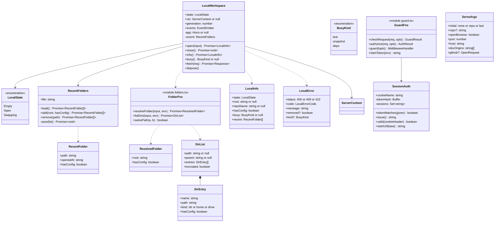
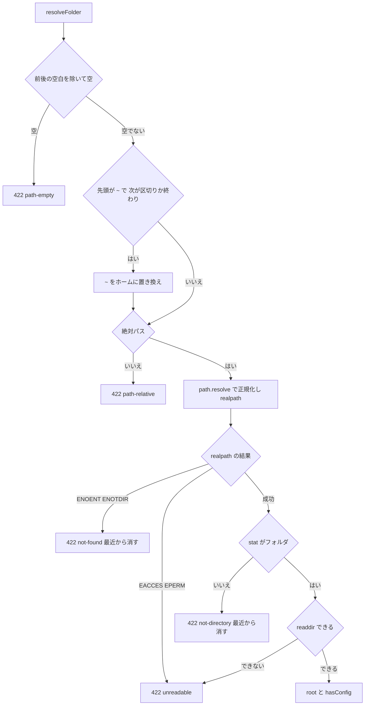
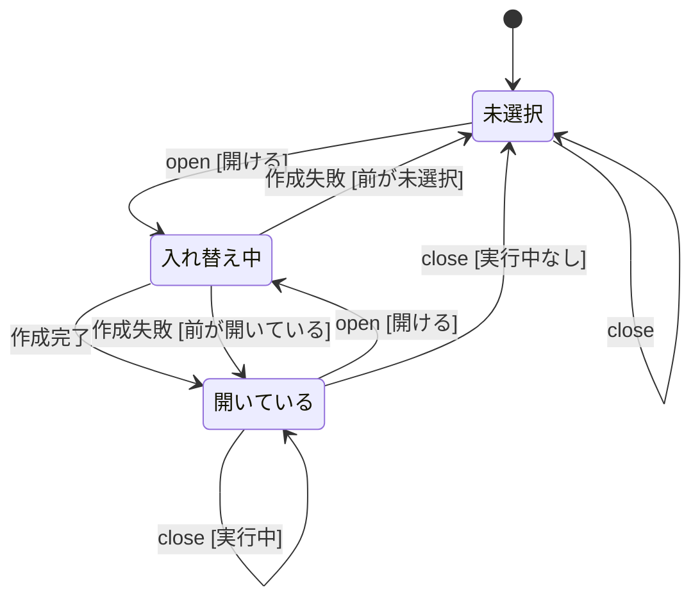
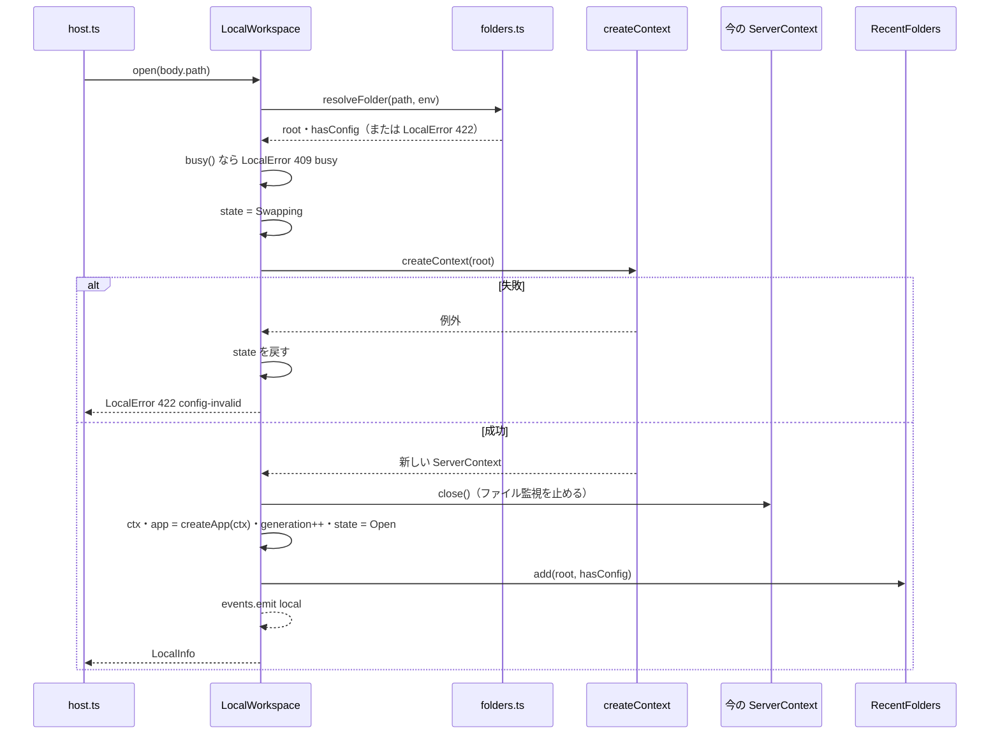
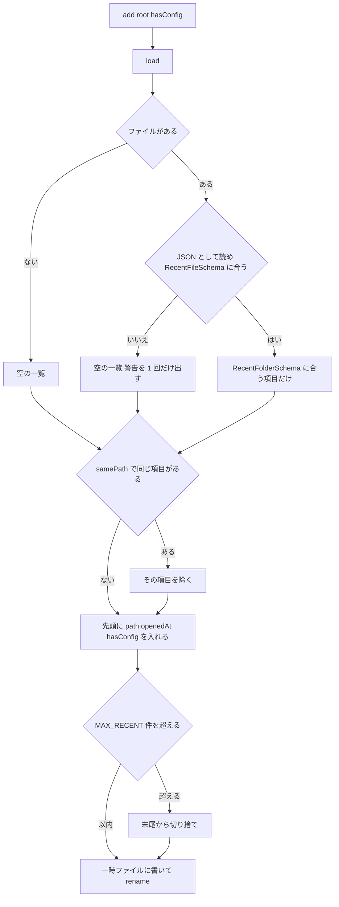
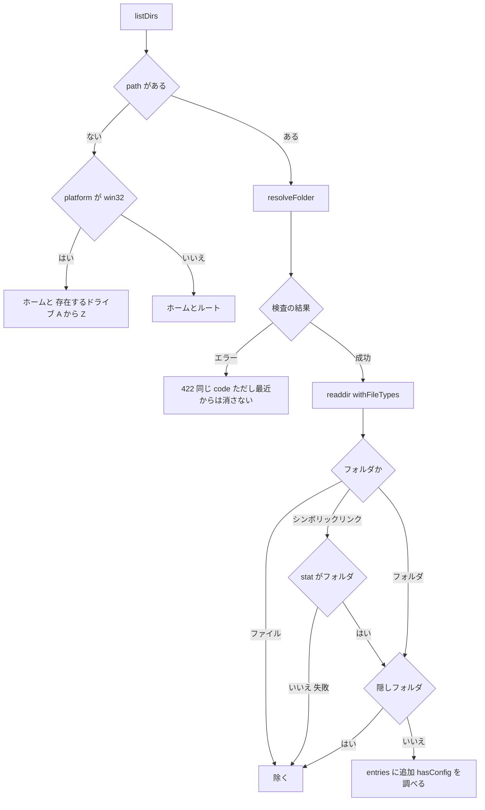
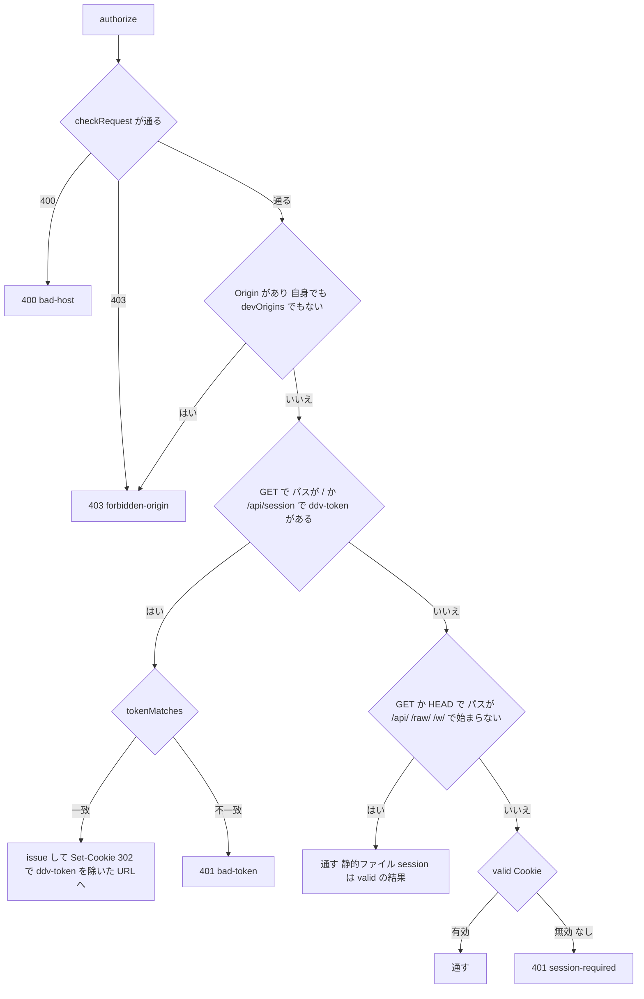
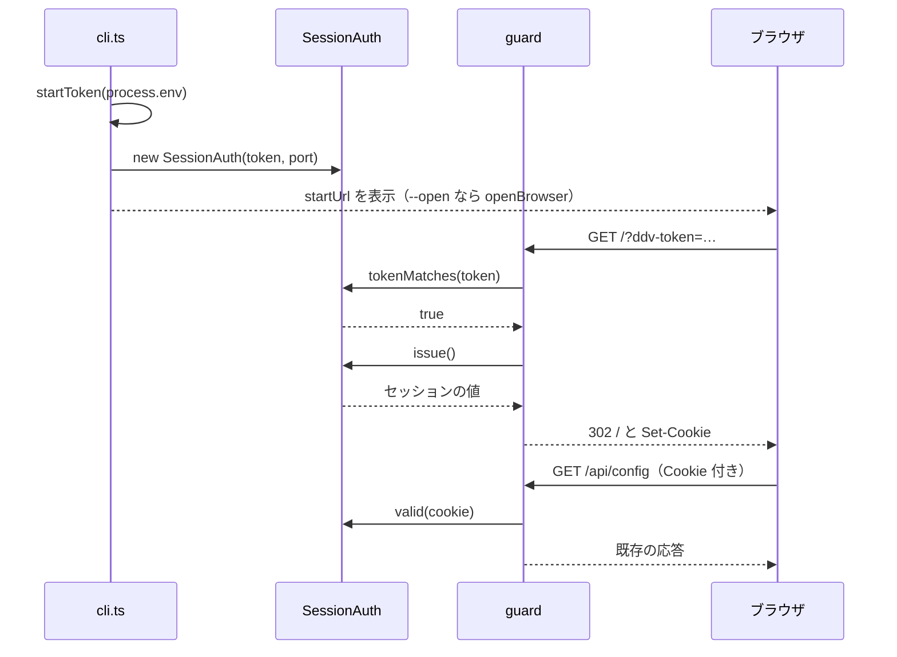
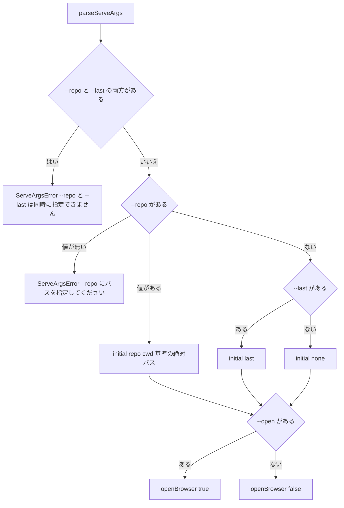

# 作業フォルダの選択・起動トークン 詳細設計

## 前提

- 画面遷移は :ref[../basic/local-folder.md#画面遷移]、開く・選び直すは :ref[../basic/local-folder.md#開く選び直す]、起動トークンは :ref[../basic/local-folder.md#起動トークン]、置き場所は :ref[../basic/local-folder.md#データ]、CLI は :ref[../basic/local-folder.md#設定と-cli] を参照
- 既存の Host / Origin 検査は :ref[workspace.md#要求の検査]、GitHub のワークスペースは :ref[workspace.md#api-のルーティング] のまま
- 実装：新規 `apps/server/src/local.ts`（`LocalWorkspace`）・`recent.ts`（`RecentFolders`）・`folders.ts`（`resolveFolder` / `listDirs`）・`serve-args.ts`（`parseServeArgs`）、既存 `guard.ts`（`SessionAuth` / `authorize` を追加）・`host.ts`・`cli.ts`。ビューアは新規 `apps/web/src/components/FolderPicker.tsx`・`TokenRequired.tsx`、既存 `App.tsx`・`main.tsx`・`api.ts`・`components/Workspace.tsx`
- `createContext` / `createApp` / `RunManager` は変えない（REQ-610）。`--repo` を付けて起動したときの画面・API の応答は従来と同じ。変わるのは、起動トークン付きの URL から開く必要があること（REQ-614）と、フォルダが無いときの応答（404 `no-local` → 409 `no-folder`）だけ

## 画面

画面遷移は :ref[../basic/local-folder.md#画面遷移]。「フォルダの選択」は `FolderPicker`（ハッシュ `#/folder`）、「文書」は従来の `Shell`。

::mock[local-folder/index.html]

### フォルダの選択

| 項目 | testid | 種類 | 型・桁 | 必須 | 初期値 | 取得元・送信先 | 入力チェック・エラー文言 |
|---|---|---|---|---|---|---|---|
| パス | `path` | テキスト | 文字列 400 | ○ | 空 | `POST /api/local/open` の `path`。一覧・最近開いたフォルダをクリックするとそのパスが入る | 前後の空白は除く。空：「パスを入力してください」（送信しない）。それ以外の検査はサーバ（[パスの検査](#パスの検査)） |
| 開く | `open` | ボタン | — | — | — | `POST /api/local/open` → 200 で `#/`（文書）へ。送信中は押せない | 422 / 409 の `error` を `open-error` に表示 |
| 開けない理由 | `open-error` | メッセージ | — | — | 非表示 | 422 / 409 の `error` | [エラーコード](#api) の文言。`removed: true` なら最近開いたフォルダを取り直す |
| 今の場所 | `dirs-current` | 表示 | 文字列 | — | `GET /api/local` の `root`、無ければ最近開いたフォルダの先頭の親、それも無ければ「ドライブ・ホーム」 | `GET /api/fs/dirs` の `path`（`null` のとき「ドライブ・ホーム」） | — |
| 上の階層へ | `dirs-up` | ボタン | — | — | — | `GET /api/fs/dirs?path=<parent>`。`parent` が `null` なら `path` 省略（ドライブ・ホーム） | 今の場所が「ドライブ・ホーム」のときは押せない |
| ドライブ・ホーム | `dirs-roots` | ボタン | — | — | — | `GET /api/fs/dirs`（`path` 省略） | — |
| フォルダの一覧 | `dirs` | 一覧 | 500 件 | — | — | `GET /api/fs/dirs` の `entries`。1 回クリックで `path` に入れてその中を一覧、ダブルクリックで開く。`hasConfig` は「ddv.config.yaml あり」の印 | `truncated: true` なら末尾に「500 件まで表示しています。パスを入力してください」 |
| 一覧の取得エラー | `dirs-error` | メッセージ | — | — | 非表示 | `GET /api/fs/dirs` の 422 の `error` | 一覧は直前の内容を残す |
| 最近開いたフォルダ | `recent` | 一覧 | 10 件 | — | — | `GET /api/local` の `recent`（パス・開いた日時 `M/D HH:mm`・`hasConfig` の印）。クリックで `path` に入れる、ダブルクリックで開く | — |
| 最近から消す | `recent-remove` | ボタン | — | — | — | `DELETE /api/local/recent { path }` → 応答の `recent` で一覧を置き換える | — |

- 画面の上部は従来の `TopBar`（`WorkspaceBar`）。手元のフォルダが無いときも「GitHub を開く…」はワークスペース切替から選べる（:ref[workspace.md#画面]）

### 文書（ヘッダ）

| 項目 | testid | 種類 | 型・桁 | 必須 | 初期値 | 取得元・送信先 | 入力チェック・エラー文言 |
|---|---|---|---|---|---|---|---|
| 開いているフォルダ | `local-root` | 表示 | 文字列 | — | — | `GET /api/local` の `root`（`title` にも同じ値）。手元のワークスペースのときだけ表示 | — |
| フォルダを選び直す | `reselect` | ボタン | — | — | — | `POST /api/local/close` → 200 で `#/folder` へ。手元のワークスペースのときだけ表示（GitHub のワークスペースでは出さない） | 409 `busy`：理由を `reselect-error` に表示して選び直さない |
| 選び直せない理由 | `reselect-error` | メッセージ | — | — | 非表示 | 409 の `error` | 「テストの実行中は選び直せません。完了してから選び直してください」ほか（[API](#api)）。5 秒後に消す |

- `busy`（モックの `select`）はモックだけの項目。実装では作らない

### セッション Cookie が無いとき

| 項目 | testid | 種類 | 型・桁 | 必須 | 初期値 | 取得元・送信先 | 入力チェック・エラー文言 |
|---|---|---|---|---|---|---|---|
| 案内 | `token-required` | 表示 | — | — | — | API を呼ばずに表示（[Cookie が無いときの画面](#cookie-が無いときの画面)） | 見出し「ddv serve が表示した URL から開いてください」、本文「サーバを起動し直したときは、新しく表示された URL を開いてください」 |

- 画面遷移図の外の画面（どの状態からも、セッションが無効になったら出る）。モックでは `data-screen="TokenRequired"` で確認用に置く

## 構造



- `LocalWorkspace` はサーバに 1 つ。`WorkspaceManager` とは別に持つ（手元のワークスペースは `WorkspaceManager` に入れない方針は :ref[workspace.md#構造] のまま）
- `LocalErrorCode`：`bad-request` / `path-empty` / `path-relative` / `not-found` / `not-directory` / `unreadable` / `config-invalid` / `busy` / `swapping` / `no-folder`
- `env`（`resolveFolder` / `listDirs` の引数）は `{ home: os.homedir(), platform: process.platform }`。テストで差し替える
- `generation` は開き直すたびに 1 増やす（ビューアの `AppProvider` の `key` に使う）

## パスの検査

`resolveFolder(input, env)`。`POST /api/local/open`・`GET /api/fs/dirs?path=`・`serve --repo`・`--last` で共通に使う。



- `~` は `os.homedir()`（`DDV_HOME` ではない）。`~user` の形は展開しない（絶対パスでないので `path-relative`）
- 相対パスはサーバ側では受け付けない（サーバのカレントに依存させない）。`serve --repo` の相対パスは CLI がカレント基準で絶対パスにしてから渡す（従来どおり）
- Windows の `C:` は `C:\` として扱う。UNC（`\\server\share`）は絶対パスとして扱う
- 正規化：`path.resolve`（`..`・末尾の区切りを除く）→ `fs.promises.realpath.native`（シンボリックリンク・ジャンクションを実体にし、Windows では大文字小文字を実際の名前にそろえる）
- `hasConfig`：`root` 直下に `CONFIG_FILES`（`ddv.config.yaml` / `.yml` / `.json`）のいずれかがある
- 「最近から消す」：入力のパス（`~` 展開・`path.resolve` 後）と `samePath` で一致する項目を `RecentFolders.remove` で消し、応答に `removed: true` を付ける。`unreadable` は消さない（ネットワークドライブの一時的な切断・権限の変更で消えないように）
- `samePath(a, b)`：Windows（`env.platform === 'win32'`）は大文字小文字を区別しない、他は区別する

| code | 文言（`error` / `message`） |
|---|---|
| `path-empty` | パスを入力してください |
| `path-relative` | 絶対パスで指定してください（例 C:\Users\taro\source\order-app、~/source/order-app） |
| `not-found` | フォルダが見つかりません: `<パス>` |
| `not-directory` | フォルダではありません: `<パス>` |
| `unreadable` | フォルダを読めません（権限を確認してください）: `<パス>` |
| `config-invalid` | ddv.config.yaml を読み込めません: `<loadConfig のメッセージ>` |

## 作業フォルダの状態

`LocalWorkspace` の状態。`open(input)`・`close()` は直列に実行する（`Swapping` の間の要求は下の不正遷移の扱い）。



| 遷移 | 応答・副作用 |
|---|---|
| open [開けない] | 422（[パスの検査](#パスの検査)）。状態・今のフォルダは変えない |
| open [実行中] / close [実行中] | 409 `{ code: 'busy', kind }`。文言は `test`「テストの実行中は選び直せません。完了してから選び直してください」、`snapshot`「スナップショットの撮影中は選び直せません。完了してから選び直してください」、`deps`「依存の導入中は選び直せません。完了してから選び直してください」 |
| open [同じフォルダ] | `samePath(root, ctx.repoRoot)` なら作り直さない。最近開いたフォルダの先頭へ移して 200。SSE は送らない |
| open [開ける] → 作成完了 | [ServerContext の作り直し](#servercontext-の作り直し)。200 `{ root, repoName, hasConfig }` |
| 作成失敗 | `createContext` の例外（主に `loadConfig` の検証エラー）は 422 `config-invalid`。前の `ctx` はそのまま（閉じていない）。最近開いたフォルダは更新しない |
| close [実行中なし] | `ctx.close()`、`ctx = null`・`app = null`、`generation++`、`events` に `local`。200 `{ ok: true }` |
| close（未選択） | 何もせず 200 `{ ok: true }` |

- 「実行中」は `busy()`：`ctx.runs.active` または `ctx.runs.rerunSession` があれば `test`、`ctx.runs.activeTask('snapshot')` があれば `snapshot`、`ctx.runs.activeTask('deps')` があれば `deps`（この順）
- 不正遷移：`Swapping` の間の `open` / `close` は 409 `{ code: 'swapping', error: 'フォルダを開いています。しばらく待ってからもう一度操作してください' }`。`Swapping` の間の手元の API（`fetch`）も同じ 409（入れ替えの途中に古いフォルダで実行が始まらないように）

## ServerContext の作り直し



- 新しい `ServerContext` を作ってから古いものを閉じる（作成に失敗しても今のフォルダで続けられる。基本設計の「閉じてから作成」と結果は同じ）
- 古い `ServerContext` の `RunManager` は止める処理を持たない（`busy()` で実行中が無いことを確かめてから入れ替えるため）。購読は host の `/api/events` が外す（下）
- `RecentFolders.add` の失敗（書き込めない）はログ `[ddv] 最近開いたフォルダを保存できません: …` を出して続ける（開くことは成功させる）
- GitHub のワークスペース・保留中レビューは触らない

### ルーティング（host.ts）

`createServerApp` の `ServerAppOptions.local` を `ServerContext` から `LocalWorkspace` に変える。`auth?: SessionAuth` を追加する（無ければ起動トークンの検査をしない。単体テスト用）。

| 順 | パス | 処理 |
|---|---|---|
| 1 | `*` | `guard({ port, devOrigins, auth })`（[要求の検査](#要求の検査)） |
| 2 | `/api/local*`・`/api/fs/dirs` | `LocalWorkspace` / `listDirs`（[API](#api)） |
| 3 | `/api/github/*`・`/api/workspaces*`・`/api/w/*`・`/w/:ws/raw/*` | 従来どおり。`GET /api/workspaces` の `local` は `LocalWorkspace.ctx !== null` |
| 4 | `GET /api/events` | host が持つ SSE（下）。未選択でもつながる |
| 5 | `/api/*`・`GET /raw/*` | `LocalWorkspace.fetch(req)`：`Open` なら `createApp(ctx)` へ、`Empty` は 409 `{ code: 'no-folder', error: 'フォルダが開かれていません' }`、`Swapping` は 409 `swapping` |
| 6 | その他の `GET` | ビューアの静的ファイル（[Cookie が無いときの画面](#cookie-が無いときの画面)） |

### SSE（`/api/events`）

host の `/api/events` は、接続中に `LocalWorkspace.events` の `local` を受けるたび、今の `ctx.events` / `ctx.runs` への購読を付け替える（`createApp` の `/api/events` と同じ `change`・`run`・`run-end` を中継する）。GitHub のワークスペースの `/api/w/<id>/events` は従来どおり。

| SSE | data | 送る時 |
|---|---|---|
| `hello`（既存） | `{}` | 接続時 |
| `local`（追加） | `{ root: string or null, repoName: string or null, generation: number }` | 入れ替えの完了・`close` の後（同じフォルダの `open` では送らない） |
| `change` / `run` / `run-end`（既存） | 従来どおり | 開いているフォルダのもの。未選択の間は送らない |

- ビューア：`local` を受けたら `WorkspaceProvider.reload()`。今が手元のワークスペースの画面なら、`root` があれば `AppProvider` の `key` を `local@<generation>` にして開き直し、`null` なら `#/folder` へ（別のタブも追従する）

## 最近開いたフォルダ

`RecentFolders`。ファイルは `<DDV_HOME>/recent.json`（`DDV_HOME` 既定 `~/.ddv`。`cli.ts` の `ddvHome()`）。

```ts
export const RecentFolderSchema = z.object({
  path: z.string().min(1),
  openedAt: z.string().datetime(),
  hasConfig: z.boolean(),
});
export const RecentFileSchema = z.object({
  version: z.literal(1),
  folders: z.array(z.unknown()),
});
export const MAX_RECENT = 10;
```



- 重複は先頭へ移す（`openedAt`・`hasConfig`・パスの表記は今回の値に置き換える）
- 壊れたファイル：読み込みは空として扱い `[ddv] 最近開いたフォルダ（recent.json）を読めません。作り直します` を出す。次の `add` / `remove` で上書きする（壊れた内容は残さない）
- `remove(path)`：`samePath` で一致する項目を除いて保存。無ければ書き込まない
- 書き込みは `WorkspaceStore.save` と同じく一時ファイル → `rename`。`DDV_HOME` が無ければ作る

## フォルダの一覧

`listDirs(input, env)`（`GET /api/fs/dirs`）。ファイルの中身・ファイル名は返さない。



- ドライブ：`A:\`〜`Z:\` を `fs.promises.access` で並行に確かめ、各 500 ms で打ち切る（切断されたネットワークドライブで止まらない）。`kind: 'drive'`、`name` は `C:`
- ホーム：`os.homedir()`、`kind: 'home'`、`name` は「ホーム」。POSIX の `/` は `kind: 'drive'`、`name` は `/`
- 隠しフォルダ：名前が `.` か `$` で始まるもの、`System Volume Information`
- 並び：`name` の `localeCompare(…, 'ja', { numeric: true, sensitivity: 'base' })`
- 件数上限：`MAX_DIR_ENTRIES = 500`。超えたら 500 件で切り `truncated: true`（`hasConfig` は返す 500 件だけ調べる）
- 一覧の中の読めないフォルダもそのまま返す（開く・一覧を取るときに `unreadable` になる）
- `parent`：`path.dirname(path)`。ドライブ・`/` の直下（`dirname` が自分と同じ）なら `null`（ビューアは「ドライブ・ホーム」へ戻る）
- 一覧のエラーでは最近開いたフォルダを消さない（消すのは `open` のときだけ）

## 要求の検査

`guard.ts` の `authorize(req, opts)`。`GuardOptions` に `auth?: SessionAuth` を加え、`guard(opts)` は `auth` があるときこの関数を使う（無いときは従来の `checkRequest` だけ）。`checkRequest` は変えない（:ref[workspace.md#要求の検査] のテストはそのまま通る）。



| 判定 | 規則 |
|---|---|
| `checkRequest` | 既存のまま：Host が `127.0.0.1` / `localhost` / `[::1]` と待ち受けのポート（または `devOrigins` の Host）、変更系は Origin / `Sec-Fetch-Site` |
| Origin（全メソッド） | `Origin` ヘッダがあれば、`http://<Host>` か `devOrigins` のどれかと一致すること（末尾 `/` を除き小文字で比較）。`Origin: null` も拒否。GET・SSE の他サイトからの読み取りを拒否するため |
| 開始 URL | `GET /?ddv-token=…` と `GET /api/session?ddv-token=…`（`--dev-origin` のとき Vite の proxy 経由で Cookie を発行するため） |
| `tokenMatches(given)` | `crypto.timingSafeEqual(sha256(given), tokenHash)`（長さの違いも時間に出さない） |
| 302 | `Location` は `/` に `ddv-token` 以外のクエリを付けたもの（ハッシュはブラウザが引き継ぐ）。`Cache-Control: no-store`・`Referrer-Policy: no-referrer` |
| 静的ファイル | `GET` / `HEAD` で `/api/`・`/raw/`・`/w/` 以外。ビューアの `index.html`・`assets/*` |
| エラーの応答 | 400 / 403 は従来の JSON `{ error, code }`。401 は `/api/*`・`/raw/*`・`/w/*` なら JSON `{ error: 'ddv serve が表示した URL から開いてください', code }`、開始 URL の `bad-token` は案内画面の `index.html`（下）を 401 で返す |
| `auth` なし | 開始 URL・Cookie の判定をしない（`createServerApp` の単体テスト・従来の呼び出し） |

### 起動トークンとセッション Cookie



| 項目 | 規則 |
|---|---|
| 起動トークン | `crypto.randomBytes(32).toString('base64url')`（43 文字）。起動ごと・メモリだけ。`SessionAuth` は `sha256` した値だけを持つ |
| 表示 | `[ddv] http://127.0.0.1:5179/?ddv-token=<43 文字>`。`--dev-origin` があれば `[ddv] 開発: <dev-origin>/api/session?ddv-token=…` も出す。ログ以外（ファイル・`recent.json`）には書かない |
| `DDV_TOKEN`（テスト用） | 設定されていれば起動トークンをその値に固定する。`^[A-Za-z0-9_-]{16,128}$` に合わなければ起動エラー（終了コード 2「DDV_TOKEN は 16〜128 文字の英数字・-・_ で指定してください」）。起動時に `[ddv] 警告: DDV_TOKEN の固定トークンを使います（テスト用）` |
| セッションの値 | 起動トークンとは別の値：`issue()` ごとに `randomBytes(32).toString('base64url')`。`sessions` に入れる（上限 100。超えたら古いものから消す）。URL に出たトークンが漏れても Cookie の値は分からず、Cookie からトークンも分からない |
| Cookie | `ddv-session-<port>=<値>; Path=/; HttpOnly; SameSite=Strict`。`Max-Age` なし（ブラウザを閉じるまで）、`Secure` なし（http）、`Domain` なし。名前にポートを入れるのは、Cookie はポートで分かれないため（同じ PC で複数の `ddv serve` を動かす・E2E で別のポートを使う） |
| `valid(cookieHeader)` | `Cookie` ヘッダから `cookieName` の値を取り、`sessions.has(値)` |

- 他のサイトのリンクから開いた直後は `SameSite=Strict` の Cookie が送られず案内画面になることがある。その場合も表示された URL を開き直せば使える（再読み込みでも同じ）

### Cookie が無いときの画面

`HttpOnly` の Cookie はスクリプトから読めないため、サーバが `index.html` に印を入れる。

- host の静的ファイルの処理：`index.html` を返すとき、`authorize` の結果が `session: false` なら `<head>` の直後に `<meta name="ddv-auth" content="required">` を入れる。`index.html` には常に `Cache-Control: no-store` を付ける（印の有無が古いまま残らないように）。`assets/*` はそのまま
- `main.tsx`：`document.querySelector('meta[name="ddv-auth"]')` があれば `<TokenRequired />` だけを描画し、`App`（`WorkspaceProvider` の `GET /api/workspaces` など）を描画しない＝ API を呼ばない
- `api.ts` の `json()`：401 `session-required` / `bad-token` を受けたら `window` に `ddv-session-required` を送り、`App` は `<TokenRequired />` に切り替える（サーバを起動し直したタブ）。`EventSource` の `error` で切れたときは `GET /api/workspaces` を 1 回呼んで 401 かどうかで判断する
- Pages 版のビルドでは印が入らない（Pages 版は `index.html` を GitHub Pages が返す。:ref[../basic/hosted-viewer.md#デプロイとセルフホスト]）

## CLI

`serve-args.ts` の `parseServeArgs(argv, cwd)`。既存の `--github` / `--pr` / `--ref` / `--port` / `--host` / `--dev-origin` の解析もここへ移す（動作は変えない）。



- `ServeArgsError` は従来の `OpenRequestError` と同じく、メッセージと HELP を出して終了コード 2
- `--github` は `initial` のどれとも組み合わせられる（`--repo` が無いときは手元のフォルダが未選択のまま、GitHub のワークスペースを開く）

| `initial` | 起動時の処理 |
|---|---|
| `repo` | `resolveFolder` → `LocalWorkspace.open`。開けなければ従来どおり起動エラー（終了コード 1、`not-found` は従来の文言「リポジトリが見つかりません: <path>」）。最近開いたフォルダにも入る |
| `last` | `RecentFolders.load()` の先頭を `open`。一覧が空なら `[ddv] 最近開いたフォルダがありません`、開けなければ `[ddv] 前回のフォルダを開けません: <path>（<理由>）` を出して未選択のまま起動する（消す条件は [パスの検査](#パスの検査) と同じ） |
| `none` | 未選択のまま起動する（ビューアは `#/folder`）。従来の「カレントを開く」は `--repo .` で行う（REQ-613） |

- 開く URL のハッシュ：GitHub のワークスペースを開いたときは従来どおり `#/w/<id>/doc`、未選択なら `#/folder`、それ以外は無し。`startUrl` は `http://<host>:<port>/?ddv-token=<token><ハッシュ>`
- `openBrowser(url)`：`win32` は `spawn('cmd', ['/c', 'start', '""', url])`（URL は base64url とハッシュだけなので `cmd` の特殊文字を含まない）、`darwin` は `open`、他は `xdg-open`。`detached: true`・`stdio: 'ignore'`・`unref()`。起動に失敗したら `[ddv] ブラウザを開けません。上の URL を開いてください` を出してサーバは続ける。追加の依存は使わない
- HELP の `serve` の行を `ddv serve [--repo <path> | --last] [--open] [--port <n>] …` にし、「--repo 省略時はフォルダの選択から始めます」「起動時に表示する URL（起動トークン付き）から開いてください」を加える。環境変数に `DDV_TOKEN`（テスト用）を加える

## API

| メソッド | パス | 要求 | 応答 |
|---|---|---|---|
| GET | `/api/local` | — | 200 `LocalInfo`：`{ state, root, repoName, hasConfig, busy, recent: [{ path, openedAt, hasConfig }] }`（未選択は `root`・`repoName` が `null`） |
| POST | `/api/local/open` | `{ path: string }` | 200 `{ root, repoName, hasConfig }`。400 `bad-request`（JSON でない・`path` が文字列でない）。422 `path-empty` / `path-relative` / `not-found` / `not-directory` / `unreadable` / `config-invalid`（`removed: boolean`）。409 `busy`（`kind`）/ `swapping` |
| POST | `/api/local/close` | — | 200 `{ ok: true }`。409 `busy`（`kind`）/ `swapping` |
| DELETE | `/api/local/recent` | `{ path: string }` | 200 `{ recent }`（無いパスでも 200）。400 `bad-request` |
| GET | `/api/fs/dirs` | `?path=`（省略可） | 200 `DirList`：`{ path, parent, entries: [{ name, path, kind, hasConfig }], truncated }`。422 `path-relative` / `not-found` / `not-directory` / `unreadable`（`removed` は付けない） |
| GET | `/` ・ `/api/session` | `?ddv-token=` | 302 `Set-Cookie`。401 `bad-token`（[要求の検査](#要求の検査)） |
| すべて | 手元のワークスペースの既存 API（`/api/config` など）・`/raw/*` | 従来どおり | 未選択は 409 `{ code: 'no-folder', error: 'フォルダが開かれていません' }`、入れ替え中は 409 `swapping`。開いていれば従来どおり |

- エラーの形は `{ error, code, message }`（`message` は `error` と同じ。`host.ts` の `OpenRequestError` と同じ形）
- `POST /api/local/close` は基本設計の API 表に無いが、「フォルダを選び直す [実行中なし]：今のフォルダを閉じる」（:ref[../basic/local-folder.md#画面遷移]）を行うために置く
- `/api/local*`・`/api/fs/dirs` も `guard` の対象（Cookie が必要）。フォルダの一覧は他のサイトから読めない
- GitHub のワークスペースの `/api/w/<id>/*` は変えない

## 既存のテスト・E2E への影響

起動トークンの検査は CLI が `SessionAuth` を渡したときだけ有効にする。単体テストは `createServerApp` を `auth` なしで作り、E2E はテスト用の `DDV_TOKEN` で固定のトークンを与える。

| ファイル | 変更 |
|---|---|
| `apps/server/src/guard.test.ts` | 既存の `checkRequest`（`DD-WSPACE-GUARD-*`）はそのまま。`authorize`・`SessionAuth`・`startToken` のテスト（`DD-LOCALF-AUTH-*`）を追加 |
| `apps/server/src/host.test.ts` | `setup` の `local` を `new LocalWorkspace({ recent, createContext, initial: ctx })` に。「手元のワークスペースが無いとき既存の API は 404 no-local」を 409 `no-folder` に、「未知の `/api/*` は JSON の 404」の `local: false` の場合を 409 `no-folder`（JSON）に変える。`auth` を渡す場合のテストを追加（Cookie なしの `/api/config` が 401、静的ファイルは 200、`index.html` に印） |
| `apps/server/src/server.test.ts` | 影響なし（`createApp` を直接使う） |
| `playwright.config.ts` | `webServer.env` に `DDV_TOKEN`（`e2e/ddv-auth.ts` の `E2E_TOKEN`）と `DDV_HOME: 'test-results/ddv-home'`（利用者の `~/.ddv/recent.json` を汚さない）。`webServer.url` を `/` に（`/api/config` は Cookie が要る）。`projects` を `setup`（`e2e/auth.setup.ts`：`request.get('/?ddv-token=…', { maxRedirects: 0 })` → `request.storageState({ path: 'test-results/.auth/ddv.json' })`）と既存（`dependencies: ['setup']`・`use.storageState`）に分ける |
| `e2e/ddv-auth.ts`（新規） | `E2E_TOKEN`（`ddv-e2e-0123456789abcdef`）、`startUrl(base)`、`login(page, base)`（`page.request.get(startUrl(base))`。`page.request` はブラウザのコンテキストと Cookie を共有する） |
| `e2e/github.spec.ts`・`github-review.spec.ts`・`test-data-editor.spec.ts` | 自前で起動する `ddv serve` の `env` に `DDV_TOKEN`、起動待ちの `fetch(/api/config)` を `fetch('/')` に、`beforeEach` で `login(page, BASE)`。`page.evaluate` 内の `fetch` は同じオリジンなので Cookie が付く |
| `e2e/test-monitoring.spec.ts` | 変更なし（`request` フィクスチャは `use.storageState` の Cookie を使う） |
| `e2e/ddv-scenarios.spec.ts` | 変更しない（固定）。`DDV_BASE_URL` が無ければモックを静的配信で再生するので影響なし。実アプリに向けるときは `storageState` の Cookie が使われる |
| `apps/web/vite.config.ts` | 変更なし（`/api` の proxy で `/api/session` も通る） |

- `DDV_TOKEN` は本番でも効くが、固定値を知る者だけが使える点は乱数のトークンと同じ。起動時の警告で気付けるようにする（ヘッダでトークンを渡すなどの別の抜け道は作らない）
- `--repo` を付けた E2E の画面・API の応答は従来と同じ（REQ-610）。`ddv serve` の引数無し（カレントを開く）を使っている E2E は無い
