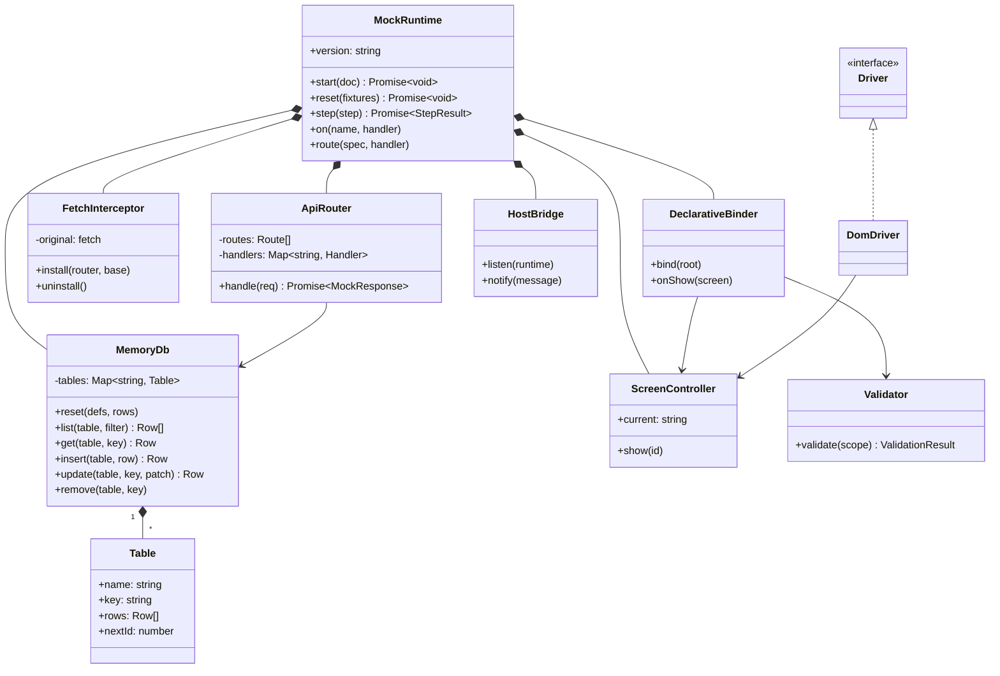
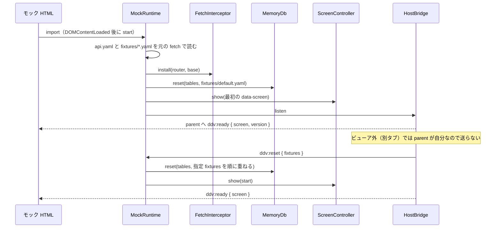
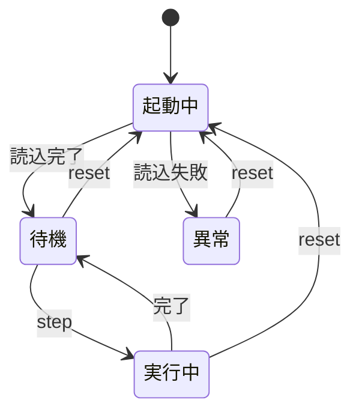
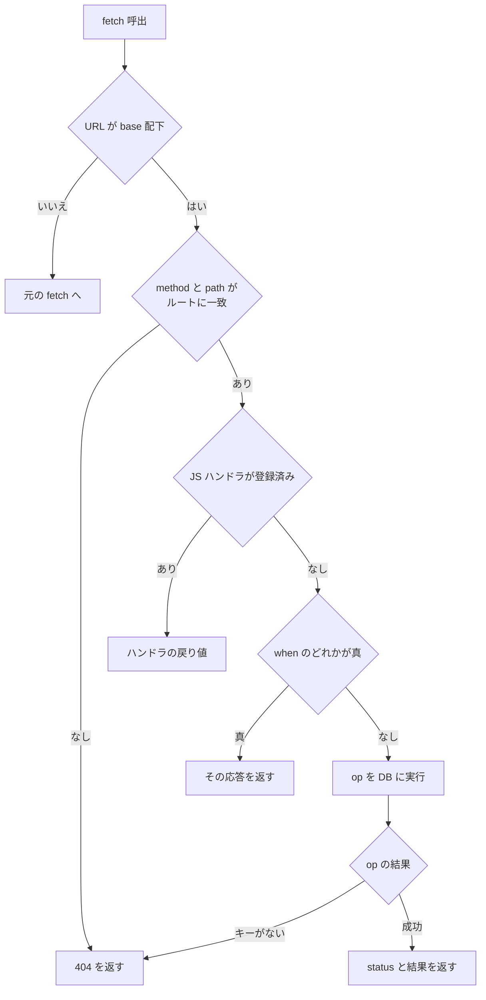
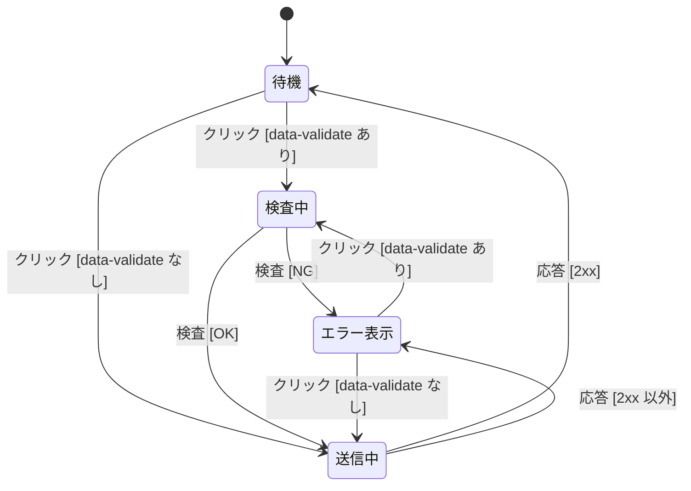
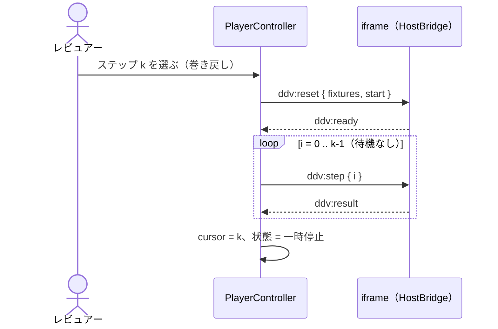

# モック runtime・プレイヤー連携 詳細設計

## 前提

- 属性・疑似 API の規約は :ref[../basic/mock-player.md#モック-html-の属性] と :ref[../basic/mock-player.md#疑似apiapiyaml]、プレイヤーの状態は :ref[../basic/mock-player.md#プレイヤー] を参照
- runtime は新パッケージ `packages/mock-runtime`。Vite のライブラリモードで依存込みの単一 ES モジュール `dist/mock-runtime.js` にし、`ddv mock init` が `<mocksRoot>/_ddv/` へコピーする。先頭に版を書き、lint で ddv の版と比べる
- ステップ解釈は `@ddv/mock/step` の `executeStep` を同梱して使う（:ref[scenario.md#ステップ解釈]）

## 構造

- ページから使う口は `window.__ddv`（`MockRuntime` のインスタンス）。`mock.js` は `import { mock } from '../_ddv/mock-runtime.js'` で `on` / `route` を使う
- `api.yaml` の `tables` は文字列（キー `id`）または `{ name, key }`。`insert` でキーが無ければ `nextId` を採番する

## 起動とリセット

## プロトコル（postMessage）

| 方向 | type | 内容 |
|---|---|---|
| ビューア → iframe | `ddv:reset` | `{ fixtures: string[], start?: string }` |
| ビューア → iframe | `ddv:step` | `{ index, step, highlight?: { holdMs } }`（`highlight` ありなら操作要素を枠で示す） |
| iframe → ビューア | `ddv:ready` | `{ screen, version }` |
| iframe → ビューア | `ddv:result` | `{ index, ok, screen, failures: { key, expected, actual }[] }` |
| iframe → ビューア | `ddv:screen` | `{ screen }`（人が直接操作して画面が変わったとき） |
| iframe → ビューア | `ddv:error` | `{ message }`（api.yaml の形式違反など） |

- 受信側は `event.origin === location.origin` と `event.source` を確認し、それ以外は無視する

- 起動中・異常の `step` は実行せず `ddv:result { ok: false }`（理由付き）を返す。実行中の `step` は待ち行列に入れて順に実行する
- 実行中の `reset` は実行中のステップを破棄する（結果は送らない）

## 疑似 API

- `base` は `api.yaml` の `base`（既定 `/api`）。path の `:name` はパラメータ
- `when.if` は安全な式評価器 `evalCondition` で評価する（`eval` は使わない）。使えるのは、参照（`body.x` / `params.x` / `query.x` / `<表>[式].列`）、比較（`== != < <= > >=`）、`&& || !`、数値・文字列・真偽値。評価できない式は `ddv:error` を送り、偽として扱う
- 応答に遅延は付けない（決定的にする）。遅延を確認したいときは `mock.route` で書く

## 宣言属性

`data-submit` のボタンを押したときの振る舞い。`data-goto` は検査なしで `show` する。

- 応答 2xx は `data-ok` の画面へ、それ以外は `data-ng` があればその画面へ、なければ画面に留まり `data-error` の要素に応答の `message` を表示する
- 送信中の再クリックは無視する。送信内容は画面内の `data-testid` 付き入力要素を `{ キー: 値 }` にしたもの
- `data-bind` は `show` のたびに GET し直す（DB の変化を反映）。`template` 内の `{{列}}` はテキストとして置換する（HTML は解釈しない）

## プレイヤー（ビューア側）

`PlayerController`（`apps/web/src/player.ts`）が状態を持ち、`MockFrame` が表示する。状態と遷移は :ref[../basic/mock-player.md#プレイヤー] の図のとおり。

- 速度は 1 ステップごとの待機 = 1000ms ÷ 倍率（0.25× = 4000、0.5× = 2000、0.75× = 1333、1× = 1000、1.5× = 667、2× = 500、4× = 250、最速 = 0）
- 応答待ちの上限は 10 秒（ハイライト時は＋保持時間 ×（入力キー数＋クリック 1））。超えたら失敗（理由「モックが応答しません」）にする
- ハイライト：オンのとき、再生・1 ステップの `ddv:step` に `highlight: { holdMs }` を付ける（holdMs = 400ms ÷ 倍率、最速 = 0）。巻き戻しの即時再実行では付けない
- runtime（`DomDriver`）は `fill` / `click` の前に対象要素へ `data-ddv-highlight` を付けて `holdMs` 待ち、操作後に外す。見た目は runtime が注入するスタイル（`outline: 3px solid #f59e0b`）。`expect` の確認対象は強調しない
- 再生中の遷移の強調は、シナリオ取得時の `transitions[i]` の辺番号を `DiagramBlock` の強調に渡す
