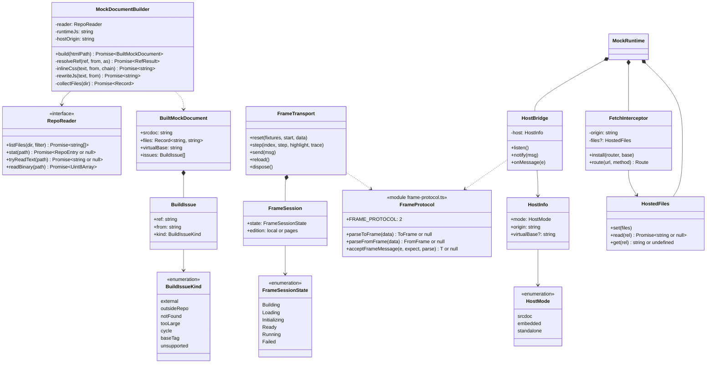
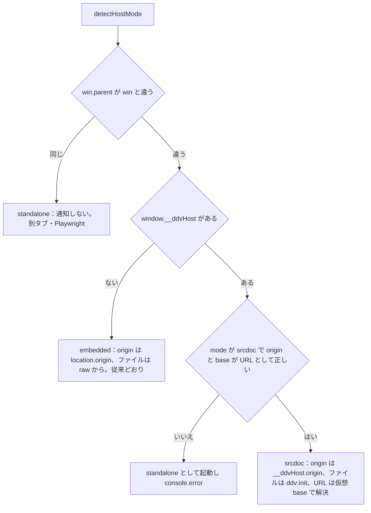
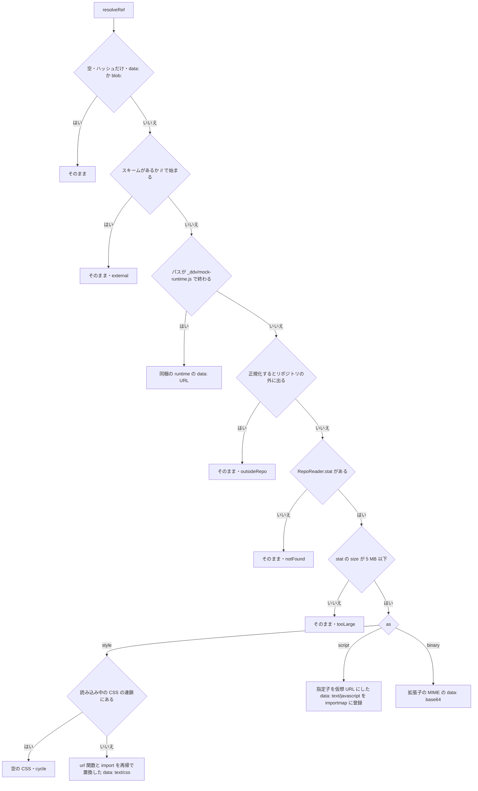
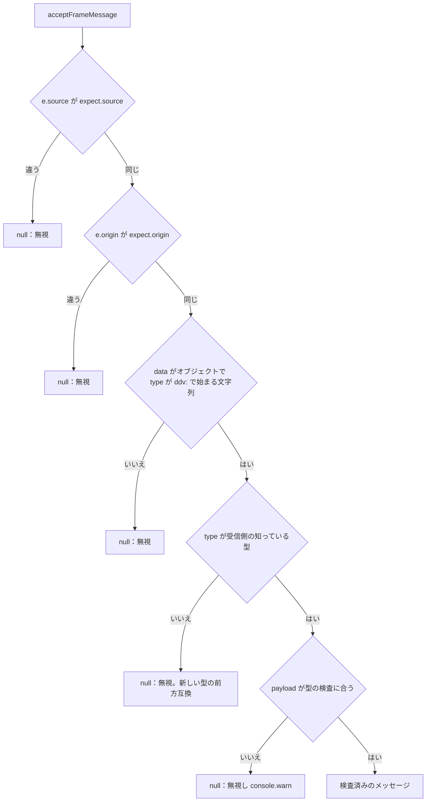
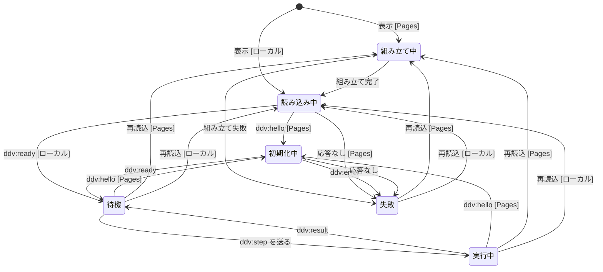
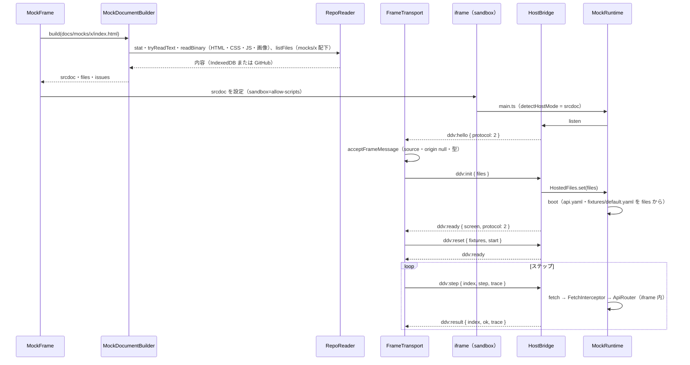
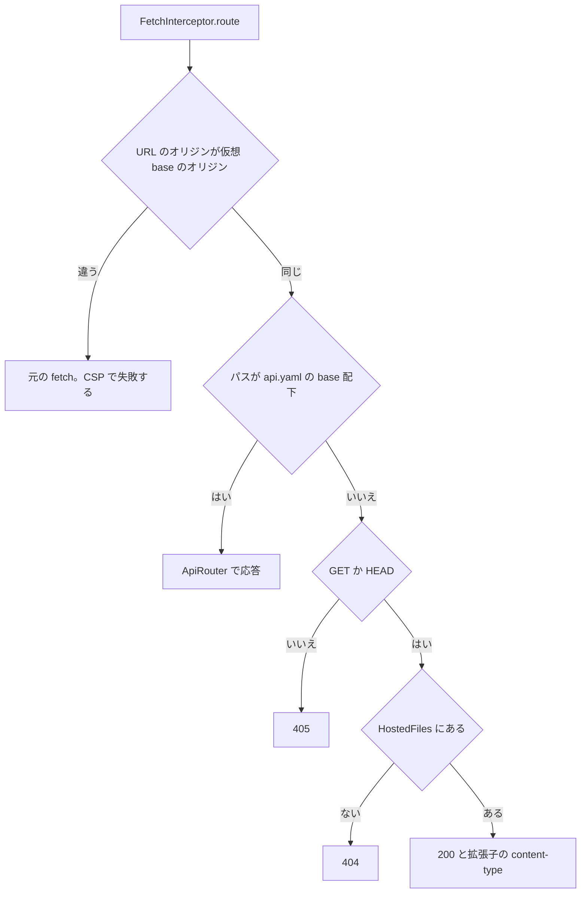

# Pages 版のモック再生（sandbox iframe・postMessage）詳細設計

## 前提

- 方針は :ref[../basic/hosted-viewer.md#モックの再生]、ファイルの取得は :ref[../basic/hosted-viewer.md#内容の取得]、CSP は :ref[../basic/hosted-viewer.md#pat-の扱い]、使えない操作は :ref[../basic/hosted-viewer.md#操作の可否] を参照
- 既存の runtime・プロトコルは :ref[mock-runtime.md#プロトコルpostmessage]、プレイヤーは :ref[mock-runtime.md#プレイヤービューア側]、調整モードは :ref[mock-tune.md#プロトコル]・:ref[mock-tune.md#要素のパス]、ライブ表示は :ref[trace-recorder.md#ライブ表示のための追加プロトコル] を参照
- `RepoReader`・`PagesBackend` は [services.md](services.md)、`GitHubRepoReader` の取得とキャッシュは [pages-viewer.md](pages-viewer.md) を参照
- 実装：`packages/mock/src/frame-protocol.ts`（新設。両側で共有）、`packages/mock-runtime/src/host.ts`（新設）・`bridge.ts`・`fetch.ts`・`runtime.ts`・`main.ts`、`apps/web/src/mockDocument.ts`（新設）・`player.ts`・`components/MockFrame.tsx`
- 画面は既存のプレイヤーのまま。Pages 版で増える表示は [読み込めない参照の表示](#読み込めない参照の表示) だけ

## 現状（Phase 5 までの親子の通信）

| 経路 | 向き | 手段 | 実装 | 同一オリジンを前提にする点 |
|---|---|---|---|---|
| モックの HTML の読み込み | ビューア → iframe | `<iframe src>`（`sandbox` なし） | `MockFrame.tsx`（`rawUrl('/raw/<mocksRoot>/<target>')`） | 親と同じオリジンで動く |
| CSS・画像・`mock.js`・`_ddv/mock-runtime.js` | iframe → サーバ | HTML の相対パス → `GET /raw/*` | `apps/server/src/app.ts`（`safeJoin` でリポジトリ内のみ） | サーバが必要 |
| `api.yaml`・`fixtures/*.yaml` | iframe → サーバ | `fetch`（`doc.baseURI` からの相対） | `MockRuntime.fetchFile` | サーバが必要 |
| 疑似 API | iframe 内 | `window.fetch` の差し替え → `ApiRouter` | `FetchInterceptor.install`（`url.origin === location.origin` かつ `base` 配下） | `location.href` で URL を解決 |
| プレイヤー ⇄ runtime | 双方向 | `postMessage`（`ddv:reset`・`ddv:step` ／ `ddv:ready`・`ddv:result`・`ddv:screen`・`ddv:error`） | `createFrameTransport`（`player.ts`）⇄ `HostBridge`（`bridge.ts`） | 送信の `targetOrigin` と受信の `event.origin` の検査が `location.origin` |
| 調整モード | 双方向 | `postMessage`（`ddv:tune`・`ddv:patch` ／ `ddv:picked`） | `TunePanel` → `FrameTransport.send` ⇄ `Tuner` | 同上。ソースとの対応は親が `api.mockSource`（サーバ） |
| ライブ表示 | 双方向 | `ddv:step { trace: true }` → `ddv:result.trace` | `PlayerController.liveTrace`・`LiveTracePanel` ⇄ `TraceTap` | 同上 |
| テストデータの編集中の再生 | ビューア → iframe | `ddv:reset { data }` | `MockFrame`（`mockHub` の `preview`）→ `PlayerController.playDraft` | 同上 |
| 図の強調・マトリクスの ▶ | ビューア内 | React の context | `mockHub.tsx` | なし（iframe と無関係） |
| スナップショット撮影・E2E のトレース | Playwright → ページ | `window.__ddv` を直接呼ぶ（モックを最上位のページとして開く） | `packages/mock/src/run-scenario.ts` | 親子の通信ではない |
| 別タブ | ビューア → 新しいタブ | `<a href="/raw/...">` | `MockFrame.tsx` | サーバが必要 |

- ビューアは `contentWindow.__ddv` などを直接参照していない。**親子の通信は既に `postMessage` だけ** で、同一オリジンに依存するのは「オリジンの検査」「ファイルの取得（`/raw/`）」「URL の解決（`location`）」の 3 点
- スナップショット撮影は Playwright が `window.__ddv` を使う（最上位のページ）。Pages 版では Actions で同じ方法で撮る（[actions-run.md](actions-run.md)）ので、本書の対象外

## 構造



- `frame-protocol.ts` は `@ddv/mock/frame-protocol` として runtime にも同梱する（`vite.config.ts` の `alias` に追加。`@ddv/mock/step` と同じ扱い）
- `MockFrame` は版（`import.meta.env` の `DDV_EDITION`）で読み込み方だけを変える。プレイヤー・調整・ライブ表示の部品は版で分岐しない

## 読み込み経路の選択

| 項目 | ローカル版（従来どおり） | Pages 版 |
|---|---|---|
| iframe | `src="/raw/<mocksRoot>/<target>"` | `srcdoc`＝`BuiltMockDocument.srcdoc` |
| `sandbox` | 付けない | `allow-scripts` のみ（`allow-same-origin`・`allow-forms`・`allow-popups`・`allow-top-navigation` なし） |
| その他の属性 | — | `referrerpolicy="no-referrer"` |
| runtime | リポジトリの `_ddv/mock-runtime.js`（`ddv mock init` が配置した版） | ビューアに同梱の `dist/mock-runtime.js`（ビューアと同じ版） |
| `api.yaml`・fixtures | runtime が `/raw/` から `fetch` | `ddv:init` の `files` |
| 受信で期待する `event.origin` | `location.origin` | `'null'`（不透明オリジン） |
| 送信の `targetOrigin` | `location.origin` | `'*'`（不透明オリジンは指定できない。送る相手は自分の `contentWindow` に限る） |
| 別タブ | `/raw/...` を開く | GitHub のファイル表示（`https://github.com/<o>/<r>/blob/<sha>/<path>`）を開く。モックを Pages の配信元で開くと PAT を読めるため |

runtime 側は起動時に自分の置かれ方を判定する。`detectHostMode(win)`（`host.ts`）。



- `__ddvHost` は `MockDocumentBuilder` が srcdoc の先頭に埋める `{ mode: 'srcdoc', origin: <親の location.origin>, base: <仮想 base> }`
- `embedded` と `standalone` の動作は Phase 5 と同じ（REQ-610）

## srcdoc の組み立て

`MockDocumentBuilder.build(htmlPath)`。HTML は親の `DOMParser` で解析し（スクリプトは実行されない）、`<!doctype html>` ＋ `documentElement.outerHTML` で srcdoc にする。

### 仮想 base

- 仮想 base は `https://mock.ddv.invalid/<HTML のあるディレクトリのリポジトリ内パス>/`（`.invalid` は名前解決されない）
- `<head>` の先頭に次の順で入れる。どれも `data-ddv-ui` を付け、要素のパスから除く（:ref[mock-tune.md#要素のパス]）

| 順 | 要素 | 内容 |
|---|---|---|
| 1 | `<meta http-equiv="Content-Security-Policy">` | [外部通信の遮断](#外部通信の遮断) |
| 2 | `<base href>` | 仮想 base。モックに `<base>` があれば削除して `baseTag` の警告 |
| 3 | `<script>`（classic） | `window.__ddvHost = {...}`（JSON。`<` は `\u003c` にする） |
| 4 | `<script type="importmap">` | 仮想 URL → `data:` URL（JS ごと。[JS と runtime の埋め込み](#js-と-runtime-の埋め込み)） |

- 置き換えは要素を 1 対 1 で属性の値だけ変える（タグ・順序・`data-testid` を変えない）。調整モードの要素のパスと `SourceLocator` の対応を保つ

### 置換の対象

| 対象 | 置き換え | `as` |
|---|---|---|
| `link[rel~=stylesheet][href]` | `data:text/css`（中の `url()`・`@import` も再帰で置換） | `style` |
| `link[rel~=icon][href]`・`link[rel~=preload][href]` | `data:<MIME>;base64` | `binary` |
| `<style>` の中身・`style` 属性 | 中の `url()`・`@import` を置換（要素・属性はそのまま） | `style` |
| `script[src]`（classic・module） | `data:text/javascript`（import の指定子を書き換えたもの） | `script` |
| `<script type="module">` の中身 | import の指定子だけを書き換え | `script` |
| `img[src]`・`img[srcset]`・`source[src]`・`source[srcset]`・`video[poster]`・`video[src]`・`audio[src]`・`input[type=image][src]` | `data:<MIME>;base64`（`srcset` は候補ごと） | `binary` |
| `template` の中身 | 上と同じ規則で置換（`DOMParser` は `template.content` に入るので個別にたどる） | — |
| `fetch` で読む JSON・YAML・テキスト | srcdoc は書き換えない。モックのディレクトリ配下の `*.json`・`*.yaml`・`*.yml`・`*.txt`・`*.csv`（`scenarios/` を除く）を `files` に入れ、[疑似 API と fetch](#疑似-api-と-fetch) で返す | — |
| `a[href]` | 置換しない（ページ内の `#id` だけが使える。他への遷移は sandbox と親の `frame-src` で止まる） | — |
| `iframe[src]`・`object`・`embed` | 置換しない（`unsupported` の警告） | — |



- 「そのまま」の参照は仮想 base か外部の URL に解決され、CSP で読み込みが止まる（`issues` に記録して [読み込めない参照の表示](#読み込めない参照の表示)）
- 正規化は `posix` のパスで行い、`..` がリポジトリのルートを越えたら `outsideRepo`（`new URL` はルートで丸めるので使わない）。`?query`・`#hash` は除いてから読む
- MIME は拡張子で決める（`png`・`jpg`・`gif`・`webp`・`svg`・`ico`・`woff`・`woff2`・`ttf`。不明は `application/octet-stream`）
- `blob:` URL は使わない。親のオリジンに属し、不透明オリジンの iframe から読めないため（`data:` だけで完結させる）
- 同じパスは 1 回だけ読む（`build` の中でキャッシュ。ファイルの内容は blob SHA で IndexedDB に入っている）

### JS と runtime の埋め込み

- JS の `import`・`export ... from`・文字列リテラルの `import()` の指定子を `es-module-lexer` で取り出し、相対パスなら仮想 URL の絶対形に書き換える。書き換えた JS を `data:text/javascript;base64` にし、importmap に「仮想 URL → `data:` URL」を登録する（`data:` のモジュールは相対の指定子を解決できないため）
- 文字列でない `import()`・`new URL(..., import.meta.url)` は置換できない（実行時に CSP で止まり、[外部通信の遮断](#外部通信の遮断) の通知で分かる）
- `_ddv/mock-runtime.js` への参照（`<script src>` と `mock.js` の `import`）は、リポジトリのファイルを読まずにビューアに同梱の runtime に置き換える。同梱の runtime は `import RUNTIME_JS from '@ddv/mock-runtime/dist/mock-runtime.js?raw'`（`package.json` の `exports` に追加。`npm run build` は既に runtime を先にビルドしている）
- `main.ts` は `window.__ddv` を使い回すので、`<script src>` と `import` が別のモジュールになっても runtime は 1 つ

## 外部通信の遮断

srcdoc の文書は **親の CSP を継承する**（`about:srcdoc` は親のポリシーを引き継ぐ）。親の CSP（:ref[../basic/hosted-viewer.md#pat-の扱い]）は GitHub への通信を許すので、srcdoc に自分の CSP を足して重ねる（両方を満たすものだけが許される）。

```text
default-src 'none'; script-src 'unsafe-inline' data:; style-src 'unsafe-inline' data:;
img-src data:; font-src data:; media-src data:; connect-src 'none'; frame-src 'none';
worker-src 'none'; form-action 'none'
```

| 止めるもの | 仕組み |
|---|---|
| モックからの `fetch`・XHR・WebSocket（GitHub を含む） | srcdoc の `connect-src 'none'`。疑似 API は iframe 内で応答するので通信にならない |
| 外部の画像・CSS・スクリプト | srcdoc の `img-src`・`style-src`・`script-src`（`data:` とインラインだけ） |
| PAT・親の DOM・storage の読み取り | `sandbox` に `allow-same-origin` が無い（不透明オリジン。`localStorage` 等は例外になる） |
| 他のサイトへの遷移・ポップアップ・フォーム送信 | `sandbox`（`allow-top-navigation`・`allow-popups`・`allow-forms` なし）と親の `frame-src 'self' blob:`（iframe の遷移先を制限） |

- 親の CSP に `script-src`・`style-src`・`default-src` を足すと srcdoc に継承され、モックのインラインのスクリプトが動かなくなる。足すときは `'unsafe-inline' data:` を含める必要がある。`base-uri` も継承されるので、親の `base-uri` には仮想 base のオリジン `https://mock.ddv.invalid` を含める（:ref[pat.md#csp]。含めないと `<base>` が無視され、モックの相対の参照が Pages のオリジンに解決される）
- `srcdoc` モードの runtime は `securitypolicyviolation` を受けて `ddv:error { message: 'Pages 版では読み込めない参照です: <blockedURI>' }` を送る（同じ URI は 1 回だけ）
- モックの JS が `localStorage`・`sessionStorage`・`document.cookie` を使うと Pages 版だけ例外になる。runtime は使っていない

## プロトコル

`FRAME_PROTOCOL = 2`。版 1 は Phase 5 までのプロトコル（:ref[mock-runtime.md#プロトコルpostmessage]）。版 2 は版 1 に型と項目を足すだけで、版 1 の型の意味は変えない。

| 方向 | type | payload | 版 | 用途 |
|---|---|---|---|---|
| iframe → ビューア | `ddv:hello` | `{ protocol: 2, version }` | 2 | 準備完了（`listen` 済み。srcdoc ならファイルを待つ） |
| ビューア → iframe | `ddv:init` | `{ protocol: 2, files: Record<string, string> }` | 2 | 初期データ（`api.yaml`・`fixtures/*.yaml`・`fetch` で読むファイル。キーは HTML のディレクトリからの相対パス）。srcdoc のときだけ送る |
| iframe → ビューア | `ddv:ready` | `{ screen, version, protocol? }` | 1（`protocol` は 2） | 起動・リセットの完了 |
| ビューア → iframe | `ddv:reset` | `{ fixtures: string[], start?, data? }` | 1 | 再生の初期化（`data` は編集中の再生） |
| ビューア → iframe | `ddv:step` | `{ index, step, highlight?: { holdMs }, trace? }` | 1 | ステップの実行（`trace` はライブ表示） |
| iframe → ビューア | `ddv:result` | `{ index, ok, screen, failures, message?, trace? }` | 1 | ステップの結果 |
| iframe → ビューア | `ddv:screen` | `{ screen }` | 1 | 人の操作で画面が変わった |
| iframe → ビューア | `ddv:error` | `{ message }` | 1 | 形式違反・起動失敗・CSP 違反 |
| ビューア → iframe | `ddv:tune` | `{ on }` | 1 | 調整モードの開始・終了 |
| ビューア → iframe | `ddv:patch` | `{ path: number[], patch: ElementPatch or null }` | 1 | 調整の適用・取り消し |
| iframe → ビューア | `ddv:picked` | `PickedElement` | 1 | 調整モードで選んだ要素 |

- `protocol` の無い `ddv:ready` は版 1 とみなす（ローカル版でリポジトリに古い runtime があるとき）
- 知らない `type` は無視する（新しい型を足しても古い側が壊れない）。既存の型に足す項目は省略可能にする
- Pages 版は同梱の runtime だけを使うので版は常に一致する。`ddv:hello` の `protocol` が 2 でなければ `Failed`（「モックの runtime の版が合いません」）
- `ddv:result` などの内容はモック自身が偽れる（ローカル版と同じ）。親は受け取った値を表示と再生の判定にだけ使い、HTML として描かない。PAT・親の状態を iframe へ送らない

### 受信の検査

両側とも `acceptFrameMessage(e, expect, parse)` を使う。

| 受信側 | `expect.source` | `expect.origin` | `parse` |
|---|---|---|---|
| ビューア（`createFrameTransport`） | その iframe の `contentWindow` | Pages 版 `'null'`、ローカル版 `location.origin` | `parseFromFrame` |
| runtime（`HostBridge.onMessage`） | `window.parent` | `HostInfo.origin`（srcdoc は `__ddvHost.origin`、embedded は `location.origin`） | `parseToFrame` |



| type | payload の検査 |
|---|---|
| `ddv:hello` | `protocol` が整数、`version` が文字列 |
| `ddv:init` | `protocol` が整数、`files` の値がすべて文字列で合計 10 MB 以下、キーが `..` を含まない相対パス |
| `ddv:ready` | `screen` が文字列か null、`version` が文字列 |
| `ddv:result` | `index` が 0 以上の整数、`ok` が真偽、`failures` が配列（`trace` はオブジェクトのときだけ使う） |
| `ddv:screen` / `ddv:error` | `screen` / `message` が文字列（4,000 文字で切る） |
| `ddv:picked` | `path` が 0 以上の整数の配列、`tag` が文字列 |
| `ddv:reset` / `ddv:step` / `ddv:tune` / `ddv:patch` | 既存の `HostBridge.onMessage` の検査（`validData`・`validHighlight` など）をそのまま移す |

## ハンドシェイク

ビューア側の `FrameSession`（`player.ts` の `frameSessionTransition(state, event, edition)`）。



- 不正遷移：図に無い組（例：ローカル版の `ddv:hello`、`Building` での `ddv:ready`、`Ready` での `ddv:result`）は無視して状態を変えない
- `Loading → Initializing` で `ddv:init` を 1 回だけ送る。`Ready`・`Running` での `ddv:hello` はモック自身の再読込（`location.reload()` 等）なので、待っているステップを `reset` と同じく破棄して `ddv:init` を送り直す
- 応答なしは `RESPONSE_TIMEOUT_MS`（10 秒）。失敗の文言は「モックが応答しません」（`NO_RESPONSE`）、組み立て失敗は「モックの HTML を読めません: <理由>」で、どちらも既存の `player-failure` に出す
- ローカル版の `Loading` の時間切れは従来どおり（3 秒待って `ddv:reset` を送る。:ref[mock-runtime.md#プレイヤービューア側]）
- 再読込は `MockFrame` の ⟳（`nonce`）。Pages 版は `build` をやり直す（読み直しは IndexedDB から）
- `ddv:reset`・`ddv:ready` の待ち合わせ（`PlayerController` の状態）は既存のまま。`FrameSession` は iframe との接続だけを表す

## 流れ



- 調整モード：`ddv:tune`・`ddv:picked`・`ddv:patch` はそのまま。ソースとの対応（`mockSource`）と suggestion の作成は親が `PagesBackend` 経由で行う（:ref[mock-tune.md#ソースとの対応]）。Pages 版でファイルへの保存は使えず suggestion だけ（:ref[../basic/hosted-viewer.md#操作の可否]）
- ライブ表示：`ddv:step { trace: true }` → `ddv:result.trace` → `LiveTrace.add` のまま
- 編集中の再生：`ddv:reset { data }` のまま（fixtures の内容を親が送るので `files` に無くてもよい）

## 疑似 API と fetch

srcdoc では `location.href` が `about:srcdoc`、`location.origin` が `'null'` になる。`FetchInterceptor` は `HostInfo` から URL の解決元と比べるオリジンを受け取る。

| モード | URL の解決元 | 比べるオリジン | API 以外の同一オリジンの要求 |
|---|---|---|---|
| `embedded`・`standalone` | `location.href`（従来） | `location.origin`（従来） | 元の `fetch`（従来） |
| `srcdoc` | `document.baseURI`（仮想 base） | 仮想 base のオリジン | `HostedFiles` から返す |



- 図は `srcdoc` モードの判定。`embedded`・`standalone` は Phase 5 の判定のまま（REQ-610）
- `MockRuntime` の `load`（`api.yaml`・`fixtures`）は `srcdoc` では `HostedFiles.read`（`ddv:init` まで待つ）、それ以外は従来の `fetchFile`
- トレースの記録（`TraceTap.record`）は `ApiRouter` が応答した要求だけ（従来どおり）。`HostedFiles` から返したファイルは記録しない

## ローカル版の移行

ローカル版も同じプロトコルの実装（`frame-protocol.ts`・`FrameSession`・`HostBridge`）を使う。読み込み経路はローカル版のまま（:ref[../basic/hosted-viewer.md#モックの再生]）。

| 変更 | ローカル版での動作 | 互換性 |
|---|---|---|
| 受信の検査を `acceptFrameMessage` に共通化 | 期待する origin は `location.origin`・source は iframe（従来と同じ条件） | 同じ |
| `ddv:hello` を追加（runtime は embedded でも送る） | ローカル版のビューアは無視する（`ddv:init` を送らない） | 旧 runtime は送らない → 影響なし |
| `ddv:ready.protocol` を追加 | 表示に使わない | 無ければ版 1 とみなす |
| `HostBridge` の origin を `HostInfo` から取る | embedded は `location.origin`（従来の値） | 同じ |
| `FetchInterceptor` の解決元・オリジンを `HostInfo` から取る | embedded・standalone は `location`（従来の値） | 同じ |
| `MockRuntime` の `load` | embedded・standalone は `fetchFile`（`/raw/`） | 同じ |
| 同梱の runtime | ローカル版は使わない（リポジトリの `_ddv/mock-runtime.js` のまま。版の警告も従来どおり lint） | 同じ |
| iframe の `sandbox` | ローカル版は付けない | 同じ |

- 新しい runtime をリポジトリに配置しなくても、ローカル版の再生・調整・ライブ表示・編集中の再生は Phase 5 と同じに動く（REQ-610）
- 既存の単体テスト（`bridge.test.ts`・`runtime.test.ts`・`player.test.ts`）は変更せずに通ること

## 読み込めない参照の表示

- `BuiltMockDocument.issues` が 1 件以上なら、既存の「⚠ モック:」の通知と同じ場所に「Pages 版では読み込めない参照があります（n 件）」を出し、開くと `ref`・`from`・理由の一覧を表示する
- 理由の文言：`external`「外部の URL は読み込みません」、`outsideRepo`「リポジトリの外です」、`notFound`「ファイルがありません」、`tooLarge`「5 MB を超えています」、`cycle`「CSS の @import が循環しています」、`baseTag`「<base> は無視しました」、`unsupported`「埋め込みのフレームには対応していません」
- 実行時の CSP 違反（`ddv:error`）は既存の「⚠ モック:」の通知に出る

## 試験の観点

| 観点 | 確かめ方 |
|---|---|
| モックが PAT を読めない | Pages 版の E2E で、`localStorage` に PAT を置いた状態でモックの JS から `parent.document`・`localStorage` を読むと例外になること |
| モックが外へ通信しない | モックの JS から `api.github.com`・外部へ `fetch` すると失敗し、ネットワークの記録に出ないこと |
| 版で再生が同じ | 既存のプレイヤー・調整・ライブ表示の E2E を、Pages 版（GitHub のモック相手）でも流す |
| ローカル版が変わらない | 既存の E2E・単体テストが変更なしで通る。古い runtime を置いたリポジトリでも再生できる |
