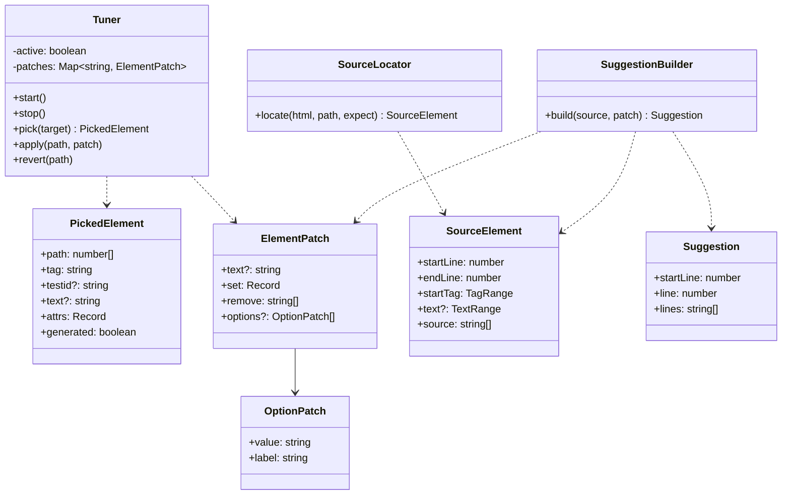
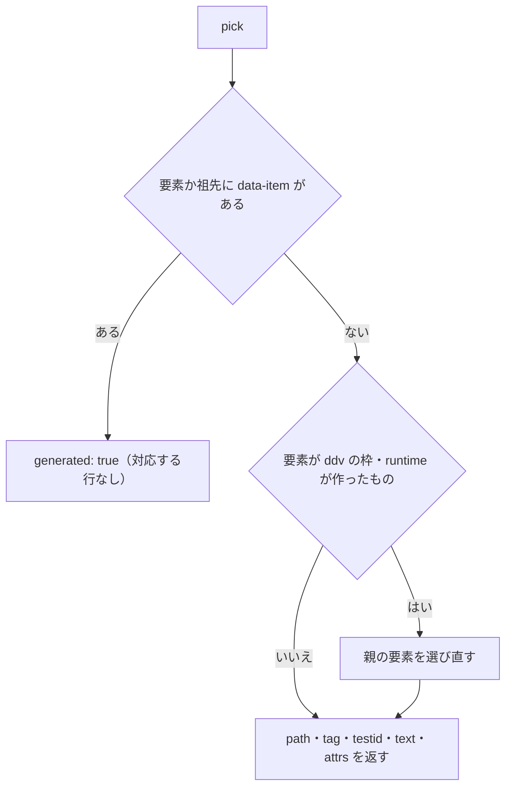
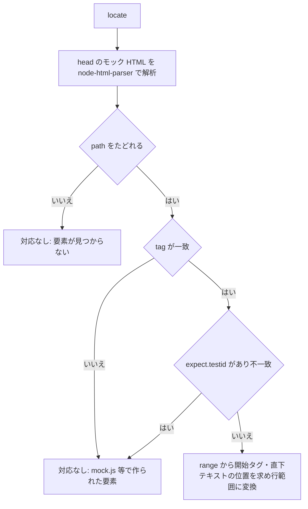
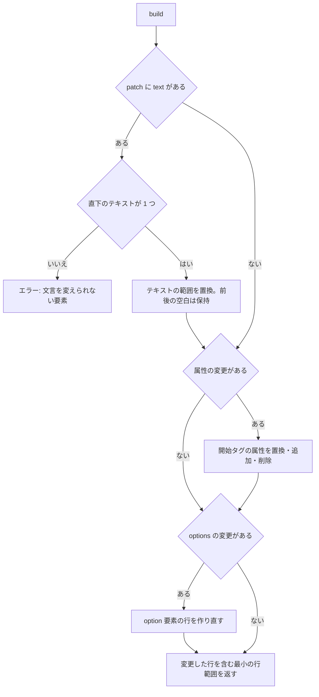
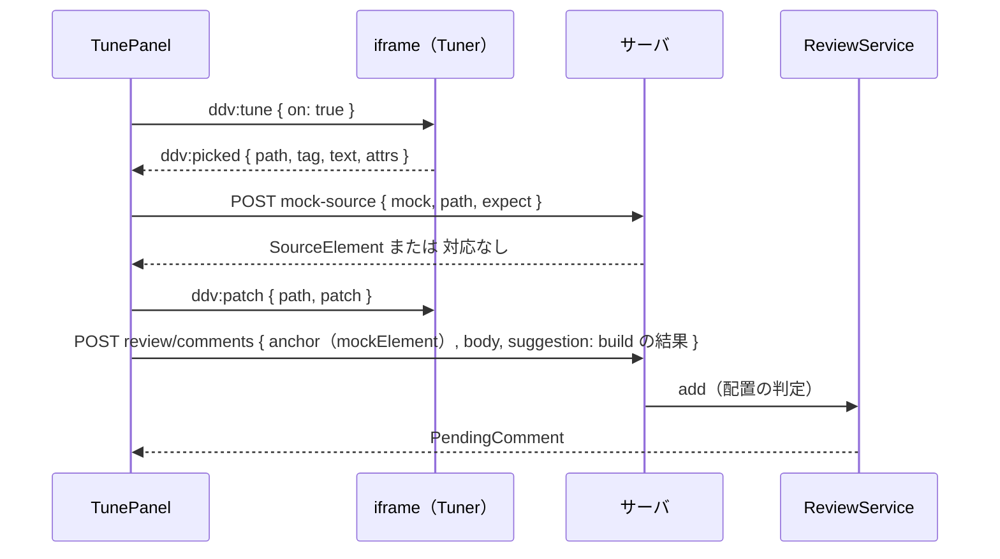

# モック調整モード 詳細設計

## 前提

- 振る舞いは :ref[../basic/github-review.md#モックの調整モード] を参照
- 既存の postMessage プロトコルは :ref[mock-runtime.md#プロトコルpostmessage] に追加する
- 実装：runtime 側 `packages/mock-runtime/src/tuner.ts`、ソース対応と suggestion 生成 `packages/mock/src/tune.ts`（既存依存の `node-html-parser` の `range` と、自前の開始タグ解析）、ビューア `apps/web/src/components/TunePanel.tsx`

## 画面

画面遷移は :ref[../basic/github-review.md#モックの調整モード]（状態 Off / Picking / Editing）。

::mock[github-review-tune/index.html]

| 項目 | testid | 種類 | 型・桁 | 必須 | 初期値 | 取得元・送信先 | 入力チェック・エラー文言 |
|---|---|---|---|---|---|---|---|
| 調整 | `tune-start` | ボタン（モックのツールバー） | — | — | — | `ddv:tune { on: true }`。再生中なら一時停止 | シナリオの再生中は押せない |
| 調整中の表示 | `tune-mode` | 表示 | — | — | — | — | — |
| 調整終了 | `tune-end` | ボタン | — | — | — | `ddv:tune { on: false }`（DOM の変更をすべて戻す） | — |
| 選択のエラー | `pick-error` | メッセージ | — | — | 非表示 | `mock-source` の対応なし（:ref[#ソースとの対応]） | 「対応する行なし：data-bind で作られた要素です」「…mock.js などで作られた要素です」 |
| 保留中の調整 | `tune-pending` | 一覧 | — | — | — | 保留中レビューのうち `anchor.element.kind = mockElement` のもの | — |
| 文言 | `t-text` | テキスト | 文字列 200 | — | 要素の直下のテキスト | `ElementPatch.text` | 直下のテキストが 1 つでない要素では出さない |
| 属性（`placeholder`・`title`・`aria-label`・`value`・`pattern`） | `t-<属性名>` | テキスト | 文字列 200 | — | 今の値 | `ElementPatch.set` | `pattern` は正規表現として不正なら「正規表現を確認してください」 |
| 属性（`maxlength`・`minlength`・`min`・`max`・`step`） | `t-<属性名>` | 数値 | 整数（`step`・`min`・`max` は小数可） | — | 今の値（空なら属性なし） | `ElementPatch.set` / 空にすると `remove` | `minlength` > `maxlength`、`min` > `max`：「範囲を確認してください」 |
| `required` | `t-required` | チェック | — | — | 今の値 | `set` / `remove` | — |
| `type`（input） | `t-type` | 選択 | `text` `number` `email` `tel` `date` `password` `checkbox` | — | 今の値 | `ElementPatch.set` | — |
| 選択肢（select） | `t-options` | 表（値・文言・追加・削除・並べ替え） | — | — | 今の `option` | `ElementPatch.options` | 値の重複：「選択肢の値が重複しています」 |
| 変更後のソース | `suggestion` | 表示（差分） | — | — | — | `SuggestionBuilder.build`（:ref[#suggestion-の生成]） | — |
| 反映 | `t-apply` | ボタン | — | — | — | `ddv:patch`（入力のたびにも反映する） | — |
| 取消 | `t-cancel` | ボタン | — | — | — | `ddv:patch { patch: null }` | — |
| 保留に追加 | `t-add` | ボタン | — | — | — | `POST /api/w/<ws>/review/comments`（手元では「HTML をコピー」） | 変更なし：押せない |

- `picked`（クリックした要素の選択）はモックだけの操作で、実際には iframe 内の要素をクリックする
- モックの入力欄は代表例（`t-placeholder`・`t-maxlength`・`t-required`）だけ。`t-text`・`t-type`・`t-options` などは選んだ要素の種類に応じて同じ並びで出す
## 構造

## プロトコル

| 向き | type | 内容 |
|---|---|---|
| ビューア → iframe | `ddv:tune` | `{ on: boolean }` 調整モードの開始・終了（終了で DOM の変更をすべて戻す） |
| iframe → ビューア | `ddv:picked` | `PickedElement` |
| ビューア → iframe | `ddv:patch` | `{ path, patch: ElementPatch }`（`patch` が null なら元に戻す） |

- 調整モードの間、`Tuner` は `click` を捕捉段階で止めて（`preventDefault`・`stopPropagation`）選択に使う。プレイヤーの `ddv:step` は受け付けず `ddv:result { ok: false }`（理由：調整中）
- ポインタの下の要素を枠で示す（ハイライトと同じ枠。`pointer-events` は変えない）

### 要素のパス

`path` は `document.documentElement` からの **要素の子の番号の並び**（テキストは数えない）。`template` の中身・`data-item` の付いた要素（`data-bind` で描画したもの）とその子孫は数えない。

- `text` は要素の直下のテキストノードを連結し前後の空白を除いたもの。子要素を含む要素（例：ラベルの中の入力）は直下のテキストだけを対象にする

## ソースとの対応

`POST /api/w/{ws}/mock-source { mock, path, expect: { tag, testid? } }` → `SourceLocator.locate`。

- `node-html-parser` は `template` の中身も子として持つので、パスをたどるときに runtime と同じ規則（`template` の中は数えない）で除く
- 開始タグの属性の位置は、`range` の先頭から `>` までを自前で字句解析する（引用符・改行を含む属性値、値なし属性に対応）

## suggestion の生成

| 変更 | 書き方 |
|---|---|
| 属性の値の変更 | 値の部分だけを置き換え、元の引用符を使う |
| 属性の追加 | 開始タグの最後の属性の後ろに ` name="value"`（値なし属性は ` required`）。改行で並べているタグは同じインデントの新しい行 |
| 属性の削除 | その属性と直前の空白（改行で並べているときは行ごと）を削除 |
| 選択肢 | `select` の中の `option` の行を、先頭の `option` のインデント・書式で並べ直す |
| エスケープ | 属性値は `&` `"` `<`、テキストは `&` `<` `>` を実体参照にする |

- 編集できる属性以外（`class`・`style`・`data-*`・`id`・`on*`）は `ElementPatch` を作る時点で受け付けない（ビューアの入力欄に出さない。サーバでも検査して 400）
- 同じ要素への複数回の変更は、ビューアが 1 つの `ElementPatch` にまとめてから送る（保留中のコメントがあれば `update` で置き換える）

## 調整の流れ

- 本文の既定：`モック調整：<要素の説明（testid / tag）> の <変更した項目>` を自動で入れ、人が書き足せる
- 手元のワークスペースでは `mock-source` を `/api/mock-source`（同じ処理）で呼び、保留の代わりに `lines` をクリップボードにコピーする
