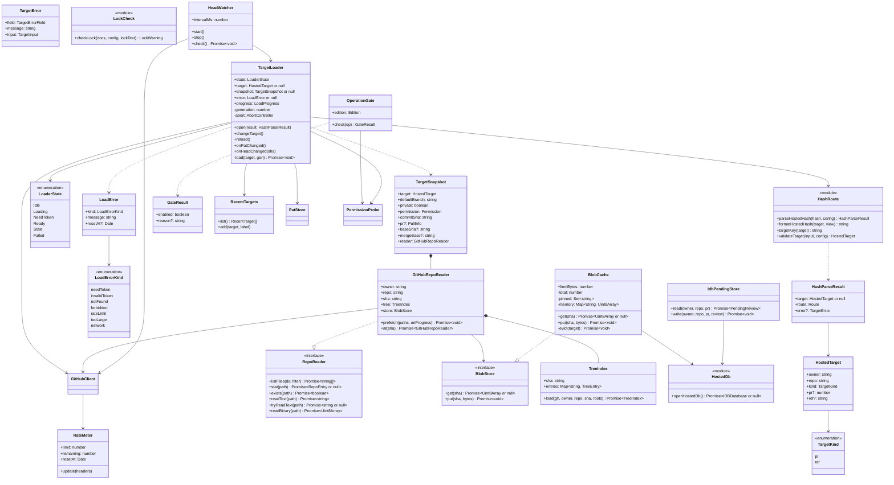
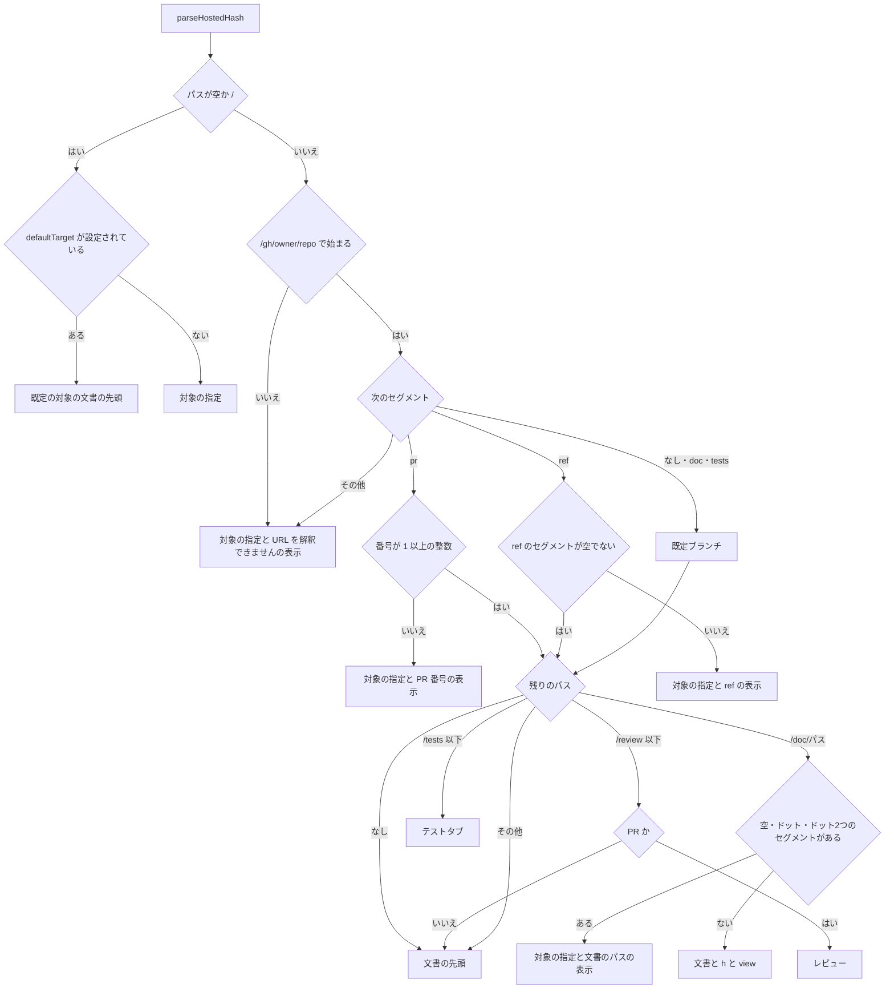
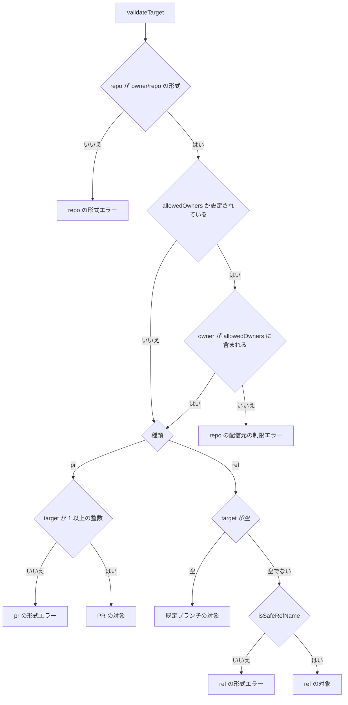
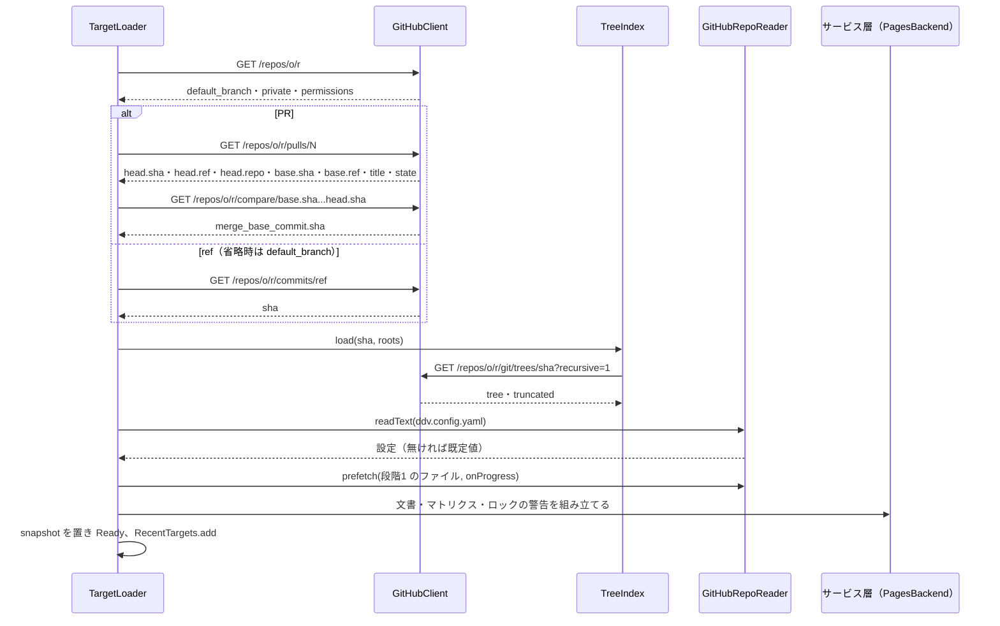
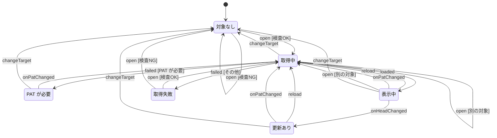
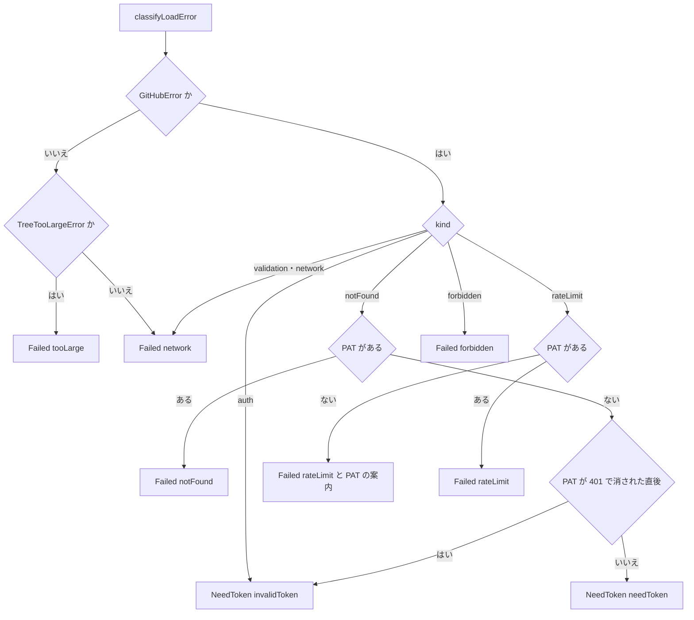
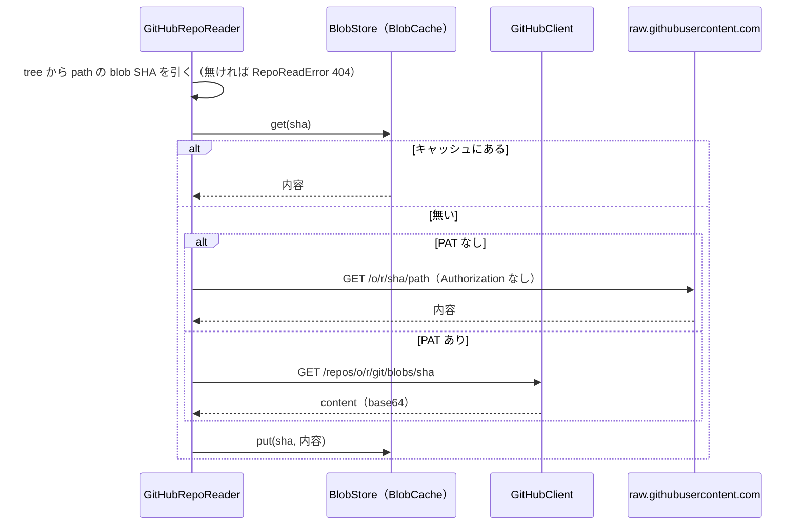
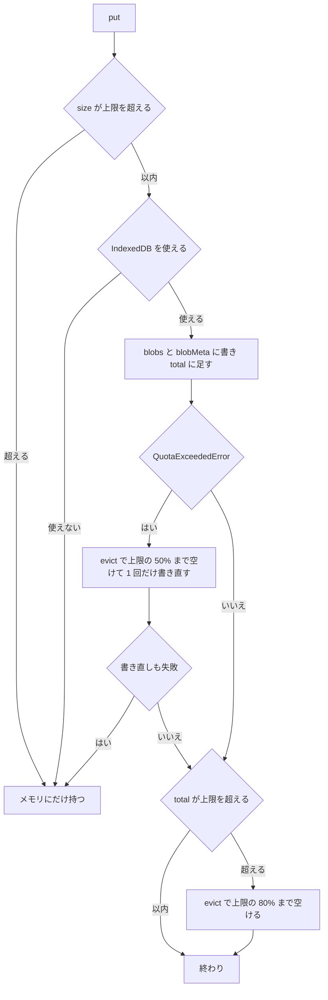
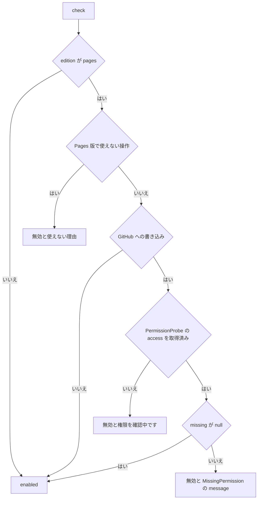
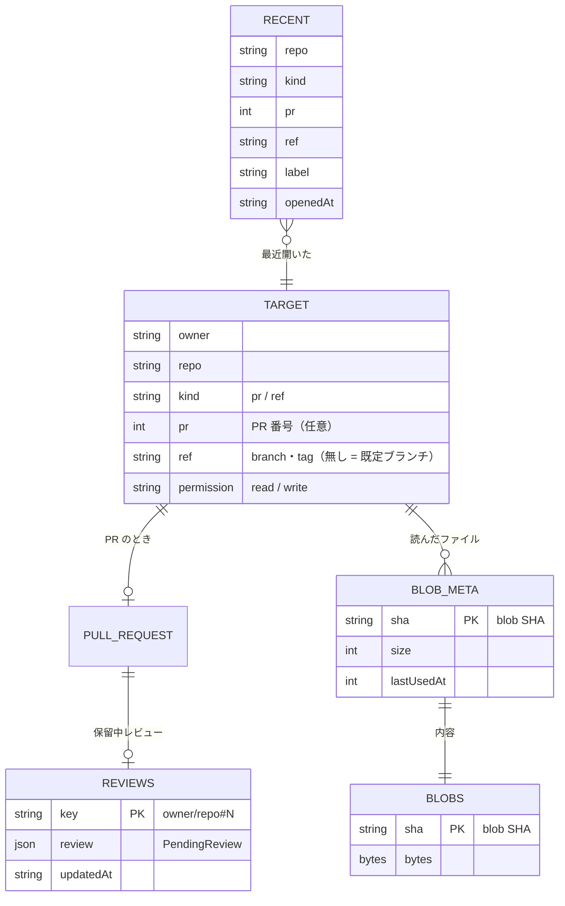

# Pages 版ビューア（対象の指定・URL・内容の取得・操作の可否）詳細設計

## 前提

- 画面遷移は :ref[../basic/hosted-viewer.md#画面遷移]、画面は :ref[../basic/hosted-viewer.md#画面イメージ]、URL は :ref[../basic/hosted-viewer.md#url]、取得は :ref[../basic/hosted-viewer.md#内容の取得]、操作の可否は :ref[../basic/hosted-viewer.md#操作の可否]、PR レビューは :ref[../basic/hosted-viewer.md#pr-レビュー]、置き場所は :ref[../basic/hosted-viewer.md#データ] を参照
- PAT の保存・`PatStore`・PAT メニュー・CSP・`pages.config.json`・ビルドとデプロイは [pat.md](pat.md)、モックの iframe の隔離は [mock-sandbox.md](mock-sandbox.md)、サービス層・`RepoReader`・`PagesBackend` の IF は [services.md](services.md) で扱う。本書はそれらを使う側だけを書く
- 実装：新規 `apps/web/src/pages/`（`hash-route.ts`・`target-loader.ts`・`blob-cache.ts`・`hosted-db.ts`・`operation-gate.ts`・`lock-check.ts`・`head-watcher.ts`・`recent-targets.ts`・`pending-store.ts`。PAT の部品と同じディレクトリ）と画面 `components/OpenTargetPage.tsx`・`TargetLoadingPage.tsx`・`TokenPage.tsx`・`TargetHeader.tsx`。Pages 版のビルド（`DDV_EDITION=pages`）にだけ含める
- `GitHubRepoReader`・`TreeIndex`・`BlobStore`（インタフェース）は `packages/services/src/github-reader.ts`（Actions の結果ブランチの読み取りでも使うため。[services.md](services.md)）。IndexedDB の実装 `BlobCache` は `apps/web/src/pages/blob-cache.ts` に置き、`GitHubRepoReader` の生成時に `BlobStore` として渡す（`packages/services` は IndexedDB に依存しない）
- 既存の画面（`DocPage`・`TestsPage`・`PrBar`・`Review`・`MatrixPanel` 等）とローカル版の動作は変えない（REQ-610）。ローカル版で変わるのは「Pages 版の URL をコピー」（[URL](#url)）の追加だけで、設定が無ければ表示しない

## 画面

画面遷移は :ref[../basic/hosted-viewer.md#画面遷移]。このうち「対象の指定」「取得中」「PAT が必要」と「文書」のヘッダを扱う（文書の本文・PR バー・レビューは既存のまま。:ref[review-comment.md#画面]）。

::mock[hosted-viewer/index.html]

共通（ヘッダ）

| 項目 | testid | 種類 | 型・桁 | 必須 | 初期値 | 取得元・送信先 | 入力チェック・エラー文言 |
|---|---|---|---|---|---|---|---|
| 版の表示 | `edition` | 表示 | — | — | `Pages 版（公式）` | `PagesConfig`（公式 / セルフホストと `title`。[pat.md](pat.md)）。`title` 属性に配信元（`location.origin + location.pathname`） | — |
| API の残り | `rate` | 表示 | `API 残り n / m` | — | 非表示（最初の応答まで） | `RateMeter`（GitHub API の応答の `x-ratelimit-remaining`・`x-ratelimit-limit`・`x-ratelimit-reset`） | 残り 10 未満は警告色。`title` にリセットの時刻 |
| PAT メニュー | `pat-menu`・`pat-menu-list`・`pat-menu-set`・`pat-menu-persist`・`pat-menu-unpersist`・`pat-menu-clear`・`pat-menu-scopes`・`pat-menu-note`（ダイアログ `pat-dialog`・`pat-cancel`） | メニュー | — | — | — | [pat.md](pat.md)。`PatStore` の変更通知で `TargetLoader.onPatChanged()` | [pat.md](pat.md) |

対象の指定（`OpenTargetPage`）

| 項目 | testid | 種類 | 型・桁 | 必須 | 初期値 | 取得元・送信先 | 入力チェック・エラー文言 |
|---|---|---|---|---|---|---|---|
| リポジトリ | `repo` | テキスト | 文字列 100 | ○ | URL を解釈できなかったときはその値、他は空 | `HostedTarget.owner`・`repo` | [対象の検査](#対象の検査) の `repo` の文言 |
| 種類 | `kind` | 選択 | `pr` / `ref` | ○ | `pr` | `HostedTarget.kind` | — |
| PR 番号 または branch・tag 名 | `target` | テキスト | 整数（pr）/ 文字列 100（ref） | pr のとき ○ | 空 | `HostedTarget.pr` / `ref`（ref が空なら既定ブランチ） | [対象の検査](#対象の検査) の `pr`・`ref` の文言 |
| 入力エラー | `open-error` | メッセージ | — | — | 非表示 | `TargetError.message`（`validateTarget` / `parseHostedHash`） | — |
| 取得失敗の理由 | `fetch-error` | メッセージ | — | — | 非表示 | `TargetLoader.error.message`（`Failed` のとき。[取得の失敗](#取得の失敗)） | — |
| 開く | `open-submit` | ボタン | — | — | — | `validateTarget` → `formatHostedHash(target)` を `location.hash` に入れる（`hashchange` → `TargetLoader.open`） | 検査 NG は `open-error` を出して留まる |
| 最近開いた対象 | `recent` | 一覧 | 10 件 + 設定の候補 | — | — | `RecentTargets.list()` の後に `PagesConfig.recentTargets`（重複を除く）。[最近開いた対象](#最近開いた対象) | 読めない値は無視 |
| 最近開いた対象の 1 件 | `recent-item` | リンク | — | — | — | `href` は `formatHostedHash(target)` | — |

取得中（`TargetLoadingPage`）

| 項目 | testid | 種類 | 型・桁 | 必須 | 初期値 | 取得元・送信先 | 入力チェック・エラー文言 |
|---|---|---|---|---|---|---|---|
| 対象 | `loading-target` | 表示 | — | — | — | `targetLabel(target)` + 「を取得中」 | — |
| 進捗 | `progress` | 一覧 | — | — | — | `TargetLoader.progress`（`LoadStep`：`info` PR 情報 → `tree` ファイル一覧 → `files` 設計書・ロック・設定（`done / total` 件、うちキャッシュ `cached` 件）→ `build` 文書の組み立て） | — |
| API の残り | `loading-rate` | 表示 | — | — | — | `RateMeter`（リセットの時刻つき） | — |
| （モックのみ）取得完了・PAT が必要・取得失敗 | `loading-done`・`loading-need-pat`・`loading-fail` | ボタン | — | — | — | 実装には無い（結果は `TargetLoader` が決める） | — |

PAT が必要（`TokenPage`）

| 項目 | testid | 種類 | 型・桁 | 必須 | 初期値 | 取得元・送信先 | 入力チェック・エラー文言 |
|---|---|---|---|---|---|---|---|
| 理由 | `token-reason` | 表示 | — | — | — | `LoadError.kind`：`needToken`「非公開のリポジトリ、または見つからないリポジトリです。PAT を設定すると取得し直します。」/ `invalidToken`「PAT が無効です（失効・取り消しの可能性があります）。設定し直してください」 | — |
| PAT | `pat` | パスワード | 文字列 255 | ○ | 空 | `PatStore.set(raw, persist)`（[pat.md](pat.md)） | `parsePat` の文言（[pat.md](pat.md)） |
| この端末に保存 | `pat-store` | チェック | — | — | オフ | `PatStore.set` の `store` | — |
| PAT のエラー | `pat-error` | メッセージ | — | — | 非表示 | [pat.md](pat.md) | — |
| 設定 | `pat-submit` | ボタン | — | — | — | `PatStore.set` → `TargetLoader.onPatChanged()`（`Loading` へ） | — |
| 対象を変更 | `token-change` | ボタン | — | — | — | `location.hash = '#/'`（`TargetLoader.changeTarget`） | — |
| PAT の作成 | `pat-create-link` | リンク | — | — | — | `https://github.com/settings/personal-access-tokens/new`（新しいタブ） | — |
| 必要な権限 | `scopes` | 一覧 | — | — | — | `REQUIRED_PERMISSIONS`（[pat.md](pat.md)） | — |
| 送信先の説明 | `pat-note` | 表示 | — | — | — | 固定文言 | — |

文書（`TargetHeader`。本文・PR バー・レビューは既存の画面）

| 項目 | testid | 種類 | 型・桁 | 必須 | 初期値 | 取得元・送信先 | 入力チェック・エラー文言 |
|---|---|---|---|---|---|---|---|
| 対象 | `doc-target` | 表示 | — | — | — | PR：`owner/repo #N <PR のタイトル>`、ref：`owner/repo <ref>`（既定ブランチは名前の後に「（既定）」） | — |
| head | `doc-head` | 表示 | — | — | — | PR：`<base> ← <head ref>（<head の SHA 7 桁>）`、ref：`<コミットの SHA 7 桁>` | — |
| 権限 | `doc-permission` | 表示 | — | — | — | `TargetSnapshot.permission`：`write`「書き込み可」/ `read`「読み取りのみ」/ PAT なし「読み取りのみ（PAT 未設定）」 | — |
| 対象を変更 | `doc-change` | ボタン | — | — | — | `location.hash = '#/'` | — |
| ロックの警告 | `lock-warning` | 警告 | — | — | 非表示 | `LockCheck.check`（[ロックの警告](#ロックの警告)） | — |
| 使えない操作 | `disabled-ops` | （モックの説明用） | — | — | — | 実装では各ボタンを `disabled` にし、`title` と隣の `.disabled-reason` に `OperationGate` の理由を出す（[操作の可否](#操作の可否)） | — |

- ローカル版のヘッダの `WorkspaceBar`（`ws-switch`・`open-github`・`auth-status`）は Pages 版では出さず、`TargetHeader` に置き換える。PR の `PrBar`（`prbar`・`head-sha`・`stale`・`refresh`・`to-review`）はそのまま使う。`ws-close` は出さない（worktree が無い）

## 構造



- `RepoReader` のメソッド（`listFiles`・`stat`・`exists`・`readText`・`tryReadText`・`readBinary`）の意味・`PagesBackend` への渡し方は [services.md](services.md)。`GitHubRepoReader` の `stat().sha` は blob SHA
- `PullInfo`・`toPullInfo` は `apps/server/src/workspaces.ts` のものを共通化して使う（[services.md](services.md)）。`Permission` は `'read' | 'write'`、`Edition` は `'local' | 'pages'`（`import.meta.env.DDV_EDITION`。[pat.md](pat.md)）
- `GitHubClient` への追加：`GitHubClientOptions.onResponse?(headers: Headers)`（`RateMeter.update` を呼ぶため。2xx・エラーの両方で呼ぶ）。PAT が無いときの匿名の呼び出しは [pat.md](pat.md)
- `TargetLoader` はアプリに 1 つ。React からは `useTargetLoader()`（状態の購読）で使う

## URL

### 解釈

`parseHostedHash(location.hash, pagesConfig)` は `hashchange` と起動時に呼ぶ。返した `route` は既存の `Route`（`apps/web/src/state.tsx`）と同じ形で、既存の画面はそのまま使う。



- 「X…」は `{ target: null, error }` を返し、「対象の指定」に `open-error` で理由を出す。`repo`・`target` には URL から読めた値を入れておく。文言：X1「URL を解釈できません（#/gh/owner/repo/… の形式）」、X2「PR 番号を入力してください」、X3「branch・tag 名を確認してください」、X4「文書のパスを確認してください」
- 対象が得られたら続けて `validateTarget`（[対象の検査](#対象の検査)）を通す。NG なら同じく「対象の指定」に理由を出す
- セグメントは `/` で分けてから `decodeURIComponent` する（ref の `%2F` を分けないため）。`decodeURIComponent` が失敗したら X1
- 「/tests 以下」はローカル版と同じ下位パス（`/tests/history/<id>`・`/tests/trace/<run>/<id>`・`/tests/flaky`）。「/review 以下」は `/review`・`/review/done`
- クエリ：`h`（見出しのスラッグ）、`view=diff`（PR の差分を開く。`Route.diff = true`）。それ以外のキーは無視する。`view=diff` は ref の対象では無視する
- 同じ `targetKey` のまま `route` だけが変わったとき（文書・見出しの移動）は `TargetLoader.open` で取得し直さない

### 生成

`formatHostedHash(target, view)`。Pages 版では既存の `wsBase()`・`docHref()`・`viewHref()`・`historyHref()`・`traceHref()`（`state.tsx`）がこれを使う。

| 部分 | 規則 |
|---|---|
| 対象 | `#/gh/<owner>/<repo>` + PR は `/pr/<N>`、ref は `/ref/<encodeURIComponent(ref)>`（`/` は `%2F`）、既定ブランチは無し |
| 文書 | `/doc/` + パスのセグメントごとに `encodeURIComponent` して `/` でつなぐ |
| 見出し・差分 | `?h=<スラッグ>`、`&view=diff`（差分の開閉は `history.replaceState` で URL に反映し、履歴を増やさない） |
| 含めないもの | PAT・コミットの SHA（:ref[../basic/hosted-viewer.md#url]） |
| `targetKey` | `owner/repo#pr-N` / `owner/repo@<ref>` / `owner/repo@`（既定ブランチ）。`Route.ws` には `gh~owner~repo~pr-N` / `gh~owner~repo~ref-<ref の / を ~~>` / `gh~owner~repo~default`（ローカル版のワークスペースID と同じ形。`PrProvider`・`Pr.tsx` の分岐に使う） |

- `parseHostedHash(formatHostedHash(t, v))` は元の `t`・`v` に戻る（往復のテストを書く）

### Pages 版の URL をコピー（ローカル版）

設定（`ddv.config.yaml` の `pages.url`）・表示の条件・対象の `owner/repo` の決め方は [pat.md](pat.md)。URL は `pages.url` + `formatHostedHash(対象, 表示中の画面)` で組み立てる（同じ関数を Pages 版と共有し、往復のテストで形をそろえる）。

- 設定が無ければ従来の画面と同じ（REQ-610）

## 対象の検査

`validateTarget(input, pagesConfig)`。「開く」とURLの解釈の両方で使う。owner・repo・ref の規則は `apps/server/src/workspaces.ts` の `parseRepo`・`isSafeRefName` と同じ（[services.md](services.md) で共通化）。



| エラー | `field` | 文言 |
|---|---|---|
| E1 | `repo` | 「owner/repo の形式で入力してください」 |
| E2 | `repo` | 「このビューアで開けるのは次の owner のリポジトリだけです：<allowedOwners を , でつなぐ>」（[pat.md](pat.md) の `isOwnerAllowed`） |
| E3 | `pr` | 「PR 番号を入力してください」 |
| E4 | `ref` | 「branch・tag 名を確認してください」 |

- 「owner が allowedOwners に含まれる」は [pat.md](pat.md) の `isOwnerAllowed(owner, allowedOwners)`（`pages.config.json`。大文字小文字を区別しない）を呼ぶ
- 前後の空白は除いてから検査する

## 対象の読み込み

### 取得の流れ

`TargetLoader.load(target, gen)`。各段階の前に `progress.step` を更新する。`gen` が最新でなくなったら（別の対象を開いた）結果を捨てる。



- `compare` が失敗したとき（base が消えた等）は `mergeBase` 無しで続ける（差分は表示できない。ローカル版の `mergeBase` 無しと同じ扱い）
- 権限：同じ `GET /repos/o/r` の応答とヘッダを `PermissionProbe.fromRepo(json, headers, kind)`（[pat.md](pat.md)）に渡す。`doc-permission` の表示用に、`permissions.push` が true なら `write`、それ以外・`permissions` が無い（PAT なし）なら `read` を `TargetSnapshot.permission` に置く。`GitHubClient` は PAT が無くても `anonymous: true`（[pat.md](pat.md)）で要求する
- `ddv.config.yaml` の読み込み・検証はローカル版と同じ（`parseConfig`）。設定のエラーは `Failed`（`network` ではなく設定のエラー文言をそのまま出す）
- `TreeIndex.load` の `truncated: true`（ファイルが多すぎる）：`roots`（`docsRoot`・`mocksRoot`・`.ddv`・各ランナーの `cwd`）ごとに非再帰の Trees API でその部分木の SHA を探し、部分木を `recursive=1` で取り直す。それでも `truncated` なら `TreeTooLargeError`（`tooLarge`）

### 状態



| 状態 | 画面 |
|---|---|
| `Idle` | 対象の指定（検査 NG なら `open-error`） |
| `Loading` | 取得中 |
| `NeedToken` | PAT が必要 |
| `Ready` / `Stale` | 文書（`Stale` は `PrBar` の `stale`） |
| `Failed` | 対象の指定（`fetch-error` に理由、入力欄に対象の値） |

- 不正遷移：`loaded`・`failed` は `gen` が古ければ無視（中断した取得の結果）。`onHeadChanged` は `Ready` 以外では無視。`reload` は `Ready`・`Stale` 以外では無視。`onPatChanged` は `Idle`・`Failed` では状態を変えない（次の `open` で新しい PAT を使う）
- 「open [別の対象]」は `targetKey` が変わったときだけ。前の取得は `AbortController.abort()` で止め、`gen` を進める。`Ready` で同じ `targetKey` の `open` は `route` だけを差し替える
- `Ready` に入るたびに `HeadWatcher.start()`、出るときに `stop()`

### 取得の失敗

`classifyLoadError(e, patStore)` で次の状態と理由を決める。「PAT が 401 で消された直後」は `patStore.lastClear === 'invalid'`（[pat.md](pat.md)。PAT を設定し直すと `null` に戻る）。



| `LoadErrorKind` | 文言（`fetch-error` / `token-reason`） |
|---|---|
| `needToken` | 「非公開のリポジトリ、または見つからないリポジトリです。PAT を設定すると取得し直します。」 |
| `invalidToken` | 「PAT が無効です（失効・取り消しの可能性があります）。設定し直してください」（[pat.md](pat.md) の文言と同じ） |
| `notFound` | 「取得できませんでした：リポジトリ・branch・tag・PR が見つからないか、PAT にこのリポジトリの権限がありません」 |
| `forbidden` | 「取得できませんでした：<GitHubError.message>」（組織の SSO の承認が必要なときも GitHub の文言をそのまま出す） |
| `rateLimit` | 「取得できませんでした：GitHub API の利用上限に達しました（<resetAt の時刻> に再開）」+ PAT なしのとき「。PAT を設定すると上限が上がります」 |
| `tooLarge` | 「取得できませんでした：ファイルが多すぎて一覧を取得できません（<部分木のパス>）」 |
| `network` | 「取得できませんでした：GitHub との通信に失敗しました（<GitHubError.message>）」。設定のエラーは「ddv.config.yaml を読めません：<理由>」 |

- 文言に要求のヘッダ・URL のクエリを含めない（`toGitHubError` は GitHub の `message` だけを使う。PAT を含みうる値は出さない。[pat.md](pat.md)）
- raw の取得の 404 は `GitHubError('notFound')` として扱う（PAT なしで非公開のファイルを読んだとき等）

## ファイルの取得

### 読むファイル

`selectPrefetch(tree, config)`。段階 1 は「取得中」で読み、それ以外は使うときに `readText`・`tryReadText`・`readBinary` で読む（どれも同じ `BlobStore` を通る）。

| 対象 | 条件 | 時期 |
|---|---|---|
| 設定 | `ddv.config.yaml` | 最初（他の条件を決めるため） |
| 設計書 | `docsRoot` 配下の `*.md` | 段階 1 |
| ロック | `.ddv/testids.lock.json` | 段階 1 |
| テスト | ランナーごとに、`cwd` 配下で `runnerFilter`（`packages/testid/src/scan.ts`。`include` が無ければ既定の拡張子）に合うもの | 段階 1 |
| シナリオ・疑似 API・fixtures | `mocksRoot` 配下の `*.yaml`・`*.yml` | 段階 1 |
| モックの資産 | `mocksRoot` 配下のその他、`styles` | モックを表示するとき（[mock-sandbox.md](mock-sandbox.md)） |
| 上記以外 | 読まない | — |

- `node_modules`・`.git` を含むパスは除く（ローカル版の `walk` と同じ除外）
- `type: blob` だけを対象にする。`commit`（サブモジュール）・シンボリックリンク（`mode: 120000`）は読まない

### 1 ファイルの読み込み



- 同時に取得するのは 6 件まで。同じ SHA の要求が重なったら 1 つにまとめる
- raw の URL のパスはセグメントごとに `encodeURIComponent`。fork からの PR で raw が 404 のときは `pr.headRepo`（`head.repo.full_name`）で 1 回だけ取り直す
- 読んだ内容は UTF-8 として `TextDecoder('utf-8', { fatal: false })` で文字列にする（`readText`）
- PAT は `GitHubClient` の要求にだけ付く。raw への `fetch` は `credentials: 'omit'` でヘッダを付けない（[pat.md](pat.md) の送信先の規則）

### base 側

PR の差分の base 側は `snapshot.reader.at(mergeBase)` の `GitHubRepoReader` で読む。`at` は `mergeBase` の tree を `TreeIndex.load` で取り（初回だけ。差分を最初に表示するとき）、同じ `BlobStore` を共有する。変更されたファイルの一覧は `GET /repos/o/r/pulls/N/files`（[services.md](services.md) の差分のサービス）で得る。

## キャッシュ

### IndexedDB

`openHostedDb()`：DB 名 `ddv-pages`、バージョン 1。開けないとき（プライベートブラウズ等）は `null` を返し、キャッシュはメモリだけ・保留中レビューは保存しない（`IdbPendingStore` は「この端末に保存できません」の警告を出す）。

| ストア | キー | 値 | 索引 |
|---|---|---|---|
| `blobs` | `sha`（blob SHA） | `{ sha, bytes: ArrayBuffer }` | — |
| `blobMeta` | `sha` | `{ sha, size, lastUsedAt }`（`lastUsedAt` はエポックミリ秒） | `lastUsedAt` |
| `reviews` | `key`（`owner/repo#N`） | `{ key, review: PendingReview, updatedAt }` | — |

- `blobs` と `blobMeta` は同じトランザクションで書く・消す。合計 `total` は `BlobCache` の初回の使用時に `blobMeta` の `size` を足して求める
- `get` で見つかったら `lastUsedAt` を更新する（同じ SHA はタブにつき 1 回だけ書く）。このタブで使った SHA は `pinned` に入れる

### 上限と削除

`BlobCache.put(sha, bytes)`（`BlobStore` の IndexedDB 実装。`apps/web/src/pages/blob-cache.ts`）。上限 `limitBytes` は 50 MB（52,428,800 バイト）。



`evict(target)`：`blobMeta` を `lastUsedAt` の古い順にたどり、`pinned` に無いものを消して `total` から引く。`total` が `target` 以下になるか、たどり終えたら止める（`pinned` だけで上限を超えるときは超えたままにする）。

- 書き込みの失敗（QuotaExceededError 以外）はメモリにだけ持って続ける（表示は止めない）
- メモリのキャッシュ（`memory`）はタブの間だけ。上限は設けない（1 つの対象の段階 1 のファイルに限られるため）

## 操作の可否

### 操作の一覧

`OperationGate.check(op)` の `op`。既存の画面の各ボタンは `useGate(op)` で `disabled`・`title` を決める（ローカル版は常に `enabled: true` を返すので、画面の動作は変わらない）。書き込みの操作は [pat.md](pat.md) の `GitHubOp` に対応させ、権限の判定（PAT の有無・ロール・スコープ・覚えた 403）は `PermissionProbe.missing(gitHubOp)` に任せる。

| `OperationId` | 対象の UI（既存） | 区分 | `GitHubOp` | 理由の文言（無効のとき） |
|---|---|---|---|---|
| `viewUncommitted` | 未コミットの変更の表示 | 使えない | — | 「Pages 版はコミット済みの内容だけを表示します」 |
| `saveFile` | テストデータの `save`、モックの調整の保存 | 使えない | — | 「ファイルの保存はローカル版で行います。PR には suggestion として付けられます」 |
| `generateTestIds` | `MatrixPanel` の「IDを確定」 | 使えない | — | 「手元の ddv で実行してください」 |
| `lint` | lint の実行 | 使えない | — | 「手元の ddv で実行してください」 |
| `scaffold` | 骨組み・シナリオの生成 | 使えない | — | 「手元の ddv で実行してください」 |
| `runLocal` | `run-case`・`run-all`・`run-selected`・`rerun` の手元のランナーでの実行 | 使えない | — | 「Pages 版は Actions で実行します」（Actions での実行は :ref[../basic/actions-run.md#実行の可否]） |
| `installDeps` | `deps-install` | 使えない | — | 「Pages 版は Actions で実行します」 |
| `snapshotLocal` | `snapshot-run`・`snapshot-run-all` の手元での撮影 | 使えない | — | 「Pages 版は Actions で実行します」 |
| `comment` | `comment-gutter`・`add-comment` | 書き込み | `reviewComment` | `MissingPermission.message`（例：PAT なし「PAT を設定してください（Pull requests: Write）」） |
| `reply` | `thread-reply-send` | 書き込み | `reviewReply` | 同上 |
| `resolveThread` | `thread-resolve` | 書き込み | `reviewResolve` | 同上 |
| `submitReview` | `review-submit` | 書き込み | `reviewSubmit` | 同上 |
| `suggestTestData` | テストデータの `td-comment` | 書き込み | `suggestion` | 同上 |
| `suggestMock` | モックの調整の `suggestion` | 書き込み | `suggestion` | 同上 |
| `approveStatus` | `approve-status` | 書き込み | `approveStatus` | 同上（例：ロールが read「このリポジトリへの書き込み権限がありません（必要なロール：Write）」） |
| `actionsDispatch` | Actions での実行（:ref[../basic/actions-run.md#実行の可否]） | 書き込み | `actionsDispatch`（Actions: Write。classic は `public_repo` / `repo`） | 同上 |
| `snapshotApprove` | 基準画像の承認（Actions の承認のモード） | 書き込み | `snapshotApprove`（Actions: Write。classic は `public_repo` / `repo`） | 同上 |

- `OperationId` の値は [services.md](services.md) の `OperationId` 型と同じ 17 個。区分は同書の `capabilities[op].kind`（使えない＝`unsupported`、書き込み＝`write`）を引き、`GitHubOp` も同書の `gitHubOp` と同じ。必要な権限（ロール・fine-grained・classic のスコープ）は [pat.md](pat.md) の `REQUIRED_PERMISSIONS`
- `actionsDispatch`・`snapshotApprove` はどちらも push と Actions: Write が要る。Actions の画面の表示の可否（ワークフローの有無など）は :ref[../basic/actions-run.md#実行の可否]・[actions-run.md](actions-run.md) で決め、ボタンの有効・無効は他の書き込みの操作と同じく GATE で決める
- 書き込みの操作で 403（`GitHubError('forbidden')`）を受けたら、画面は `PermissionProbe.recordDenied(gitHubOp, err)` を呼んでから `OperationGate` を読み直す

### 判定



- 「Pages 版で使えない操作」は `capabilities[op].kind === 'unsupported'`、「GitHub への書き込み」は `kind === 'write'`（`actionsDispatch`・`snapshotApprove` を含む）。`missing` には `gitHubOp` を渡す
- 「権限を確認中です」は [pat.md](pat.md) の `access` 未取得のときの扱いと同じ。`TargetLoader` が `GET /repos/o/r` の応答を `PermissionProbe.fromRepo` に渡し、`Ready` になる前に取得済みにする
- ref の対象（PR でない）ではレビューの画面自体が出ない（ローカル版の ref のワークスペースと同じ）

## ロックの警告

`checkLock(docs, config, lockText)`。「取得中」の `build` と、文書の表示で使う。

| 場合 | 判定 | 表示 |
|---|---|---|
| ロックがある | 文書ごとに `docMatrices(doc, config, structuredClone(lock))`（`packages/testid/src/matrix.ts`）を呼び、`provisional: true` のケース（ロックに無い経路）を図ごとに数える | 1 件以上の図がある文書の先頭に `lock-warning`「テストIDのロックが図より古い（ddv-testid generate が未実行）：<図の id> に新しい経路が <件数> 件あります（仮IDで表示）」（図が複数なら「、」で連結） |
| ロックが無い | 空のロック（`emptyLock()`）として同じ判定。matrix 付きの図があれば全件が仮ID | 「テストIDのロックがありません（ddv-testid generate が未実行）：…」 |
| ロックを読めない（JSON でない） | 空のロックとして同じ判定 | 「テストIDのロックを読めません（.ddv/testids.lock.json）：…」 |

- 仮ID は `assignIds` が振る番号のまま表示する（ローカル版の未採番と同じ `MatrixPanel` の「仮ID」の印）。ロックは書き換えない（`structuredClone` に対して呼ぶ）
- ロックにあって図から消えた経路（欠番）だけの差は警告しない（PR の差分の「テストIDの増減」で見える）
- ローカル版には出さない（ローカル版は「IDを確定」で直せるため。従来どおり）

## PR レビュー

### 保留中レビュー

`IdbPendingStore` は `apps/server/src/review.ts` の `PendingStore` と同じ `read` / `write` を持ち、サービス層の `ReviewService` に渡す（[services.md](services.md)）。

| 項目 | 内容 |
|---|---|
| 置き場所 | IndexedDB `ddv-pages` の `reviews`、キー `owner/repo#N` |
| 形式 | `PendingReview`（`headSha`・`mergeBase?`・`comments`。ローカル版の `~/.ddv/reviews/<owner>/<repo>/pr-<N>.json` と同じ JSON） |
| 読み込み | 無い・形が違うときは `{ headSha: '', comments: [] }`（`PendingStore.read` と同じ補正） |
| 書き込み | 1 つの readwrite トランザクションで `put`。書いたら `BroadcastChannel('ddv-pages')` に `{ type: 'reviews-changed', key }` を送り、同じ PR を開いている他のタブの `PrProvider` が読み直す |
| 送信後 | `ReviewService.submit` が送信済みのコメントを除いて `write`（ローカル版と同じ） |

### 更新の検知

`HeadWatcher`：`Ready` の PR の対象で `GET /repos/o/r/pulls/N` の `head.sha` を `snapshot.pr.headSha` と比べ、違えば `TargetLoader.onHeadChanged(sha)`。

| 条件 | 間隔 |
|---|---|
| PAT あり | 60 秒ごと（ローカル版の `DDV_GITHUB_POLL` の既定と同じ）と、`window` の `focus`（前回から 30 秒以内なら呼ばない） |
| PAT なし | 5 分ごとと `focus`（前回から 5 分以内なら呼ばない） |
| `document.hidden` | 止める（見えたら `focus` と同じ扱いで 1 回確かめる） |
| `rateLimit` を受けた | `resetAt` まで止める |

- PR のクローズ・マージは `PrBar` の `pr-state` に出す（状態は変えない。ローカル版と同じ）。その他の失敗は無視して次の間隔で再試行する

## 最近開いた対象

`RecentTargets`：`localStorage` のキー `ddv.pages.recent`。`Ready` に入ったときに `add(target, label)`。

```ts
const RecentTargetSchema = z.object({
  repo: z.string(),               // owner/repo
  kind: z.enum(['pr', 'ref']),
  pr: z.number().int().min(1).optional(),
  ref: z.string().optional(),     // 無し = 既定ブランチ
  label: z.string().max(200),     // PR のタイトル / ref 名
  openedAt: z.string(),           // ISO 8601
});
const RecentListSchema = z.array(RecentTargetSchema).max(10);
```

- 新しい順に最大 10 件。同じ `targetKey` は前のものを消して先頭に入れる
- PAT・コミットの SHA・PR の本文は入れない（REQ-608）
- 読めない値（JSON でない・スキーマに合わない）は空として扱い、次の `add` で上書きする。`allowedOwners` に合わなくなったものは `list()` で除く

## データ



| データ | 置き場所 | モックの疑似 API |
|---|---|---|
| ファイルの内容 | IndexedDB `ddv-pages` の `blobs`・`blobMeta` | — |
| 保留中レビュー | IndexedDB `ddv-pages` の `reviews` | — |
| 最近開いた対象 | `localStorage` の `ddv.pages.recent` | テーブル `recent`（`GET /recent`） |
| PAT | [pat.md](pat.md) | — |
| `TargetSnapshot`・スレッド・PR 情報 | メモリだけ | — |

## GitHub API

本書で呼ぶもの（レビュー・スレッドは :ref[review-comment.md#github-api-の対応]、Actions は :ref[../basic/actions-run.md#api]）。

| メソッド | パス | 要求 | 応答（ステータス・エラー） |
|---|---|---|---|
| GET | `/repos/{o}/{r}` | — | 200 `default_branch`・`private`・`permissions?`。404 → [取得の失敗](#取得の失敗) |
| GET | `/repos/{o}/{r}/pulls/{n}` | — | 200 `title`・`state`・`merged`・`head.sha`・`head.ref`・`head.repo`・`base.sha`・`base.ref`。404 |
| GET | `/repos/{o}/{r}/compare/{base}...{head}` | — | 200 `merge_base_commit.sha`。失敗は `mergeBase` 無しで続ける |
| GET | `/repos/{o}/{r}/commits/{ref}` | ref はセグメントごとにエンコード | 200 `sha`。404・422 → `notFound` |
| GET | `/repos/{o}/{r}/git/trees/{sha}?recursive=1` | — | 200 `tree[]`（`path`・`type`・`mode`・`sha`・`size`）・`truncated` |
| GET | `/repos/{o}/{r}/git/trees/{sha}` | 非再帰（`truncated` のときだけ） | 200 `tree[]` |
| GET | `/repos/{o}/{r}/git/blobs/{sha}` | PAT ありのとき | 200 `content`（base64）・`encoding` |
| GET | `https://raw.githubusercontent.com/{o}/{r}/{sha}/{path}` | PAT なしのとき。`Authorization` を付けない | 200 内容。404 → `notFound` |

- PAT なしで「開く」1 回に使う API は、PR で 4 回（repo・pulls・compare・trees）、ref で 3 回。ファイルの内容は API を使わない
- すべての応答で `RateMeter.update(headers)`（raw の応答は対象外）
