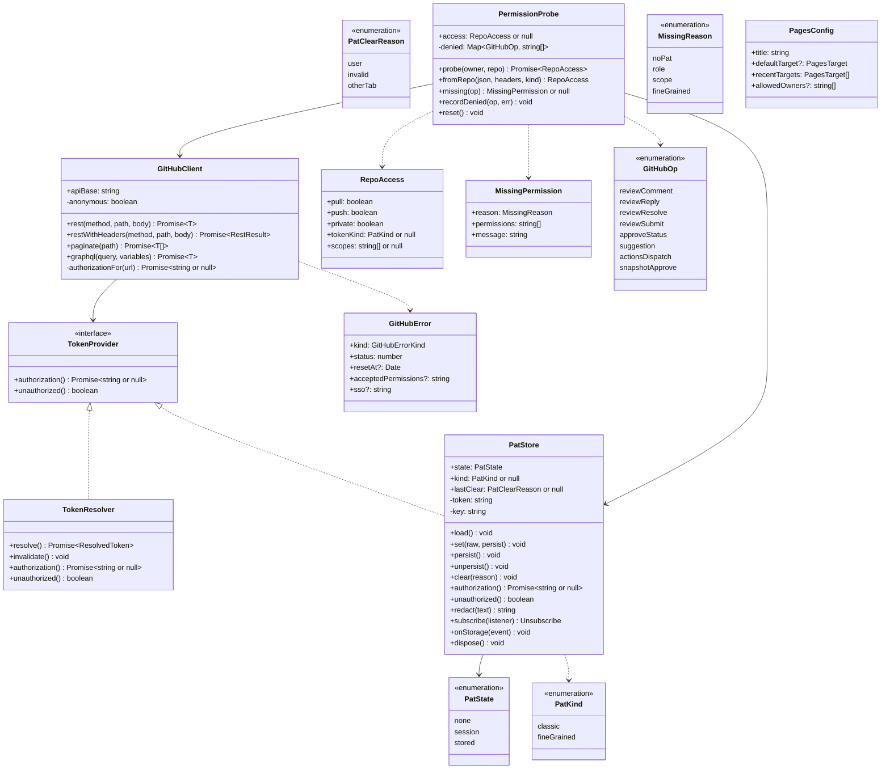
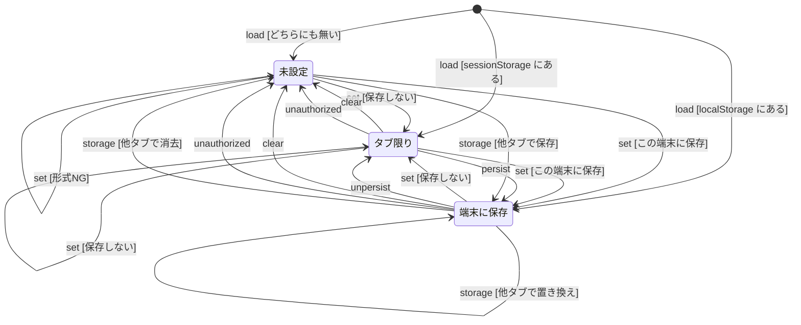
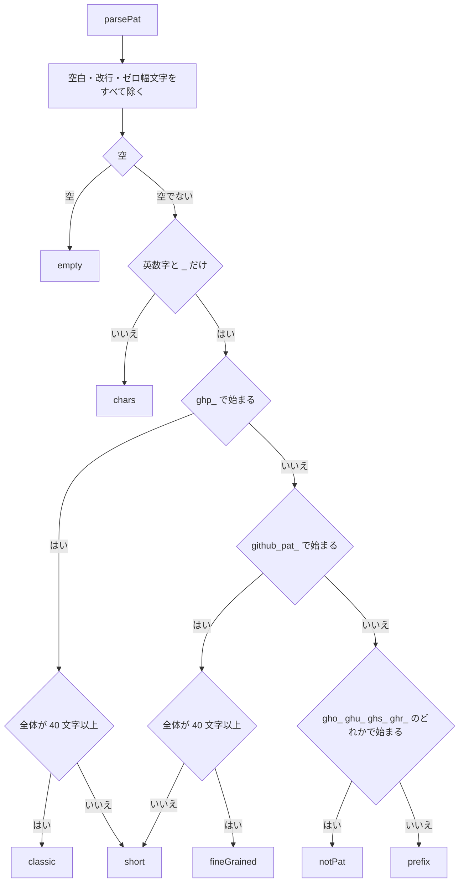
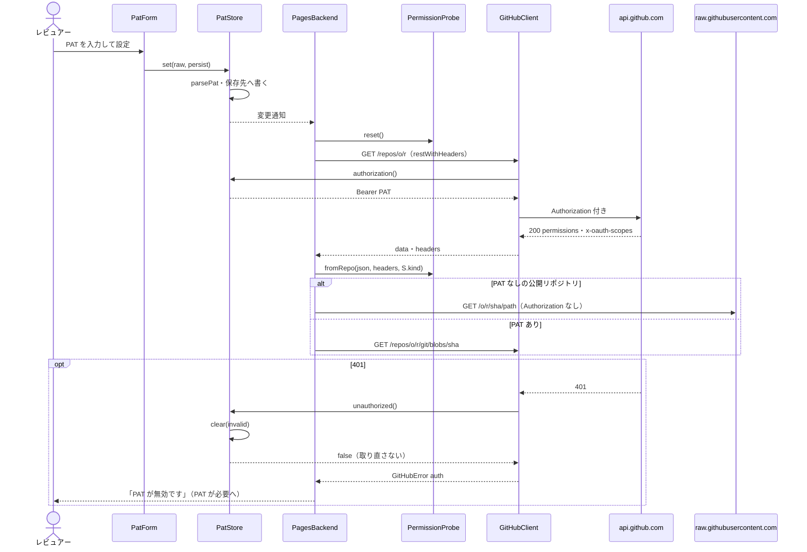
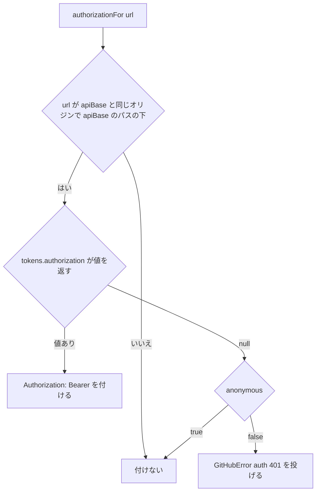
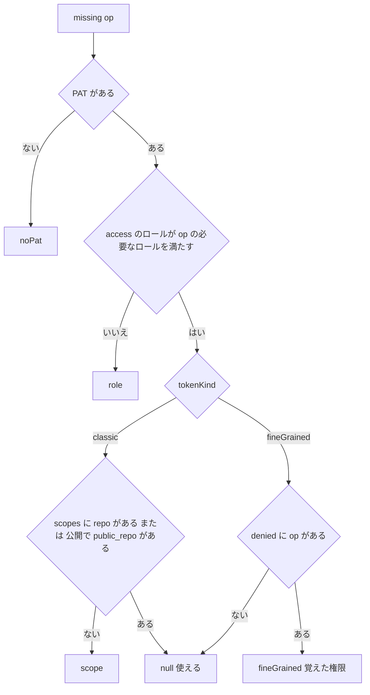
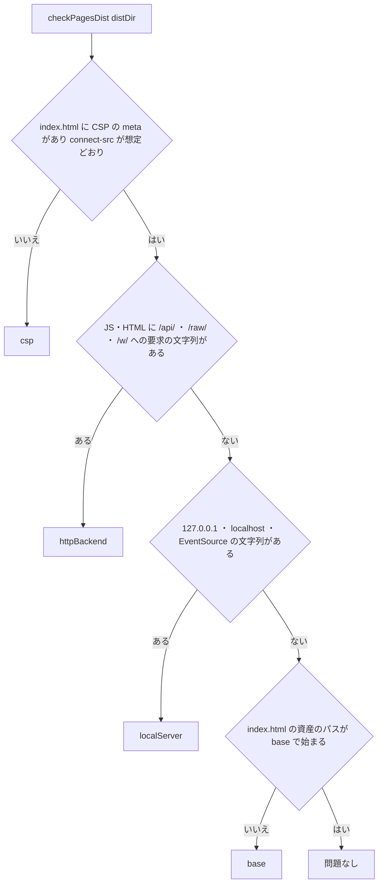
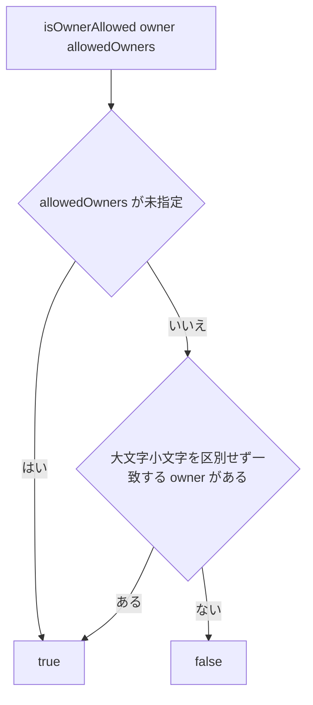

# PAT・権限・CSP・ビルド版・Pages デプロイ 詳細設計

## 前提

- PAT の状態・置き場所・送信先・CSP は :ref[../basic/hosted-viewer.md#pat-の扱い]、権限による操作の可否は :ref[../basic/hosted-viewer.md#操作の可否]、ビルド・デプロイ・設定は :ref[../basic/hosted-viewer.md#デプロイとセルフホスト]、試験は :ref[../basic/hosted-viewer.md#試験の観点] を参照
- Actions の実行の可否（`permissions.push`・Actions: Write）は :ref[../basic/actions-run.md#実行の可否] を参照。本書はその判定に使う `PermissionProbe` を提供する
- 画面遷移（対象の指定・取得中・PAT が必要）と操作の可否の画面側（無効表示・理由）は [pages-viewer.md](pages-viewer.md)、`PagesBackend`・`GitHubRepoReader`（raw・blob の取得）は [services.md](services.md) で扱う。本書はそれらが使う部品だけを扱う
- 実装：
  - `packages/github`：新規 `src/provider.ts`（`TokenProvider`）・`src/browser.ts`（ブラウザ用の入口）、`client.ts`（Authorization の付与判定・匿名・401 の扱い）、`errors.ts`（403 の `acceptedPermissions`）、`redact.ts`（`Buffer` をやめる）
  - `apps/web`：新規 `src/pages/pat-store.ts`・`pat-format.ts`・`permission.ts`・`components/PatMenu.tsx`・`components/PatForm.tsx`、`src/backend/`（版の切り替え）、`vite.config.ts`・`vite-env.d.ts`、新規 `pages.config.json`・`scripts/check-pages-dist.ts`
  - `packages/core`：新規 `src/pages-config.ts`、`config.ts`（`pages.url`）
  - リポジトリ：新規 `.github/workflows/pages.yml`・`playwright.pages.config.ts`・`e2e-pages/`
- **ローカル版の動作は変えない（REQ-610）**：`TokenResolver`（gh / `GITHUB_TOKEN`）・401 で 1 回だけ取り直す動作・`GitHubClient` の既定（トークンが無ければ「GitHub にログインしてください…」）・エラー文言はそのまま。`DDV_EDITION` 未指定のビルドは従来と同じ成果物（CSP の meta なし、base は `/`）

## 画面

PAT が必要の画面（`Token`）と、ヘッダの PAT メニュー。画面遷移と他の画面の項目は [pages-viewer.md](pages-viewer.md)。

::mock[hosted-viewer/index.html]

### PAT の入力（`PatForm`）

「PAT が必要」の画面と、PAT メニューの「設定」で開くダイアログで同じ部品を使う。`<form>` の GET 送信・`name` 属性は使わない（PAT が URL に載らないように `onSubmit` で `preventDefault`）。

| 項目 | testid | 種類 | 型・桁 | 必須 | 初期値 | 取得元・送信先 | 入力チェック・エラー文言 |
|---|---|---|---|---|---|---|---|
| Personal Access Token | `pat` | パスワード入力 | 文字列 255 | ○ | 空（設定済みでも表示しない） | `PatStore.set(raw, persist)` | `parsePat`（[PAT の形式](#pat-の形式)）。`autocomplete="off"`・`spellcheck=false` |
| この端末に保存 | `pat-store` | チェックボックス | 真偽 | — | オフ（`Stored` のときはオン） | `set` の `persist` | — |
| 入力エラー | `pat-error` | メッセージ | — | — | 非表示 | `PatParseError.message`、または直前の 401（`PatStore.lastClear === 'invalid'`）のとき「PAT が無効です（失効・取り消しの可能性があります）。設定し直してください」 | — |
| 設定 | `pat-submit` | ボタン | — | — | — | 形式 OK なら `set` → 対象を取得し直す（取得中へ） | 形式 NG なら `pat-error` を表示し状態を変えない |
| 対象を変更 | `token-change` | ボタン | — | — | — | 対象の指定へ（PAT は変えない） | — |
| 必要な権限 | `scopes` | 一覧 | — | — | `REQUIRED_PERMISSIONS` から生成 | [必要な権限](#必要な権限) の表 | — |
| PAT の作成ページ | `pat-create-link` | リンク | — | — | — | `https://github.com/settings/personal-access-tokens/new`（新しいタブ、`rel="noopener noreferrer"`） | — |
| キャンセル | `pat-cancel` | ボタン | — | — | — | ダイアログのときだけ。閉じる（状態を変えない） | — |

### PAT メニュー（`PatMenu`）

ヘッダの `pat-menu` を押すと開く。各操作の後は `PatStore` の変更通知で対象を取得し直す（[PAT と要求](#pat-と要求)）。

| 項目 | testid | 種類 | 型・桁 | 必須 | 初期値 | 取得元・送信先 | 入力チェック・エラー文言 |
|---|---|---|---|---|---|---|---|
| PAT メニュー | `pat-menu` | ボタン | — | — | `PAT：未設定` / `PAT：タブ限り` / `PAT：端末に保存` | `PatStore.state` | — |
| 設定 | `pat-menu-set` | メニュー項目 | — | — | — | `PatForm` のダイアログを開く（設定済みなら「置き換え」と表示） | — |
| この端末に保存 | `pat-menu-persist` | メニュー項目 | — | — | `Session` のときだけ表示 | `PatStore.persist()` | — |
| 端末から消す | `pat-menu-unpersist` | メニュー項目 | — | — | `Stored` のときだけ表示 | `PatStore.unpersist()`（このタブでは使い続ける） | — |
| 消す | `pat-menu-clear` | メニュー項目 | — | — | `None` のときは無効 | `PatStore.clear('user')` | 確認なし（設定し直せば戻るため） |
| 必要な権限 | `pat-menu-scopes` | メニュー項目 | — | — | — | `scopes` と同じ一覧と作成ページへのリンクを表示 | — |
| 説明 | `pat-menu-note` | 文 | — | — | 「PAT は api.github.com への要求にだけ使い、URL・ログ・他のサイトには送りません」 | 固定 | — |

## 構造



| 型・関数 | ファイル | 規則 |
|---|---|---|
| `TokenProvider` | `packages/github/src/provider.ts` | `GitHubClient` が依存するのはこの型だけにする（今の `TokenResolver` への型依存を置き換える） |
| `TokenResolver.unauthorized()` | `packages/github/src/token.ts` | `invalidate()` して `true`（今と同じく 1 回だけ取り直す） |
| `GitHubClient` の `anonymous` | `GitHubClientOptions.anonymous?: boolean`（既定 `false`） | Pages 版だけ `true`。`false` のときの動作・文言は今と同じ |
| `GitHubClient.restWithHeaders` | `client.ts` | `{ data, headers }` を返す（`x-oauth-scopes`・`x-ratelimit-*` を読むため）。今の非公開の `request` を公開するだけ |
| `GitHubError.acceptedPermissions` / `sso` | `errors.ts` | 403 のとき `x-accepted-github-permissions` / `x-github-sso` の値。`message` は変えない |
| `redact` / `secretForms` | `redact.ts` | `Buffer` を `btoa` に置き換える（Node 20 にもある。結果は同じ） |
| ブラウザ用の入口 | `packages/github/src/browser.ts` | `client.ts`・`errors.ts`・`redact.ts`・`provider.ts` だけを再輸出（`node:child_process` を含む `token.ts` を含めない）。`apps/web/vite.config.ts` の alias `@ddv/github` はこれを指す |
| `PatStore` / `parsePat` | `apps/web/src/pages/pat-store.ts` / `pat-format.ts` | Pages 版のバンドルにだけ入る |
| `PermissionProbe` / `REQUIRED_PERMISSIONS` | `apps/web/src/pages/permission.ts` | 同上 |
| `PagesConfigSchema` / `isOwnerAllowed` | `packages/core/src/pages-config.ts` | `@ddv/core` の `index.ts` から輸出（ブラウザでも使う） |

## PAT の保管

`PatStore` は 1 タブに 1 つ。`PagesBackend` の生成時に `load()` し、`window` の `storage` イベントを `onStorage` に渡す。

| 項目 | 値 |
|---|---|
| キー | `ddv:pat:<import.meta.env.BASE_URL>`（例 `ddv:pat:/design-document/`）。GitHub Pages のプロジェクトサイトは同じオリジン（`<owner>.github.io`）を共有するため、配信元ごとに分ける |
| `Session` の置き場所 | `sessionStorage` のキーに PAT の文字列だけ（JSON にしない）。`localStorage` には置かない |
| `Stored` の置き場所 | `localStorage` のキーに PAT の文字列だけ。`sessionStorage` には置かない |
| ストレージが使えない | `sessionStorage` の読み書きが例外（プライベートモード・無効化）なら、メモリだけで `Session` として持つ。`persist` は `Error('この端末に保存できません（ブラウザの設定でストレージが無効です）')` |
| 他タブとの同期 | `localStorage` の `storage` イベントだけで行う（`sessionStorage` はタブごとなので同期しない）。`event.key` がキーか `null`（`clear()`）のときだけ扱う |
| 変更通知 | 状態または PAT が変わったら `subscribe` の listener を呼ぶ。`PagesBackend` はキャッシュ（PR 情報・権限）を捨てて対象を取得し直し、`PermissionProbe.reset()` する |



- `load`：`sessionStorage` を先に見る（タブを閉じれば消えるので、タブを閉じて開き直すと `localStorage` に無い限り `None`）。値は `parsePat` を通し、NG なら消して `None`
- `set [形式NG]`：`PatFormatError`（`code`・`message`）を投げ、状態と保存先を変えない。`set` は `lastClear` を `null` に戻す
- 状態を移すときは、移動元の保存先から必ず消す（`Stored → Session` は `localStorage` から消して `sessionStorage` へ書く）
- `clear(reason)`：両方の保存先から消し、`lastClear = reason`。`unauthorized()` は `clear('invalid')` して `false` を返す（取り直さない）。`Stored` で 401 を受けると `localStorage` からも消えるので他のタブも `None` になる
- `storage [他タブで保存]`：`newValue` が `parsePat` で OK のとき。NG の値は無視
- 不正遷移：`None` での `persist`・`unpersist` は `Error('PAT が設定されていません')`（メニューには出さない）。`Session` での `unpersist`・`Stored` での `persist` は何もしない。`Session` での `storage` イベントは無視する（タブ限りの PAT を優先。他タブの変更で置き換えない）。`None` での `clear`・`unauthorized` は何もしない（通知もしない）

## PAT の形式

`parsePat(raw): { ok: true; token: string; kind: PatKind } | { ok: false; error: PatFormatError }`。GitHub の形式が変わっても通るよう、長さは下限だけ見る。



| code | 文言（`pat-error`） |
|---|---|
| `empty` | PAT を入力してください |
| `chars` | PAT に使えない文字が含まれています（貼り付けた内容を確認してください） |
| `short` | PAT が短すぎます（途中までしか貼り付けられていない可能性があります） |
| `notPat` | OAuth・GitHub App のトークンは使えません。ghp_ または github_pat_ で始まる PAT を入力してください |
| `prefix` | ghp_ または github_pat_ で始まる PAT を入力してください（モックと同じ文言） |

- 除く空白は `/[\s\u200B-\u200D\uFEFF]/g`。除いた後の値を `token` として保存・送信する
- 文言に入力値（PAT の一部）を含めない

## PAT と要求



`GitHubClient.request` の中で、要求ごとに Authorization を付けるかを決める（`authorizationFor(url)`）。raw・配信元・その他の URL は `GitHubClient` を通さないが、`paginate` の `Link` のような絶対 URL も同じ判定にかける。



- 「同じオリジン」は `new URL(url).origin === new URL(apiBase).origin` かつパスが `apiBase` のパス（`api.github.com` では空）で始まる。`https://raw.githubusercontent.com`・`https://github.com`・配信元は常に「いいえ」
- `E` の文言は今と同じ「GitHub にログインしてください（gh auth login または GITHUB_TOKEN）」（ローカル版。REQ-610）
- 401 で取り直すのは Authorization を付けて送ったときだけ、かつ `tokens.unauthorized()` が `true` のときだけ（ローカル版は今と同じく 1 回、Pages 版は取り直さない）
- `fetch` の指定：`credentials: 'omit'`、`referrerPolicy: 'no-referrer'`。リダイレクトは既定（別オリジンへのリダイレクトではブラウザが Authorization を外す）

### 漏らさないための規則

| 出し先 | 規則 |
|---|---|
| URL | PAT をクエリ・ハッシュに入れない。`PatForm` は GET 送信しない |
| 画面のエラー表示 | `GitHubError.message`（GitHub の `message` だけから作る。:ref[workspace.md#github-api] と同じ）を、さらに `PatStore.redact(text)`（= `redact(text, [token])`）に通してから表示する |
| `console` | Pages 版のコードは PAT・要求のヘッダを `console` に出さない。`fetch` の例外の `message` も `redact` に通してから `GitHubError` にする |
| モックの iframe | `postMessage` で渡すのはモックのデータだけ（PAT・`GitHubClient` を渡さない） |
| 最近開いた対象・IndexedDB | PAT を含めない（キーにも使わない） |

Pages 版のエラー表示（`formatGitHubError(e, store)`、`apps/web/src/pages/errors.ts`）：

| 条件 | 表示 |
|---|---|
| `kind: 'auth'` かつ `store.lastClear === 'invalid'` | PAT が無効です（失効・取り消しの可能性があります）。設定し直してください |
| `kind: 'forbidden'` かつ `sso` あり | この組織では PAT の SSO 承認が必要です（GitHub の PAT の設定で「Configure SSO」から承認してください） |
| `kind: 'forbidden'`（操作中） | [権限の判定](#権限の判定) の `MissingPermission.message` |
| `kind: 'rateLimit'` | `message`（解除の時刻）＋ PAT が未設定なら「PAT を設定すると上限が上がります」 |
| その他 | `redact(message)` |

## 権限の判定

### 必要な権限

`REQUIRED_PERMISSIONS: Record<GitHubOp, OpRequirement>`。fine-grained PAT で 403 になったとき、応答に `x-accepted-github-permissions` が無ければこの表で「足りない権限」を推定する。画面の `scopes` もこの表から作る。

| 操作（`GitHubOp`） | 呼ぶ API | 必要なロール | fine-grained PAT | classic PAT（公開 / 非公開） |
|---|---|---|---|---|
| 閲覧（操作なし） | contents・trees・blobs・pulls・GraphQL（スレッド） | pull | Contents: Read、Pull requests: Read（Metadata: Read は自動） | 不要 / `repo` |
| `reviewComment` コメント | `POST /repos/{o}/{r}/pulls/{n}/comments` または保留中レビュー | pull | Pull requests: Write | `public_repo` / `repo` |
| `reviewReply` 返信 | `POST …/pulls/{n}/comments/{id}/replies` | pull | Pull requests: Write | `public_repo` / `repo` |
| `reviewResolve` 解決 | GraphQL `resolveReviewThread` | pull | Pull requests: Write | `public_repo` / `repo` |
| `reviewSubmit` レビューの送信 | `POST …/pulls/{n}/reviews` | pull | Pull requests: Write | `public_repo` / `repo` |
| `suggestion` モックの調整・テストデータの suggestion | `reviewComment` と同じ | pull | Pull requests: Write | `public_repo` / `repo` |
| `approveStatus` Approve の status 連動 | Git Data API（blobs・trees・commits・refs） | push | Contents: Write | `public_repo` / `repo` |
| `actionsDispatch` Actions での実行 | `POST …/actions/workflows/{id}/dispatches` | push | Actions: Write | `public_repo` / `repo` |
| `snapshotApprove` 基準画像の承認 | `actionsDispatch` と同じ（承認のモード） | push | Actions: Write | `public_repo` / `repo` |

### 判定

`PermissionProbe.probe(owner, repo)` は対象を開いたときに 1 回（`GET /repos/{o}/{r}`。`PagesBackend` が既定ブランチを得るための同じ応答を `fromRepo` に渡し、二重に呼ばない）。`RepoAccess` は次のとおり作る。

| 項目 | 値 |
|---|---|
| `pull` / `push` | 応答の `permissions.pull` / `permissions.push`。`permissions` が無い（PAT なし）ときは `pull: true`・`push: false` |
| `private` | 応答の `private` |
| `tokenKind` | `PatStore.kind`（PAT なしは `null`） |
| `scopes` | classic のとき `x-oauth-scopes` をカンマで分けたもの。fine-grained・PAT なしは `null` |

fine-grained PAT の `permissions` は利用者のロールを表し、PAT に与えた権限は表さない。そのため fine-grained は送信して 403 になった操作を `recordDenied` で覚え、以後その操作を無効にする。



| `reason` | `permissions` | `message`（無効にした操作の理由に表示） |
|---|---|---|
| `noPat` | 表の fine-grained 列 | PAT を設定してください（<権限>） |
| `role` | `['write']` | このリポジトリへの書き込み権限がありません（必要なロール：<pull→Read / push→Write>） |
| `scope` | `['repo']` または `['public_repo']` | PAT に <repo> スコープがありません |
| `fineGrained` | `recordDenied` で覚えたもの | PAT に次の権限がありません：<権限>（PAT の設定で追加してください） |

- `access` が未取得（取得中・取得失敗）のとき、書き込みの操作は `noPat` ではなく「権限を確認中です」として無効（`PagesBackend` が `probe` の完了を通知する）
- `recordDenied(op, err)`：`err.kind === 'forbidden'` かつ `sso` が無いときだけ覚える（`rateLimit` は覚えない）。`err.acceptedPermissions` があれば、`;` で区切った最初の組を `,` で分け `contents=write` → `Contents: Write` の形にする（名前の対応：`contents` Contents、`pull_requests` Pull requests、`actions` Actions、`metadata` Metadata、`workflows` Workflows、`statuses` Commit statuses。他は先頭を大文字にする）。無ければ上の表の fine-grained 列
- classic で `scope` に当たらないのに 403 になったときも `recordDenied` で覚える（`reason` は `fineGrained` と同じ表示）
- `reset()`：PAT が変わったとき・対象を変えたときに `access` と `denied` を捨てる
- 画面側の判定（Pages 版で使えるか・書き込みか）と表示は [pages-viewer.md](pages-viewer.md)。Actions の可否は :ref[../basic/actions-run.md#実行の可否] の「書き込み権限」に `missing('actionsDispatch')` を使う

## ビルドの版

`DDV_EDITION`（`local` / `pages`、既定 `local`）は `apps/web/vite.config.ts` だけが読む。実行時には判定しない（REQ-614）。

```ts
// apps/web/vite.config.ts（追加分）
const edition = resolveEdition(process.env.DDV_EDITION); // 'local' | 'pages'。他の値は Error('DDV_EDITION は local か pages です: <値>')
const pagesConfig = edition === 'pages' ? loadPagesConfig(process.env.DDV_PAGES_CONFIG ?? path.join(import.meta.dirname, 'pages.config.json')) : null;

export default defineConfig({
  base: edition === 'pages' ? normalizeBase(process.env.DDV_BASE ?? '/') : '/',
  define: {
    'import.meta.env.DDV_EDITION': JSON.stringify(edition),
    'import.meta.env.DDV_PAGES_CONFIG': JSON.stringify(pagesConfig),
  },
  plugins: [react(), ...(edition === 'pages' ? [ddvPagesHtml(pagesConfig!)] : [])],
  resolve: {
    alias: {
      '@ddv/github': path.join(root, 'packages/github/src/browser.ts'),
      '#backend-impl': path.join(import.meta.dirname, `src/backend/${edition === 'pages' ? 'pages' : 'http'}.ts`),
      // 既存の alias はそのまま
    },
  },
});
```

| 項目 | 規則 |
|---|---|
| 型 | `vite-env.d.ts` に `interface ImportMetaEnv { readonly DDV_EDITION: 'local' \| 'pages'; readonly DDV_PAGES_CONFIG: PagesConfig \| null }` |
| Backend の切り替え | `src/backend/index.ts` は `import { createBackend } from '#backend-impl'` だけ。ビルドに入るのは片方のファイルだけなので、Pages 版に `HttpBackend` は含まれない（tree-shake に頼らない） |
| `api.ts` の取り込み | `api.ts`（`/api/...` の `fetch`・`EventSource`）を import してよいのは `src/backend/http.ts` だけ。型は `import type` に限る（成果物に残らない） |
| 版による画面の分岐 | `import.meta.env.DDV_EDITION` を参照してよいのは `src/backend/` とヘッダの版の表示だけ（画面は版で分岐しない。:ref[../basic/hosted-viewer.md#構成]） |
| base | `DDV_BASE` は `/` で始まり `/` で終わる形に直す（`normalizeBase`。空は `/`）。ルートはハッシュなので base 以外のパスは使わない |
| `ddvPagesHtml` | `transformIndexHtml` で `<head>` の先頭に CSP の meta を、`<title>` を `pagesConfig.title` に置き換える。`apply: 'build'` と `'serve'` の両方（`vite dev` で Pages 版を試すときも同じ CSP） |
| 開発 | `DDV_EDITION=pages npx vite apps/web` で Pages 版を開発サーバで動かせる（`/api` の proxy は使われない） |

### CSP

Pages 版の `index.html` に付ける meta（1 行にまとめる）。基本設計の 3 つの指定に、モックの iframe（`srcdoc` は親の CSP を引き継ぐ）を動かすための指定と、既定の制限を足す。

```html
<meta http-equiv="Content-Security-Policy" content="default-src 'self'; script-src 'self' 'unsafe-inline' blob:; style-src 'self' 'unsafe-inline' blob: data:; connect-src 'self' https://api.github.com https://raw.githubusercontent.com; img-src 'self' data: blob: https://*.githubusercontent.com; font-src 'self' data: blob:; media-src 'self' data: blob:; frame-src 'self' blob:; worker-src 'self' blob:; object-src 'none'; base-uri 'self'; form-action 'none'">
```

| 指定 | 理由 |
|---|---|
| `connect-src` / `img-src` / `frame-src` | 基本設計のとおり。GitHub 以外への `fetch`・画像による送信を止める |
| `script-src 'unsafe-inline' blob:` | モックの HTML（利用者のインラインの JS）を `srcdoc` で動かすため。外部のスクリプトは読めない。PAT はモックから読めない（sandbox で親と別オリジン。:ref[../basic/hosted-viewer.md#モックの再生]） |
| `style-src 'unsafe-inline'` | Mermaid の SVG とモックのインラインのスタイル |
| `form-action 'none'` | フォームの送信で外部へ出さない（`PatForm` も送信しない） |
| `frame-ancestors` | meta では効かないので書かない |

- ローカル版の `index.html` は変えない（meta を付けない）

### 成果物の検査

`apps/web/scripts/check-pages-dist.ts`（`npm run check:pages-dist`）。Pages 版のビルドの後に実行し、問題があれば一覧を出して終了コード 1。



- 文字列の検査は `dist/**/*.{js,html}` の中身に対して行う。`"/api/` と `'/api/` と `` `/api/ ``（引用符の直後）を数え、GitHub の API の URL（`https://api.github.com/...`）は数えない
- 単体テストは `dist` の代わりに小さなディレクトリを作って `checkPagesDist` に渡す
- E2E（[試験](#試験)）でも、実際に `127.0.0.1` のローカルサーバへの要求が無いことを確かめる

## pages.config.json

`apps/web/pages.config.json`（公式版の既定）。セルフホストではこのファイルだけを変える（REQ-611）。ビルド時に読み、zod で検査して `import.meta.env.DDV_PAGES_CONFIG` に埋め込む（実行時に取得しない）。

```json
{ "title": "ddv", "recentTargets": [] }
```

```ts
// packages/core/src/pages-config.ts
const OWNER = /^[A-Za-z0-9](?:[A-Za-z0-9-]{0,38})$/;
const REPO = /^[A-Za-z0-9](?:[A-Za-z0-9-]{0,38})\/[A-Za-z0-9._-]{1,100}$/;

export const PagesTargetSchema = z
  .object({
    repo: z.string().regex(REPO, 'owner/repo の形式で書いてください'),
    pr: z.number().int().min(1).optional(),
    ref: z.string().min(1).max(100).optional(),
    label: z.string().max(60).optional(),
  })
  .strict()
  .refine((t) => !(t.pr !== undefined && t.ref !== undefined), 'pr と ref はどちらか一方だけ書いてください');

export const PagesConfigSchema = z
  .object({
    title: z.string().min(1).max(40).default('ddv'),
    defaultTarget: PagesTargetSchema.optional(),
    recentTargets: z.array(PagesTargetSchema).max(20).default([]),
    allowedOwners: z.array(z.string().regex(OWNER)).min(1).optional(),
  })
  .strict()
  .superRefine((c, ctx) => {
    for (const [i, t] of [c.defaultTarget, ...c.recentTargets].entries()) {
      if (t && !isOwnerAllowed(t.repo.split('/')[0], c.allowedOwners))
        ctx.addIssue({ code: 'custom', path: i === 0 ? ['defaultTarget'] : ['recentTargets', i - 1], message: `allowedOwners に無い owner です: ${t.repo}` });
    }
  });

export type PagesConfig = z.infer<typeof PagesConfigSchema>;
export type PagesTarget = z.infer<typeof PagesTargetSchema>;
```

- `loadPagesConfig(file)`（`apps/web/vite.config.ts` から呼ぶ、Node 側）：ファイルが無ければ `{}` として既定値。JSON が壊れている・スキーマ違反はビルドを止める（`Error('pages.config.json: <path>: <message>')`）
- `DDV_PAGES_CONFIG`（環境変数）はファイルの場所の上書き（E2E で `allowedOwners` を試すため）。セルフホストの手順では使わない
- `recentTargets` は利用者の最近開いた対象（`localStorage`）の後ろに重複を除いて並べる。`label` は表示名（無ければ `#<pr>` / `<ref>`）

`isOwnerAllowed(owner, allowedOwners)`。対象の指定の「開く」と、URL からの自動の「開く」の両方で、取得の前に呼ぶ（[pages-viewer.md](pages-viewer.md) の「開く [入力NG]」の 1 つ）。



- `false` のときの文言（`open-error`）：「このビューアで開けるのは次の owner のリポジトリだけです：<allowedOwners を , でつなぐ>」
- `allowedOwners` は利用の範囲を絞る設定で、PAT の悪用を防ぐものではない（PAT の権限は GitHub 側で決まる）

## ローカル版の Pages の URL

`ddv.config.yaml` に任意の項目を追加する（`ConfigSchema` の末尾）。

```ts
/** Pages 版の配信元。あるときローカル版に「この画面の Pages 版の URL をコピー」を出す。 */
pages: z
  .object({
    url: z.url({ protocol: /^https$/, error: 'pages.url は https:// で始まる URL を書いてください' }).transform((u) => u.replace(/\/+$/, '')),
  })
  .optional(),
```

- 例：`pages: { url: https://acme.github.io/ddv }`。無ければ従来どおり（コピーの操作を出さない。REQ-610）
- コピーする URL は `<pages.url>/#/gh/<owner>/<repo>/...`（形は :ref[../basic/hosted-viewer.md#url]、組み立ては [pages-viewer.md](pages-viewer.md)）。`owner/repo` は、手元のフォルダは GitHub のリモート（:ref[../basic/actions-run.md#実行の可否] と同じ判定）、GitHub のワークスペースはその対象。どちらも無ければ出さない
- 未コミットの変更があるときは「Pages 版はコミット済みの内容を表示します」を添える

## Pages のデプロイ

`.github/workflows/pages.yml`。公式版と fork で同じファイル（REQ-611）。

```yaml
name: Pages

on:
  push:
    branches: [master, main]
  workflow_dispatch:

permissions:
  contents: read

concurrency:
  group: pages
  cancel-in-progress: false

jobs:
  build:
    runs-on: ubuntu-latest
    timeout-minutes: 30
    env:
      DDV_EDITION: pages
      DDV_GITHUB_NO_GH: '1'
    steps:
      - uses: actions/checkout@v5
      - uses: actions/setup-node@v5
        with:
          node-version: 20
          cache: npm
      - id: pages
        uses: actions/configure-pages@v5
      - run: npm ci
      - run: npx playwright install --with-deps chromium
      - run: npm run build
        env:
          DDV_BASE: ${{ steps.pages.outputs.base_path }}/
      - run: npm run check:pages-dist
      - run: npm test
      - run: npm run e2e:pages
        env:
          DDV_BASE: ${{ steps.pages.outputs.base_path }}/
      - uses: actions/upload-artifact@v5
        if: failure()
        with:
          name: pages-test-results
          path: test-results/
          retention-days: 7
      - uses: actions/upload-pages-artifact@v4
        with:
          path: apps/web/dist

  deploy:
    needs: build
    runs-on: ubuntu-latest
    permissions:
      pages: write
      id-token: write
    environment:
      name: github-pages
      url: ${{ steps.deployment.outputs.page_url }}
    steps:
      - id: deployment
        uses: actions/deploy-pages@v4
```

- `pages: write`・`id-token: write` は `deploy` ジョブにだけ付ける（ビルド・テストは `contents: read`）
- base は `configure-pages` の `base_path`（プロジェクトサイトは `/<repo>`、独自ドメイン・ユーザーサイトは空）に `/` を付けたもの。fork でリポジトリ名を変えても追従する
- fork では管理者が Settings → Pages の Source を「GitHub Actions」にしてから `workflow_dispatch` で実行する。`master`・`main` のどちらも無いリポジトリは `workflow_dispatch` だけで動く
- 既存の `ci.yml` は変えない（ローカル版のビルド・E2E のまま）

`package.json`（ルート）に追加するスクリプト：

| スクリプト | 内容 |
|---|---|
| `check:pages-dist` | `tsx apps/web/scripts/check-pages-dist.ts apps/web/dist` |
| `e2e:pages` | `playwright test -c playwright.pages.config.ts` |

## 試験

基本設計の観点（:ref[../basic/hosted-viewer.md#試験の観点]）の実現方法。

| 観点 | 実現 |
|---|---|
| Pages 版の E2E の土台 | `playwright.pages.config.ts`：`testDir: 'e2e-pages'`、`webServer` は `vite preview apps/web --port 5180 --strictPort`（ビルド済みの `dist` を配信。`DDV_BASE` を引き継ぐ）、`baseURL` は `http://127.0.0.1:5180<base>`。既存の `playwright.config.ts`（`testDir: 'e2e'`）は変えない |
| GitHub のモック | `e2e-pages/github-stub.ts`：`page.route('https://api.github.com/**')` と `page.route('https://raw.githubusercontent.com/**')` で、`examples/sample-app` の内容から応答を作る（公開・非公開・401・403＋`x-accepted-github-permissions` を切り替え） |
| GitHub 以外へ通信しない（REQ-608） | `page.on('request')` で全要求を記録し、送信先が（配信元のオリジンで base の下）・`api.github.com`・`raw.githubusercontent.com`・`data:`・`blob:` だけであること |
| PAT は API にだけ | 記録した要求のうち `authorization` ヘッダを持つものの URL がすべて `https://api.github.com/` で始まること。`page.url()`・画面の文字列・`console` の出力に PAT が無いこと |
| タブを閉じると消える | 新しい `context` で開き直すと PAT の入力を求められる（`Session`）。`pat-store` をオンにしたときは同じ `context` の新しいページで求められない（`Stored`） |
| ローカルサーバを呼ばない（REQ-614） | `check:pages-dist`（[成果物の検査](#成果物の検査)）と、E2E で配信元への要求のパスが `/api/`・`/raw/`・`/w/` で始まらないこと、ポート 5178 への要求が無いこと |
| 版で画面が同じ（REQ-602・603） | [pages-viewer.md](pages-viewer.md) で扱う（既存の PR レビュー・モック再生の E2E を GitHub のモック相手に流す） |
| 単体テスト | 本書の matrix 図（`PATSTORE`・`PATFMT`・`AUTHZ`・`PERM`・`DIST`・`OWNERS`）。`PatStore` は `sessionStorage`・`localStorage` の代わりに `Storage` を満たすメモリ実装を渡し、`StorageEvent` は `onStorage` に直接渡す |
