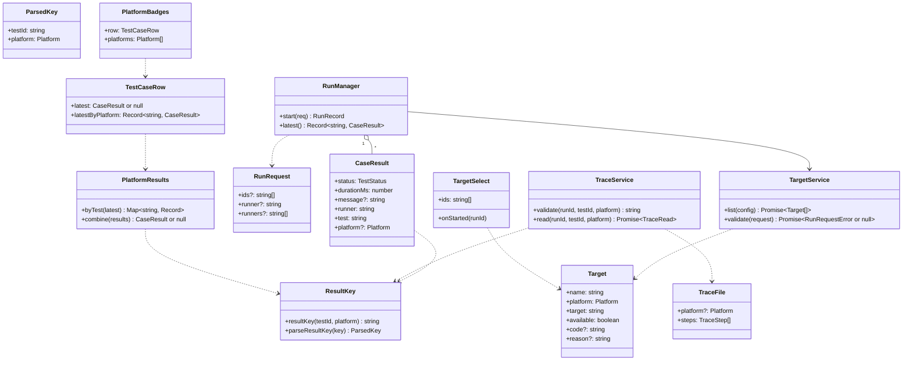
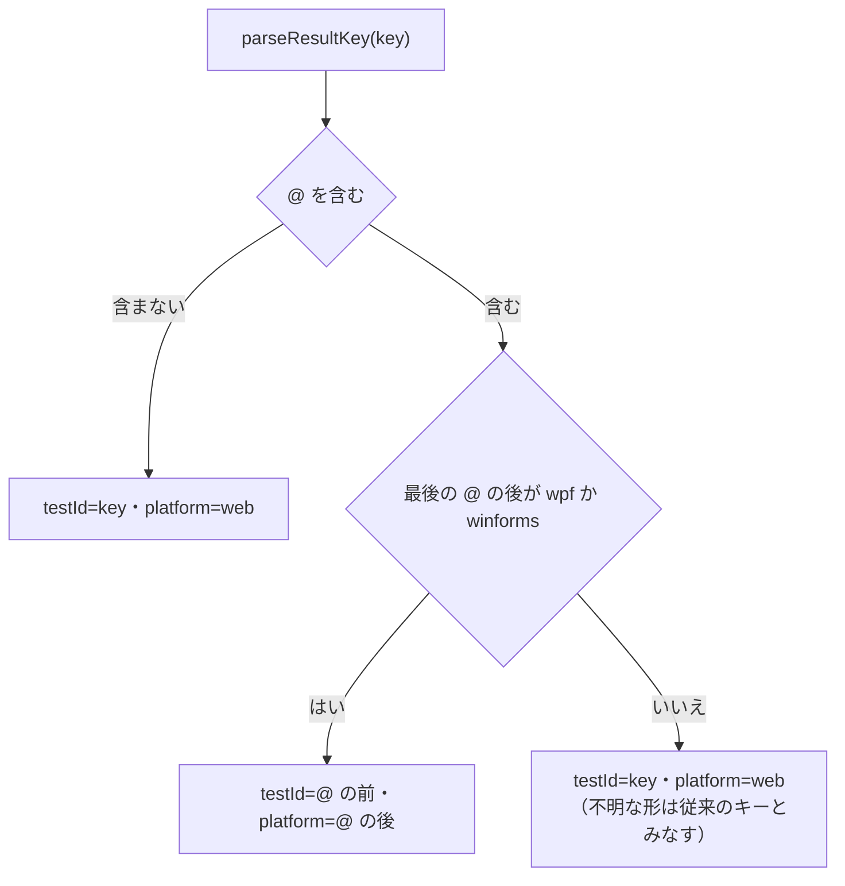
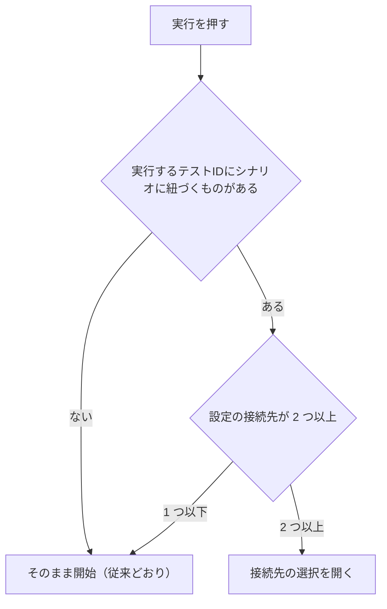
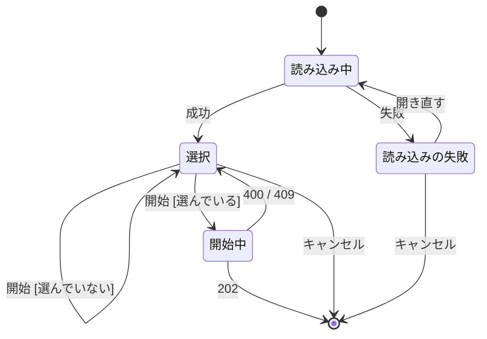
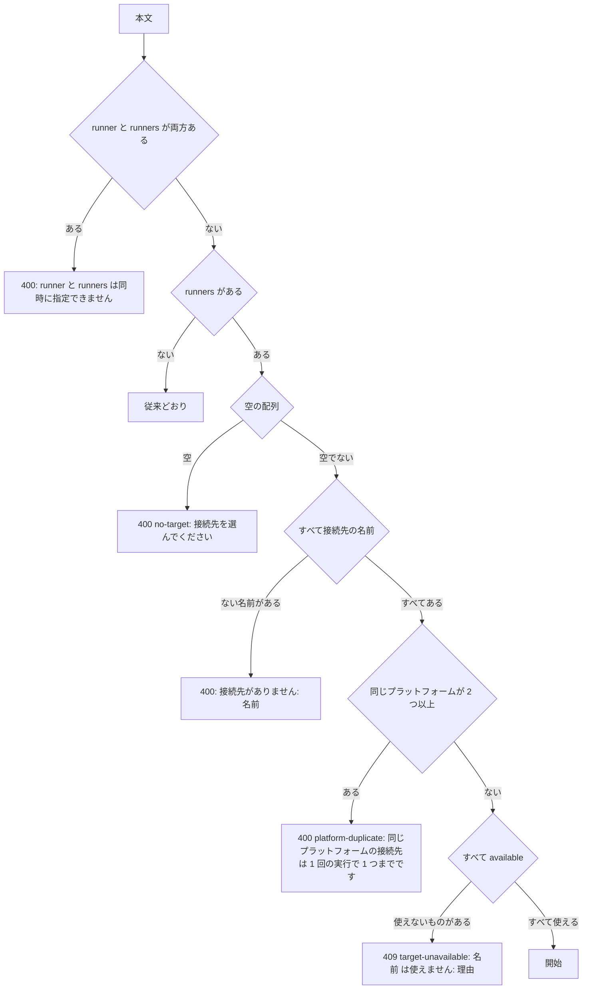
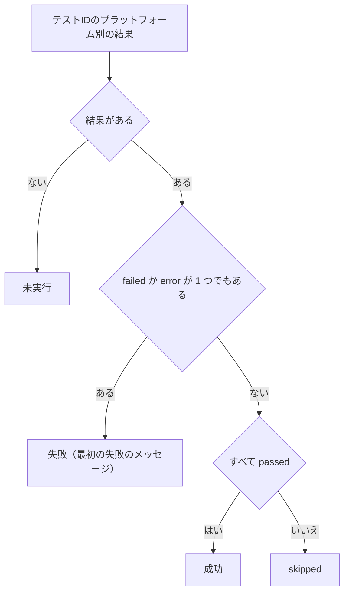
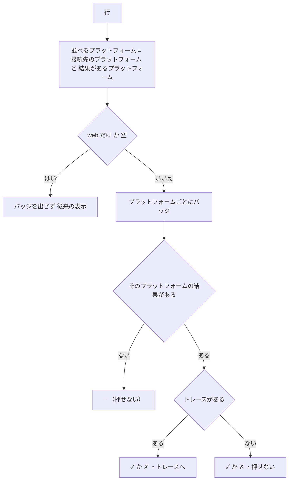
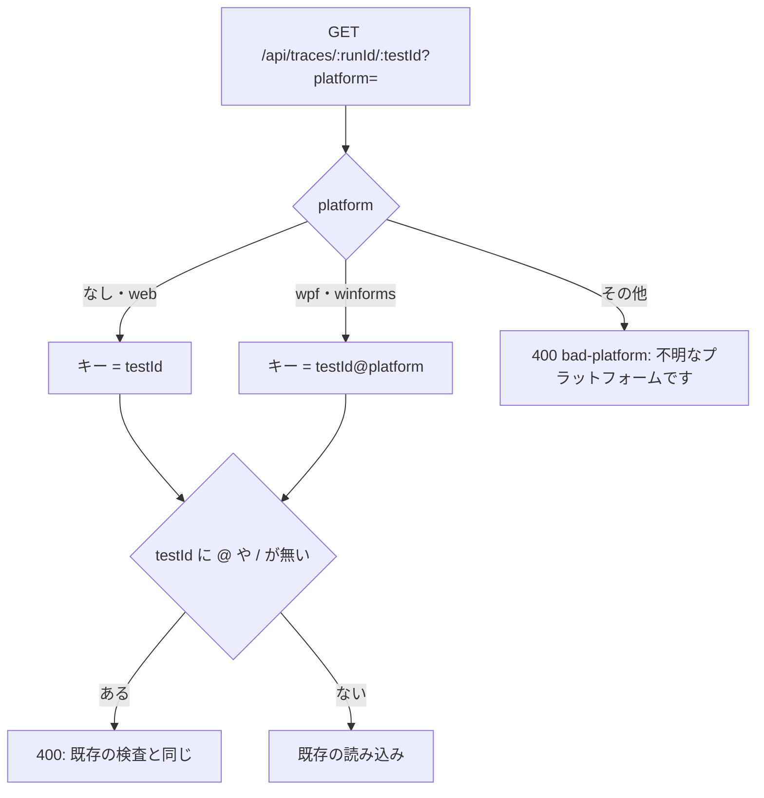

# プラットフォーム別の結果・接続先の選択・トレース 詳細設計

## 前提

- 画面遷移は :ref[../basic/desktop-run.md#画面遷移]、実行の可否は :ref[../basic/desktop-run.md#実行の可否]、結果の表示は :ref[../basic/desktop-run.md#結果の表示]、データは :ref[../basic/desktop-run.md#データ]、API は :ref[../basic/desktop-run.md#api] を参照
- 既存の実行記録は :ref[run-record.md#構造]、テスト一覧とマトリクスの履歴・カバレッジは :ref[test-history.md#構造]、トレースの画面は :ref[trace.md#画面]、結果ブランチは :ref[actions-run.md#構造] を参照
- 接続先の可否の判定 `DesktopGate` は :ref[flaui-driver.md#実行の可否]、飛ばした補助ステップの記録は :ref[desktop-scenario.md#実行器] を参照
- 実装：新規 `packages/services/src/result-key.ts`（ブラウザでも動く）、`apps/server/src/runs.ts`（`RunRequest`・`runTests`）・`runner.ts`（`CaseResult`）・`app.ts`（`/api/tests/targets`・`/api/tests/run`・`/api/traces`）・`targets.ts`（新規）、`packages/services/src/traces.ts`・`history.ts`・`coverage.ts`・`matrix.ts`・`actions/results-branch.ts`、`packages/mock/src/trace.ts`・`trace-format.ts`、`apps/web/src/api.ts`・`components/TestsPage.tsx`・`MatrixPanel.tsx`・`TargetSelect.tsx`（新規）・`PlatformBadges.tsx`（新規）・`TraceView.tsx`

## 画面

テスト一覧（`#/tests`）と文書のマトリクスに、プラットフォーム別のバッジと接続先の選択を加える。

::mock[desktop-run/index.html]

### テスト一覧・マトリクス（追加分）

| 項目 | testid | 種類 | 型・桁 | 必須 | 初期値 | 取得元・送信先 | 入力チェック・エラー文言 |
|---|---|---|---|---|---|---|---|
| 実行（モックの `run`） | `run-all`・`run-selected`・`run-case`（既存） | ボタン | — | — | — | [実行の始め方](#実行の始め方)に従い、接続先の選択を開くか、そのまま `POST /api/tests/run` | 既存どおり |
| 結果のバッジ | `badges` | 表示（行ごと） | — | — | 非表示 | `TestCaseRow.latestByPlatform`（[バッジの表示](#バッジの表示)） | — |
| プラットフォームの結果 | `badge-<platform>` | ボタン（バッジごと） | — | — | — | 「<platform> ✓ / ✗ / –」。トレースがあれば `#/tests/trace/<runId>/<テストID>?platform=<platform>` へ | トレースが無いバッジは押せない（`title` に「トレースはありません」） |

### 接続先の選択（`TargetSelect`）

| 項目 | testid | 種類 | 型・桁 | 必須 | 初期値 | 取得元・送信先 | 入力チェック・エラー文言 |
|---|---|---|---|---|---|---|---|
| 説明 | — | 表示 | — | — | — | 「シナリオ <件数> 件を、選んだ接続先で順に実行します。」（件数は実行するテストIDのうちシナリオに紐づくもの） | — |
| 接続先の一覧 | `targets` | 表 | — | — | — | `GET /api/tests/targets`（列：チェック・接続先・プラットフォーム・対象） | 読み込みの失敗：`target-error` に「接続先を読み込めません: <理由>」 |
| 接続先 | `target-<ランナー名>` | チェック（行ごと） | boolean | — | [前回の選択](#前回の選択) | `RunRequest.runners` | `available: false` の行は押せない |
| 使えない理由 | `target-<ランナー名>-reason` | メッセージ（行ごと） | — | — | 非表示 | `Target.reason` | `available: false` のときだけ |
| エラー | `target-error` | メッセージ | — | — | 非表示 | 開始の結果 | 選んでいない：「接続先を選んでください」。400 / 409：応答の `error` |
| キャンセル | `target-cancel` | ボタン | — | — | — | 閉じて一覧へ | — |
| 開始 | `target-start` | ボタン | — | — | — | `POST /api/tests/run { ids, runners }` | 開始中は押せない |

### 実行中（追加分）

| 項目 | testid | 種類 | 型・桁 | 必須 | 初期値 | 取得元・送信先 | 入力チェック・エラー文言 |
|---|---|---|---|---|---|---|---|
| 接続先の進捗 | `run-target` | 表示（接続先ごと） | — | — | — | SSE の `runner` の開始・終了（「<名前> 実行中 / 待ち / 完了」）。モックには無い | — |
| 注意 | `desktop-warning` | メッセージ | — | — | 非表示 | 選んだ接続先に `wpf`・`winforms` があるときだけ：「デスクトップアプリの操作中はマウス・キーボードに触れないでください（前面のウィンドウを操作しています）。」 | — |
| ログ | `run-log` | 表示（既存） | — | — | — | 既存。行の先頭に `[<ランナー名>]` | — |

- モックの `run-done`（実行完了）はモックだけの操作で、実際には SSE の `done` で一覧に戻る

### トレース（追加分）

| 項目 | testid | 種類 | 型・桁 | 必須 | 初期値 | 取得元・送信先 | 入力チェック・エラー文言 |
|---|---|---|---|---|---|---|---|
| プラットフォーム | `trace-platform` | 表示 | — | — | — | `TraceFile.platform`（無ければ `web`）と結果 | — |
| ステップ | `trace-steps`（既存の `timeline`） | 一覧 | — | — | — | `steps`。`skipped` の行は「飛ばした（only: <値>）」と薄く表示し、選べる | — |
| スクリーンショット | `trace-shot`（既存の `screenshot`） | 画像 | — | — | — | 既存の URL に `?platform=` を付ける。デスクトップはアプリのウィンドウの画像 | 飛ばしたステップ：「このプラットフォームでは実行していません」 |
| 戻る | `trace-back`（既存） | ボタン | — | — | — | 既存 | — |

- デスクトップのトレース（`platform` が `wpf`・`winforms`）では、`api-calls`・`db-diff` の欄を出さない
- 実装では既存の testid（`timeline`・`screenshot`）を使い、モックの `trace-steps`・`trace-shot` はその別名とみなす

## 構造

| クラス・関数 | 置き場所 | 役割 |
|---|---|---|
| `resultKey`・`parseResultKey` | `packages/services/src/result-key.ts` | [結果のキー](#結果のキー) |
| `CaseResult.platform` | `apps/server/src/runner.ts`・`results-branch.ts` の `CaseResultSchema` | 任意。`web` と、プラットフォームを持たないランナー（vitest・dotnet・command）は省略 |
| `RunRequest.runners` | `apps/server/src/runs.ts` | 接続先（ランナー名）の配列 |
| `TargetService`（`listTargets`・`validateRunRequest`） | `apps/server/src/targets.ts` | 接続先の一覧と、開始の要求の検査 |
| `PlatformResults`（`byTest`・`combine`） | `packages/services/src/result-key.ts` | 最新の結果をテストIDごとに束ね、カバレッジのために 1 つの結果にまとめる |
| `TestCaseRow.latestByPlatform` | `packages/services/src/matrix.ts` | プラットフォーム → 最新の結果。`latest` は従来どおり `web`（キーに `@` の無いもの） |
| `TargetSelect`・`PlatformBadges` | `apps/web/src/components/*` | 接続先の選択のダイアログ・結果のバッジ |

## 結果のキー

- `resultKey(testId, platform)` は `platform` が `web` か未指定なら `testId`、それ以外は `<testId>@<platform>`
- キーを分けて解釈するのは集計（`PlatformResults`・`HistoryService`・`CoverageService`）と表示だけ。実行記録・再実行・剪定・結果ブランチは、キーをそのまま扱う
- `runTests` が結果を書くとき：ランナーの `platform`（:ref[flaui-driver.md#設定]）で `resultKey(id, platform)` をキーにし、`CaseResult.platform` を付ける（`web` は付けない）
- 「紐づくテストが無いか、結果が見つかりませんでした」の `error` は、要求したテストIDのどのキーにも結果が無いときだけ、`@` の無いキーで作る

## 実行の始め方

- 「シナリオに紐づく」：`TestCaseRow.links` に `file` が `scenarios/*.yaml` のもの（:ref[trace.md#画面] の「トレース」ボタンと同じ判定）
- 「設定の接続先」は `/api/tests/targets` の件数（使えないものを含む）。Web だけのリポジトリでは従来の見た目・動きのまま（REQ-510）
- 選択を開くときに `/api/tests/targets` を読み直す（可否は開くたびに最新にする）

### 接続先の選択の状態

- 「開始 [選んでいない]」は要求を送らず `target-error` に「接続先を選んでください」
- 「400 / 409」は応答の `error` を `target-error` に出し、選択を残す
- 「202」で閉じ、既存の実行中の表示（SSE）に移る。上の図に無い操作（開始中のキャンセルなど）は受け付けない（ボタンを押せなくする）

### 前回の選択

- `localStorage` の `ddv.targets.<ワークスペースID>` に、開始したときの接続先の名前の配列を保存する
- 開いたときは、保存した名前のうち今も `available` なものを選ぶ。保存が無い・どれも使えないときは `platform: web` の使える接続先を選ぶ（初回はモック）。それも無ければ何も選ばない

## 接続先の一覧

`GET /api/tests/targets` → `{ targets: Target[] }`。対象は `scenarios: true` の playwright のランナーと `type: flaui` のランナー（設定の順）。

| 項目 | 値 |
|---|---|
| `name` | ランナー名 |
| `platform` | ランナーの `platform`（playwright は省略時 `web`） |
| `target` | playwright：環境変数 `DDV_BASE_URL` があればその URL、無ければ「モック（<mocksRoot>）」。flaui：`app.path` |
| `available`・`code`・`reason` | `DesktopGate.evaluate`（:ref[flaui-driver.md#実行の可否]） |

- Pages 版の `Backend.targets()` は、設定から同じ形を作り、`wpf`・`winforms` を `available: false`・`code: hosted`・`reason`「デスクトップアプリの実行はローカル版（Windows）で行います」にする。Actions での実行の画面（:ref[actions-run.md#画面]）には接続先の選択を置かない（ワークフローの OS で実行できるものを実行する）

## 開始の要求

`POST /api/tests/run` の本文 `{ ids?, runner?, runners? }` を `validateRunRequest` で検査する。

- 検査は既存の `deps-installing`・`deps-missing` の検査の前に行う
- `runners` があるとき、実行するランナーは「接続先でないランナー（vitest・dotnet・command、`scenarios: false` の playwright）」＋「`runners` に挙げた接続先」。設定の順に 1 つずつ実行する（同時には動かさない）
- `RunRecord.request.runners` に保存し、再実行（:ref[run-record.md#構造]）は同じ `runners` で行う

## 集計

`PlatformResults.byTest(latest)` は、最新の結果のキーを `parseResultKey` で分け、`Map<テストID, Record<platform, CaseResult>>` にする。

- 設計カバレッジ（`CoverageService`）の分類は `combine` の結果で行う（:ref[../basic/test-monitoring.md#設計カバレッジ] の分類はそのまま）
- 履歴（`HistoryService`）：`HistorySummary.tests` のキーは結果のキーのまま。項目に `testId`・`platform` を加える。フレーキーの判定はキーごと。`/api/history/:testId` は `?platform=`（省略時 `web`）を受け取る
- `/api/results/latest` は従来どおりキー → 結果（`platform` の項目が増えるだけ）

## バッジの表示

- 並べる順は `web`・`wpf`・`winforms`
- 図の経路の色分け（:ref[test-history.md#図の色分け]）は `combine` の結果で塗る

## トレース

- 保存先：`.ddv/traces/<runId>/<結果のキー>.json`、スクリーンショットは `<結果のキー>/<n>.png`。`RunRecord.traces` の要素も結果のキー
- `recorderFor(dir, title, mock, target, platform?)`：ファイル名を `resultKey(testId, platform)` にし、`TraceFile.platform` に `platform`（`web` は省略）を書く。`TRACE_VERSION` は 1 のまま（項目の追加だけ）
- 結果ブランチ（`runs/<id>/`）の中も同じファイル名

- `TraceService.validate(runId, testId, platform)` が上の図を行い、キーを返す。スクリーンショットの URL（`/steps/<n>.png`）も同じ `?platform=` を受け取る
- ビューアの `api.ts` の `trace(runId, testId, platform?)`・スクリーンショットの URL に `platform` を付ける（`web` は付けない）
- ハッシュ `#/tests/trace/<runId>/<テストID>?platform=<platform>`。`platform` の無いハッシュは `web`（既存のリンクはそのまま動く）

## テストの方針

| 種類 | 対象 | 方法 |
|---|---|---|
| 単体テスト | 本書の matrix 図（`RKEY`・`RUNOPEN`・`TSEL`・`RUNREQ`・`COVMERGE`・`BADGE`・`TRPATH`） | `packages/services/src/*.test.ts`・`apps/server/src/*.test.ts`・`apps/web/src/components/*.test.tsx` |
| 結合テスト | API | `apps/server` のテストで、Web と WPF（偽のランナー）の結果が別のキーで残り、`@` の無い既存の実行記録が `web` として読めること |
| E2E | 画面 | ビューアの E2E で、接続先の選択（使えない理由・選んでいないときのエラー）・バッジ・トレースの `platform`（サーバの `DesktopGate` を差し替える） |
