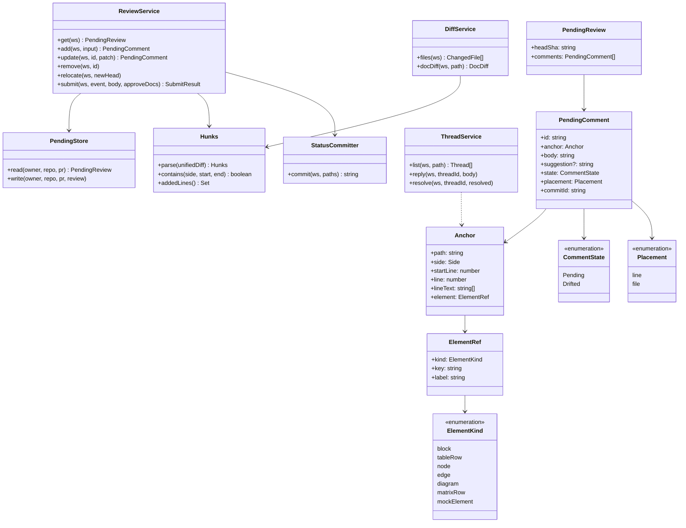
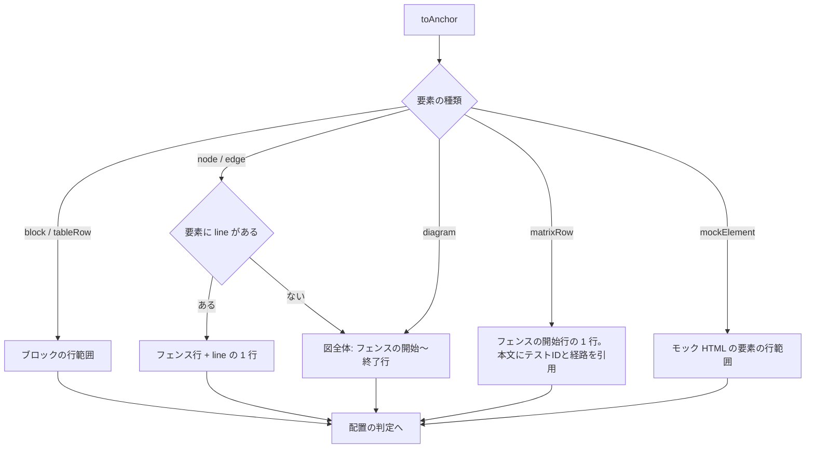
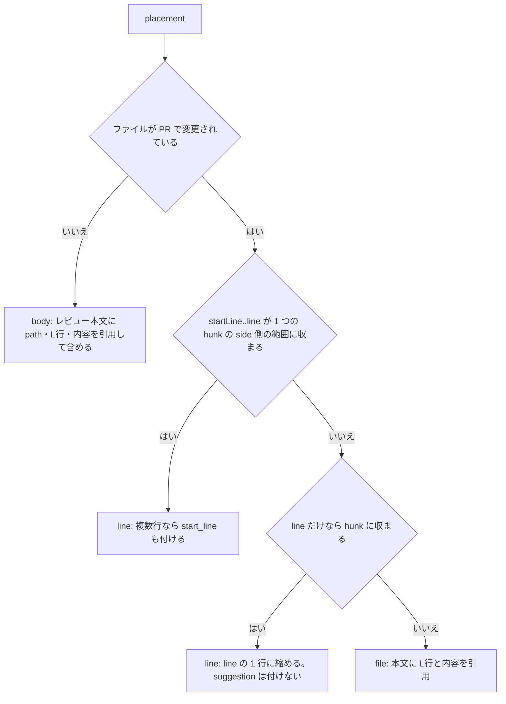
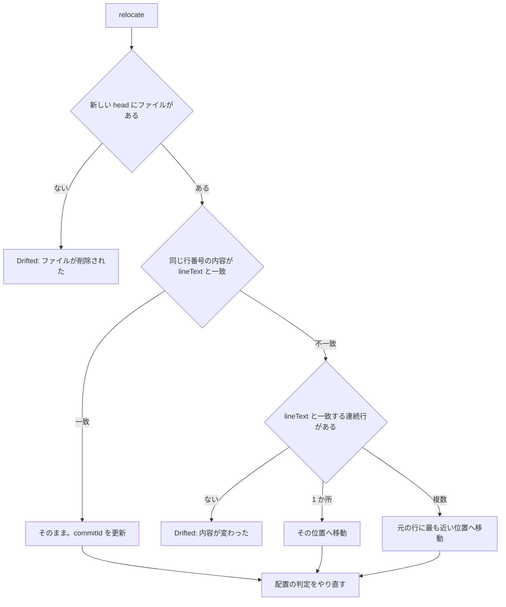
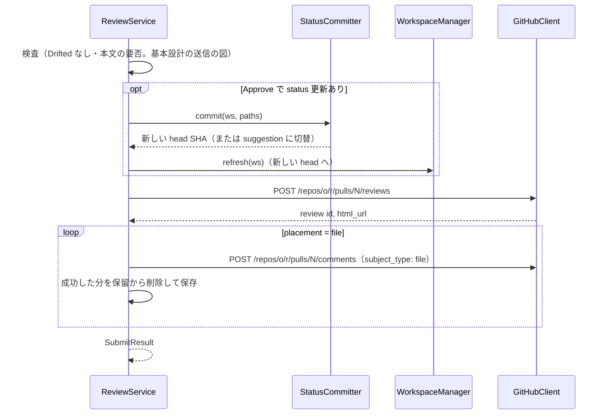
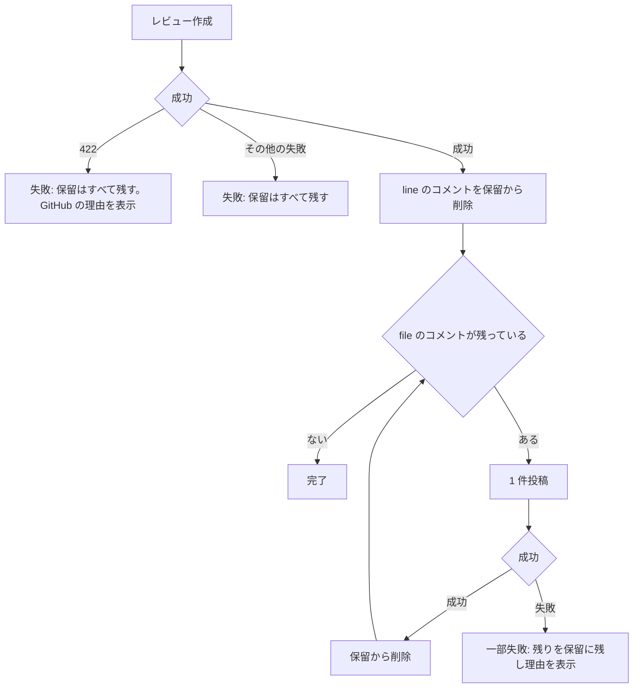
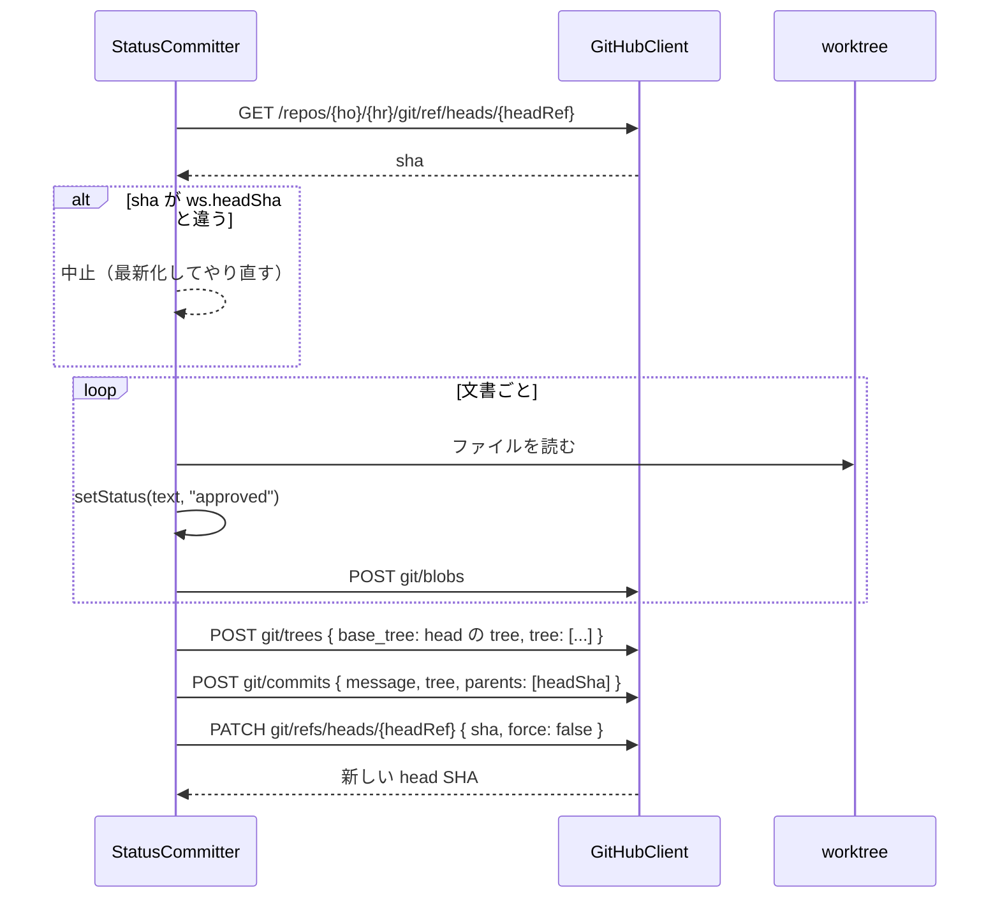
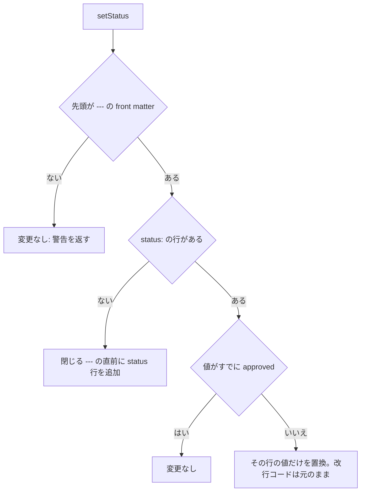
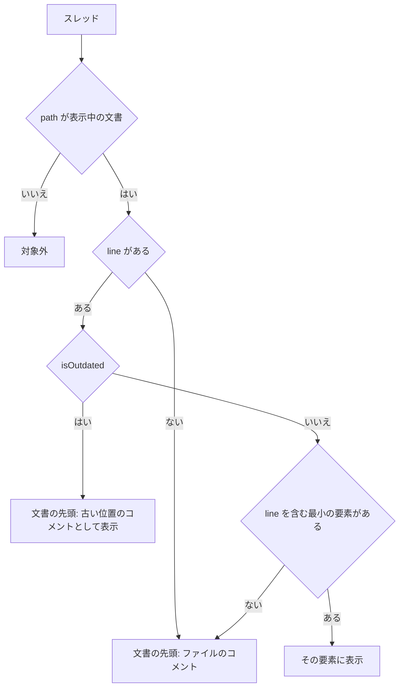
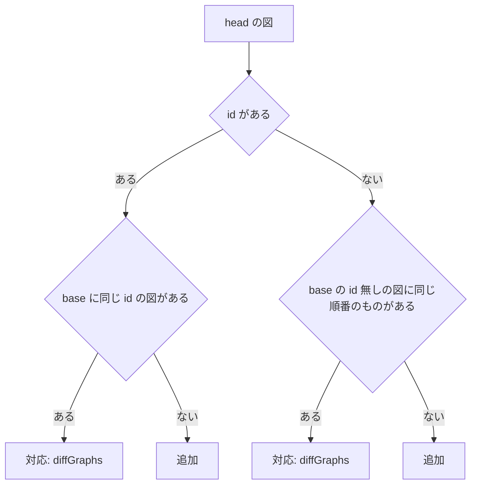

# PR 差分・レビューコメント 詳細設計

## 前提

- 振る舞いは :ref[../basic/github-review.md#pr-の差分]、:ref[../basic/github-review.md#コメント]、:ref[../basic/github-review.md#approve-時の-status-連動] を参照
- ワークスペース・GitHub クライアントは :ref[workspace.md#構造] を参照
- サーバは `apps/server/src/review.ts`（`ReviewService`・`PendingStore`）・`pr-diff.ts`（`DiffService`）・`threads.ts`、ソース位置は `packages/core`・`packages/graph` に追加する

## 画面

画面遷移は :ref[../basic/github-review.md#画面遷移]。このうち「PR の文書（本文・差分）」「保留中レビュー」「送信済」を扱う。

::mock[github-review/index.html]

| 項目 | testid | 種類 | 型・桁 | 必須 | 初期値 | 取得元・送信先 | 入力チェック・エラー文言 |
|---|---|---|---|---|---|---|---|
| PR バー | `prbar` | 表示 | — | — | — | `GET /api/w/<ws>/pr`（番号・タイトル・base ← head） | — |
| head の SHA | `head-sha` | 表示 | 7 桁 | — | — | ワークスペースの `headSha` | — |
| 更新あり | `stale` | 表示 | — | — | 非表示 | SSE `stale` | — |
| 最新化 | `refresh` | ボタン | — | — | — | `POST /api/workspaces/<ws>/refresh` → 取得中 → `relocate` | — |
| レビュー状態 | `review-state` | 表示 | — | — | — | `GET /api/w/<ws>/reviews`（レビュアーごとの最新） | — |
| 保留件数 | `pending-count` | 表示 | 数値 | — | 0 | `PendingReview.comments.length` | — |
| 変更された文書 | `changed-docs` | ツリー | — | — | — | `DiffService.files`（A / M / D） | — |
| 差分 | `diff-view` | 表示切替 | — | — | 閉 | `DiffService.docDiff` | — |
| テストIDの増減 | `id-changes` | 一覧 | — | — | — | `DocDiff.ids`（追加・欠番） | — |
| スレッド | `thread` | 表示 | — | — | — | `ThreadService.list`（未解決を先に） | — |
| 場所 | `anchor` | 選択 | — | ○ | 💬 を押した要素 | `Anchor`（:ref[#ソース位置]）。差分外ならファイルコメントと表示 | — |
| コメント | `comment` | テキスト（複数行） | 文字列 2000 | ○ | 空 | `POST /api/w/<ws>/review/comments` の `body` | 空：「コメントを入力してください」 |
| コメントのエラー | `comment-error` | メッセージ | — | — | 非表示 | `422` の `message` | — |
| 保留に追加 | `add-comment` | ボタン | — | — | — | `ReviewService.add` | — |
| レビュー | `to-review` | ボタン | — | — | — | 保留中レビューへ | — |
| 保留中のコメント | `pending` | 一覧 | — | — | — | `ReviewService.get`（`Drifted` は警告色。修正・削除・移動） | — |
| 種類 | `event` | 選択 | `COMMENT` / `APPROVE` / `REQUEST_CHANGES` | ○ | `COMMENT` | `submit` の `event` | — |
| 本文 | `body` | テキスト（複数行） | 文字列 5000 | Comment・Request changes で ○ | 空 | `submit` の `body` | 空：「Comment / Request changes には本文が必要です」 |
| status を approved にする | `approve-status` | チェック（文書ごと） | — | — | オフ | `submit` の `approveDocs` | `APPROVE` 以外では無効（:ref[#status-連動]） |
| 送信のエラー | `submit-error` | メッセージ | — | — | 非表示 | `SubmitResult.failed` / GitHub の理由 | `Drifted` が残る：「位置を確認していないコメントがあります」 |
| 送信 | `review-submit` | ボタン | — | — | — | `ReviewService.submit`（:ref[#送信]） | — |
| 閉じる | `review-close` | ボタン | — | — | — | PR の文書へ | — |
| 結果 | `done-message` | 表示 | — | — | — | `SubmitResult.posted`・`statusCommit` | 一部失敗は件数と理由 |
| レビューの URL | `review-url` | リンク | — | — | — | `SubmitResult.reviewUrl` | — |
| PR に戻る | `back-to-pr` | ボタン | — | — | — | PR の文書へ（スレッドを取り直す） | — |
## 構造



- `Side` は `RIGHT`（head）/ `LEFT`（merge-base）。`lineText` は `startLine..line` の各行の内容（付け直しに使う）
- `ElementRef.key` の例：見出しのスラッグ、`<図ID>#node:<状態ID>`、`<図ID>#edge:<GraphEdge.key>`、テストID、モック要素のパス（:ref[mock-tune.md#要素のパス]）
- `PendingStore` は `DDV_HOME/reviews/<owner>/<repo>/pr-<N>.json`。書き込みは一時ファイル → rename

## ソース位置

ビューアの要素 → ファイルの行（1 始まり）。描画側は `DocResponse` に追加する位置情報だけを使い、行の計算はサーバで行う。

| 追加するもの | 内容 |
|---|---|
| `ParsedDoc.blocks` | remark の最上位ブロックごとに `{ type, line, endLine }`。リストは項目ごと、表は行ごと（`tableRow`、ヘッダ・区切り行を含めて 1 行 = 1 要素） |
| `GraphNode.line` / `GraphEdge.line` | 図のコード内の行（1 始まり）。ノードは `state "…" as X` / `X[…]` の定義行、無ければ最初に現れた行 |
| ファイル行への変換 | `DiagramBlock.line`（開始フェンス）+ コード内の行 |



### 配置の判定



- `Hunks` は `git diff --unified=3 <mergeBase> <head> -- <path>` を解析する（GitHub の差分と同じ文脈 3 行）。`side` の範囲は `RIGHT` = `+c,d`、`LEFT` = `-a,b`
- suggestion 付きで「line に縮める」場合は suggestion が範囲とずれるため、`file` にする（suggestion の行範囲は変えない）
- PR の差分に無いファイルは、GitHub がファイルへのコメント（`subject_type: file`）を受け付けず（422 `could not be resolved`）、行コメントも付けられない。そのため `body`（レビュー本文に含める）とする。送信時はレビュー本文の末尾に `**path**` と引用・コメントを区切り線（`---`）つきで並べ、レビュー作成と同時に送るので、一部だけ失敗することは無い。スレッドにならないため返信・解決はできない
- 判定は追加時と `relocate` 後に行い、`placement` として保存する（一覧の区別表示に使う）

## 付け直し

`ReviewService.relocate(ws, newHead)`：最新化で head が変わったとき、`state = Pending` のコメントごとに行う。



- `LEFT`（削除行）のコメントは merge-base が変わらなければそのまま、変わったら同じ手順を merge-base に対して行う
- `Drifted` は送信対象外。`update(ws, id, { anchor })` で位置を選び直すと `Pending` に戻る

## 送信





- 要求の組み立て：`{ commit_id: head, event, body, comments: [{ path, body, line, side, start_line?, start_side? }] }`
- suggestion は本文の末尾に ```` ```suggestion ```` ブロックで付ける（`startLine..line` を置き換える内容）
- ファイルコメント：`{ commit_id: head, path, body, subject_type: "file" }`。本文の先頭に `> L12: <行の内容>`（複数行は `L12-14`）
- `SubmitResult`：`{ reviewUrl, posted: { line, file }, failed: [{ id, message }], statusCommit? }`

## status 連動



- `{ho}/{hr}` は PR の head リポジトリ（フォークの PR ではフォーク側）。書けるかは `pr.head.repo.permissions.push` または `pr.maintainer_can_modify`
- `PATCH` が `422`（fast-forward でない）なら中止して `stale` 扱い
- 書けないときは、各文書の `status:` 行への suggestion コメント（配置の判定に従い、差分外ならファイルコメントで変更内容を記載）を保留に追加してから送信する



- 行の書き換えだけで YAML を再出力しない（コメント・キーの順・引用符を保つ）

## スレッド

| 操作 | GitHub |
|---|---|
| 一覧 | GraphQL `pullRequest(number).reviewThreads(first: 100)`：`id`・`isResolved`・`isOutdated`・`path`・`line`・`startLine`・`diffSide`・`comments(first: 50) { databaseId author { login } body createdAt url }` |
| 返信 | REST `POST /repos/o/r/pulls/N/comments/{先頭コメントの databaseId}/replies` |
| 解決 / 未解決 | GraphQL `resolveReviewThread` / `unresolveReviewThread`（`threadId`） |
| ファイルコメント | `line` が null（`subjectType: FILE`）。文書の先頭に表示する |



- 「最小の要素」は、図の node / edge → 表の行・ブロック → 図全体 の順に、行範囲が `line` を含むもの
- スレッドは `ws` ごとに 30 秒キャッシュし、返信・解決・送信の後は捨てる

## PR の差分



- base 側に対応の無い図は「削除」。`parseMermaidGraph` が解析できない図（シーケンス図等）は、ソースの行差分だけを示す
- 図が「変更」か「変更なし」かは、改行（CRLF / LF）と行末の空白を正規化して比べる（base は git の blob で LF、head は作業ツリーで autocrlf により CRLF のことがあるため）。それ以外の文字の違いは「変更」
- 本文：`Hunks.addedLines()` を含む head のブロックを追加・変更、base で削除行だけからなるブロックを削除ブロックとして、直後の head のブロックの前に入れる
- テストIDの増減：`git show <mergeBase>:.ddv/testids.lock.json` と head のロックを比べ、図ごとに `active` のIDの差（追加・欠番化）を返す。base にロックが無ければ全部追加
- `DocDiff`：`{ status: A/M/D/R, oldPath?, blocks: [{ line, endLine, change }], removed: [{ beforeLine, markdown }], diagrams: { [id]: { change, diff? } }, ids: { added: [], retired: [] } }`

## GitHub API の対応

| 用途 | エンドポイント |
|---|---|
| PR 情報・権限 | `GET /repos/o/r/pulls/N` |
| レビュー一覧（状態バッジ） | `GET /repos/o/r/pulls/N/reviews`（レビュアーごとに最新の `APPROVED` / `CHANGES_REQUESTED` / `COMMENTED`） |
| レビュー作成 | `POST /repos/o/r/pulls/N/reviews` |
| ファイルコメント・返信 | `POST /repos/o/r/pulls/N/comments`、`.../comments/{id}/replies` |
| スレッド・解決 | GraphQL `reviewThreads`・`resolveReviewThread`・`unresolveReviewThread` |
| status 連動 | `GET git/ref`・`POST git/blobs`・`POST git/trees`・`POST git/commits`・`PATCH git/refs` |

## CLI：review comments

`ddv review comments --github o/r --pr N [--json] [--all]`：未解決のスレッド（`--all` で全部）を出力する。ワークスペースが無ければ取得してから行う。

```json
{ "pr": 12, "headSha": "a1b2c3d",
  "threads": [
    { "id": "PRRT_…", "url": "https://github.com/…", "resolved": false, "outdated": false,
      "path": "docs/design/basic/order.md", "line": 42, "startLine": null,
      "doc": { "id": "ORDER", "status": "review", "heading": "画面遷移" },
      "element": { "kind": "edge", "key": "screen-flow#edge:Confirm|戻る|Input", "label": "確認 → 入力 : 戻る" },
      "testIds": ["BD-ORDER-SCREEN-T009"],
      "suggestion": null,
      "comments": [{ "id": 101, "author": "alice", "body": "…", "createdAt": "…" }] } ] }
```

- `suggestion` は先頭コメントの ```` ```suggestion ```` ブロックの中身（無ければ null）。`testIds` は element を通る経路のテストID（`pathsThrough`）
- `--json` なしは、文書・見出しごとにまとめた人向けの一覧
