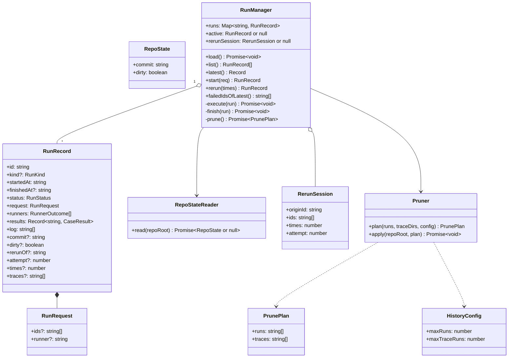
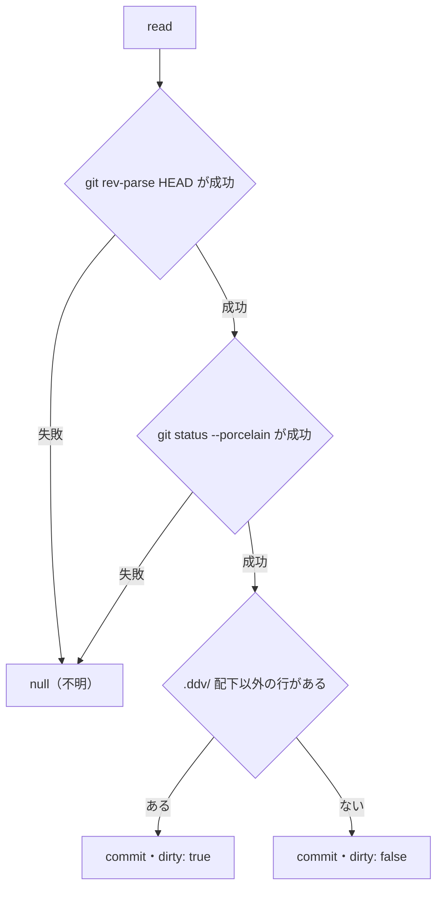
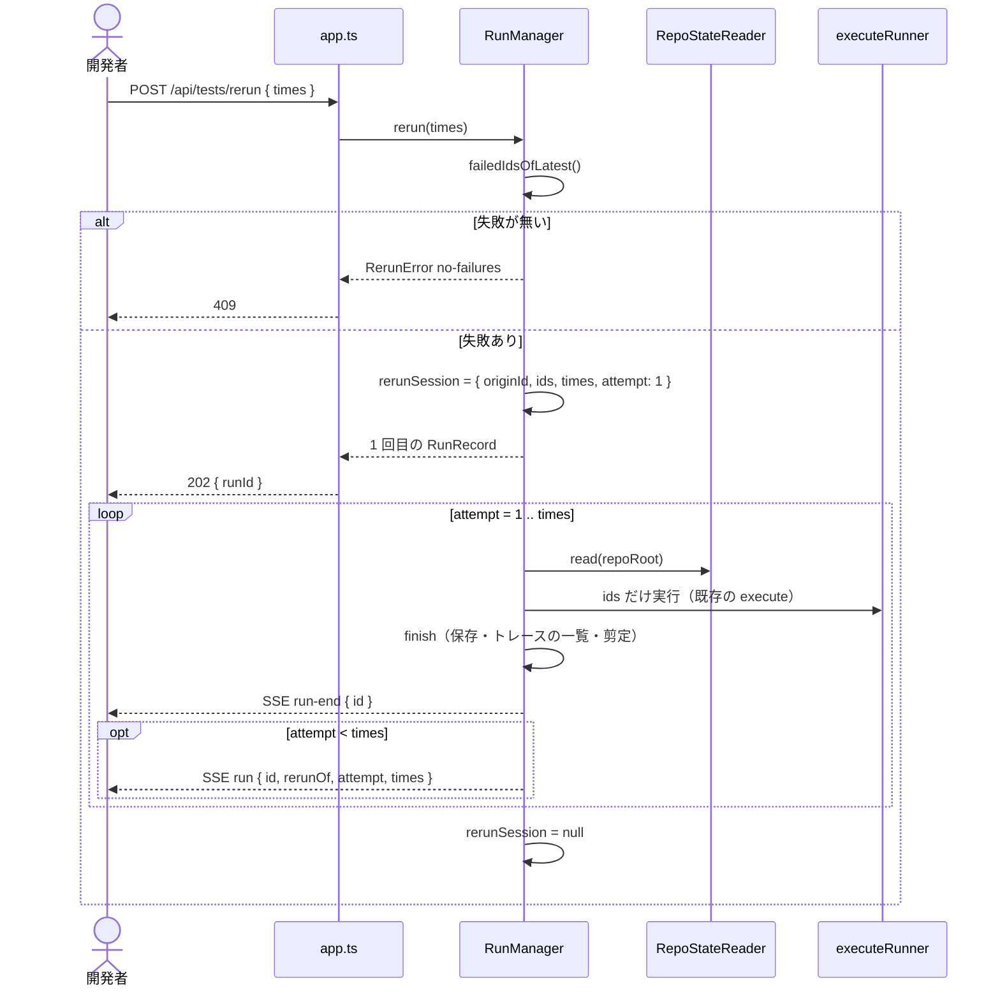
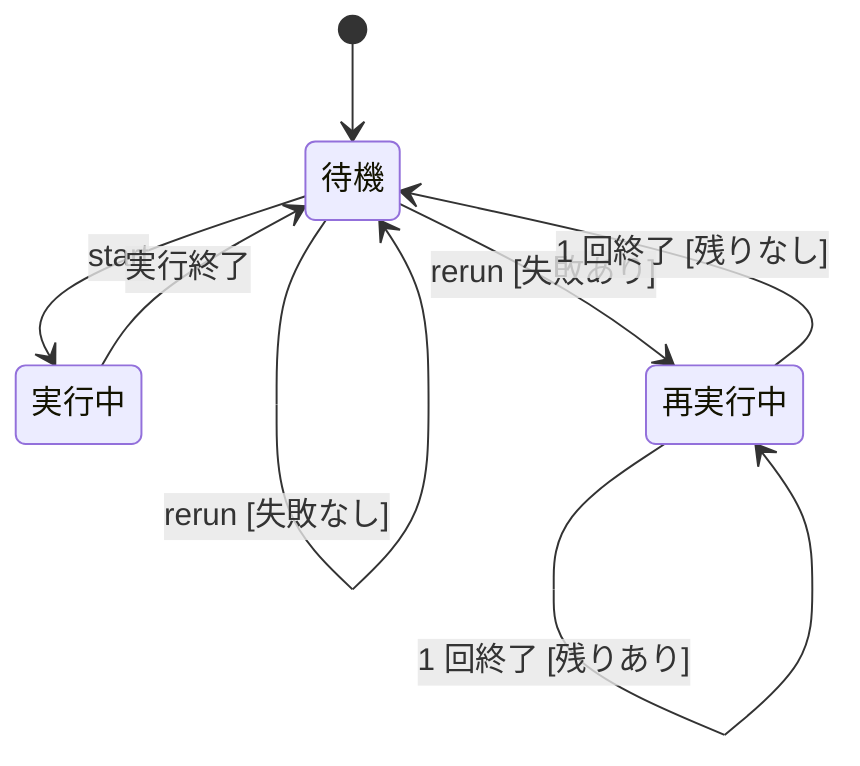
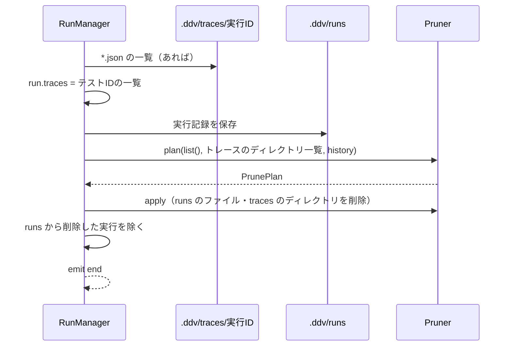
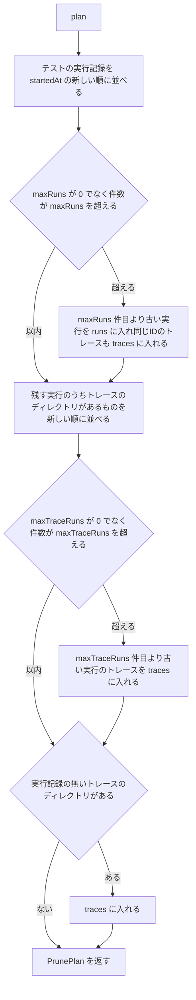
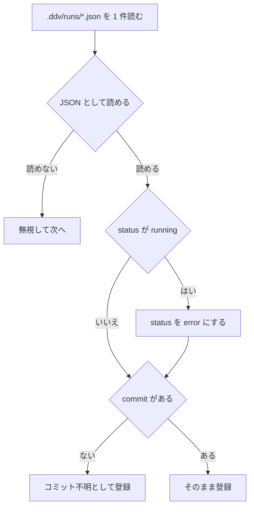

# 実行記録の拡張・失敗の再実行・保持件数 詳細設計

## 前提

- 実行記録の拡張は :ref[../basic/test-monitoring.md#実行記録の拡張]、再実行は :ref[../basic/test-monitoring.md#失敗の再実行]、保持件数は :ref[../basic/test-monitoring.md#保持件数] を参照
- トレースのファイルの置き場所は :ref[../basic/trace-view.md#データ]、トレースの書き込みは :ref[trace-recorder.md#記録の流れ] を参照
- 実装：`apps/server/src/runs.ts`（`RunManager` の拡張）、新規 `apps/server/src/repo-state.ts`（コミットの状態）、`apps/server/src/prune.ts`（剪定）、設定は `packages/core/src/config.ts`
- 集計（推移・フレーキー・カバレッジ）は :ref[test-history.md#構造] で扱う。本書は記録と削除だけを扱う

## 構造



| 項目 | 追加の理由・規則 |
|---|---|
| `commit` / `dirty` | 実行開始時の `RepoState`。取れないとき（git でない・git が無い）は両方とも項目を書かない（＝不明） |
| `rerunOf` / `attempt` / `times` | 再実行のときだけ。`rerunOf` は元の実行（再実行の起点。2 回目以降も同じ値）、`attempt` は 1 始まり、`times` は指定回数 |
| `traces` | この実行でトレースを書いたテストIDの一覧（`.ddv/traces/<実行ID>/*.json` のファイル名）。剪定でトレースを消しても残す（「削除済み」と「記録なし」を区別するため。:ref[trace.md#トレースの読み込み]） |

- `RunStatus` は既存の `'running' | 'passed' | 'failed' | 'error'` のまま。`CaseResult` も変えない
- 既存の項目は変えない。古い記録（`commit` などが無い）もそのまま読める（[読み込み](#読み込み)）

## コミットの状態

`RepoStateReader.read(repoRoot)` は `start` と `rerun` の各回の開始時に 1 回呼ぶ。



- コマンドは `git -C <repoRoot> rev-parse HEAD` と `git -C <repoRoot> status --porcelain=v1 --untracked-files=normal`。`.gitignore` の対象は `--porcelain` に出ないので数えない
- 「`.ddv/` 配下」は `status` の各行のパス（rename は移動先）が `.ddv/` で始まるもの。`testids.lock.json`・`snapshots/baseline/` も `.ddv/` 配下なので数えない（ddv が書くファイルで成否が変わらないため）
- 各コマンドの上限は 5 秒。超えたら不明とする
- GitHub のワークスペースでは worktree のディレクトリ（`ReviewTarget.dir`）を `repoRoot` として同じく呼ぶ

## 失敗の再実行



- `failedIdsOfLatest()`：`list()` の先頭（最新のテストの実行。再実行の記録も含む）の `results` のうち `failed` か `error` のテストID。ただし最新が再実行の記録なら、その起点（`rerunOf`）の実行を使う（再実行で全部通っても、もう一度「失敗を再実行」で同じ対象を回せるようにする）
- `times` は整数 1〜5。範囲外・整数でないときは 400
- 2 回目以降の対象も 1 回目と同じ `ids`（途中で通ったIDも外さない。フレーキーの判定に回数を使うため）
- 依存の確認（`deps-missing`）と GitHub の信頼の確認は、既存の `POST /api/tests/run` と同じ順で 1 回目の前に行う



- 「rerun [失敗なし]」は `RerunError('no-failures')`（409「直近の実行に失敗したテストはありません」）を投げ、状態は変えない
- 不正遷移：実行中・再実行中の `start` と `rerun` は `Error('別のテスト実行が進行中です')`（409。既存と同じ文言）。再実行の各回の間も `active` を空けない（`rerunSession` があれば `start` を受け付けない）
- 1 回の実行がランナーの起動失敗（`error`）で終わっても、残りの回は続ける

## 実行の終了

`execute` の最後（既存の `save` の位置）を `finish(run)` にまとめる。



- 剪定の失敗（ファイルのロック等）はログに `! 古い実行記録を削除できませんでした: …` を出して続ける。次の剪定でもう一度試す
- 剪定はサーバの起動時（`load` の後）にも 1 回行う

## 剪定

`Pruner.plan(runs, traceDirs, config)` は削除するものを決めるだけの純粋関数（ファイルを触らない）。



- 対象は `kind` が `test`（または無し）の記録だけ。`running` の記録（実行中）は数えるが削除しない
- 「実行記録の無いトレース」は、実行中の実行のディレクトリを除く（書き込み中のため）
- `apply` は `safeJoin` でパスを作り、`.ddv/runs/<id>.json` と `.ddv/traces/<id>/`（再帰）だけを消す

## 読み込み

`load()` の 1 件ごとの扱い（REQ-309）。



- 書き戻しはしない（古い記録のファイルは変えない）

## 設定

`ConfigSchema` に追加する。

```ts
history: z.object({
  maxRuns: z.number().int().min(0).default(200),
  maxTraceRuns: z.number().int().min(0).default(20),
}).prefault({}),
```

- 負の数・小数は設定の読み込みエラー（既存と同じく起動時に表示）

## API

| メソッド | パス | 要求 | 応答 |
|---|---|---|---|
| POST | `/api/tests/rerun` | `{ times: number }` | 202 `{ id, status, rerunOf, attempt: 1, times }`。400 `times-invalid`。409 `no-failures` / 実行中 / `deps-installing` / `deps-missing`（既存と同じ形） |
| GET | `/api/runs` | — | 既存の項目に `commit`・`dirty`・`rerunOf`・`attempt`・`times` を加える |
| GET | `/api/runs/{id}` | — | 既存の項目に同じものと `traces` を加える（トレースの有無の表示は :ref[trace.md#api]） |

| SSE（`/api/events`） | data | 送る時 |
|---|---|---|
| `run`（追加） | `{ id, kind: 'test', rerunOf, attempt, times }` | 再実行の 2 回目以降を始めたとき |
| `run-end`（既存） | `{ id, kind }` | 各回の終了（変えない） |

- GitHub のワークスペースでは既存と同じく `/api/w/<ワークスペースID>/tests/rerun`。ワークスペースごとの `RunManager` が持つ
