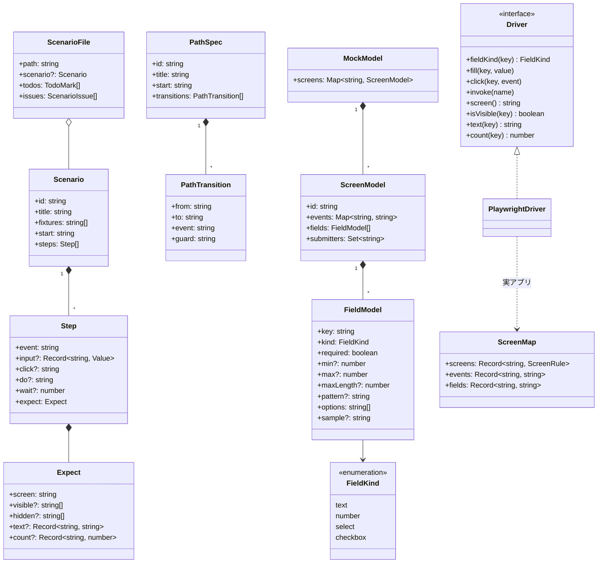
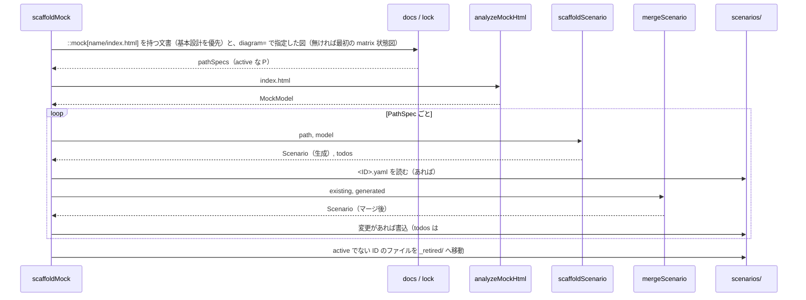
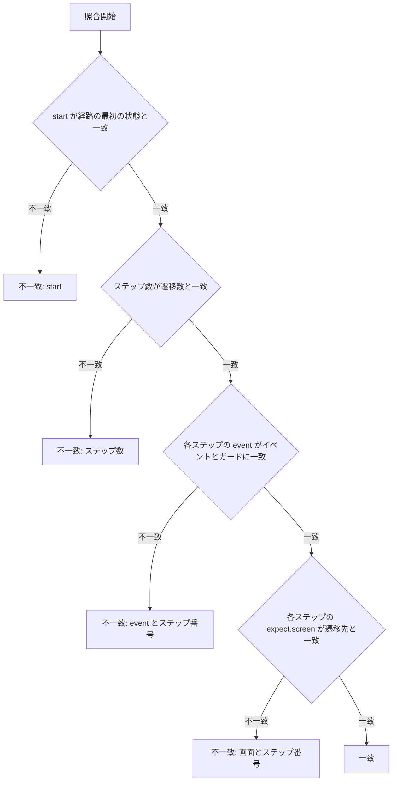
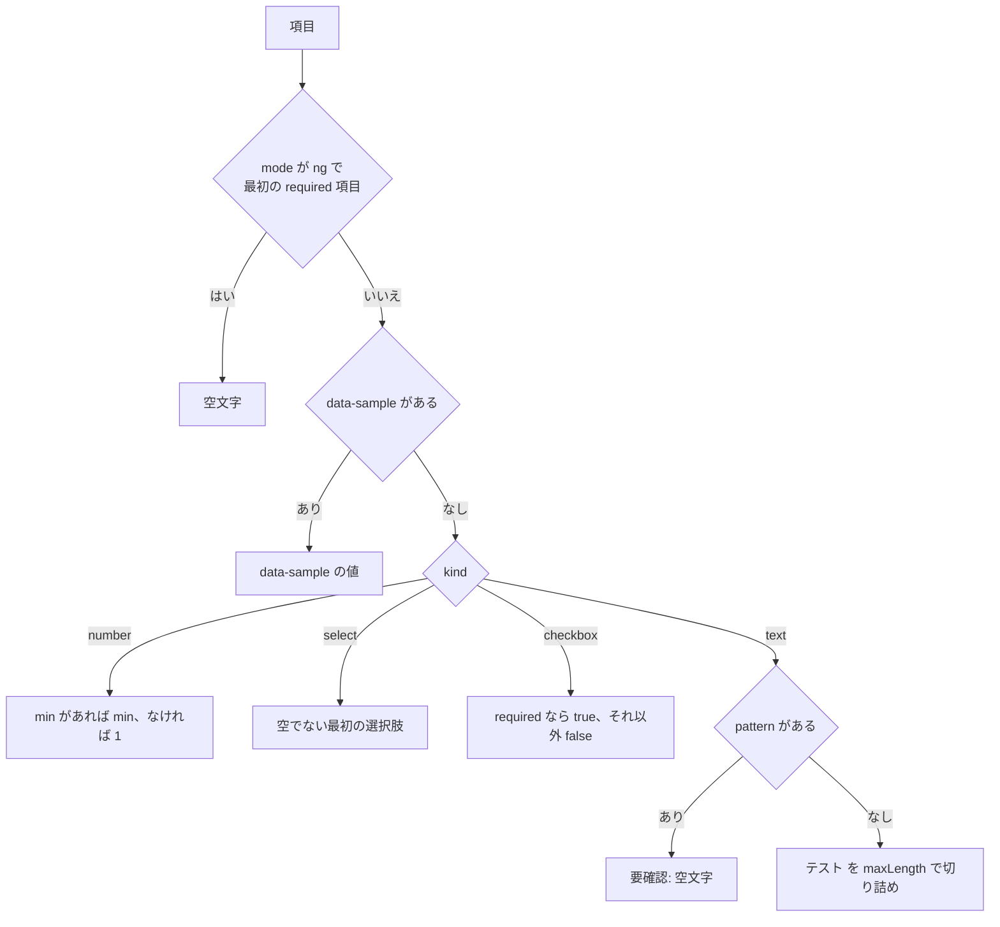
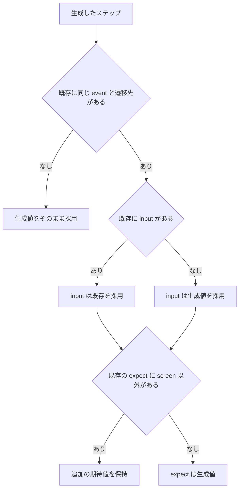
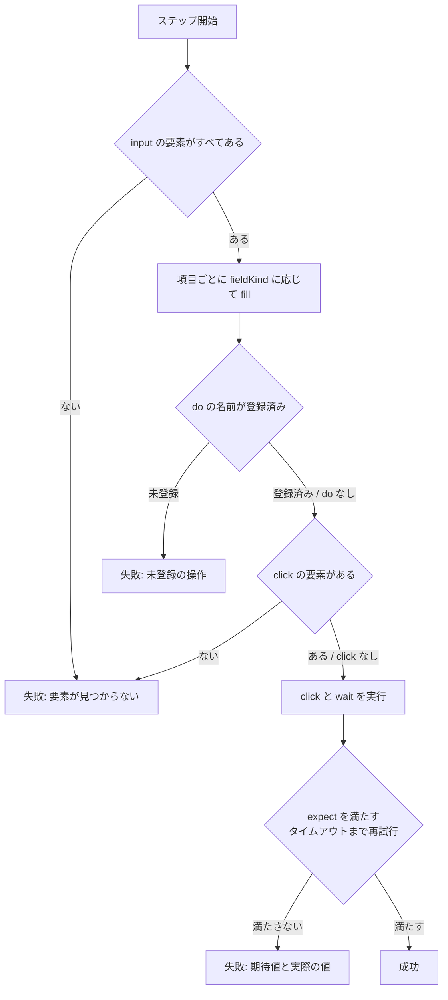
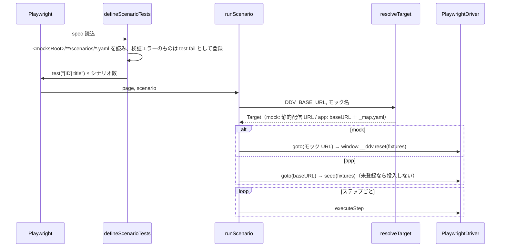
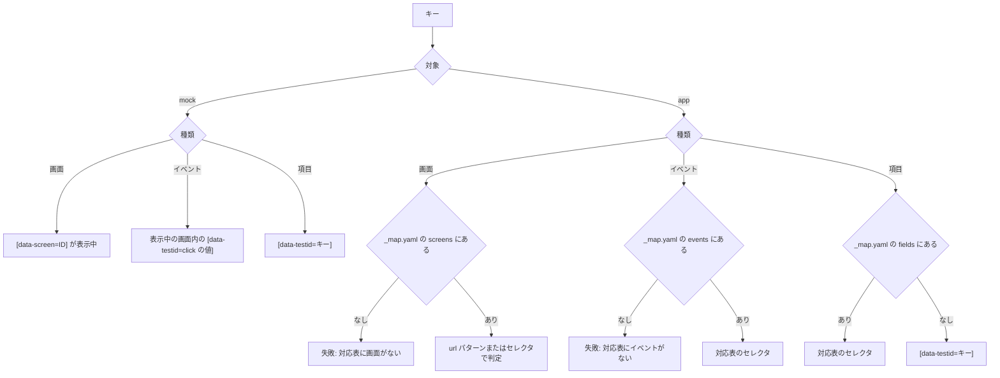

# シナリオ・骨組み生成・E2E 実行 詳細設計

## 前提

- 成果物・ファイル規約は :ref[../basic/mock-player.md#成果物]、シナリオ形式は :ref[../basic/mock-player.md#シナリオ] を参照
- 実装は新パッケージ `packages/mock`（`@ddv/mock`）。エントリは `.`（Node 用：形式・検証・照合・骨組み生成）、`./step`（ブラウザと共用のステップ解釈）、`./playwright`（E2E 実行器）
- 追加依存：`node-html-parser`（モック HTML の静的解析）。YAML は既存の `yaml`、形式は `zod`

## 構造



| 関数 | モジュール | 役割 |
|---|---|---|
| `parseScenarioFile(text, path)` | `scenario.ts` | YAML → `ScenarioFile`。`# 要確認` コメントの行を `todos` に集める |
| `pathSpecs(doc, diagram, lock)` | `paths.ts` | ロックの active な P ケースを `PathSpec[]` に変換（ガードは `splitLabel` で分離） |
| `matchPath(scenario, path)` | `match.ts` | シナリオと経路の照合（[経路照合](#経路照合)） |
| `analyzeMockHtml(html)` | `analyze.ts` | `data-screen` / `data-event` / 入力要素と制約 → `MockModel` |
| `scaffoldScenario(path, mock)` | `scaffold.ts` | 経路 1 本の骨組みと要確認の一覧を作る |
| `inferValue(field, mode)` | `infer.ts` | 候補値（[候補値](#候補値)） |
| `mergeScenario(existing, generated)` | `merge.ts` | 再生成時のマージ（[マージ](#マージ)） |
| `scaffoldMock(repo, config, mock?)` | `scaffold-cli.ts` | 1 モック分を生成し、ファイル書込・`_retired/` 移動・件数を返す |
| `checkMocks(repo, config, docs, lock)` | `check.ts` | lint 拡張（:ref[../basic/mock-player.md#検査ddv-lint-拡張]）。`lintDocs` から呼ぶ |
| `executeStep(driver, step)` | `step.ts` | ステップ解釈（プレイヤーと E2E で共用） |
| `defineScenarioTests(opts)` / `runScenario(page, scenario, target)` | `playwright.ts` | E2E 実行器 |

- `Value` は `string | number | boolean`。式は受け付けない（REQ-109）。形式違反は `ScenarioIssue`（行番号付き）にする

## 骨組み生成の流れ



- 書込は `yaml` の `Document` で行い、人間が付けたコメントを保持する。キー順は `id, title, fixtures, start, steps`
- `fixtures` の既定は `[default]`（`fixtures/default.yaml` があるとき）、なければ `[]`

## 経路照合

`matchPath` はステップと遷移を先頭から 1 対 1 に照合し、最初の不一致を返す。



- `event` の比較は空白を正規化し、`イベント [ガード]` の形で行う（ガードなしは `イベント` のみ）

## 候補値

`inferValue(field, mode)`。`mode` は `ok`（遷移先が別画面）か `ng`（遷移先が遷移元と同じ画面）。



- `ng` のとき required 項目がなければ、そのステップの `input` を空にして要確認にする
- select に有効な選択肢がない場合も要確認にする

## マージ

生成したステップごとに、既存ステップを `event` と `expect.screen` の組で探す（同じ組が複数あれば出現順で対応）。



- 生成項目（`title`・`start`・`event`・`click`・`expect.screen`）は常に生成値。`fixtures`・`wait`・`do` は既存を保持
- 対応しなかった既存ステップは削除し、件数を「更新」に含めて報告する
- 結果が既存と同じなら書き込まない（更新日時を変えない。シナリオの状態判定のため）

## ステップ解釈

`executeStep(driver, step)` は `Driver` だけに依存し、プレイヤー（`DomDriver`）と E2E（`PlaywrightDriver`）が同じ実装を使う。



- 実行順は input → do → click → wait → expect で固定。キーがないものは飛ばす
- `fill` は `fieldKind` が text/number なら入力、select なら選択、checkbox なら `true`/`false` に合わせる
- 要素が見つからないときは `StepError`（`kind: notFound`、キー名）で失敗する
- `expect` の再試行は既定 5 秒（`defineScenarioTests({ timeout })` で変更可）。プレイヤーは画面描画後に 1 回だけ判定する

## E2E 実行



- モックの静的配信は、`globalSetup` で `mocksRoot` を一時ポートで配信する（`DDV_BASE_URL` 未設定時のみ）
- `seed` と `do` の実装は利用側の `e2e/ddv-hooks.ts`（任意）から `export const seed / steps` として読み込む（AI が書く）
- テスト紐づけ：`RunnerSchema` に `scenarios: boolean`（既定 false）を追加。true の playwright ランナーは `scanTestLinks` で `<mocksRoot>/**/scenarios/*.yaml` の `id:` 行も紐づける（`test` はシナリオの `title`）

## 要素の解決

`PlaywrightDriver` がキー（イベント名・画面ID・項目キー）からロケーターを決める。



`_map.yaml` の形式（`ScreenMapSchema`）：

```yaml
screens:
  List: { url: "/orders$" }              # url は正規表現（パス部分に一致）
  Input: { selector: "h1:has-text('注文入力')" }
events:
  新規: "a[href='/orders/new']"
  次へ: "button[type=submit]"
fields:
  customer: "#customerName"
```

- モックの click の値は、骨組み生成で data-event の要素の data-testid を入れる（data-testid がなければ要確認）。実アプリは click の値を使わず、ステップの `event`（ガードを除く）で対応表を引く
- 対応表の検証（存在しない状態ID・イベント名）は lint の warning にする
