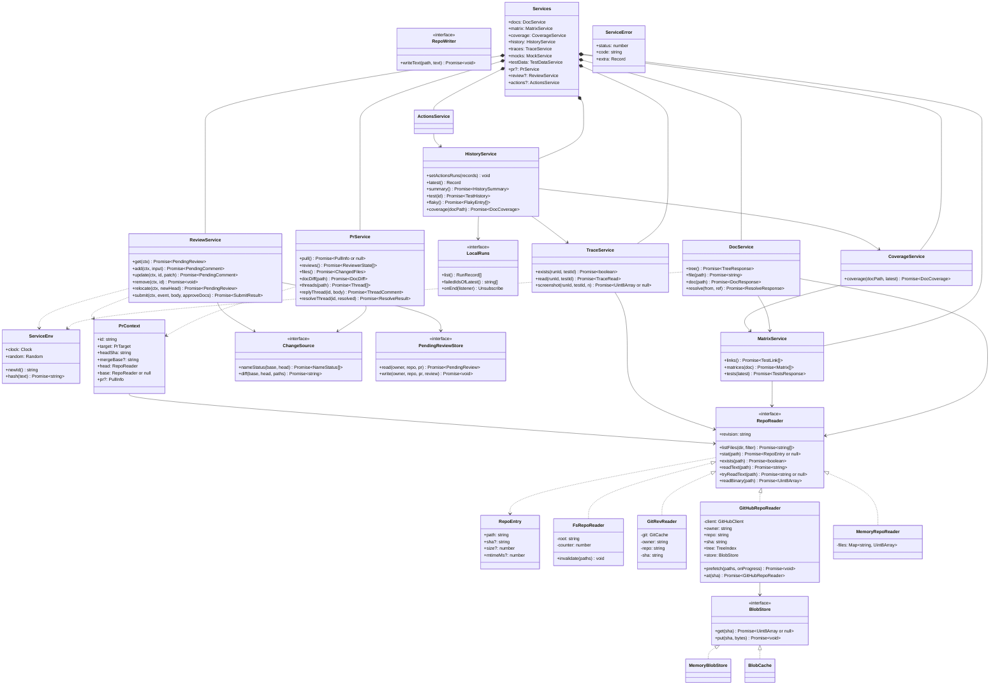
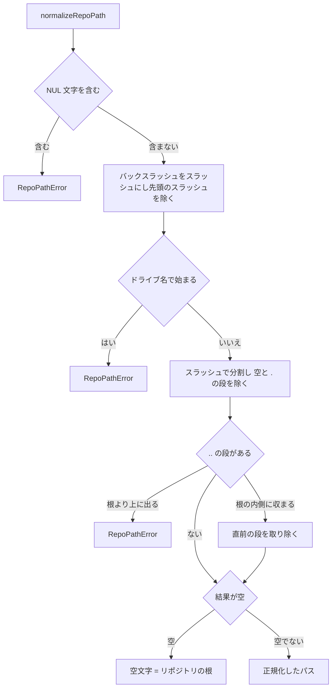
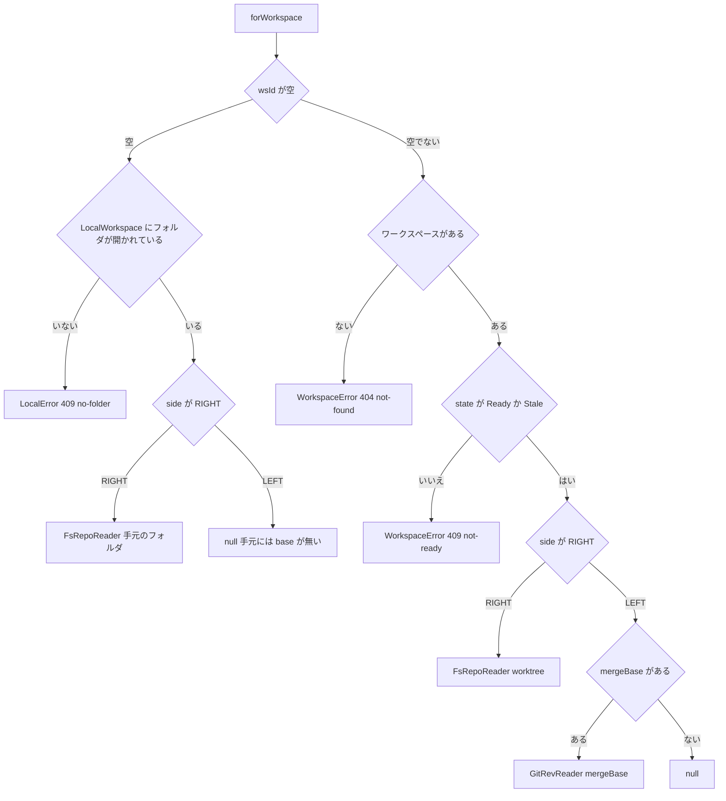
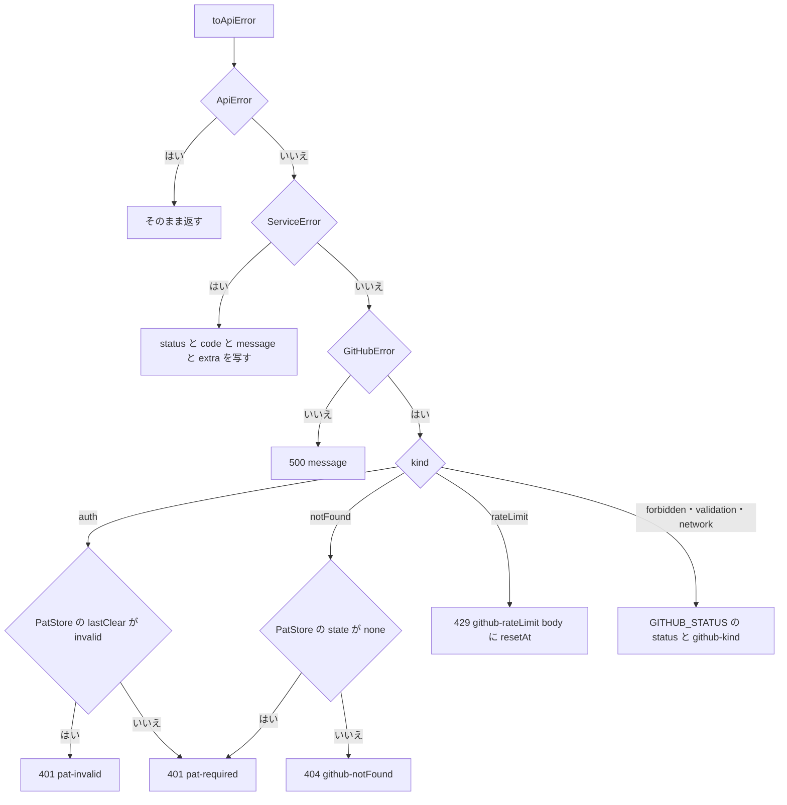
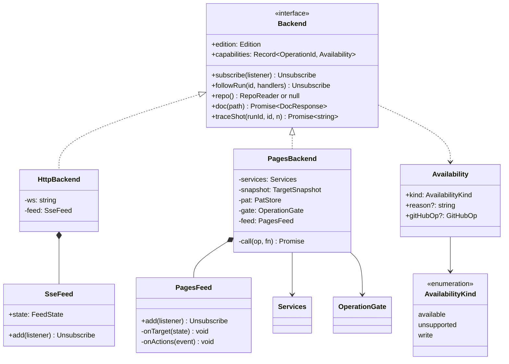
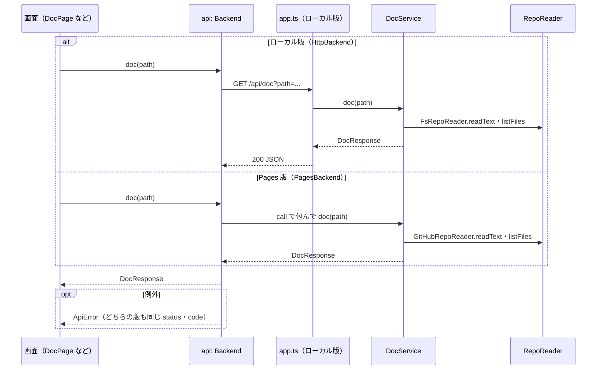
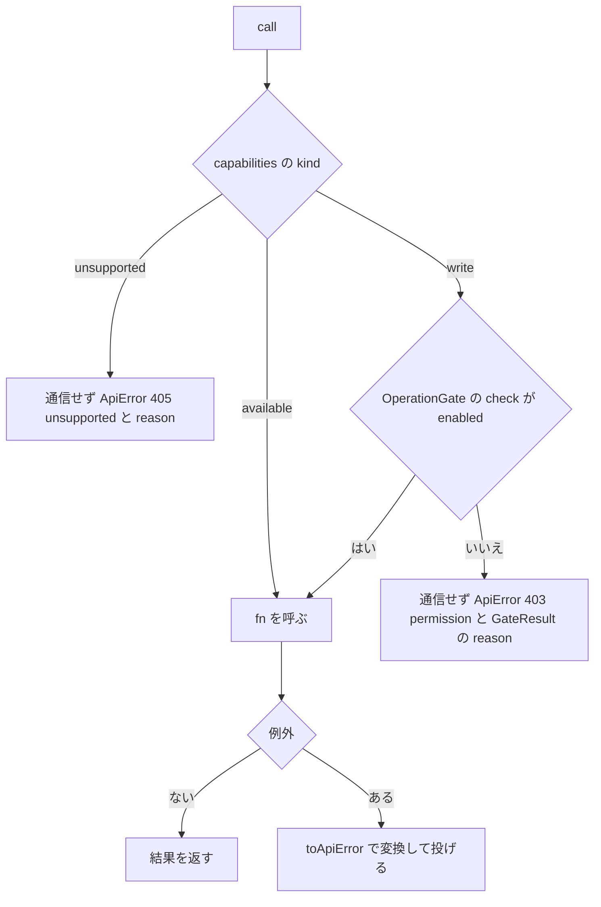
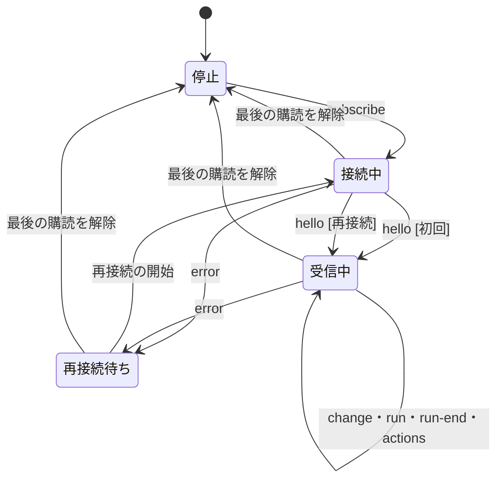

# サービス層・Backend・RepoReader 詳細設計

## 前提

- 用語（Backend・サービス層・RepoReader）は :ref[../basic/hosted-viewer.md#用語]、全体の構成は :ref[../basic/hosted-viewer.md#構成] を参照
- `ActionsService`・`HistoryService` の位置づけは :ref[../basic/actions-run.md#構成]、出所を含む集計は :ref[../basic/actions-run.md#履歴の統合] を参照。本書は置き場所と依存の向きだけを扱い、Actions の処理（`ActionsService`・`ResultsBranchReader`・`mergeRunRecords`・`HistoryService.setActionsRuns`）は [actions-run.md](actions-run.md) で扱う
- 使えない操作の一覧と理由は :ref[../basic/hosted-viewer.md#操作の可否] を参照。`OperationId` の一覧・`OperationGate` は [pages-viewer.md](pages-viewer.md)、PAT（`PatStore`）・権限（`PermissionProbe`・`GitHubOp`）・`TokenProvider` は [pat.md](pat.md)、`GitHubRepoReader` の取得順・`TreeIndex`・IndexedDB の `BlobCache`・対象の解決・`HeadWatcher` は [pages-viewer.md](pages-viewer.md)、モックの `srcdoc` での読み込み（`MockDocumentBuilder`）は [mock-sandbox.md](mock-sandbox.md)、手元のフォルダの切り替え（`LocalWorkspace`）は [local-folder.md](local-folder.md) で扱う
- 本書の範囲：新設 `packages/services` の構成、`RepoReader`、各サービスの公開メソッドと現行の `apps/server` からの移設、web 側の `Backend`（`HttpBackend` / `PagesBackend`）、イベント購読、使えない操作の表現、移行の段階
- **ローカル版の HTTP API・SSE のパスと応答の形は変えない**（REQ-610）。サーバのルートの中身をサービス層の呼び出しに置き換えるだけで、既存の単体テスト・E2E はそのまま通す

## パッケージ構成

`packages/services`（`@ddv/services`）を新設する。`node:*`・`child_process`・`process` を使わない（ブラウザと Node の両方で動く）。

| ファイル | 主な公開 | 移設元 |
|---|---|---|
| `src/index.ts` | `createServices`、`Services`、各型の再エクスポート | 新規 |
| `src/env.ts` | `ServiceEnv`（`clock`・`random`・`newId`・`hash`）、`Clock`、`Random`、`systemEnv` | 新規 |
| `src/errors.ts` | `ServiceError`、`RepoReadError`、`ReviewError`、`HistoryError`、`TraceError`、`TestDataError`、`COMMENT_MAX`・`BODY_MAX` | `review-error.ts`、各モジュールのエラー |
| `src/repo-path.ts` | `normalizeRepoPath`、`IGNORED_DIRS`、`isUnder` | `@ddv/core/node` の `safeJoin`・`walk` の規則 |
| `src/repo-reader.ts` | `RepoReader`、`RepoEntry`、`MemoryRepoReader`（テスト用） | 新規 |
| `src/github-reader.ts` | `GitHubRepoReader`、`TreeIndex`、`BlobStore`（インタフェース：`get(sha)`・`put(sha, bytes)`）、`MemoryBlobStore` | 新規（取得順・`TreeIndex` の中身は [pages-viewer.md](pages-viewer.md)。IndexedDB の実装 `BlobCache` は `apps/web/src/pages/blob-cache.ts` に置き、`packages/services` は IndexedDB に依存しない） |
| `src/repo-ref.ts` | `parseRepo`、`isSafeRefName` | `workspaces.ts`（Pages 版の対象の検査 `validateTarget` と共通化。[pages-viewer.md](pages-viewer.md)） |
| `src/mime.ts` | `mimeOf` | `app.ts` |
| `src/config.ts` | `loadConfigFrom(reader)` | `@ddv/core/node` の `loadConfig` |
| `src/docs.ts` | `DocService` | `app.ts` の `/api/tree`・`/api/file`・`/api/doc`・`/api/resolve` |
| `src/matrix.ts` | `MatrixService`、`scanTestLinksIn` | `app.ts` の `/api/doc`（matrices）・`/api/tests`、`@ddv/testid` の `scanTestLinks` |
| `src/history.ts` | `HistoryService`（`setActionsRuns`・`latest` を含む）、`LocalRuns`、純関数（`entriesOf`・`firstFailure`・`flakyCommits`・`classify` 等） | `history.ts` |
| `src/coverage.ts` | `CoverageService` | `history.ts` の `HistoryService.coverage` |
| `src/traces.ts` | `TraceService`、`NO_TRACE_MESSAGE` | `traces.ts` の `TraceStore` |
| `src/mocks.ts` | `MockService`、`scenarioStatus`、`PlayStore` | `app.ts` の `/api/mocks`・`/api/mock-source`、`scenarios.ts` |
| `src/testdata.ts` | `TestDataService`、`RepoWriter` | `testdata.ts` |
| `src/pr-diff.ts` | `Hunks`、`matchDiagrams`、`DiffService`、`ChangeSource`、`GitHubChangeSource` | `pr-diff.ts`（`GitHubChangeSource` は新規） |
| `src/threads.ts` | `ThreadService`、`anchorThread` | `threads.ts` |
| `src/pr.ts` | `PrService`、`PrContext`、`toPullInfo`、`latestReviews` | `host.ts`（`/api/w/:ws/pr`・`reviews`）、`workspaces.ts` の `toPullInfo` |
| `src/review.ts` | `ReviewService`、`PendingReviewStore`、`judgePlacement`・`composeBody`・`composeReviewBody` | `review.ts` |
| `src/status-commit.ts` | `setStatus`、`StatusCommitter` | `status-commit.ts` |
| `src/actions/` | `actions-service.ts`（`ActionsService`）・`gate.ts`・`remote.ts`・`tracker.ts`・`results-branch.ts`（`ResultsBranchReader`）・`merge.ts`（`mergeRunRecords`・`latestOf`） | 新規（[actions-run.md](actions-run.md)） |

```json
{
  "name": "@ddv/services",
  "private": true,
  "type": "module",
  "sideEffects": false,
  "exports": { ".": "./src/index.ts" },
  "dependencies": { "@ddv/core": "*", "@ddv/graph": "*", "@ddv/testid": "*", "@ddv/mock": "*", "@ddv/github": "*", "yaml": "^2.9.1" }
}
```

既存パッケージは、ブラウザで使える入口を分ける（既存の入口は再エクスポートで残し、呼び出し側は変えない）。

| パッケージ | 追加する入口 | 内容 |
|---|---|---|
| `@ddv/core` | `.`（既存）に追加 | `docEntryOf(rel, text)`（`loadDoc` の中身）、`parseConfigText(name, text)`・`CONFIG_FILES`（`node.ts` から移す）、`lintTargets(docs, config)`・`lintDocsWith(existing, config, docs)`（`lintDocs` の `existsSync` を「存在するパスの集合」に置き換えた純関数。`lintDocs` はこれを呼ぶ） |
| `@ddv/testid` | `./core` | `lock.ts`、`matrix.ts` の純関数（`docMatrices`・`activeIds`・`diagramKeyOf`・`parseLock(text)`）、`scan.ts` の純関数（`globToRegExp`・`runnerFilter`・`linksInText`）。`readLock`・`writeLock`・`generateAll`・`scanTestLinks` は `lock-io.ts`・`scan.ts` に残す |
| `@ddv/github` | `src/browser.ts`（`apps/web/vite.config.ts` の alias で `@ddv/github` をこれに差し替える。[pat.md](pat.md)） | `client.ts`・`errors.ts`・`redact.ts`・`provider.ts`（`token.ts` は `child_process` を使うので含めない）。`packages/services` は `@ddv/github` からこれらの名前だけを import する |
| `@ddv/mock` | `./browser` | `types`・`scenario`・`analyze`・`paths`・`trace-format`・`tune`・`tune-patch`・`yaml-patch` |

- `GitHubClient` が依存するトークンの型は `TokenProvider`（`authorization()`・`unauthorized()`。`packages/github/src/provider.ts`）。ローカル版は `TokenResolver`、Pages 版は `PatStore` が満たす。PAT が無いときの `anonymous` オプションも含めて [pat.md](pat.md)
- `packages/services` から `node:` を import していないことを単体テスト（`no-node.test.ts`：`src/**/*.ts` の import 文と、依存パッケージの入口の一覧を検査。`@ddv/github` は `browser.ts` が輸出する名前に限る）で確かめる

## 構造



| 型 | 置き場所 | 規則 |
|---|---|---|
| `FsRepoReader` | `apps/server/src/fs-reader.ts` | 手元のフォルダ・PR の worktree（`Workspace.dir`）を読む。`revision` は `worktree:<counter>`。ファイル監視（`createContext` の `watch`）が `invalidate(paths)` を呼ぶと `counter` を 1 増やす |
| `GitRevReader` | `apps/server/src/git-reader.ts` | 1 つのコミット（merge base 等）を `git show <sha>:<path>`・`git ls-tree -r <sha>` で読む。`revision` はコミット SHA |
| `GitHubRepoReader` | `packages/services/src/github-reader.ts` | 1 つのコミットを GitHub から読む（Trees API・raw・Blobs API。取得順・`TreeIndex`・`prefetch`・`at` は [pages-viewer.md](pages-viewer.md)）。`revision` はコミット SHA、`stat().sha` は blob SHA。blob の内容は生成時に渡された `BlobStore` に `get` / `put` する（Pages 版は `BlobCache`、テストは `MemoryBlobStore`）。PR の base 側は `at(mergeBase)` で同じ `BlobStore` を共有する |
| `BlobStore` | `packages/services/src/github-reader.ts` | blob SHA をキーにした内容の保管（`get(sha)` は無ければ `null`、`put(sha, bytes)` は失敗しても例外を投げない）。IndexedDB の実装 `BlobCache`（上限・削除）は `apps/web/src/pages/blob-cache.ts`（[pages-viewer.md](pages-viewer.md)） |
| `MemoryRepoReader` | `packages/services/src/repo-reader.ts` | 単体テスト用。`revision` は `memory:<counter>` |
| `LocalRuns` | `packages/services/src/history.ts` | 手元の実行記録。サーバは `RunManager`（`onEnd` を追加）、Pages 版は空（`list()` が `[]`） |
| `ServiceEnv` | `packages/services/src/env.ts` | `systemEnv`：`clock.now = Date.now`、`random.bytes(n) = crypto.getRandomValues`、`newId = crypto.randomUUID`、`hash` は `crypto.subtle.digest('SHA-256')` の 16 進先頭 16 文字（現行の `hashOf` と同じ値）。テストでは固定値を渡す。`ActionsService` の `Clock`・`Random`（[actions-run.md](actions-run.md)）はここから渡す |

## RepoReader

| メソッド | 引数 | 戻り値・例外 |
|---|---|---|
| `listFiles(dir, filter?)` | リポジトリ相対の `dir`（`''` = 根）、`filter(path)` | `dir` 配下のファイルのパス（posix・リポジトリ相対・昇順）。`dir` の配下のディレクトリのうち名前が `IGNORED_DIRS`（`node_modules` `.git` `bin` `obj` `dist` `.ddv` `test-results` `playwright-report`）のものは辿らない（現行の `walk` と同じ。`dir` 自身が `.ddv/...` のときは除外しない）。`dir` が無ければ `[]` |
| `stat(path)` | ファイルのパス | `RepoEntry`。無い・ディレクトリなら `null` |
| `exists(path)` | 同上 | `stat(path) !== null` |
| `readText(path)` | 同上 | UTF-8 で復号した文字列（BOM は残す。改行は変換しない）。無いとき `RepoReadError(404, 'not-found')` |
| `tryReadText(path)` | 同上 | 無いとき `null`（パスの検査で失敗したときも `null`） |
| `readBinary(path)` | 同上 | `Uint8Array`。無いとき `readText` と同じ |

- すべてのメソッドは最初に `normalizeRepoPath` を通す（[パスの正規化](#パスの正規化)）。`FsRepoReader` はさらに `safeJoin` で絶対パスを作る（二重の検査）
- **ref の扱い**：1 つの `RepoReader` は 1 つの版（作業中のフォルダ、または 1 つのコミット）だけを読む。別の ref を読むときは別のインスタンスを作る。branch・tag・PR 番号からコミット SHA への解決は呼び出し側（サーバは `WorkspaceManager`、Pages 版は [pages-viewer.md](pages-viewer.md)）が行う
- **revision**：サービス層の結果のキャッシュ（`DiffService` の memo、`MatrixService.links` 等）は `reader.revision` をキーに含める。コミット SHA の読み手は内容が変わらないので期限なしで使える
- **改行**：worktree は `core.autocrlf` で CRLF になり得るが、GitHub の blob は LF。比較する側（`matchDiagrams` の `normalizeCode` 等）で吸収し、`RepoReader` では変換しない
- GitHub の失敗（回数制限・通信）は `GitHubError` のまま投げる（`RepoReadError` に包まない。[エラーの変換](#エラーの変換)）

### パスの正規化

`normalizeRepoPath(rel)` は `safeJoin` と同じ範囲を受け付け、OS に依存せずに判定する。



- `RepoPathError` は `RepoReadError(404, 'not-found')` の一種で、文言は現行と同じ `path escapes repository: <rel>`（`app.ts` の `onError` が 404 にする現行の動作を保つ）
- 例：`docs\a.md` → `docs/a.md`、`/docs/./a.md` → `docs/a.md`、`docs/../README.md` → `README.md`、`../x`・`C:/x`・`docs/../../x` → エラー
- NUL を含むパスは、現行は Node の例外で 500 だったが 404 になる（意図した変更。画面からは発生しない）

### 読み手の選択（サーバ）

`ReaderFactory.forWorkspace(wsId, side)`（`apps/server/src/readers.ts`）。`side` は差分の `RIGHT`（head）/ `LEFT`（merge base）。



- `FsRepoReader` はワークスペースの `generation` ごとに 1 つ作って使い回す（worktree の checkout で `generation` が変わる）。エラーの文言・コードは現行の `WorkspaceManager.context` と同じ
- 手元のフォルダは `LocalWorkspace.ctx`（`apps/server/src/local.ts`。[local-folder.md](local-folder.md)）から読む。フォルダの切り替えで `ServerContext` が作り直されると、その中の `services` と `FsRepoReader` も作り直される（`LocalWorkspace` の `generation` が変わる）。開かれていないときの 409 `no-folder` の文言は [local-folder.md](local-folder.md) と同じ
- Pages 版の選択は対象（コミット SHA）ごとに `GitHubRepoReader` を作るだけ（`TargetSnapshot.reader`。base 側は `reader.at(mergeBase)`。[pages-viewer.md](pages-viewer.md)）

## サービスの公開メソッド

`createServices(deps)` が `Services` を組み立てる。サーバはワークスペースごと（`ServerContext` に `services` を追加）、Pages 版は対象ごとに 1 つ作る。

```ts
export interface ServiceDeps {
  env: ServiceEnv;
  reader: RepoReader;
  getConfig: () => DdvConfig;
  runs: LocalRuns;                // Pages 版は空
  repoName: string;
  writer?: RepoWriter;            // 無い = ファイル保存できない（Pages 版）
  plays?: PlayStore;              // 無い = シナリオの再生結果を読まない
  actions?: (history: HistoryService) => ActionsService; // 無い = Actions を使わない（actions-run.md）
  pr?: {
    context: () => Promise<PrContext>;
    github: GitHubClient;
    changes: ChangeSource;
    pending: PendingReviewStore;
    committer: StatusCommitter;
    refresh: (id: string) => Promise<void>;
  };
}
```

| サービス | メソッド | 戻り値（現行 API の応答と同じ形） | 主な例外 |
|---|---|---|---|
| `DocService` | `config()` | `{ repoRoot, repoName, config }`（Pages 版の `repoRoot` は `owner/repo`） | — |
| | `tree()` | `{ docsRoot, docs: TreeDoc[] }` | — |
| | `file(path)` | 文字列 | `RepoReadError` 404 |
| | `doc(path)` | `DocResponse` | `RepoReadError` 404 |
| | `resolve(from, ref)` | `ResolveResponse`（`ok: false` のときも値で返し、呼び出し側が 404 にする） | — |
| `MatrixService` | `links()` | `TestLink[]`（`reader.revision` ごとに memo） | — |
| | `matrices(doc)` | `Matrix[]`（`links` を付けたもの） | — |
| | `tests(latest)` | `TestsResponse` | — |
| `CoverageService` | `coverage(docPath, latest)` | `DocCoverage` | `RepoReadError` 404 |
| `HistoryService` | `summary()` / `test(id)` / `flaky()` / `coverage(docPath)` / `latest()` / `setActionsRuns(records)` | 現行と同じ（Actions の項目の追加は [actions-run.md](actions-run.md)） | `HistoryError` 404 `unknown-id` |
| `TraceService` | `exists` / `read` / `screenshot` | `screenshot` は PNG のバイト列（現行はパス） | `TraceError` 400 / 500 |
| `MockService` | `mocks()` / `source(body)` / `scenarios()` / `scenario(id)` | 現行の `/api/mocks`・`/api/mock-source`・`/api/mocks/scenarios`・`/api/mocks/scenario` の応答 | `ServiceError` 400 / 404 / 422（現行と同じ code） |
| `TestDataService` | `load` / `validate` / `save` | 現行と同じ（`writer` が無いと `save` の `file` モードは `TestDataError` 403 `readonly`） | `TestDataError` |
| `PrService` | `pull()` / `reviews()` / `files()` / `docDiff(path)` / `threads(path?)` / `replyThread` / `resolveThread` | 現行の `/api/w/:ws/pr`・`reviews`・`pr/files`・`pr/diff`・`pr/threads` の応答 | `ReviewError`、`GitHubError` |
| `ReviewService` | `get` / `add` / `update` / `remove` / `relocate` / `submit` | 現行と同じ（:ref[review-comment.md#送信]） | `ReviewError`、`GitHubError` |

- `HistoryService` のコンストラクタは `(local: LocalRuns, lock: () => Promise<TestIdLock>, traces: TraceService, coverage: CoverageService)`。手元の記録と `setActionsRuns` で受けた Actions の記録を `mergeRunRecords`、最新の結果を `latestOf`（どちらも `src/actions/merge.ts`）でまとめる（規則は [actions-run.md](actions-run.md)）。`/api/results/latest` は `latest()` を使う。トレースの有無は `test(id)` の中で対象の行だけ `traces.exists` を待ってから、純関数 `entriesOf` に同期の判定として渡す
- `CoverageService` は `HistoryService.coverage` の集計を移したもの。`HistoryService.coverage(docPath)` は `coverage.coverage(docPath, this.latest())` に委譲して残す（`/api/coverage` と [actions-run.md](actions-run.md) が使う。`history.test.ts` も変えない）
- `ActionsService` は `deps.actions` があるときだけ作る（サーバは手元のフォルダに GitHub のリモートがあるときとワークスペース、Pages 版は対象を開いたとき）。対象の決め方（`ActionsTargetProvider`）はサーバが `LocalActionsTarget`・`WorkspaceActionsTarget`、Pages 版は下の `PagesActionsTarget`
- `PagesActionsTarget`（`apps/web/src/backend/pages-actions-target.ts`）：`TargetSnapshot`（[pages-viewer.md](pages-viewer.md)）から `ActionsTarget` を作る。`ref` は branch の対象ならその branch、PR なら `pr.headRef`（コミットの対象は `problem: 'detached'`）、`sha` は `commitSha`、`pr`・`headRef` は `pr` から、`fork` は `pr.headRepo` が `owner/repo` と違う（大文字小文字を区別しない）、`dirty` は無し（[actions-run.md](actions-run.md) の `WorkspaceActionsTarget` と同じ規則）
- `ReviewService`・`ThreadService`・`DiffService` が受け取っていた `ReviewTarget` / `ThreadTarget` / `DiffTarget`（`dir` を持つ）は `PrContext`（`head`・`base` の `RepoReader` を持つ）にまとめる。`textOf(side)` は `RIGHT` = `ctx.head`、`LEFT` = `ctx.base`
- `ChangeSource` の実装：サーバは `GitChangeSource`（現行の `GitCache.nameStatus`・`diff`）、Pages 版は `GitHubChangeSource`（`GET /repos/{o}/{r}/pulls/{n}/files` を全ページ読み、`status`・`filename`・`previous_filename` を `NameStatus` に、各ファイルの `patch` に `diff --git` の見出しを付けて連結したものを `diff` にする。`patch` が無いファイル（GitHub が省略した大きい差分）は hunk なしとして扱う）。結果は `headSha` ごとに memo
- 書き込み・実行を伴う処理（テストの実行・再実行、依存の導入、テストID採番、lint、骨組み生成、スナップショットの撮影・承認、再生結果の記録）は **移さない**。サーバに残し、Pages 版では [使えない操作](#使えない操作) になる

### 移設対応表

| 現行 | 関数・ルート | 移設先 | 依存の引数化 |
|---|---|---|---|
| `app.ts` | `/api/config` | `DocService.config()` | 設定は `getConfig`（サーバは監視で再読込した `ctx.config`） |
| `app.ts` | `/api/tree`、`/api/file`、`/api/doc`、`/api/resolve` | `DocService` | `loadDocs`・`loadDoc` → `reader.listFiles` + `docEntryOf`、`existsSync` → `reader.exists`、`lintDocs` → `lintDocsWith`（`lintTargets` の各パスを `reader.exists` で調べた集合） |
| `app.ts` | `/raw/*` | ルートに残す | `fs.readFile` → `reader.readBinary`、`mimeOf` は `@ddv/services` から |
| `app.ts` | `/api/tests`、`/api/doc` の matrices | `MatrixService` | `readLock` → `parseLock(reader.tryReadText(LOCK_PATH))`、`scanTestLinks` → `scanTestLinksIn(reader, config)` |
| `app.ts` | `/api/history/*`、`/api/results/latest` | `HistoryService`（`latest()`） | `RunManager` → `LocalRuns` |
| `app.ts` | `/api/coverage` | `HistoryService.coverage` → `CoverageService` | `runs.latest()` → `HistoryService.latest()` を引数で渡す |
| `app.ts` | `/api/runs/:id`（`traceOf`）、`/api/traces/*` | `TraceService`（ルートは残す） | `existsSync`・`fs.readFile` → `reader`（根は `.ddv/traces`）。画像は `screenshot` のバイト列を応答する |
| `app.ts` | `/api/mocks`、`/api/mock-source` | `MockService.mocks` / `source` | `walk` → `reader.listFiles`、`fs.readFile` → `reader.tryReadText` |
| `app.ts` | `/api/tests/run`・`rerun`、`/api/deps*`、`/api/testids/generate`、`/api/lint`、`/api/mocks/scaffold`、`/api/mocks/played`、`/api/snapshots*`、`/api/runs/:id/events`、`/api/events` | 移さない | — |
| `history.ts` | 型・純関数（`entriesOf`・`allEntries`・`changedRows`・`firstFailure`・`flakyCommits`・`flakyCounts`・`recentMarks`・`classify`・`bestClass`・`elementClasses`）、`HistoryError` | `services/history.ts`、`errors.ts` | なし（そのまま） |
| `history.ts` | `HistoryService` | `services/history.ts` | `existsSync` → `TraceService.exists`、`readLock(repoRoot)` → `lock()`、`RunManager` → `LocalRuns`。Actions の記録の統合（`setActionsRuns`）は移した後のこのクラスに足す |
| `history.ts` | `HistoryService.coverage` | `services/coverage.ts` | `loadDoc` → `reader` + `docEntryOf` |
| `traces.ts` | `TraceStore`、`TraceError`、`NO_TRACE_MESSAGE` | `services/traces.ts` の `TraceService` | `RunManager` → `LocalRuns`、`fs` → `reader` |
| `scenarios.ts` | `scenarioStatus`、`listScenarios`、`scenarioDetail` | `services/mocks.ts` | `fs.stat().mtimeMs` → `RepoEntry.mtimeMs`（GitHub は無し＝0）、`readPlays` → `PlayStore.read()`、`findScenarioFiles` → `reader.listFiles` |
| `scenarios.ts` | `readPlays`・`recordPlay` | 残す（`FsPlayStore` として `PlayStore` を実装） | `at` は `env.clock` |
| `testdata.ts` | `TestDataService` と純関数（`issuePath`・`tableDefs`・`rowKeyField`・`scenarioAfter`・`suggestionOf`）、`TestDataError` | `services/testdata.ts` | `fs.readFile`・`existsSync` → `reader`、書き込み（一時ファイル + rename）→ `RepoWriter`（サーバの `FsRepoWriter`）、`hashOf`（`createHash`）→ `env.hash`（非同期）、`randomUUID` → `env.newId` |
| `pr-diff.ts` | `Hunks`、`matchDiagrams`、`DiffService` | `services/pr-diff.ts` | `GitCache.nameStatus`・`diff` → `ChangeSource`、`git.show(mergeBase)` → `ctx.base.tryReadText`、`fs.readFile(ws.dir)` → `ctx.head.tryReadText`。memo のキーは現行どおり `mergeBase`・`headSha` |
| `threads.ts` | `ThreadService`、`anchorThread`、`THREAD_CACHE_MS` | `services/threads.ts` | `now` → `env.clock.now`、`fs.readFile(safeJoin(ws.dir))` → `ctx.head.tryReadText` |
| `review.ts` | `ReviewService`、`judgePlacement`、`composeBody`、`composeReviewBody` | `services/review.ts` | `PendingStore` → `PendingReviewStore`、`randomUUID` → `env.newId`、`git.diff` → `ChangeSource`、`readLock(ws.dir)` → `parseLock(ctx.head)` |
| `review.ts` | `PendingStore`（`~/.ddv/reviews/...json`） | 残す（`FsPendingStore`） | `process.pid`・`Date.now` はサーバ側のまま |
| `review-error.ts` | `ReviewError`、`COMMENT_MAX`、`BODY_MAX` | `services/errors.ts` | `ReviewError` は `ServiceError` を継承 |
| `status-commit.ts` | `setStatus`、`StatusCommitter` | `services/status-commit.ts` | `fs.readFile(ws.dir)` → `ctx.head.readText`（Git Data API の呼び出しはそのまま） |
| `host.ts` | `/api/w/:ws/pr`・`reviews`・`pr/files`・`pr/diff`・`pr/threads*`、`latestReviews` | `PrService` | `manager.github` → `deps.pr.github`、`manager.pull` → `PrService.pull` |
| `host.ts` | `/api/w/:ws/review*` | `ReviewService`（ルートは残す） | `ReviewTarget` → `PrContext`（`ReaderFactory` で作る） |
| `workspaces.ts` | `toPullInfo`、`parseRepo`、`isSafeRefName` | `services/pr.ts`、`services/repo-ref.ts` | なし。`WorkspaceManager` は残す（clone・worktree・監視） |
| `runs.ts` | `RunManager` | 残す | `onEnd(listener)` を追加して `LocalRuns` を満たす |

- 移した先の旧ファイル（`apps/server/src/history.ts` 等）は、移行の段階 1〜4 の間は `export * from '@ddv/services/...'` の再エクスポートだけを残し、既存のテストの import を変えずに通す（段階 7 で削除）

## エラーの変換

サービス層の例外は `ServiceError`（`status`・`code`・`message`・`extra`）か `GitHubError`。

| 例外 | ローカル版（`app.ts` / `host.ts` の `onError`） | Pages 版（`toApiError`） |
|---|---|---|
| `ServiceError` とその子 | `{ error, code, message, ...extra }` を `status` で返す（現行の各 `tdError`・`guarded` と同じ形） | 同じ `status`・`code`・`message`・`extra` の `ApiError` |
| `GitHubError` | 現行どおり `GITHUB_STATUS[kind]` と `github-<kind>` | 下の図 |
| その他 | 現行どおり（`escapes repository / ENOENT / not found` は 404、他は 500） | 500 |

`toApiError(e, pat)`（`apps/web/src/backend/errors.ts`。`pat` は `PatStore`）。画面は `ApiError` だけを見る（現行の `json()` が作るものと同じ）。`GitHubError` の `message` は [pat.md](pat.md) の `formatGitHubError(e, pat)`（`redact` を通した表示の文言）にする。



- `pat-required` を受けた対象の画面は「PAT が必要」へ遷移する（:ref[../basic/hosted-viewer.md#画面遷移]）。401 での PAT の消去（`lastClear = 'invalid'`）は `GitHubClient` が `PatStore.unauthorized()` を呼んだときに起き（[pat.md](pat.md)）、`toApiError` はその後に呼ばれる。`toApiError` 自体は副作用を持たない
- 対象を開くときの取得の失敗は `ApiError` にせず、[pages-viewer.md](pages-viewer.md) の `classifyLoadError` が扱う。`toApiError` は対象を開いた後の `Backend` の呼び出しだけに使う
- `forbidden` の後の `PermissionProbe.recordDenied` は画面が呼ぶ（[pages-viewer.md](pages-viewer.md)）。`resetAt` は ISO 文字列で `body.resetAt` に入れる

## Backend

`apps/web/src/backend/`（`types.ts`・`http.ts`・`pages.ts`・`errors.ts`・`index.ts`）。画面は `api`（`Backend` 型）だけを呼び、版で分岐しない。

### メソッド

`Backend` のメソッドは現行の `createApi(ws)` の戻り値のキーと同じ名前・引数・戻り値にする（画面の呼び出しを変えない）。`gh.pr(id)` だけ `pr()` として加える。

| メソッド | HttpBackend（現行の要求） | PagesBackend | Pages の `OperationId` |
|---|---|---|---|
| `config` / `tree` / `doc` / `resolve` | `GET /api/config`・`tree`・`doc`・`resolve` | `DocService` | — |
| `tests` / `latest` | `GET /api/tests`・`results/latest` | `MatrixService.tests`、`HistoryService.latest()`（Actions の結果） | — |
| `runs` / `run` | `GET /api/runs`・`runs/{id}` | 手元の実行が無いので `[]` / 404 `not-found`（Actions の実行は下の `actions*`） | — |
| `historySummary` / `historyTest` / `flaky` / `coverage` | `GET /api/history/*`・`coverage` | `HistoryService` | — |
| `trace` / `traceShot` | `GET /api/traces/...` | `ActionsService.file(結果ID, 'traces/...')`（結果ブランチ。[actions-run.md](actions-run.md)） | — |
| `scenarios` / `scenario` / `mockSource` | `GET /api/mocks/scenarios`・`scenario`、`POST /api/mock-source` | `MockService` | — |
| `played` | `POST /api/mocks/played` | メモリに保持（タブを閉じると消える） | — |
| `testData` / `validateTestData` | `GET /api/testdata`・`POST validate` | `TestDataService` | — |
| `saveTestData` | `POST /api/testdata/save` | `TestDataService.save`（`writer` なし＝ファイル保存は不可、PR では suggestion） | `saveFile`（ファイル）／`suggestTestData`（suggestion） |
| `pr` / `prFiles` / `prDiff` / `prThreads` / `reviews` | `GET /api/w/{ws}/pr`・`pr/files`・`pr/diff`・`pr/threads`・`reviews` | `PrService` | — |
| `review` | `GET /api/w/{ws}/review` | `ReviewService.get`（保留中レビューは `IdbPendingStore`。[pages-viewer.md](pages-viewer.md)） | — |
| `addComment` / `updateComment` / `deleteComment` | `/api/w/{ws}/review/comments*` | `ReviewService`（送信まで GitHub に書かない） | `comment` |
| `submitReview` | `POST /api/w/{ws}/review/submit` | `ReviewService.submit` | `submitReview`（Approve で status を連動するときは `approveStatus` も） |
| `replyThread` / `resolveThread` | `POST /api/w/{ws}/pr/threads/*` | `PrService` | `reply` / `resolveThread` |
| `startRun` / `rerun` | `POST /api/tests/run`・`rerun` | 使えない | `runLocal` |
| `deps` / `installDeps` | `GET /api/deps`・`POST deps/install` | 使えない | `installDeps` |
| `generateIds` | `POST /api/testids/generate` | 使えない | `generateTestIds` |
| `scaffold` | `POST /api/mocks/scaffold` | 使えない | `scaffold` |
| `runSnapshots` / `approveSnapshots` | `POST /api/snapshots/run`・`approve` | 使えない（Actions での承認は `approveActions`） | `snapshotLocal` |
| `snapshots` | `GET /api/snapshots` | 基準画像は `reader`、現在・差分は結果ブランチ（`ActionsService.file`） | — |
| `actions` / `actionsRuns` / `actionsRun` / `actionsFile` | `GET /api/actions`・`actions/runs`・`actions/runs/{id}`・`actions/runs/{id}/files/*`（[actions-run.md](actions-run.md)） | `ActionsService.status` / `runs` / `run` / `file` | — |
| `startActions` / `approveActions` | `POST /api/actions/runs`・`actions/runs/{id}/approve` | `ActionsService.dispatch` / `approve` | `actionsDispatch` / `snapshotApprove` |
| `initActions` | `POST /api/actions/init`（[actions-workflow.md](actions-workflow.md)） | 使えない | `scaffold` |

追加するメンバ：

| メンバ | 型 | 内容 |
|---|---|---|
| `edition` | `'local' \| 'pages'` | ビルド時に決まる値 |
| `capabilities` | `Record<OperationId, Availability>` | [使えない操作](#使えない操作) |
| `subscribe(listener)` | `(ev: BackendEvent) => void` を受け `Unsubscribe` を返す | [イベントの購読](#イベントの購読) |
| `followRun(id, handlers)` | `{ onLog, onEvent, onEnd }` を受け `Unsubscribe` を返す | Http は `GET /api/runs/{id}/events`（SSE）。Pages は手元の実行が無いので呼ばない（Actions の実行の追跡は `subscribe` の `actions`） |
| `traceShot` / `rawUrl` / `actionsFile` | `Promise<string>` を返す | Http は現行の URL をそのまま返す。Pages は `readBinary`・`ActionsService.file` から `blob:` URL を作る（`TraceStepDetail`・`SnapshotPanel` は `await` するよう変える） |
| `repo()` | `RepoReader \| null` | Http は `null`（`MockFrame` は従来どおり `rawUrl` の `src`）。Pages は対象の head の `GitHubRepoReader`。`MockFrame` が `MockDocumentBuilder` に渡して `srcdoc` を組み立てる（[mock-sandbox.md](mock-sandbox.md)） |

- ワークスペースの管理（`gh.auth`・`pulls`・`workspaces`・`open`・`info`・`refresh`・`trust`・`check`・`close`・`eventsUrl`）は `Backend` に含めず、ローカル版だけの `gh`（`apps/web/src/api.ts`）として残す。Pages 版の対象の指定は [pages-viewer.md](pages-viewer.md)

### HttpBackend と PagesBackend



- `HttpBackend`：現行の `createApi(ws)` の中身をそのまま包む（`apiPath`・`json()`・`ApiError` を使い、要求・応答は変えない）
- `PagesBackend`：各メソッドを `call(op, fn)` で包む（[サービスの呼び出し](#サービスの呼び出し)）。応答の型は `HttpBackend` と同じ（サービスの戻り値が現行 API の応答と同じ形のため）。`TargetSnapshot`・`OperationGate` は [pages-viewer.md](pages-viewer.md)、`PatStore` は [pat.md](pat.md)。対象を開き直すたびに作り直す



### ビルド時の選択

```ts
// apps/web/src/backend/index.ts（'#backend-impl' は vite.config.ts の alias で http.ts か pages.ts のどちらか一方）
export { createBackend } from '#backend-impl';
// apps/web/src/backend/http.ts
export function createBackend(scope: string): Backend { return new HttpBackend(scope); }
// apps/web/src/backend/pages.ts
export function createBackend(scope: string): Backend { return createPagesBackend(scope); }
```

- 版の選択は実行時に判定しない（ビルドに入るのは片方のファイルだけ）。alias・`DDV_EDITION` の `define`・Pages 版の成果物に `HttpBackend` が含まれないことの確かめ方は [pat.md](pat.md)
- `scope` はローカル版ではワークスペースID（`''` = 手元）、Pages 版では対象のキー（[pages-viewer.md](pages-viewer.md)）
- `api.ts` の `export let api = createApi('')` と `setWorkspace` は `api = createBackend(ws)` に置き換える。`api.ts`（`fetch`・`EventSource`）を値として import するのは `http.ts` だけ

### 使えない操作

```ts
// OperationId の値と理由の文言は pages-viewer.md の「操作の一覧」と同じ（正本はこの型。OperationGate も引く）
export type OperationId =
  | 'viewUncommitted' | 'saveFile' | 'generateTestIds' | 'lint' | 'scaffold'
  | 'runLocal' | 'installDeps' | 'snapshotLocal'
  | 'comment' | 'reply' | 'resolveThread' | 'submitReview'
  | 'suggestTestData' | 'suggestMock' | 'approveStatus'
  | 'actionsDispatch' | 'snapshotApprove';
export type Availability =
  | { kind: 'available' }
  | { kind: 'unsupported'; reason: string }
  | { kind: 'write'; gitHubOp: GitHubOp };   // GitHubOp は pat.md（import type）
```

| `OperationId` | HttpBackend | PagesBackend |
|---|---|---|
| `viewUncommitted`・`saveFile`・`generateTestIds`・`lint`・`scaffold`・`runLocal`・`installDeps`・`snapshotLocal` | `available` | `unsupported`。`reason` は [pages-viewer.md](pages-viewer.md) の表の文言（:ref[../basic/hosted-viewer.md#操作の可否]） |
| `comment`・`reply`・`resolveThread`・`submitReview`・`suggestTestData`・`suggestMock`・`approveStatus` | `available` | `write`：`gitHubOp` は `reviewComment`・`reviewReply`・`reviewResolve`・`reviewSubmit`・`suggestion`・`suggestion`・`approveStatus` |
| `actionsDispatch`・`snapshotApprove` | `available`（表示の可否は `GET /api/actions` の `ActionsStatus`。[actions-run.md](actions-run.md)） | `write`：`gitHubOp` は同名 |

- `capabilities` は静的な値（ビルド時の版だけで決まる）。`write` を PAT の有無・ロール・スコープと照らして使えるかを決めるのは `OperationGate.check(op)`（[pages-viewer.md](pages-viewer.md)）と `PermissionProbe.missing(gitHubOp)`（[pat.md](pat.md)）。`OperationGate` の「Pages 版で使えない操作」「GitHub への書き込み」の判定は `capabilities[op].kind` を引く
- ローカル版の画面は `capabilities` がすべて `available` なので、表示は現行と変わらない（REQ-610）

### サービスの呼び出し

`PagesBackend.call(op, fn)`。`op` は上の表で `OperationId` を持つメソッドだけに付け、読み取りのメソッドは `op` なし（`available` と同じ）で呼ぶ。



- 画面のボタンは `useGate(op)` で先に無効になる（[pages-viewer.md](pages-viewer.md)）ので、`E1`・`E2` は画面の外からの呼び出し（古い表示のままの操作・権限の取り直し中）への備え
- `fn` が `GitHubError('forbidden')` で失敗した書き込みは、`toApiError` の後に画面が `PermissionProbe.recordDenied` を呼ぶ（[pages-viewer.md](pages-viewer.md)。`call` は副作用を持たない）

## イベントの購読

```ts
export type BackendEvent =
  | { type: 'change'; paths: string[] }
  | { type: 'run'; id: string; kind: 'test'; rerunOf?: string; attempt?: number; times?: number }
  | { type: 'run-end'; id: string; kind: string }
  | { type: 'actions'; data: ActionsEvent }   // tracker・history（actions-run.md の SSE と同じ形）
  | { type: 'stale'; headSha: string }
  | { type: 'resync' };
```

| 発生元 | HttpBackend（`SseFeed`） | PagesBackend（`PagesFeed`） |
|---|---|---|
| ファイルの変更 | SSE `change`（現行の `/api/events`。手元のフォルダの切り替えの後も同じ接続で届く。[local-folder.md](local-folder.md)） | なし（コミット済みの内容は変わらない） |
| 手元のテストの実行 | SSE `run`・`run-end` | なし |
| Actions の実行・取り込み | SSE `actions`（[actions-run.md](actions-run.md)） | `ActionsService` のイベント（`ActionsRunTracker` の `update`・`refreshHistory` の後）を `actions` として配る |
| head の移動 | ワークスペースの SSE（`gh.eventsUrl`。`Backend` の外） | `TargetLoader` が `Stale` になったとき（`HeadWatcher` が検知。間隔は [pages-viewer.md](pages-viewer.md)）に `stale` |
| 取りこぼし | 再接続した後に `resync` | — |

- `state.tsx` の `new EventSource(apiUrl('/api/events'))` を `api.subscribe` に、`follow` の `EventSource(.../runs/{id}/events)` を `api.followRun` に置き換える。`resync` は `refreshResults()` と `version` の加算（`change` と同じ扱い）
- 購読者は 1 つの `Backend` で共有する。`SseFeed` は最初の `subscribe` で接続し、最後の解除で切る。`PagesFeed` は自分では GitHub を呼ばない（取得の間隔・タブの非表示・回数制限の扱いは `HeadWatcher` と `ActionsRunTracker` が持つ）。Pages 版の追跡を止めるのは `pagehide`（[actions-run.md](actions-run.md)）

### SseFeed



- 「hello [再接続]」のときだけ `resync` を配る。再接続は `EventSource` の自動再接続（`readyState` が `CONNECTING`）を使う
- `error` のとき起動トークンの失効（401 `session-required` / `bad-token`）かどうかの判断と `TokenRequired` への切り替えは [local-folder.md](local-folder.md)
- 不正遷移：`Stopped` で届いたイベント、`Connecting`・`Retrying` での `change` 等は無視する。2 つ目以降の `subscribe` は購読者を足すだけ（状態は変えない）

## 移行の段階

各段階の終わりで `npm test`（Vitest）・`npm run typecheck`・既存の E2E がそのまま通ることを確かめる。HTTP API の形は全段階で変えない。

| 段階 | 内容 | 既存のテストへの影響 |
|---|---|---|
| 1 | `packages/services` を作り、依存の無い純関数（`Hunks`・`matchDiagrams`・`judgePlacement`・`composeBody`・`anchorThread`・`history.ts` の純関数・`setStatus`・`toPullInfo`）とエラー型を移す。旧ファイルは再エクスポート | 変更なし |
| 2 | ブラウザ用の入口を分ける（`@ddv/core` の `docEntryOf`・`lintDocsWith`、`@ddv/testid/core`、`@ddv/github` の `browser.ts`・`TokenProvider`、`@ddv/mock/browser`）。既存の関数は新しい純関数を呼ぶ形にする | 変更なし |
| 3 | `RepoReader`・`normalizeRepoPath`・`MemoryRepoReader`・`FsRepoReader`・`GitRevReader`・`ReaderFactory` を足す（まだ誰も使わない）。単体テストを追加 | 追加のみ |
| 4 | `DocService`・`MatrixService`・`CoverageService`・`HistoryService`・`TraceService`・`MockService`・`TestDataService` を作り、`createContext` に `services` を足して `app.ts` のルートの中身を置き換える。Actions の統合（[actions-run.md](actions-run.md)）はこの段階の後に `services/history.ts` へ足す | `server.test.ts`・`history.test.ts`・`traces.test.ts`・`testdata.test.ts`・`mock-api.test.ts` が無修正で通ること |
| 5 | `DiffService`・`ThreadService`・`ReviewService`・`StatusCommitter`・`PrService` を `PrContext` 化し、`host.ts` を置き換える（`FsPendingStore`・`GitChangeSource` を用意） | `pr-diff.test.ts`・`threads.test.ts`・`review.test.ts`・`review-api.test.ts`・`status-commit.test.ts`・`host.test.ts` は、`ReviewTarget` 等を作る部分だけ `PrContext` の生成関数に置き換える（期待値は変えない） |
| 6 | web に `Backend`・`HttpBackend`・`SseFeed`・`createBackend` を足し、`api` の型を `Backend` にする。`state.tsx`・`SnapshotPanel`・`Workspace` の `EventSource` を `subscribe` / `followRun` に、`traceShot` の利用を `await` に置き換える | `api.test.ts` と既存の E2E が通ること |
| 7 | `PagesBackend`・`PagesFeed`・`toApiError`・`PagesActionsTarget`・`GitHubRepoReader`・`BlobStore`・`GitHubChangeSource` を足し、`DDV_EDITION=pages` のビルドを作る（`BlobCache`・`TargetLoader` は [pages-viewer.md](pages-viewer.md)、`PatStore`・alias は [pat.md](pat.md)）。旧ファイルの再エクスポートを消し、テストの import を `@ddv/services` に移す | Pages 版の E2E を追加 |

- 段階 4・5 の置き換えでは、サーバのルートは「引数の検査 → サービスの呼び出し → 応答」だけにする。引数の検査の文言・ステータスは現行のまま
- 段階 4 の後、ローカル版の性能が落ちないこと（`/api/doc` の応答時間）を `examples/sample-app` で確かめる。`FsRepoReader` は監視による `revision` の更新までキャッシュしない（現行どおり毎回読む）
