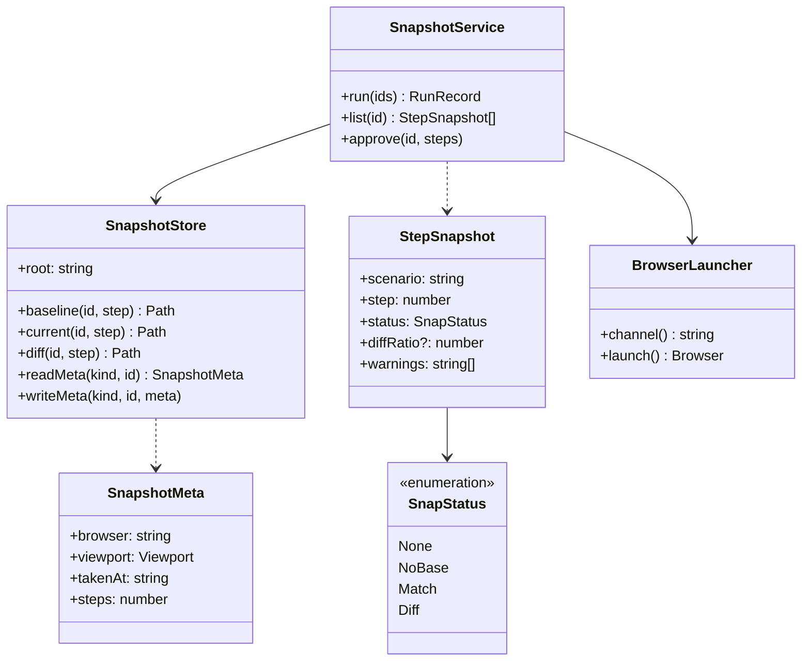
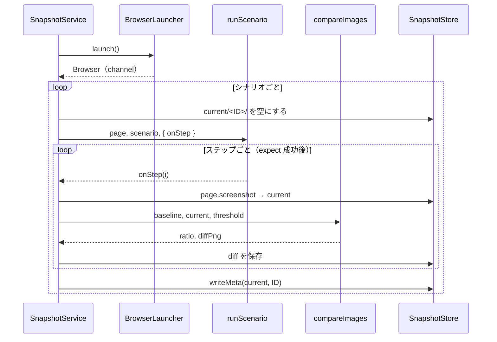
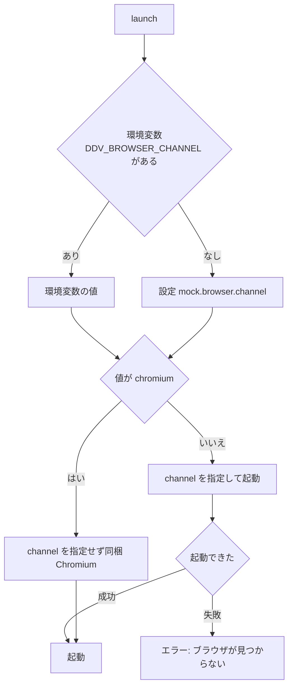
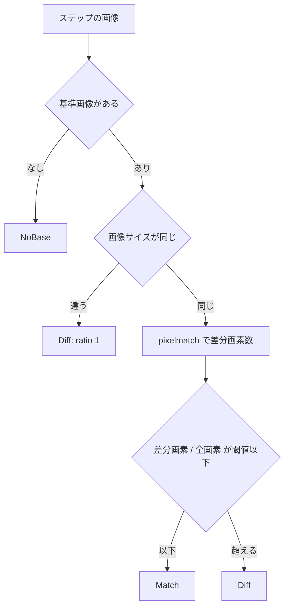

# スナップショット 詳細設計

## 前提

- 状態と流れは :ref[../basic/mock-player.md#スナップショット]、設定は :ref[../basic/mock-player.md#設定と-cli] を参照
- 実装は `apps/server/src/snapshots.ts`（サービス）と `packages/mock/src/image.ts`（比較）。追加依存は `pixelmatch` と `pngjs`

## 構造

- 置き場所：`.ddv/snapshots/{baseline,current,diff}/<テストID>/<ステップ番号 3 桁>.png` と `meta.json`
- 実行の進捗は既存の `RunManager` の仕組み（SSE `/api/runs/{id}/events`）に `kind: snapshot` の実行として載せる
- `ConfigSchema` に `mock`（`browser.channel` 既定 `chromium`、`snapshot.threshold` 既定 0.001、`snapshot.viewport` 既定 1280×800）を追加する

## 撮影

- 撮影はモック対象だけ（`DDV_BASE_URL` は無視する）。アニメーションは `animations: 'disabled'`、キャレットは非表示
- ステップの失敗で、そのシナリオの撮影を打ち切る（以降のステップは None のまま）

## ブラウザの選択

- 起動エラーには `npx playwright install` または該当ブラウザのインストールを促す文言を付ける

## 比較

`compareImages(baseline, current, threshold)` とステップの状態判定。

- pixelmatch の色の許容値は 0.1（既定）。差分画像は常に保存する
- 基準と今回の `meta.browser` / `viewport` が違うときは状態に関係なく warning（`撮影環境が基準と異なります`）を付ける

## 承認

- `approve(id, steps?)`：指定ステップ（省略時は全ステップ）の current を baseline へコピーし、baseline の `meta.json` を current のもので更新する
- 今回の撮影でステップ数が減ったときは、全ステップ承認で baseline の余分なファイルを削除する
- None のステップは承認できない（400）
