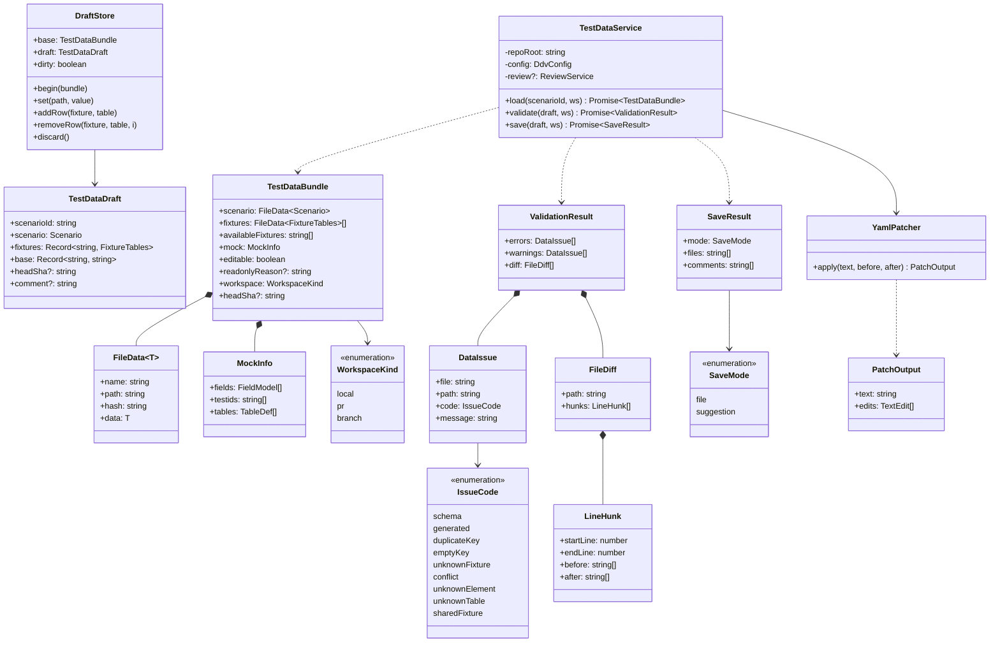
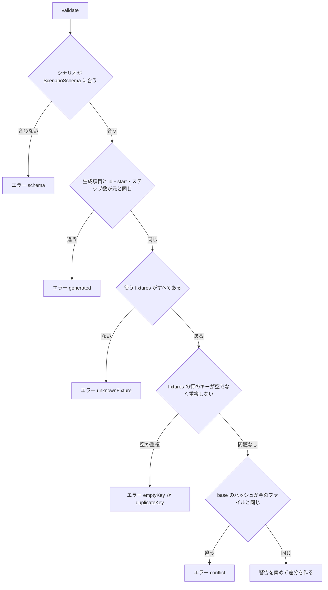
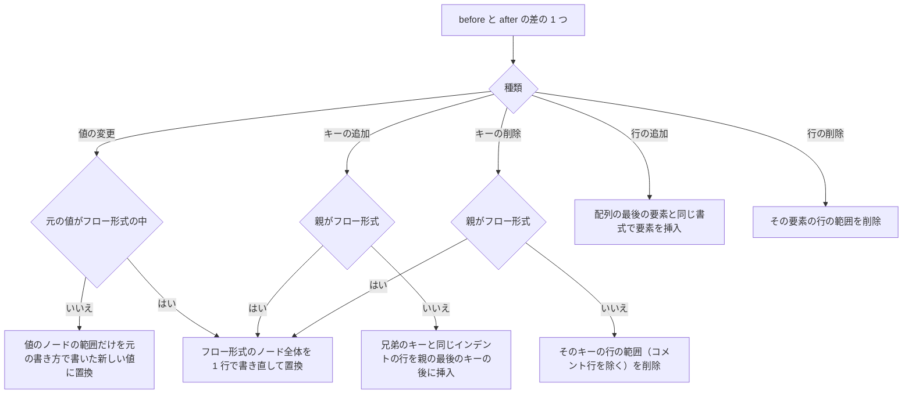
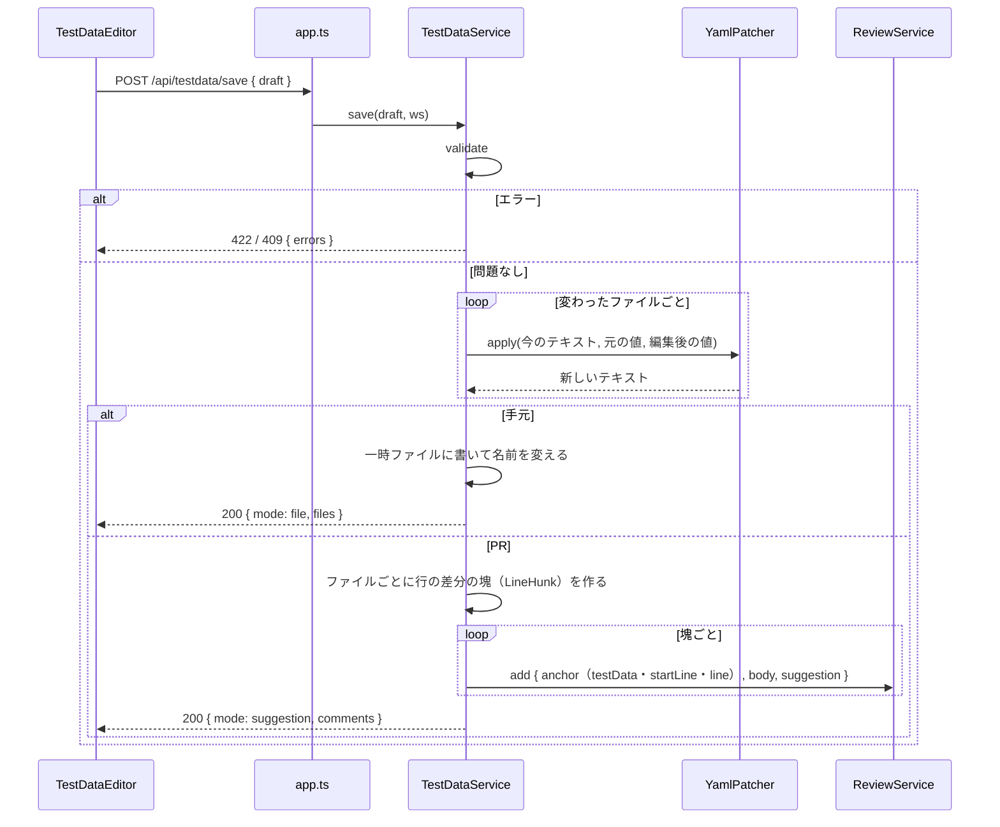
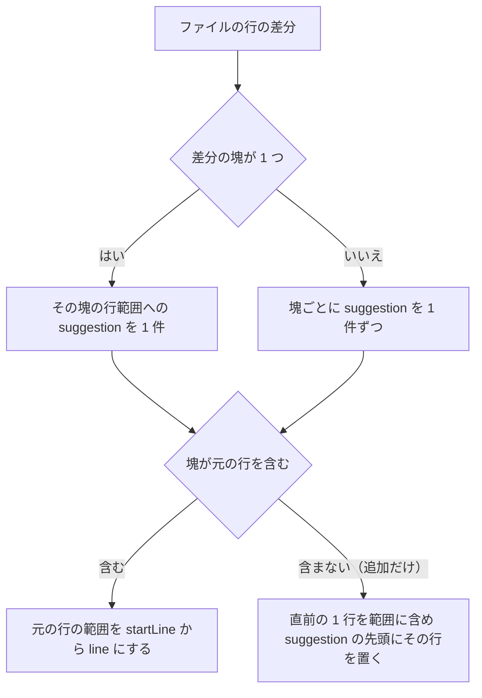
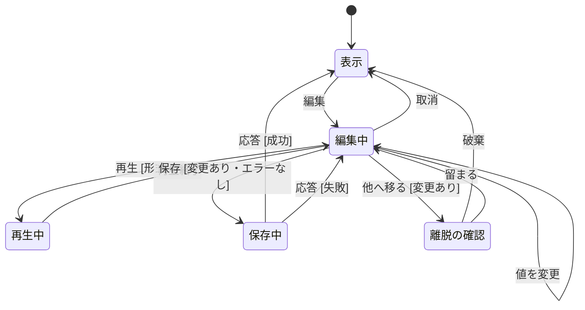

# テストデータ編集（シナリオ・fixtures） 詳細設計

## 前提

- 画面遷移は :ref[../basic/test-data-editor.md#画面遷移]、編集できる範囲は :ref[../basic/test-data-editor.md#編集できる範囲]、検証と保存は :ref[../basic/test-data-editor.md#検証と保存]、編集中の再生は :ref[../basic/test-data-editor.md#編集中の再生] を参照
- シナリオの形式（`ScenarioSchema`）とモックの解析（`analyzeMockHtml`）は :ref[scenario.md#構造]、runtime のリセットは :ref[mock-runtime.md#起動とリセット] を参照
- PR の保留中レビュー（`ReviewService.add`・配置の判定）は既存の `apps/server/src/review.ts` を使う
- 実装：サーバ `apps/server/src/testdata.ts`（`TestDataService`）、YAML の書き換え `packages/mock/src/yaml-patch.ts`（`YamlPatcher`）、ビューア `apps/web/src/components/TestDataEditor.tsx`・`apps/web/src/testdata.ts`（`DraftStore`・値の変換）、`player.ts`（編集中の再生）、runtime `bridge.ts`・`runtime.ts`（fixtures の内容の受け取り）

## 画面

画面遷移は :ref[../basic/test-data-editor.md#画面遷移]（状態 View / Editing / Previewing）。マトリクスの行・プレイヤーのツールバーの「テストデータ」で、文書の右側にパネルとして開く（ハッシュは変えない）。

::mock[test-data-editor/index.html]

### シナリオ表示

| 項目 | testid | 種類 | 型・桁 | 必須 | 初期値 | 取得元・送信先 | 入力チェック・エラー文言 |
|---|---|---|---|---|---|---|---|
| テストデータ（開く） | `td-open` | ボタン（マトリクスの行・プレイヤー） | — | — | — | `GET /api/testdata?scenario=<ID>` | シナリオの無い行には出さない |
| 見出し | `td-title` | 表示 | — | — | — | シナリオの `id`・`title`・経路（`ScenarioDetail.transitions`） | — |
| ステップ | `steps-view` | 表 | — | — | — | `scenario.steps`（列：#・イベント・入力・期待） | — |
| fixtures | `fixtures-view` | 表（fixtures・テーブルごと） | — | — | — | `fixtures[].tables` | — |
| ▶ 再生 | `td-play` | ボタン | — | — | — | 保存済みの内容でプレイヤーを再生（既存） | — |
| E2E を実行 | `td-run-e2e` | ボタン | — | — | — | `POST /api/tests/run { ids: [ID] }` | 紐づく playwright ランナーが無い・実行中は押せない |
| 編集 | `edit` | ボタン | — | — | — | Editing へ（`DraftStore.begin`） | `editable` が false なら押せない（理由を `title`） |
| 保存の結果 | `saved` | メッセージ | — | — | 非表示 | `POST /api/testdata/save` の応答（「保存しました」「suggestion を n 件追加しました」） | — |

### 編集中

| 項目 | testid | 種類 | 型・桁 | 必須 | 初期値 | 取得元・送信先 | 入力チェック・エラー文言 |
|---|---|---|---|---|---|---|---|
| タイトル | `td-title-input` | テキスト | 文字列 200 | — | `scenario.title` | `scenario.title` | — |
| 使う fixtures | `td-fixtures` | 複数選択（順序あり） | — | — | `scenario.fixtures` | `scenario.fixtures`（候補は `availableFixtures`） | 存在しない名前：「fixtures が見つかりません：x」（エラー） |
| ステップ | `steps-edit` | 表 | — | — | — | 生成項目（イベント・期待の画面）は灰色の表示だけ | — |
| 入力（キーごと） | `in-<キー>` | 入力（種類は[値の型](#値の型)） | 文字列 1000 / 数値 / 真偽 / 選択 | — | 今の値 | `steps[i].input[キー]` | 型に合わない：「数値を入力してください」など（エラー） |
| 期待 text（キーごと） | `ex-<キー>` | テキスト | 文字列 1000 | — | 今の値 | `steps[i].expect.text[キー]` | — |
| 期待 count（キーごと） | `exc-<キー>` | 数値 | 整数 0 以上 | — | 今の値 | `steps[i].expect.count[キー]` | 「0 以上の整数を入力してください」 |
| 期待 visible | `exv` | 複数選択 | — | — | 今の値 | `steps[i].expect.visible`（候補はモックの `data-testid`） | — |
| キーの追加 | `step-add-key` | ボタン（ステップごと） | — | — | — | `input`・`text`・`count`・`visible` を選び、キーは候補から補完 | 同じステップの同じ種類に同じキー：「キーが重複しています」 |
| キーの削除 | `step-remove-key` | ボタン（キーごと） | — | — | — | そのキーを消す | — |
| fixtures の行 | `fx-row` | 表の行（`data-fixture`・`data-table`・`data-index`） | — | — | — | `fixtures[].tables[テーブル][i]` | — |
| fixtures のキー | `fxkey` | テキスト | 文字列 100 | ○ | 今の値 | 行のキー（[キーの決め方](#検証)） | 空：「キーを入力してください」、重複：「キー A-1002 が重複しています」（エラー） |
| fixtures の項目 | `fx<項目名>` | 入力（種類は[値の型](#値の型)） | 文字列 1000 / 数値 / 真偽 | — | 今の値 | 行の項目 | — |
| 行の追加 | `fx-add-row` | ボタン（テーブルごと） | — | — | — | 最後の行と同じ項目で空の行を追加（キーは空） | — |
| 行の削除 | `fx-remove-row` | ボタン（行ごと） | — | — | — | 行を消す | — |
| 項目の追加・削除 | `fx-add-field` / `fx-remove-field` | ボタン（行ごと・項目ごと） | — | — | — | 行の項目を足す・消す | キーの項目は消せない |
| 変わる行 | `diff` | 表示（差分） | — | — | — | `POST /api/testdata/validate` の `diff`（入力が止まって 400ms 後に取り直す） | — |
| 警告 | `warnings` | 一覧 | — | — | 非表示 | `validate` の `warnings` | — |
| エラー | `save-error` | 一覧 | — | — | 非表示 | `validate` / `save` の `errors`（該当のセルにも `aria-invalid` と文言） | — |
| ▶ 再生（編集中のデータ） | `preview` | ボタン | — | — | — | Previewing へ（[編集中の再生](#編集中の再生)） | 形式のエラーがあると押せない |
| 取消 | `cancel` | ボタン | — | — | — | 編集中のデータを捨てて View へ | 変更があれば確認「変更を破棄しますか」 |
| 保存 / suggestion に追加 | `save` | ボタン | — | — | — | `POST /api/testdata/save` | 変更なし・エラーありは押せない。文言は手元「保存」、PR「suggestion に追加」 |
| コメント（PR のみ） | `td-comment` | テキスト（複数行） | — | — | `テストデータ：<ID> の <変えた項目>` | suggestion のコメント本文 | — |

- `change`（モックの「値を変更」）と `preview-end`（モックの「再生終了」）はモックだけの操作で、実際には入力欄の変更・プレイヤーの終了で起きる
- 生成項目と `id`・`start` は表示するが入力欄にしない

### 編集中の再生

| 項目 | testid | 種類 | 型・桁 | 必須 | 初期値 | 取得元・送信先 | 入力チェック・エラー文言 |
|---|---|---|---|---|---|---|---|
| 再生中の表示 | `preview-badge` | 表示 | — | — | 「編集中のデータで再生中」 | — | — |
| 失敗したステップ | `preview-failed` | 表示 | — | — | 非表示 | 再生の結果（Editing に戻ったとき、そのステップの行と差のあったセルを強調） | — |

## 構造

- `FixtureTables` は `Record<テーブル名, Row[]>`、`Row` は `Record<string, Value>`（fixtures の 1 ファイル分）
- `hash` はファイルのバイト列の SHA-256（16 進の先頭 16 文字）
- `editable` は、手元か PR のワークスペースで、シナリオのファイルが `_retired/` でないとき true。それ以外の `readonlyReason`：「PR でない GitHub のワークスペースでは保存できません（編集中の再生はできます）」「引退したシナリオです」。branch では Editing と Previewing まで行けて、保存だけ押せない

## 値の型

| 対象 | 入力欄 | 保存する値 |
|---|---|---|
| `input`（モックの要素が `number`） | 数値 | 数値（空なら空文字列） |
| `input`（`checkbox`） | チェック | 真偽 |
| `input`（`select`） | 選択（モックの `option` の値。候補に無い今の値も残す） | 文字列 |
| `input`（`text`・不明） | テキスト | 文字列 |
| fixtures の項目 | 今の値の型（新しい項目は文字列）。数値・真偽の項目は型の選択を付ける | その型。数値に変換できないとエラー |
| `expect.text` | テキスト | 文字列 |
| `expect.count` | 数値 | 0 以上の整数 |

## 検証

`TestDataService.validate(draft, ws)`。`save` も最初に同じ検証をする。

- エラーは見つけたところで止めず、同じ段のものはすべて集める（B で誤りがあれば C 以降は見ない）
- 生成項目：各ステップの `event`・`click`・`do`・`wait`・`expect.screen`・`expect.hidden`。`hidden` は編集の範囲（:ref[../basic/test-data-editor.md#編集できる範囲]）に無いので生成項目と同じく変更を受け付けない
- 行のキー：api.yaml の `tables` にそのテーブルの `key` があればその項目（既定 `id`）、行にその項目が無ければ先頭の項目
- 競合：手元は今のファイルのハッシュ、PR は加えて `draft.headSha` がワークスペースの `headSha` と同じか
- 警告：`input`・`expect.text`・`expect.count`・`expect.visible` のキーがモックの `data-testid` に無い（`unknownElement`）、fixtures のテーブルが api.yaml の `tables` に無い（`unknownTable`）、変えた fixtures を他のシナリオも使っている（`sharedFixture`。「default は他の 12 本のシナリオでも使われています」）
- `DataIssue.path` は `steps[1].input.customer`・`orders[2].id` の形（画面で該当のセルを示すため）

## YAML の書き換え

`YamlPatcher.apply(text, before, after)` は `yaml` の `parseDocument(text, { keepSourceTokens: true })` で位置を取り、**元のテキストを範囲ごとに差し替える**（`Document.toString()` で書き直さない）。

| 規則 | 内容 |
|---|---|
| 値の書き方 | 元が引用符付きなら同じ引用符。元が引用符なしで、新しい値を引用符なしで書いて同じ型・同じ値に読み戻せるならなし、そうでなければ `"…"`（JSON と同じエスケープ）。数値・真偽は引用符なし |
| 空の親 | `input` などが無いステップにキーを足すときは、`expect` の前に `input:` の行を作る（`event`・`input`・`click`・`expect` の順を保つ） |
| 改行 | 元のファイルの改行（LF / CRLF）と末尾の改行・BOM を保つ |
| 確認 | 置換後のテキストを読み直し、`after` と同じ値になることを確かめる。違えば保存せず 500「YAML を安全に書き換えられませんでした」 |

- 差し替えは後ろの範囲から順に行う（前の位置がずれないように）。変えていない行は 1 文字も変えない（REQ-305）
- 差（キーの追加・削除・値の変更、配列の要素の追加・削除）は、`before` と `after` をキーの道筋ごとに比べて求める。配列はシナリオの `steps` は位置で、fixtures の行はキーで突き合わせる（キーが変わった行は削除と追加にせず、キーの値の変更にする。並びの位置で判断する）

## 保存

- 差分の塊は前後の文脈 0 行で作る（離れた変更を 1 つの suggestion にまとめない）
- `anchor.element` は `{ kind: 'testData', key: '<シナリオID>' または 'fixtures/<名前>', label }`。`ElementKind` に `testData` を足し、`mockElement` と同じく行番号の指定を必須にする
- 配置（行・ファイル・本文）は既存の `judgePlacement` に任せる。PR の差分に無いファイルの suggestion は本文に入り、その旨を応答の `warnings` に入れる（画面の `saved` にも出す）
- PR で途中の `add` が失敗したら、追加済みのコメントは残し、失敗した塊を `errors` に入れて 502 を返す（もう一度押すと、同じ範囲の保留コメントは `update` で置き換える）
- 手元で保存した後は `GET /api/testdata` を取り直して View に戻る（ファイルの変更で既存の監視がシナリオの状態を「未確認」にする）

## 編集の状態

`TestDataEditor` の状態。:ref[../basic/test-data-editor.md#画面遷移] に保存中と離脱の確認を加えたもの。

- 不正遷移：保存中・再生中の「編集」「保存」「再生」はボタンを押せない（何もしない）。View で「他へ移る」は確認なしで移る
- 「他へ移る」は、別のシナリオ・文書・タブへの移動と `beforeunload`。`beforeunload` ではブラウザの確認だけを出す

## 編集中の再生

:ref[mock-runtime.md#プロトコルpostmessage] の `ddv:reset` に `data` を足す。

| 方向 | type | 追加する内容 |
|---|---|---|
| ビューア → iframe | `ddv:reset` | `data?: Record<fixtures の名前, Record<テーブル, Row[]>>`。指定した名前はファイルを読まずにこの内容を使う |

- `PlayerController.playDraft(scenario, data)`：`ddv:reset { fixtures: scenario.fixtures, start, data }` の後、`scenario.steps` を既存の再生と同じく送る（`ddv:step` に `trace: true`。:ref[trace.md#ライブ表示]）
- 再生の結果は `POST /api/mocks/played` に送らない（シナリオの状態を変えない）
- 再生が完了・失敗・停止したら Editing に戻り、失敗したステップの `failures` のキーのセルを強調する

## API

GitHub のワークスペースでは既存と同じく `/api/w/<ワークスペースID>/...` で呼ぶ。

| メソッド | パス | 要求 | 応答 |
|---|---|---|---|
| GET | `/api/testdata` | `?scenario=<ID>` | `TestDataBundle`。シナリオが無い 404、形式が読めないシナリオは 422（`issues` 付き。編集できない） |
| POST | `/api/testdata/validate` | `TestDataDraft` | 200 `ValidationResult`（エラーがあっても 200） |
| POST | `/api/testdata/save` | `TestDataDraft` | 200 `SaveResult`（＋ `warnings`）。422 検証エラー、409 `conflict`、403 `readonly`（branch・引退）、502 suggestion の追加の一部失敗 |
