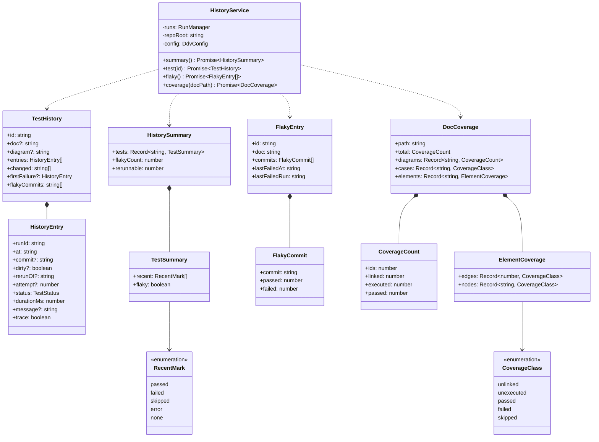
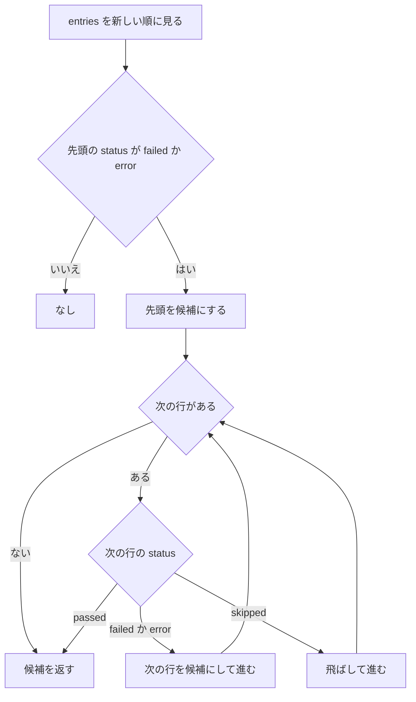
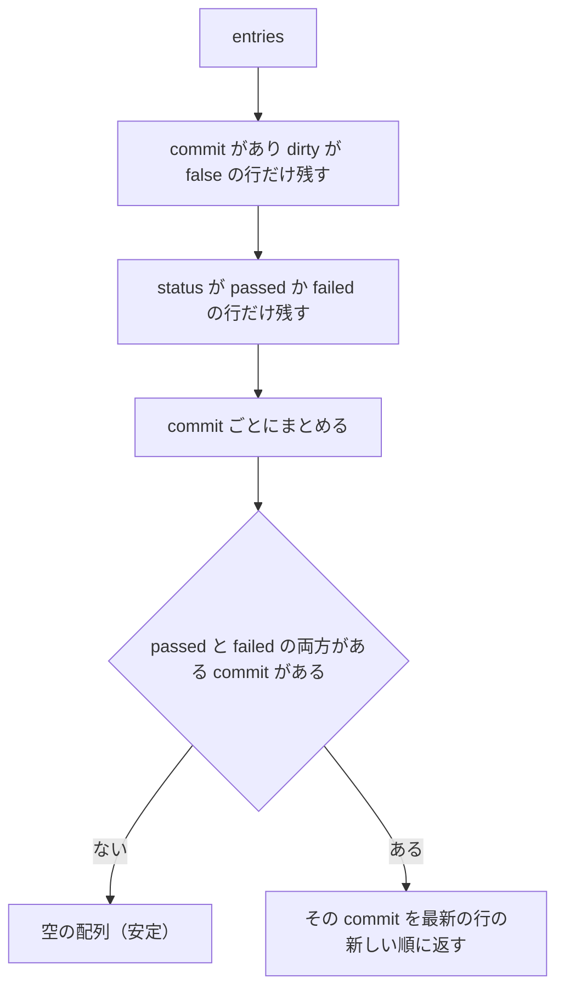
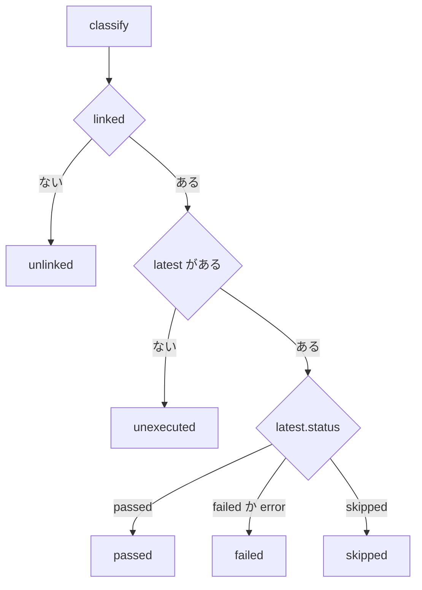
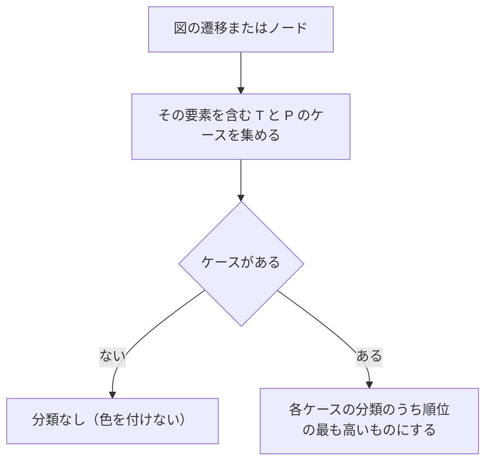
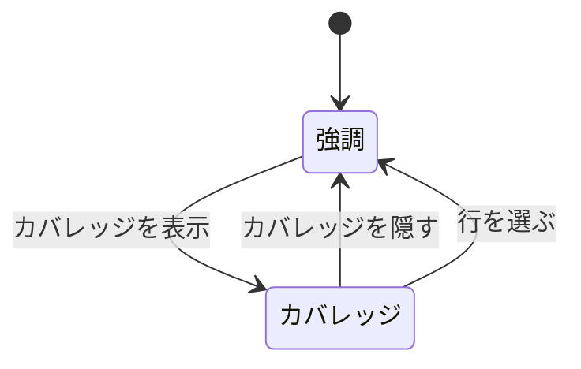
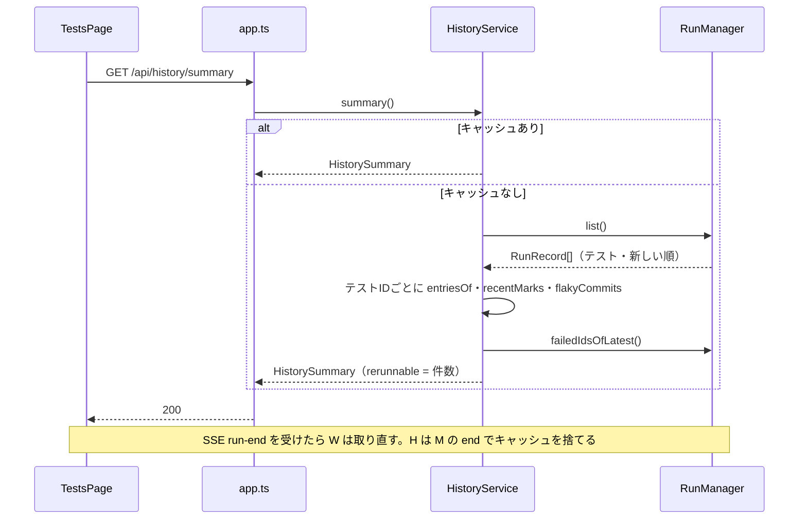

# テスト履歴・フレーキー・設計カバレッジ 詳細設計

## 前提

- 画面遷移は :ref[../basic/test-monitoring.md#画面遷移]、フレーキーの定義は :ref[../basic/test-monitoring.md#フレーキーの判定]、カバレッジの分類と表示場所は :ref[../basic/test-monitoring.md#設計カバレッジ] を参照
- 集計の元になる実行記録（`commit`・`dirty`・`rerunOf`）と再実行は :ref[run-record.md#構造] を参照
- 実装：サーバ `apps/server/src/history.ts`（`HistoryService` と純粋関数）、ビューア `apps/web/src/components/TestsPage.tsx`（拡張）・`TestHistory.tsx`・`FlakyList.tsx`・`CoverageBadge.tsx`、`MatrixPanel.tsx`・`DiagramBlock.tsx`・`MermaidView.tsx`（カバレッジの表示）

## 画面

画面遷移は :ref[../basic/test-monitoring.md#画面遷移]（状態 List / Detail / Flaky / Rerunning）。ハッシュは `#/tests`（List・Rerunning）、`#/tests/history/<テストID>`（Detail）、`#/tests/flaky`（Flaky）。GitHub のワークスペースでは先頭に `#/w/<ワークスペースID>` が付く。

::mock[test-monitoring/index.html]

### テスト一覧（追加分）

| 項目 | testid | 種類 | 型・桁 | 必須 | 初期値 | 取得元・送信先 | 入力チェック・エラー文言 |
|---|---|---|---|---|---|---|---|
| フレーキー | `flaky-open` | ボタン | — | — | 「フレーキー（n）」 | `HistorySummary.flakyCount`。`#/tests/flaky` へ | 0 件でも押せる（一覧が空） |
| 再実行の回数 | `rerun-times` | 選択 | `1` `2` `3` `5` | ○ | `2`（前回の選択を localStorage に保持） | `POST /api/tests/rerun` の `times` | — |
| 失敗を再実行 | `rerun` | ボタン | — | — | — | `POST /api/tests/rerun { times }` → Rerunning | 直近の実行に失敗が無い（`HistorySummary.rerunnable = 0`）・実行中は押せない。押せない理由を `title` に出す |
| 再実行のエラー | `rerun-error` | メッセージ | — | — | 非表示 | 409 / 400 の `error` | 「直近の実行に失敗したテストはありません」ほか応答の文言 |
| テスト一覧 | `test-list` | 表 | — | — | — | `GET /api/tests`（既存）＋ `GET /api/history/summary` | — |
| テストID | `test-open` | リンク | — | — | — | `#/tests/history/<テストID>` へ | — |
| 直近 10 回 | `test-dots` | 表示 | 点 10 個 | — | — | `HistorySummary.tests[id].recent`（左が新しい。足りない分は「未実行」の白い点） | 点の `title` に日時・コミット・結果 |
| フレーキーの印 | `flaky-mark` | 表示 | — | — | 非表示 | `HistorySummary.tests[id].flaky` | `title` に判定したコミット |

- 既存の `run-all`・`run-selected`・`test-row`・`run-log` は変えない
- `lastrun`（モックの「直近の実行」）はモックだけの操作で、実際には `rerunnable` の値で決まる

### テストIDの履歴

| 項目 | testid | 種類 | 型・桁 | 必須 | 初期値 | 取得元・送信先 | 入力チェック・エラー文言 |
|---|---|---|---|---|---|---|---|
| 一覧へ | `detail-back` | ボタン | — | — | — | `#/tests` へ（フレーキー一覧から来たときも一覧へ） | — |
| 見出し | `detail-title` | 表示 | — | — | — | `TestHistory.id`・`doc`・`diagram` | 有効でないID：「このテストIDはロックにありません（欠番か存在しません）」 |
| フレーキーの印 | `detail-flaky` | 表示 | — | — | 非表示 | `TestHistory.flakyCommits`（短縮 SHA を並べる） | — |
| 失敗し始めた実行 | `first-failure` | 表示 | — | — | 非表示 | `TestHistory.firstFailure`（[失敗し始めた実行](#失敗し始めた実行)） | 直近が失敗でなければ出さない |
| 推移 | `history` | 表 | 最大 200 行 | — | — | `TestHistory.entries`（新しい順。各行 `history-row`、結果が変わった行は `data-changed`） | 0 件：「まだ実行していません」 |
| トレース | `history-trace` | ボタン（行ごと） | — | — | — | :ref[trace.md#画面] へ | シナリオのテストIDで、その実行にトレースがある行だけ |

| 推移の列 | 内容 |
|---|---|
| 実行日時 | `finishedAt`（無ければ `startedAt`）を `MM/DD HH:mm` |
| コミット | `commit` の先頭 7 文字。`dirty` なら「（変更あり）」、`commit` 無しは「不明」。再実行は「再実行 n/m」を併記 |
| 結果 | 成功・失敗・スキップ・エラー |
| 所要時間 | `durationMs` を秒（小数 1 桁） |
| メッセージ | `message` の 1 行目を 120 文字まで（全文は `title`） |

### フレーキー一覧

| 項目 | testid | 種類 | 型・桁 | 必須 | 初期値 | 取得元・送信先 | 入力チェック・エラー文言 |
|---|---|---|---|---|---|---|---|
| 一覧へ | `flaky-back` | ボタン | — | — | — | `#/tests` へ | — |
| フレーキー一覧 | `flaky-list` | 表 | — | — | — | `GET /api/history/flaky`（最後に失敗した実行の新しい順） | 0 件：「フレーキーなテストはありません」 |
| テストID | `flaky-test-open` | リンク | — | — | — | `#/tests/history/<テストID>` へ | — |

- 列：テストID・文書（`doc`）・コミット（判定したコミットのうち最新の短縮 SHA。複数なら「ほか n 件」）・成功 / 失敗（そのコミットでの回数）・最後の失敗（日時）

### 再実行中

| 項目 | testid | 種類 | 型・桁 | 必須 | 初期値 | 取得元・送信先 | 入力チェック・エラー文言 |
|---|---|---|---|---|---|---|---|
| 何回目か | `rerun-attempt` | 表示 | — | — | 「1 / n 回目」 | SSE `run` の `attempt`・`times` | — |
| ログ | `rerun-log` | ログ | — | — | — | 既存の `GET /api/runs/{id}/events`（回が変わったら次の実行IDで購読し直す） | — |

- 最後の回の `run-end` で List に戻り、`summary` を取り直す

### 文書・マトリクス・図（追加分）

| 項目 | testid | 種類 | 型・桁 | 必須 | 初期値 | 取得元・送信先 | 入力チェック・エラー文言 |
|---|---|---|---|---|---|---|---|
| 文書のカバレッジ | `coverage-doc` | 表示 | — | — | — | `DocCoverage`（「テストID n・紐づけ a（x%）・実行 b（y%）・成功 c（z%）」） | 有効なテストIDが 0：出さない |
| 図のカバレッジ | `coverage-diagram` | 表示 | — | — | — | `DocCoverage.diagrams[図ID]` | 同上 |
| マトリクスの分類 | `matrix-coverage` | 表示（行ごと） | — | — | — | `DocCoverage.cases[id]`（`data-class` に `CoverageClass`） | — |
| フレーキーの印（行） | `matrix-flaky` | 表示（行ごと） | — | — | 非表示 | `HistorySummary.tests[id].flaky` | — |
| 履歴 | `matrix-history` | ボタン（行ごと） | — | — | — | `#/tests/history/<テストID>` へ | 実行済みでない行は押せない |
| カバレッジを表示 | `coverage-toggle` | チェック（図のツールバー） | — | — | オフ | `DocCoverage.elements[図ID]` で色分け | オンにすると経路の強調を解除し、強調の操作中はオフにする（[図の色分け](#図の色分け)） |

## 構造

| 関数（`history.ts`） | 役割 |
|---|---|
| `entriesOf(runs, id)` | `RunManager.list()`（テストの実行・新しい順）から、そのIDの結果がある実行を `HistoryEntry[]` にする |
| `changedRows(entries)` | 1 つ古い行と `status` が違う行の `runId`（最も古い行は含めない） |
| `firstFailure(entries)` | [失敗し始めた実行](#失敗し始めた実行) |
| `flakyCommits(entries)` | [フレーキーの判定](#フレーキーの判定)。判定したコミット（新しい順） |
| `recentMarks(entries, n = 10)` | 先頭 n 件の `status`。足りない分は `none` |
| `classify(id, linked, latest)` | [カバレッジの分類](#カバレッジの分類) |
| `elementClasses(matrix, cases)` | [図の色分け](#図の色分け) |

- 集計は `RunManager` の `end` で無効にするキャッシュ（`summary` と `flaky` の結果）を持つ。`test(id)` と `coverage` は毎回計算する（対象が小さい）
- 紐づけ（`scanTestLinks`）とロック（`readLock`）は既存の `/api/tests` と同じものを使う

## 失敗し始めた実行

- 返すのは連続した失敗のうち最も古い実行。画面には日時とコミットを出し、推移の表でその行を強調する

## フレーキーの判定

- `dirty` が無い（不明）の行は残さない。再実行の記録も通常の実行と同じく数える
- `FlakyEntry.commits` の `passed`・`failed` は、そのコミットの行の件数
- `HistorySummary.flakyCount` は `flakyCommits` が空でないテストIDの数。ロックで有効でないID（欠番・不明）も含める（実行した事実を隠さない）

## カバレッジの分類

`classify(id, linked, latest)`。`linked` は紐づくテストがあるか、`latest` は `RunManager.latest()[id]`。

- 対象はロックの有効なID（`activeIds`）のうち、その文書の図のもの。欠番は数えない
- `CoverageCount`：`ids` = 対象の数、`linked` = `unlinked` 以外、`executed` = `linked` のうち `unexecuted` 以外、`passed` = `passed`。割合はビューアで `Math.floor(x / ids * 100)` の整数 %
- 紐づいていないのに結果だけがある（以前紐づいていた）IDは `unlinked` にする（いま実行できないため）

## 図の色分け

`elementClasses(matrix, cases)` は図ごとに要素の分類を決める。

- 順位：`passed` > `failed` > `skipped` > `unexecuted` > `unlinked`
- 遷移はケースの `edges`（辺番号）、ノードはケースの `nodes` に含まれるか。T は 1 本の遷移とその両端のノード、P は経路上のすべて
- `MermaidView` は要素に `ddv-cov-<分類>` のクラスを付ける（色：成功 緑・失敗 赤・スキップ 灰・未実行 白地に灰の枠・未紐づけ 白地に橙の破線）。既存の強調（`highlight.ts`）とは同時に付けない

- 「行を選ぶ」（マトリクスの行の選択・プレイヤーの再生による強調）が起きたら、カバレッジの表示をオフにしてから強調する

## 集計の流れ

## API

GitHub のワークスペースでは既存と同じく `/api/w/<ワークスペースID>/...` で呼ぶ。

| メソッド | パス | 要求 | 応答 |
|---|---|---|---|
| GET | `/api/history/summary` | — | `HistorySummary` |
| GET | `/api/history/tests/{id}` | — | `TestHistory`。ロックに無い・履歴も無いIDは 404 `unknown-id` |
| GET | `/api/history/flaky` | — | `FlakyEntry[]` |
| GET | `/api/coverage` | `?path=<文書のパス>` | `DocCoverage`。文書が無ければ 404 |
| POST | `/api/tests/rerun` | :ref[run-record.md#api] | 同左 |

- `HistoryEntry.trace` は、その実行の `traces` にIDがあり、`.ddv/traces/<実行ID>/<ID>.json` が今もあるとき true
