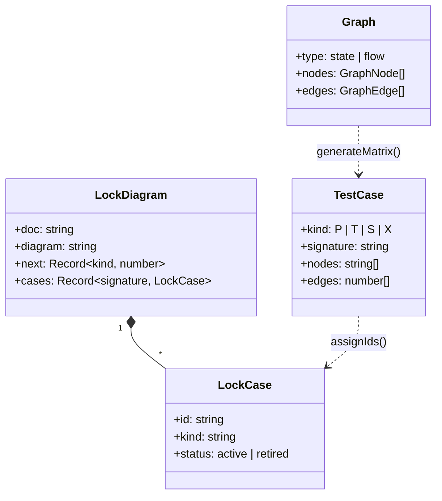
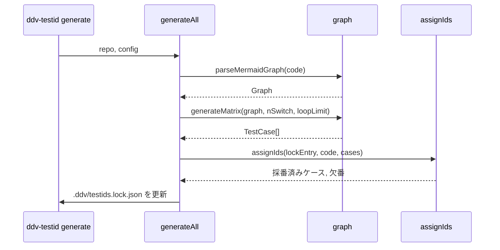
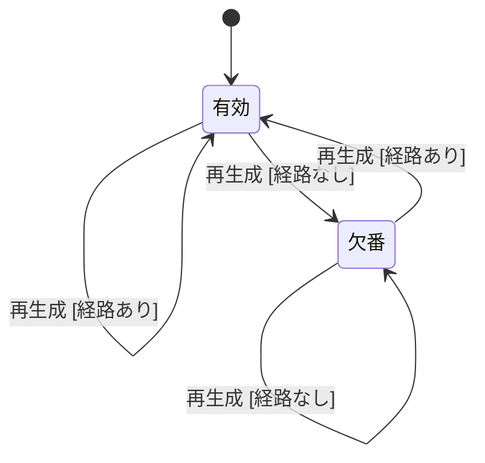

# テストID採番 詳細設計

## 構造

## 採番

参照：:ref[../basic/viewer.md#データ]

- ID 形式：`{REQ|BD|DD}-{文書ID}-{図の略号}-{P|T|S|X}{連番3桁}`
- 連番は種別ごとに `next` から払い出し、欠番は再利用しない

## テストIDの状態

- 有効になるとき：新しい経路は種別ごとの末尾番号、復活した経路は元の番号
