# 実アプリのデザインのトークン（XAML・CSS の取り込み）詳細設計

## 前提

- 生成の流れは :ref[../basic/design-tokens.md#生成の流れ]、XAML の変換規則は :ref[../basic/design-tokens.md#xaml-の取り込みwpf]、CSS の取り込み規則は :ref[../basic/design-tokens.md#css-の取り込みweb-アプリ]、出力の形式は :ref[../basic/design-tokens.md#出力ファイル]、乖離の検出は :ref[../basic/design-tokens.md#乖離の検出]、設定と CLI は :ref[../basic/design-tokens.md#設定と-cli] を参照
- 実装：新規パッケージ `packages/tokens`（`@ddv/tokens`。`src/schema.ts`・`src/fs.ts`・`src/xaml/reader.ts`・`src/xaml/uri.ts`・`src/xaml/convert.ts`・`src/xaml/aero2.ts`・`src/css/reader.ts`・`src/writer.ts`・`src/drift.ts`・`src/generate.ts`・`src/node.ts`・同梱の `assets/wpf-base.css`）、設定 `packages/core/src/config.ts`、lint の組み込み `packages/core/src/lint-cli.ts`・`apps/server/src/app.ts`（`/api/lint`）、CLI `apps/server/src/cli.ts`
- 依存：XML の解析に `fast-xml-parser`、CSS の解析に `postcss`（どちらもブラウザでも動く純粋な JavaScript）。ハッシュは WebCrypto（`crypto.subtle.digest('SHA-256')`）で計算し、Node 専用の API を使わない
- 本書に画面は無い（CLI と lint だけ）

## 構造

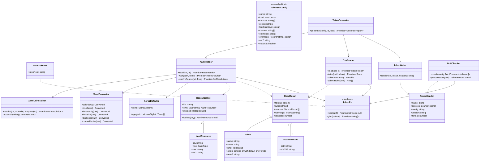

| クラス・関数 | 置き場所 | 役割 |
|---|---|---|
| `TokenSetSchema`・`TokenSetConfig` | `packages/core/src/config.ts` | `tokens` の 1 項目。`kind` で `xaml` / `css` を分ける zod の判別共用体 |
| `TokenFs`・`NodeTokenFs` | `src/fs.ts`・`src/node.ts` | 読み取りの抽象。パスはリポジトリのルートからの相対（`/` 区切り。`..` で外も指せる）。読めないときは `null`。ブラウザ側からは `RepoReader` を包んだ実装を渡す |
| `XamlReader`・`XamlUriResolver`・`XamlConverter`・`Aero2Defaults` | `src/xaml/*` | [XAML の読み取り](#xaml-の読み取り) |
| `CssReader` | `src/css/reader.ts` | [CSS の読み取り](#css-の読み取り) |
| `TokenWriter` | `src/writer.ts` | [出力](#出力) |
| `DriftChecker`（関数 `checkTokens(repoRoot, config)` で公開） | `src/drift.ts` | [乖離の検査](#乖離の検査) |
| `TokenGenerator`（関数 `generateTokens(config, fs, { name })` で公開） | `src/generate.ts` | セットごとに読み取り・出力し、件数と warning をまとめる |

## 設定の形式

`ConfigSchema.tokens` を `z.array(z.unknown())` で受け、項目ごとに `TokenSetSchema` で検証する（設定全体を不正にしない）。

| 項目 | 型 | 必須 | 既定 | 規則・エラー文言 |
|---|---|---|---|---|
| `name` | string | ○ | — | `^[a-z0-9][a-z0-9-]*$`。違反：「tokens の name は小文字の英数字とハイフンで書いてください: <値>」。重複：「tokens の name が重複しています: <値>」 |
| `kind` | `xaml` / `css` | ○ | — | それ以外：「tokens の kind は xaml か css です: <値>」 |
| `sources` | string[] | ○ | — | 1 件以上。リポジトリのルートからの相対 |
| `prefix` | string | | なし | `^[a-z][a-z0-9-]*$`。xaml だけ |
| `fontSizeKeys` | string[] | | `[]` | xaml だけ |
| `classes` | string[] | | `[]` | css だけ。先頭の `.` は付けない |
| `elements` | string[] | | `[]` | css だけ |
| `overrides` | Record\<string, string\> | | `{}` | キーは `--` で始まる |
| `out` | string | | `<mocksRoot>/_tokens/<name>.css` | `mocksRoot` の下で `.css` で終わる。違反：「tokens の out は mocksRoot（<mocksRoot>）の下の .css にしてください: <値>」 |
| `optional` | boolean | | `false` | 生成元が無いときの乖離の検査を下げる |

- 文字列の項目（旧形式 `tokens: string[]`）は、lint で warning「tokens の文字列の項目は使われなくなりました（無視します）: <値>」を出して読み飛ばす
- 他方の `kind` だけの項目（xaml に `classes` など）は warning「kind: xaml では classes は使いません」で無視する
- `TokenSetSchema` の不適合は lint の error（rule `tokens-config`、場所は `ddv.config.yaml`）。そのセットは生成・検査の対象から外す

## 生成の流れ

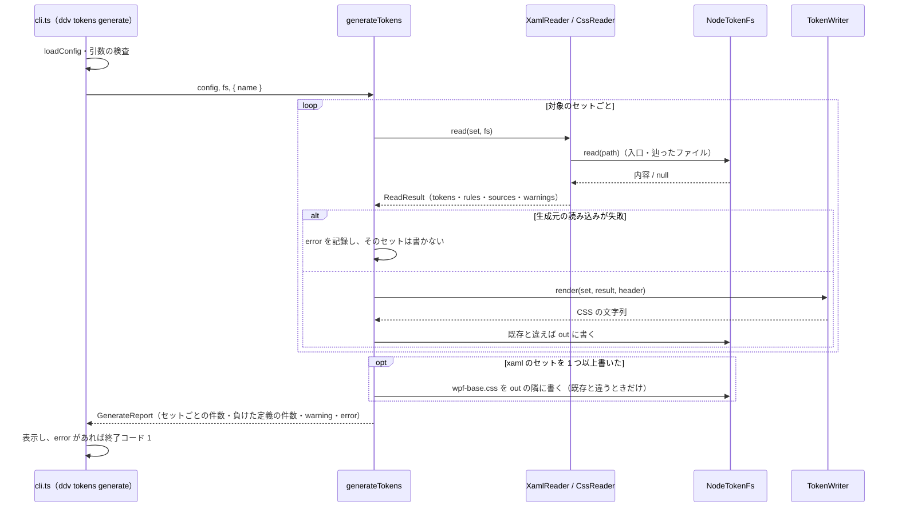

- 生成元のハッシュは、読んだ内容の改行を LF にそろえてから計算する（`sha256Hex(text)`）
- 出力が既存の内容と同じなら書かない（更新日時を変えない）

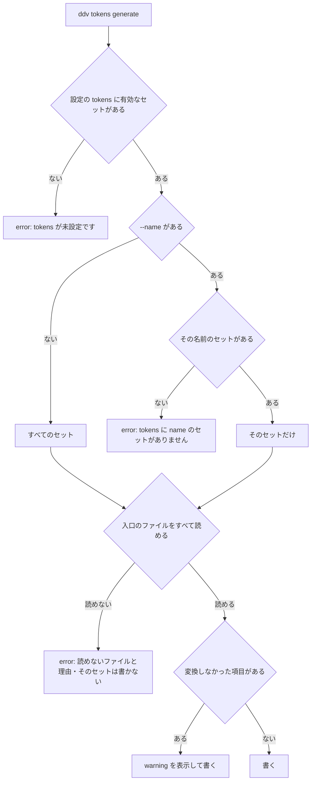

- E3 は入口（`sources` に挙げたファイル）が読めないとき。`MergedDictionaries`・`@import` で辿った先が読めないときは warning（[XAML の Source の解決](#xaml-の-source-の解決)・[CSS の @import](#css-の-import)）
- 1 つのセットが E3 でも、ほかのセットは生成する。終了コードは error が 1 件でもあれば 1
- 表示の形式：セットごとに 1 行「<name>: トークン <n> 件・共通クラス <n> 件・標準の項目 <n> 件（WPF 標準 <n> 件）・負けた定義 <n> 件 → <out>」、続けて warning を「  warning: <ファイル>:<行> <内容>」

## XAML の読み取り

`fast-xml-parser` の `XMLParser`（`ignoreAttributes: false`、`preserveOrder: true`、行番号のため `captureMetaData` を使う）で読み、要素名は名前空間の接頭辞を外した局所名で、`x:Key` などは名前空間の URI で判定する。

| 判定 | 規則 |
|---|---|
| XAML の名前空間 | `xmlns:<p>="http://schemas.microsoft.com/winfx/2006/xaml"` の `<p>:Key`・`<p>:Static` |
| `sys:Double` | `xmlns:<p>="clr-namespace:System;assembly=mscorlib"`（または `System.Runtime`）の `<p>:Double` |
| 辞書の場所 | ルートが `ResourceDictionary` ならその直下、`Application` なら `Application.Resources` の直下（または中の `ResourceDictionary`） |
| 静的な参照 | 属性・内容が `{StaticResource K}`・`{DynamicResource K}` |
| システムの参照 | `{x:Static SystemColors.<名前>}`・`{x:Static SystemFonts.<名前>}`（キーにも値にも現れる） |

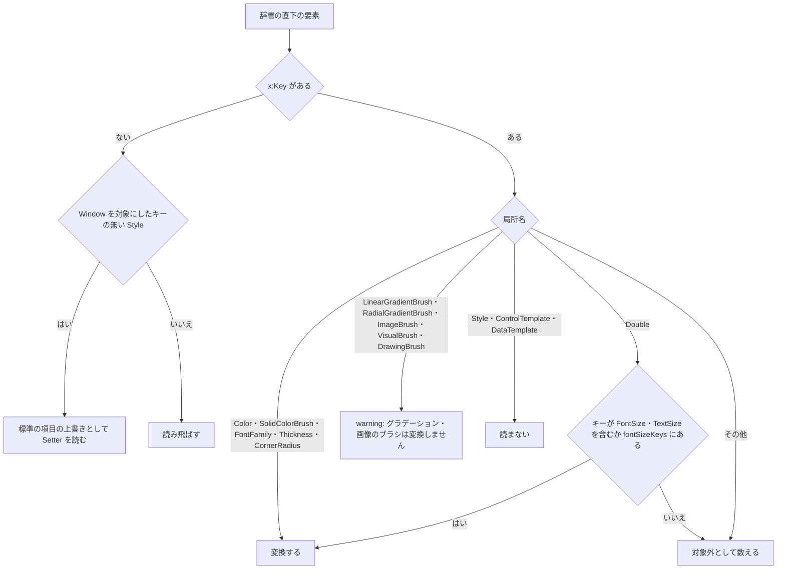

- WS（Window の Style）は、基本設計の「`TextElement.FontFamily` を App.xaml で上書き」を満たすための狭い例外。`TargetType` が `Window`（`{x:Type Window}` を含む）でキーの無い `Style` の `Setter` のうち、`Background`・`Foreground`・`FontFamily`・`FontSize`・`TextElement.FontFamily`・`TextElement.FontSize` だけを読む。ほかの `Setter`・`Trigger` は読まず、共通クラスにもしない
- キーが `{x:Static SystemColors.…Key}`・`{x:Static SystemFonts.…Key}` のリソースは、標準の項目の上書きとして扱う（[標準の項目](#標準の項目)）。通常のトークンとしては出さない

### 値の変換

| 型 | 入力の形 | 出力 | 変換できないとき |
|---|---|---|---|
| `Color`（内容） | `#AARRGGBB`・`#RRGGBB`・`#ARGB`・`#RGB`・既知の色名（`Red` など。CSS の色名に小文字で対応するもの） | `#rrggbb`（A が FF）/ `#rrggbbaa` | `sc#…`・未知の色名：warning「色の値を読めません: <値>」 |
| `SolidColorBrush` | 属性 `Color`（値か参照）、任意の `Opacity` | 色と同じ。`Opacity` が 1 未満なら A に掛ける | `Color` が参照で `Opacity` が 1 未満：warning「参照の色に Opacity は掛けられません」 |
| `FontFamily`（内容） | `,` 区切り | 各名前の前後の空白を除き `"…"` で囲む（`serif`・`sans-serif`・`monospace` は囲まない） | 空：warning |
| `Double`（文字サイズ） | 数値・`<数値>px`・`pt`・`in`・`cm` | px に換算（`pt` は ×4/3、`in` は ×96、`cm` は ×96/2.54）。小数 2 桁で丸め末尾の 0 を除く | 数値でない：warning「文字サイズを読めません」 |
| `Thickness`（内容） | 1 値（全周）・2 値（左右,上下）・4 値（左,上,右,下） | `上 右 下 左` の px（0 は単位なし） | 値の数が 3 など：warning |
| `CornerRadius`（内容） | 1 値・4 値（左上,右上,右下,左下） | 1 値は `<n>px`、4 値はその順の px | 値の数が 2・3：warning |
| 参照 `{StaticResource K}`・`{DynamicResource K}` | 同じセットで解決できるキー | `var(--<名前>)` | 解決できない：warning「参照先のリソースがありません: K」。項目は出さない |
| 参照 `{x:Static SystemColors.XBrushKey}` など | [標準の項目](#標準の項目)の対応表にあるキー | `var(--wpf-…)` | 表に無いキー：warning「対応していないシステムのリソースです: X」 |
| `{Binding …}`・ほかのマークアップ拡張 | — | — | warning「実行時にしか決まらない値です」 |

### トークン名

`tokenName(key, prefix)` = `--` ＋（`prefix` があれば `<prefix>-`）＋ `kebabKey(key)`。

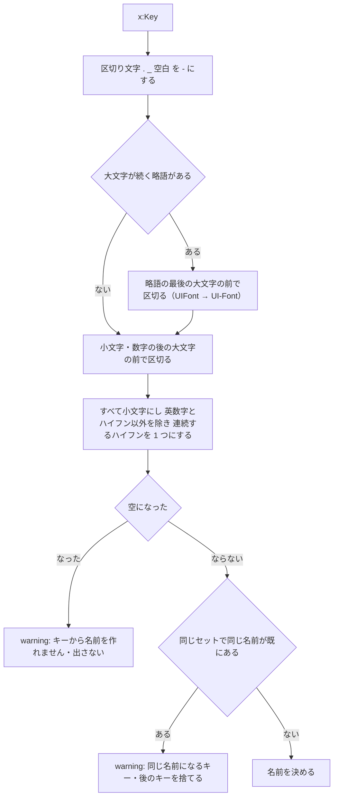

- 例：`AccentBrush` → `accent-brush`、`UIFontSize` → `ui-font-size`、`Brush.Accent_2` → `brush-accent-2`
- 標準の項目の名前（`--wpf-window-bg` など）は `prefix` に関わらず固定。定義したトークンと同じ名前になったときは定義を出し、warning「標準の項目と同じ名前です」

### XAML の Source の解決

`ResourceDictionary.MergedDictionaries` の子の `ResourceDictionary Source="…"` を `XamlUriResolver.resolve(uri, fromFile, entryProject)` で読み取りのパスにする。`entryProject` は入口のファイルから親へ辿って最初に見つかった `*.csproj` のある場所。

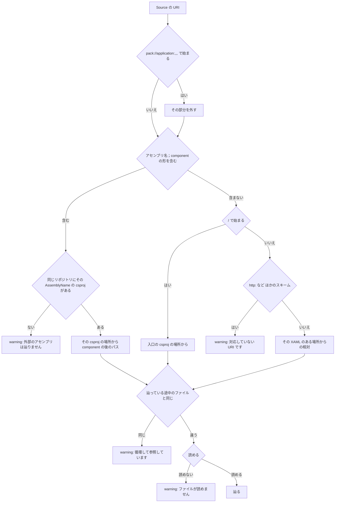

- アセンブリ名の索引は `glob('**/*.csproj')`（`bin`・`obj`・`node_modules` を除く）の各ファイルの `<AssemblyName>`、無ければファイル名（拡張子を除く）。一度だけ作る
- URI の照合は大文字小文字を区別しない（Windows のパスに合わせる）。読み取りのパスは実在するファイルの大文字小文字に直してから生成元に記録する
- warning には URI と、それを書いたファイル・行を出す

### 同じキーの優先順

`ResourceDict.lookup(key)` は WPF の検索順に合わせる。

1. その辞書自身の定義（`own`）
2. `merged` を **後ろから** 順に、それぞれの `lookup`（入れ子も同じ規則）
3. 設定の `sources` に複数のファイルを挙げたときは、後のファイルの辞書から先に探す

出力するトークンは、全辞書のキーの和集合を `lookup` で 1 つずつ解決したもの。解決に使われなかった定義は「負けた定義」として数える（表示のみ）。参照 `{StaticResource K}` の解決にも同じ `lookup` を使う（参照元の辞書ではなくセット全体で解決する。モックでは辞書の境界が無いため）。

### 標準の項目

`Aero2Defaults.apply(dict, windowStyle)` は、次の表の項目ごとに、上書きの元（上から優先）があればその値、無ければ Aero2 の値を出す。Aero2 の値の項目には `/* WPF 標準 */` を付ける。

| トークン | Aero2 の値 | 上書きの元（キーは `SystemColors.` / `SystemFonts.` の後） |
|---|---|---|
| `--wpf-window-bg` | `#ffffff` | Window の Style の `Background`、`WindowBrushKey`、`WindowColorKey` |
| `--wpf-window-fg` | `#000000` | Window の Style の `Foreground`、`WindowTextBrushKey`、`WindowTextColorKey` |
| `--wpf-font-family` | `"Segoe UI", "Yu Gothic UI", sans-serif` | Window の Style の `TextElement.FontFamily`・`FontFamily`、`MessageFontFamilyKey` |
| `--wpf-font-size` | `12px` | Window の Style の `TextElement.FontSize`・`FontSize`、`MessageFontSizeKey` |
| `--wpf-button-bg` | `#dddddd` | なし（Aero2 のテンプレートの固定値） |
| `--wpf-button-border` | `#707070` | なし |
| `--wpf-button-fg` | `#000000` | `ControlTextBrushKey`、`ControlTextColorKey` |
| `--wpf-button-hover-bg` | `#bee6fd` | なし |
| `--wpf-button-pressed-bg` | `#c4e5f6` | なし |
| `--wpf-input-bg` | `var(--wpf-window-bg)` | `WindowBrushKey`（ウィンドウの背景と同じ元） |
| `--wpf-input-border` | `#abadb3` | なし |
| `--wpf-input-focus-border` | `#569de5` | なし |
| `--wpf-highlight-bg` | `#0078d7` | `HighlightBrushKey`、`HighlightColorKey` |
| `--wpf-highlight-fg` | `#ffffff` | `HighlightTextBrushKey`、`HighlightTextColorKey` |
| `--wpf-control-padding` | `1px` | なし |
| `--wpf-control-border-width` | `1px` | なし |

- 上書きの値も [値の変換](#値の変換) で変換し、参照なら `var(--…)` にする
- 「なし」の項目は WPF でもテーマのテンプレートを差し替えない限り変わらない。アプリが独自の `Style` でボタンの色を変えていても読まない（Style は範囲外）。その場合は利用者がモック側の CSS で上書きする
- `assets/wpf-base.css` は `body`（`--wpf-window-bg`・`--wpf-window-fg`・`--wpf-font-family`・`--wpf-font-size`）、`button`（背景・枠・文字色・`:hover`・`:active`・`padding`・`border-width`）、`input`・`select`・`textarea`（背景・枠・`:focus`）、`::selection`（選択色）だけを持つ。生成のたびに out と同じフォルダの `wpf-base.css` に写す（ddv の持ち物。先頭に「生成物。編集しない」）

## CSS の読み取り

`postcss.parse(text, { from: path })` で読み、`@import` を展開した 1 つの木を作ってから、上から順に 1 回だけ走査する。

### CSS の @import

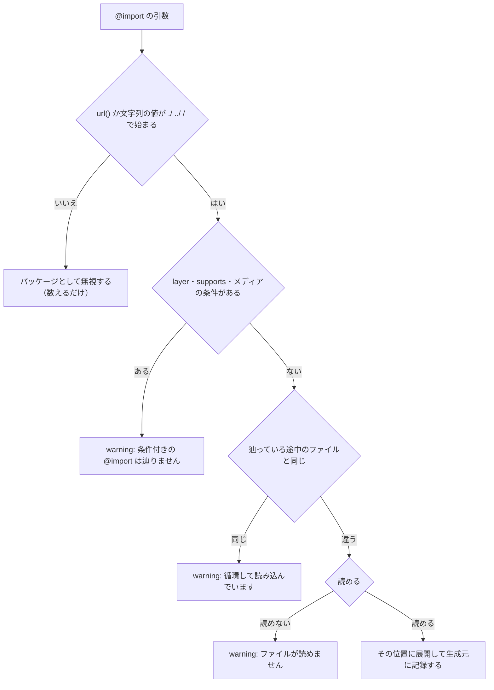

- `/` で始まるものは、入口のファイルのあるパッケージ（親へ辿って最初の `package.json` の場所）からのパスとする

### 規則の分類

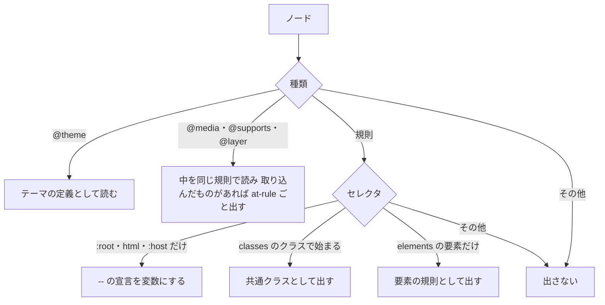

- セレクタの一覧（`a, .x`）は、条件に合うセレクタだけを残して出す
- 「クラスで始まる」：`.<クラス>` の直後が終わり・`__`・`--`・`:`・`.`・`[`・空白・`>`・`+`・`~` のどれか（`.admin-cardx` は合わない）
- 「要素だけ」：`<要素>` の直後が終わり・`:`・`::` のどれか
- `:root` などにある `--` 以外の宣言は出さない（`html` を `elements` に挙げたときは要素の規則として出す）
- 出した規則の中の `@apply` は除いて warning「@apply は展開しません: <クラス>」、値に `theme(`・`--theme(`・`--spacing(` を含む宣言は除いて warning「ビルドが必要な値です」
- `@media` などの中の `:root` の変数は、通常の変数表に入れず、その at-rule ごと出す

### テーマの定義

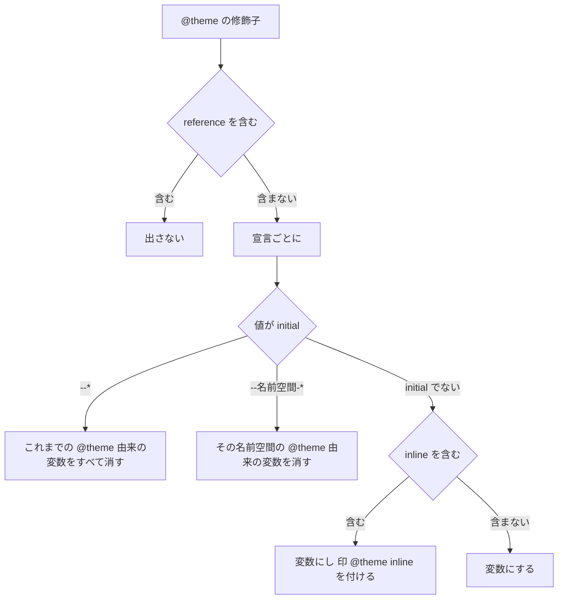

- 変数表は名前 → 値の 1 つの表で、`:root` 由来と `@theme` 由来を区別せず、後に読んだ定義が上書きする（展開した `@import` の位置の順）。消す命令は、`@theme` 由来の印のある変数だけを消す
- `@theme` の中の `@keyframes` などは出さない

### 代替値と未定義の変数

1. `overrides` の各キーを変数表に入れる（既にあれば値を置き換え、印 `override`）
2. 出す変数・規則の値に現れる `var(--x)`（入れ子・既定値付きを含む）を集める
3. 変数表に無い `--x` があれば warning「未定義の変数を参照しています（overrides で値を与えてください）: --x」。規則は出す

## 出力

`TokenWriter.render` は次の順で 1 つの文字列を作る。改行は LF、末尾に改行 1 つ。

1. ヘッダ（[ヘッダの形式](#ヘッダの形式)）
2. `:root {` … `}`：トークンを、xaml は種類（色 → 書体 → 文字サイズ → 余白 → 角丸 → 標準の項目）→ 名前の順、css は名前の順に 1 行ずつ `  --name: value;`。印があれば行末に `/* WPF 標準 */`・`/* override */`・`/* @theme inline */`
3. css だけ：取り込んだ at-rule・要素の規則・共通クラスを **元の順のまま**（カスケードを変えないため）。postcss の `toString()` で出し、コメントは除く

### ヘッダの形式

```text
/* ddv tokens: <name>（ddv tokens generate が生成。編集しない）
 * source: <path> sha256=<64 桁の 16 進>      ← 読んだファイルごと（読んだ順）
 * config: sha256=<64 桁の 16 進>
 * generated-by: ddv <版> format=<出力の形式の版>
 */
```

- `config` は `kind`・`sources`・`prefix`・`fontSizeKeys`・`classes`・`elements`・`overrides`・`out` を、キーを辞書順に並べた JSON（`canonicalJson`）の SHA-256。`name`・`optional` は含めない（名前は出力先で、`optional` は検査の扱いだけのため）
- `TOKEN_FORMAT = 1`。変換規則を変えたときだけ上げる

## 乖離の検査

`checkTokens(repoRoot, config)` は `ExtraLintCheck` として `lintRepo` に渡す（rule `tokens`、場所は出力ファイル）。

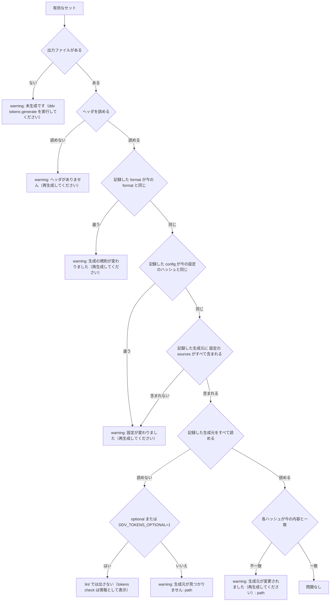

- `LintIssue.severity` に `info` は無いので、`optional` のときは lint の結果に入れない。`ddv tokens check` は同じ判定を使い、そのときだけ「情報: 生成元が見つからないため検査を省略しました: <path>」を表示する
- 乖離の検査は生成元を読むだけで、変換はしない（MergedDictionaries で辿った先が増えた・減ったは、辿った元の XAML のハッシュの不一致で気づく）
- 組み込み：`lint-cli.ts` の `extraChecks` に `checkTokens` を加え、`app.ts` の `/api/lint` でも `checkMocks` の後に呼ぶ。`@ddv/core` → `@ddv/tokens` → `@ddv/core` の循環を避けるため、`lint-cli.ts` は `await import('@ddv/tokens/node')` で読む
- Pages 版は lint を実行しないので、ブラウザ側では `checkTokens` を呼ばない

## CLI

`apps/server/src/cli.ts` に `tokens` のサブコマンドを加える。

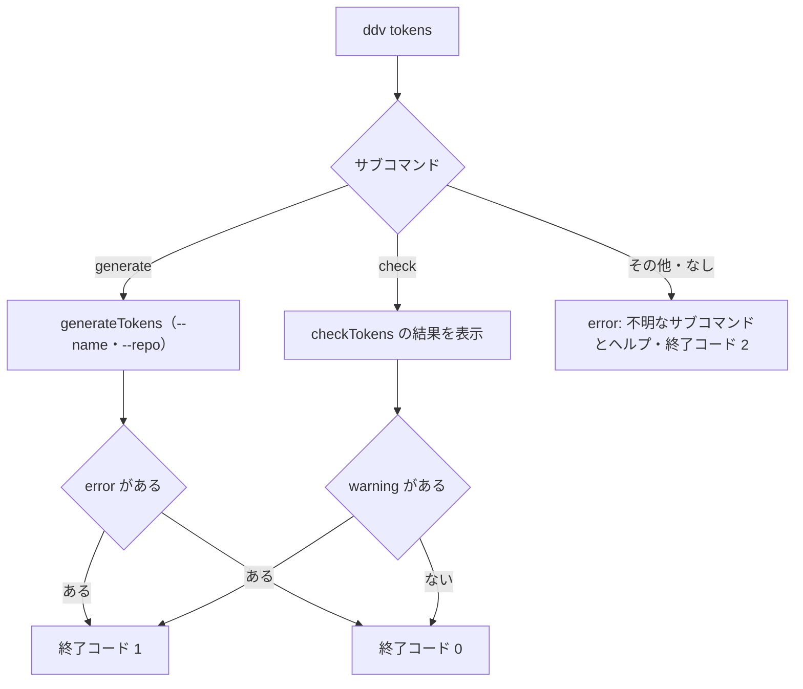

- `check` は CI 用なので warning で失敗させる（lint の `--strict` と同じ考え方）

## テストの方針

| 種類 | 対象 | 方法 |
|---|---|---|
| 単体テスト | 本書の matrix 図（`TGEN`・`XRES`・`KEBAB`・`XURI`・`CIMPORT`・`CRULE`・`THEME`・`TCHK`・`TCLI`） | `packages/tokens/src/*.test.ts`。`TokenFs` はメモリ実装を渡す |
| 単体テスト | 値の変換・標準の項目・優先順 | 表の行ごとに `XamlConverter`・`Aero2Defaults`・`ResourceDict.lookup` を確かめる |
| 結合テスト | サンプルの WPF（`examples/sample-app/desktop/OrderApp.Wpf`）と pokenae.Web の `globals.css` の写し | 生成結果を固定のファイルと比べ、2 回目の生成で内容が変わらないこと |
