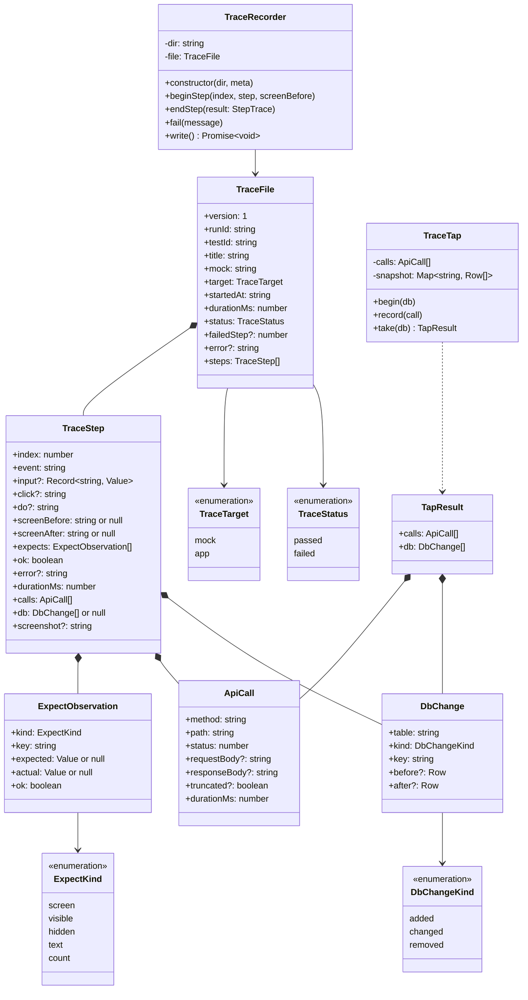
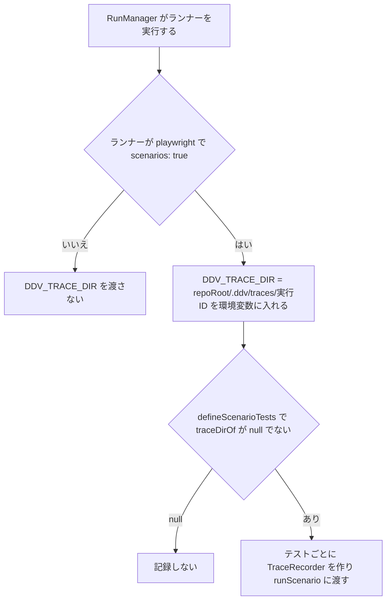
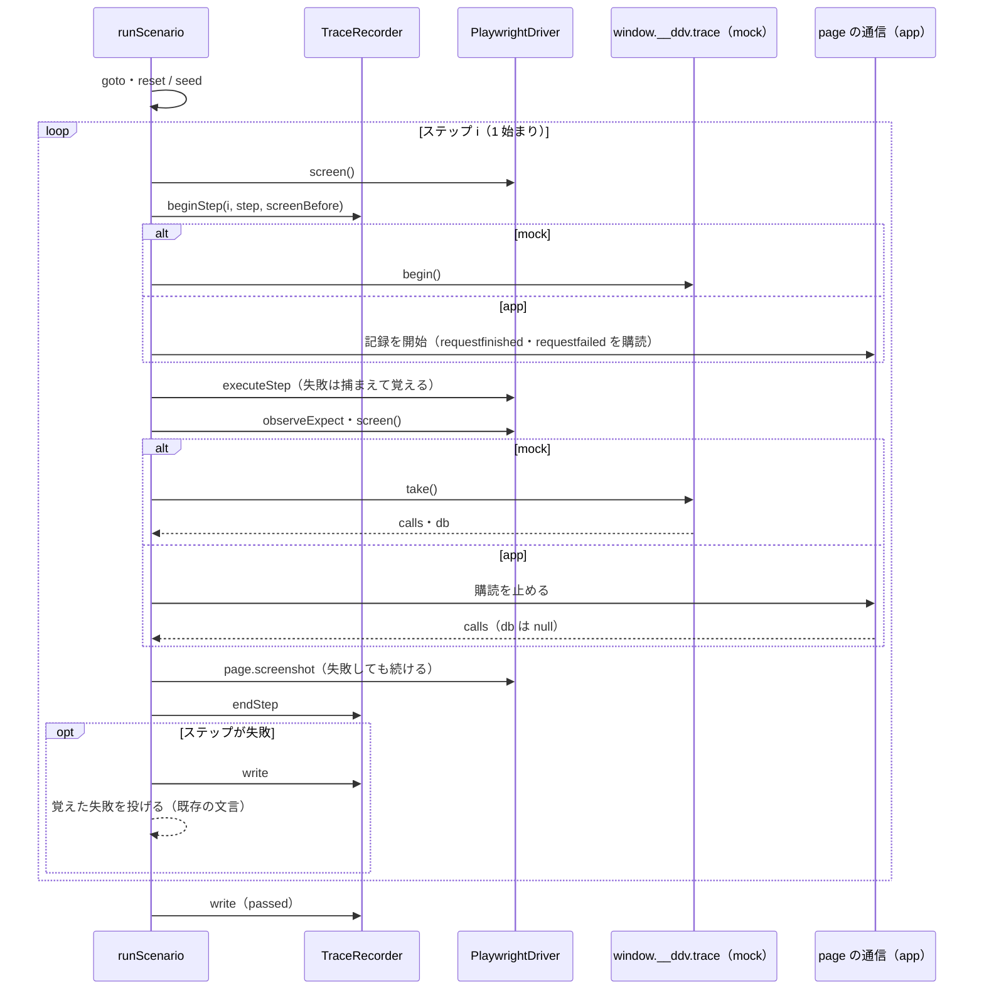
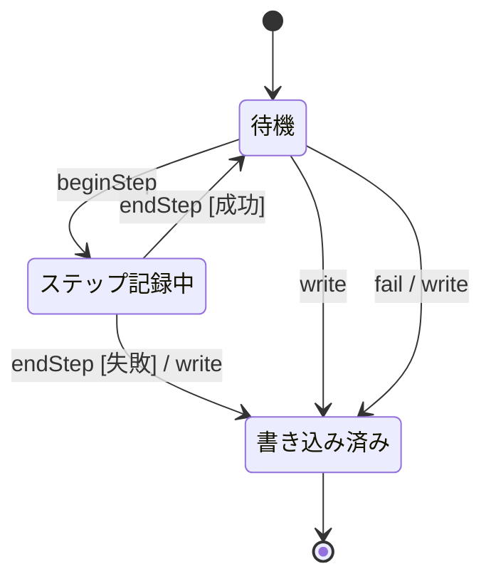
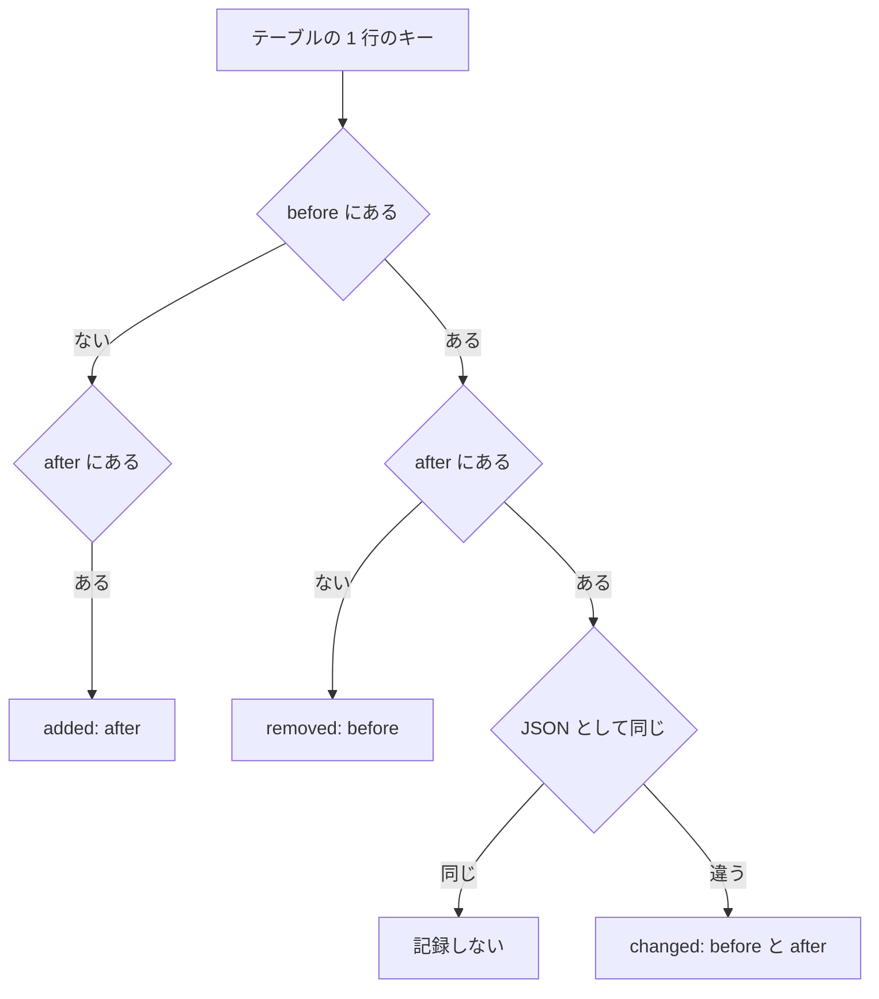
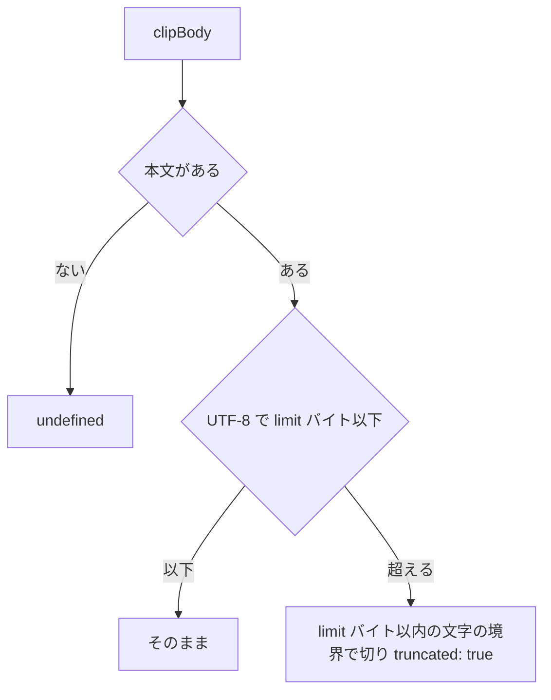

# トレースの記録（シナリオ E2E・mock-runtime） 詳細設計

## 前提

- 記録の流れと記録する内容は :ref[../basic/trace-view.md#記録]、ライブ表示は :ref[../basic/trace-view.md#ライブ表示]、データは :ref[../basic/trace-view.md#データ] を参照
- E2E の実行器・ステップ解釈は :ref[scenario.md#e2e-実行]・:ref[scenario.md#ステップ解釈]、runtime の構造とプロトコルは :ref[mock-runtime.md#構造]・:ref[mock-runtime.md#プロトコルpostmessage] を参照（本書はそこへの追加だけを書く）
- 実行記録の `traces` と剪定は :ref[run-record.md#実行の終了] を参照
- 実装：`packages/mock/src/trace.ts`（形式・`TraceRecorder`・`observeExpect`）、`packages/mock/src/run-scenario.ts`・`playwright.ts`（記録の呼び出し）、`packages/mock-runtime/src/trace-tap.ts`（API・DB の記録）、`bridge.ts`・`fetch.ts`・`runtime.ts`（追加）、`apps/server/src/runs.ts`・`runner.ts`（`DDV_TRACE_DIR` の受け渡し）

## 構造

| 関数 | モジュール | 役割 |
|---|---|---|
| `observeExpect(driver, expect)` | `@ddv/mock/step` | `expect` の各項目を 1 回だけ評価し `ExpectObservation[]` を返す（再試行しない）。`checkExpect` と同じ評価を使う |
| `diffTables(before, after, keys)` | `@ddv/mock/trace` | [DB の変化](#db-の変化) |
| `clipBody(text, limit)` | `@ddv/mock/trace` | [本文の切り詰め](#本文の切り詰め) |
| `traceDirOf(env)` | `@ddv/mock/trace` | `DDV_TRACE_DIR` を絶対パスにする。未設定・空なら null |

- `TraceStep.index` は 1 始まり（画面の「ステップ n」と同じ）。`TraceFile.failedStep` も 1 始まり、0 はステップの前（ページを開く・fixtures の投入）での失敗
- `TraceStep.db` が null は「対象外」（実アプリ）。空の配列は「変化なし」
- `screenshot` は `<テストID>/<index>.png`（トレースのディレクトリからの相対パス）。撮れなかったら項目を書かない

## 記録の有効化

- `buildInvocation` の `env` に足す。スナップショット（`ddv mock snapshot`）と手での `playwright test` は `DDV_TRACE_DIR` が無いので記録しない
- `defineScenarioTests` は `test.info()` からタイトルの ID を取り、`TraceRecorder` の `meta`（`runId` = ディレクトリ名、`testId`、`title`、`mock`、`target`）にする
- `.gitignore` に `**/.ddv/traces/` を追加する（ddv 自身と `ddv mock init` が書く雛形の両方）

## 記録の流れ

- 例外の文言・種類（`StepError`）は既存の `runScenario` と変えない。記録の失敗（`take`・スクリーンショット・書き込み）はテストの結果を変えず、`console.warn` に出す
- ステップより前の失敗（runtime が読み込まれない等）は `fail(message)`（`failedStep: 0`、`steps: []`）を書いてから投げる
- `observeExpect` はステップの成功・失敗にかかわらず 1 回呼ぶ（失敗時の「実際の値」を画面に出すため）。要素が無い項目は `actual: null`

- 不正遷移：`InStep` での `beginStep`・`write`、`Written` での `beginStep`・`endStep`・`fail` は `Error('トレースの記録の順序が不正です')`（実装の誤りを検出するため。テストの結果には影響させない）
- `write` は `<テストID>.json.tmp` に書いてから名前を変える。ディレクトリが無ければ作る

## mock-runtime の記録

`MockRuntime` に `trace: TraceTap` を持たせ、`window.__ddv.trace` として公開する。

| 追加 | 内容 |
|---|---|
| `TraceTap.begin(db)` | `calls` を空にし、`db` の全テーブルの行を `structuredClone` で写す |
| `TraceTap.record(call)` | `FetchInterceptor` が `ApiRouter.handle` の応答を返す直前に呼ぶ（base 配下の要求だけ。元の fetch へ流したものは記録しない） |
| `TraceTap.take(db)` | `{ calls, db: diffTables(写し, 今の行, テーブルのキー) }` を返し、記録を止める |
| `begin` していないとき | `record` は何もしない（記録のための負荷を通常の操作に掛けない） |

- 要求の本文は `fetch` の `body`（文字列）をそのまま、応答の本文は `JSON.stringify`。どちらも `clipBody`（64KB）
- `durationMs` は `performance.now()` の差

### DB の変化

`diffTables(before, after, keys)` はテーブル名の和集合ごとに行のキー（`TableDef.key`、既定 `id`）で突き合わせる。

- キーの値は `String(key)`。キーの無い行は配列の位置（`#<番号>`）をキーにする
- 並びはテーブル名の昇順、同じテーブルでは added → changed → removed、その中はキーの昇順

### 本文の切り詰め

- 実アプリの応答で本文が取れない（バイナリ・リダイレクト）ときは `responseBody` を書かない

## 実アプリの通信の記録

- 記録するのは `request.resourceType()` が `fetch` か `xhr` のものだけ（画面の読み込み・画像は除く）
- `requestfinished` で `status` と本文、`requestfailed` で `status: 0`・`responseBody` に失敗の理由
- `path` は `baseURL` と同じオリジンならパスとクエリ、違えば URL 全体
- ステップの終わりまでに完了しなかった要求は、そのステップに `status: -1`（「未完了」）で入れる

## ライブ表示のための追加（プロトコル）

:ref[mock-runtime.md#プロトコルpostmessage] に次を足す。

| 方向 | type | 追加する内容 |
|---|---|---|
| ビューア → iframe | `ddv:step` | `trace?: boolean`（true なら `HostBridge` が `exec` の前後で `begin`・`take` を呼ぶ） |
| iframe → ビューア | `ddv:result` | `trace?: { screenBefore, calls, db, expects }`（`ddv:step` の `trace` が true のときだけ） |

- `expects` は runtime 側の `DomDriver` で `observeExpect` を 1 回呼んだもの
- スクリーンショットは送らない（:ref[../basic/trace-view.md#ライブ表示]）
- 調整中（`TUNING_MESSAGE`）・起動中などで実行しなかったステップには `trace` を付けない
- 古い runtime（`trace` を返さない）では、ビューアはライブ表示に「この runtime は記録に対応していません（ddv mock init で更新してください）」を出す
