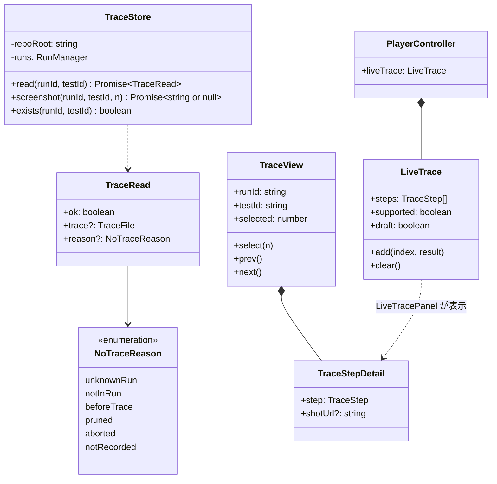
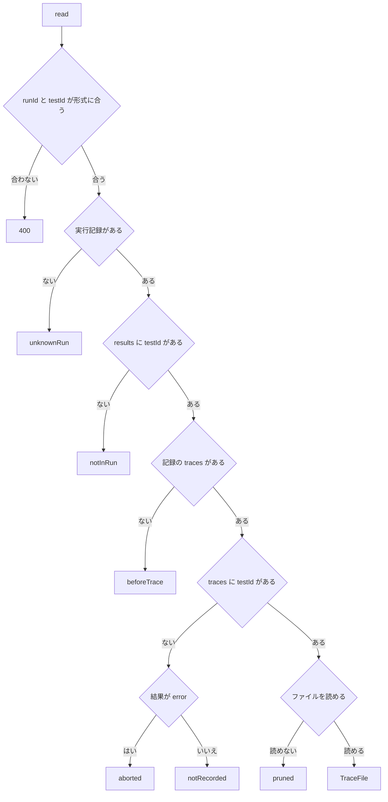
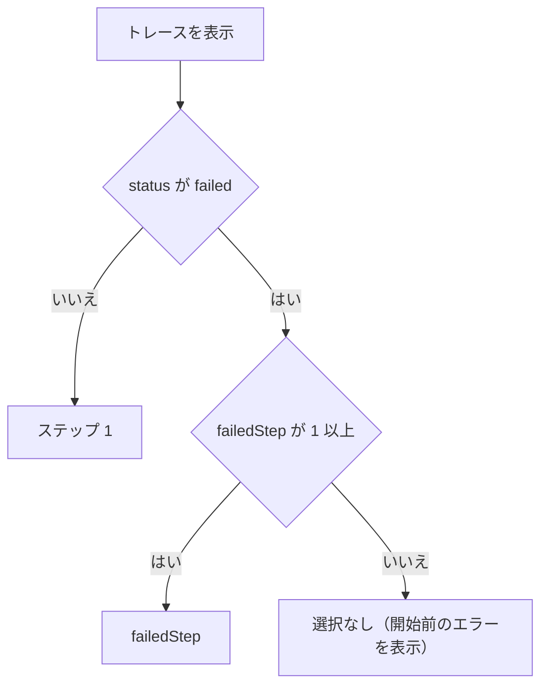
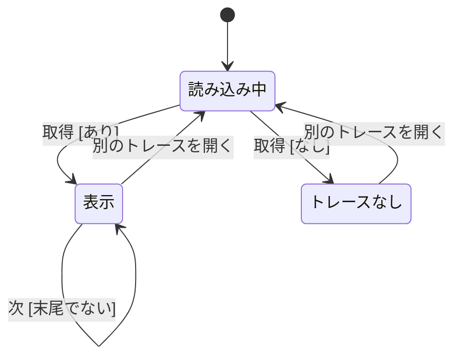
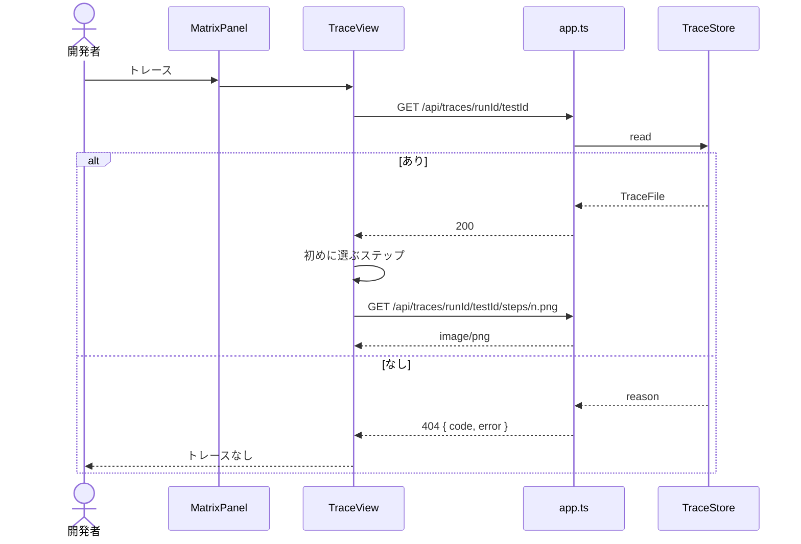
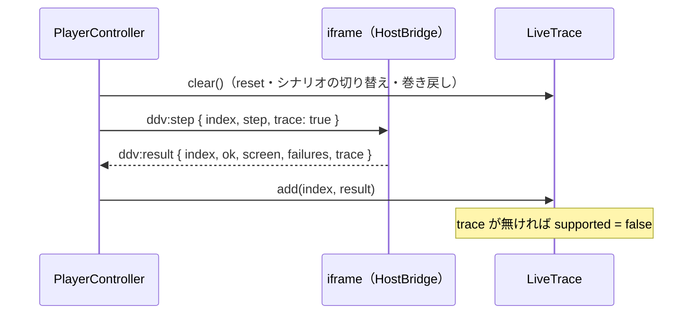

# トレースビュー（表示・API・ライブ表示） 詳細設計

## 前提

- 画面遷移は :ref[../basic/trace-view.md#画面遷移]、画面の要素は :ref[../basic/trace-view.md#画面イメージ]、ライブ表示は :ref[../basic/trace-view.md#ライブ表示] を参照
- トレースのファイル形式（`TraceFile`・`TraceStep`）とライブ表示のプロトコルは :ref[trace-recorder.md#構造]・:ref[trace-recorder.md#ライブ表示のための追加プロトコル] を参照
- 実装：サーバ `apps/server/src/traces.ts`（`TraceStore`）、ビューア `apps/web/src/components/TraceView.tsx`・`TraceStepDetail.tsx`・`LiveTracePanel.tsx`、`MatrixPanel.tsx`・`TestsPage.tsx`・`TestHistory.tsx`（「トレース」ボタン）、`player.ts`・`MockFrame.tsx`（ライブ表示）

## 画面

ハッシュは `#/tests/trace/<実行ID>/<テストID>`（GitHub のワークスペースでは先頭に `#/w/<ワークスペースID>`）。「戻る」は開いた元の画面（ブラウザの履歴を 1 つ戻る。履歴が無ければ `#/tests`）。

::mock[trace-view/index.html]

### テスト結果（追加分）

| 項目 | testid | 種類 | 型・桁 | 必須 | 初期値 | 取得元・送信先 | 入力チェック・エラー文言 |
|---|---|---|---|---|---|---|---|
| トレース（マトリクスの行） | `trace-open` | ボタン | — | — | — | `#/tests/trace/<latest.runId>/<ID>` へ | シナリオに紐づくID（紐づけの `file` が `scenarios/*.yaml`）で、実行済みの行だけ出す |
| トレース（テスト一覧の行） | `test-trace` | ボタン | — | — | — | 同上 | 同上 |
| トレース（履歴の行） | `history-trace` | ボタン | — | — | — | `#/tests/trace/<その行の runId>/<ID>` へ | `HistoryEntry.trace` が true の行だけ（:ref[test-history.md#テストidの履歴]） |

- `recorded`（モックの「記録あり / なし」）はモックだけの操作で、実際には API の応答で Trace / NoTrace が決まる

### トレース

| 項目 | testid | 種類 | 型・桁 | 必須 | 初期値 | 取得元・送信先 | 入力チェック・エラー文言 |
|---|---|---|---|---|---|---|---|
| 戻る | `trace-back` | ボタン | — | — | — | 開いた元の画面へ | — |
| 実行の情報 | `trace-header` | 表示 | — | — | — | `TraceFile`（テストID・日時・`RunRecord.commit` の短縮 SHA・対象「モック / 実アプリ」・`durationMs`） | — |
| 結果 | `trace-status` | 表示 | — | — | — | `status`・`failedStep`（「失敗：ステップ n」。0 なら「失敗：開始前」と `error`） | — |
| タイムライン | `timeline` | 一覧 | — | — | [初めに選ぶステップ](#初めに選ぶステップ) | `steps`（各行 `timeline-step`。番号・`event`・✓ / ✗・`durationMs`、`data-ok`、選択中は `aria-current`） | — |
| ステップを選ぶ | `step-select` | ボタン（行ごと） | — | — | — | 選択を変える | — |
| 前のステップ | `step-prev` | ボタン | — | — | — | 選択を 1 つ前へ。キーの ← でも | 先頭では押せない |
| 次のステップ | `step-next` | ボタン | — | — | — | 選択を 1 つ後へ。キーの → でも | 末尾では押せない |
| スクリーンショット | `screenshot` | 画像 | — | — | — | `GET /api/traces/{runId}/{testId}/steps/{n}.png` | `screenshot` が無い：「スクリーンショットはありません」 |
| 操作 | `trace-action` | 表示 | — | — | — | `input`（キー：値）・`click`・`do` を文にする | — |
| 画面 | `trace-screen` | 表示 | — | — | — | `screenBefore` → `screenAfter`。期待の画面と違えば赤で「（期待 X）」 | — |
| 期待と実際 | `expect-table` | 表 | — | — | — | `expects`（列：期待・期待値・実際。`ok` が false の行は赤） | `expects` が空：「期待はありません」 |
| ステップのエラー | `trace-error` | メッセージ | — | — | 非表示 | `error` | — |
| API | `api-calls` | 表 | — | — | — | `calls`（列：メソッド・パス・状態・所要時間。行を開くと要求と応答の本文。`truncated` なら「64KB で切り詰め」） | 0 件：「通信はありません」。`status` が 0：「失敗」、-1：「未完了」 |
| DB の変化 | `db-diff` | 表 | — | — | — | `db`（テーブルごとに 追加・変更・削除の行。変更は項目ごとに 前 → 後 で、変わった項目だけ強調） | `[]`：「変化なし」、null：「対象外（実アプリ）」 |

### トレースなし

| 項目 | testid | 種類 | 型・桁 | 必須 | 初期値 | 取得元・送信先 | 入力チェック・エラー文言 |
|---|---|---|---|---|---|---|---|
| 理由 | `no-trace` | メッセージ | — | — | — | 404 の `code`（[トレースの読み込み](#トレースの読み込み)の文言） | — |
| 戻る | `notrace-back` | ボタン | — | — | — | 開いた元の画面へ | — |

### ライブ表示（プレイヤー）

| 項目 | testid | 種類 | 型・桁 | 必須 | 初期値 | 取得元・送信先 | 入力チェック・エラー文言 |
|---|---|---|---|---|---|---|---|
| トレース | `trace-live-toggle` | ボタン（プレイヤーのツールバー） | — | — | オフ | パネルの開閉 | — |
| ライブ表示 | `trace-live` | パネル | — | — | — | `PlayerController.liveTrace`（タイムラインと詳細は「トレース」と同じ部品。スクリーンショットは出さない） | runtime が `trace` を返さない：「この runtime は記録に対応していません（ddv mock init で更新してください）」 |
| 編集中のデータ | `trace-live-draft` | 表示 | — | — | 非表示 | 編集中のデータで再生しているとき「編集中のデータで再生中」 | — |

## 構造

## トレースの読み込み

`TraceStore.read(runId, testId)`。

| 理由 | 画面の文言 |
|---|---|
| `unknownRun` | この実行の記録はありません（保持件数を超えて削除されました） |
| `notInRun` | この実行ではこのテストを実行していません |
| `beforeTrace` | トレースの導入前の実行です |
| `pruned` | トレースは保持件数を超えたため削除されました |
| `aborted` | 実行が途中で止まったため、トレースはありません（ランナーの起動失敗など） |
| `notRecorded` | このテストのトレースは記録されていません（シナリオの E2E ではないか、記録を有効にせずに実行しました） |

- 形式：`runId` は `^[0-9A-Za-z-]{1,64}$`、`testId` は設定の `idPrefix` から作る `idPattern`。パスは `safeJoin` で作る（`..` を通さない）
- 読めた `TraceFile` の `version` が 1 でなければ `pruned` ではなく 500「トレースの形式が古いか新しすぎます」

## 初めに選ぶステップ

- `steps` が空のときも「選択なし」

## ステップの選択

- 不正遷移：先頭での「前」・末尾での「次」は無視する（ボタンは押せない。キーは何もしない）
- ←・→ は、入力欄にフォーカスが無いときだけ受け付ける
- 選択を変えたらスクリーンショットだけを取り直す（`TraceFile` は 1 回だけ取得）

## 表示の流れ

## ライブ表示

- `add` は `ddv:result` から `TraceStep` を作る（`screenAfter` = `screen`、`ok`、`error` = `message`、`expects`・`calls`・`db` = `trace` の値、`durationMs` はビューアで計った時間、`screenshot` は無し）
- 巻き戻しの即時再実行（:ref[mock-runtime.md#プレイヤービューア側]）の結果も同じく `add` する（同じ `index` は置き換える）
- 編集中のデータの再生（:ref[test-data.md#編集中の再生]）では `draft = true`

## API

GitHub のワークスペースでは既存と同じく `/api/w/<ワークスペースID>/...` で呼ぶ。

| メソッド | パス | 要求 | 応答 |
|---|---|---|---|
| GET | `/api/traces/{runId}/{testId}` | — | 200 `TraceFile` ＋ `commit`・`dirty`（実行記録から）。404 `{ code: NoTraceReason, error }`。400 形式違反 |
| GET | `/api/traces/{runId}/{testId}/steps/{n}.png` | — | `image/png`（`Cache-Control: private, max-age=86400`）。無ければ 404 |
| GET | `/api/runs/{id}` | — | 既存＋ `traces`（:ref[run-record.md#api]）と `traceOf: Record<テストID, boolean>`（ファイルが今もあるか） |
| GET | `/api/results/latest` | — | 既存の各結果に `trace: boolean` を加える |
