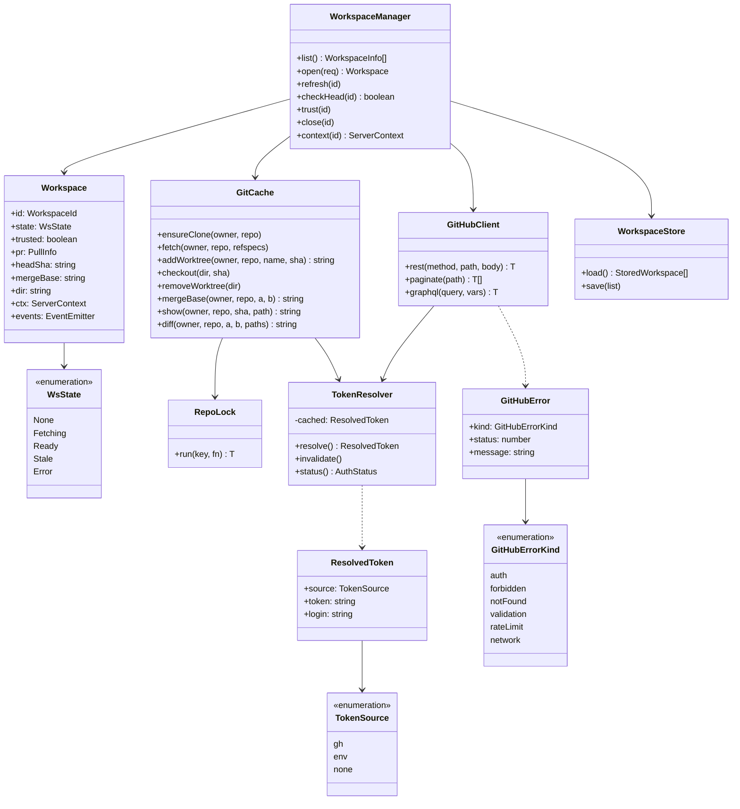
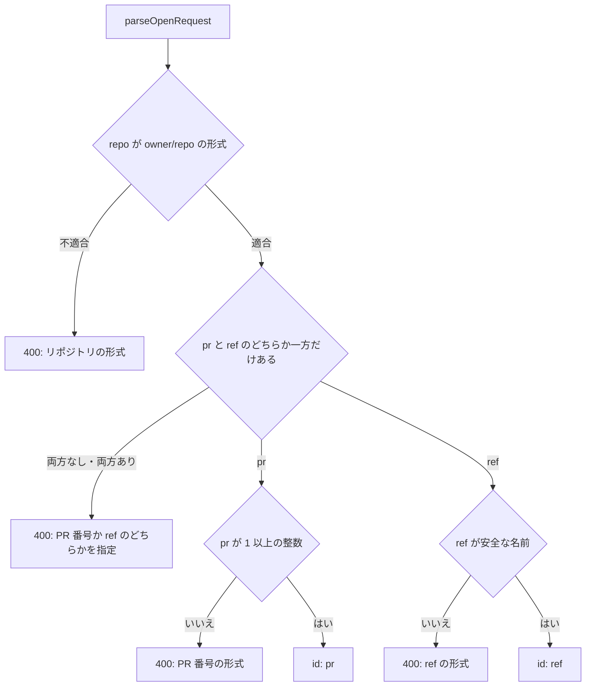
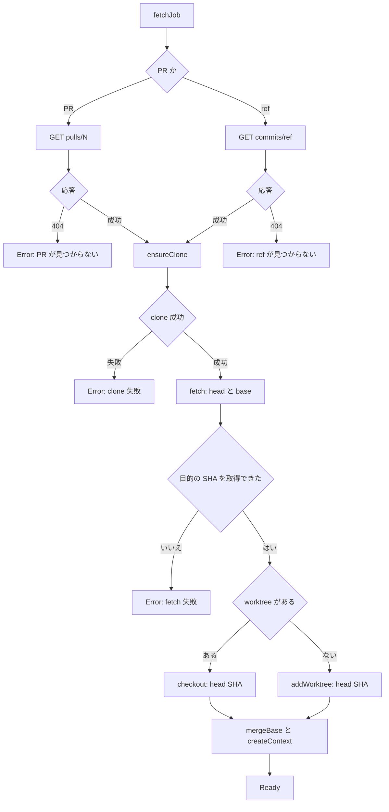
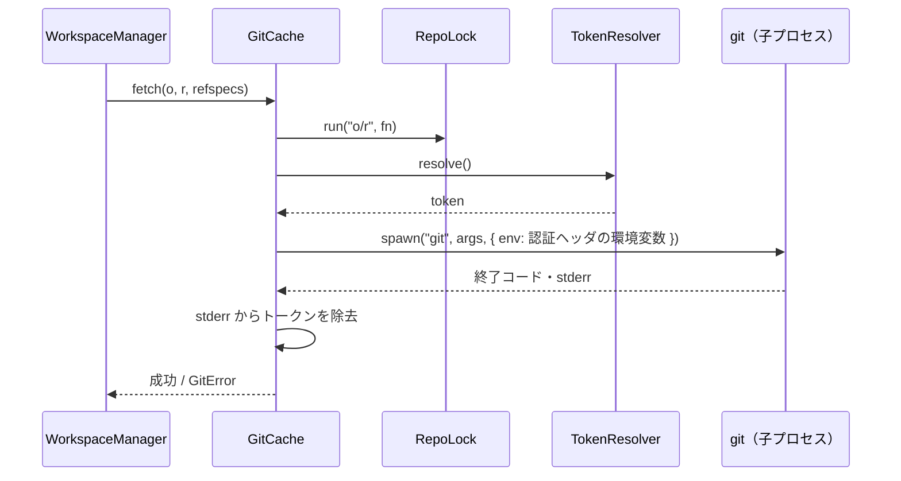
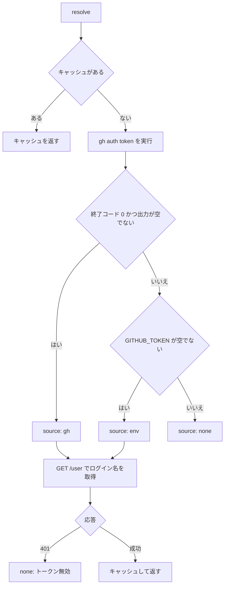
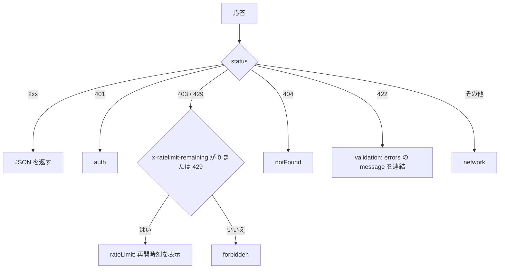
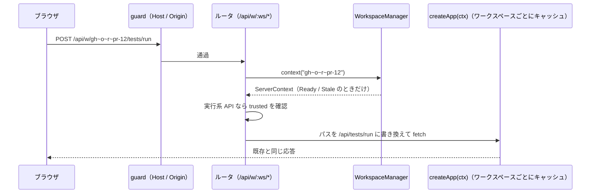
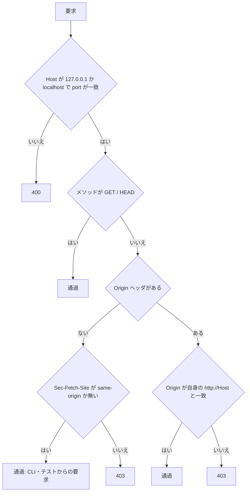
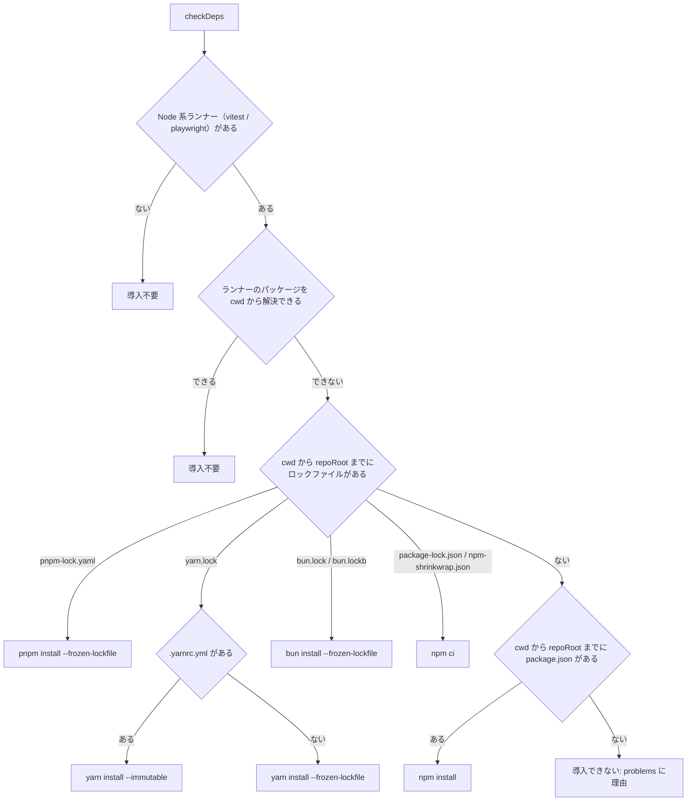

# ワークスペース・GitHub 接続 詳細設計

## 前提

- 振る舞いは :ref[../basic/github-review.md#ワークスペース]、認証は :ref[../basic/github-review.md#認証]、置き場所は :ref[../basic/github-review.md#データ] を参照
- 新規パッケージ `packages/github`（認証・REST/GraphQL クライアント。依存追加なし、`fetch` と `child_process`）
- サーバは `apps/server/src/workspaces.ts`（管理）・`git.ts`（git CLI）・`guard.ts`（Host/Origin 検査）を追加し、既存の `createContext` / `createApp` は変えずにワークスペースごとに使う

## 画面

画面遷移は :ref[../basic/github-review.md#画面遷移]。このうち「GitHub を開く」「取得中」を扱う（PR の文書・保留中レビューは :ref[review-comment.md#画面]）。

::mock[github-review/index.html]

| 項目 | testid | 種類 | 型・桁 | 必須 | 初期値 | 取得元・送信先 | 入力チェック・エラー文言 |
|---|---|---|---|---|---|---|---|
| GitHub を開く | `open-github` | ボタン | — | — | — | `OpenDialog` を開く | 認証なし（`GET /api/github/auth` が `none`）：「GitHub にログインしてください（`gh auth login` または `GITHUB_TOKEN`）」を表示して開かない |
| リポジトリ | `repo` | テキスト | 文字列 100 | ○ | 空（最近開いたものを選ぶと補完） | `POST /api/workspaces` の `repo` | 形式違い：「owner/repo の形式で入力してください」（:ref[#ワークスペースid]） |
| 種類 | `kind` | 選択 | `pr` / `ref` | ○ | `pr` | `pr` か `ref` のどちらを送るか | — |
| PR 番号 または branch・tag 名 | `target` | テキスト | 数字（pr）/ 文字列 100（ref） | ○ | 空 | `POST /api/workspaces` の `pr` / `ref` | pr が 1 以上の整数でない：「PR 番号を入力してください」、ref が安全な名前でない：「branch・tag 名を確認してください」 |
| 入力エラー | `open-error` | メッセージ | — | — | 非表示 | `400` の `message` | — |
| 開く | `open-submit` | ボタン | — | — | — | `POST /api/workspaces` → `#/w/<id>/doc` へ。取得中は `LoadingPage` | 同じ ID が開いていればそのワークスペースへ移る |
| キャンセル | `open-cancel` | ボタン | — | — | — | 元の画面に戻る | — |
| オープンな PR | `pulls` | 一覧 | 30 件 | — | — | `GET /api/github/pulls?repo=o/r`（`repo` 入力後に取得。クリックで `target` に番号を入れる） | 取得失敗は一覧を空にして理由を小さく表示 |
| 認証の状態 | `auth-status` | 表示 | — | — | — | `GET /api/github/auth` の `{ source, login }` | トークンは表示しない |
| 進捗 | `progress` | 一覧 | — | — | — | SSE `progress { step }`（PR 情報 → clone → fetch → worktree） | `step: error` は理由を表示し「再試行」「戻る」を出す |
## 構造



- `WorkspaceManager` はサーバに 1 つ。手元のワークスペース（`id = local`）は持たず、既存の `ServerContext` をそのまま使う（REQ-209）
- `RepoLock` は同じ clone への git 操作を直列化する（キー `owner/repo`）。別のリポジトリは並行して動く
- `DDV_HOME`（既定 `~/.ddv`）の配下：`repos/<owner>/<repo>.git`、`worktrees/<owner>/<repo>/<pr-N|ref-名前>`、`reviews/…`、`workspaces.json`

## ワークスペースID

`gh~<owner>~<repo>~pr-<N>` / `gh~<owner>~<repo>~ref-<名前>`。ref 名の `/` は `~~` に置き換える（URL・ファイル名に使うため）。



- owner：`^[A-Za-z0-9](?:[A-Za-z0-9-]{0,38})$`、repo：`^[A-Za-z0-9._-]{1,100}$` かつ `.` / `..` でない
- 安全な ref 名：`git check-ref-format --branch` を通り、`-` で始まらず、`..`・`~`・制御文字を含まない（git の引数・パスに使うため）
- 同じ ID がすでに開いていれば、新しく作らずそのワークスペースを返す

## 取得

`WorkspaceManager.open` → `fetchJob`。各段階の終わりに `events` へ `progress { step }` を出し、SSE `/api/workspaces/{id}/events` で送る。



| 段階 | git / API |
|---|---|
| ensureClone | 無ければ `git clone --bare --filter=blob:none https://github.com/<o>/<r>.git <repos>/<o>/<r>.git` |
| fetch（PR） | `git fetch --no-tags origin +refs/pull/<N>/head:refs/ddv/pr/<N> +refs/heads/<base>:refs/ddv/base/<base>` |
| fetch（ref） | `git fetch --no-tags origin +<ref>:refs/ddv/ref/<ref>`（branch → tag の順に試す） |
| addWorktree | `git worktree add --detach <worktrees>/<o>/<r>/<name> <sha>` |
| checkout | `git -C <worktree> checkout --detach <sha>`（作業ツリーに変更があれば失敗させる。`.ddv/runs` 等は gitignore で影響しない） |
| mergeBase | `git merge-base <base の SHA> <head の SHA>`（PR のみ） |

- GitHub の応答の `401` は認証エラー（[トークン](#トークン)）、それ以外の失敗は `Error` にして理由を `progress { step: 'error', message }` で送る
- 状態の遷移は :ref[../basic/github-review.md#ワークスペース] の図どおり。`Error` からの再試行は `fetchJob` をやり直す（途中まで作ったものは再利用）
- `createContext(worktree, { watch: false })` で作る（GitHub のワークスペースのファイルは ddv 以外が変えないため監視しない）

### git の実行



- 認証は `GIT_CONFIG_COUNT=1`・`GIT_CONFIG_KEY_0=http.https://github.com/.extraheader`・`GIT_CONFIG_VALUE_0=Authorization: Basic <base64("x-access-token:" + token)>` の環境変数で 1 コマンドだけに渡す。引数・remote URL・設定ファイルには書かない（REQ-207）
- 常に `GIT_TERMINAL_PROMPT=0`・`GCM_INTERACTIVE=never` を付ける（認証の対話で止まらない）。`spawn` は `shell: false`
- 出力・エラーメッセージは `redact()`（トークンと base64 化した値を `***` に置換）を通してから返す

## トークン



- `gh` が見つからない（`ENOENT`）・5 秒で終わらないときは「いいえ」の扱い
- `GitHubClient` が `401` を受けたら `invalidate()` → `resolve()` で 1 回だけやり直す。それでも `401` なら `GitHubError(auth)`
- `status()` は `{ source, login }` だけを返す（`GET /api/github/auth`）。`token` を持つ `ResolvedToken` は `packages/github` の外へ出さず、`GitHubClient` と `GitCache` だけが使う

## GitHub API

`GitHubClient` は `https://api.github.com` に `Authorization: Bearer`・`Accept: application/vnd.github+json`・`X-GitHub-Api-Version: 2022-11-28` を付けて呼ぶ。テストでは `fetch` を差し替える（コンストラクタ引数）。



- `fetch` 自体の失敗（オフライン等）も `network`。メッセージは GitHub の `message` だけを使い、リクエストのヘッダは含めない
- `paginate` は `Link: rel="next"` をたどる（上限 20 ページ）
- 使うエンドポイント：`GET /user`、`GET /repos/{o}/{r}/pulls`、`GET /repos/{o}/{r}/pulls/{n}`、`GET /repos/{o}/{r}/commits/{ref}`（以降は :ref[review-comment.md#github-api-の対応]）

## API のルーティング



- `/w/:ws/raw/*` も同じく `/raw/*` に書き換える（モックの iframe はこの URL で開く）
- ワークスペースが無い → 404、`Ready` / `Stale` 以外 → 409 `{ code: 'not-ready' }`
- 実行系（`POST tests/run`・`POST snapshots/run`・`POST deps/install`）で `trusted = false` → 403 `{ code: 'untrusted' }`。ビューアはこれを受けて信頼の確認を出す
- GitHub 専用の API（`pr`・`review`・`mock-source`）は書き換えずにサーバ側の `ReviewService` 等が処理する

### 要求の検査



- 手元のワークスペースの既存 API にも同じ検査をかける（変更系を外部サイトから呼べないようにする。既存の画面・テストの挙動は変わらない）
- 開発時（`vite` 経由、`5173`）は Origin が違うため、`DDV_DEV_ORIGIN` 環境変数で追加の Origin を許可する

## 依存の導入

PR の worktree は `git worktree add` しただけなので `node_modules` が無く、Vitest / Playwright のランナーを起動できない。GitHub のワークスペースでは、テスト実行の前に依存を確認し、無ければ導入を提案する（:ref[../basic/github-review.md#pr-のコードの実行]）。実装は `apps/server/src/deps.ts`。



- ランナーのパッケージ：`vitest` → `vitest`、`playwright` → `@playwright/test`。`<cwd>/__ddv__.js` 起点の `require.resolve('<pkg>/package.json')` で判定する（ランナーの起動と同じ解決）。`dotnet`・`command` は対象外（`dotnet test` が restore する）
- ロックファイルは cwd に近い順に探す（モノレポで cwd が `apps/web` でも、ルートのロックファイルで導入する）。導入先が同じランナーはまとめる
- 結果：`{ needed, targets: [{ dir, lockfile?, manager, command, args, runners, missing }], problems }`（`dir` はリポジトリ相対）

| API | 動作 |
|---|---|
| `GET /api/deps` | `checkDeps` の結果 |
| `POST /api/deps/install` | `RunManager.startTask('deps')` で `targets` のコマンドを順に実行（失敗したらそこで止める）。202 `{ runId, deps }`。ログは `/api/runs/{runId}/events`。導入後にもう一度 `checkDeps` し、まだ不足があれば `error`。テストの実行中は 409 |
| `POST /api/tests/run` | `ServerContext.checkDeps`（GitHub のワークスペースのみ true）のとき、対象ランナーに不足があれば 409 `{ code: 'deps-missing', deps }` で実行しない。依存の導入中は 409 `{ code: 'deps-installing' }`。手元のワークスペースは確認しない（従来どおり） |

- コマンドはロックファイルから決まる固定の値だけで組み立てる。Windows では `npm` 等が `.cmd` のため shell 経由で起動する。環境変数 `CI=1`（対話の確認を出させない）
- install スクリプト（`postinstall` 等）は通常どおり実行する。信頼済み（`trusted`）のワークスペースだけで、さらに導入ごとにビューアで確認する
- ランナーを起動できなかったとき（パッケージが見つからない等）は、そのランナーに紐づくテストIDの結果を `error`、メッセージを「ランナー <name> を起動できませんでした: <理由>」にする（「紐づくテストが無いか…」は本当に紐づけが無い ID だけ）

ビューア（`DepsDialog`）：`tests/run` が `deps-missing` を返したら開く。

| 項目 | testid | 種類 | 取得元・送信先 | 備考 |
|---|---|---|---|---|
| 導入するコマンド | `deps-targets` | 一覧 | `GET /api/deps` の `targets`（コマンド・導入先・ロックファイル・不足パッケージ）と `problems` | — |
| 導入する | `deps-install` | ボタン | `POST /api/deps/install` → SSE でログを表示 | 成功したら閉じて、拒否されたテスト実行をもう一度送る。失敗したら「再試行」 |
| ログ | `deps-log` | 表示 | SSE `log` | — |
| エラー | `deps-error` | メッセージ | 導入の失敗・API のエラー | — |
| キャンセル / 閉じる | `deps-cancel` | ボタン | 閉じる（テストは実行しない） | 導入中は押せない |

## 更新の検知

- サーバ：`Ready` の PR ワークスペースを `DDV_GITHUB_POLL` 秒ごとに `checkHead`（`GET pulls/N` の `head.sha` と比較）。違えば `Stale` にして `events` に `stale { headSha }`
- ビューア：`window` の `focus` で `POST /api/workspaces/{id}/check` を呼ぶ（30 秒以内の再呼び出しはサーバが前回の結果を返す）
- PR がクローズ・マージされたら PR バーに表示する（状態は変えない。閲覧は続けられる）

## 保存

```json
// ~/.ddv/workspaces.json（トークン・PR の本文は保存しない）
{ "version": 1,
  "workspaces": [
    { "id": "gh~acme~order-app~pr-12", "repo": "acme/order-app", "pr": 12,
      "trusted": false, "headSha": "a1b2c3d…", "openedAt": "2026-10-11T02:00:00Z" } ] }
```

- サーバ起動時に読み込み、worktree が残っているものは `fetchJob` を介さず `Ready`（`headSha` は前回のもの）として復元する。最初の `checkHead` で `Stale` になりうる
- 書き込みは一時ファイル → rename（同時書き込みで壊さない）

## CLI

| 指定 | 動作 |
|---|---|
| `serve --repo <p>` | 従来どおり。`WorkspaceManager` は作るが GitHub には触れない（トークンも解決しない） |
| `serve --github o/r --pr N` | 起動後に `open` を実行し、ブラウザで開く URL を `#/w/<id>/doc` にする |
| `serve --github o/r --pr N`（`--repo` なし） | 手元のワークスペース無し。`/api/config` 等の既存 API は 404 を返し、ビューアは GitHub を開く画面から始める |
| `gh clean [--repo o/r]` | `workspaces.json` に無い worktree を `git worktree remove --force`、`--repo` 指定時は clone も削除 |

## ビューア

- ルート：`#/w/<ws>/doc?path=…` / `#/w/<ws>/tests`（`ws` 省略時は手元）。基本設計の `/w/<ID>/...` はハッシュ内のパスとして実現する
- `api.ts` の各関数はワークスペースの接頭辞（`''` または `/api/w/<ws>` の差分）を受け取る `createApi(ws)` に変える。モックの iframe の URL も `/w/<ws>/raw/...`
- `WorkspaceSwitcher`（ヘッダ）・`OpenDialog`・`LoadingPage`・`PrBar`・`TrustDialog`・`DepsDialog` を追加する。`AppProvider` は `ws` が変わったら状態（文書・実行結果）を読み直す
