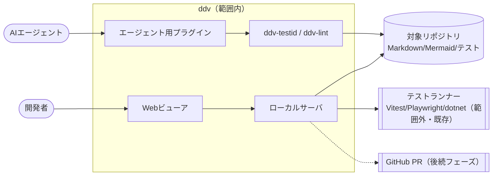
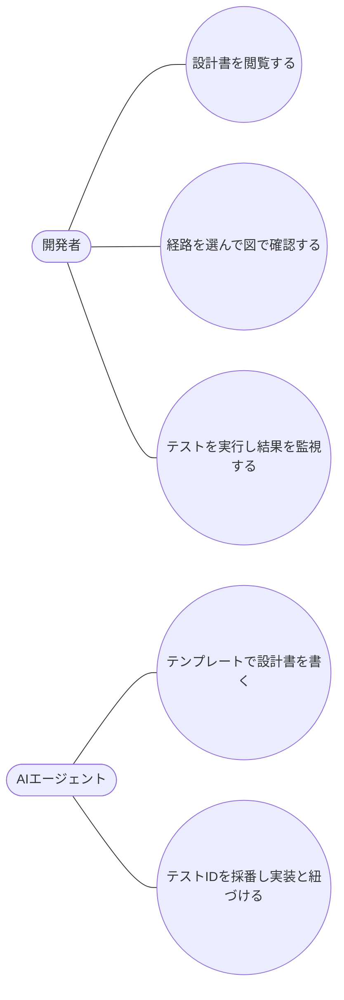

# ddv 要件定義

## 目的

- AI エージェントが作る設計成果物を、人間が **短時間で正しく** レビューできるようにする（認知負荷の軽減）
- 設計と実装・テストを ID で機械的につなぎ、修正・機能追加時の影響漏れを防ぐ（リスク軽減）
- 成功の判定基準：設計レビューで長文を通読しない（図・マトリクス・モックで判断できる）、設計の全経路にテストIDがあり実装テストとの対応が一覧で確認できる

## 現状 (As-Is)

## あるべき姿 (To-Be)

## スコープ

## ユースケース

## 要件一覧

| ID | 種別 | 要件 | 優先度 |
|---|---|---|---|
| REQ-001 | 機能 | Mermaid 図中心の Markdown を描画し、図をパン/ズームできる（ドラッグで文字が選択されない） | 高 |
| REQ-002 | 機能 | 状態図/フロー図からテストマトリクスとテストIDを自動生成し、選んだ経路を図上で強調する。表示/非表示を切り替えられる | 高 |
| REQ-003 | 機能 | テストIDの採番をCLIでも行え、既存IDは変わらない。IDを書いたテストを自動で紐づける | 高 |
| REQ-004 | 機能 | 紐づいたテストを個別/一括で実行し、結果とログを監視できる | 高 |
| REQ-005 | 機能 | 別ドキュメントの見出しをポップアップ/埋め込みで参照でき、見出しから目次を生成する | 中 |
| REQ-006 | 機能 | As-Is/To-Be の図の差分とギャップ表を表示する | 中 |
| REQ-007 | 機能 | AI エージェント用のスキルとテンプレートを提供する（Copilot CLI / Claude Code） | 中 |

## 受入基準

| 要件 | 受入基準 |
|---|---|
| REQ-001 | 図をドラッグしても文字選択が発生せず、Ctrl+ホイール・ボタンで拡大縮小できる |
| REQ-002 | マトリクスの行を選ぶと図の該当経路だけが強調され、IDが表示される |
| REQ-003 | `ddv-testid generate` を図の変更後に再実行しても既存の経路のIDが変わらない |
| REQ-004 | 紐づいたテストがある行だけ実行ボタンが押せ、実行結果がバッジで反映される |
| REQ-005 | `:ref` をクリックすると参照先の節がポップアップし、目次のレベル範囲を変更できる |
| REQ-006 | To-Be の図で追加/削除/変更が色分けされ、ギャップごとに要件IDが表示される |
| REQ-007 | テンプレートが `ddv lint` を通り、スキルからテンプレートとCLIを使える |
