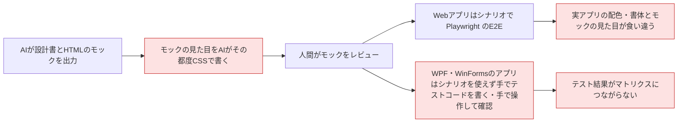
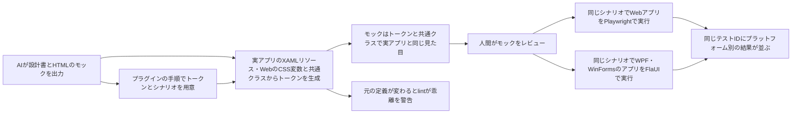
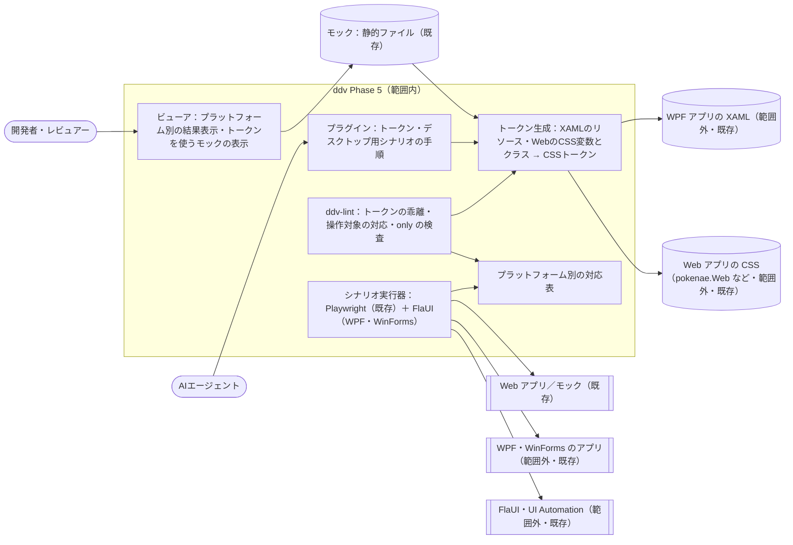
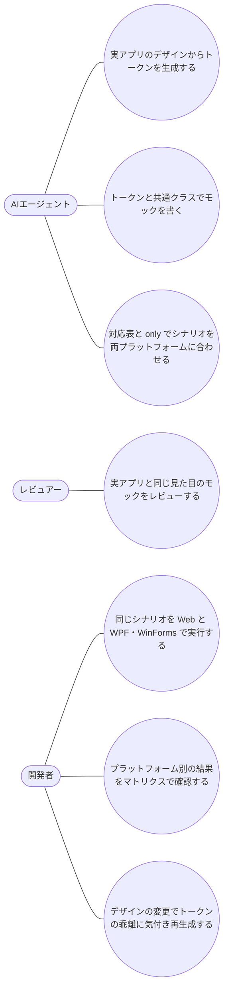

# .NET デスクトップと実アプリのデザイン（Phase 5）要件定義

## 位置づけ

- ddv 全体の目的は :ref[ddv.md#目的] を参照。本書はその Phase 5（.NET デスクトップアプリ（WPF・WinForms）への対応と、実アプリのデザインをモックへ取り込むこと）の要件
- Phase 2（:ref[mock.md#目的]）のモック・シナリオ・E2E 実行は Web（HTML のモックと Playwright）だけが対象で、WPF・WinForms のアプリには使えない
- モックの見た目は作成者（AI）がその都度書く CSS で決まり、実アプリ（WPF のアプリ、Web アプリ）の配色・書体・余白と一致する保証がない
- 本書の「Web アプリのデザイン」は、実例として pokenae.Web（Next.js＋Tailwind CSS v4。`app/globals.css` の `:root` の CSS 変数・`@theme`・共通クラス）を対象に確認する
- Phase 6（:ref[hosted.md#目的]）は先に実装済み。本書の機能は Pages 版・ローカル版の両方を前提とし、デスクトップアプリの実行だけはローカル版（Windows）に限る

## 目的

- 同じ画面構成を持つ Web アプリと WPF・WinForms のアプリを、**1 つの設計書・1 つのシナリオ** でレビュー・テストできるようにする
- モックを実アプリと同じ配色・書体・余白で表示し、レビューで見た画面と実装後の画面の食い違いを減らす
- 成功の判定基準：
  - 同じシナリオ YAML を、モック・Web アプリ（Playwright）・WPF/WinForms のアプリ（FlaUI）に対して、プラットフォームごとのテストコードやスクリプトを書かずに実行でき、結果が同じテストIDに並ぶ
  - モックの配色・書体・余白が実アプリのデザインの定義（XAML のリソース、Web の CSS 変数・共通クラス）から生成されたトークンで決まり、元の定義が変わったときに lint で気付ける

## 現状 (As-Is)

## 課題

- S：モックの CSS を実アプリのデザインと無関係に書くため、配色・書体・余白が実アプリと揃わない。実アプリのデザインを変えてもモックに反映されない
- D：WPF・WinForms のアプリは、Phase 2 のシナリオ・実行器を使えず、同じ画面構成でも Web とは別にテストを書く（または手で操作する）必要がある
- M：デスクトップのテスト結果がテストIDでマトリクスに紐づかず、Web と同じ経路のどこが通っていないか一覧で見られない
- G：レビューで承認したモックの見た目と、実装後の画面の差に実装後まで気付けない

## あるべき姿 (To-Be)

## スコープ

### 対象と取り込み範囲

| 対象 | デザインのトークン | 共通クラス | シナリオの実行 | 操作対象の名前 |
|---|---|---|---|---|
| モック（HTML） | 生成したトークンを読み込む | Web アプリから取り込んだクラスを使える | Playwright（既存） | `data-testid`・`data-screen`（既存） |
| Web アプリ（例：pokenae.Web） | `:root` などの CSS 変数・Tailwind の `@theme` | 指定したスタイルシートのクラス | Playwright（既存） | `data-testid`・`data-screen`（既存） |
| WPF | `App.xaml`・ResourceDictionary のリソース（色・ブラシ・書体・文字サイズ・余白・角丸）。リソースが無い項目は WPF 標準のテーマの値 | ×（Style はトークンとして扱わない） | FlaUI | AutomationId（未設定なら `x:Name`） |
| WinForms | ×（範囲外） | × | FlaUI | AutomationId（Control の `Name`） |

- シナリオは論理名（`click: new`・`input: { customer: … }`・`screen: Input`）で書き、実行器が上表の名前に読み替える。論理名と名前が同じであることを基本（命名規約）とし、合わせられない箇所だけプラットフォーム別の対応表で読み替える
- 画面構成の差でステップ数が違う場合（例：Web だけ確認ダイアログを閉じる、WPF だけタブを切り替える）は、そのステップに `only:`（`web`・`wpf`・`winforms`、または `desktop`）を付ける。`only:` を付けられるのは図の遷移（`event`）を伴わない補助ステップだけで、経路（状態・遷移の並び）が違う場合は図とシナリオを分ける
- 範囲外：WinUI 3・Avalonia・MAUI、WinForms のトークン、React などのコンポーネントの見た目の再現（Storybook の取り込み）、Tailwind のユーティリティクラスの生成、XAML の画面からのモックの自動生成、FlaUI の C# テストコードの生成、Pages 版・Linux 上でのデスクトップアプリの実行、デスクトップアプリのスナップショットとモックのスナップショットの相互比較、品質ゲート・CI テンプレート（Phase 7）

## ユースケース

## 要件一覧

| ID | 種別 | 要件 | 優先度 |
|---|---|---|---|
| REQ-501 | 機能 | WPF の XAML（`App.xaml` と、そこから参照する ResourceDictionary）のリソースのうち、色・ブラシ（単色）・書体・文字サイズ・余白（Thickness）・角丸を CSS の変数（トークン）に変換して出力できる。リソースの無い項目は WPF 標準のテーマの値で補う。対象のファイルと出力先は設定で指定し、コマンドで生成する | 高 |
| REQ-502 | 機能 | Web アプリのスタイルシートから、CSS 変数（`:root` など）・Tailwind の `@theme` の定義と、指定したクラス（例：pokenae.Web の `.site-frame`・`.admin-card`）を取り込み、モックで使えるトークンと共通クラスとして出力できる。実行時に決まる変数（例：`next/font` のフォント変数）は、設定で代わりの値を与えられる | 高 |
| REQ-503 | 機能 | モックは生成したトークンと共通クラスを読み込み、実アプリと同じ配色・書体・余白で表示できる。ローカル版・Pages 版のプレイヤー、モックの調整、スナップショットで同じ見た目になる。トークンを持たないモックは従来どおり表示する | 高 |
| REQ-504 | 機能 | 生成したトークン・共通クラスの元のファイル（XAML・スタイルシート）が生成後に変わったとき、`ddv-lint` が warning を出す。再生成すると warning が消える | 中 |
| REQ-505 | 機能 | ddv が提供する実行器が、Web と同じシナリオ YAML を読み込み、FlaUI で WPF・WinForms のアプリを起動・操作して E2E テストとして実行する（入力・選択・クリック・期待画面・表示/非表示・文言）。シナリオごとのテストコードは書かない。接続先（モック・Web アプリ・WPF・WinForms）は実行時に選ぶ | 高 |
| REQ-506 | 機能 | FlaUI での実行結果を、テストIDで既存の結果表示・マトリクス・テスト履歴・トレースに反映する。同じテストIDにプラットフォーム別の結果（例：Web ✓・WPF ✗）を並べて表示し、ステップごとのスクリーンショットをトレースで見られる | 高 |
| REQ-507 | 機能 | `ddv-lint` が、シナリオの論理名・期待画面に対応する名前（AutomationId・`x:Name`・Control の `Name`、または対応表の読み替え）が対象のアプリの画面定義に無いこと、対応表の読み替え先の欠け、遷移を伴うステップへの `only:` を検査する | 中 |
| REQ-508 | 機能 | プラグインのスキルとテンプレートに、トークンの生成・モックでの使い方、デスクトップアプリ向けのシナリオ（命名規約・対応表・`only:`）と実行の手順を追加する | 中 |
| REQ-509 | 制約 | FlaUI での実行はローカル版（Windows）だけで使える。Pages 版・Windows 以外では、デスクトップの実行の操作を理由を付けて無効にし、実行済みの結果だけを表示する | 高 |
| REQ-510 | 制約 | 既存の Web のモック・シナリオ・Playwright の実行・Pages 版の動作を変えない。シナリオ YAML は追加の項目（`only:`）を除いて従来の形式のままとし、人間が AI なしで読み書きできる平易な形式を保つ（:ref[mock.md#要件一覧] の REQ-109）。シナリオの骨組みの再生成で、`only:` のステップと対応表を保持する | 高 |
| REQ-511 | 制約 | トークンと共通クラスの生成は、対象のファイルを読むだけで行い、実アプリのビルド・起動・パッケージの導入を必要としない。生成物は対象リポジトリにテキストで置き、生成元のファイルを記録する | 中 |
| REQ-512 | 機能 | 論理名とプラットフォームの名前が一致しない操作対象・画面だけを、プラットフォーム別の対応表（YAML）で読み替えられる。シナリオのステップに `only:` を付けて、指定したプラットフォームでだけ実行し、それ以外では飛ばせる | 高 |

## 受入基準

| 要件 | 受入基準 |
|---|---|
| REQ-501 | サンプルの WPF アプリの ResourceDictionary に定義した色・書体・文字サイズ・余白・角丸が、生成したトークンの CSS 変数として出力される。リソースを定義していない項目（例：ボタンの背景）は WPF 標準のテーマの値が出力される |
| REQ-502 | pokenae.Web の `app/globals.css` を対象に生成すると、`--color-accent-25` などの `:root` の変数、`@theme` の定義、指定した `.site-frame`・`.admin-card` のクラスが出力される。`--font-geist-sans` は設定で与えた値になる |
| REQ-503 | 生成したトークンと pokenae.Web のクラスを読み込んだモックを、ローカル版と Pages 版のプレイヤーで開くと、カードの枠・影・アクセント色・書体が pokenae.Web の該当画面と同じに見える。トークンを持たない既存のサンプルのモックは見た目が変わらない |
| REQ-504 | pokenae.Web の `--color-accent-25` の値を変えて `ddv-lint` を実行すると warning が出て、再生成すると消える。サンプルの WPF の ResourceDictionary を変えた場合も同じ |
| REQ-505 | sample-app の注文画面と同じ画面構成の WPF・WinForms のサンプルアプリで、既存の注文のシナリオ（テストコードの追加なし）を接続先を WPF・WinForms にして実行すると、画面遷移・入力・期待値の確認が行われて成功する。期待値を誤らせると失敗する |
| REQ-506 | 同じシナリオを Web と WPF で実行すると、マトリクスの該当行にプラットフォーム別の結果バッジが並ぶ。WPF だけ失敗させると WPF のバッジだけが失敗になり、トレースで失敗したステップのスクリーンショットが見られる |
| REQ-507 | サンプルの WPF アプリから `x:Name="next"` を消すと `ddv-lint` がエラーを出し、対応表に読み替えを追加すると消える。遷移を伴うステップに `only: web` を付けるとエラーになる |
| REQ-508 | スキルの手順だけで、サンプルの WPF アプリのトークンを生成してモックに使い、同じシナリオを Web と WPF で実行できる |
| REQ-509 | Pages 版と、Windows 以外で起動したローカル版では、WPF・WinForms の実行の操作が理由付きで無効になり、実行済みの結果は表示される |
| REQ-510 | 既存のサンプルの Web のシナリオ・Playwright の E2E・Pages 版の E2E が変更なしで通る。`only:` を付けたシナリオで骨組みを再生成しても `only:` のステップと対応表が残る |
| REQ-511 | 対象リポジトリで `npm install`・`dotnet build` をしていない状態でも、pokenae.Web とサンプルの WPF のトークンを生成できる。生成物に生成元のファイルが記録されている |
| REQ-512 | WPF のサンプルで、Web と名前が違うボタンを対応表で読み替えると同じシナリオが通る。Web だけ確認ダイアログを閉じるステップに `only: web` を付けると、Web では実行され、WPF では飛ばされて両方とも成功する |
