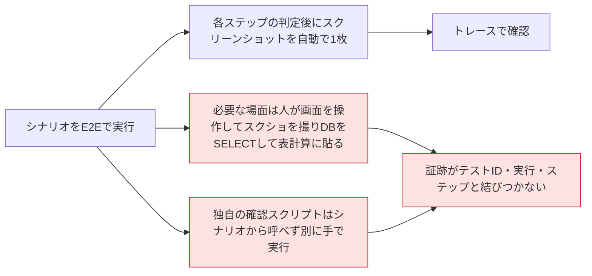
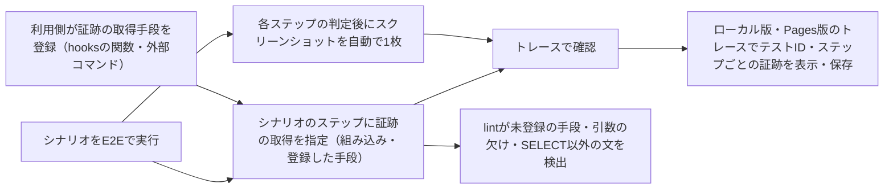
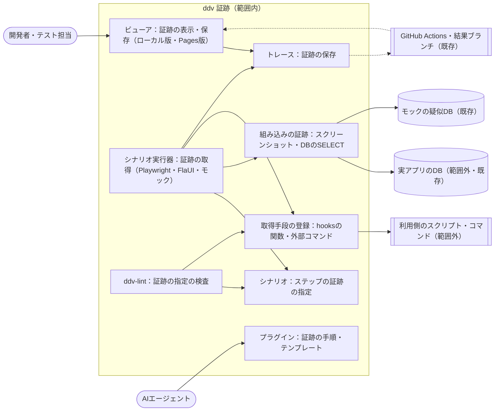
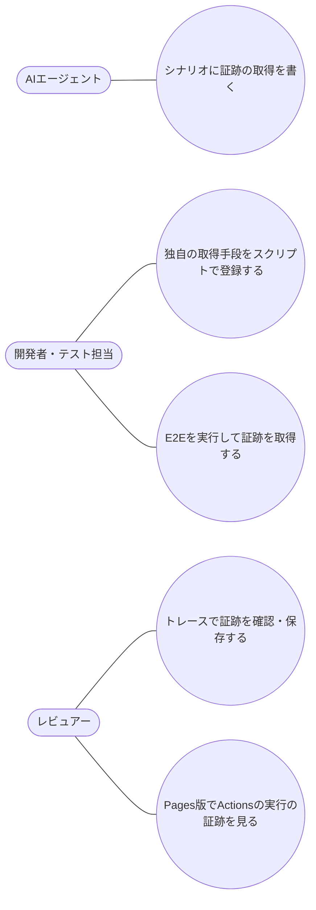

# シナリオから取得するテストの証跡 要件定義

## 位置づけ

- ddv 全体の目的は :ref[ddv.md#目的] を参照。本書は、シナリオの E2E 実行（:ref[mock.md#目的]）とトレース（:ref[testops.md#目的]）を拡張し、テストの証跡（画面のスクリーンショット、DB の内容など）をシナリオの指定で取得する機能の要件
- Phase 4 のトレースは、各ステップの判定後にスクリーンショットを 1 枚自動で撮る。DB の変化はモックの疑似 DB だけで、実アプリの DB は記録しない（:ref[testops.md#要件一覧] の REQ-307）
- Phase 5（:ref[desktop.md#目的]）の FlaUI での実行と、Phase 6（:ref[hosted.md#目的]）の Actions での実行・Pages 版での結果表示を前提とする

| 利用側の工程 | 使う機能 | 作るもの・残るもの |
|---|---|---|
| 結合・受入テスト | シナリオの証跡の指定、組み込みの証跡（スクリーンショット・DB の SELECT） | テストID・実行・ステップに紐づいた証跡 |
| 独自の確認 | 利用側が登録した証跡の取得手段（スクリプト・関数） | ログ・ファイル・API の応答などの証跡 |
| レビュー・受入判断 | トレースの証跡の表示（ローカル版・Pages 版） | 証跡を見たうえでの合否判断 |

### 前提とした判断（レビューで確認したい点）

- スクリーンショットと DB の SELECT は**組み込みの証跡の一例**として提供する。利用側が用意した取得手段も、組み込みと同じ書き方でシナリオから呼べる
- 利用側の取得手段は 2 種類とする：hooks（`e2e/ddv-hooks.ts`）に書く関数と、設定（`ddv.config.yaml`）に登録する外部コマンド（PowerShell・Python・sqlcmd など）
- 証跡の取得に失敗したときは、既定でそのステップを失敗にする。シナリオの指定で警告にとどめて続行することもできる
- 実アプリの DB の接続先は設定に名前で定義し、接続情報は環境変数（Actions では secrets）から読む。シナリオ・設計書・トレースに接続情報を書かない
- 証跡の取得は E2E の実行（ローカル版・Actions）でだけ行う。プレイヤーの再生では取得しない（指定は表示する）

## 目的

- テストの証跡を手で集める作業をなくし、**どのテストID・実行・ステップの証跡か** が分かる形で残す
- スクリーンショットや DB の SELECT に限らず、利用側が用意した確認の手段を、テストコードを書かずにシナリオから呼べるようにする
- 成功の判定基準：
  - シナリオに証跡の指定を書いて E2E を実行すると、指定したステップのスクリーンショット・DB の SELECT の結果がトレースに並ぶ。手での操作・貼り付けが要らない
  - 利用側が登録したスクリプトを、シナリオに名前と引数を書くだけで呼べ、その出力がトレースに証跡として残る
  - Actions で実行した結果の証跡を、Pages 版のトレースで見られる

## 現状 (As-Is)

## 課題

- H：撮る場面（操作の前・特定の要素）を選べず、実アプリの DB の内容は残らないため、証跡は人が手で集めている
- X：手で集めた証跡は、どのテストID・実行・ステップのものかが記録に残らず、再実行のたびに集め直す
- P：ログの回収・ファイルの確認など利用側の確認手段は、シナリオから呼べないため、テストと別に手で実行している

## あるべき姿 (To-Be)

## スコープ

- 範囲外：証跡を所定の書式（表計算・PDF の証跡書）にまとめて出力すること、DB の更新（INSERT・UPDATE・DELETE など）や前処理としての投入（既存の fixtures・seed を使う）、動画の録画、プレイヤーの再生中・Pages 版での証跡の取得、証跡どうしの差分比較（前回の実行との比較）、品質ゲート・CI テンプレート（Phase 7）

## ユースケース

## 要件一覧

| ID | 種別 | 要件 | 優先度 |
|---|---|---|---|
| REQ-801 | 機能 | シナリオのステップに、証跡の取得を複数指定できる。各指定は、取得手段の名前・引数・取得の時点（操作の前、または判定の後）・表示名を持つ。同じ指定は Web アプリ・モック・WPF/WinForms のアプリのどれに対して実行しても使える | 高 |
| REQ-802 | 機能 | 組み込みの証跡としてスクリーンショットを取得できる。画面全体か、論理名で指定した要素だけを撮る。Playwright（Web アプリ・モック）と FlaUI（WPF・WinForms）の両方で使える | 高 |
| REQ-803 | 機能 | 組み込みの証跡として DB の SELECT の結果を表として取得できる。接続先はモックの疑似 DB か、設定に名前で定義した実アプリの DB（SQL Server・PostgreSQL・SQLite）を選ぶ。SQL はシナリオに直接書くか、ファイルを指定する。パラメータにシナリオの入力値を使える | 高 |
| REQ-804 | 機能 | 利用側が証跡の取得手段を名前を付けて追加できる。hooks（`e2e/ddv-hooks.ts`）の関数と、設定に登録する外部コマンド（引数・作業フォルダ・出力先を指定）の 2 種類。取得手段は画像・表・JSON・テキスト・任意のファイルを証跡として返し、組み込みと同じ書き方でシナリオから呼べる | 高 |
| REQ-805 | 機能 | 取得した証跡を、テストID・実行・ステップ・プラットフォームに紐づけてトレースと一緒に保存する。トレースのステップの詳細に、表示名・種類ごとに証跡を表示（画像・表・JSON・テキスト）し、ファイルとして保存できる | 高 |
| REQ-806 | 機能 | 証跡の取得に失敗したとき、既定ではそのステップを失敗にし、失敗の理由をトレースに残す。指定ごとに「警告にとどめて続行」を選べる。取得には時間の上限があり、超えたら失敗として扱う | 高 |
| REQ-807 | 機能 | `ddv-lint` が、シナリオの証跡の指定のうち、登録されていない取得手段の名前、必須の引数の欠け、定義されていない DB の接続先、SELECT 以外の SQL、存在しない SQL ファイルを検出する | 中 |
| REQ-808 | 機能 | Pages 版では、Actions で実行した結果の証跡をトレースで表示・保存できる。Pages 版から証跡の取得は行わない。Actions の実行でも、組み込み・登録した取得手段で証跡を取得する（接続情報は secrets から読む） | 中 |
| REQ-809 | 制約 | DB の SELECT は読み取りだけとし、SELECT（`WITH` を含む）以外の文を実行しない。取得する行数・大きさに上限を設け、指定した列の値を伏せて保存できる。接続情報（接続文字列・パスワード）をシナリオ・設計書・トレース・ログに残さない | 高 |
| REQ-810 | 制約 | 証跡の指定を書かないシナリオの動作、各ステップ後の自動のスクリーンショット、既存のトレースの表示を変えない。シナリオの骨組みの再生成で証跡の指定を保持する。シナリオ YAML は人間が AI なしで読み書きできる平易な形式を保つ（:ref[mock.md#要件一覧] の REQ-109） | 高 |
| REQ-811 | 機能 | プラグインのスキルとテンプレートに、証跡の指定の書き方、組み込みの証跡、取得手段（hooks の関数・外部コマンド）の登録の手順と例を追加する | 中 |

## 受入基準

| 要件 | 受入基準 |
|---|---|
| REQ-801 | sample-app の注文のシナリオの確定のステップに、操作の前と判定の後の 2 つの証跡を書いて E2E を実行すると、そのステップのトレースに 2 つの証跡が指定の順・表示名で並ぶ。同じシナリオを WPF のサンプルアプリで実行しても同じ 2 つが並ぶ |
| REQ-802 | 要素の論理名を指定したスクリーンショットは、その要素の範囲だけが写った画像になる。Web と WPF の両方で撮れる |
| REQ-803 | 注文の確定後に `orders` を SELECT する指定で実行すると、確定した注文の行が表として証跡に残る。接続先をモックの疑似 DB と、サンプルの SQLite の DB に切り替えて、どちらでも取得できる |
| REQ-804 | `e2e/ddv-hooks.ts` に追加した関数と、設定に登録した PowerShell のスクリプト（ファイルを出力するもの）を、シナリオに名前と引数を書くだけで呼び、その出力がトレースに証跡として残る |
| REQ-805 | マトリクスのテスト結果からトレースを開き、ステップを選ぶと証跡が表示され、画像・表・ファイルを保存できる。WPF と Web で実行した場合、プラットフォームごとに別の証跡として見られる |
| REQ-806 | 存在しないテーブルを SELECT する指定ではステップが失敗し、トレースに失敗の理由が表示される。同じ指定を「警告」にすると、テストは成功し、警告と理由が表示される |
| REQ-807 | 登録していない名前・SELECT 以外の SQL・定義していない接続先を書くと `ddv-lint` がエラーを出し、直すと消える |
| REQ-808 | Actions で実行したシナリオの結果を Pages 版で開くと、トレースに証跡が表示され、保存できる。Pages 版には証跡を取得する操作がない |
| REQ-809 | `UPDATE` を含む SQL は実行されずエラーになる。行数の上限を超える結果は上限で切られ、その旨が表示される。伏せる列に指定した値はトレースに残らない。トレース・ログに接続文字列が含まれない |
| REQ-810 | 証跡を指定していない既存のサンプルのシナリオ・E2E・Pages 版の E2E が変更なしで通る。証跡を指定したシナリオで骨組みを再生成しても指定が残る |
| REQ-811 | スキルの手順だけで、組み込みのスクリーンショット・DB の SELECT と、自作のスクリプトの証跡をシナリオに追加し、トレースで確認できる |
