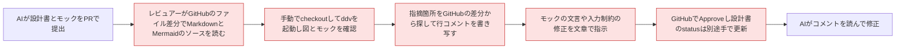
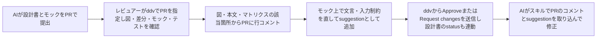
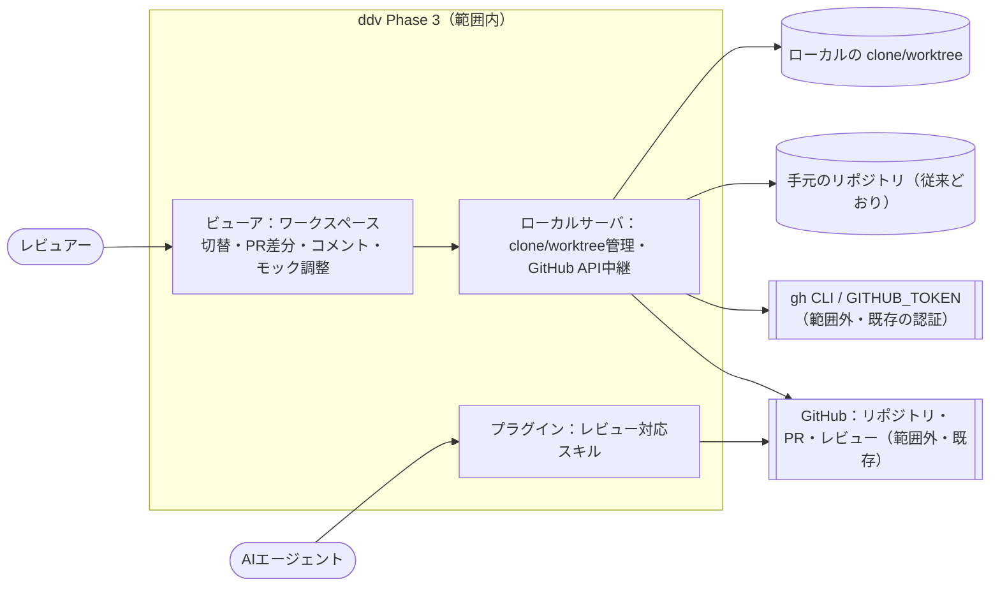
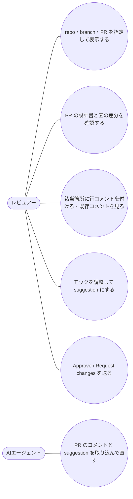

# GitHub 連携・PR レビュー（Phase 3）要件定義

## 位置づけ

- ddv 全体の目的は :ref[ddv.md#目的] を参照。本書はその Phase 3（GitHub の repo/branch/PR の表示、PR 差分、行コメント・Approve 連携、モック調整 → suggestion）の要件
- Phase 2 までは「手元のリポジトリ 1 つ」を表示するだけで、設計レビューの場である GitHub PR とつながっていない
- ddv を使う開発では、各工程のゲート（要件定義・基本設計・詳細設計の承認）を PR で運用するときにこの機能を使う

| 利用側の工程 | 使う機能 | 作るもの・残るもの |
|---|---|---|
| 設計のレビュー（各ゲート） | PR 指定での表示、PR 差分、行コメント、モック調整 → suggestion | PR のレビューコメント・suggestion |
| 設計の承認（各ゲート） | Approve / Request changes の送信、status 連動 | PR のレビュー結果、設計書の `status: approved` |
| 指摘への対応 | プラグインのレビュー対応スキル | 指摘を反映した設計書・モックのコミット |

## 目的

- レビュアーが GitHub PR の設計書を、図・マトリクス・モックのまま確認し、**その場で PR にレビュー結果を返せる** ようにする（ローカルへの手動 checkout と、指摘の書き写しをなくす）
- モックの文言・入力制約の指摘を、文章の指示ではなく **そのまま取り込める修正案（suggestion）** で返せるようにする
- 成功の判定基準：
  - PR 番号を指定するだけで、その PR の設計書・差分・モック・テストを ddv で確認できる（手動の clone/checkout が不要）
  - ddv で付けたコメント・suggestion・Approve が、GitHub の PR の該当行・レビュー結果として反映される

## 現状 (As-Is)

## 課題

- B：GitHub の差分では Mermaid がソースのままで、図の変化（経路・テストIDの増減）が読み取れない
- V：図・モックを確認するには、レビュアーが PR ごとに手で checkout・起動する必要がある
- C：ddv で見つけた指摘を、GitHub 上の該当行を探して書き写す二重作業になる
- M：モックの修正指示が文章のため、解釈違い・反映漏れが起きる
- P：PR の承認と設計書の `status` が別管理で、ずれる

## あるべき姿 (To-Be)

## スコープ

- 範囲外：GitHub 以外（GitLab 等）と GitHub Enterprise Server、PR の作成・マージ、Issue 連携、モックのスタイル（CSS）の suggestion、CI でのチェック（Phase 7）、ホスト型（Phase 6）、テスト履歴・テストデータ編集（Phase 4）

## ユースケース

## 要件一覧

| ID | 種別 | 要件 | 優先度 |
|---|---|---|---|
| REQ-201 | 機能 | GitHub のリポジトリ（owner/repo）と branch・tag・PR 番号を指定して、その内容を表示できる。ddv がローカルに clone/worktree を作るため、テスト実行・モック再生・スナップショットも手元と同じく使える。表示中の対象（手元のリポジトリ / GitHub の ref・PR）をビューアで切り替え、最新化できる | 高 |
| REQ-202 | 機能 | PR を表示しているとき、変更された設計書の一覧と、文書ごとの差分を表示する。本文は追加/削除を色分けし、図は As-Is/To-Be と同じ方式で変更を色分けし、マトリクスの経路・テストIDの増減を示す | 高 |
| REQ-203 | 機能 | 本文のブロック・表の行・図のノード/遷移・マトリクスの行を選んで、PR の該当ソース行に行コメントを付けられる。既存のレビューコメント（スレッド）を該当箇所に表示し、返信できる。解決済みかどうかが分かる | 高 |
| REQ-204 | 機能 | 付けたコメントを保留中のレビューとしてまとめ、Comment / Approve / Request changes のいずれかで送信できる。送信前に保留中のコメントを一覧・修正・削除できる | 高 |
| REQ-205 | 機能 | Approve を送信するとき、PR で変更された設計書のうち選んだものの `status` を `approved` に更新する。PR のブランチに書き込めない場合は、同じ変更を suggestion として付ける。ビューアは PR のレビュー状態（Approve 済み・変更要求）を文書ごとに表示する | 中 |
| REQ-206 | 機能 | モックの「調整モード」で、画面上の要素の文言と属性（placeholder・required・maxlength・min・max・pattern・選択肢など）を変更でき、変更はその場のモックに反映される。変更はモック HTML の該当行への suggestion として保留中のレビューに追加される（送信までファイルは変更しない） | 中 |
| REQ-207 | 制約 | 認証は gh CLI のトークンを優先し、無ければ環境変数 `GITHUB_TOKEN` を使う。トークンはローカルサーバ内だけで扱い、ブラウザ・設定ファイル・ログに出さない。サーバは従来どおり 127.0.0.1 で待ち受ける | 高 |
| REQ-208 | 機能 | プラグインに、PR のレビューコメントと suggestion を取り込み、設計書・モックを修正して返信するスキルを追加する | 中 |
| REQ-209 | 制約 | GitHub に接続しない手元のリポジトリだけの利用（Phase 2 までの機能）は、認証なしで従来どおり動く | 高 |

## 受入基準

| 要件 | 受入基準 |
|---|---|
| REQ-201 | テスト用リポジトリの PR 番号を指定して開くと、その PR の head の設計書が表示され、マトリクスからテストを実行でき、モックを再生できる。手元のリポジトリとの切替と、PR への追加コミット後の最新化ができる |
| REQ-202 | 状態図に遷移を 1 本追加した PR を開くと、変更文書の一覧にその文書が出て、図の追加遷移が色分けされ、追加された経路のテストIDが示される。本文の変更行も色分けされる |
| REQ-203 | 図の遷移を選んでコメントを付けて送信すると、GitHub の PR でその遷移を定義した行にコメントが付く。GitHub 側で付けたコメントが ddv の該当箇所に表示され、ddv から返信できる |
| REQ-204 | 3 件のコメントを保留し、1 件を削除して Request changes で送信すると、GitHub に 2 件のコメント付きの変更要求レビューが 1 つ作られる |
| REQ-205 | 文書を選んで Approve すると、PR のブランチの該当文書の `status` が `approved` になる（書き込めないときは suggestion が付く）。ddv の文書に Approve 済みの表示が出る |
| REQ-206 | 調整モードでボタンの文言と入力欄の maxlength を変更すると、モックに即反映され、送信後に GitHub の PR でモック HTML の該当行に 2 件の suggestion が付き、そのまま「Commit suggestion」で取り込める |
| REQ-207 | gh にログイン済みの環境で `GITHUB_TOKEN` 未設定でも PR を開ける。ビューアの通信・ログ・`.ddv` 配下のファイルにトークンが含まれない |
| REQ-208 | スキルの手順だけで、AI が PR のコメントと suggestion を取り込んで修正をコミットし、各コメントに返信できる |
| REQ-209 | 認証なし・ネットワーク切断の状態で `ddv serve --repo <path>` を起動し、Phase 2 までの機能がすべて動く |
