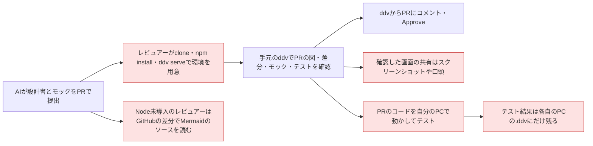
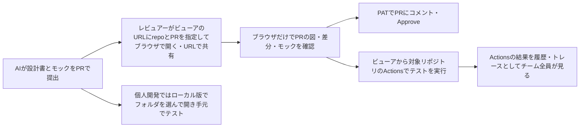
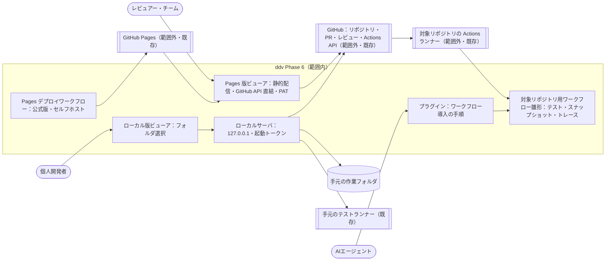
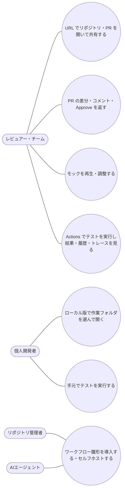

# ホスト型（Phase 6）要件定義

## 位置づけ

- ddv 全体の目的は :ref[ddv.md#目的] を参照。本書はその Phase 6（GitHub Pages で公開するビューア、GitHub Actions でのテスト実行、ローカル版の作業フォルダ選択）の要件
- Phase 5 までの ddv は、閲覧するたびに clone・`npm install`・`ddv serve` が必要で、Node や ddv を入れていない人は使えない
- Phase 3（:ref[github.md#目的]）で PR のレビューは ddv から返せるようになったが、レビュアーそれぞれの PC に ddv を用意する前提のまま
- Phase 4（:ref[testops.md#目的]）で範囲外とした「テスト履歴の共有」は、Actions の実行結果を読むだけで済む範囲を本書で扱う
- ddv は次の 2 つの版で提供する。ソースは共通で、どちらの版かはビルド時に決める

| 版 | 起動 | 認証 | 想定する使い方 |
|---|---|---|---|
| Pages 版 | ブラウザで公開 URL を開く（公式版・セルフホスト版） | 利用者が入力する PAT | チームのレビュー、Node を入れていないレビュアー |
| ローカル版 | `ddv serve`（127.0.0.1） | gh CLI のトークン / `GITHUB_TOKEN`（従来どおり） | 個人開発、手元でのテスト実行、設計書の作成 |

## 目的

- Node や ddv を入れていないレビュアーを含むチーム全員が、**ブラウザで URL を開くだけで** 設計書・図・マトリクス・モック・テスト結果を確認し、PR にレビューを返せるようにする
- 設計書の画面を URL で共有でき、PR ごとの設計のプレビューを手元の準備なしに見られるようにする
- 個人開発では、ローカル版で任意の作業フォルダを開き、従来どおり手元でテストを実行できるようにする
- 成功の判定基準：
  - ビューアの URL に対象リポジトリをパラメータで指定するだけで設計書を閲覧できる（clone・install・起動が不要）
  - PR を指定したとき、PR のコメントの閲覧・書き込み・Approve が Phase 3 と同じくできる
  - Pages 版でモックを再生でき、対象リポジトリの Actions でテストを実行して結果をビューアで確認できる

## 現状 (As-Is)

## 課題

- B：レビューのたびに clone・`npm install`・`ddv serve`（または `--repo` の指定し直し）が必要で、準備に時間がかかる
- N：Node や ddv を入れていないレビュアー（PM・顧客など）は図・モックを見られず、Mermaid のソースを読むしかない
- S：見ている設計書・見出しを URL で共有できない
- T：他人の PR のコードを自分の PC で動かす必要があり、重く、安全面の不安もある
- H：テスト結果・トレースが各自の PC にしか残らず、チームで同じ結果を見られない

## あるべき姿 (To-Be)

## スコープ

### Pages 版とローカル版の切り分け

| 機能 | Pages 版（PAT・ddv のサーバ無し） | ローカル版（ddv serve） |
|---|---|---|
| 閲覧（図・マトリクス・TOC・参照・As-Is/To-Be 差分） | ○（GitHub API から取得） | ○（既存） |
| 対象の指定 | URL パラメータ（repo・branch/tag・PR） | アプリ内でフォルダを選択、GitHub の PR・branch（既存） |
| PR の差分・スレッド・コメント・Approve＋status | ○ | ○（既存） |
| モックの再生・調整 → suggestion | ○ | ○（既存） |
| テストデータ編集 | PR への suggestion のみ | ファイル保存＋suggestion（既存） |
| テスト実行・スナップショット・トレース | 対象リポジトリの Actions | 手元のランナー（既存）＋Actions（GitHub のリモートがあるとき） |
| テスト履歴・フレーキー・カバレッジ | Actions の結果 | `.ddv/runs`（既存）＋Actions の結果（出所を区別） |
| 未コミットの変更の閲覧、ファイルの直接保存、テストID採番、lint、手元のコマンド実行 | ×（理由を付けて無効表示） | ○（既存） |

- 範囲外：ddv 独自の API サーバ（OAuth のトークン交換など）と「GitHub でログイン」、Pages 版の画面から手元の `ddv serve` への接続、PR 作成時にビューアの URL を PR へ自動でコメントするワークフロー（#6）、結果ブランチの保持件数・日数を超えるテスト履歴の保存・集約（#5）、GitHub 以外（GitLab 等）と GitHub Enterprise Server、Pages 版でのテストID採番・lint、品質ゲート・CI テンプレート（Phase 7）、.NET デスクトップ（Phase 5）

## ユースケース

## 要件一覧

| ID | 種別 | 要件 | 優先度 |
|---|---|---|---|
| REQ-601 | 機能 | Pages 版は、ビューアの URL のパラメータで対象のリポジトリ（owner/repo）と branch・tag・PR 番号を指定して表示する。表示中の文書・見出しも URL に含め、URL を共有すれば同じ画面を開ける。公開リポジトリはログインなしで閲覧でき、非公開リポジトリは PAT の入力後に閲覧できる | 高 |
| REQ-602 | 機能 | Pages 版でも、PR の変更文書一覧と差分、レビュースレッドの表示・返信・解決、保留中のレビューの送信（Comment / Approve / Request changes）、Approve 時の `status` 連動、モックの調整とテストデータの編集の suggestion を、Phase 3・4 と同じ操作で使える | 高 |
| REQ-603 | 機能 | Pages 版でも、モックをプレイヤーで再生できる（疑似 API・fixtures・画面遷移図の強調を含む）。非公開リポジトリのモックも再生できる | 高 |
| REQ-604 | 機能 | ビューアから、対象リポジトリの GitHub Actions のワークフローを起動して、選んだテストID・ランナーのテストを実行できる。実行中の状態を表示し、完了後は JUnit / TRX の結果をマトリクス・テスト一覧に反映する。Pages 版・ローカル版の両方で使える | 高 |
| REQ-605 | 機能 | Actions での実行でも、シナリオのスナップショット比較とトレースを記録し、ビューアで差分画像とトレースを表示する。基準画像の更新（承認）は、Actions のワークフローが PR のブランチへコミットする | 中 |
| REQ-606 | 機能 | Actions の実行結果を、テストIDごとの推移・フレーキー・設計カバレッジの入力として表示する。結果は対象リポジトリの結果専用ブランチにワークフローが保存し（ブラウザは Actions の artifact を CORS の制約で取得できないため）、保持はワークフローの設定（件数・日数）に従う。ローカル版では手元の実行（`.ddv/runs`）と Actions の実行を区別して表示する | 中 |
| REQ-607 | 機能 | 対象リポジトリに置く Actions のワークフローの雛形（テスト・スナップショット・トレースの実行と、結果の結果専用ブランチへの保存・古い結果の削除）を提供し、ddv の CLI またはテンプレートで配置できる。プラグインのスキルに導入手順を追加する | 高 |
| REQ-608 | 制約 | Pages 版は静的ファイルだけで動き、ddv 独自のサーバを持たない。ブラウザは GitHub とだけ通信する。PAT は既定でタブを閉じると消え、利用者が「この端末に保存」を選んだときだけ保存する。PAT を GitHub 以外へ送らず、URL・ログに出さない。必要な権限を画面で案内し、PAT を消す操作を用意する | 高 |
| REQ-609 | 制約 | Pages 版で使えない機能（未コミットの変更の閲覧、ファイルの直接保存、テストID採番、lint、手元のランナー・コマンドの実行）は、理由を付けて無効として表示する。コミット済みのテストIDのロックが図より古いときは警告を表示する | 中 |
| REQ-610 | 制約 | ローカル版は、Phase 5 までの機能・認証（gh CLI / `GITHUB_TOKEN`）・動作を変えない。Actions に関する機能は、開いたフォルダに GitHub のリモートがあるときだけ表示する。未コミットの変更は Actions では実行されないことを示す | 高 |
| REQ-611 | 制約 | 公式版（ddv リポジトリの GitHub Pages）と同じビルドを、fork またはテンプレートから自組織の GitHub Pages にデプロイできる（セルフホスト）。デプロイ先ごとに変えるのは設定だけとする | 中 |
| REQ-612 | 制約 | Actions のワークフローの起動には、対象リポジトリへの書き込み権限が必要とし、権限が無い利用者には実行済みの結果だけを表示する。fork からの PR ではワークフローを起動せず、PR の CI の結果だけを表示する。PR のコードは閲覧者の PC では動かさない | 高 |
| REQ-613 | 機能 | ローカル版は、アプリ内のダイアログで作業フォルダを選んで開ける（フォルダの一覧から選択・パスの入力・最近開いたフォルダ）。`ddv serve` の `--repo` は省略でき、省略時は選択画面から始める。同時に開く手元のフォルダは 1 つで、選び直すと開き直す（GitHub の PR・branch のワークスペースは従来どおり） | 中 |
| REQ-614 | 制約 | Pages 版かローカル版かはビルド時に決め、実行時に判定しない。ローカルサーバは 127.0.0.1 だけで待ち受け、起動時に発行するトークンと Host・Origin の検査で、他のサイトからの呼び出しを拒否する | 高 |

## 受入基準

| 要件 | 受入基準 |
|---|---|
| REQ-601 | Node を入れていない PC のブラウザで、公式版の URL に公開のサンプルリポジトリと PR 番号を指定すると、ログインなしでその PR の設計書と図が表示される。見出しを開いた状態の URL を別のブラウザで開くと同じ見出しが表示される。非公開リポジトリは PAT の入力前は表示されず、入力後に表示される |
| REQ-602 | Pages 版で、図の遷移にコメントを付けて Request changes で送信すると、GitHub の PR の該当行にコメント付きのレビューが作られる。GitHub 側の返信が Pages 版の該当箇所に表示され、解決済みにできる。Approve で選んだ文書の `status` が `approved` になる。モックの文言の調整が suggestion として PR に付く |
| REQ-603 | Pages 版で非公開リポジトリのモックをマトリクスの行から再生すると、疑似 API と fixtures のデータで画面が動き、図上で現在の状態が強調される |
| REQ-604 | ワークフローを導入したサンプルリポジトリで、Pages 版のマトリクスの行から実行すると、Actions の実行が始まって実行中と表示され、完了後にその行の結果バッジが成功または失敗になる。ローカル版から同じ操作をしても同じ結果になる |
| REQ-605 | Actions で、期待値を誤らせたシナリオを実行すると、ビューアでそのトレースの失敗したステップとスクリーンショットが見られる。モックの文言を変えた PR ではスナップショットの差分が表示され、承認すると PR のブランチに基準画像のコミットが追加される |
| REQ-606 | Actions で同じコミットのテストを 2 回実行し、成否が分かれたテストIDにフレーキーの印が付く。ローカル版では、手元の実行と Actions の実行が区別できる表示で同じ推移に並ぶ |
| REQ-607 | 雛形を配置するコマンド（またはテンプレートのコピー）とスキルの手順だけで、ワークフローの無いリポジトリでビューアからのテスト実行ができるようになる |
| REQ-608 | Pages 版の通信を記録すると、送信先は Pages の配信元と GitHub だけで、PAT は GitHub への要求にしか含まれない。「この端末に保存」を選ばずにタブを閉じて開き直すと、PAT の再入力を求められる。PAT を消す操作の後は非公開リポジトリが表示されない |
| REQ-609 | Pages 版でテストデータを編集すると保存ボタンの代わりに suggestion の追加だけが使え、テストID採番などは無効で理由が表示される。図に遷移を足してロックを更新していない PR では警告が出る |
| REQ-610 | 認証なし・ネットワーク切断の状態で `ddv serve --repo <path>` を起動し、Phase 5 までの機能がすべて動く。GitHub のリモートが無いフォルダでは Actions の操作が表示されない |
| REQ-611 | ddv リポジトリを fork し、設定を変えてデプロイワークフローを実行すると、fork の GitHub Pages で公式版と同じ機能が動く |
| REQ-612 | 読み取り権限だけの PAT では Actions の実行ボタンが無効で、実行済みの結果は表示される。fork からの PR では実行ボタンが出ず、PR の CI の結果が表示される |
| REQ-613 | `--repo` を付けずに `ddv serve` を起動すると選択画面が開き、フォルダの一覧からサンプルを選ぶと表示される。別のフォルダを選び直すと前のフォルダは閉じられる。再起動後は「最近開いたフォルダ」から開ける |
| REQ-614 | Pages 版のビルドを開いたとき、ローカルサーバの API への要求が発生しない。別のサイトのページからローカルサーバの API を呼ぶと拒否され、トークンの無い要求も拒否される |
