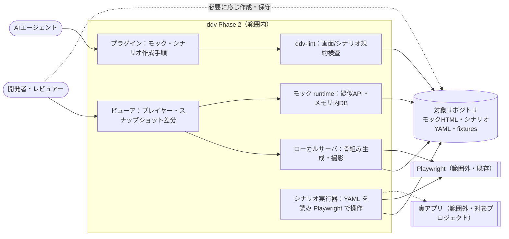
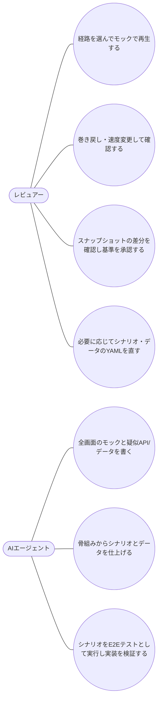

# モック再生・シナリオ（Phase 2）要件定義

## 位置づけ

- ddv 全体の目的は :ref[ddv.md#目的] を参照。本書はその Phase 2（モック runtime・シナリオ・プレイヤー・E2E 実行・スナップショット）の要件
- ddv を使う開発では、次の工程でこの機能と記法を使う

| 利用側の工程 | 使う機能 | 作るもの |
|---|---|---|
| 基本設計 | モック表示、シナリオ骨組みの自動生成、プレイヤー、スナップショット | 全画面のモック、シナリオ（経路ごと） |
| 詳細設計 | モック runtime（疑似 API / DB） | 疑似 API の定義、テストデータ（fixtures） |
| 実装・受入 | シナリオの E2E 実行（データ駆動）、テストタブ | 実アプリへの接続設定・データ投入処理・実アプリとの対応表 |

### 役割分担

| 成果物 | 作成 | 保守 | 人間の関わり |
|---|---|---|---|
| 画面操作スクリプト（モックの補助スクリプト、実アプリへのデータ投入処理、独自の操作の拡張、実アプリの画面・操作要素との対応表） | AI | AI | 書かない |
| 汎用の実行器（シナリオを読み画面を操作する部分） | ddv が提供 | ddv | — |
| シナリオ・テストデータ（YAML） | 骨組みを自動生成し AI が完成させる | AI | **作成・保守する場合がある** |
| モック画面・疑似 API の定義 | AI | AI | レビューのみ |

## 目的

- 基本設計のレビュアーが、静的モックからは分からない **画面の振る舞い（遷移・入力エラー・データ状態）** を、設計の経路どおりに動かして確認できるようにする
- レビューで使った操作手順を、そのまま E2E テストとして実装の検証に使えるようにする（手書きの二重管理をなくす）
- 成功の判定基準：
  - 基本設計の画面遷移図の **全経路（P）をモック上で再生** して確認できる
  - 経路に対応するシナリオが **Playwright テストとしてそのまま実行でき**、テストIDで結果がマトリクスに反映される

## 現状 (As-Is)

## 課題

- A：モックが 1 画面・固定データのため、遷移先やデータの状態（0 件・在庫不足など）を表現できない
- B：振る舞いの確認がレビュアーの想像に依存し、見落としが出る
- C：レビューの操作手順と E2E テストが別管理になり、内容がずれる
- D：画面の見た目や状態の変化を基準と比べる手段がなく、食い違いに実装後まで気付かない

## あるべき姿 (To-Be)

```mermaid id=flow-tobe compare=flow-asis
flowchart LR
  %% req: A REQ-101
  %% req: B REQ-103
  %% req: C REQ-104
  %% req: S REQ-105
  %% req: Q REQ-102
  %% req: Q->B REQ-109
  %% req: A->Q REQ-102
  %% req: Q->B REQ-103 REQ-109
  %% req: B->S REQ-105
  %% req: S->C REQ-104
  %% req: A->B REQ-102
  %% req: B->C REQ-104
  %% req: T REQ-104
  %% req: R REQ-104
  %% req: I->T REQ-104
  %% req: T->R REQ-104
  %% req: I->D REQ-104
  %% req: D->E REQ-104
  %% req: D REQ-104
  %% req: E REQ-104
  A[AIが全画面のモックと疑似API/データを出力] --> Q[経路とモックからシナリオの骨組みを自動生成し<br/>AIまたは人間がテストデータを仕上げる]
  Q --> B[人間がプレイヤーで経路を再生してレビュー]
  B --> S[ステップごとのスナップショットで基準との差分を確認]
  S --> C[シナリオをそのままE2Eテストとして実行可能]
  C --> I[AIが実装]
  I --> T[同じシナリオを実アプリに向けて実行]
  T --> R[人間がddvで結果を確認]
```

## スコープ

- 範囲外：実アプリへのモックの自動変換、実 BE の自動生成、PR へのコメント連携（Phase 3）、ビューア上でのテストデータ編集（入力値・fixtures・期待値）とテスト履歴・フレーキー検出（Phase 4）

## ユースケース

## 要件一覧

| ID | 種別 | 要件 | 優先度 |
|---|---|---|---|
| REQ-101 | 機能 | モック内の API 呼び出しに疑似 BE（ルート定義）とメモリ内 DB で応答し、一覧表示・登録・エラー応答などの振る舞いを再現できる。DB は fixtures から初期化・リセットできる | 高 |
| REQ-102 | 機能 | 操作手順（表示・入力・選択・クリック・期待値）を YAML のシナリオで、テストデータを fixtures で分離して書ける。シナリオの骨組み（テストID・遷移ごとのイベント・操作対象・期待画面）を経路とモックから自動生成し、入力値には入力制約から推定した候補を入れる。図やモックの変更後に再生成しても、編集済みの値・データ・追加の期待値は保持する。経路と手順の対応を検査できる | 高 |
| REQ-103 | 機能 | シナリオをモック上で再生・一時停止・1 ステップ実行・巻き戻し・速度変更できる。マトリクスの行から再生でき、再生中の状態/遷移を図上で強調する | 高 |
| REQ-104 | 機能 | ddv が提供する実行器がシナリオ YAML を読み込み、Playwright で画面を操作して E2E テストとして実行する（データ駆動。シナリオごとのテストコードは書かない）。接続先をモックと実アプリで切り替えられ、テストIDで既存の紐づけ・実行・結果表示につながる | 高 |
| REQ-105 | 機能 | シナリオのステップごとに画面を撮影し、承認済みの基準画像との差分を表示できる。差分を確認して基準を更新（承認）できる。差分の許容閾値を設定できる | 中 |
| REQ-106 | 機能 | 画面遷移図の状態とモックの画面（`data-screen`）の対応、シナリオのテストIDと経路の不一致を `ddv-lint` で検査する（画面の欠けは warning） | 中 |
| REQ-107 | 機能 | プラグインのスキルとテンプレートに、モック・疑似 API/fixtures・シナリオの作成手順とプレイヤーでのレビュー依頼を追加する | 中 |
| REQ-108 | 制約 | モック runtime はモックと同じ静的ファイルとして動き、ddv サーバの API に依存しない（Phase 6 のホスト型でも動かせる） | 中 |
| REQ-109 | 制約 | シナリオ・テストデータの YAML は、人間が AI なしで読み書き・保守できる平易な形式とする（プログラムの式やスクリプトを含めない）。画面操作スクリプトは人間が書かなくてよい | 高 |

## 受入基準

| 要件 | 受入基準 |
|---|---|
| REQ-101 | サンプルのモックで注文一覧が fixtures のデータで表示され、注文を確定すると一覧に 1 件増え、在庫不足の fixtures では確定時にエラーが表示される。リセットで初期データに戻る |
| REQ-102 | サンプルの画面遷移図の全経路（P）のシナリオが自動生成され、候補値のまま再生して期待画面に遷移する。値を編集してから図に遷移を追加して再生成しても、編集した値が残る。手順を経路と違う順に書き換えると検査でエラーになる |
| REQ-103 | マトリクスの経路行から再生すると、モックが手順どおりに動き、図上で現在の状態が強調される。一時停止・1 ステップ・巻き戻し・速度変更が効く |
| REQ-104 | シナリオを置いただけで（テストコードを追加せずに）テストタブから実行でき、モック上で成功し、結果バッジがマトリクスの該当行に反映される |
| REQ-105 | 初回撮影を基準として承認した後、モックの文言を変えて再撮影すると、該当ステップに差分が表示される |
| REQ-106 | モックから「入力確認」画面を消すと `ddv-lint` が warning を出し、戻すと消える |
| REQ-107 | テンプレートが `ddv-lint` を通り、スキルの手順だけでモック・fixtures・シナリオを作成して再生できる |
| REQ-108 | モックを `ddv serve` を使わず静的サーバで開いても、疑似 API とデータで画面が動く |
| REQ-109 | 人間がテキストエディタだけで fixtures の値とシナリオの入力値を変更し、再生・E2E 実行に反映できる |
