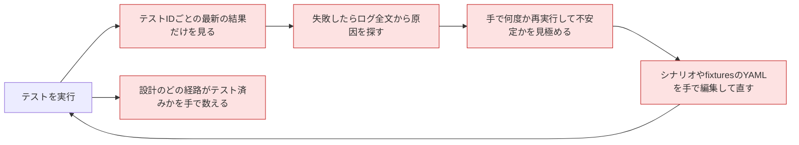
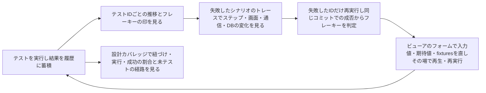
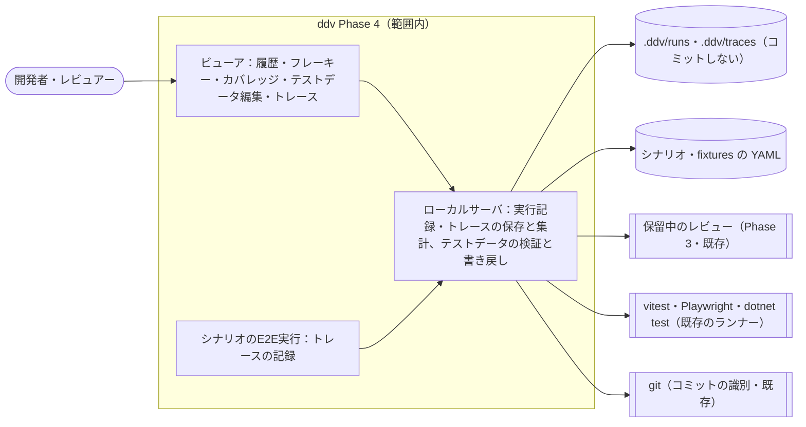
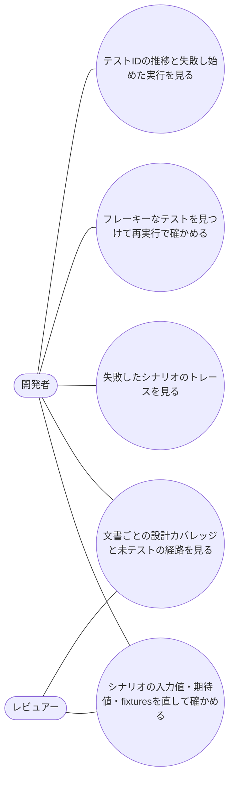

# テスト監視・テストデータ編集・トレース（Phase 4）要件定義

## 位置づけ

- ddv 全体の目的は :ref[ddv.md#目的] を参照。本書はその Phase 4（テスト監視（履歴・フレーキー・カバレッジ）、テストデータ編集、トレースビュー）の要件
- Phase 3 までで、設計から採番したテストIDのテストを実行し、最新の結果をマトリクスに表示できる。実行記録は `.ddv/runs/` に残るが、使っているのは「IDごとの最新結果」だけで、推移・不安定さ・網羅の度合い・失敗の経緯は人がログから読み解いている
- シナリオ（:ref[mock.md#目的]）の入力値・fixtures・期待値は YAML を手で編集するしかなく、設計者・レビュアーが直しにくい

| 利用側の工程 | 使う機能 | 作るもの・残るもの |
|---|---|---|
| 実装（TDD） | 履歴、フレーキー判定、トレース | 失敗原因の特定、不安定なテストの洗い出し |
| 設計のレビュー | 設計カバレッジ、テストデータ編集 | 未テスト経路の把握、シナリオ・fixtures の修正（ファイルまたは PR の suggestion） |
| 受入・リリース判断 | 設計カバレッジ、履歴 | 文書ごとのテスト済み割合と直近の成否 |

### 前提とした判断（レビューで確認したい点）

- 履歴・トレースは対象リポジトリの `.ddv/` にローカル保存し、コミットしない（既存の `.gitignore` のとおり）。チームでの共有・CI 上での集約は Phase 6・7 で扱う
- フレーキーは「同じコミット（未コミットの変更なし）で成功と失敗の両方がある」テストIDと定義する。回数や割合のしきい値は使わない
- カバレッジは設計単位（テストID・経路）とし、コードの行・分岐カバレッジは扱わない
- テストデータ編集の書き戻し先は、手元のワークスペースではファイル、GitHub の PR では保留中のレビューへの suggestion（Phase 3 のモック調整と同じ）

## 目的

- テストが失敗したとき、**ログ全文を読まずに**、いつから・どのステップで・なぜ失敗したかと、不安定なだけかどうかを判断できるようにする
- 設計のどの経路がテストで確かめられているかを、文書・図の単位で数値と図で示す
- 設計者・レビュアーが YAML を直接触らずに、シナリオの入力値・期待値と fixtures を直して、その場で確かめられるようにする
- 成功の判定基準：
  - 失敗したテストIDから、直近の推移・失敗し始めた実行とコミット・失敗したステップのトレースまで、ビューアの操作だけでたどれる
  - 同じコミットで成否が分かれたテストIDが、再実行の結果からフレーキーとして一覧される
  - 文書ごとの「テストID数・紐づけ済み・実行済み・最新が成功」の数と割合が表示され、未テストの経路が図上で分かる
  - シナリオの入力値・期待値・fixtures を変えて保存（または suggestion に追加）し、再生・再実行するまでを、ファイルを開かずに行える

## 現状 (As-Is)

## 課題

- B：最新の結果しか見えず、いつから失敗しているか・前は通っていたかが分からない
- C：シナリオのどのステップで、どんな画面・通信・DB の状態で失敗したかがログからしか読めない
- D：不安定なテスト（フレーキー）を見分ける基準も記録もなく、勘で再実行している
- E：入力値・期待値・fixtures の修正に YAML の書き方の知識が要り、設計者・レビュアーが直せない。PR では修正を文章で指示している
- F：テストIDの数は分かっても、紐づけ済み・実行済み・成功の割合や、未テストの経路が見えない

## あるべき姿 (To-Be)

## スコープ

- 範囲外：コードの行・分岐カバレッジ（各ランナーのカバレッジレポートの取り込み）、CI 上の履歴の集約・共有（Phase 6・7）、シナリオ以外のテスト（vitest・dotnet の単体テスト）のトレース、Playwright 標準の trace.zip の表示、テストコード（.ts・.cs）と疑似 API 定義（api.yaml）の編集、シナリオのステップの追加・削除・並べ替え（scaffold が経路から生成するため）

## ユースケース

## 要件一覧

| ID | 種別 | 要件 | 優先度 |
|---|---|---|---|
| REQ-301 | 機能 | テストの実行ごとに、結果とその時点のコミット（未コミットの変更の有無を含む）を履歴として記録する。テストIDごとに、直近の結果の推移（成功・失敗・スキップ・エラーと所要時間）と、結果が変わった実行・コミットを表示する | 高 |
| REQ-302 | 機能 | 同じコミット（未コミットの変更なし）の実行で成功と失敗の両方があるテストIDを「フレーキー」として印を付け、一覧できる。直近の実行で失敗したテストIDだけを指定回数（既定 2 回）再実行でき、その結果も判定に使う | 高 |
| REQ-303 | 機能 | 文書・図ごとに、テストID数と、そのうち紐づけ済み・実行済み・最新が成功の数と割合（設計カバレッジ）を表示する。未紐づけ・未実行・失敗の経路を、マトリクスと図の上で区別して示す | 中 |
| REQ-304 | 機能 | シナリオのステップの入力値と期待値（画面以外の text・count など）と、fixtures のレコードを、ビューアの表形式のフォームで追加・変更・削除できる。scaffold が経路から生成する項目（event・click・expect.screen）とステップの構成は編集できない | 高 |
| REQ-305 | 機能 | 編集したテストデータは保存前に検証する（シナリオの形式、fixtures のキーの重複、モックに無い要素キー・テーブルの警告）。手元のワークスペースではファイルに書き戻し（YAML のコメント・キー順・書式を保つ）、GitHub の PR では該当行への suggestion として保留中のレビューに追加する | 中 |
| REQ-306 | 機能 | テストデータの編集後、保存（または suggestion に追加）する前でも、編集中の内容でそのシナリオをプレイヤーで再生できる。保存後はそのシナリオの E2E を実行できる | 中 |
| REQ-307 | 機能 | シナリオの E2E 実行ごとに、ステップ単位で操作・表示中の画面・期待の判定結果・モック API の要求と応答・DB の変化・スクリーンショットを記録し、タイムラインで表示する。失敗したテストの結果から該当のトレースと失敗したステップを開ける。プレイヤーの再生中も同じ表示で見られる（保存はしない）。実アプリを対象にした実行では DB の変化は記録しない | 高 |
| REQ-308 | 制約 | 履歴・トレースは対象リポジトリの `.ddv/` に保存し、コミットしない。保持件数を設定でき（既定：実行履歴 200 件、トレース 直近 20 回の実行分）、超えたら古いものから削除する | 中 |
| REQ-309 | 制約 | 既存の実行記録（`.ddv/runs/*.json`）をそのまま読み込める。手元・GitHub のワークスペースのどちらでも同じく動き、Phase 3 までの機能は変わらない | 高 |

## 受入基準

| 要件 | 受入基準 |
|---|---|
| REQ-301 | サンプルで全テストを 3 回実行し、その間にテストを 1 件壊すコミットを入れると、そのテストIDの推移に「成功・成功・失敗」と各実行のコミットが表示され、失敗し始めた実行とコミットが示される |
| REQ-302 | 実行ごとに成否が変わるテストを用意し、同じコミットで失敗後に「失敗したテストを再実行」すると、そのテストIDにフレーキーの印が付き、フレーキーの一覧に出る。コミットを変えて成否が変わっただけのテストIDには印が付かない |
| REQ-303 | サンプルの基本設計を開くと、文書と各図にテストID数・紐づけ済み・実行済み・成功の数と割合が出る。紐づけを 1 件外すと、その経路が図とマトリクスで「未紐づけ」として示され、割合が減る |
| REQ-304 | シナリオを開き、ステップの入力値と期待値（text）を変更し、fixtures に 1 件追加できる。event・click・expect.screen は編集できない |
| REQ-305 | 手元のワークスペースで保存すると YAML の該当箇所だけが変わり、コメントと他の行は変わらない。fixtures のキーを重複させると保存できない。PR のワークスペースでは保存の代わりに保留中のレビューに suggestion が入り、送信後に GitHub で「Commit suggestion」で取り込める |
| REQ-306 | 入力値を変えて保存する前に再生すると、変えた値で入力・判定される。保存後にそのシナリオの E2E を実行でき、結果がマトリクスに反映される |
| REQ-307 | 期待値をわざと誤らせたシナリオを E2E で実行し、マトリクスの失敗結果からトレースを開くと、失敗したステップが選ばれた状態で、その画面のスクリーンショット・期待と実際の値・直前の API の要求と応答・DB の変化が表示される |
| REQ-308 | 保持件数を 3 にして 5 回実行すると、実行履歴とトレースが新しい 3 回分だけになる。`git status` に `.ddv/` 配下のファイルが出ない |
| REQ-309 | Phase 3 時点の `.ddv/runs/` を置いたまま起動すると、過去の実行が履歴に表示される。GitHub の PR のワークスペースでも履歴・カバレッジ・トレース・テストデータ編集（suggestion）が使える |
