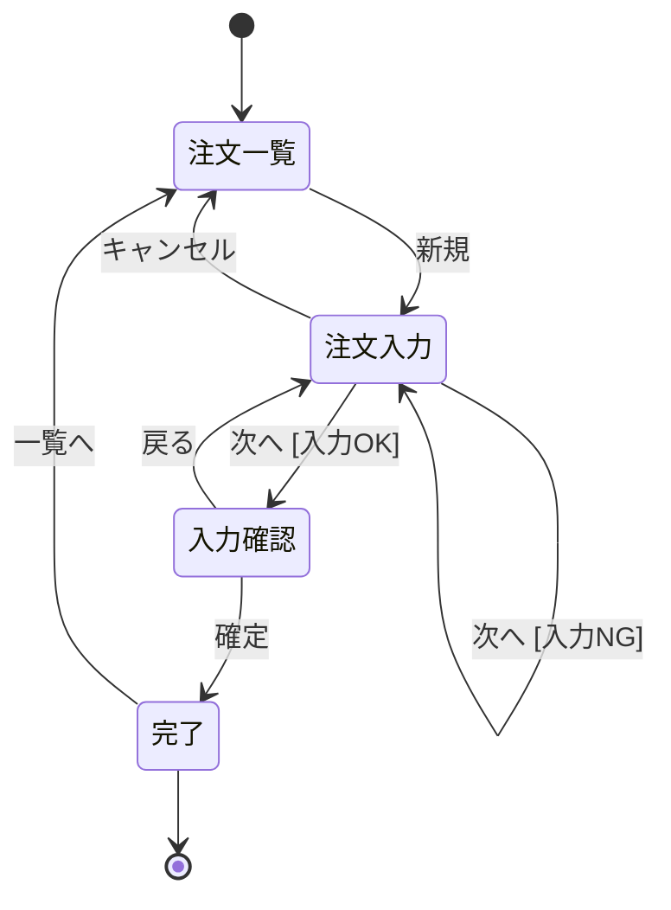
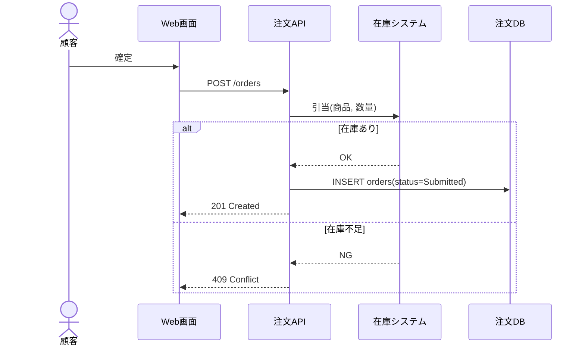
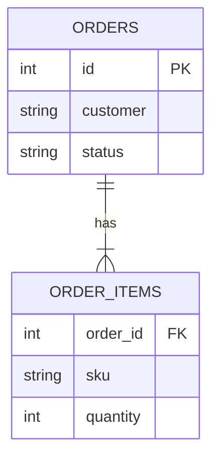

# 注文画面 基本設計

## 前提

目的は :ref[../requirements/order.md#目的] を参照。

::embed[../requirements/order.md#受入基準]

## 画面遷移

## 画面イメージ

::mock[order/index.html]{scenario=order-happy}

## 注文確定の処理

## データ

### 入力チェック

| 項目 | 必須 | 形式 |
|---|---|---|
| 顧客名 | ○ | 1〜50文字 |
| 商品 | ○ | 1件以上 |
| 数量 | ○ | 1〜99 |
