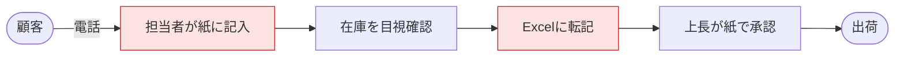
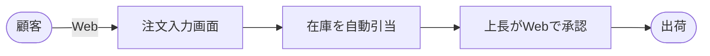
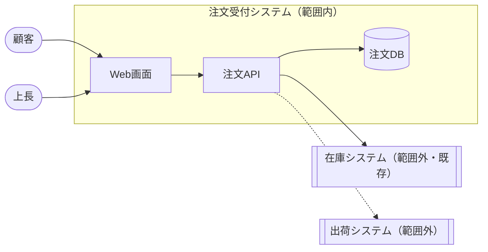
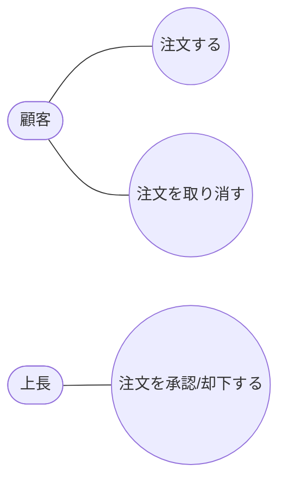

# 注文受付システム 要件定義

## 目的

- 電話と紙で受けている注文を Web 化し、受付から出荷指示までを当日中に終える
- 成功の判定基準：受付から出荷指示までの平均時間 2 日 → 4 時間以内、転記ミス 0 件

## 現状 (As-Is)

## あるべき姿 (To-Be)

## スコープ

## ユースケース

## 要件一覧

| ID | 種別 | 要件 | 優先度 |
|---|---|---|---|
| REQ-001 | 機能 | 顧客が Web で注文を入力・確定できる | 高 |
| REQ-002 | 機能 | 注文確定時に在庫を自動で引き当てる | 高 |
| REQ-003 | 機能 | 上長が Web で注文を承認/却下できる | 高 |
| REQ-004 | 非機能 | 画面操作の応答は 1 秒以内 | 中 |

## 受入基準

| 要件 | 受入基準 |
|---|---|
| REQ-001 | 注文入力 → 確認 → 確定で注文が「申請中」になる |
| REQ-002 | 在庫不足の商品は確定できない |
| REQ-003 | 承認で「承認済」、却下で「却下」になり、却下は修正して再申請できる |
| REQ-004 | 一覧・入力・確認画面の操作が 1 秒以内に応答する |
