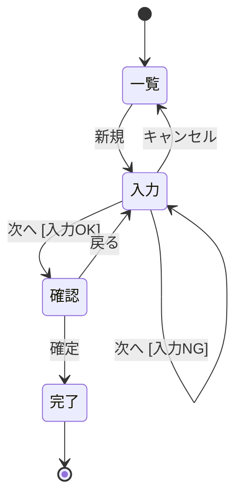
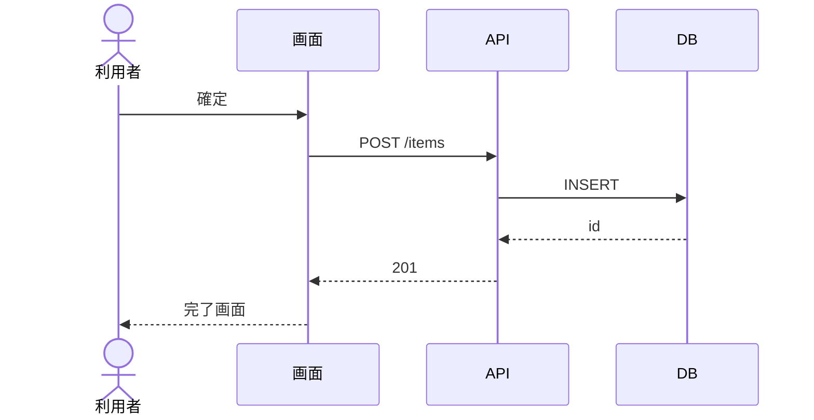
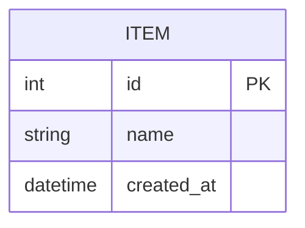

# SAMPLE 基本設計

## 前提

目的は :ref[../requirements/sample.md#目的] を参照。

::embed[../requirements/sample.md#受入基準]

## 画面遷移

<!-- matrix を付けた状態図/フロー図からテストマトリクスとテストIDが生成される。code はテストIDに入る図の略号 -->

## 画面イメージ

<!-- モックは docs/mocks 配下。実プロジェクトの CSS を link して見た目を合わせる -->

::mock[sample/index.html]

## 処理

## データ

